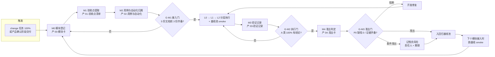

# 测试流程整改与模块化验证执行计划 v1.0

> **上位文档**：`测试计划与验证方案_v1.0.md`（问题诊断与目标形态）
> **本文职责**：把上文的整改建议拆成**可执行、可按模块滚动、可勾选验收**的任务
> **核心约束**：模块是分批交付的（12 个 change 完成度 26%～99% 不等），所以**验证门禁必须按模块独立成立**，不能用"整包发布"的单一门禁
> **编制日期**：2026-11-12｜**适用周期**：6 周（W1～W6）

---

## 0. 一页看懂

| 问题 | 改什么 | 怎么改 | 何时 |
|---|---|---|---|
| 执行率 19.8% | 用例从"全量跑"改为"按模块风险加权跑" | 每模块做 A～E 打标，只跑 A 类 + 抽检 B 类 | W2 起每模块 |
| 门禁空转 | 门禁从"整包一次"改为"每模块一张准出卡" | 21 个模块各产一张卡，发布时汇总 | W3 起 |
| API 层为 0 | 高风险场景下沉到 L1 | 六专项各出 API 用例，挂在模块卡里 | W3 起 |
| 无 CI | 三档流水线 + 统一 runner | PR / Nightly / Release | W1 |
| 文档分散 | 每模块 5 份固定文档 | 模板化，缺一份不过 M1 门 | W2 起 |
| 双栈并行 | webauto 为唯一 L2 | auto-explore 退为 L3 探索 | W4 收口 |

**产物**：21 个模块 × 5 份文档 + 21 张准出卡 + 6 张跨模块专项卡 = 可累积、可审计、可分批复用的验证底座。

**总投入估算**：约 28 人天（底座 5 + 模块 21.5 + 总门禁 2），6 周内 1 人全职可完成，开发侧每模块配合约 2 小时（评审 + 裁定）。

---

## 1. 设计决策：为什么按模块，以及怎么按模块

### 1.1 按版本门禁在当前交付模式下必然失败

12 个 change 的完成度分布：

| change | 完成度 | 对应模块 |
|---|---|---|
| `c01-c02-recovery-followup` | 68/69 (99%) | C01/C02 收尾 |
| `return-fulfillment` | 54/61 (89%) | FEAT-17/18 |
| `formal-reports-and-printing` | 238/294 (81%) | FEAT-13/19 |
| `reception-and-history` | 131/164 (80%) | FEAT-14/15 |
| `historical-customer-order-entry` | 252/316 (80%) | FEAT-10/20 |
| `ui-ja-public-foundation` | 216/270 (80%) | 全局 UI |
| `lifecycle-and-inspection-notices` | 307/413 (74%) | FEAT-12/13 |
| `professional-work-and-disposition` | 152/215 (71%) | FEAT-16 |
| `order-and-actual-fulfillment` | 59/89 (66%) | FEAT-10/11/19 |
| `persist-initial-production-inspection-qualification` | 25/27 (93%) | FEAT-07 |

结论：**任何一个时刻都不存在"全部完成"的版本**。如果门禁只能在整包发布时判定，那么项目在 6 周内根本走不到门禁那一步，等于继续空转。

正确做法：**门禁颗粒度对齐交付颗粒度** —— 模块完成即准出，准出即入回归基线，发布时只是"汇总已有卡片"。

### 1.2 两个关键架构决策

**决策一：门禁分两层，互不替代**

| 层 | 名称 | 判定对象 | 何时判定 | 谁签 |
|---|---|---|---|---|
| 模块门 | M1/M2/M3 | 单个 FEAT 的功能与验收点 | 该模块交付时 | 测试负责人 |
| 专项门 | X1～X6 | 跨模块风险（寄出、一致性、时间、权限、文件、并发） | 相关模块**成组**时 | 测试负责人 + 开发 |

原因：FEAT-11 寄送的"确认寄出"同时改变订单关系、产品归属、履约数量、生命周期基准月——**任何一个单模块卡都无法独立证明它是正确的**。所以跨模块风险必须单独成卡，不能塞进模块卡里假装覆盖了。

**决策二：准出即入基线，后续模块接入必须跑基线冒烟**

模块 A 准出后，它进入"回归基线池"。模块 B 接入时，M2 门的第一个动作是跑**基线池 smoke 集**，确认 B 没有破坏 A。

这一条直接解决"不同时间提交"带来的累积破坏：否则最后集成时会一次性暴露十几个模块的互相踩踏，且无法定位是谁踩的。

### 1.3 四条执行原则

1. **一个模块一张卡，卡随模块走**——不写"本轮测试报告"这种只对某个时间点有效的文档。
2. **文档缺一份就是没接入**——M1 门只审文档完备性，不审质量；质量在 M3 审。
3. **先归档模块，后迭代模块**——已归档模块规格稳定，先做能建立模板和信心。
4. **每个模块只跑它该跑的用例**——A 类 100%、B 类抽检 20%、C 类跟 change、D 类合并走查、E 类归档。

---

## 2. 目标流程：模块化测试流水线

### 2.1 全景图



### 2.2 模块状态机

```
待接入 → 文档就绪 → 验证中 → 待准出 → 已准出 → 回归基线
                        ↑          ↓
                        └── 阻断 ──┘
                                   └→ 条件准出（限期闭环）
```

状态变更必须落到台账（`模块接入台账.md`），且每次变更记录日期与操作人。**不允许"口头说验过了"**。

### 2.3 三道模块门的判定标准

#### G-M1 接入门（文档完备性，30 分钟）

- [ ] `00-模块卡.md` 填完，含入口页面、后端接口、关联表、依赖模块、关联 change 与完成度
- [ ] `01-验收点清单.md` 从 `validation.md` 全部提取，每个 VP 有优先级和风险编号
- [ ] `02-用例与自动化归属.md` 完成 V5 用例映射与 A～E 打标
- [ ] 该模块相关风险编号已从风险文档摘出，P0 风险已标注
- [ ] 验证基线 commit 已记录

> 此门**不判断对错**，只判断"资料是否齐到可以开始验证"。缺一份即退回。

#### G-M2 执行门（执行完备性）

- [ ] A 类用例 100% 有结论（PASS/FAIL/PARTIAL/UNKNOWN，不允许空）
- [ ] 该模块 P0 风险项，每项至少有一条 L1 或 L2 用例覆盖（不能只靠人工点）
- [ ] 基线池 smoke 集全绿（非首模块时）
- [ ] L0 单测全绿且该模块核心 Service 有覆盖
- [ ] 失败用例均有 trace + 截图 + DB 快照

#### G-M3 准出门（质量判定）

- [ ] P0/P1 缺陷 0 遗留；P2 有书面接受（责任人 + 影响范围 + 期限）
- [ ] 验收点覆盖率 ≥ 90%（= 有 PASS 证据的 VP / 总 VP）
- [ ] `【待确认】` 事项已关闭或标注"不影响本模块准出"
- [ ] 未实现功能未记为通过（对照 change 完成度逐项核）
- [ ] 三路证据齐备（UI 断言 / 接口响应 / DB 快照），缺失项已说明原因
- [ ] 准出卡已签字

**三选一结论**：`准出` / `条件准出`（残余风险表必须填满）/ `阻断`（写明阻断原因与回归条件）。

### 2.4 模块交付包：5 份文档

固定放在 `modules/{FEAT-XX}/`，文件名固定，模板见 `templates/`：

| 文件 | 内容 | 谁写 | 何时写 | 对应门 |
|---|---|---|---|---|
| `00-模块卡.md` | 身份、范围、依赖、风险标签、统计 | 测试 | 接入时 | M1 |
| `01-验收点清单.md` | VP 列表 + 优先级 + 风险映射 | 测试 | 接入时 | M1 |
| `02-用例与自动化归属.md` | V5 映射 + A～E 打标 + 自动化落位 + 缺口 | 测试 + 自动化 | 接入时 | M1 |
| `03-验证记录.md` | 执行轮次、结果、证据索引、缺陷 | 测试 | 执行后 | M2 |
| `04-准出卡.md` | 判定、残余风险、签字 | 测试负责人 | 准出时 | M3 |

> 为什么不合并：这 5 份文档的**生命周期不同**。00-02 在验证前写、03 在执行后写、04 在判定时写。合并会导致"验证记录被后改"，破坏审计性。

---

## 3. 分阶段整改计划

### 阶段 A：底座建设（W1，全局一次性，约 5 人天）

> 这一阶段做的是"所有模块共用"的东西，不做它，21 个模块会各做一遍重复劳动。

| ID | 任务 | 具体动作 | 产出 | 验收标准 |
|---|---|---|---|---|
| A1 | 统一 runner | 写 `run-suite.ts`，注册现有脚本，加 tag（`smoke`/`mainflow`/`special:tx|fact|time|perm|file|concurrency`）、并发、重试、汇总 JSON | `auto-explore/run-suite.ts` | `npm run suite -- --tag=smoke` 一条命令出汇总 |
| A2 | 单测纳管 | `pom.xml` 加 `jacoco-maven-plugin`；`ruoyi-ui/package.json` 补 `"test": "node --test tests/"` | 覆盖率报告 + test 脚本 | `mvn test` 与 `npm test` 均一条命令跑通 |
| A3 | CI 三档 | PR（L0+L1 smoke+lint，≤6min）/ Nightly（全量+专项，≤30min）/ Release（全量+门禁报告） | 流水线配置 | PR 上可见测试结果，失败阻断合并 |
| A4 | 数据治理 | 统一 `AUTO-` 前缀；8 组夹具写成 `sql/fixtures/*.sql`；CI 每轮 `mysqldump` 还原 | 夹具 SQL + 还原脚本 | 连跑 3 轮库数据量不增长 |
| A5 | 模块台账 | 建 `模块接入台账.md`，21 行预填 | 台账 | 每个模块有状态、批次、责任人 |
| A6 | 模板落地 | 5 份模板入 `templates/`，配填写说明 | 模板 | 试点模块能直接照着填 |

**阶段 A 风险**：A3 依赖 CI 平台可用性。若暂无平台，降级为"本地 `npm run suite --tag=nightly` + 定时任务 + 报告落盘"，门禁判定不变，只是不自动触发。

### 阶段 B：试点打样（W2，2 个模块，约 2 人天）

**试点选择：FEAT-02 部件资料（8 验收点，最小）+ FEAT-08 产品列表（50 验收点，最大且已有 46 条通过证据）。**

选这一大一小，是为了让模板同时经受"极简"和"极复杂"两种考验。只用小模块试点，模板会在复杂模块上崩掉。

| ID | 任务 | 验收标准 |
|---|---|---|
| B1 | FEAT-02 全流程走一遍（M0→M3） | 5 份文档齐备，准出卡签字；记录填模板时遇到的 5 个问题 |
| B2 | FEAT-08 全流程走一遍 | 同上；重点验证"50 个验收点怎么映射到 A～E 类" |
| B3 | 模板回改 | 根据 B1/B2 的问题修订模板，形成 v1.1 定稿 |
| B4 | 校准工时 | 实测单模块耗时，修正第 4 节的估算 |

**阶段 B 出口条件**：模板定稿 + 2 张准出卡 + 一份"填写踩坑记录"。没有这份记录，后面 19 个模块会重复踩同样的坑。

### 阶段 C：批量接入（W3～W5，19 个模块，约 19.5 人天）

按第 4 节分批表滚动。每批的动作固定：

| 步骤 | 动作 | 时长/模块 |
|---|---|---|
| C1 | 建目录、拷模板、填 00-模块卡 | 0.5 h |
| C2 | 从 `validation.md` 提 VP、标优先级与风险 | 1～3 h |
| C3 | V5 用例映射 + A～E 打标（用 `case-tools` 批量 + 人工校） | 1～3 h |
| C4 | 自动化归属：标已覆盖 / 待补 / 只人工 | 0.5～1 h |
| C5 | 过 G-M1 门（自检 + 交叉复核） | 0.5 h |
| C6 | 执行 A 类 + 基线 smoke，写验证记录 | 2～4 h |
| C7 | 缺陷裁定 + 准出卡（需开发 30 min 参与） | 1 h |

**每批结束时**：更新台账、跑一次全量基线 smoke、把本批新增的自动化用例登记进 suite。**不登记 = 下轮必漏**。

### 阶段 D：总门禁（W6，约 2 人天）

| ID | 任务 | 产出 |
|---|---|---|
| D1 | 汇总 21 张准出卡 + 6 张专项卡 | 汇总表：哪些准出、哪些条件准出、哪些阻断 |
| D2 | 出 `cross-validation.md`（REQ→CODE→TEST 矩阵 + P0～P3 清单） | 交叉验证报告 |
| D3 | 出 `ai-validation-report.md`（放行结论） | 放行报告 |
| D4 | 度量填表（覆盖率、通过率、flake 率、缺陷密度） | 度量台账 |
| D5 | 复盘：哪条流程卡住了、模板还要怎么改 | 复盘记录 |

---

## 4. 模块分批与排期

### 4.1 分批原则（三条，按优先级）

1. **规格稳定度**：已归档 change 的模块优先（规格不会再变，准出结论长期有效）；
2. **change 完成度**：同稳定度下，完成度高的先做（返送 89% > 作业 71%）；
3. **资产丰度**：已有自动化/用例基础多的先做（能快速验证流程本身是否可行）。

### 4.2 21 个模块分批表

| 批次 | 周 | FEAT | 模块 | 验收点 | 关联 change（完成度） | 相对工作量 |
|---|---|---|---|---:|---|---|
| **试点** | W2 | FEAT-02 | 部件资料 | 8 | master-data-and-customer（归档） | 0.5 |
| **试点** | W2 | FEAT-08 | 产品列表 | 50 | product-production-and-traceability（归档） | 1.5 |
| 批 1 | W3 | FEAT-00 | 首页看板 | 11 | home-work-dashboard（归档） | 0.5 |
| 批 1 | W3 | FEAT-01 | 客户管理 | 40 | master-data-and-customer + 类型继承修复（归档） | 1 |
| 批 1 | W3 | FEAT-03 | 基础数据 | 13 | master-data-and-customer（归档） | 0.5 |
| 批 1 | W3 | FEAT-04 | 作业选项 | 20 | master-data-and-customer（归档） | 1 |
| 批 1 | W3 | FEAT-05 | 衣体入库 | 19 | product-production-and-traceability（归档） | 1 |
| 批 1 | W3 | FEAT-06 | 部件组装 | 23 | 同上 + streamline-production-entry（归档） | 1 |
| 批 1 | W3 | FEAT-07 | 质检工作台 | 21 | 同上 + 合格持久化（93%） | 1 |
| 批 1 | W3 | FEAT-09 | 部件追溯 | 14 | product-production-and-traceability（归档） | 0.5 |
| 批 2 | W4 | FEAT-18 | 返送批量打印 | 9 | return-fulfillment（89%） | 0.5 |
| 批 2 | W4 | FEAT-19 | 订单批量打印 | 12 | formal-reports-and-printing（81%） | 0.5 |
| 批 2 | W4 | FEAT-17 | 返送 | 58 | return-fulfillment（89%） | 1.5 |
| 批 2 | W4 | FEAT-13 | 通知管理 | 31 | lifecycle-and-inspection-notices（74%） | 1 |
| 批 3 | W5 | FEAT-11 | 寄送 | 31 | order-and-actual-fulfillment（66%） | 1 |
| 批 3 | W5 | FEAT-12 | 定期管理 | 51 | lifecycle-and-inspection-notices（74%） | 1.5 |
| 批 3 | W5 | FEAT-15 | 受付履历 | 34 | reception-and-history（80%） | 1 |
| 批 3 | W5 | FEAT-20 | 历史补录 | 待核 | historical-customer-order-entry（80%） | 1 |
| 批 4 | W6 | FEAT-10 | 订单管理 | 34 | order-and-actual-fulfillment（66%） | 1 |
| 批 4 | W6 | FEAT-14 | 受付工作台 | 56 | reception-and-history（80%） | 1.5 |
| 批 4 | W6 | FEAT-16 | 作业管理 | 73 | professional-work-and-disposition（71%） | 2.5 |

合计：**21 个模块，约 648 个验收点，21.5 人天。**

> 批 4 的三个模块（订单、受付、作业）合计 163 个验收点，占总量 25%，且 change 完成度最低。**如 W6 时间不足，允许这批顺延到第 7～8 周**，但必须在台账标注"未接入"，不允许默认算通过。

### 4.3 单模块工时校准表

| 验收点数 | 典型模块 | 标准工时 |
|---|---|---:|
| ≤ 15 | 部件资料、基础数据、返送批量打印 | 0.5 人天 |
| 16～40 | 客户、订单、寄送、通知、受付履历 | 1 人天 |
| 41～60 | 产品列表、定期、受付工作台、返送 | 1.5 人天 |
| > 60 | 作业管理 | 2.5 人天 |

试点后（B4）用实测数据修正此表。

---

## 5. 验证门槛定义

### 5.1 模块准出卡的判定矩阵

| 条件组合 | 结论 | 后续动作 |
|---|---|---|
| P0/P1 = 0，覆盖率 ≥ 90%，证据齐 | **准出** | 入基线池 |
| P0 = 0，P1 = 0，覆盖率 80～90%，缺口有说明 | **条件准出** | 入基线池 + 限期补测 |
| P0 = 0，P1 ≤ 2 且有 workaround | **条件准出** | 入基线池 + P1 进下轮必修 |
| P0 > 0 或 覆盖率 < 80% | **阻断** | 修复后重走 M3 |
| 存在未实现功能被计为通过 | **阻断** | 立即纠正统计口径 |

### 5.2 六张跨模块专项卡（X1～X6）

模块卡管"模块内"，专项卡管"模块之间"。专项卡不按 FEAT 归属，按风险归属：

| 卡 | 名称 | 涉及模块 | 触发时机 | 通过标准 |
|---|---|---|---|---|
| X1 | 不可逆动作与事务一致性 | 07/10/11/17/20 | 上述任一模块接入时 | 失败零残留、重放不产生第二套事实、无撤销入口 |
| X2 | 跨模块事实回读一致性 | 10/11/12/17 | 寄送与生命周期同时可用时 | 5 个观察点四元组一致 |
| X3 | 时间与时区 | 全部 | 每次 Release 前 | 四列时间对照一致，日界不偏移 |
| X4 | 权限与数据范围 | 全部 22 个入口 | 页面增删时 | 无权限写接口全部 403，只读不隐含写 |
| X5 | 文件冻结与对外文书 | 11/13/17/18/19 | 文书相关模块接入时 | 生成后改主档内容不变，历史版本不被覆盖 |
| X6 | 并发与幂等 | 01/10/11/14 | 高并发写入模块接入时 | 无重号、事件条数 = 请求数、无静默覆盖 |

### 5.3 发布总门禁 = 卡片汇总

```
发布判定 =
    Σ 已交付模块的准出卡（必须 ≥ 90% 为"准出"或"条件准出"）
  AND Σ 相关专项卡的通过状态（X1/X2/X4 必须全通过）
  AND P0/P1 全局遗留 = 0
  AND 未解释的跨模块差异 = 0
```

**关键约束**：未接入的模块必须在报告里显式列为"未验证"，**不得因为"没人提"而被视为通过**。

### 5.4 例外：条件准出的管理

条件准出不是"放过"，是"带账放行"：

- 必须填残余风险表：风险描述 / 影响范围 / 责任人 / 闭环期限 / 临时缓解措施；
- 每张条件准出卡在台账标黄，**超过期限未闭环自动升级为阻断**；
- 同一模块累计 2 次条件准出，下一轮必须升为"阻断"处理（说明该模块质量不稳定）。

---

## 6. 回归策略：应对分批交付的累积风险

### 6.1 回归基线池

模块准出即入池。池内分三档：

| 档 | 内容 | 何时跑 | 时长目标 |
|---|---|---|---|
| S 冒烟 | 登录 + 6 个核心页面可达 + 关键接口存活 | 每次模块接入前、每次 PR | ≤ 5 min |
| M 模块集 | 已准出模块的 A 类用例 | 每批接入后、Nightly | ≤ 20 min |
| F 全量 | S + M + 专项卡 + 抽检 | Release | ≤ 45 min |

### 6.2 触发规则（change → 受影响模块）

| 变更类型 | 触发范围 |
|---|---|
| 单模块内字段/校验调整 | 该模块 M 集 |
| 跨模块规则（`business-time`、`identity-history-rules`） | 全系统 X3 + 全部 M 集 |
| 共享接口/字典/主档结构变化 | 所有消费模块的 M 集（按模块卡"依赖"字段反查） |
| 纯 UI 文案/布局 | S 冒烟 |

> 前提：每张模块卡的"依赖模块"字段必须填准。这是触发规则能自动化的唯一依据。

### 6.3 分批交付下的回归纪律

1. **每批接入后必跑 M 集**，不允许"攒到最后一起跑"；
2. **发现回归立即定位到最近一批**（最多回看 1 批，不要回看 5 批）；
3. **M 集失败优先于新模块验证**——老模块被破坏比新模块没验完更严重。

---

## 7. 度量与报告

### 7.1 模块级看板（每张模块卡末页固定展示）

| 指标 | 计算 |
|---|---|
| 验收点覆盖率 | 有 PASS 证据的 VP / 总 VP |
| 风险覆盖率 | 已证风险 / 该模块相关风险 |
| 自动化占比 | (L1+L2 覆盖的 A 类) / A 类总数 |
| 缺陷密度 | 缺陷数 / 验收点数 |
| 执行耗时 | 该模块 A 类跑完的实际时长 |
| 结论 | 准出 / 条件准出 / 阻断 |

### 7.2 项目级趋势（周报）

- 已接入模块数 / 21；
- 准出卡分布（准出 / 条件 / 阻断）；
- A 类用例自动化率；
- P0/P1 累计遗留；
- 基线 M 集通过率与 flake 率。

---

## 8. 角色与协作

| 角色 | 在模块流程中的职责 | 每模块时间投入 |
|---|---|---|
| 测试（主） | 填 00～04、执行、判定 | 见 4.3 |
| 自动化 | C4 自动化归属、补 L1/L2、登记 suite | 0.5～2 h |
| 开发 | 确认实现状态、缺陷裁定、修复 | 2 h |
| 产品 | 验收点确认、待确认项裁决 | 0.5 h |
| 运维 | 环境、快照、CI 平台 | W1 集中 2 天 |

**协作卡点（必须留痕）**：
- change 完成度确认 → 开发书面回复，不能凭"应该差不多了"；
- 待确认项裁决 → 产品在模块卡上批注，不接受口头；
- 准出签字 → 测试负责人，条件准出需产品共同签字。

---

## 9. 整改本身的五个风险

| 风险 | 表现 | 对策 |
|---|---|---|
| 文档流于形式 | 5 份文档填满了但没实际价值 | 试点阶段强制记录"填这份文档解决了什么"，无效字段在 v1.1 删掉 |
| 模块卡变成抄写 | 把 validation.md 复制一遍 | 01-验收点必须重新编号并挂风险，抄写无法完成风险映射 |
| 批量接入赶工 | W4/W5 一天做 3 个模块，质量崩塌 | 每批最多 4 个模块；超量顺延，不压缩单模块工时 |
| 开发不配合确认 | change 完成度靠猜 | 把"书面确认"设为 M1 门条件，不确认即不接入 |
| 专项卡被跳过 | 模块卡都绿了，专项没做 | 发布门禁里 X1/X2/X4 为**硬条件**，缺失即阻断 |

---

## 10. 本周就能开始的五个动作

1. **建台账**：`模块接入台账.md` 已建好 21 行，把责任人填上（30 min）。
2. **补两条命令**：`pom.xml` 加 JaCoCo、`package.json` 加 `test` 脚本（1 h）——立刻知道 133 个单测现在是什么状态。
3. **写 runner 骨架**：先只支持 `--tag=smoke` 和汇总 JSON（半天），能跑起来比能跑全更重要。
4. **填 FEAT-02 模块卡**：8 个验收点，2 小时能填完，用来暴露模板问题。
5. **对一次 change 完成度**：找开发确认 `order-and-actual-fulfillment` 真实进度（59/89 是任务数，不等于功能可用度）。

---

## 附录 A：目录规范

```
E:/proptest/
├── 测试计划与验证方案_v1.0.md        # 上位：目标形态
├── 测试流程整改执行计划_v1.0.md      # 本文：怎么做
├── 模块接入台账.md                  # 21 个模块状态
├── templates/
│   ├── README.md                    # 填写顺序与三条纪律
│   ├── 模块卡_模板.md
│   ├── 验收点清单_模板.md
│   ├── 用例与自动化归属_模板.md
│   ├── 验证记录_模板.md
│   └── 准出卡_模板.md
├── modules/
│   ├── FEAT-02-part-profile/        # 试点样板（00/01/02 已填）
│   │   ├── 00-模块卡.md
│   │   ├── 01-验收点清单.md
│   │   ├── 02-用例与自动化归属.md
│   │   ├── 03-验证记录.md           # 执行后生成
│   │   └── 04-准出卡.md             # 判定时生成
│   └── ...
├── specials/
│   ├── README.md                    # 六张卡的定义与触发条件
│   └── X1-...X6-*.md                # 触发时按骨架建，未触发不建空文件
└── spec-workspace/                  # 现有 spec/ai-test/webauto/case 保持不动
```

## 附录 B：与现有资产的复用关系

| 现有资产 | 在新流程中的用途 | 是否需改造 |
|---|---|---|
| `业务功能模块验证清单.md` | 模块接入顺序与状态参考 | 保留，改为指向台账 |
| `docs/spec/docs/features/*/validation.md` | 验收点唯一来源（21 份） | 不动（被测仓库只读） |
| `spec/测试风险评估文档.md` | 风险编号来源 | 不动 |
| V5 工作簿 1,249 条 | 02-用例与自动化归属的输入 | 需补 A～E 分类列 |
| `webauto` 11 条主流程 | L2 主干，M 集基础 | 修 2 处假阳性 |
| `auto-explore` 73 脚本 | A 类证据来源，逐步转 L1 | 需注册进 runner |
| `ruoyi-*` 92 单测 + 41 前端测试 | L0 层，模块卡"自动化现状" | 需 JaCoCo + npm test |
| `tools/feishu-bug` | 缺陷录入 | 不动 |
| `ai-test/prompts/T01～T08` | 静态对账方法 | 保留，作为 01/02 的辅助 |

## 附录 C：整改完成判定（Definition of Done）

6 周后，满足以下全部条件视为整改完成：

- [ ] 21 个模块至少 18 个已接入（3 个可顺延并标注）；
- [ ] 每张模块卡 5 份文档齐备，无空模板；
- [ ] 6 张专项卡全部有判定结论；
- [ ] `cross-validation.md` 与 `ai-validation-report.md` 不再是空文件；
- [ ] CI 三档跑通，PR 有测试结果，Nightly 有报告归档；
- [ ] JaCoCo 与前端 `npm test` 有基线数字；
- [ ] 台账能回答"任意模块现在是什么状态、谁负责、卡在哪"；
- [ ] 下一轮迭代可以**不再改动流程**，只填卡。
