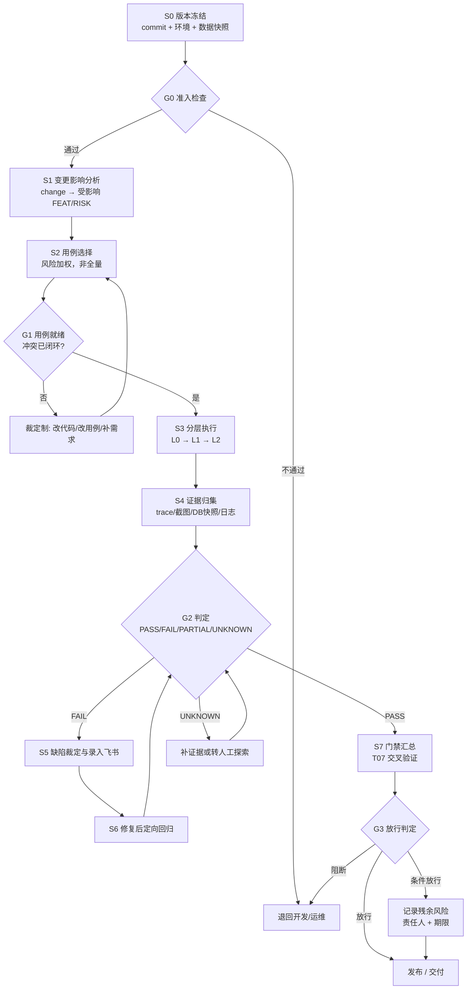

# PROP 系统 软件测试计划与验证方案 v1.0

> **文档定位**：本项目测试工作的**唯一主入口**。现有 `spec/`、`ai-test/`、`webauto/`、`case/` 下的分析文档作为附录与证据保留，不再各自充当"计划"。  
> **被测系统**：`E:\proptest\prop_new`（RuoYi 架构，Java 后端 + Vue3 前端 + MySQL 5.7 + Redis）  
> **代码基线**：`main` @ `3f4b6ad`（编制时）；正式验证前必须**冻结 commit** 并把哈希写入报告  
> **需求基线**：`spec/spec10-28`（20 FEAT / 106 REQ）  
> **编制日期**：2026-11-12  
> **适用阶段**：迭代中的 C03/C04/C05 交付 + 已归档 C01/C02 的回归

---

## 0. 先看结论

你的测试工作已经完成了"方法论建设"阶段，现在卡在**从方法到工程**的转化上。

| 维度     | 现状判断                                                                             |
| ------ | -------------------------------------------------------------------------------- |
| 测试设计能力 | **强**。1,249 条用例、106 条需求基线、三方对账、四档证据分级，这套东西超过多数团队的成熟度                             |
| 风险识别能力 | **强**。42 项风险、26 项高风险、六类专项，识别精度高且落到具体字段和边界                                        |
| 执行能力   | **弱**。1,249 条用例只执行了 247 条（19.8%），995 条未执行                                        |
| 工程化能力  | **弱**。无 CI、无环境编排、无数据重置、无覆盖率、73 个验证脚本无统一入口                                        |
| 门禁能力   | **空转**。`cross-validation.md` 与 `ai-validation-report.md` 为空文件，准入准出有定义但没执行到"放行判定" |
| 资产可见性  | **差**。92 个 Java 单测 + 41 个前端组件测试存在但从未进入任何测试报告                                     |

**一句话**：你不缺测试设计，缺的是**让测试每天自动跑起来并给出放行结论的流水线**。本方案的主线就是把"方法论资产"转成"每天可执行的工程"，而不是再写一份更厚的方案。

---

## 1. 现状诊断

### 1.1 资产盘点（实测，非文档口径）

| 层级          | 资产                       | 位置                                                    |                                 规模 | 是否纳管                           |
| ----------- | ------------------------ | ----------------------------------------------------- | ---------------------------------: | ------------------------------ |
| L0 单元       | JUnit 5 + Mockito        | `prop_new/ruoyi-prop/src/test`、`ruoyi-admin/src/test` |                        **92 个测试类** | ❌ 无 JaCoCo、无流水线、未出现在任何报告       |
| L0' 组件      | node:test                | `prop_new/ruoyi-ui/tests/*.test.mjs`                  |                       **41 个测试文件** | ❌ 未纳管                          |
| L1 API/服务集成 | ——                       | ——                                                    |                              **0** | ⚠️ **完全空白**                    |
| L2 E2E      | pytest + Playwright（POM） | `webauto/webtest`                                     |                 **11 条主流程 + 2 自检** | ⚠️ 手工运行，2026-11-06 快照全绿（2m21s） |
| L2' 场景复验    | tsx + Playwright 脚本      | `auto-explore/scripts`                                | **73 个 `verify-*.ts`**（共 128 个 ts） | ❌ 无 runner、无 tag、逐个手工跑         |
| L3 探索       | 三路探针 + 5 类 Agent         | `auto-explore/src`                                    |                        273 份 Trace | ⚠️ 按需触发                        |
| 手工用例        | V5 工作簿                   | `case/outputs/测试用例汇总/`                                |            **1,249 条 / 2,068 条映射** | ✅ 有状态列，人工回写                    |
| 静态对账        | 文档                       | `ai-test/02～04`                                       |           280 BR / 506 判定 / 49 REQ | ❌ 一次性，无增量机制                    |
| 缺陷          | 飞书多维表格                   | `tools/feishu-bug`                                    |                               16 条 | ✅ 有 CLI                        |

### 1.2 七个结构性缺口

**G1｜测试金字塔倒置，中间层完全缺失**

手工用例 1,249 条、E2E 11 条，而**服务端 API 测试为 0**。这直接解释了执行率只有 19.8%：因为所有验证都堆在最贵、最慢、最不稳定的一层。而你的 26 项高风险 —— 事务一致性（D-01）、幂等重放（D-01）、并发取号（D-08）、权限越权（P-01/P-02）—— **恰恰是 API 层最容易覆盖、UI 层最难覆盖的东西**。用 E2E 验证"事务中途失败要整笔回滚"，成本高且几乎不可能稳定。

**G2｜两套自动化栈并行，职责重叠且口径分裂**

`webauto`（Python/pytest）和 `auto-explore`（TS/tsx）都在驱动同一个系统、同一批页面：

- 测试数据前缀分裂：`AUTO-`（auto-explore）vs `AUTO-WA-`（webauto）；
- 页面对象重复建设：`customer_page.py` 与 `scripts/customer/*.ts` 各写一套；
- 登录、等待、断言策略两套；
- 定位器都重度依赖日文文案和 AntD DOM。

结果是**维护成本翻倍，但覆盖没有翻倍**。

**G3｜没有统一执行入口和回归分级**

73 个 `verify-*.ts` 是"一次性验证脚本"，不是"可回归测试套件"：没有 suite 注册、没有 `@tag`、没有统一汇总、没有失败重试策略。每次回归只能凭记忆挑脚本跑，无法回答"这次能不能放行"。

**G4｜无 CI / 环境编排 / 数据重置**

`prop_new` 中没有 `.github/workflows`、`.gitlab-ci.yml`、`Jenkinsfile`。11 条 E2E 全部标记 `destructive`，跑完就往共享库里塞数据，靠"时间戳唯一"避免冲突。后果是：报告无法对应代码版本（2026-11-06 的 Allure 全绿不能证明今天的代码全绿）、库越跑越脏、并发执行不敢开。

**G5｜质量门禁空转**

`ai-test/04-validation/cross-validation.md` 和 `ai-test/05-report/ai-validation-report.md` 都是**空文件**。风险文档里定义了完整的进入/退出条件，但没有任何机制在"放行"那一刻强制检查它们。当前所有"通过"结论都是局部结论，没有人做过全局放行判定。

**G6｜高危专项没有自动化，只有一次性脚本**

风险文档识别的六类高危（不可逆动作、跨模块事实一致性、日本时间、权限、文件冻结、并发幂等）目前靠一次性脚本各打一枪，**没有一个是可重复的门禁项**。而这几类恰恰是实现最容易漂移、回归最容易漏的地方。

**G7｜用例资产重、治理成本高**

1,249 条用例对应的是 995 条未执行。按当前执行速度，跑完一轮需要数月，而代码每周都在变 —— **用例库正在以快于执行的速度膨胀**。同时 24 条"用例与代码冲突"仍未闭环，意味着这些用例本身可能写错了。

### 1.3 你已完成的三件事的准确定位

| 你的工作                    | 实际是什么          | 应该变成什么                                  |
| ----------------------- | -------------- | --------------------------------------- |
| 测试用例编写（V5 1,249 条）      | 测试**设计资产**     | 风险加权执行的**决策依据**，不是全量执行清单                |
| 自动化测试验证（73 个 verify 脚本） | 一次性**证据生产工具**  | 分层注册的 **L1/L2 回归套件**（保留 25～30 条核心，其余归档） |
| Web 自动化编写（11 条主流程）      | 已成体系的**L2 主干** | 唯一 E2E 栈 + CI nightly + 数据治理            |

---

## 2. 测试计划

### 2.1 质量目标（可度量）

| 编号 | 目标                                               | 当前             |                               目标值 | 达成期限 |
| -- | ------------------------------------------------ | -------------- | --------------------------------: | ---- |
| Q1 | P0 高风险项证据覆盖率                                     | 未统计            |            **100%**（26 项高风险逐项有证据） | W5   |
| Q2 | 主干回归自动化通过率                                       | 11/11（历史快照）    |  **100%**，且 nightly 连续 5 次无 flake | W4   |
| Q3 | 服务端关键规则 API 覆盖                                   | 0              |                 **≥ 80 条**，覆盖六类专项 | W5   |
| Q4 | 核心模块分支覆盖率（lifecycle / notice / order / shipment） | 未测量            |                      **≥ 60%** 起步 | W6   |
| Q5 | P0/P1 缺陷遗留                                       | 未知             |                **0**；P2 必须有书面接受记录 | 每次放行 |
| Q6 | 用例与代码冲突数                                         | 24             |                             **0** | W6   |
| Q7 | 单轮自动化回归时长                                        | 约 25 分钟（仅 E2E） |          **≤ 30 分钟**（L0+L1+L2 全量） | W5   |
| Q8 | 失败结论证据完整率                                        | 部分             | **100%**（失败必带 trace + 截图 + DB 快照） | W4   |

> 不建议设"缺陷检出数"作为目标 —— 它会诱导测试写出不稳定的用例。用**证据覆盖率**和**门禁通过率**衡量更可靠。

### 2.2 范围

**范围内**

- 20 个 FEAT 的功能验证与回归；
- 六类高危专项：不可逆动作、跨模块事实一致性、时间时区、权限、文件冻结、并发幂等；
- 对外文书（面单 / 納品書 / 点检报告 / 案内）的生成、内容、版本、打印参数；
- 已归档 C01/C02 的回归基线；
- 迭代中 C03/C04/C05 的增量验证。

**范围外（明确不做，避免资源错配）**

- 生产环境压测与容量规划（本地库无真实数据规模）；
- 安全渗透（SQL 注入 / XSS / 越权探测建议用 ZAP/Burp 专项，本方案只覆盖业务级权限）；
- 第三方承运商真实对接（ヤマト / 佐川 接口以 mock 与实纸抽检替代）；
- 移动端 App（不存在）；
- 浏览器兼容矩阵（先固定 Chromium，Firefox/WebKit 作为 P2 探索项）。

### 2.3 测试策略：四层模型

```
L0 单元/组件      133 个（92 Java + 41 Node）  →  每次提交，< 2 min
L1 API/服务集成   0 → 80~120 条（新建）        →  每次合并，< 5 min
L2 E2E 主流程     11 条 + 收敛后 25~30 条       →  每日 nightly，< 20 min
L3 探索/一次性复验 73 个脚本（按需）            →  需求变更或专项，不计入门禁
```

**投入分配建议：L0 40% / L1 35% / L2 20% / L3 5%。**

理由：你当前 100% 的精力在 L2/L3，而 bug 密度最高、成本最低的地方在 L1。以"确认寄出"为例：

- L2（UI）只能验证"点了按钮，页面状态变了"，无法验证"中途失败整笔回滚"；
- L1（API）可以用一条 `POST /prop/shipment/confirm` + 注入失败，直接断言 6 张表同成同败；
- L0（单测）可以直接对 `PropShipmentService` 的幂等分支做参数化，秒级反馈。

**每一层的职责边界（防止重复投入）**

| 层  | 负责验证                          | 不负责           |
| -- | ----------------------------- | ------------- |
| L0 | 单方法/单类的分支、边界值、异常抛出、幂等键逻辑      | 跨服务编排、DB 真实约束 |
| L1 | 接口契约、权限校验、事务边界、状态机流转、DB 落库一致性 | 页面交互、渲染、文件样式  |
| L2 | 跨页面业务流程、UI 状态与提示、文件下载/打印链路    | 所有异常分支、并发、性能  |
| L3 | 未知区域探索、UI 细节、一次性冲突复验          | 任何门禁判定        |

### 2.4 风险驱动的排期

42 项风险 → 收敛为 6 个专项（详见 §4.3），按"不可逆性 × 跨模块扩散 × 发现成本"排序：

| 序 | 专项             | 风险编号                     | 为什么排这个位置                          |
| - | -------------- | ------------------------ | --------------------------------- |
| 1 | V1 不可逆动作与事务一致性 | B-01/B-07/B-13、D-01、D-10 | 错了无法用普通业务操作恢复，且一次污染扩散到案内/受付/返送全链  |
| 2 | V2 跨模块事实回读一致性  | B-01/B-02/B-08、D-02/D-07 | 派生数据不同步会静默产生"看起来正常但数字错"的数据        |
| 3 | V5 文件冻结与对外文书   | C-02、D-03/D-06、B-13      | 对外文件错误 = 客户可见事故，且不可撤回             |
| 4 | V3 时间与时区       | D-04、C-01、R-01           | 系统性偏差，跨日/跨月/跨年必错，且极难在 UI 上发现      |
| 5 | V4 权限与数据范围     | P-01/P-02                | 页面隐藏 ≠ 服务端受控，当前全部用 admin 验证，等于没验证 |
| 6 | V6 并发与幂等       | D-01/D-08                | 上线后真实并发才会暴露，代价最高                  |

### 2.5 环境与数据

**环境拓扑（建议固定三套，不混用）**

| 环境      | 用途      | 数据          | 启动方式                                      |
| ------- | ------- | ----------- | ----------------------------------------- |
| `local` | 开发自测    | 任意          | `docker compose -f compose.local.yaml up` |
| `ci`    | 流水线执行   | **每轮从快照重置** | CI 内起 MySQL + Redis + 后端 + 前端（8090/8080）  |
| `stg`   | 验收与实纸打印 | 准生产数据（脱敏）   | 独立部署，仅测试负责人可写                             |

**数据治理三条硬规则**

1. **统一前缀**：全部自动化数据用 `AUTO-` 前缀（废弃 `AUTO-WA-` 双前缀），编号规则 `AUTO-{模块}-{yyyymmddHHmmss}-{4位随机}`。
2. **快照重置**：CI 与 stg 在每轮测试前 `mysqldump` 还原基线库；跑完按前缀清理并生成清理报告（已有 `auto-explore/scripts/cleanup/` 可复用）。
3. **最小数据包**：按风险文档 §6.2 建立 8 组固定夹具（基准月四边界、分批/超发/取消/解除订单、多类型受付大番号、四种最终去向、同日多案内、历史租赁三类、面单长文本、跨页多产品）。**夹具由 SQL 脚本维护，不由 UI 造数**——UI 造数慢且不稳定。

### 2.6 角色与职责（RACI）

| 活动                | 测试负责人   | 自动化工程师 | 开发    | 产品    | 运维    |
| ----------------- | ------- | ------ | ----- | ----- | ----- |
| 风险分级与范围确认         | **A**   | C      | C     | **R** | I     |
| 用例设计与维护           | **A/R** | C      | C     | C     | —     |
| 自动化实现（L0/L1/L2）   | A       | **R**  | C     | —     | —     |
| 环境与数据             | A       | C      | I     | —     | **R** |
| 缺陷裁定（改代码/改用例/补需求） | **A**   | I      | **R** | **R** | —     |
| 放行判定              | **A/R** | C      | C     | C     | I     |

> 关键：**放行判定必须由测试负责人签字**，不能由自动化结果自动放行。当前"人工审核闸门"的设计是对的，要继续保持，但要把它写进流程卡点（§3.3）。

### 2.7 里程碑（6 周滚动，按 change 节奏）

| 周  | 主题                | 交付物                                                      | 验收标准                                           |
| -- | ----------------- | -------------------------------------------------------- | ---------------------------------------------- |
| W1 | 统一入口与门禁骨架         | `run-suite.ts`（统一 runner + tag）、CI 三档流水线、JaCoCo 接入       | `npm run suite -- --tag=smoke` 可一键跑通并产出汇总 JSON |
| W2 | L1 API 层起步 + 单测纳管 | 30 条 API 测试（六专项各 5 条）、单测进入 PR 门禁                         | PR 触发 L0+L1，< 6 分钟出结果                          |
| W3 | V1/V2 专项自动化       | 事务回滚、跨模块回读断言集                                            | 每个专项 ≥ 5 个场景，注入失败可复现                           |
| W4 | V3/V4/V5 专项       | 时区矩阵、权限矩阵、文件冻结断言                                         | 无权限接口全部拒绝（含直连 URL）                             |
| W5 | 首轮全量回归 + 门禁报告     | `cross-validation.md`、`ai-validation-report.md`、P0～P3 清单 | 26 项高风险逐项有证据；放行结论明确                            |
| W6 | 复盘 + 扩面           | 度量表填实测值、C04/C05 纳入                                       | Q1～Q8 达成情况公开                                   |

### 2.8 准入 / 准出（Gate，可执行判定）

**准入（进入一轮测试前必须全部为真）**

- [ ] 被测 commit 已冻结并记录哈希，构建产物可追溯到该 commit；
- [ ] `prop_new` 编译通过，`mvn test` 与 `npm run test` 全绿；
- [ ] 数据库为基线快照状态，8 组夹具齐备；
- [ ] 测试账号齐备：admin / 只读 / 单页面权限 / 无权限（4 类）；
- [ ] 时区环境固定 `Asia/Tokyo`，且可切换对照；
- [ ] 目标 change 的实现状态已确认（未实现项单列，不得进入"待验证"）。

**准出（放行判定，缺一项即阻断）**

- [ ] 26 项高风险：每项状态为 `通过` 或 `已接受残余风险（有责任人 + 影响范围 + 决策记录）`；
- [ ] 不可逆动作（确认寄出、质检通过、回收、报废、返送、删除）均有前后状态 + 跨模块回读证据；
- [ ] 页面 / 接口 / 数据库 / 文件 / 看板之间**不存在未解释的数量、日期、身份、状态差异**；
- [ ] P0/P1 缺陷 0 遗留；P2 有书面接受；
- [ ] L0/L1/L2 自动化全绿，flake 已定性（修复或标记隔离并说明）；
- [ ] `【待确认】` 事项已关闭，或已明确"不影响本次发布"并记录条件验收；
- [ ] 未实现功能未被误记为通过；实纸打印未验收时，不得宣称打印通过。

### 2.9 交付物

| 交付物      | 路径                                                | 频率    |
| -------- | ------------------------------------------------- | ----- |
| 测试计划（本文） | `测试计划与验证方案_v1.0.md`                               | 版本级更新 |
| 自动化汇总报告  | `auto-explore/reports/summary-{date}.json` + HTML | 每轮    |
| 三层执行结果   | `reports/l0`、`reports/l1`、`reports/l2`            | 每轮    |
| 缺陷台账     | 飞书"测试问题跟踪"                                        | 实时    |
| 交叉验证报告   | `ai-test/04-validation/cross-validation.md`       | 每次放行  |
| 放行报告     | `ai-test/05-report/ai-validation-report.md`       | 每次放行  |
| 覆盖率报告    | `target/site/jacoco/index.html`                   | 每次 PR |
| 度量台账     | `ai-test/05-report/测试对比分析表.xlsx`                  | 每月    |


---

## 3. 测试流程（可执行版）

### 3.1 主流程与八道门



八道门的判定执行人必须明确，不允许"自动通过"：

| 门  | 名称   | 判定人     | 自动/人工  | 失败动作       |
| -- | ---- | ------- | ------ | ---------- |
| G0 | 准入   | 自动化工程师  | 自动（脚本） | 阻断，通知开发    |
| G1 | 用例就绪 | 测试负责人   | 人工     | 进入裁定制      |
| G2 | 结果判定 | 测试负责人   | 人工复核   | 录入缺陷 / 补证据 |
| G3 | 放行   | 测试负责人签字 | 人工     | 阻断或条件放行    |

### 3.2 日常迭代流程（每个 change 必走）

1. **变更登记**：从 `openspec/` 的 change 读取任务完成度（如 `order-and-actual-fulfillment` 27/48），映射到受影响 FEAT 与风险编号。
2. **影响分析**：产出"本次变更 → 受影响页面 / 接口 / 表 / 风险项"一页纸（可用 T01 提示词）。
3. **用例选择**：按 §4.4 规则挑选，而不是"跑全部"。
4. **分层执行**：L0/L1 本地跑，L2 nightly 跑，L3 按需。
5. **结果回写**：只有 `PASS` 才回写 V5；`FAIL/PARTIAL/UNKNOWN` 保留"未执行"，以报告跟踪。
6. **变更收口**：把本次新增/修改的自动化用例登记到套件清单，否则下次回归会漏。

### 3.3 发布流程（RC → 回归 → 放行）

| 阶段      | 动作                                                  | 时长       | 产物        |
| ------- | --------------------------------------------------- | -------- | --------- |
| RC 冻结   | 打 tag，冻结 commit，库快照                                 | 10 min   | 基线记录      |
| 自动化全量   | L0 + L1 + L2（含 V1～V6 专项）                            | ≤ 30 min | 三层报告      |
| 人工抽检    | 按 §4.4 抽检清单（P0 场景 + 抽检 20%）                         | 0.5～1 天  | 抽检记录      |
| 实纸/文件验收 | 面单、納品書、点检报告打印 2 家承运商样张                              | 0.5 天    | 样张 + 参数截图 |
| 门禁汇总    | 填 `cross-validation.md` + `ai-validation-report.md` | 2 h      | 放行结论      |
| 签字放行    | 测试负责人 + 产品确认                                        | 30 min   | 放行单       |

### 3.4 缺陷流程


**分级标准**

| 级别 | 判定                            | 示例                        | SLA         |
| -- | ----------------------------- | ------------------------- | ----------- |
| P0 | 不可逆事实错误 / 跨对象串用 / 权限越权 / 数据丢失 | 寄出未冻结基准月、质检可撤回、无权限账号能调写接口 | 4 小时响应，阻断发布 |
| P1 | 主链功能不可用或结果错误，但有 workaround    | 运单生成后承运商不正确、剩余可发算错        | 1 工作日       |
| P2 | 分支功能错误 / 局部数据偏差 / 文件局部不一致     | 分页后搜索条件丢失、长客户名截断          | 3 工作日       |
| P3 | 显示、文案、排序、易用性                  | 日文文案不一致、空态缺失              | 下个迭代        |

**状态机**：`新增 → 修复中 → 待验收 → 验收通过 → 待上线 → 已上线`；另有 `不予修复`（须写理由 + 责任人）、`重复`、`非缺陷`。

**录入规则（保持现有闸门）**：脚本结论 **不得** 直接生成缺陷单，必须经人工复核。这点你已做对，写进流程即可。

### 3.5 变更流程（Spec 变更如何触发回归）

- Spec 任一 FEAT 修订 → 必须更新该 FEAT 的 `validation.md` → 触发该 FEAT 的**全量回归集**（L1 + L2 对应用例）；
- 跨 FEAT 的规则变更（如 `business-time`、`identity-history-rules`）→ 触发**全系统时间/编号专项**，不是单模块回归；
- `spec10-28-vs-spec9-29-变更分析.md` 已有变更对照，应固化为"变更影响矩阵"模板，每次 Spec 升级照此填。

---

## 4. 验证方案

### 4.1 验证总原则

1. **证据分级**：`PASS / FAIL / PARTIAL / UNKNOWN` 四档，证据不足一律 `UNKNOWN`，不允许推测。
2. **三路探针**：任何结论必须同时具备 —— 页面态（UI/无障碍树）、网络态（接口状态码 + 响应摘要）、数据态（MySQL 前后快照）。缺一路只能算 `PARTIAL`。
3. **静态与运行时分离**：静态对账负责"提前发现缺口"，运行时负责"实际确认"，不得互相替代。
4. **不美化**：脚本跑过 ≠ 用例通过。脚本判定与用例原文不一致时必须人工复核（已发生过 3 次纠正，制度要保留）。

### 4.2 分层验证矩阵

| 层  | 验证对象                             | 方法                                  | 关键证据                   | 判定标准                 |
| -- | -------------------------------- | ----------------------------------- | ---------------------- | -------------------- |
| L0 | Service 分支、Mapper 契约、PDF 渲染、时间计算 | JUnit5 + Mockito；时间用固定 Clock        | 测试报告 + 覆盖率             | 全绿且分支覆盖达标            |
| L1 | 接口契约、权限、事务、状态机、幂等                | Playwright APIRequest / REST Client | 请求响应 + DB 前后快照         | 状态码 + 落库 + 幂等键三者一致   |
| L2 | 跨页面主流程、UI 状态、文件下载                | pytest + Playwright（POM）            | trace + 截图 + 录屏 + 下载文件 | 步骤全通过 + 关键断言 + 文件可解析 |
| L3 | 未知区域、边界探索                        | Agent 探索 + 三路探针                     | trace + 探索日志           | 人工复核后转成 L1/L2 用例     |

### 4.3 六个专项验证方案

#### V1 不可逆动作与事务一致性

> 风险：B-01、B-07、B-13、D-01、D-03、D-10｜**P0**

| 项    | 内容                                                                                                            |
| ---- | ------------------------------------------------------------------------------------------------------------- |
| 目标   | 确认寄出、质检通过、回收、报废、返送、历史补录、删除 —— 七个不可逆动作"要么全成，要么全不成"，且成功后无撤销入口                                                   |
| 场景   | ① 正常路径逐动作取证；② 事务中途注入异常（mock Mapper 抛错）验证零残留；③ 成功请求重放验证不产生第二套事实、不刷新事件时刻、不重复取号；④ 双端并发提交；⑤ 成功后查找撤销/删除入口（前后端均须拒绝） |
| 数据   | 最小闭环一套 + 每组场景独立快照                                                                                             |
| 证据   | 动作前后 6 张核心表的全字段 diff + 接口响应 + 事件时刻                                                                            |
| 通过标准 | 失败场景所有关联表零残留；重放返回原结果；无撤销入口；已寄出记录前后端删除均 400/403                                                                |

#### V2 跨模块事实回读一致性

> 风险：B-01、B-02、B-08、D-02、D-07｜**P0**

| 项    | 内容                                                    |
| ---- | ----------------------------------------------------- |
| 目标   | 同一业务事实在 5 个观察点（订单详情 / 产品详情 / 看板 / 数据库 / 导出文件）数值一致     |
| 场景   | 首次寄出、分批寄出、超发阻断、取消、解除并保留基准月、解除并清空基准月、回收后再出货、返送后报废      |
| 断言   | 有效交付 / 历史累计 / 剩余可发 / 基准月 四元组在每个观察点相同；剩余值不为负；累计不因解除而减少 |
| 证据   | 一个场景 = 5 份快照 + 1 张对照表                                 |
| 通过标准 | 5 点四元组完全一致；任一不一致即为 P0                                 |

#### V3 时间与时区

> 风险：D-04、C-01、R-01｜**P0**

| 项    | 内容                                                                                                                                     |
| ---- | -------------------------------------------------------------------------------------------------------------------------------------- |
| 目标   | 日本业务时间口径全链路一致（存储 / 接口 `+09:00` / 页面 / 筛选 / 导出 / 调度 / 编号）                                                                               |
| 场景   | ① `TZ=Asia/Tokyo` 与 `TZ=UTC`、`TZ=Asia/Shanghai` 三组对照；② 23:59:59 与 00:00:01 跨日写入；③ 月末/年末跨月跨年出货；④ 日期区间筛选含末日；⑤ Quartz 夜间任务触发时点；⑥ 年度编号首次取号 |
| 证据   | 同一操作的 DB 存储值 + 接口返回值 + 页面显示值 + 导出文件值，四列对照                                                                                              |
| 通过标准 | 四列在同一业务日期上完全一致；跨日不偏移；年度编号按日本年切换                                                                                                        |

#### V4 权限与数据范围

> 风险：P-01、P-02、P-04、C-03｜**P0**

| 项    | 内容                                                     |
| ---- | ------------------------------------------------------ |
| 目标   | 页面级授权在**服务端**生效，共享读权限不隐含写权限                            |
| 账号矩阵 | admin / 只读 / 单页面维护 / 无权限（4 类 × 22 个页面入口）               |
| 场景   | 菜单可见性 → 直达 URL → 刷新 → 直接调接口 → 改 HTTP 方法 → 调用共享查询接口     |
| 证据   | 每个写接口一次"无权限调用"的完整请求响应 + 后端拒绝日志                         |
| 通过标准 | 无权限账号对全部写接口返回 401/403；只读账号对维护接口全部拒绝；菜单隐藏与接口拒绝一致（不能只隐藏） |

> 这是当前**最薄弱**的一环：所有现有 E2E 都使用 admin，等于 P-01/P-02 完全未验证。

#### V5 文件冻结与对外文书

> 风险：C-02、D-03、D-06、B-13｜**P0**

| 项    | 内容                                                                                                                |
| ---- | ----------------------------------------------------------------------------------------------------------------- |
| 目标   | 文书生成即冻结；重看/重下内容不变；模板升级不污染历史                                                                                       |
| 场景   | ① 生成后修改客户名/地址/产品名/固件/字典 → 重看版本；② 模板升级后重下历史版本；③ 删除准备记录 → 级联删除清单与文件；④ 正式寄出后删除 → 拒绝；⑤ 份数 2 是否产生对应张数；⑥ 长名称 / 多产品 / 跨页 |
| 证据   | 文件本体（PDF/XLSX 解析后的字段表）+ 版本号 + 模板摘要 + 下载事件                                                                         |
| 通过标准 | 字段与快照逐项一致；历史版本内容不变；删除已生成文件后不可再下载；XLSX 可被 `openpyxl` 解析且行数/份数正确                                                    |

> 顺带修掉 `webauto` 的两个假阳性：承运商断言与"伪 Download"（见 §8 P0-4）。

#### V6 并发与幂等

> 风险：D-01、D-08、B-07｜**P1**

| 项    | 内容                                                        |
| ---- | --------------------------------------------------------- |
| 目标   | 并发提交不产生重号、重复事实、覆盖丢失                                       |
| 场景   | ① 并发创建订单/寄送/受付番号（10 并发）；② 同一单据双开编辑先后保存；③ 提交中断后重试；④ 双击确认按钮 |
| 证据   | 并发结束后 DB 唯一性查询 + 事件条数 + 序号连续性                             |
| 通过标准 | 无重号（唯一约束生效）；事件条数 = 请求数；后保存不静默覆盖先保存（要么报冲突，要么有版本号校验）        |

> 已知问题：客户并发编辑、部件资料并发编辑存在"后保存静默覆盖"，需在 V6 中给出结论（修 or 接受）。

### 4.4 用例执行策略（1,249 条不全跑）

这是把执行率从 19.8% 拉起来的关键。**规则：按风险加权分层，而不是按工作表顺序跑。**

| 分层  | 范围                                   |       数量估算 | 执行方式              | 频率       |
| --- | ------------------------------------ | ---------: | ----------------- | -------- |
| A 类 | 全部 P0 高风险场景（六专项核心）                   |     ~120 条 | **100% 执行**，优先自动化 | 每轮       |
| B 类 | C01/C02 已归档模块的主流程用例                  |     ~300 条 | 自动化覆盖 + 人工抽检 20%  | 每版本      |
| C 类 | C03/C04/C05 迭代中模块，仅"本 change 涉及"的验收点 | 按 change 定 | 跟随 change 验收      | 每 change |
| D 类 | 显示/文案/排序类                            |     ~400 条 | 合并为模块级检查单，人工走查    | 季度       |
| E 类 | 重复、过期、代码不支持的用例                       |     ~200 条 | **归档或作废**，不计入分母   | 一次性      |

**动作**：W1 内完成 1,249 条的 A/B/C/D/E 打标（可用现有 `case-tools` 脚本批量处理），把"待执行 995 条"变成"待执行 A 类 120 条 + B 类抽检 60 条"。分母从 1,249 降到 ~180 后，执行率才有意义。

### 4.5 单条结论的完成定义（DoD）

一条用例可标记为 `PASS`，必须同时满足：

1. 在**冻结的 commit** 上执行；
2. 有**执行时间、执行人、环境地址、库名**；
3. 有**三路证据**（UI 断言 + 接口响应 + DB 快照）或说明为何某路不适用；
4. 断言来自用例原文，不是脚本自行放宽的断言；
5. 与对应 `REQ` / `BR` 编号可追溯。

缺任一项 → 只能标 `PARTIAL`。

---

## 5. 自动化工程方案

### 5.1 目标形态

```
prop_new (只读)
   │
   ├─ L0: mvn test + npm run test          → JaCoCo / 覆盖率
   │
   ├─ L1: auto-explore/api/*.spec.ts       → 新建，Playwright APIRequest
   │      （按专项分目录：tx/ perm/ time/ file/ concurrency/ fact/）
   │
   ├─ L2: webauto/webtest (pytest)         → 唯一 E2E 栈，11 → 25 条
   │
   └─ L3: auto-explore/agents              → 保留，退为探索工具
          │
          └─ run-suite.ts  统一入口（tag + 并发 + 汇总 JSON + 失败重试）
                 │
                 └─ CI: PR / nightly / release 三档
```

### 5.2 资产归位（解决 G2 双栈问题）

| 现有资产                                     | 去向                                                         | 理由                                      |
| ---------------------------------------- | ---------------------------------------------------------- | --------------------------------------- |
| `webauto/webtest`（11 条 POM 主流程）          | **保留为唯一 L2 栈**                                             | POM 分层清晰、fixture 完善、Allure 报告成熟，是最规范的一套 |
| `auto-explore/scripts/verify-*.ts`（73 个） | **拆解**：核心 25～30 个改成 L1 API 或并入 L2；其余归档到 `scripts/archive/` | 多数是"一次性取证脚本"，不适合做回归                     |
| `auto-explore/src`（Agent + 探针）           | **保留为 L3 工具**                                              | 探索能力有价值，但不应承担门禁                         |
| `auto-explore/scripts/case-tools/*.py`   | 保留为**用例治理工具**                                              | 回写 V5、统计，职责清晰                           |
| `AUTO-WA-` 前缀                            | **废弃，统一 `AUTO-`**                                          | 两套前缀会让清理脚本互相漏掉                          |

> 不建议"两套并存各管一半"——那会让每次回归都要回答"这个场景到底归谁"，是长期的认知成本。

### 5.3 统一执行入口（W1 必须交付）

`run-suite.ts` 需要提供的能力：

|   |   |   |   |   |
| - | - | - | - | - |

- `--tag=smoke|mainflow|special:tx|special:perm|...` 按标签选择；  
  |  |  |  |  |  
  | --- | --- | --- | --- |
- `--layer=l0|l1|l2|all` 按层选择；
- 并发执行（`--workers=4`），但 `destructive` 场景串行；
- 失败自动重试 1 次并**标记 retry**（flake 可统计）；
- 每次运行产出 `summary-{timestamp}.json`：总数 / 通过 / 失败 / 跳过 / 耗时 / flake 列表 / 失败用例对应 REQ 编号；
- 失败自动归集：trace + 截图 + DB 快照到 `reports/{runId}/{caseId}/`。

**这是一切的前提**：没有统一 runner，"门禁"只能靠人记。

### 5.4 数据治理

- 统一 `AUTO-` 前缀与编号规则（见 §2.5）；
- **夹具 SQL 化**：8 组最小数据包写成 `sql/fixtures/*.sql`，CI 每次导入；
- **快照回滚**：CI 每轮 `mysqldump` 还原，不做逐条清理；
- **清理兜底**：保留 `cleanup-auto-data.ts`，用于 stg 环境的按前缀清理，跑完输出清理清单。

### 5.5 稳定性治理（flake 是最大的隐性成本）

| 问题        | 现状                                     | 处理                                                                           |
| --------- | -------------------------------------- | ---------------------------------------------------------------------------- |
| 定位器依赖日文文案 | `追加しました。`、`.ant-table-row`、`td:nth(4)` | 优先 `data-testid` → ARIA role/name → 业务稳定标识；日文文案集中到 `constants/ja.ts`，改文案只改一处 |
| 固定 sleep  | `time.sleep(3)`、`waitForTimeout`       | 全部替换为显式等待（接口响应 / 元素状态 / 提示出现）                                                |
| 伪下载       | `_FakeDownload` 读 response body        | 用 `page.expect_download()` 或解析 XLSX 校验表头/行数                                  |
| 断言与注释冲突   | 运单承运商三处口径不一致                           | 由产品裁定后统一 Spec / 后端 / 断言                                                      |
| 共享环境干扰    | 数据全部保留                                 | 快照回滚 + 独立 CI 库                                                               |

**flake 处理规则**：同一用例连续 3 次中失败 ≥ 2 次即判定为 flake，**当轮不得标记通过**，必须修复或明确隔离（`@pytest.mark.skip(reason=...)` + 缺陷单），并计入月度 flake 率（目标 < 3%）。

### 5.6 CI 三档流水线

| 档       | 触发       | 内容                                       |       时长 | 阻断条件           |
| ------- | -------- | ---------------------------------------- | -------: | -------------- |
| PR      | 每次 PR    | L0 + L1 smoke + lint + typecheck + 覆盖率   |  ≤ 6 min | 任一层失败即阻断合并     |
| Nightly | 每日 02:00 | L0 + L1 全量 + L2 主流程 + V1～V6 专项           | ≤ 30 min | 失败自动建缺陷草稿 + 通知 |
| Release | 打 tag    | 全量 + 覆盖率报告 + 生成 `cross-validation.md` 初稿 | ≤ 45 min | P0/P1 未闭环则阻断   |

### 5.7 报表

- **Allure**（已有）：单次运行的用例级明细；
- **汇总 JSON → HTML**：趋势（通过率、时长、flake 率、覆盖率）按周聚合；
- **门禁报告**：由 `run-suite.ts` 输出直接填充 `cross-validation.md` 的三张表（REQ→CODE→TEST 矩阵、P0～P3 清单、放行建议），人工只做裁定，不做誊抄。

---

## 6. 度量体系

| 指标       | 定义                        | 采集           | 目标                | 现状             |
| -------- | ------------------------- | ------------ | ----------------- | -------------- |
| 需求覆盖率    | 有 ≥1 条 PASS 用例的 REQ / 106 | V5 回写        | ≥ 90%             | 33/49 已判定（部分）  |
| 高风险证据覆盖率 | 有完整证据的 P0 风险 / 26         | 门禁报告         | 100%              | 未统计            |
| 自动化通过率   | L0+L1+L2 通过 / 总数          | summary.json | ≥ 98%             | 13/13（历史快照）    |
| Flake 率  | flake 用例 / 执行用例           | summary.json | < 3%              | 未统计            |
| 缺陷逃逸率    | 上线后 P0/P1 / 总缺陷           | 飞书 + 线上      | < 5%              | 无数据            |
| 缺陷密度     | 缺陷数 / FEAT                | 飞书           | 基线建立中             | 16 条 / 5 模块    |
| 平均修复时长   | 新增 → 验收通过                 | 飞书状态时间       | P0 ≤ 1 天、P1 ≤ 3 天 | 无数据            |
| 单轮回归时长   | L0+L1+L2 全量               | CI           | ≤ 30 min          | ~25 min（仅 E2E） |
| 分支覆盖率    | 核心模块                      | JaCoCo       | ≥ 60%             | 未测量            |
| 用例有效率    | (A+B+C) / 1249            | 打标结果         | ≥ 70%             | 未分类            |

> 目前的"提效比例"仍是空白（`测试对比分析表.xlsx` 只有 T001-A/T001-B 两行空模板）。建议先不追这个数字，等 CI 跑满 4 周、有稳定基线后再做对照实验，否则数据不可信。

---

## 7. 关于"定制"的说明

本方案不是通用模板，以下 6 处是针对本项目特征做的特异性设计：

1. **按 change 而非按迭代排期** —— 项目用 `openspec/change` 管理交付（如 27/48、292/393、45/50），测试节奏必须跟 change 完成度走，不能按固定 Sprint。
2. **"未实现不判通过"作为门禁硬条件** —— 风险 R-09 明确存在"文档完成 ≠ 功能完成"的陷阱，所以准入条件里专门列了"实现状态已确认"。
3. **日本业务时间作为独立专项** —— 这是全系统性的时间口径变更（R-01），不是某模块的字段问题，必须独立回归。
4. **不可逆动作单独成专项** —— 质检、寄出、回收、报废、删除五类动作没有"撤销"，错误成本不对称，不能混在功能测试里。
5. **实纸打印单列验收** —— Spec 未定义纸张尺寸/打印区域（S-02），系统生成正确 ≠ 实纸正确，必须分开验收。
6. **人工裁定闸门保留** —— 冲突用例该改代码还是改用例，必须产品/开发裁定，AI 不自动改业务规则（这条你已做对，固化为流程）。

---

## 8. 建议清单

### P0｜1～2 周内必须做（不做则后面都是重复劳动）

**P0-1 建统一 runner**  
把 73 个 `verify-*.ts` 注册进 `run-suite.ts`，加 `@tag`（`smoke` / `special:tx` / `special:perm` / `special:time` / `special:file` / `special:concurrency` / `special:fact`），产出统一 `summary.json`。  
*验收*：一条命令跑完 A 类场景并输出可通过/失败清单。

**P0-2 接 CI 三档流水线**  
PR 跑 L0+L1+lint，nightly 跑全量，release 跑全量+门禁报告。  
*验收*：PR 上能看到测试结果评论，失败阻断合并。

**P0-3 单测纳管 + JaCoCo**  
`pom.xml` 加 `jacoco-maven-plugin`，`mvn test` 进 PR 门禁；前端 41 个 `.test.mjs` 加 `npm run test` 脚本（目前 `package.json` 里**没有 test 脚本**，这是最容易被忽略的一条）。  
*验收*：PR 上能看到覆盖率报告，核心模块有基线数字。

**P0-4 修 `webauto` 两个假阳性**（已在 `自动化分析文档.md` §10.1/§10.2 定位）

- `tests/test_order_batch_print_mainflow.py:91` 承运商断言与后端实际行为冲突 → 产品裁定后统一；
- `pages/order_batch_print_page.py:67` 伪 Download → 改真实下载事件 + `openpyxl` 解析校验；
- 顺手清掉 `time.sleep(3)` 与 `[DEBUG]` 输出。  
  *验收*：两条用例在"故意做错"时能真实失败（做一次 mutation 验证）。

**P0-5 数据快照与重置**  
`sql/fixtures/*.sql` 落地 8 组夹具；CI 每轮 `mysqldump` 还原；统一 `AUTO-` 前缀。  
*验收*：连续跑 3 轮，库数据量不增长。

**P0-6 补齐门禁报告（这两个空文件是最大的管理风险）**  
`cross-validation.md` 与 `ai-validation-report.md` 由 runner 自动生成初稿，人工只填裁定列。  
*验收*：W5 能出一份带放行结论的报告。

### P1｜1 个月内

**P1-1 双栈合并决策**：保留 `webauto` 为唯一 L2，`auto-explore` 退为 L3 + L1 载体。避免长期维护两套 POM。  
**P1-2 权限专项 V4 落地**：建 4 类账号，跑 22 个页面 × 6 种访问方式。当前是"零验证"状态，风险最高。  
**P1-3 24 条静态冲突闭环**：逐条给"改代码 / 改用例 / 补需求 / 补环境"的裁定和责任人，清零后才做全量回归。  
**P1-4 时间专项 V3**：容器固定 `TZ=Asia/Tokyo`，建日界/月末/年末三组用例。  
**P1-5 用例 A～E 打标**：1,249 → 活跃约 700，把执行分母降到可管理。

### P2｜季度内

**P2-1 性能基线**：关键 6 个页面（产品列表、订单列表、看板、受付、作业、点检）用 Lighthouse + API P95，先建基线不设阈值。  
**P2-2 可访问性**：`axe-core` 接入 11 条主流程，先只报告不阻断（AntD 组件默认通过率通常不错）。  
**P2-3 视觉回归**：6 个关键页 `toHaveScreenshot()`，只对比 Chromium，容忍度 0.2%。  
**P2-4 文档整合**：现有 12 份 md（`测试业务流程梳理`、`风险评估`、`自动化分析`、`实验验证方案`、`端到端探索方案`、`流程汇报`…）整合为"1 计划 + 4 附录"，否则新人要读 20 万字才能上手。

---

## 附录 A：现有文档地图与去重建议

| 现有文档                                                                    | 实际内容           | 建议定位                      |
| ----------------------------------------------------------------------- | -------------- | ------------------------- |
| `测试计划与验证方案_v1.0.md`（本文）                                                 | 计划 + 流程 + 验证   | **主入口**                   |
| `spec/测试业务流程梳理文档.md`（46K）                                               | 业务主线、状态流转、字段规则 | 附录 1：业务知识（保留）             |
| `spec/测试风险评估文档.md`（38K）                                                 | 42 项风险、进入退出条件  | 附录 2：风险基线（保留，本文 §2.4 已引用） |
| `spec/spec10-28-vs-spec9-29-变更分析.md`                                    | 变更对照           | 附录 3：变更影响矩阵模板             |
| `ai-test/测试实现业务流程与沉淀收益_20261027.md`                                     | 方法总结与收益        | 归档（内容已被本文 §1/§5 吸收）       |
| `ai-test/端到端自动探索测试方案.md`                                                | Agent 架构       | 附录 4：L3 工具说明              |
| `ai-test/AI辅助全流程测试实验验证方案.md`                                            | 对照实验设计         | 保留，作为 P2 度量实验依据           |
| `ai-test/测试验证流程汇报.md`、`ai-test-workflow-report.md`、`AI辅助全流程测试前期预期分析.md` | 汇报材料           | 归档到 `docs/archive/`       |
| `webauto/自动化分析文档.md`（35K）                                               | 框架与覆盖分析        | 附录 5：L2 框架说明              |
| `webauto/AGENTS.md`、`业务功能模块验证清单.md`                                     | 编码规范、模块清单      | 保留为操作手册                   |

## 附录 B：编号与命名规则

- 需求 `REQ-{FEAT}-{序号}`；代码行为 `BR-{模块}-{序号}`；风险 `B/D/P/R/C-{序号}`；
- 用例 `{模块}-{三位序号}`（V5 现有规则，不变）；
- 自动化用例 `test_{module}_{scenario}`，`TEST_POINT` 用中文"模块：动作 A → 动作 B"；  
  |  |  |  |  |  |  |  
  | --- | --- | --- | --- | --- | --- |
- 专项标签 `special:{tx|fact|time|perm|file|concurrency}`；
- 数据 `AUTO-{module}-{yyyymmddHHmmss}-{4随机}`。

## 附录 C：放行检查表（可打印）

```
项目：PROP          版本：__________  commit：__________  日期：________
执行人：__________  判定人：__________

□ 准入
  □ commit 冻结    □ 构建通过    □ 单测全绿    □ 库为基线快照
  □ 4 类账号齐备   □ TZ=Asia/Tokyo  □ change 实现状态已确认

□ 自动化
  □ L0 全绿 覆盖率 ≥___%    □ L1 全绿（___/___）
  □ L2 全绿（___/___）      □ flake 率 ___%      □ 总时长 ___ min

□ 六专项
  □ V1 不可逆/事务   □ V2 跨模块一致性   □ V3 时间时区
  □ V4 权限          □ V5 文件冻结       □ V6 并发幂等

□ 放行
  □ P0/P1 遗留 0     □ P2 已书面接受（___项）
  □ 未解释差异 0     □ 待确认事项已关闭或条件验收（___项）
  □ 实纸打印已验收 / 已声明未验收

结论：□ 放行   □ 条件放行（残余风险：__________）   □ 阻断（原因：__________）
```
