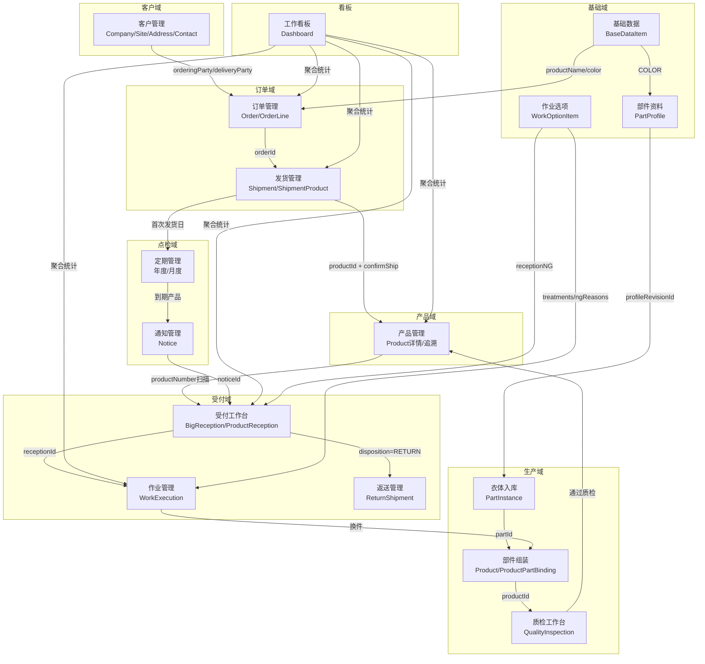

# 株式会社プロップ · 订单管理 — 业务测试点分析

> 本文档基于 `src/` 目录下全部源码文件（96 个文件）的代码分析生成，覆盖 15 个业务模块。

---

## 模块：首页/工作看板

| 项目 | 内容 |
| ---- | ---- |
| 模块说明 | 系统首页看板，聚合展示当前订单履约、发货待办、厂内作业、库存、半成品等关键指标，提供快捷跳转入口 |
| 上游数据来源 | 1. 订单数据：`getOrderStore()`，上游模块=订单管理；2. 发货数据：`getShipmentStore()`，上游模块=发货管理；3. 部件/产品数据：`getPartStore()`，上游模块=产品生产/产品管理；4. 受付/作业数据：`getReceptionStore()`，上游模块=受付工作台/作业管理。汇总计算由 `buildDashboardSummary()`（`src/utils/dashboardSelectors.ts`）完成 |
| 数据关联关系 | 订单→发货（shipment.orderId = order.orderId）；产品→订单关系（productOrderRelations.productId = product.productId）；受付→作业（workExecution.receptionId = reception.receptionId）；受付→产品（reception.productId = product.productId） |
| 枚举值 | 工作组枚举 `WorkGroup`：SEWING(縫製)、SENSOR(センサ)、ASSEMBLY(組立)、DEPLOY_REPAIR(展開修理)、CLEANING(クリーニング)；来源：前端常量 `WORK_GROUP_LABEL` |

### 功能操作测试点

| 序号 | 功能点 | 操作描述 | 预期页面展示 | 数据来源&关联校验点 |
| ---- | ---- | ---- | ---- | ---- |
| 1 | 页面加载 | 进入首页 `/` | 展示工作看板，含订单一览、待办事项、厂内作业、厂内库存、今日作业、半成品6个卡片 | 数据来自 `buildDashboardSummary()`，聚合 orderStore/shipmentStore/partStore/receptionStore |
| 2 | 订单一览-租赁 | 查看租赁订单指标 | 显示租赁订单数(单)、未发完/已发完/剩余待发台数 | `summary.orders.byType.RENTAL`，由 orderStore.orders 中 orderType=RENTAL 的订单派生 |
| 3 | 订单一览-销售 | 查看销售订单指标 | 显示销售订单数(单)、未发完/已发完/剩余待发台数 | `summary.orders.byType.SALE`，由 orderStore.orders 中 orderType=SALE 的订单派生 |
| 4 | 待办-今日发货 | 查看今日要发货 | 显示今日需发货订单数及待发台数 | `summary.shippingSchedule.todayOrders`，由 order.expectedShipDate = 今天 派生 |
| 5 | 待办-逾期未发 | 查看逾期未发 | 显示逾期订单数及台数，值>0时红色显示 | `summary.shippingSchedule.overdueOrders`，由 expectedShipDate < 今天 且未发完 派生 |
| 6 | 厂内作业-待清洗 | 查看待清洗 | 显示待清洗台数 | `summary.work.pendingCleaningProducts`，由 receptionStore 中 workScopes 含 CLEANING 且无清洗完成作业记录派生 |
| 7 | 厂内作业-待返送 | 查看待返送 | 显示待返送大番号数 | `summary.work.pendingReturnBatches`，由 receptionStore.returnShipments 及 reception.disposition=RETURN 派生 |
| 8 | 厂内作业-今日受付 | 查看今日受付 | 显示今日受付台数 | `summary.work.todayReceptionProducts`，由 reception.createdAt = 今天 派生 |
| 9 | 快捷跳转 | 点击各卡片"查看"按钮 | 跳转至对应模块页（/orders、/inspection/work、/inspection/reception、/products 等） | 路由跳转，由 `navigate()` 实现 |
| 10 | 今日作业统计 | 查看各工作组今日作业台数 | 按SEWING/SENSOR/ASSEMBLY/DEPLOY_REPAIR/CLEANING分列显示台数 | `summary.work.todayByGroup[group]`，由 workExecution.executedAt = 今天 派生 |
| 11 | 半成品统计 | 查看在制品/待质检/绑定零件数 | 显示在制品台数、待质检台数、气囊/传感器/发生器个数 | `summary.inventory.wipProducts`/`pendingInspection`/`wipParts`，由 partStore 派生 |

### 页面展示字段明细

| 字段名 | 展示内容 | 关联信息说明 |
| ---- | ---- | ---- |
| 租赁订单 | ongoing单数 + 未发完/已发完/剩余待发台数 | orderStore.orders 中 orderType=RENTAL |
| 销售订单 | ongoing单数 + 未发完/已发完/剩余待发台数 | orderStore.orders 中 orderType=SALE |
| 今日要发货 | 单数 + 台数 | order.expectedShipDate = 今天 |
| 逾期未发 | 单数 + 台数（>0红色） | order.expectedShipDate < 今天 且 status=ACTIVE |
| 待清洗 | 台数 | reception.workScopes 含 CLEANING |
| 待返送 | 大番号数 | reception.disposition=RETURN 且未返送 |
| 今日受付 | 台数 | reception.createdAt = 今天 |
| 在制品 | 台数 | product 未通过首次质检 |
| 成品在库 | 台数 | 质检通过 + 无当前订单关系 + 未报废 |
| 今日作业(各组) | 台数 | workExecution.executedAt = 今天，按 workGroup 分组 |

---

## 模块：客户管理

| 项目 | 内容 |
| ---- | ---- |
| 模块说明 | 管理客户主档：公司/支店/现场、地址、联系人，支持树形展示、多条件搜索、新建/编辑公司及支店 |
| 上游数据来源 | 1. 客户数据：`customerStore`（mock 单例），包含 companies/sites/addresses/contacts/legacyMappings；2. 查询工具函数：`getCompanySites()`、`listSubjectAddresses()`、`listAddressContacts()`、`getLegacyNumbers()`，来源 `src/utils/customerSelectors.ts`；3. 写入操作：`createCompanyBundle()`、`createSiteBundle()`、`correctCompany()`、`correctSite()`、`correctAddress()`、`correctContact()` 等，来源 `src/services/customerMockRepository.ts` |
| 数据关联关系 | Company(1)→Site(N)（site.companyId = company.companyId）；Address 通过 owner 关联到 Company 或 Site；Contact 通过 addressId 关联到 Address；Order 通过 orderingParty/deliveryParty/billingParty 引用 CustomerSubjectRef（kind=COMPANY 或 SITE） |
| 枚举值 | 客户区分 `CustomerCategory`：DIRECT(直販)、PROXY(代理)；来源：前端常量 `CUSTOMER_CATEGORY_LABEL` |

### 功能操作测试点

| 序号 | 功能点 | 操作描述 | 预期页面展示 | 数据来源&关联校验点 |
| ---- | ---- | ---- | ---- | ---- |
| 1 | 关键词搜索 | 输入业务编号/公司名称/支店名称，点击查询 | 树形表格展开匹配结果，高亮匹配行 | `customerStore.companies` + `sites`，匹配 name/businessNo/legacyBusinessNo |
| 2 | 地址搜索 | 输入邮编/地址关键字，点击查询 | 展开匹配地址的客户行 | `listSubjectAddresses()` 过滤 postalCode/addressLine1 |
| 3 | 联系人搜索 | 输入姓名/电话/邮箱，点击查询 | 展开含匹配联系人的客户行 | `listAddressContacts()` 过滤 contactName/phone/fax/email |
| 4 | 客户区分筛选 | 选择直贩/代理，点击查询 | 仅显示对应区分的客户 | `company.customerCategory` 匹配 |
| 5 | 重置 | 点击重置按钮 | 清空所有筛选条件，恢复全部列表 | 重新执行 `buildRows()` |
| 6 | 新建公司 | 点击"新建公司"，弹出 CustomerWorkspace Modal | Modal 含公司名称(必填)、客户区分(必选)、资料路径、地址+联系人录入区 | `createCompanyBundle()` 创建 Company + 关联 Address/Contact |
| 7 | 新建支店 | 在客户详情页点击"新建支店" | Modal 含支店名称(必填)、地址+联系人录入区 | `createSiteBundle()` 创建 Site + 关联 Address/Contact |
| 8 | 编辑公司 | 在详情页点击编辑 | Modal 预填公司信息，可修改名称/区分/资料路径 | `correctCompany()` 更新公司基础信息 |
| 9 | 编辑地址 | 在详情页编辑地址 | 弹窗预填邮编/地址1/地址2，保存后更新主档 | `correctAddress()` 更新 Address |
| 10 | 编辑联系人 | 在详情页编辑联系人 | 弹窗预填姓名/职位/电话/FAX/邮箱/备注 | `correctContact()` 更新 Contact |
| 11 | 删除地址 | 在详情页删除地址 | 确认后删除，关联联系人级联删除 | `deleteAddress()` 校验是否被 Order 引用 |
| 12 | 删除支店 | 在详情页删除支店 | 确认后删除支店及其下所有地址/联系人 | `deleteSite()` 校验是否被 Order 引用 |
| 13 | 查看详情 | 点击"查看详情" | 跳转 `/customers/:companyId`，展示公司信息、支店卡片、地址联系人 | 路由跳转，`customerStore` 读取 |

### 页面展示字段明细

| 字段名 | 展示内容 | 关联信息说明 |
| ---- | ---- | ---- |
| 业务编号 | 公司/支店的 businessNo + 历史编号 | `getLegacyNumbers()` 查 legacyMappings |
| 客户 | 公司名称/支店名称 + 所属公司 | Company.companyName / Site.siteName |
| 默认业务信息 | 客户区分标签(直贩/代理) + 默认請求書先 | `CUSTOMER_CATEGORY_LABEL` |
| 联系资料 | 地址条数 + 联系人名数 | `listSubjectAddresses()` + `listAddressContacts()` 聚合 |
| 操作 | 查看详情按钮 | 跳转 `/customers/:companyId` |

---

## 模块：订单管理

| 项目 | 内容 |
| ---- | ---- |
| 模块说明 | 管理订单全生命周期：创建/编辑/取消订单、查看订单详情、发货管理（ShipmentDrawer）、批量打印面单。订单是核心业务实体，驱动发货和产品-订单关系建立 |
| 上游数据来源 | 1. 订单数据：`getOrderStore()`（mock 单例），含 orders/productOrderRelations/orderQuantityHistories/orderOperationLogs；2. 客户数据：`customerStore`（选择下单方/納品先/請求先）；3. 发货数据：`getShipmentStore()`（履约进度派生）；4. 写入操作：`createOrder()`、`updateOrder()`、`cancelOrder()`，来源 `src/services/orderMockRepository.ts`；5. 发货写入：`createShipment()`、`confirmShipments()`、`addShipmentProduct()`，来源 `src/services/shipmentMockRepository.ts` |
| 数据关联关系 | Order→Customer（orderingParty/deliveryParty/billingParty → CustomerSubjectRef）；Order→OrderLine（1:N）；Order→Shipment（shipment.orderId = order.orderId）；Order→ProductOrderRelation（relation.orderId = order.orderId）；Shipment→ShipmentProduct（shipmentProductId → productId）；履约进度 F = 已确认发货且未否定的产品数，H = 历史发货数，Q = orderQuantity(order) |
| 枚举值 | 订单类型 `OrderType`：SALE(销售/green)、RENTAL(租赁/blue)、SUBSTITUTE(替代/orange)；来源：前端常量 `ORDER_TYPE_LABEL`/`ORDER_TYPE_COLOR`。订单状态 `OrderStatus`：ACTIVE(有效)、CANCELLED(已取消)；来源：`ORDER_STATUS_LABEL`。履约进度 `FulfillmentProgress`：NOT_STARTED(未发货)、PARTIAL(部分发货)、COMPLETED(已完成)；来源：`FULFILLMENT_LABEL`。客户区分 `CustomerCategory`：DIRECT(直販)、PROXY(代理)；来源：`CUSTOMER_CATEGORY_LABEL` |

### 功能操作测试点

| 序号 | 功能点 | 操作描述 | 预期页面展示 | 数据来源&关联校验点 |
| ---- | ---- | ---- | ---- | ---- |
| 1 | 关键词搜索 | 输入订单番号/案件番号/下单方/納品先/产品/颜色，点击查询 | 过滤匹配的订单行 | `useOrderRows()` 返回 OrderRowView[]，搜索 orderNo/customerOrderNo/orderingPartyName/deliveryPartyName/lines.productName/lines.color |
| 2 | 制造番号搜索 | 输入制造番号(如PTG26001)，点击查询 | 显示含该制造番号产品的订单 | 反查 shipmentStore.shipmentDocuments.snapshot.products.productNumber |
| 3 | 订单类型筛选 | 选择销售/租赁/替代 | 仅显示对应类型订单 | `order.orderType` 匹配 |
| 4 | 客户区分筛选 | 选择直贩/代理 | 仅显示对应区分订单 | `order.customerRelationType` 匹配 |
| 5 | 履约进度筛选 | 选择未发货/部分发货/已完成 | 仅显示对应进度订单 | `deriveFulfillmentProgress()` 派生值匹配 |
| 6 | 订单状态筛选 | 选择有效/已取消 | 仅显示对应状态订单 | `order.status` 匹配 |
| 7 | 受注日范围 | 选择日期范围 | 仅显示受注日在范围内的订单 | `order.orderDate` 范围比较 |
| 8 | 预计发货日范围 | 选择日期范围 | 仅显示预计发货日在范围内的订单；无预计发货日的订单不显示 | `order.expectedShipDate` 范围比较 |
| 9 | 重置 | 点击重置 | 清空所有筛选条件 | `form.resetFields()` + 重置 query/applied |
| 10 | 新建订单 | 点击"新建订单"，跳转 `/orders/new` | 订单表单页，含客户选择器、订单类型、日期、订购内容、地址联系人 | `createOrder()` 校验：客户必选、地址必选、联系人必选、订单行≥1、数量>0 |
| 11 | 编辑订单 | 在详情页点击编辑，跳转 `/orders/new?edit=orderId` | 表单预填，已发货(F>0)时客户/订单行锁定 | `updateOrder()` 校验：已取消订单不可编辑、删除行保护、总量约束 |
| 12 | 取消订单 | 在详情页点击取消，填写取消原因 | 订单状态变为已取消，履约进度文字展示 | `cancelOrder()` 写入 cancelledAt/cancelledBy/cancelReason |
| 13 | 查看详情 | 点击"查看详情" | 跳转 `/orders/:orderId`，展示订单信息、客户关系、订购内容、发货记录、产品关联 | `getOrderStore()` 读取 |
| 14 | 新建发货 | 在详情页点击发货按钮，打开 ShipmentDrawer | 抽屉展示发货表单：地址/联系人/快递公司/产品选择 | `createShipment()` 创建草稿，`addShipmentProduct()` 添加产品 |
| 15 | 确认发货 | 在 ShipmentDrawer 中确认寄出 | 发货状态变为已确认，产品-订单关系建立，订单履约进度更新 | `confirmShipments()` 事务性确认：校验产品不重复、订单状态=ACTIVE、业务类型确定 |
| 16 | 打印面单 | 在 ShipmentDrawer 中打印面单 | 生成面单快照（LabelPrintSnapshot），预览 ShippingLabelDocument | `printShippingLabel()` 写入 ShipmentDocument |
| 17 | 批量打印 | 点击"批量打印面单"，跳转 `/orders/batch-print` | 批量打印页面，选择快递公司，勾选多张面单打印 | 从 shipmentStore 聚合准备中发货，`BatchPrintTable` 展示 |

### 页面展示字段明细（列表页）

| 字段名 | 展示内容 | 关联信息说明 |
| ---- | ---- | ---- |
| 订单 | 客户订单号 + 系统订单号 + 已取消标签 | order.customerOrderNo + order.orderNo + status |
| 客户关系 | 下单方名称 + 納品先名称 | customerSnapshot.orderingPartyName/deliveryPartyName |
| 订单要求 | 订购内容摘要 + 总台数 | `orderLinesSummary()` + `orderQuantity()` |
| 订单类型 | 销售租赁替代标签 | `ORDER_TYPE_LABEL` + `ORDER_TYPE_COLOR` |
| 受注/预计发货 | 受注日期 + 预计发货日期 | order.orderDate + order.expectedShipDate |
| 履约进度 | 未发货/部分发货/已完成标签 | `deriveFulfillmentProgress()` 派生 |
| 操作 | 查看详情按钮 | 跳转 `/orders/:orderId` |

---

## 模块：产品生产-衣体入库

| 项目 | 内容 |
| ---- | ---- |
| 模块说明 | 衣体（JACKET_BODY）入库工作台，支持单个/连续范围录入衣体编号，选择部件资料，确认入库生成 PartInstance |
| 上游数据来源 | 1. 部件资料：`partStore.profiles` 中 partType=JACKET_BODY 且 enabled=true；2. 基础数据 COLOR 字典：`partStore.baseData` 中 dataType=COLOR；3. 写入操作：`createIntakeRecord()`，来源 `src/services/partMockRepository.ts` |
| 数据关联关系 | PartInstance.profileRevisionId → PartProfileRevision.revisionId；IntakeRecord.partIds → PartInstance.partId；PartProfile → BaseData(COLOR) |
| 枚举值 | 部件类型 `PartType`：JACKET_BODY(衣体)、AIRBAG(气囊)、SENSOR(传感器)、INFLATOR(充气发生器)；来源：前端常量 `PART_TYPE_LABELS` |

### 功能操作测试点

| 序号 | 功能点 | 操作描述 | 预期页面展示 | 数据来源&关联校验点 |
| ---- | ---- | ---- | ---- | ---- |
| 1 | 选择部件资料 | 从下拉选择衣体资料 | 自动带入前缀(prefix) | `partStore.profiles` 过滤 partType=JACKET_BODY |
| 2 | 单个录入 | 输入单个衣体编号，确认 | 生成一条 PartInstance + IntakeRecord | `createIntakeRecord()` 校验编号不重复 |
| 3 | 范围录入 | 输入起始/结束编号，确认 | 生成多条 PartInstance | 逐个校验编号不重复，生成连续编号 |
| 4 | 待确认列表 | 查看已录入未确认的记录 | 表格展示待确认衣体列表 | 临时状态（页面 state） |
| 5 | 删除选中 | 勾选记录点击删除 | 从待确认列表移除 | 仅删除未确认的临时记录 |
| 6 | 确认入库 | 点击确认入库 | 生成 IntakeRecord，partIds 写入，列表清空 | `createIntakeRecord()` 写入 partStore |

### 页面展示字段明细

| 字段名 | 展示内容 | 关联信息说明 |
| ---- | ---- | ---- |
| 衣体编号 | PartInstance.partNumber | 衣体唯一编号 |
| 部件资料 | PartProfile.name | 关联 profileRevisionId |
| 状态 | 待确认/已入库 | IntakeRecord 是否生成 |

---

## 模块：产品生产-部件组装

| 项目 | 内容 |
| ---- | ---- |
| 模块说明 | 部件组装工作台，将衣体/气囊/传感器/充气发生器组装为产品(Product)，建立 ProductPartBinding，生成 Product.internalNo(M+6位流水) |
| 上游数据来源 | 1. 部件个体：`partStore.instances`（已入库的 PartInstance）；2. 部件资料：`partStore.profiles`（默认资料选择）；3. 写入操作：`installPart()`（安装部件）、创建 Product，来源 `src/services/partMockRepository.ts` |
| 数据关联关系 | Product(1)→ProductPartBinding(N)→PartInstance(1)；binding.partType 区分部件类型；Product.productNumber = 衣体编号（製造番号）；Product.internalNo = M+6位流水 |
| 枚举值 | 组装操作类型 `AssemblyOperationType`：INSTALL(安装)、REMOVE(拆卸)、REPLACE(替换)；来源：前端常量 |

### 功能操作测试点

| 序号 | 功能点 | 操作描述 | 预期页面展示 | 数据来源&关联校验点 |
| ---- | ---- | ---- | ---- | ---- |
| 1 | 范围筛选 | 输入编号前缀+范围 | 显示匹配的在制产品列表 | `listProductsWithParts()` 过滤 |
| 2 | 单件筛选 | 输入单个编号 | 显示该编号产品 | 精确匹配 productNumber |
| 3 | 录入衣体 | 输入衣体编号 | 自动匹配已有 PartInstance 或创建新产品 | `installPart()` 绑定 JACKET_BODY |
| 4 | 录入气囊 | 输入气囊编号 | 绑定到当前产品 | `installPart()` 绑定 AIRBAG，校验编号唯一 |
| 5 | 录入传感器 | 输入传感器编号+固件版本 | 绑定到当前产品，记录固件版本 | `installPart()` 绑定 SENSOR + `SensorFirmwareRecord` |
| 6 | 录入充气发生器 | 输入发生器编号(1/2位) | 绑定到当前产品 | `installPart()` 绑定 INFLATOR，position=1 或 2 |
| 7 | 保存 | 点击保存行 | 保存当前行组装数据 | `installPart()` 写入 partStore |
| 8 | 确认 | 确认组装完成 | 产品状态更新 | 所有部件齐全后可质检 |
| 9 | 错误提示 | 输入已绑定的部件编号 | 显示冲突提示 | 校验 PartInstance 是否已绑定其他产品 |

### 页面展示字段明细

| 字段名 | 展示内容 | 关联信息说明 |
| ---- | ---- | ---- |
| 製造番号 | Product.productNumber | = 衣体编号 |
| M管理番号 | Product.internalNo | M+6位流水，自动生成 |
| 衣体编号 | jacketNumber | ProductPartBinding → PartInstance.partNumber |
| 气囊编号 | airbagNumber | 同上 |
| 传感器编号/版本 | sensorNumber + sensorVersion | SensorFirmwareRecord.newVersion |
| 发生器1/2 | inflator1Number/inflator2Number | position=1/2 |
| 组装状态 | 在制/待质检 | `getProductStage()` 派生 |

---

## 模块：产品生产-质检工作台

| 项目 | 内容 |
| ---- | ---- |
| 模块说明 | 质检工作台，对部件组装齐全的产品执行质检通过确认，生成 QualityInspection 记录 |
| 上游数据来源 | 1. 产品列表：`listProductsWithParts(partStore)`，过滤 inspectionStatus=PENDING；2. 写入操作：质检确认，来源 `src/services/partMockRepository.ts` |
| 数据关联关系 | QualityInspection.productId → Product.productId；质检通过 = inspectionStatus 从 PENDING → PASSED |
| 枚举值 | 质检状态：PENDING(待检)、PASSED(已通过)；来源：`ProductWithParts.inspectionStatus` |

### 功能操作测试点

| 序号 | 功能点 | 操作描述 | 预期页面展示 | 数据来源&关联校验点 |
| ---- | ---- | ---- | ---- | ---- |
| 1 | 连续输入 | 连续输入多个编号 | 批量匹配待检产品 | `listProductsWithParts()` 过滤 PENDING |
| 2 | 番号输入 | 输入单个番号 | 精确定位 | 精确匹配 productNumber |
| 3 | 质检通过确认 | 选择产品点击确认 | 生成 QualityInspection，产品状态变为 PASSED | `partStore.inspections` 写入 |
| 4 | 打印编号清单 | 点击打印 | 生成 PrintVersion，展示编号清单 | `PrintVersion` 写入 partStore |

### 页面展示字段明细

| 字段名 | 展示内容 | 关联信息说明 |
| ---- | ---- | ---- |
| 製造番号 | Product.productNumber | 衣体编号 |
| M管理番号 | Product.internalNo | 内部编号 |
| 部件状态 | 各部件是否齐全 | ProductPartBinding 派生 |
| 质检状态 | 待检/已通过 | inspectionStatus |

---

## 模块：产品管理-产品列表

| 项目 | 内容 |
| ---- | ---- |
| 模块说明 | 产品全量列表，支持范围/单件/部件反查三种查询模式，按状态/首发出/区间筛选，支持删除产品（有阻断校验） |
| 上游数据来源 | 1. 产品数据：`partStore.products` + `partStore.bindings` → `listProductsWithParts()`；2. 订单关系：`getOrderStore().productOrderRelations`；3. 受付数据：`getReceptionStore().scraps`/`receptions`；4. 删除操作：`deleteProduct()` + `getProductDeleteBlockers()`，来源 `src/services/partMockRepository.ts` |
| 数据关联关系 | Product → ProductPartBinding → PartInstance；Product → ProductOrderRelation → Order；Product → QualityInspection；Product → ScrapRecord |
| 枚举值 | 产品阶段 `ProductStage`：WIP(在制/gray)、READY(待质检/orange)、INSPECTED(已完成质检/green)；来源：前端常量 `STAGE_LABEL`/`STAGE_COLOR`。首出状态：ALL/SHIPPED/UNSHIPPED |

### 功能操作测试点

| 序号 | 功能点 | 操作描述 | 预期页面展示 | 数据来源&关联校验点 |
| ---- | ---- | ---- | ---- | ---- |
| 1 | 范围查询 | 输入前缀+起止编号 | 显示范围内的产品 | `listProductsWithParts()` 过滤 productNumber |
| 2 | 单件查询 | 输入单个编号 | 精确匹配 | 精确匹配 productNumber |
| 3 | 部件反查 | 输入部件编号 | 显示含该部件的产品 | 反查 ProductPartBinding → PartInstance.partNumber |
| 4 | 阶段筛选 | 选择在制/待质检/已完成质检 | 仅显示对应阶段产品 | `getProductStage()` 派生 |
| 5 | 首出筛选 | 选择全部/已出货/未出货 | 仅显示对应首出状态 | `ProductWithParts.firstShippedAt` 是否存在 |
| 6 | 查看详情 | 点击行跳转 | 跳转 `/products/:productId` | 路由跳转 |
| 7 | 删除产品 | 点击删除，确认弹窗 | 如果有阻断原因则提示不可删除 | `getProductDeleteBlockers()` 校验：有当前订单关系/有受付记录/有发货记录 |
| 8 | 确认删除 | 无阻断时确认删除 | 产品标记 voidedAt | `deleteProduct()` 写入 voidedAt/voidedBy/voidReason |

### 页面展示字段明细

| 字段名 | 展示内容 | 关联信息说明 |
| ---- | ---- | ---- |
| 製造番号 | Product.productNumber | 衣体编号 |
| M管理番号 | Product.internalNo | 内部编号 |
| 产品状态 | 已报废/已关联订单/未关联订单 | `productStatus()` 从 scraps/receptions/relations 派生 |
| 订单类型 | 销售/租赁/替代标签 | `currentOwnership()` 从 ProductOrderRelation → Order 派生 |
| 阶段 | 在制/待质检/已完成质检 | `getProductStage()` |
| 质检日 | 最近质检确认日 | `partStore.inspections` |
| 首次出货日 | firstShippedAt | 从已确认 Shipment 派生 |
| 生命周期基准月 | lifecycleBaseMonth | 首次发货日派生 YYYY-MM |

---

## 模块：产品管理-产品详情

| 项目 | 内容 |
| ---- | ---- |
| 模块说明 | 单个产品详情页，展示产品基本信息、生命周期、当前部件绑定表、业务历史Timeline，支持部件更换/安装/升级操作 |
| 上游数据来源 | 1. 产品数据：`partStore`（Product + bindings + operations）；2. 订单关系：`getOrderStore().productOrderRelations`；3. 发货数据：`getShipmentStore()`；4. 受付数据：`getReceptionStore()`；5. 产品名称事件：`partStore.productNameEvents` |
| 数据关联关系 | Product → ProductPartBinding(N) → PartInstance；Product → AssemblyOperation(N)；Product → ProductOrderRelation(N) → Order；Product → ProductNameEvent(N)；Product → QualityInspection；Product → ShipmentProduct → Shipment |
| 枚举值 | 产品业务类型 `ProductBusinessType`：UNDETERMINED(未确定)、SALE(销售)、RENTAL(租赁) |

### 功能操作测试点

| 序号 | 功能点 | 操作描述 | 预期页面展示 | 数据来源&关联校验点 |
| ---- | ---- | ---- | ---- | ---- |
| 1 | 查看基本信息 | 进入详情页 | 展示製造番号、M管理番号、业务类型、资料路径 | `partStore.products` 读取 |
| 2 | 查看生命周期 | 查看生命周期区域 | 展示首次出货日、生命周期基准月 | 从 Shipment 派生 |
| 3 | 查看当前部件 | 查看部件表格 | 展示衣体/气囊/传感器(含版本)/发生器1/2 | `ProductPartBinding` → `PartInstance` |
| 4 | 查看业务历史 | 查看Timeline | 按时间展示组装/质检/发货/受付/换件等事件 | 聚合 operations/inspections/shipments/receptions |
| 5 | 部件更换 | 点击更换按钮，选择新件 | 完成换绑，生成 AssemblyOperation(REPLACE) | `installPart()` + `removePart()`，新件校验已入库 |
| 6 | 部件安装 | 安装新部件 | 生成 AssemblyOperation(INSTALL) | `installPart()` |
| 7 | 传感器固件升级 | 升级固件版本 | 生成 SensorFirmwareRecord | `installPart()` + firmwareRecord |
| 8 | 解除订单关系 | 解除当前产品-订单关系 | 生成 ProductOrderRelation.endedAt + endReason=UNLINK | `endCurrentOrderRelation()` |
| 9 | 返回列表 | 点击返回 | 跳转 `/products` | 路由跳转 |

### 页面展示字段明细

| 字段名 | 展示内容 | 关联信息说明 |
| ---- | ---- | ---- |
| 製造番号 | Product.productNumber | 产品唯一编号 |
| M管理番号 | Product.internalNo | 内部管理编号 |
| 业务类型 | 未确定/销售/租赁 | Product.businessType |
| 当前部件表 | 部件类型+编号+资料名+版本 | ProductPartBinding → PartInstance → PartProfile |
| 业务历史 | 时间+事件类型+描述 | 聚合多源事件，按时间排序 |
| 对外名称 | 当前产品名称 | `ProductNameEvent` 最新一条 |

---

## 模块：受付工作台

| 项目 | 内容 |
| ---- | ---- |
| 模块说明 | 受付工作台是来件接收的核心页面，支持扫描製造番号识别产品、创建大番号(BigReception)/包裹(Package)/小番号(ProductReception)，登记受付类型、NG、作业范围、处置等 |
| 上游数据来源 | 1. 产品数据：`getPartStore().products`（扫描识别）；2. 受付数据：`getReceptionStore()`；3. 通知数据：`getNoticeStore()`（关联通知）；4. 订单数据：`getOrderStore()`（关联订单上下文）；5. 写入操作：`createBigReception()`、`createPackage()`、`startReception()`、`updateReceptionJudgment()` 等，来源 `src/services/receptionMockRepository.ts` |
| 数据关联关系 | BigReception(1)→Package(N)→ProductReception(N)→Product(1)；ProductReception.noticeId → Notice.noticeId（可选）；ProductReception.orderId → Order.orderId（可选）；WorkExecution.receptionId → ProductReception.receptionId |
| 枚举值 | 受付类型 `ReceptionReason`：PERIODIC_INSPECTION(定期点检)、TEMPORARY_INSPECTION(临时点检)、REPAIR(修理)、CLEANING(クリーニング)、RENTAL_END(租赁结束)、NORMAL_RETURN(正常回收)、SCRAP(报废)、WRONG_SHIPMENT_RETURN(误发退回)、WRONG_PRODUCT_RETURN(错产品退回)、WRONG_SPEC_RETURN(错规格退回)、OTHER(其他)；来源：前端常量 `RECEPTION_REASON_LABEL`。作业范围 `WorkScope`：STANDARD(标准点检・维修)、DEPLOY_REPAIR(展开维修)、CLEANING(クリーニング)；来源：`WORK_SCOPE_LABEL`。客户确认 `CustomerConfirm`：NOT_NEEDED(不需要确认)、NEEDED(需要向客户确认)；来源：`CUSTOMER_CONFIRM_LABEL`。处置 `ReceptionDisposition`：RETURN(返回客户)、RETAIN(PROP回收)、SCRAP(报废)；来源：`RECEPTION_DISPOSITION_LABEL`。NG域 `NgDomain`：SEWING(縫製)、SENSOR(センサ)、ASSEMBLY(組立)、GENERAL(一般)；来源：`NG_DOMAIN_LABEL` |

### 功能操作测试点

| 序号 | 功能点 | 操作描述 | 预期页面展示 | 数据来源&关联校验点 |
| ---- | ---- | ---- | ---- | ---- |
| 1 | 扫描识别 | 扫描/输入製造番号 | 自动识别产品，显示产品信息 | `partStore.products` 匹配 productNumber |
| 2 | 新建大番号 | 创建新的大番号 | 生成 BigReception，分配 bigNo | `createBigReception()` |
| 3 | 选择客户 | 确认来件客户 | 快照 customerName/sourceAddress | `customerStore` 读取 |
| 4 | 新建包裹 | 创建包裹 | 生成 ReceptionPackage | `createPackage()` |
| 5 | 开始受付 | 生成小番号 | 生成 ProductReception，smallNo = bigNo-pkgSeq-seq | `startReception()` |
| 6 | 选择受付类型 | 多选受付类型 | 定期点检/临时点检/修理/清洗/回收/报废等 | `receptionTypes[]` |
| 7 | 年度完成情况 | 选择年度(1-4) | 仅 receptionTypes 含 PERIODIC_INSPECTION 时适用且必填 | `annualInspectionYearNo` |
| 8 | 选择作业范围 | 多选作业范围 | 标准/展开维修/清洗 | `workScopes[]` |
| 9 | 客户确认 | 选择需要/不需要 | NEEDED 时备注至少1条 | `customerConfirm` |
| 10 | 登记正式NG | 添加NG域+内容+备注+照片 | 生成 FormalNg 记录 | `formalNgs[]` |
| 11 | 填写临时装箱数 | 输入箱数 | 保存前必填 | `temporaryPacking` |
| 12 | 保存受付 | 点击保存 | 生成 ProductReception | `startReception()` / `updateReceptionJudgment()` |
| 13 | 扫描下一台 | 继续扫描 | 自动开始下一台受付 | 小番号递增 |
| 14 | 受付完了 | 点击受付完了 | BigReception.completedAt 写入 | `completeBigReception()` |
| 15 | 删除小番号 | 删除误登记 | ProductReception.voidedAt 写入，编号不复用 | `deleteReception()` |
| 16 | 删除大番号 | 删除整批 | BigReception.voidedAt 写入 | `deleteBigReception()` |

### 页面展示字段明细

| 字段名 | 展示内容 | 关联信息说明 |
| ---- | ---- | ---- |
| 大番号 | BigReception.bigNo | 来件批次编号 |
| 小番号 | ProductReception.smallNo | bigNo-pkgSeq-seq |
| 製造番号 | Product.productNumber | 扫描识别 |
| M管理番号 | Product.internalNo | 内部编号 |
| 客户名 | BigReception.customerName | 来件来源快照 |
| 受付类型 | 多选标签 | `RECEPTION_REASON_LABEL` |
| 作业范围 | 多选标签 | `WORK_SCOPE_LABEL` |
| 客户确认 | 需要确认/不需要 | `CUSTOMER_CONFIRM_LABEL` |
| 处置 | 返回客户/PROP回收/报废 | `RECEPTION_DISPOSITION_LABEL` |
| 正式NG | NG域+内容列表 | `FormalNg` 数组 |
| 受付备注 | 列表 | `ReceptionNote[]` |
| 临时装箱数 | 数值 | `temporaryPacking` |

---

## 模块：作业管理

| 项目 | 内容 |
| ---- | ---- |
| 模块说明 | 作业管理台账，按受付(Reception)维度管理各工作组(縫製/センサ/組立/展開修理/クリーニング)的作业记录，支持检查项录入、处置内容、NG处理、换件、固件升级等 |
| 上游数据来源 | 1. 受付数据：`getReceptionStore().receptions` + `workExecutions`；2. 部件数据：`getPartStore()`（换件操作）；3. 作业选项字典：`receptionStore.workOptions`；4. 写入操作：`saveWorkExecution()`、换件 `installPart()`/`removePart()`，来源 `src/services/receptionMockRepository.ts` + `src/services/partMockRepository.ts` |
| 数据关联关系 | WorkExecution.receptionId → ProductReception.receptionId；WorkExecution.productId → Product.productId；WorkExecution.workGroup → WorkGroup 枚举；WorkExecution.replacement → PartInstance（换件）；WorkExecution.firmwareUpgrade → SensorFirmwareRecord |
| 枚举值 | 工作组 `WorkGroup`：SEWING(縫製)、SENSOR(センサ)、ASSEMBLY(組立)、DEPLOY_REPAIR(展開修理)、CLEANING(クリーニング)；来源：`WORK_GROUP_LABEL`。作业动作 `WorkAction`：NONE(无需处理)、SEWING_REPAIR(缝制修补)、REINFORCE(补强)、JACKET_REPLACE(衣体更换)、AIRBAG_REPLACE(气囊更换)、ADJUST(调整)、REPAIR(修理)、SENSOR_REPLACE(传感器更换)、FIRMWARE_UPGRADE(固件版本升级)、ASSEMBLE(组装)、REASSEMBLE(重新组装)、INFLATOR_REPLACE(充气发生器更换)、LED_REPLACE(LED更换)、REED_SW_REPLACE(磁簧开关更换)、OTHER(其他)；来源：`WORK_ACTION_LABEL`。各工作组可用动作：`WORK_GROUP_ACTIONS`。检查项：`WORK_GROUP_CHECK_ITEMS`。NG原因种子：`WORK_GROUP_NG_REASONS`。处置内容种子：`WORK_GROUP_TREATMENTS` |

### 功能操作测试点

| 序号 | 功能点 | 操作描述 | 预期页面展示 | 数据来源&关联校验点 |
| ---- | ---- | ---- | ---- | ---- |
| 1 | 筛选状态 | 按待处理/已完成筛选 | 仅显示对应状态台账 | WorkExecution.voidedAt 是否存在 |
| 2 | 工作组聚焦 | 选择工作组Tab | 仅显示该组作业 | `workExecution.workGroup` 匹配 |
| 3 | 查看台账行 | 查看批次统计行(BATCH_HEADER) | 显示该批次小番号/NG/作业概况 | 聚合同 bigReceptionId 的数据 |
| 4 | 录入检查项 | 按固定检查项录入○/× | 每项可选OK/NG + NG描述 | `WORK_GROUP_CHECK_ITEMS` 提供检查项 |
| 5 | 录入处置内容 | 从下拉多选处置标签 | 保存为 treatments[] | `WORK_GROUP_TREATMENTS` 种子 + field 新增 |
| 6 | 录入作业动作 | 选择处理动作 | 保存为 actions[]，換件动作触发Modal | `WORK_GROUP_ACTIONS` 限制可选项 |
| 7 | 换件操作 | 选择換件动作(如SENSOR_REPLACE)，弹窗录入新件编号 | 完成 PartInstance 换绑 + AssemblyOperation(REPLACE) | `installPart()` + `removePart()`，新件校验 |
| 8 | 固件升级 | 选择 FIRMWARE_UPGRADE，录入新版本 | 生成 SensorFirmwareRecord | `SensorFirmwareRecord` 写入 |
| 9 | NG处理 | 针对受付NG选择本组处理结果 | 保存为 ngHandlings[] | 关联 `FormalNg.ngId` |
| 10 | 保存作业 | 点击保存 | WorkExecution 更新，乐观锁版本递增 | `saveWorkExecution()` 校验 revision |
| 11 | 乐观锁冲突 | 并发保存时版本冲突 | 提示冲突，需刷新后重试 | `revision` 比对 |
| 12 | 确认回收 | 点击【回収を確定】 | ProductReception.recoveredAt 写入，ProductOrderRelation 结束 | `confirmRecovery()` |
| 13 | 确认报废 | 点击【廃棄を確定】 | ProductReception.scrappedAt 写入，ScrapRecord 生成 | `confirmScrap()` |

### 页面展示字段明细

| 字段名 | 展示内容 | 关联信息说明 |
| ---- | ---- | ---- |
| 小番号 | ProductReception.smallNo | bigNo-pkgSeq-seq |
| 製造番号 | productNumber | 产品快照 |
| 受付类型 | 多选标签 | `RECEPTION_REASON_LABEL` |
| 正式NG | NG域+内容 | `FormalNg[]` |
| 检查项结果 | ○/× + NG描述 | `CheckResult[]` |
| 处置内容 | 多选标签 | `treatments[]` |
| 作业动作 | 动作标签 | `actions[]` → `WORK_ACTION_LABEL` |
| 换件信息 | 旧件→新件编号 | `replacement.oldPartId → newPartNumber` |
| 固件版本 | 旧版本→新版本 | `firmwareUpgrade.oldVersion → newVersion` |
| 备注 | 自由文本 | `note` |
| 乐观锁版本 | revision | 并发控制 |

---

## 模块：点检管理-定期管理

| 项目 | 内容 |
| ---- | ---- |
| 模块说明 | 定期点检管理，按年度(1-4年)管理产品生命周期，按月度查看到期产品，生成定期点检案内/廃棄案内通知 |
| 上游数据来源 | 1. 受付数据：`getReceptionStore().receptions`（年度点检记录）；2. 发货数据：`getShipmentStore()`（首次出货日派生生命周期）；3. 通知数据：`getNoticeStore().notices`（已生成通知）；4. 产品数据：`getPartStore().products`；5. 订单数据：`getOrderStore()`（当前订单关系）；6. 月度聚合：`buildMonthlyProducts()` / `buildMonthlyCustomers()`，来源 `src/services/noticeMockRepository.ts` |
| 数据关联关系 | Product.lifecycleBaseMonth → Shipment（首次发货月）；Reception.annualInspectionYearNo → 年次；Notice.targetMonth → 到期月；Notice.productIds → Product |
| 枚举值 | 通知类型 `NoticeType`：PERIODIC_INSPECTION(定期点検案内/arcoblue)、FIFTH_YEAR_DISPOSAL(廃棄案内/orange)；来源：`NOTICE_TYPE_LABEL` |

### 功能操作测试点

| 序号 | 功能点 | 操作描述 | 预期页面展示 | 数据来源&关联校验点 |
| ---- | ---- | ---- | ---- | ---- |
| 1 | 查看年度概览 | 进入定期管理页 | 展示1-4年各年次到期产品数 | `buildMonthlyProducts()` 聚合 |
| 2 | 进入月度详情 | 点击某月 | 跳转 `/inspection/periodic/:year/:month`，展示该月到期产品按客户分组 | `PeriodicMonthPage` |
| 3 | 打开公司月度抽屉 | 点击某客户 | 展示该公司本月到期产品列表 + 历史通知 | `CompanyMonthDrawer` |
| 4 | 创建通知 | 点击创建通知，弹出 NoticeCreateModal | 选择下单方/納品先、发行日、寄送地址、追加事项 | `issueNotice()` 生成 Notice + PDF |
| 5 | 查看历史通知 | 在抽屉中查看该公司历史通知列表 | 展示已生成通知的案内番号/类型/发行日 | `noticeStore.notices` 过滤 |
| 6 | 生成PDF | 创建通知后提示 | 生成正式 PDF（mock 占位） | `pdfRef` 写入 |

### 页面展示字段明细

| 字段名 | 展示内容 | 关联信息说明 |
| ---- | ---- | ---- |
| 年次 | 1-4年 | 派生自 lifecycleBaseMonth + reception.annualInspectionYearNo |
| 到期月 | YYYY-MM | 生命周期基准月 + N年 |
| 客户 | 公司名称 | 按 customer 聚合到期产品 |
| 产品数 | 到期产品台数 | `buildMonthlyProducts()` |
| 历史通知 | 案内番号+类型 | `noticeStore.notices` 过滤 customerId + targetMonth |

---

## 模块：点检管理-通知管理

| 项目 | 内容 |
| ---- | ---- |
| 模块说明 | 通知管理列表，展示已生成通知历史，跟踪超期未受付产品，查看通知详情（含快照、产品进度、实时受付事实、PDF操作、内部备注） |
| 上游数据来源 | 1. 通知数据：`getNoticeStore().notices`；2. 客户数据：`getCustomerStore()`；3. 受付数据：`getReceptionStore().receptions`（超期未受付判断）；4. 超期判断：`listOverdueProducts()`，来源 `src/services/noticeMockRepository.ts` |
| 数据关联关系 | Notice.customerId → Customer；Notice.productIds → Product；Notice.productSnapshots → 产品级商品名/納品先快照（生成时冻结）；Notice.targetMonth → 到期月 |
| 枚举值 | 通知类型 `NoticeType`：PERIODIC_INSPECTION(定期点検案内)、FIFTH_YEAR_DISPOSAL(廃棄案内)；来源：`NOTICE_TYPE_LABEL`。表示期間 `PeriodFilter`：RECENT_3M(最近3个月)、ALL(全部) |

### 功能操作测试点

| 序号 | 功能点 | 操作描述 | 预期页面展示 | 数据来源&关联校验点 |
| ---- | ---- | ---- | ---- | ---- |
| 1 | 案内番号搜索 | 输入案内番号 | 过滤匹配通知 | `notice.noticeNo` 匹配 |
| 2 | 客户名搜索 | 输入客户名 | 过滤匹配通知 | `customerNodeName()` 查询 |
| 3 | 納品先搜索 | 输入納品先 | 过滤匹配通知 | `noticeDeliveries()` 快照匹配 |
| 4 | 类型筛选 | 选择定期点检/廃棄 | 仅显示对应类型 | `notice.noticeType` |
| 5 | 対象月筛选 | 选择月份 | 仅显示该月通知 | `notice.targetMonth` |
| 6 | 表示期間筛选 | 选择最近3月/全部 | 控制展示范围 | `issuedAt` 时间过滤 |
| 7 | 重置 | 点击重置 | 清空筛选 | 重置 query/applied |
| 8 | 超期提醒 | 查看顶部提醒 | 显示超1月未受付的通知数和产品数 | `listOverdueProducts()` |
| 9 | 查看详情 | 点击行 | 跳转 `/inspection/notices/:noticeId`，展示快照+产品进度+受付事实 | `NoticeDetailPage` |
| 10 | 正式PDF操作 | 在详情页查看PDF | 预览/下载正式PDF（mock） | `notice.pdfRef` |
| 11 | 内部备注编辑 | 在详情页编辑備考 | 保存 `currentNote`，不改写正式快照 | `notice.currentNote` 可反复编辑覆盖 |

### 页面展示字段明细

| 字段名 | 展示内容 | 关联信息说明 |
| ---- | ---- | ---- |
| 案内番号 | Notice.noticeNo | 正式编号 AN-YYYY-NNNNNN |
| 通知类型 | 定期点检/廃棄标签 | `NOTICE_TYPE_LABEL` |
| 顧客 | 客户名 | `customerNodeName()` 查询 |
| 納品先 | 納品先名称 | `noticeDeliveries()` 快照 |
| 対象月 | YYYY-MM | `notice.targetMonth` |
| 发行日 | YYYY/MM/DD | `notice.issueDate` |
| 超期未受付 | 通知数+产品数 | `listOverdueProducts()` |

---

## 模块：点检管理-返送管理

| 项目 | 内容 |
| ---- | ---- |
| 模块说明 | 返送管理列表（大番号维度），管理返送面单的创建/编辑/确认/打印。返送独立于订单Shipment，不增加履约 |
| 上游数据来源 | 1. 受付数据：`getReceptionStore().receptions` + `returnShipments`；2. 返送判断：`confirmedShippedReceptionIds()` / `stagedReceptionIds()` / `isReturnable()` / `isPendingReturn()`，来源 `src/utils/returnSelectors.ts`；3. F10报告：`latestF10Version()`；4. 写入操作：`createReturnShipment()` / `confirmReturnShipment()` / `issueReturnShipmentDocument()`，来源 `src/services/receptionMockRepository.ts` |
| 数据关联关系 | ReturnShipment.bigReceptionId → BigReception；ReturnShipment.customerId → Customer；ReturnPackage.items[].receptionId → ProductReception；返送不属于订单Shipment |
| 枚举值 | 返送筛选 `ReturnFilter`：ALL(全部)、PENDING(有待返送)、NO_PENDING(无待返送)。承运商 `Carrier`：YAMATO(ヤマト運輸)、SAGAWA(佐川急便)；来源：`CARRIER_LABEL`。返送文档类型：SHIPPING_LABEL(面单)、DELIVERY_NOTE(纳品书) |

### 功能操作测试点

| 序号 | 功能点 | 操作描述 | 预期页面展示 | 数据来源&关联校验点 |
| ---- | ---- | ---- | ---- | ---- |
| 1 | 大番号搜索 | 输入大番号 | 过滤匹配 | `big.bigNo` |
| 2 | 客户搜索 | 输入客户名 | 过滤匹配 | `big.customerName` |
| 3 | 地址搜索 | 输入地址关键字 | 过滤匹配 | `big.sourceAddress` |
| 4 | 日期范围 | 选择收件日期范围 | 过滤匹配 | `big.receivedAt` |
| 5 | 返送筛选 | 选择全部/有待返送/无待返送 | 过滤显示 | `pending` / `returnable` 计算 |
| 6 | 查看详情 | 点击行 | 跳转 `/inspection/return/:bigId`，展示大番号下产品列表+返送面单 | `ReturnDetailPage` |
| 7 | 新建返送面单 | 在详情页打开 ReturnShipmentDrawer | 选择产品、地址、快递公司 | `createReturnShipment()` |
| 8 | 确认寄出 | 在面单抽屉中确认 | ReturnShipment.confirmedAt 写入 | `confirmReturnShipment()` |
| 9 | 生成面单/纳品书 | 生成文档 | 生成 ReturnShipmentDocument | `issueReturnShipmentDocument()` |
| 10 | 批量打印 | 在返送批量打印页选择行+份数 | 生成打印面单 | `issueReturnShipmentDocument()` 批量 |
| 11 | 邮件正文生成 | 生成邮件通知文本 | 展示邮件正文 | 确认后自动生成 |

### 页面展示字段明细

| 字段名 | 展示内容 | 关联信息说明 |
| ---- | ---- | ---- |
| 大番号 | BigReception.bigNo | 受付批次编号 |
| 受付日 | receivedAt.slice(0,10) | 收件日期 |
| 客户 | customerName | 来件快照 |
| 总数 | 有效Reception总数 | `receptions.filter(!voidedAt)` |
| 待返送 | disposition=RETURN 且未返送台数 | `isPendingReturn()` |
| 可返送 | 可返送台数 | `isReturnable()` |
| 已返送 | 已确认面单台数 | `confirmedShippedReceptionIds()` |
| 未生成F10 | 可返送中无F10台数 | `latestF10Version()` |
| 面单数 | 返送面单数 | `returnShipments.length` |

---

## 模块：基础设置-部件资料

| 项目 | 内容 |
| ---- | ---- |
| 模块说明 | 部件资料(PartProfile)管理，树形表格按部件类型分组，支持新建/编辑资料、规格版本管理、启用/停用 |
| 上游数据来源 | 1. 部件资料：`getPartStore().profiles` + `specFields`；2. 基础数据：`partStore.baseData`（COLOR 字典）；3. 写入操作：`createProfile()` / `correctProfileBase()` / `updateProfileSpec()` / `setProfileEnabled()`，来源 `src/services/partMockRepository.ts` |
| 数据关联关系 | PartProfile(1)→PartProfileRevision(N)（版本链）；PartProfile.partType → PartType 枚举；PartProfileRevision.color → BaseData(COLOR)；PartInstance.profileRevisionId → PartProfileRevision.revisionId |
| 枚举值 | 部件类型 `PartType`：JACKET_BODY(衣体)、AIRBAG(气囊)、SENSOR(传感器)、INFLATOR(充气发生器)；来源：`PART_TYPE_LABELS` |

### 功能操作测试点

| 序号 | 功能点 | 操作描述 | 预期页面展示 | 数据来源&关联校验点 |
| ---- | ---- | ---- | ---- | ---- |
| 1 | 查看树形列表 | 进入页面 | 按部件类型分组展示 | `partStore.profiles` 按 partType 分组 |
| 2 | 新建资料 | 点击新建，弹窗填写 | 部件类型/名称/厂家/前缀/规格参数 | `createProfile()` 校验：partType必选、name必填、衣体color必选 |
| 3 | 编辑基础信息 | 编辑名称/厂家/前缀 | 不生成新版本 | `correctProfileBase()` |
| 4 | 编辑规格参数 | 修改规格值 | 生成新版本 PartProfileRevision | `updateProfileSpec()` 版本号递增 |
| 5 | 启用/停用 | 点击启用/停用 | 切换 enabled 状态 | `setProfileEnabled()` 校验是否被 PartInstance 引用 |
| 6 | 衣体颜色 | 衣体类型必填颜色 | 从 COLOR 字典选择 | `partStore.baseData` dataType=COLOR |

### 页面展示字段明细

| 字段名 | 展示内容 | 关联信息说明 |
| ---- | ---- | ---- |
| 部件类型 | 衣体/气囊/传感器/发生器 | `PART_TYPE_LABELS` |
| 资料名称 | PartProfile.name | 资料唯一标识 |
| 厂家 | manufacturer | 制造商 |
| 前缀 | suggestedPrefix | 编号前缀 |
| 规格 | 规格参数摘要 | `specificationText()` |
| 颜色 | 衣体颜色(仅JACKET_BODY) | BaseData COLOR 字典 |
| 状态 | 启用/停用标签 | `enabled` |
| 版本号 | 当前版本号 | `currentRevisionId` |

---

## 模块：基础设置-基础数据

| 项目 | 内容 |
| ---- | ---- |
| 模块说明 | 基础数据字典管理，管理 CUSTOMER_TYPE / PRODUCT_NAME / COLOR / SENSOR_VERSION 四类基础数据的新增/停用 |
| 上游数据来源 | 1. 基础数据：`getPartStore().baseData`；2. 写入操作：新增/停用基础数据项，来源 `src/services/partMockRepository.ts` |
| 数据关联关系 | BaseDataItem.dataType → 4类字典；BaseDataItem.value 被订单行(productName/color)、部件资料(color)、客户(customerCategory)引用 |
| 枚举值 | 数据类型 `dataType`：CUSTOMER_TYPE(客户类型)、PRODUCT_NAME(产品名称)、COLOR(颜色)、SENSOR_VERSION(传感器版本)；来源：前端常量 |

### 功能操作测试点

| 序号 | 功能点 | 操作描述 | 预期页面展示 | 数据来源&关联校验点 |
| ---- | ---- | ---- | ---- | ---- |
| 1 | 切换数据类型 | 选择不同类型Tab | 显示对应类型字典列表 | `partStore.baseData` 过滤 dataType |
| 2 | 新增 | 输入值点击保存 | 列表新增一行 | 校验值不重复 |
| 3 | 启用/停用 | 点击停用/启用 | 切换 enabled 状态 | 停用时校验 refCount（被引用数量） |
| 4 | 查看引用 | 查看引用数 | 显示被引用次数 | `refCount` 字段 |

### 页面展示字段明细

| 字段名 | 展示内容 | 关联信息说明 |
| ---- | ---- | ---- |
| 数据值 | BaseDataItem.value | 字典值 |
| 状态 | 启用/停用 | `enabled` |
| 引用数 | refCount | 被订单/部件资料引用次数 |
| 来源 | ADMIN/FIELD | 管理员录入/现场手输 |

---

## 模块：基础设置-作业选项

| 项目 | 内容 |
| ---- | ---- |
| 模块说明 | 作业/受付选项字典管理，管理作业处置内容(WORK_TREATMENT)、作业NG原因(WORK_NG_REASON)、受付NG快捷选项(RECEPTION_NG)三类选项 |
| 上游数据来源 | 1. 选项数据：`getReceptionStore().workOptions`；2. 种子数据：`WORK_GROUP_TREATMENTS` / `WORK_GROUP_NG_REASONS` / `RECEPTION_NG_PRESETS`；3. 写入操作：新增/停用选项 |
| 数据关联关系 | WorkOptionItem.category → WorkOptionCategory；WorkOptionItem.workGroup → WorkGroup（RECEPTION_NG 无）；选项被 WorkExecution.treatments / CheckResult.ngNotes / FormalNg.content 引用 |
| 枚举值 | 选项类别 `WorkOptionCategory`：WORK_TREATMENT(作业处置内容)、WORK_NG_REASON(作业NG原因)、RECEPTION_NG(受付NG)；来源：前端常量。工作组 `WorkGroup`：SEWING/SENSOR/ASSEMBLY/DEPLOY_REPAIR/CLEANING |

### 功能操作测试点

| 序号 | 功能点 | 操作描述 | 预期页面展示 | 数据来源&关联校验点 |
| ---- | ---- | ---- | ---- | ---- |
| 1 | 切换类别 | 选择作业处置/NG原因/受付NG | 显示对应选项列表 | `workOptions` 过滤 category |
| 2 | 切换工作组 | 在作业处置/NG原因下选择工作组Tab | 显示该组选项 | `workOptions` 过滤 workGroup |
| 3 | 新增选项 | 输入值保存 | 列表新增一行 | source=ADMIN |
| 4 | 启用/停用 | 点击停用 | 切换 enabled，停用后不出现在下拉 | 不删除历史记录中的字符串快照 |
| 5 | 查看来源 | 查看选项来源标签 | ADMIN/FIELD | `source` 字段 |

### 页面展示字段明细

| 字段名 | 展示内容 | 关联信息说明 |
| ---- | ---- | ---- |
| 选项值 | WorkOptionItem.value | 选项文本 |
| 工作组 | 縫製/センサ/組立等 | `WORK_GROUP_LABEL` |
| 状态 | 启用/停用 | `enabled` |
| 来源 | 管理员/现场 | `source` ADMIN/FIELD |

---

## 模块间业务数据流简图

---

## 风险备注

| 序号 | 待确认项 | 说明 |
| ---- | ---- | ---- |
| 1 | 【代码未明确，需后端接口文档确认】所有数据均为前端 mock 单例（`mock-data/*.ts`），无真实后端 API。正式实现时所有 service 函数需替换为 HTTP 请求，接口契约（URL/参数/返回值）待后端文档确认 |
| 2 | 【代码未明确】跨标签页数据同步使用 `BroadcastChannel('prop-store-sync')`，仅同步 reception 和 part store，不同步 customer/order/notice store。正式实现时同步策略需确认 |
| 3 | 【代码未明确】Excel/PDF 模板生成依赖 `python3 scripts/render_excel_template.py`，正式模板版本(`templateVersion`)标注为"demo 占位"，实际模板内容待客户确认 |
| 4 | 【代码未明确】通知(Notice)的 `pdfRef` 为 mock 占位，实际 PDF 生成机制未在代码中实现 |
| 5 | 【代码未明确】受付工作台(ReceptionWorkbenchPageV2) 的年度完成情况(`annualInspectionYearNo`)与已有受付记录的年度查重逻辑(`completed` 派生)依赖 `receptionMockRepository` 内部实现，跨年度边界场景需确认 |
| 6 | 【代码未明确】作业管理的乐观锁(`revision`)仅在前端内存中递增，正式实现需后端支持乐观锁或并发控制策略 |
| 7 | 【代码未明确】产品删除阻断校验(`getProductDeleteBlockers`)的具体阻断条件列表需确认是否覆盖所有业务场景（如：有发货记录但已取消、有受付但已作废等边界情况） |
| 8 | 【代码未明确】返送面单的运单号(`waybillNo`)为选填，确认后仍可补改——多箱运单细节标注"待验收"，实际多箱运单管理逻辑待确认 |
| 9 | 【代码未明确】展开修理/清洗工作组(`DEPLOY_REPAIR`/`CLEANING`)的检查项为"暂定 Demo 数据"（代码注释明确标注），待 PROP 确认后替换 |
| 10 | 【代码未明确】F10 报告的 `workCompletedAt`(作業完了日)和 `nextInspectionMonth`(次回点検日)允许人工修改，修改后的校验规则（如不能早于受付日）未在代码中明确 |
