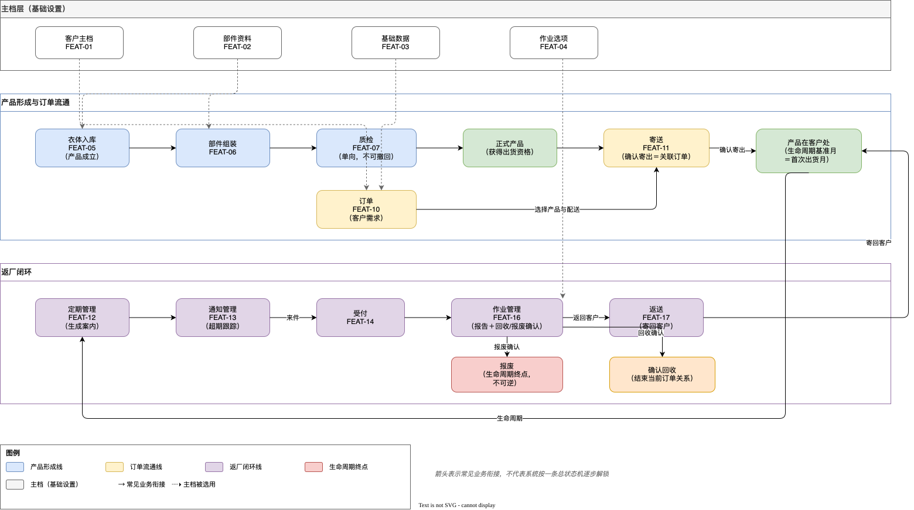
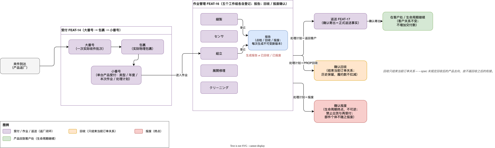

# PROP V2.1 整体业务流程

> 本文档用于建立系统全局业务认知：一台气囊产品从衣体到厂、出厂交付、到期返厂、再寄回或终结，中间各环节由哪些模块承接、各自留下什么业务事实。
> 本文档不替代各 Feature spec 与领域模型；页面字段、校验、操作细节以 `../features/FEAT-NN/spec.md` 为唯一基线。
> 图中箭头只表示常见业务衔接，各业务的前置条件以对应功能需求为准：订单可以不经过通知直接来件受付，产品可以先入库再下订单，报告也不是返送的硬前置。

## 一、整体业务流程图

大图分三层。顶部是**主档层**：客户主档（FEAT-01）、部件资料（FEAT-02）、基础数据（FEAT-03）、作业选项（FEAT-04）为各业务页面提供可选用资料与字典，本身不随单笔业务变化。中间是**产品形成线**：衣体入库（FEAT-05）时产品成立，经部件组装（FEAT-06）绑定气囊／传感器／发生器，质检（FEAT-07）登记通过后成为可出货的正式产品。下方是**订单流通线**与**返厂闭环线**：订单（FEAT-10）只记录客户需求，确认寄出（FEAT-11）才把产品与订单关联并把首次出货月登记为生命周期基准月；之后定期管理（FEAT-12）按生命周期生成案内，通知管理（FEAT-13）跟踪案内受付情况，产品返厂经受付（FEAT-14）、作业管理（FEAT-16）登记五组作业并生成报告，最后由返送（FEAT-17）寄回客户，或由作业管理确认回收／报废。

## 二、返厂闭环

图为原流程资料；报告入口及对象以2026-10-13正文为准：单台点检在作业管理或返送详情产品行生成，大番号回收／报废在返送详情页头生成。图中如出现作业管理生成三类报告的旧描述，不作为当前依据。

返厂段是最容易误读的一段，单独放大。受付以来件到达为起点，按**大番号 → 包裹 → 小番号**三层登记本次实际来件（FEAT-14）；作业管理按**縫製／センサ／組立／展開修理／クリーニング**五个工作组分别登记作业记录，并从这里生成单台点检报告、执行回收确认与报废确认；大番号回收／报废报告在返送详情生成（FEAT-17 §5.8）。

闭环的三种出口业务含义完全不同：

- **返送回客户**（FEAT-17）：只记录「这批受付产品已寄回客户」这一结果；产品仍归客户、客户关系不变、生命周期继续，之后仍可能再次来件。
- **确认回收**（FEAT-16 §3.3）：结束产品与当前订单的关系，历史保留；不是取消履约，订单有效履约数不扣减。spec 未规定回收后的产品去向，图中不画回收之后的任何衔接。
- **确认报废**（FEAT-16 §3.3）：产品生命周期终结，禁止继续出货与再次受付，不可逆；只终结产品与衣体编号（製造番号），气囊／传感器／发生器部件个体不随之报废，解除绑定后可继续用于其他产品。

报告与回收／报废实际处理是完全独立的两件事：生成回收报告不等于已回收，生成报废报告不等于已报废（FEAT-16 §3.3）。

## 三、各业务阶段在系统中的作用

| 业务阶段 | 解决的问题 | 关键业务结果 |
|---|---|---|
| 基础设置（FEAT-01～04） | 各业务页面需要的客户、部件、字典、作业选项从哪来 | 可复用的主档与字典；停用只影响之后的选择，不回写已引用历史 |
| 衣体入库（FEAT-05） | 新到衣体如何建档 | 衣体个体建档、产品成立（製造番号 = 衣体编号）、衣体与产品绑定，一次完成 |
| 部件组装（FEAT-06） | 气囊／传感器／发生器如何装到产品上 | 产品—部件绑定与安装／更换操作记录；部件个体建档（组装建档） |
| 质检（FEAT-07） | 线下质检结果如何进入系统 | 登记质检通过事实，产品获得出货资格；单向动作不可撤回 |
| 订单（FEAT-10） | 客户订购需求如何记录与跟踪 | 订单（需求、配送资料、数量）与交付进度；订单只是需求，不创造产品 |
| 寄送（FEAT-11） | 实际寄出如何登记 | 确认寄出后登记寄送事实，建立产品与订单当前关系，首次出货月成为生命周期基准月 |
| 定期管理（FEAT-12） | 哪些产品这个月该通知客户 | 按生命周期基准月找到候选产品，生成案内（定期点検／5年目廃棄）与正式 PDF |
| 通知管理（FEAT-13） | 已发出的案内有没有人来件 | 案内查询与发行日加 30 天超期未受付跟踪；不建立案内 |
| 受付（FEAT-14） | 来件到达如何登记 | 大番号／包裹／小番号三层受付事实；受付日期是通知模块判断超期的依据 |
| 作业管理（FEAT-16） | 五组现场作业如何登记、单台点检报告如何生成、回收报废如何确认 | 各组当前作业记录、单台点检报告不可变版本、回收事实（结束当前订单关系）、报废事实（生命周期终结） |
| 返送（FEAT-17） | 点检完的产品如何寄回客户 | 确认寄出后建立正式返送事实；不影响订单关系与履约数 |

## 四、读图时必须注意的业务边界

1. **产品成立于衣体入库，不成立于订单**：衣体入库时产品即成立（製造番号 = 衣体编号）（FEAT-05 §4.1）；订单只表示客户需求，实际寄出由寄送业务记录（FEAT-10 §1）；无订单也可先有产品，质检通过只要求部件构成不要求订单（FEAT-07 §3.2）。
2. **质检通过是单向动作不可撤回**：确认后无法撤回，误录只能由管理员在数据层更正，或走产品维修／换件流程（FEAT-07 §1、§5）。
3. **打印 ≠ 寄出**：生成面单／纳品书／保障确认书只产生文件记录，不登记寄出、不建立产品与订单关系；只有「确认寄出」登记寄送事实并建立产品与订单当前关系（FEAT-11 §6.1）；寄送侧首次出货月成为产品生命周期基准月（FEAT-12 §8.4）。返送侧同样打印与寄出分离（FEAT-17 §7.4）。
4. **客户主档更正／删除不回写历史单据**：订单、通知、受付、出货、返送在成立时各自保存当时的客户信息；主档之后更正、删除不影响已保存的单据（FEAT-01 §3.5）。
5. **部件资料修改不回写已建档个体**：已建档部件个体记住自己建档时（或被更正时）的那份资料内容；之后资料再修改，不影响已建档个体，也不回写产品、订单、已确认出货或正式文件（FEAT-02 §3.1、FEAT-05 §3.1、FEAT-06 §3.1）。
6. **报告每次生成都是新的不可变版本，不锁定作业记录**：报告生成后不可修改，之后作业记录变化不影响已生成报告（FEAT-16 §3.2）；旧报告不因作业后续修改而失效，不存在「修正版／过期／需更新」概念（FEAT-16 §5.6）；返送详情产品行复用单台点检报告，页头生成大番号回收／报废报告（FEAT-17 §5.8）。
7. **返送只记录「寄回客户」结果**：返送不建立、结束或修改任何订单关系，不增加订单交付数量，不决定作业或报告是否完成（FEAT-17 §1、§7.2）。
8. **回收／报废确认在作业管理完成，不在返送**：回收确认与报废确认均为作业管理的实际处理动作（FEAT-16 §3.3）；确认返送不产生订单履约变化、作业记录变化或报告版本；返送详情中独立的报告生成操作产生对应报告版本（FEAT-17 §6.7），返送资格只排除已确认回收／报废的产品（FEAT-17 §7.1）。

## 五、使用原则

本页只建立全局认知：三条主线各自承接什么、返厂闭环的三种出口分别意味着什么、哪些动作是不可逆的正式事实。具体页面、字段、校验与操作步骤以各 feature spec 为准；图中未画出的模块（首页看板、产品列表、部件追溯、受付履历、两类批量打印）承担查询、统计与文件输出职责，不改变本文所述业务事实的归属。

## 删除与身份的跨模块约束

产品／部件删除只移出当前有效业务范围，保留原身份及可读历史；同业务编号新登记为独立身份，M番号不复用。正常更换衣体只登记实物更换事件，身份、编号、绑定和系统衣体资料均不变。出货／返送准备可连同全部所属文件版本删除，正式寄出后不可删除；保障确认书归属单笔发货且仅含生成时该笔清单。详见 [身份与历史规则](identity-history-rules.md) 及所引功能正文。
