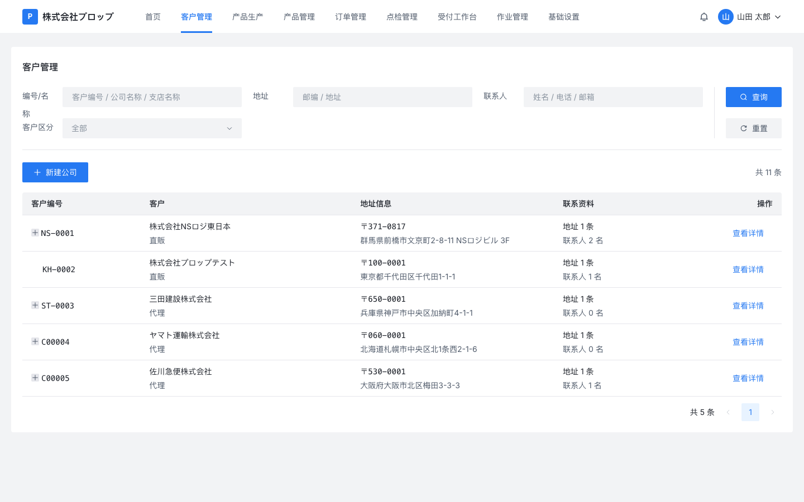
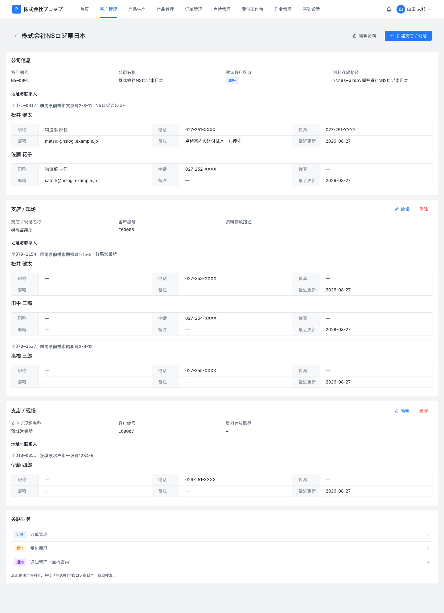
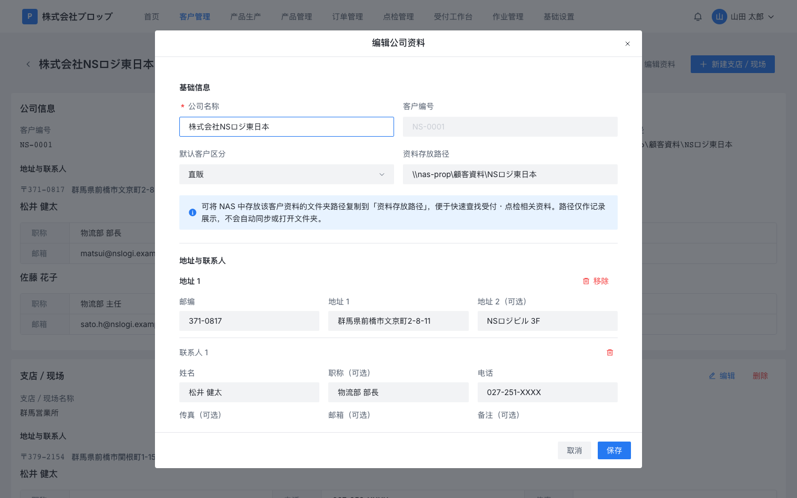
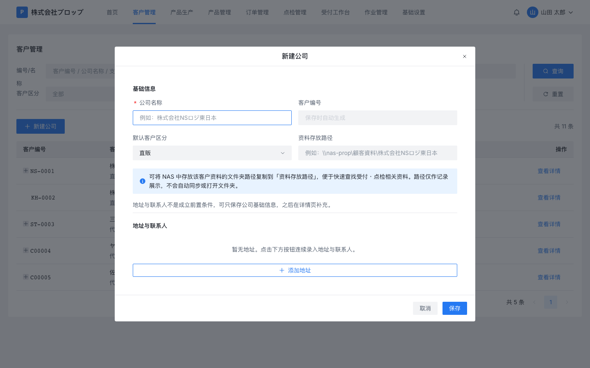

# FEAT-01 客户管理

**状态：Current Truth**

## 1. 模块概述

客户管理维护 PROP 可重复使用的客户主档，为订单、通知、受付、出货和返送提供公司、支店／现场、地址和联系人资料。

```text
公司
├─ 公司地址 0..N
│  └─ 联系人 0..N
└─ 支店／现场 0..N
   └─ 地址 0..N
      └─ 联系人 0..N

订单 / 通知 / 受付 / 出货 / 返送
└─ 引用客户主档，并各自保存当时的客户信息
   （之后更正或删除主档，不影响已保存的单据）
```

「客户主体」只是页面中对「公司或某个支店／现场」的统称，不是一种单独的客户资料。客户管理不处理价格、正式請求書、收款、对账和财务状态。

## 2. 页面构成

| 页面 | 导航位置 | 主要作用 |
|---|---|---|
| 客户列表 | 客户管理 | 搜索公司／支店、查看层级、进入详情、新建公司 |
| 客户详情 | 客户列表 → 查看详情 | 查看公司、支店、地址、联系人；支店编辑与删除；关联业务跳转 |
| 客户编辑工作区 | 列表「新建公司」、详情「编辑资料／新建支店／现场／编辑」 | 单弹窗连续新建或编辑公司／支店、地址、联系人 |
| 客户主体选择 | 订单等需要选择客户的页面内 | 选择公司或支店／现场 |

## 3. 资料项目与规则

### 3.1 公司

| 资料项目 | 必填 | 规则 |
|---|---:|---|
| 客户编号 | 是 | 两个来源：系统新建时自动生成，格式为 C + 连续数字（例：C00012），公司与支店／现场共用同一条连续序列，取当前最大号 +1；历史导入的客户直接使用其原系统中的编号（例：NS-0001）。编号一经确定终身不变（改名、改地址均不换号）；界面不可编辑 |
| 公司名称 | 是 | 公司现实名称，员工填写，可在编辑工作区更正 |
| 默认客户区分 | 是 | 固定两个选项：直販／代理；新建默认直販；不提供自定义维护 |
| 资料存放路径 | 否 | 客户资料在 NAS 中的存放路径，仅作记录展示，不自动同步、不自动打开 |
| 创建与修改信息 | — | 创建人、创建时间、最近修改人、最近修改时间由系统自动记录；详情页不展示 |

### 3.2 支店／现场

| 资料项目 | 必填 | 规则 |
|---|---:|---|
| 客户编号 | 是 | 规则同公司 |
| 支店／现场名称 | 是 | 支店或现场的现实名称；不另设类型字段 |
| 所属公司 | 是 | 新建时由上下文确定，之后不能更换所属公司 |
| 资料存放路径 | 否 | 同公司口径 |
| 创建与修改信息 | — | 同公司口径 |

支店不保存客户区分；需要显示时读取所属公司的默认客户区分。

### 3.3 客户地址

| 资料项目 | 必填 | 规则 |
|---|---:|---|
| 邮编 | 是 | 仅允许输入 7 位数字（不接受 〒、空格、连字符等任何其他字符）；保存与展示统一为「〒XXX-XXXX」形态（例：〒104-0033）；不满足 7 位数字时不允许保存 |
| 地址 1 | 是 | 都道府县、市区町村、道路和门牌 |
| 地址 2 | 否 | 建筑物、楼层、入口、店名或现场位置 |
| 所属对象 | 是 | 一个地址只能直接属于一个公司或一个支店／现场，不能同时属于两者；所属关系确定后不能更换 |

### 3.4 地址联系人

| 资料项目 | 必填 | 规则 |
|---|---:|---|
| 姓名 | 是 | 联系人姓名 |
| 职称 | 否 | 例：物流部 部長 |
| 电话 / 传真 / 邮箱 | 否 | 按文本保存 |
| 备注 | 否 | 联络偏好、注意事项 |
| 所属地址 | 是 | 确定后不能更换所属地址 |

### 3.5 各业务保存当时的客户信息

订单、通知、受付、出货、返送在成立时各自保存当时的客户信息（公司名称、地址、联系人等，部分界面称为「快照」）：

- 各业务保存的内容与格式由各自模块规定；
- 客户主档之后的更正、删除不回写已保存的单据；历史业务继续显示当时的信息。

## 4. 客户列表

### 4.1 页面作用

搜索公司和支店／现场，查看层级，进入详情；新建公司的唯一入口。

### 4.2 页面入口与去向

- 入口：主导航「客户管理」。
- 行「查看详情」→ 公司详情；
- 「新建公司」→ 客户编辑工作区；保存成功后跳新公司详情。

### 4.3 页面布局



```text
客户管理
[编号/名称      ] [地址      ] [联系人      ] [客户区分 ▼] │ [查询] [重置]
─────────────────────────────────────────────────────────────────
[＋ 新建公司]                                            共 N 条
┌───────────────────────────────────────────────────────────┐
│ ▾ 客户编号    客户              地址信息                联系资料    操作 │
│   NS-0001   株式会社NSロジ…    〒371-0817            地址 1 条  查看详情 │
│             直販               群馬県前橋市文京町…     联系人 2 名      │
│   ▸ （公司行可展开支店行；搜索时自动展开命中项）                 │
└───────────────────────────────────────────────────────────┘
                                        共 N 条   < 1 2 … >
```

### 4.4 展示信息

每格两行：第一行主值、第二行辅助值，语义不互换。

| 列 | 第一行 | 第二行 |
|---|---|---|
| 客户编号 | 编号（等宽字体） | — |
| 客户 | 公司或支店名称 | 客户区分（直販／代理；支店读所属公司值） |
| 地址信息 | 第一个地址的邮编（〒 前缀，等宽字体） | 第一个地址的地址 1 + 地址 2；无地址显示 — |
| 联系资料 | 地址 N 条 | 联系人 N 名 |
| 操作 | 查看详情 | — |

### 4.5 功能

- 三个分类搜索框 + 一个筛选项：
  - 编号/名称：客户编号（含导入客户的原编号）、公司名、支店名；
  - 地址：邮编、地址 1、地址 2；邮编查询允许输入带或不带 ASCII 连字符 `-` 的值，查询时先移除 `-`，再按邮编数字做部分匹配，不改变数据库中保存的 7 位数字格式；
  - 联系人：姓名、电话、传真、邮箱；
  - 客户区分：直販 / 代理。
- 统一按部分匹配（忽略英文大小写）；「查询」按钮或回车生效；「重置」清空全部条件。
- 公司行可展开支店行；搜索命中时自动展开命中公司；无搜索时默认收起。
- 层级列表排序固定如下，筛选和未筛选时相同：一级公司按创建时间倒序，创建时间相同时按公司内部唯一 ID 倒序；同一公司下的二级支店／现场按创建时间正序，创建时间相同时按支店／现场内部唯一 ID 正序。客户编号和最近修改时间不参与排序；编辑客户资料不改变创建时间，也不改变其排序位置。
- 分页以公司为单位，每页 10 个公司；工具栏「共 N 条」为公司与支店合计行数。
- 导入数据是否保留原始创建时间待实际导入资料明确后裁决；本轮不根据客户编号推算创建时间，不提供手工排序或表头排序。

### 4.6 校验与反馈

纯查询页面，无写入校验；无结果时显示统一空状态。

### 4.7 页面产生的数据

无（只读与导航）。

## 5. 客户详情

### 5.1 页面作用

查看公司基础信息、地址与联系人、全部支店及其地址联系人；提供公司编辑、支店新建／编辑／删除入口；提供订单、受付、通知的关联跳转。

### 5.2 页面入口与去向

- 入口：客户列表「查看详情」；新建／编辑保存后跳转。
- 「编辑资料」→ 公司编辑工作区；「新建支店／现场」→ 支店编辑工作区；支店卡「编辑」→ 支店编辑工作区。
- 关联业务快捷链接 → 订单管理 / 受付履歴 / 通知管理，自动按本公司名称搜索目标列表。
- 返回 → 客户列表。

### 5.3 页面布局



```text
← 株式会社NSロジ東日本              [编辑资料] [＋ 新建支店／现场]

┌ 公司信息 ───────────────────────────────────────┐
│ 客户编号       公司名称        默认客户区分  资料存放路径 │
│ C00001       株式会社NS…     [直販]       \\nas-prop\… │
│                                                 │
│ 地址与联系人                                     │
│ 〒371-0817  群馬県前橋市文京町2-8-11  NSロジビル3F   │
│ ┌ 松井 健太 ────────────────────────────────┐  │
│ │ 职称 物流部 部長 │ 电话 027-…  │ 传真 027-…    │  │
│ │ 邮箱 …           │ 备注 …      │ 最近更新 …    │  │
│ └───────────────────────────────────────────┘  │
└─────────────────────────────────────────────────┘

┌ 支店／现场 ──────────────────────── [编辑] [删除] ─┐
│ 支店／现场名称     客户编号        资料存放路径       │
│ 群馬営業所        C00006         —                │
│ 地址与联系人（结构同公司卡）                         │
└───────────────────────────────────────────────────┘

┌ 关联业务 ───────────────────────────────────────┐
│ [订单]  订单管理                              →  │
│ [受付]  受付履歴                              →  │
│ [通知]  通知管理（点检案内）                  →  │
│ 点击跳转对应列表，并按「公司名」自动搜索。           │
└─────────────────────────────────────────────────┘
```

### 5.4 展示信息

- 公司卡：客户编号（等宽）、公司名称、默认客户区分、资料存放路径（等宽，空值 —）。不显示创建人／创建时间／修改人／修改时间。
- 支店卡：卡片标题统一为分类名「支店／现场」；支店／现场名称、客户编号、资料存放路径为内容区首行字段。
- 地址与联系人（公司卡、支店卡结构一致）：
  - 地址为一行组头：〒邮编（等宽）+ 地址 1 + 地址 2（弱化）；
  - 联系人用带边框的描述表格：姓名为标题，职称／电话／传真、邮箱／备注／时间六个项目固定三列等宽排列、常显，无值显示 —；
  - 时间尾项：编辑过显示「最近更新 + 更新日期」，未编辑过显示「新建 + 创建日期」；
  - 地址为空显示统一空状态；地址下无联系人显示「暂无联系人」。
- 关联业务：三个快捷链接（订单／受付／通知 + 目标页名 + 箭头），只负责跳转，不做件数统计。

### 5.5 功能

- 编辑资料：打开公司编辑工作区（编辑模式）。
- 新建支店／现场：打开支店编辑工作区（所属公司由上下文确定）。
- 支店卡「编辑」：打开该支店编辑工作区。
- 支店卡「删除」：确认后删除该支店，其下地址与联系人一并删除。

### 5.6 校验与反馈

删除支店确认弹窗固定说明：

```text
将同时删除其下 N 个地址、M 名联系人，删除后不可恢复；
已生成的订单、通知、受付等历史业务记录不受影响（业务保存的是当时的信息）。
```

### 5.7 页面产生的数据

- 删除支店 → 该支店及其下地址、联系人一并删除；
- 其他动作只打开工作区或跳转，不直接写数据。

## 6. 客户编辑工作区

### 6.1 页面作用

新建或编辑公司／支店，并在同一弹窗内连续录入地址与联系人，一次提交。新建与编辑共用同一工作区。

### 6.2 页面入口与去向

- 列表「新建公司」；详情「编辑资料」「新建支店／现场」、支店卡「编辑」。
- 保存成功：新建 → 跳新对象详情；编辑 → 停留详情并刷新。
- 取消直接关闭，不写数据。

### 6.3 页面布局




```text
┌ 新建公司 / 编辑公司资料 ─────────────────────────┐
│ 基础信息                                            │
│ [公司名称              ] [客户编号（保存时自动生成）]  │
│ [默认客户区分 ▼        ] [资料存放路径              ] │
│ ⓘ 可将 NAS 中存放该客户资料的文件夹路径复制到           │
│   「资料存放路径」…仅作记录展示，不自动同步或打开。      │
│ ─────────────────────────────────────────────────  │
│ 地址与联系人                                        │
│ ┌ 地址 1 ────────────────────────────── [移除] ──┐  │
│ │ [邮编]        [地址 1]        [地址 2（可选）]   │  │
│ │ ┌ 联系人 1 ──────────────────────── [✕] ────┐ │  │
│ │ │ [姓名]   [职称（可选）]   [电话]            │ │  │
│ │ │ [传真（可选）] [邮箱（可选）] [备注（可选）]  │ │  │
│ │ └──────────────────────────────────────────┘ │  │
│ │ ＋ 添加联系人                                  │  │
│ └───────────────────────────────────────────────┘  │
│ [＋ 添加地址]                                       │
│                                     [取消] [保存]   │
└─────────────────────────────────────────────────────┘
```

支店模式差异：首行改为「所属公司（只读）＋ 支店／现场名称」，无默认客户区分字段。

### 6.4 展示信息

全部录入项目见第 3 节；录入字段均带可见标题，输入框内的示例文字只作填写示例。

### 6.5 功能

- 连续录入：添加地址 → 在地址块内添加联系人 → 继续添加地址，一次保存；不打开第二层弹窗。
- 地址与联系人不是成立前置条件：可只保存基础信息。
- 保存前的新增／移除只是页面上的草稿，保存时才统一生效。
- 移除已有地址时先弹确认（说明连带联系人数与对历史业务无影响），确认后从草稿移除；本次新添加的地址移除不弹确认。
- 编辑模式：打开时载入现有全部地址与联系人，可直接增删改。

### 6.6 校验与反馈

- 公司：名称必填；支店：名称必填（所属公司由上下文确定）；
- 已开始填写的地址必须具有邮编和地址 1；已开始填写的联系人必须具有姓名；
- 邮编仅允许输入 7 位数字；不接受 〒、空格、连字符等任何其他字符，保存与展示统一为「〒XXX-XXXX」形态（例：〒104-0033）；
- 错误指出具体对象，如「地址 2 缺少邮编或地址 1」「地址 1 的邮编应为 7 位数字」「地址 1 的联系人 2 缺少姓名」；
- 任一校验失败整体不提交，保留已填写内容。

### 6.7 页面产生的数据

- 新建保存：建立一个公司或支店／现场及其地址、联系人；系统自动分配客户编号并记录创建信息；任一内容校验失败时全部不保存。
- 编辑保存：按最终内容一次生效——修改的项目更正、移除的地址连同其联系人一并删除、移除的联系人删除、新增的项目建立；客户编号不变；系统自动记录修改信息。

## 7. 客户主体选择

需要选择客户的页面（如订单）提供统一的选择方式：

- 先选公司，可再选其支店／现场；不选支店即为选择公司本身；
- 支持按名称、编号搜索；选择时预览所选主体的资料；
- 地址与联系人由调用页面自行选择或就地维护；
- 各业务各自保存当时选择的客户信息，选择动作本身不修改客户主档。

## 8. 跨页面统一规则

- 层级固定：公司 →（公司地址｜支店 → 支店地址）→ 联系人；一个地址只能直接属于一个公司或一个支店／现场。
- 客户编号：系统新建为 C + 连续数字（公司与支店／现场共用同一条连续序列，保存时自动生成）；历史导入客户使用其原系统编号；编号不可编辑、一经确定终身不变。
- 客户区分固定为直販、代理两个选项，不提供自定义维护；支店不存区分，读取所属公司值。
- 主档更正、删除不影响历史业务中保存的当时信息。
- 删除语义：删除支店时其下地址、联系人一并删除；删除地址时其联系人一并删除；联系人可单独删除；公司无删除入口。
- 不提供地址换所属公司／支店，不提供联系人换所属地址。
- 无启用／停用概念：不需要的地址、联系人、支店直接删除。
- 无更正履历：主档只保留当前内容与最近修改信息。

## 9. Feature 边界与明确不做

```text
客户主档与各业务的客户信息来源 → 本模块
价格 / 正式請求書 / 收款 / 对账 / 财务 → 不在系统范围
订单 / 通知 / 受付保存的客户信息内容与业务校验 → 各调用模块
```

明确不做：

- 启用／停用（任何层级）；
- 更正履历与字段级历史记录展示；
- 默认請求書先管理；
- 支店独立客户区分；
- 公司删除；
- 地址换所属、联系人换地址；
- 邮箱格式校验、疑似重复提示；
- 关联业务件数统计；
- 得意先コード（SMILE BS 客户代码）管理（2026-09-20 裁决：暂不考虑）。

## 10. 核对记录

- 2026-09-23：按二级导航粒度自 01-客户管理 拆分为本 feature（FEAT-01）；内容不变，章节与交叉引用已重编号。

- 核对日期：2026-09-20，已与当前 demo 核对一致。
- 裁决来源：修改记录 2026-09-18 至 2026-09-20 客户管理各条目，及「客户编号规则定稿 + PRD 文档风格裁决」（2026-09-20）。
- 二轮修订（2026-09-20）：邮编格式校验与保存归一化（日本 7 位数字、〒/空格/连字符/全角宽容录入）；历史编号不再单独成节、并入公司/支店资料项目；列表「公司整体」改「公司」；4.3/4.4 按页面实际修正（默认請求書先占位文案恢复如实描述）。来源：修改记录「客户管理四点修订」（2026-09-20）。
- 三轮修订（2026-09-21）：历史编号概念删除，导入客户直接使用原历史编号作为客户编号；列表客户列第二行改为客户区分；「默认业务信息」列改为「地址信息」（第一个地址的邮编 + 地址）；默认請求書先占位文案随列重构移除。来源：修改记录「客户列表三列重构 + 历史编号概念删除」（2026-09-21）。
- 五轮修订（2026-09-21，仅文档）：邮编录入口径由宽容录入改为严格录入——仅允许 7 位数字，保存与展示统一为「〒XXX-XXXX」；「明确不做」中的默认請求書先条目恢复为无注解写法，避免开发误读。来源：修改记录「客户管理 PRD 两点文档修订（2026-09-21）」。
- 六轮修订（2026-09-26，仅查询规则）：地址筛选中的邮编允许带或不带 ASCII 连字符 `-`；查询时移除连字符后按邮编数字部分匹配，数据库保存格式仍为 7 位数字。
- 七轮修订（2026-09-26，列表排序）：公司按创建时间／内部 ID 倒序，所属支店／现场按创建时间／内部 ID 正序；筛选、分页与编辑后的稳定位置规则同步明确，导入创建时间口径保留待后续裁决。
