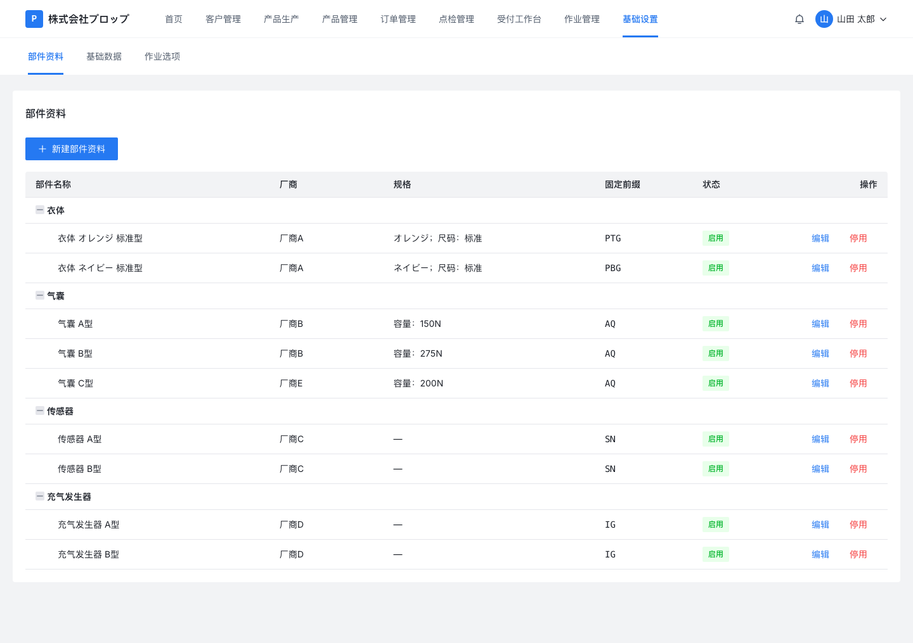
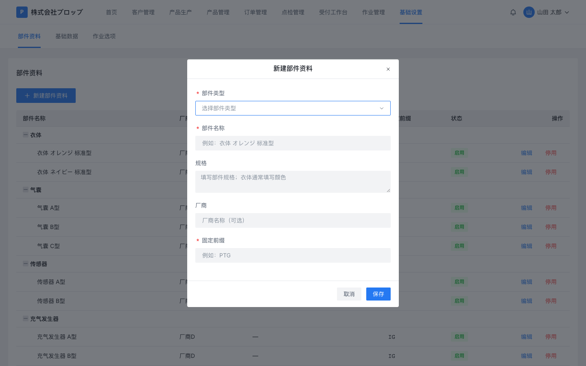

# FEAT-02 部件资料

**状态：Current Truth**

## 1. 模块概述

部件资料负责建立与维护某类部件下一款可复用的定义，供衣体入库、部件组装、订单等页面选用。

```text
部件资料（定义：名称 / 规格 / 厂商 / 编号前缀）
  ├─ 衣体入库选用
  ├─ 部件组装选用
  └─ 订单等页面选用
```

## 2. 页面构成

| 页面 | 导航位置 | 主要作用 |
|---|---|---|
| 部件资料 | 基础设置 → 部件资料 | 建立与维护部件资料（规格、厂商、前缀、启停） |

## 3. 资料项目与规则

### 3.1 部件资料

一条部件资料代表某类部件（衣体／气囊／传感器／充气发生器）下一款可复用的定义。

| 资料项目 | 必填 | 规则 |
|---|---:|---|
| 部件类型 | 是 | 四选一：衣体／气囊／传感器／充气发生器；建立后不可改 |
| 部件名称 | 是 | 自由文本 |
| 规格 | 是 | 单一自由文本，四类部件均必填；衣体通常填写颜色，也可填写其他描述，系统不解析含义 |
| 厂商 | 否 | 自由文本 |
| 编号前缀 | 否 | 自由文本，最多 32 个 Unicode 码点；不限字符种类，不自动转换大小写或删除非空值中的字符。作为该类部件编号的建议前缀；衣体入库连续范围的带出与临时输入规则见 FEAT-05 |
| 状态 | — | 启用／已停用；停用后新建个体与组装录入不可选，已建档个体和历史不受影响 |

规则：

- 资料修改保留历史：编辑资料保存后，旧内容不被覆盖，作为历史版本完整保留；当前页面不提供历史版本查看入口，页面与新建建档读取最新内容。
- 已建档部件个体记住自己建档时（或被更正时）的那份资料内容；之后资料再修改，不影响已建档个体，也不回写产品、订单、已确认出货或正式文件。
- 每次编辑保存均产生一份新的完整资料版本。新版本保存部件名称、规格、厂商和编号前缀的完整内容；即使本次只修改其中一个项目，也不得覆盖旧版本。
- 部件类型建立后不可修改；停用／启用只改变资料是否可供之后选择，不产生资料版本。

## 4. 部件资料（基础设置）

### 4.1 页面作用

建立与维护四类部件的可复用资料定义。

### 4.2 页面入口与去向

- 入口：基础设置 → 部件资料。
- 去向：资料被衣体入库、部件组装、订单等页面选用。

### 4.3 页面布局




```text
┌──────────────────────────────────────────────────────────┐
│ 部件资料                                    [新建部件资料] │
│  表格（按部件类型分组展开）：                              │
│   类型组行：衣体 / 气囊 / 传感器 / 充气发生器              │
│   资料行：部件名称 │ 厂商 │ 规格 │ 编号前缀 │ 状态 │ 操作   │
└──────────────────────────────────────────────────────────┘
新建／编辑共用 弹窗：部件类型（编辑时不可改）/ 部件名称 / 规格（多行）
  / 厂商 / 编号前缀；[保存][取消]
```

### 4.4 展示信息

- 表格按部件类型分组，默认全部展开；无筛选区、无独立详情页。
- 列：部件名称、厂商（空显示 —）、规格（完整文本允许换行）、编号前缀（等宽）、状态（启用／已停用 Tag）、操作（编辑／停用·启用）。

### 4.5 功能

- **新建部件资料**：弹窗选择部件类型、填写名称、规格（必填，多行文本）、厂商（可选）、编号前缀（可选）。前缀可包含数字、中文、符号或大小写混合内容；只要不超过容量上限，不因字符种类被拒绝。
- **编辑**：同一弹窗；部件类型不可改；保存后产生一份包含部件名称、规格、厂商和编号前缀完整内容的新资料版本，旧版本完整保留但不在当前页面展示。
- **停用／启用**：行内确认后切换；停用后该资料不可再用于新建个体与组装录入，已建档个体与历史版本不受影响。

### 4.6 校验与反馈

- 部件类型、部件名称和规格必填；厂商和编号前缀可空。
- 编号前缀最多 32 个 Unicode 码点；不自动改变大小写、删除符号或对非空输入做字符种类归一。`null`、空串或全空白均按未填处理；含有非空白字符的值按输入原样保留。
- 校验失败在弹窗内指出字段，不关闭弹窗、保留已填内容。

### 4.7 页面产生的数据

- 新建 → 建立一个部件资料（含首个资料版本）。
- 编辑 → 生成一个新的完整资料版本；旧版本完整保留且不被覆盖，不论本次修改的是名称、规格、厂商还是编号前缀。
- 停用／启用 → 更正资料状态，不产生版本。

## 5. 跨页面统一规则

- **资料版本与当前资料**：每次编辑保存均完整保留该次部件名称、规格、厂商和编号前缀；最新版本供之后的新建与录入选择。已建档部件个体继续使用其建档或资料更正时采用的版本，资料后续修改不影响既有个体。
- **停用语义**：部件资料停用只影响「之后的选择」，不影响已建档个体与历史；部件个体没有停用功能。

- **个体纠错与历史引用**：编号正确但资料错误时，通过 FEAT-06／08／16 的既有资料更正机制处理，保留个体身份、采用的资料版本和更正记录，不要求删除重建。个体删除不清除这些历史；同编号重新登记的新身份不继承原个体更正记录（FEAT-09 §3.7～3.8）。实物更换衣体不自动更改系统衣体资料。

## 6. Feature 边界与明确不做

```text
部件资料 → 本 feature
部件个体的查询、履历展示与删除入口 → FEAT-09 部件追溯
质检判定 → FEAT-07 质检；产品详情与删除 → FEAT-08 产品管理
订单选配与出货、受付／作业中的部件事实读取 → 各调用 feature
```

明确不做：

- 动态规格参数配置（参数名自定义、参数行增删、值与单位分列、摘要勾选）；
- 独立颜色字典维护入口；
- 从规格文本解析含义（颜色、型号等不结构化、不推导拦截规则）；

## 7. 核对记录

- 2026-09-23：按二级导航粒度自 02-部件与生产 拆分为本 feature（FEAT-02）；内容不变，章节与交叉引用已重编号。
- 核对日期：2026-09-21，已与当前 demo 核对入库、组装、资料功能一致（AssemblyPage / IntakeWorkbenchPage / PartProfileListPage / partMockRepository）；部件追溯履历展示固件记录、导出 Excel 尚未实施，见 validation 用例备注。
- 裁决来源：修改记录 §24.21（部件资料页面简化）、§24.22（产品统一列表与在制品合并）、部件组装三组装页合并与三次调整（2026-09-18）、Enter 纵向跳格（2026-09-18）、删除部件停用功能（2026-09-18）、部件追溯新增删除部件（2026-09-19）、作业管理更换衣体改为确认制（2026-09-20）；阶段 PRD 02-部件资料-v21.md、03-部件追溯-v21.md。
- 结构说明：本模块合并 V2.0「02-部件资料与衣体入库」与「03-产品组装」两份底稿为单一 spec；质检工作台与产品列表／详情划入 FEAT-08 产品管理。
- 二轮修订（2026-09-21）：规格改为四类部件均必填；「资料版本」表述改为保留历史的业务说法；删除「实时派生」表述（实现方式由开发决策）；删除组装页旧路由描述；范围筛选改为严格匹配并明确待录入只看三件必需部件（发生器位置 2 不影响）；删除「原部件不存在」不可达提示；导出明确为正式功能（导出 Excel）；「固定前缀」统一为「编号前缀」。来源：用户对本 spec 初稿的逐条批注（2026-09-21）。
- 三轮修订（2026-09-21）：组装页筛选语义改为「查询全部 Product」——页面进入后表格为空并提示筛选；范围/编号筛选显示符合条件的全部 Product（含已完成质检），不再只查询待录入产品；发生器位置 2 空缺不再导致产品从组装页消失；废弃「三个必需部件齐全后从组装页隐藏」的逻辑。来源：用户裁决（2026-09-21）。
- 三轮修订（2026-09-21）：部件追溯章节拆出为独立模块 FEAT-09 部件追溯；质检工作台划入 FEAT-07 质检；「打印编号清单」功能整体删除（页面、路由、打印版本数据）；删除语义一节改为引用 FEAT-09。来源：用户裁决「模块按业务职责拆分、删除打印编号清单功能」（2026-09-21）。
- 四轮修订（2026-09-23）：经用户明确允许破例修改冻结 spec，部件资料版本规则统一为「每次编辑保存完整新版本」；名称、规格、厂商和编号前缀均随版本完整保留，停用／启用不产生版本。
- 五轮修订（2026-09-27）：按用户最新裁决，编号前缀改为选填自由文本，取消纯英文限制并保留非空输入原样；前缀仍属于完整版本内容，空/非空间编辑不改写旧版本或已建档个体。
