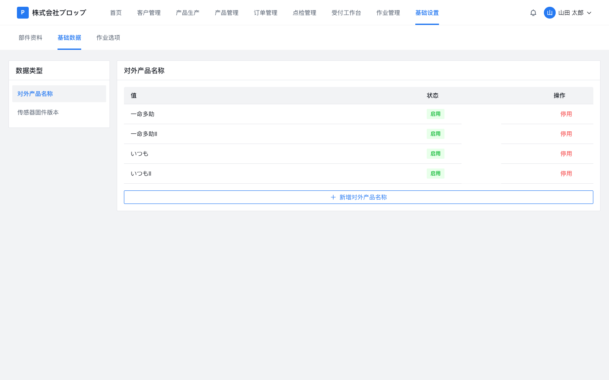

# FEAT-03 基础数据

**状态：Current Truth**

## 1. 模块概述

基础数据是系统级字典维护页，供各业务页面下拉／选择使用。

```text
基础数据维护
  ├─ 对外产品名称 → FEAT-10 订单管理选择
  └─ 传感器固件版本 → FEAT-06 部件组装、FEAT-08 产品详情、FEAT-16 作业管理选择
```

## 2. 页面构成

| 页面 | 导航位置 | 主要作用 |
|---|---|---|
| 基础数据 | 基础设置 → 基础数据 | 对外产品名称、传感器固件版本两类字典的新增／停用／启用 |

## 3. 资料项目与规则

### 3.1 字典范围

本页面只维护两类字典：对外产品名称、传感器固件版本。页面不存在其他字典。

### 3.2 对外产品名称

- FEAT-10 订单管理从启用的对外产品名称中选择。
- 一个订单只有一种产品名称，所有订单行的产品名称必须相同。
- 对外产品名称不决定实物颜色或规格。

### 3.3 传感器固件版本

- FEAT-06 部件组装中的默认固件选择与行内固件更新、FEAT-08 产品详情中的传感器补录／更换／版本升级，以及 FEAT-16 作业管理中的バージョンNo，统一使用本页面维护的传感器固件版本。
- 新选择只提供启用项。已被传感器采用的版本停用后，当前部件和历史继续显示原值，不清空、不自动替换，也不因保留旧值要求员工重新选择。
- 合法消费页面可只读取得启用项，不要求同时拥有基础数据维护页面权限；新增、停用和启用等维护接口仍只向基础数据维护页面授权。

## 4. 基础数据

### 4.1 页面作用

维护供各业务页面选择的系统级字典。

### 4.2 页面入口与去向

- 入口：基础设置 → 基础数据。
- 去向：启用的对外产品名称供 FEAT-10 订单管理选择；启用的传感器固件版本供 FEAT-06 部件组装、FEAT-08 产品详情和 FEAT-16 作业管理选择。

### 4.3 展示信息



2026-10-01 用户裁决：取消“引用情况”列，列表以本节三列定义为准；原型图片已同步为三列。启停及历史引用保留规则不变。

- **左侧类型菜单**：对外产品名称、传感器固件版本，点击切换右侧字典内容。
- **字典列表**：每行只显示值、状态（启用／停用标签）、操作（停用／启用）；不展示引用情况或引用数量，不要求为本页统计当前或历史引用。
- **新增区**：列表下方「新增」按钮，点击展开行内输入区（输入框 + 取消／保存）。

### 4.4 功能

- **新增**：输入值并保存 → 新增为启用状态 → 立即可供业务页面选择。
- **停用**：二次确认（提示「停用后不再出现在新建选择中；已引用的历史记录继续显示原值」）→ 该项不再出现在新建选择的下拉中。
- **启用**：二次确认 → 恢复可选。
- **被引用项处理**：允许停用；停用不影响已引用历史记录，历史记录继续显示原值。字典项不提供删除。

### 4.5 校验与反馈

- 新增保存前去除输入值首尾空白；处理后为空不可保存。中间空格、全角半角及其他字符不自动删除、合并或转换，显示保留去除首尾空白后的原输入大小写。
- 同一类型内按英文字母大小写不敏感判重；不同类型允许同名。例如「 Test 」与「test」视为重复，「A B」与「AB」不因本规则视为相同。
- 启用和停用项均参与判重。命中已有启用项时提示「该值已存在」；命中已有停用项时提示「该值已存在且已停用，请使用现有启用操作」，不得自动新建或自动启用。
- 服务端校验与数据库唯一性约束必须遵循相同判重口径；并发提交同一类型的同一归一值时最多建立一条记录，其他请求返回相同的重复提示。不得只依赖数据库默认排序规则推定所有字符比较行为符合上述要求。

### 4.6 页面产生的数据

- 新增：建立一条字典项（类型、值、启用状态）。
- 停用／启用：更新该字典项的状态，不修改值，不影响历史引用。

## 5. 跨页面统一规则

- 订单只能从启用的对外产品名称中选择。
- 部件组装、产品详情和作业管理的新选择只能使用基础设置中启用的传感器固件版本；已采用版本停用后仍按原值显示，不回写既有部件或历史。
- 启用项共享读取按合法消费页面权限开放，不扩大基础数据维护接口权限。

## 6. Feature 边界与明确不做

**本 feature 负责**：系统级字典维护页。

**其他 feature 负责**：对外产品名称在订单中的选择与订单内一致性（FEAT-10）；传感器固件版本的采用与变更事实（FEAT-06、FEAT-08、FEAT-16）。

**明确不做**：

- 从对外产品名称决定实物颜色或规格。
- 在本页面维护颜色、快递公司等两类以外的字典。

## 7. 核对记录

- 2026-09-23：按二级导航粒度自 02-部件与生产、06-订单管理、11-受付、12-作业管理、13-返送的基础数据相关描述拆分为本 feature（FEAT-03）；内容不变，章节与交叉引用已重编号。
- 2026-09-23：按 demo 页面实际行为补全维护规则（用户许可核对 demo 设置页）：字典范围明确为对外产品名称与传感器固件版本两类（颜色无独立字典）、左侧类型菜单、列表列（值／状态／引用情况／操作）、行内展开新增、停用二次确认与历史引用不回写提示、空值与重名校验、被引用项处理、快递公司改为固定选项等由「待补」转正。
- 2026-09-23：用户裁决删除颜色与快递公司两节——颜色与快递公司不属于本页面内容，相关规则本 feature 不再表述（颜色的填写规则在 FEAT-02 部件资料与 FEAT-10 订单管理各自表述，快递公司选项规则在 FEAT-11 寄送／FEAT-17 返送各自表述）。§3 小节重编号为 3.1 字典范围／3.2 对外产品名称／3.3 传感器固件版本。

- 2026-10-01：用户确认取消基础数据列表引用情况展示及统计要求；两类基础数据均适用，启停和历史引用规则不变。
