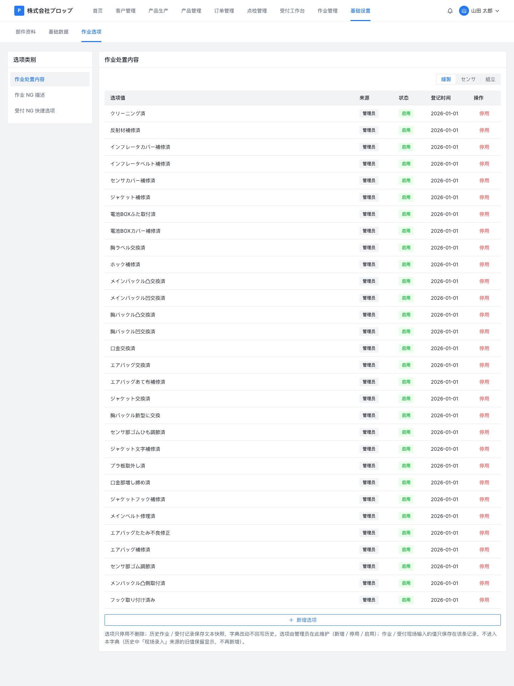

# FEAT-04 作业选项

**状态：Current Truth**

## 1. 模块概述

作业选项维护作业现场使用的常用 NG 描述、常用处置内容（按工作组），以及受付工作台使用的受付 NG 快捷选项（全局）。

```text
作业选项
  ├─ 作业 NG 描述 ─┐
  ├─ 作业处置内容 ─┴→ FEAT-16 作业管理按工作组选择
  │                      └→ 现场输入只进入该台作业记录，不回写清单
  └─ 受付 NG 快捷选项 ─→ FEAT-14 受付工作台「④ 异常 / NG」点击填充
```

## 2. 页面构成

| 页面 | 导航位置 | 主要作用 |
|---|---|---|
| 作业选项 | 基础设置 → 作业选项 | 按縫製／センサ／組立三组维护作业 NG 描述与作业处置内容；维护全局受付 NG 快捷选项 |

## 3. 资料项目与规则

### 3.1 作业 NG 描述

- 常用 NG 清单按工作组维护，字典仅含縫製／センサ／組立三组。
- 支持新增／停用／启用。
- 作业现场可从该组常用 NG 清单选择，也可现场输入。
- 现场输入的新值只保存到该台作业记录，不进入该组常用清单，作业现场不回写。

### 3.2 作业处置内容

- 常用处置清单按工作组维护，字典仅含縫製／センサ／組立三组。
- 支持新增／停用／启用。
- 作业现场可从该组常用处置清单中选择，也可现场输入新值。
- 现场输入的新值只保存到该台作业记录，不进入该组常用清单，作业现场不回写。

### 3.3 受付 NG 快捷选项

- 全局清单，不分工作组；支持新增／停用／启用。
- 为 FEAT-14 受付工作台「④ 异常 / NG」的登记弹窗提供快捷选项：弹窗内以可点击的选项胶囊展示启用项，点击后将选项内容填入 NG 内容输入框，填入后允许继续编辑。
- 快捷选项只是输入辅助，不改变 NG 内容的业务含义；登记保存的是当时输入的文本内容，之后字典停用或修改不回写已登记的 NG。

## 4. 作业选项

### 4.1 页面作用

按工作组维护 FEAT-16 作业管理使用的作业 NG 描述与作业处置内容清单。

### 4.2 页面入口与去向

- 入口：基础设置 → 作业选项。
- 去向：FEAT-16 作业管理的检查 NG 与处置选择。

### 4.3 展示信息



- **左侧选项类别菜单**：作业处置内容、作业 NG 描述、受付 NG 快捷选项，点击切换右侧清单。
- **工作组页签**：縫製／センサ／組立三组（作业处置内容与作业 NG 描述），展開修理／クリーニング不设处置与 NG 常用清单。
- **受付 NG 快捷选项为全局清单**：选择该类别时不显示工作组页签。
- **选项清单**：每行显示选项值、来源（管理员／现场录入）、状态（启用／停用标签）、登记时间、操作（停用／启用）。
- **新增区**：清单下方「新增」按钮，点击展开行内输入区（输入框 + 取消／保存）。

### 4.4 功能

- 作业 NG 描述：按工作组新增／停用／启用。
- 作业处置内容：按工作组新增／停用／启用。
- 受付 NG 快捷选项：全局新增／停用／启用，不分工作组。
- 停用项不再出现在作业现场的选择清单中；启用项恢复可选。
- 清单项不提供删除。来源列为「现场录入」的项是历史行为残留（作业现场曾回写清单），当前规则现场输入不回写清单，该来源不再新增。

### 4.5 校验与反馈

- 新增保存前去除输入值首尾空白；处理后为空不可保存。中间空格、全角半角及其他字符不自动删除、合并或转换，显示保留去除首尾空白后的原输入大小写。
- 作业 NG 描述与作业处置内容分别在「同一类别、同一工作组」内按英文字母大小写不敏感判重；受付 NG 快捷选项在该类别的全局范围内按相同规则判重。不同类别或不同工作组允许同名。例如「 Test 」与「test」视为重复，「A B」与「AB」不因本规则视为相同。
- 启用和停用项均参与判重。命中已有启用项时提示「该值已存在」；命中已有停用项时提示「该值已存在且已停用，请使用现有启用操作」，不得自动新建或自动启用。
- 服务端校验与数据库唯一性约束必须遵循相同判重口径；并发提交同一判重范围的同一归一值时最多建立一条记录，其他请求返回相同的重复提示。不得只依赖数据库默认排序规则推定所有字符比较行为符合上述要求。
- 停用需二次确认，提示「停用后不再出现在新建选择中；已登记的历史记录保存的是文本快照，继续显示原值」。

### 4.6 页面产生的数据

- 新增／停用／启用更正对应工作组的常用 NG 清单或常用处置清单。
- 新增／停用／启用更正全局受付 NG 快捷选项清单。

## 5. 跨页面统一规则

- 作业现场输入的新处置内容、新 NG 内容只进入该台作业记录，不进入该组常用处置清单、常用 NG 清单。
- 字典仅含縫製／センサ／組立三组；展開修理／クリーニング不设处置与 NG 常用清单。
- 受付 NG 快捷选项为全局选项；FEAT-14 受付工作台「④ 异常 / NG」登记弹窗显示启用项胶囊，点击填入内容并允许编辑，登记保存文本快照，字典之后停用或修改不回写。

## 6. Feature 边界与明确不做

**本 feature 负责**：作业处置内容、作业 NG 描述清单（按工作组）与受付 NG 快捷选项（全局）的维护（新增／停用／启用）。

**其他 feature 负责**：FEAT-16 作业管理只读取使用，不回写；FEAT-14 受付工作台只读取快捷选项用于输入辅助，NG 的登记与业务含义由受付侧负责。

**明确不做**：

- 将现场输入的新处置内容或新 NG 内容自动加入常用清单。
- 为展開修理／クリーニング提供处置与 NG 常用清单。

## 7. 核对记录

- 2026-09-23：按二级导航粒度自 12-作业管理与 11-受付的作业选项相关描述拆分为本 feature（FEAT-04）；内容不变，章节与交叉引用已重编号。
- 2026-09-23：按 demo 页面实际行为补全维护规则（用户许可核对 demo 设置页）：左侧类别菜单、列表列（选项值／来源／状态／登记时间／操作）、行内展开新增、停用二次确认与快照不回写提示、空值与重名校验、来源列说明等由「待补」转正。
- 2026-09-23：用户裁决受付 NG 快捷选项由本 feature 负责维护——为 FEAT-14 受付工作台「④ 异常 / NG」提供点击填充的快捷选项（全局、新增／停用／启用、快照不回写），原「本页仅展示、登记由受付侧负责」的表述及「明确不做」中的维护排除同步移除。
