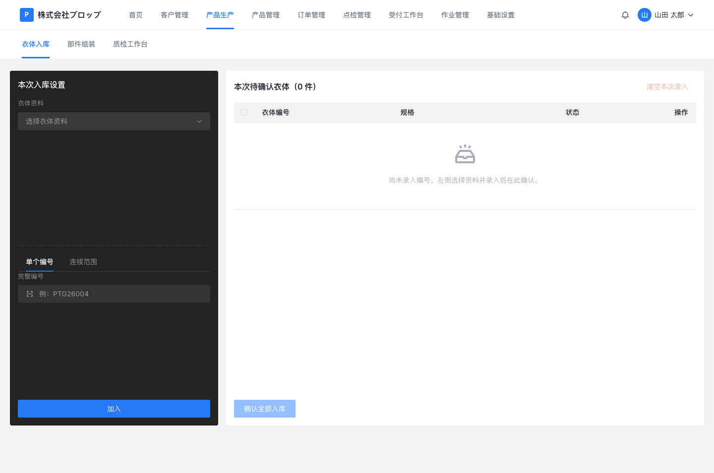

# FEAT-05 衣体入库

**状态：Current Truth**

## 1. 模块概述

本 feature 覆盖衣体入库建档。产品在衣体入库时成立；衣体与产品的绑定关系是后续部件组装、质检、订单、出货、受付的事实基础。

```text
衣体资料（定义：名称 / 规格 / 厂商 / 编号前缀）
  └─ 衣体个体（编号、建档来源、当前资料归属）
       └─ 产品（衣体入库时成立，製造番号 = 衣体编号）
            └─ 衣体与产品绑定（入库即绑定）
                 ↓ 下游读取
            部件组装 → 质检 → 订单／出货 → 受付／作业
```

## 2. 页面构成

| 页面 | 导航位置 | 主要作用 |
|---|---|---|
| 衣体入库 | 产品生产 → 衣体入库 | 衣体编号建档入库，同时成立产品 |

## 3. 资料项目与规则

### 3.1 衣体资料

一条部件资料代表某类部件（衣体／气囊／传感器／充气发生器）下一款可复用的定义。

| 资料项目 | 必填 | 规则 |
|---|---:|---|
| 部件类型 | 是 | 四选一：衣体／气囊／传感器／充气发生器；建立后不可改 |
| 部件名称 | 是 | 自由文本 |
| 规格 | 是 | 单一自由文本，四类部件均必填；衣体通常填写颜色，也可填写其他描述，系统不解析含义 |
| 厂商 | 否 | 自由文本 |
| 编号前缀 | 否 | 自由文本，不限字符种类且不自动转换大小写或删除非空值中的字符；完整规则见 FEAT-02。衣体入库连续范围时，资料有前缀则自动带出并只读，资料前缀为空则允许本次临时填写或留空，留空生成纯数字编号 |
| 状态 | — | 启用／已停用；停用后新建个体与组装录入不可选，已建档个体和历史不受影响 |

规则：

- 资料修改保留历史：编辑资料保存后，旧内容不被覆盖，作为历史版本完整保留；当前页面不提供历史版本查看入口，页面与新建建档读取最新内容。
- 已建档部件个体记住自己建档时（或被更正时）的那份资料内容；之后资料再修改，不影响已建档个体，也不回写产品、订单、已确认出货或正式文件。
- 每次编辑保存均产生一份新的完整资料版本，完整保存名称、规格、厂商和编号前缀；即使只修改其中一个项目，也不得覆盖旧版本。部件类型不可修改，停用／启用不产生资料版本。

### 3.2 部件个体

| 资料项目 | 必填 | 规则 |
|---|---:|---|
| 部件编号 | 是 | 建档时录入，在当前有效档案范围内全系统唯一；删除后可用同一编号登记独立新身份；衣体编号即产品的製造番号 |
| 部件类型 | 是 | 建档来源决定：衣体来自衣体入库，其余三类来自组装建档 |
| 建档来源 | — | 衣体入库／组装建档，建档时确定不变 |
| 当前资料 | — | 建档时指向的资料内容 + 后续资料更正记录中最新一条；不随资料本身后续修改自动变化 |
| 当前归属 | — | 当前有效绑定的产品；未绑定显示「未绑定」 |
| 首次登记 | — | 建档来源 + 建档日期 |

### 3.3 产品（与部件相关的部分）

| 资料项目 | 规则 |
|---|---|
| 製造番号 | = 衣体编号，入库时确定，终身不变 |
| M番号 | 产品成立时按全系统单调递增序列生成（M + 6 位流水）；删除产品后不复用，允许空号；不进入任何界面显示 |
| 部件构成 | 当前有效绑定：衣体（必有，入库即绑定）+ 气囊／传感器／发生器位置 1（质检必需的最低构成）+ 发生器位置 2（可选） |

### 3.4 绑定与操作记录

- 绑定：产品与部件的当前有效关系。同一产品同一部件类型同一位置（发生器分位置 1／2）最多一个有效绑定。

## 4. 衣体入库

### 4.1 页面作用

把新到衣体的编号批量建档入库。入库即同时完成三件事：衣体个体建档、产品成立（製造番号 = 衣体编号、配发 M番号）、衣体与产品绑定。

### 4.2 页面入口与去向

- 入口：产品生产 → 衣体入库。
- 去向：入库完成的衣体可在部件组装继续录入部件，在产品列表查看。

### 4.3 页面布局

2026-09-28人工验收调整：桌面双栏按浏览器主内容区实际可用高度等高铺满，左栏资料选择/说明与编号录入/加入分为上下各50%，下区从顶部排列，不整体贴底。右栏标题/清空及底部删除/确认保持可见，中间表格使用剩余高度并内部滚动，行高不拉伸。窗口高度变化自动适配；短视口允许页面滚动，窄屏上下排列，输入及主操作不裁切。旧原型固定留白与加入贴底表现由此替代，不改变生成数量。



```text
┌──────────────────────────────────────────────────────────┐
│ [本次入库设置（深色左栏）]        [本次待确认衣体（N 件）] │
│  衣体资料（下拉）                表格：勾选│衣体编号│规格│状态│操作│
│   厂商 / 规格摘要                                        │
│  录入方式：单个编号 / 连续范围      [删除选中] [确认全部入库] │
│   单个：完整编号（扫码）           （右上：清空本次录入）   │
│   范围：前缀（资料有值时带出）+ 开始～结束             │
│  [加入]                                                  │
└──────────────────────────────────────────────────────────┘
```

### 4.4 展示信息

- 左栏（本次入库设置）：
  - 衣体资料下拉；只选择 FEAT-02 已有且启用的衣体资料，选中后显示该资料的厂商与规格摘要。本页面不提供资料新建、维护或跳转创建入口。
  - 录入方式两个页签：单个编号／连续范围。
    - 单个：完整编号输入框（扫码或手输，回车加入）。
    - 连续范围：编号前缀＋开始～结束数字。所选资料已有前缀时，选择资料后自动带出并保持只读；所选资料前缀为空时，允许用户为本次范围编号生成临时填写前缀，也允许留空；留空时直接按原位数生成补零的纯数字编号（例：001～003 生成 001、002、003）。临时值不回写部件资料、不产生资料新版本；开始与结束位数仍要求一致（例：001～005），单次最多 500 件。
- 右栏（本次待确认衣体）：
  - 表格：勾选、衣体编号（等宽）、规格（取所选资料规格）、状态（待入库／已有档案）、操作（行内删除）。
  - 已有档案的行以红色「已有档案」标记区分。

### 4.5 功能

- **加入（单个）**：输入完整编号回车或点「加入」→ 加入待确认列表；已在候选列表中的编号不重复加入并提示「该编号已在待确认清单中」，不混同数据库已有档案。
- **加入（范围）**：校验开始／结束为数字、位数一致、开始 ≤ 结束、单次 ≤ 500 → 按前缀 + 补零流水生成整段编号加入列表（例：001～005 生成 5 件）；前缀为空时只使用补零流水，保留开始／结束的数字位数。生成结果仍按当前有效档案范围全系统查重，本次待确认列表中的重复编号不重复加入。
- **范围临时前缀**：仅当所选资料前缀为空时允许编辑，只用于当前待确认范围的编号生成；切换资料或本次录入状态时不得将它当作资料值保存。
- 范围全部已在候选列表时提示「该范围内的编号均已在待确认清单中」；部分重复仍只加入新编号。勾选仅用于删除选中，「确认全部入库」仍处理整个候选清单，不改为只确认勾选项。
- **行内删除／删除选中／清空本次录入**：只移出待确认列表，不影响已入库数据。
- **勾选反馈**：右侧卡片底部固定操作区始终提供「删除选中（N）」。未勾选时禁用，勾选后立即启用并更新数量；请求期间仍禁用。表格滚动不带走操作区，短/窄视口允许必要滚动且不裁切按钮。删除选中仅移除候选中的对应行并清空选择，行内删除、清空及入库结果更新后选择数量与剩余清单一致；不调用产品或衣体删除。
- **确认全部入库**：二次确认（提示已有档案的编号不会重复入库）→ 列表中「待入库」的编号批量入库，已有档案的跳过；完成后提示成功／失败件数，失败行保留在列表中。

### 4.6 校验与反馈

- 未选择衣体资料时不可确认入库。
- 待确认列表为空、或全部为已有档案时，确认入库给出提示不执行。
- 编号已在当前有效档案中存在 → 标记「已有档案」，入库时跳过。
- 范围录入的开始／结束不合法（非数字、位数不一致、开始大于结束、超过 500 件）→ 提示具体原因，不生成。
- 所选资料前缀为空时，临时前缀不必填；留空不阻断范围生成，生成的纯数字编号仍遵守原范围校验、补零及当前有效编号全系统唯一规则，不因无前缀免于查重。

### 4.7 页面产生的数据

- 确认全部入库 → 每个新编号建立：衣体个体（建档来源：衣体入库）、产品（製造番号 = 衣体编号、按序列配发 M番号）、衣体与产品的绑定；本批入库生成一条入库记录（确认人、确认时间、包含的衣体个体）。
- 加入／删除／清空待确认列表 → 不产生业务数据。

### 4.8 请求期间保护

- 加入查重或确认入库请求期间显示处理中，禁止切换资料、录入方式、修改编号/范围、再次加入、确认以及删除/清空候选；重复回车不重复发起操作。
- 结果只能归属发起时的本次资料和候选清单；不得在切换资料或清空后重新出现旧候选，也不得重复加入同号候选。资料切换在无请求时清空原候选后再录入，不把原候选改挂到新资料。
- 成功后更新相应结果；失败保留原输入和候选、显示原因并恢复操作。请求结束不等于成功，不显示虚假的完成状态。
- 本次入库候选是批次清单，不增加每页条数选择；既有单次范围生成最多500件规则不变，不套用组装/质检的100件查询上限。

## 5. 跨页面统一规则

- **编号唯一与重建**：业务编号只在当前有效档案范围内保持全系统唯一。删除后可以复用同一编号，但重新登记产生独立身份；原身份的历史、固件、绑定与资料更正记录不得自动继承或按相同编号改指新档案。衣体编号 = 产品製造番号；产品删除后该编号允许重新入库，新产品与新衣体均为独立对象，M番号不复用；查重不以原身份的历史记录阻断重新登记。
- **M番号**：产品成立时按全系统单调递增序列配发；不复用、允许空号；不在任何界面显示。
- **资料版本与当前资料**：每次编辑保存均完整保留该次部件名称、规格、厂商和编号前缀；最新版本供之后的新建与录入选择。已建档部件个体继续使用其建档或资料更正时采用的版本，资料后续修改不影响既有个体。
- **更换衣体**：更换衣体只登记线下实物更换事件；产品身份、製造番号、系统衣体身份及现有绑定均不变，不创建新衣体档案、不解除旧衣体绑定，不产生可删除的换下衣体对象。换下实物线下报废，系统不登记其报废过程、不触发产品报废；衣体资料不自动变化，资料错误仍通过既有资料更正机制处理。FEAT-08 与 FEAT-16 两处入口一致。
- **绑定唯一性**：同一产品同类型同位置最多一个有效绑定；安装、撤销、更换只追加操作记录，不覆盖历史。
- **删除语义**：删除后部件退出当前有效档案、列表、选择与业务操作范围，不能再安装、资料更正或固件升级；保留删除时间和操作人。原身份及历史数据继续保留；仍存在的产品或其他业务记录中的既有历史继续显示原对象当时的编号、采用资料和事件内容，足以理解发生过什么，不能只剩孤立 ID 或删除日志，也不得因同编号重建而改指新身份。不要求新增已删除档案查询页、历史检索、回收站、恢复或指向已删除档案的导航入口。删除前的绑定阻断只检查当前有效绑定，曾绑定、曾安装或已有固件历史均不阻断（FEAT-09）。产品删除保持 FEAT-08 的四类阻断条件及历史保留规则。
- **停用语义**：部件资料停用只影响「之后的选择」，不影响已建档个体与历史；部件个体没有停用功能。

- **纠错路径**：档案正确但绑错产品时，结束错误绑定再绑定正确产品，保留同一部件身份及两侧历史；编号正确但资料错误时追加资料更正记录（FEAT-02 的版本规则、FEAT-06／08／16 的既有更正入口），不要求删除重建；误建档或编号录错时先解除当前绑定，再按 FEAT-09 删除错误档案并按需重新登记。
- **历史与当前的区分**：历史保留不表示原档案仍可用于当前业务；存储实现不在本需求中选定，不新增恢复、回收站或部件启停功能。

- **入库记录有效成员**：已删除衣体不计入入库记录的当前有效成员；无有效成员的记录不再作为有效入库记录展示，历史登记信息仍保留。后续同编号入库是新登记，不接续原成员身份。

## 6. Feature 边界与明确不做

```text
衣体入库 → 本 feature
部件资料 → FEAT-02 部件资料
部件组装 → FEAT-06 部件组装
部件个体的查询、履历展示与删除入口 → FEAT-09 部件追溯
质检判定 → FEAT-07 质检工作台；产品详情与删除 → FEAT-08 产品管理
订单选配与出货、受付／作业中的部件事实读取 → 各调用 feature
```

明确不做：

- 部件个体停用／启用（整套能力已于 2026-09-18 裁决删除）；
- 衣体停用及级联作废产品（产品作废唯一来源为受付确认报废）；
- 动态规格参数配置（参数名自定义、参数行增删、值与单位分列、摘要勾选）；
- 独立颜色字典维护入口；
- 在制品独立管理页（在制／待质检／已质检等生产阶段统一在产品管理中展示，见 FEAT-08 产品管理）；
- 更换衣体时录入新编号（更换不改变製造番号，仅确认动作）；
- 从规格文本解析含义（颜色、型号等不结构化、不推导拦截规则）；
- 打印编号清单及打印版本台账（2026-09-21 裁决删除）；

## 7. 核对记录

- 2026-09-23：按二级导航粒度自 02-部件与生产 拆分为本 feature（FEAT-05）；内容不变，章节与交叉引用已重编号。
- 核对日期：2026-09-21，已与当前 demo 核对入库、组装、资料功能一致（AssemblyPage / IntakeWorkbenchPage / PartProfileListPage / partMockRepository）；部件追溯履历展示固件记录、导出 Excel 尚未实施，见 validation 用例备注。
- 裁决来源：修改记录 §24.21（部件资料页面简化）、§24.22（产品统一列表与在制品合并）、部件组装三组装页合并与三次调整（2026-09-18）、Enter 纵向跳格（2026-09-18）、删除部件停用功能（2026-09-18）、部件追溯新增删除部件（2026-09-19）、作业管理更换衣体改为确认制（2026-09-20）；阶段 PRD 02-部件资料-v21.md、03-部件追溯-v21.md。
- 结构说明：本模块合并 V2.0「02-部件资料与衣体入库」与「03-产品组装」两份底稿为单一 spec；质检工作台与产品列表／详情划入 FEAT-08 产品管理。
- 二轮修订（2026-09-21）：规格改为四类部件均必填；「资料版本」表述改为保留历史的业务说法；删除「实时派生」表述（实现方式由开发决策）；删除组装页旧路由描述；范围筛选改为严格匹配并明确待录入只看三件必需部件（发生器位置 2 不影响）；删除「原部件不存在」不可达提示；导出明确为正式功能（导出 Excel）；「固定前缀」统一为「编号前缀」。来源：用户对本 spec 初稿的逐条批注（2026-09-21）。
- 2026-09-23：经用户明确允许破例修改冻结 spec，引用的部件资料规则同步为「每次编辑保存完整新版本」；名称、规格、厂商和编号前缀均保留历史。
- 三轮修订（2026-09-21）：组装页筛选语义改为「查询全部 Product」——页面进入后表格为空并提示筛选；范围/编号筛选显示符合条件的全部 Product（含已完成质检），不再只查询待录入产品；发生器位置 2 空缺不再导致产品从组装页消失；废弃「三个必需部件齐全后从组装页隐藏」的逻辑。来源：用户裁决（2026-09-21）。
- 三轮修订（2026-09-21）：部件追溯章节拆出为 FEAT-09 部件追溯；质检工作台划入 FEAT-07 质检工作台；「打印编号清单」功能整体删除（页面、路由、打印版本数据）；删除语义一节改为引用 FEAT-09。来源：用户裁决「模块按业务职责拆分、删除打印编号清单功能」（2026-09-21）。

- 2026-09-25：根据已确认裁决修订删除、身份与编号复用、历史保留、实物衣体更换或单笔发货文件归属相关条款；此前核对记录中的冲突口径已被本次正文取代，旧 demo／测试结论不代表本次修订已实施或验收。
- 2026-09-27：同步部件资料前缀改为选填自由文本的最新裁决；连续范围在资料有前缀时自动带出且只读，资料无前缀时允许本次临时填写且不回写资料。FEAT-05 代码本轮未实现或验证。

- 2026-09-27：用户确认资料前缀为空时，临时前缀也可留空，直接生成保留位数的纯数字编号；原范围上限、查重及不回写资料规则不变，取代此前该项待裁决口径。本次仅补充需求，未执行功能验证。

- 2026-09-28 最新裁决：请求中锁定相关操作；组装/质检单次100件且超限拒绝、不分页；产品/追溯可选分页条数；空前缀保留范围；页面级授权、即时筛选及列表字段导出按本正文执行。仅同步需求，修复与验收待完成；旧原型及历史记录冲突处以本次正文为准。
