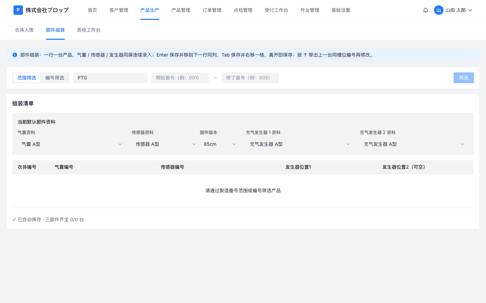
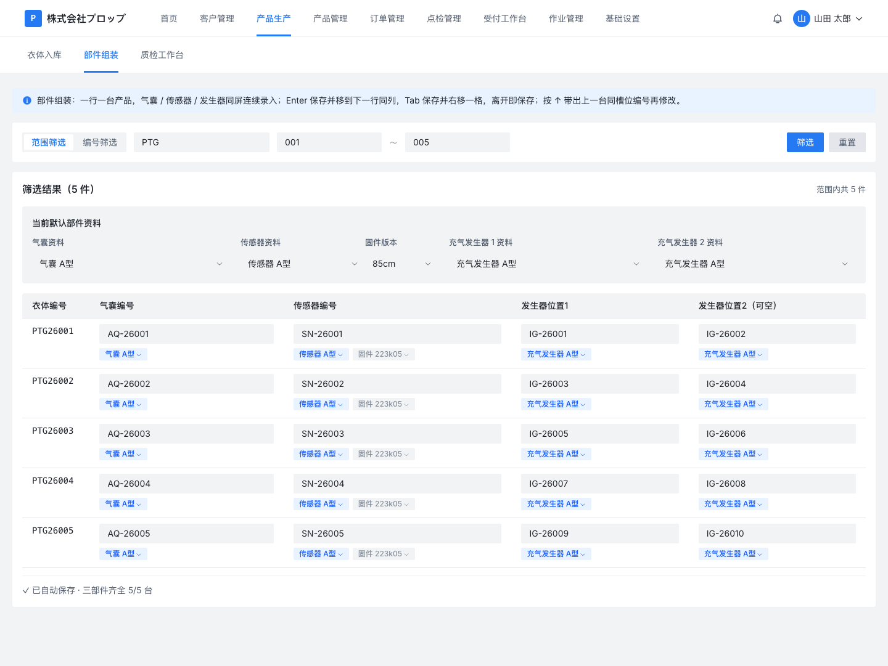

# FEAT-06 部件组装

**状态：Current Truth**

## 1. 模块概述

本 feature 覆盖气囊／传感器／充气发生器的组装绑定。部件与产品的绑定关系是后续质检、订单、出货、受付的事实基础。

```text
部件资料（定义：名称 / 规格 / 厂商 / 编号前缀）
  └─ 部件个体（编号、建档来源、当前资料归属）
       └─ 产品（衣体入库时成立，製造番号 = 衣体编号）
            └─ 绑定：气囊 + 传感器 + 发生器位置 1/2（组装建立）
                 ↓ 下游读取
            质检 → 订单／出货 → 受付／作业
```

## 2. 页面构成

| 页面 | 导航位置 | 主要作用 |
|---|---|---|
| 部件组装 | 产品生产 → 部件组装 | 一行一台产品，连续录入气囊／传感器／发生器编号并绑定 |

## 3. 资料项目与规则

### 3.1 部件资料

一条部件资料代表某类部件（衣体／气囊／传感器／充气发生器）下一款可复用的定义。

| 资料项目 | 必填 | 规则 |
|---|---:|---|
| 部件类型 | 是 | 四选一：衣体／气囊／传感器／充气发生器；建立后不可改 |
| 部件名称 | 是 | 自由文本 |
| 规格 | 是 | 单一自由文本，四类部件均必填；衣体通常填写颜色，也可填写其他描述，系统不解析含义 |
| 厂商 | 否 | 自由文本 |
| 编号前缀 | 否 | 选填自由文本，不限字符种类且不自动转换大小写或删除非空值中的字符；完整规则见 FEAT-02，衣体入库连续范围的带出/临时输入规则见 FEAT-05 |
| 状态 | — | 启用／已停用；停用后新建个体与组装录入不可选，已建档个体和历史不受影响 |

规则：

- 资料修改保留历史：编辑资料保存后，旧内容不被覆盖，作为历史版本完整保留；当前页面不提供历史版本查看入口，页面与新建建档读取最新内容。
- 已建档部件个体记住自己建档时（或被更正时）的那份资料内容；之后资料再修改，不影响已建档个体，也不回写产品、订单、已确认出货或正式文件。
- 每次编辑保存均产生一份新的完整资料版本，完整保存名称、规格、厂商和编号前缀；即使只修改其中一个项目，也不得覆盖旧版本。部件类型不可修改，停用／启用不产生资料版本。

### 3.2 部件个体

| 资料项目 | 必填 | 规则 |
|---|---:|---|
| 部件编号 | 是 | 建档时录入，在当前有效档案范围内全系统唯一；删除后可用同一编号登记独立新身份；衣体编号即产品的製造番号 |
| 部件类型 | 是 | 建档来源决定：衣体来自衣体入库，其余三类来自组装建档 |
| 建档来源 | — | 衣体入库／组装建档，建档时确定不变 |
| 当前资料 | — | 建档时指向的资料内容 + 后续资料更正记录中最新一条；不随资料本身后续修改自动变化 |
| 当前归属 | — | 当前有效绑定的产品；未绑定显示「未绑定」 |
| 首次登记 | — | 建档来源 + 建档日期 |

### 3.3 产品（与部件相关的部分）

| 资料项目 | 规则 |
|---|---|
| 製造番号 | = 衣体编号，入库时确定，终身不变 |
| M番号 | 产品成立时按全系统单调递增序列生成（M + 6 位流水）；删除产品后不复用，允许空号；不进入任何界面显示 |
| 部件构成 | 当前有效绑定：衣体（必有，入库即绑定）+ 气囊／传感器／发生器位置 1（质检必需的最低构成）+ 发生器位置 2（可选） |

### 3.4 绑定与操作记录

- 绑定：产品与部件的当前有效关系。同一产品同一部件类型同一位置（发生器分位置 1／2）最多一个有效绑定。
- 组装操作记录：每次安装、撤销安装、更换各产生一条操作事实，历史只增不改。
- 资料更正记录：单个部件的资料归属被更正时追加一条（从哪份内容到哪份内容），不覆盖旧值；部件当前资料以最新一条为准。
- 传感器固件版本记录：事实属于传感器个体；默认固件选择与固件更新统一使用 FEAT-03 基础数据中的传感器固件版本，新选择只提供启用项；每次设定或更新追加一条（旧版本 → 新版本），首次设定旧版本为空。已采用版本之后停用不清空、不替换当前值或历史，也不要求重新选择。

## 4. 部件组装

### 4.1 页面作用

Spreadsheet 式连续录入：一行一台产品，同屏录入气囊、传感器、发生器位置 1／2 的编号并建立绑定。录入即保存，保存后编号旁立即显示该部件当前绑定的资料；资料可逐台点击更正。

### 4.2 页面入口与去向

- 入口：产品生产 → 部件组装。
- 去向：部件齐全的台数在底部状态条可见，可前往质检工作台。

### 4.3 页面布局




```text
┌──────────────────────────────────────────────────────────┐
│ 顶部说明条（Enter / Tab 分工与 ↑ 带出说明）                │
├──────────────────────────────────────────────────────────┤
│ 筛选区：[范围筛选|编号筛选] 前缀 开始～结束 / 扫码编号 [筛选][重置]│
├──────────────────────────────────────────────────────────┤
│ 组装清单卡（组装清单｜筛选结果（N 件）｜筛选摘要）           │
│  ┌─ 当前默认部件资料（灰底区块）────────────────────────┐ │
│  │ 气囊资料 │ 传感器资料＋固件版本（一体）│发生器1资料│发生器2资料│ │
│  └──────────────────────────────────────────────────┘ │
│  表格：衣体编号 │ 气囊编号 │ 传感器编号 │ 发生器位置1 │ 发生器位置2 │
│   每格：编号输入框＋资料行（保存后：资料 Tag＋传感器固件 Tag） │
│  底部：自动保存状态 / 错误与待确认计数       单次最多100件，不分页     │
└──────────────────────────────────────────────────────────┘
```

### 4.4 展示信息

- 筛选区只筛选产品，不承担部件录入：范围筛选（前缀 + 开始～结束）／编号筛选（单个衣体编号，可扫码）。页面进入后表格为空，提示「请通过製造番号范围或编号筛选产品」；不默认加载任何清单。
- 当前默认部件资料（与录入清单同卡、灰底区块）：依次为气囊资料、传感器资料、传感器固件、发生器位置1资料、发生器位置2资料；固件紧随传感器资料，不显示厂商、规格摘要。窄屏换行仍保持该阅读顺序。
- 表格列：衣体编号（等宽）＋四个部件录入列；发生器位置 2 标注「可空」。
- 2026-09-28人工验收调整：同视口列边界固定，不随编号输入、标签、错误、待确认或loading改变；长文本可换行或查看完整内容，确认及错误可达。宽度不足只在工作表内部横滚；不改变键盘保存或最后一行焦点规则。
- 单元格内资料行（恒占一行高度，保证已录／未录行输入框纵向对齐）：
  - 保存后：该部件当前绑定的资料名 Tag（可点击下拉更正）；传感器额外显示固件 Tag（可点击下拉更新）。
  - 录入中未保存：弱化预览将按哪个默认资料保存。
- 底部状态：正常时显示「已自动保存 · 三部件齐全 X/N 台」；有错误显示失败计数；有待确认显示待确认计数（Enter 确认／Esc 取消）。

### 4.5 功能

- **筛选**：范围筛选按输入内容严格匹配（前缀 + 开始～结束编号，不做位数放宽）；编号筛选定位单台。两种筛选在匹配不超过100件时均显示符合条件的**全部 Product**（含在制、待质检、已完成质检），不再只查询待录入产品。发生器位置 2 即使为空，也不影响产品出现在筛选结果中。重置后回到空白状态。
- **清单语义**：匹配不超过100件时，筛选结果 = 当前条件下的全部 Product；已录入部件直接显示当前编号和部件资料，未录入部件保持为空、可直接补录。不再使用「三个必需部件齐全后从组装页隐藏」的逻辑。
- **录入与保存**：输入编号后 Enter／Tab／离开输入框均触发保存。
  - Enter：保存并移到下一行同列（最后一行任意列只保存不跳格，显示 Enter で保存提示）。
  - Tab：保存并右移一格（气囊 → 传感器 → 发生器 1 → 发生器 2 → 下一行气囊）。
  - 原本为空且未修改的单元格：Enter/Tab只按上述方向移动，不发保存请求，不要求默认资料或固件；最后一行/末格仍不越界，不显示空格已保存。保存中、失败、待确认门禁不因此放开。原本有已保存编号而被清空不是未修改空格，不跳过修改、不自动拆除，仍须恢复编号或通过既有明确拆除入口处理。
  - ↑：带出上一台同槽位编号再修改。
- **默认资料绑定**：新录入的编号按当前默认资料建立绑定（传感器同时记录默认固件版本）；编号无当前有效档案时自动建立独立新档案（来源：组装建档）。
- **已保存编号的更正**：已保存的编号改为另一个编号 → 保存时识别为更换，给出更换确认（说明原编号与新编号），确认后完成更换；取消则还原。
- **资料不一致确认**：编号已建档但当前资料与默认资料不一致 → 行内确认条（说明该编号当前资料与默认资料；按 Enter 或点确认键以默认资料更正、Esc 或取消放弃）；更换且资料不一致时合并为一次「更换并更正资料」确认。
- **行内资料更正**：已保存格的资料 Tag 下拉选择其他资料 → 只更正这一个部件的资料归属（追加更正记录），不影响其他产品。
- **行内固件更新**：已保存传感器格的固件 Tag 下拉从 FEAT-03 当前启用的传感器固件版本中选择其他版本 → 只更新这一个传感器的固件版本记录。已采用后停用的版本仍显示原值，但不再作为新的选择项。
- **顶部默认资料切换**：只影响之后的新录入，不回改已保存行；有未保存输入时先二次确认（提示将按新默认资料保存）。
- **页面级动作门禁**：筛选、重置前有未保存、保存失败或待确认的格子 → 提示先处理，不执行动作。

### 4.6 校验与反馈

- 未选择默认资料时录入 → 行内错误「请先在上方选择默认部件资料」。
- 编号部件类型与列不符、部件已安装在其他产品、产品不存在（提示先在衣体入库建档）→ 行内红色错误，说明原因。
- 同一产品同一编号重复提交且资料一致 → 视为无操作。
- 该槽位已有其他部件 → 进入更换确认流程，不直接覆盖。
- 保存失败与待确认均在底部计数，处理前阻止重置与重新筛选。

### 4.7 页面产生的数据

- 录入保存 → 编号无当前有效档案时建立独立部件个体（来源：组装建档）；建立产品—部件绑定与安装操作记录；传感器同时追加固件版本记录（首次设定）。
- 更换确认 → 原绑定结束、新绑定建立，产生更换操作记录。
- 行内资料更正 → 追加一条资料更正记录（不覆盖旧值）。
- 行内固件更新 → 追加一条固件版本记录（旧版本 → 新版本）。
- 筛选、跳格、↑ 带出、默认资料切换 → 不产生业务数据。

**档案查找范围**：本模块按编号查询或选择待安装部件时，只匹配当前有效档案；“未建档／首次使用”包括旧同编号档案已按规则删除后重新登记，不表示复用旧身份。按原身份发起对已删除部件的安装、资料更正或固件升级均不得执行。

### 4.8 操作清单上限与请求保护（2026-09-28）

- 初次进入仍为空。每次编号/范围查询最多100件，不分页、不提供每页条数选择；100件以内显示全部匹配产品，不按生产阶段排除产品。
- 匹配超过100件时拒绝替换清单，提示“匹配数量超过100件，请缩小范围”；不得静默截取前100件。保留原清单及其已生效筛选摘要，明确新筛选未生效。没有原清单时保持空态。后端同样执行上限，显示顺序沿用原编号顺序。
- 查询或保存请求期间显示 loading，并暂时禁止组装输入、默认资料/固件切换、Tag操作、筛选、重置及重复提交，结果返回后恢复相应操作；不支持请求期间继续编辑来积累新草稿。
- 有未保存输入、保存失败或待确认项时，筛选、重置等替换清单动作被阻止，提示先保存、重试、完成确认或明确取消该输入。请求结束但失败或待确认时不能直接丢弃草稿；成功才更新已保存内容。既有默认值确认/取消和键盘节奏保留。
- 范围筛选的前缀可空：有前缀时按前缀与起止数字组成完整编号；空前缀时仍按起止数字筛选纯数字编号，不取消范围条件。起止须同时填写、均为数字、位数一致且开始不大于结束，严格保留前导零和位数；半填或非法范围提示错误、不扩大查询。产品列表起止均为空时可不限制编号范围，组装和质检的范围筛选须填写起止。

## 5. 跨页面统一规则

- **编号唯一与重建**：业务编号只在当前有效档案范围内保持全系统唯一。删除后可以复用同一编号，但重新登记产生独立身份；原身份的历史、固件、绑定与资料更正记录不得自动继承或按相同编号改指新档案。衣体编号 = 产品製造番号；产品删除后该编号允许重新入库，新产品与新衣体均为独立对象，M番号不复用；查重不以原身份的历史记录阻断重新登记。
- **资料版本与当前资料**：每次编辑保存均完整保留该次部件名称、规格、厂商和编号前缀；最新版本供之后的新建与录入选择。已建档部件个体继续使用其建档或资料更正时采用的版本，资料后续修改不影响既有个体。
- **绑定唯一性**：同一产品同类型同位置最多一个有效绑定；安装、撤销、更换只追加操作记录，不覆盖历史。
- **删除语义**：删除后部件退出当前有效档案、列表与选择范围，不能再安装、资料更正或固件升级；保留删除时间和操作人。安装、拆除、更换、资料更正及固件变更等历史继续属于原部件身份，并保留足以理解原对象和事件的内容，不能只剩孤立 ID 或删除日志。删除前的绑定阻断只检查当前有效绑定，曾绑定、曾安装或已有固件历史均不阻断（FEAT-09）。产品删除保持 FEAT-08 的四类阻断条件及历史保留规则。
- **停用语义**：部件资料停用只影响「之后的选择」，不影响已建档个体与历史；部件个体没有停用功能。

- **纠错路径**：档案正确但绑错产品时，结束错误绑定再绑定正确产品，保留同一部件身份及两侧历史；编号正确但资料错误时追加资料更正记录（FEAT-02／本模块既有机制），不要求删除重建；误建档或编号录错时先解除当前绑定，再按 FEAT-09 删除错误档案并按需重新登记。
- **历史与当前的区分**：历史保留不表示原档案仍可用于当前业务；存储实现不在本需求中选定，不新增恢复、回收站或部件启停功能。

## 6. Feature 边界与明确不做

```text
部件组装绑定 → 本 feature
部件资料 → FEAT-02 部件资料
衣体入库 → FEAT-05 衣体入库
部件个体的查询、履历展示与删除入口 → FEAT-09 部件追溯
质检判定 → FEAT-07 质检工作台；产品详情与删除 → FEAT-08 产品管理
订单选配与出货、受付／作业中的部件事实读取 → 各调用 feature
```

明确不做：

- 部件个体停用／启用（整套能力已于 2026-09-18 裁决删除）；
- 动态规格参数配置（参数名自定义、参数行增删、值与单位分列、摘要勾选）；
- 独立颜色字典维护入口；
- 三个独立组装工作台（已合并为部件组装单页）；
- 在制品独立管理页（在制／待质检／已质检等生产阶段统一在产品管理中展示，见 FEAT-08 产品管理）；
- 从规格文本解析含义（颜色、型号等不结构化、不推导拦截规则）；
- 打印编号清单及打印版本台账（2026-09-21 裁决删除）；

## 7. 核对记录

- 2026-09-23：按二级导航粒度自 02-部件与生产 拆分为本 feature（FEAT-06）；内容不变，章节与交叉引用已重编号。
- 核对日期：2026-09-21，已与当前 demo 核对入库、组装、资料功能一致（AssemblyPage / IntakeWorkbenchPage / PartProfileListPage / partMockRepository）；部件追溯履历展示固件记录、导出 Excel 尚未实施，见 validation 用例备注。
- 裁决来源：修改记录 §24.21（部件资料页面简化）、§24.22（产品统一列表与在制品合并）、部件组装三组装页合并与三次调整（2026-09-18）、Enter 纵向跳格（2026-09-18）、删除部件停用功能（2026-09-18）、部件追溯新增删除部件（2026-09-19）、作业管理更换衣体改为确认制（2026-09-20）；阶段 PRD 02-部件资料-v21.md、03-部件追溯-v21.md。
- 结构说明：本模块合并 V2.0「02-部件资料与衣体入库」与「03-产品组装」两份底稿为单一 spec；质检工作台与产品列表／详情划入 FEAT-08 产品管理。
- 二轮修订（2026-09-21）：规格改为四类部件均必填；「资料版本」表述改为保留历史的业务说法；删除「实时派生」表述（实现方式由开发决策）；删除组装页旧路由描述；范围筛选改为严格匹配并明确待录入只看三件必需部件（发生器位置 2 不影响）；删除「原部件不存在」不可达提示；导出明确为正式功能（导出 Excel）；「固定前缀」统一为「编号前缀」。来源：用户对本 spec 初稿的逐条批注（2026-09-21）。
- 2026-09-23：经用户明确允许破例修改冻结 spec，引用的部件资料规则同步为「每次编辑保存完整新版本」；名称、规格、厂商和编号前缀均保留历史。
- 三轮修订（2026-09-21）：组装页筛选语义改为「查询全部 Product」——页面进入后表格为空并提示筛选；范围/编号筛选显示符合条件的全部 Product（含已完成质检），不再只查询待录入产品；发生器位置 2 空缺不再导致产品从组装页消失；废弃「三个必需部件齐全后从组装页隐藏」的逻辑。来源：用户裁决（2026-09-21）。
- 三轮修订（2026-09-21）：部件追溯章节拆出为 FEAT-09 部件追溯；质检工作台划入 FEAT-07 质检工作台；「打印编号清单」功能整体删除（页面、路由、打印版本数据）；删除语义一节改为引用 FEAT-09。来源：用户裁决「模块按业务职责拆分、删除打印编号清单功能」（2026-09-21）。

- 2026-09-25：根据已确认裁决修订删除、身份与编号复用、历史保留、实物衣体更换或单笔发货文件归属相关条款；此前核对记录中的冲突口径已被本次正文取代，旧 demo／测试结论不代表本次修订已实施或验收。

- 2026-09-28 最新裁决：请求中锁定相关操作；组装/质检单次100件且超限拒绝、不分页；产品/追溯可选分页条数；空前缀保留范围；页面级授权、即时筛选及列表字段导出按本正文执行。仅同步需求，修复与验收待完成；旧原型及历史记录冲突处以本次正文为准。
