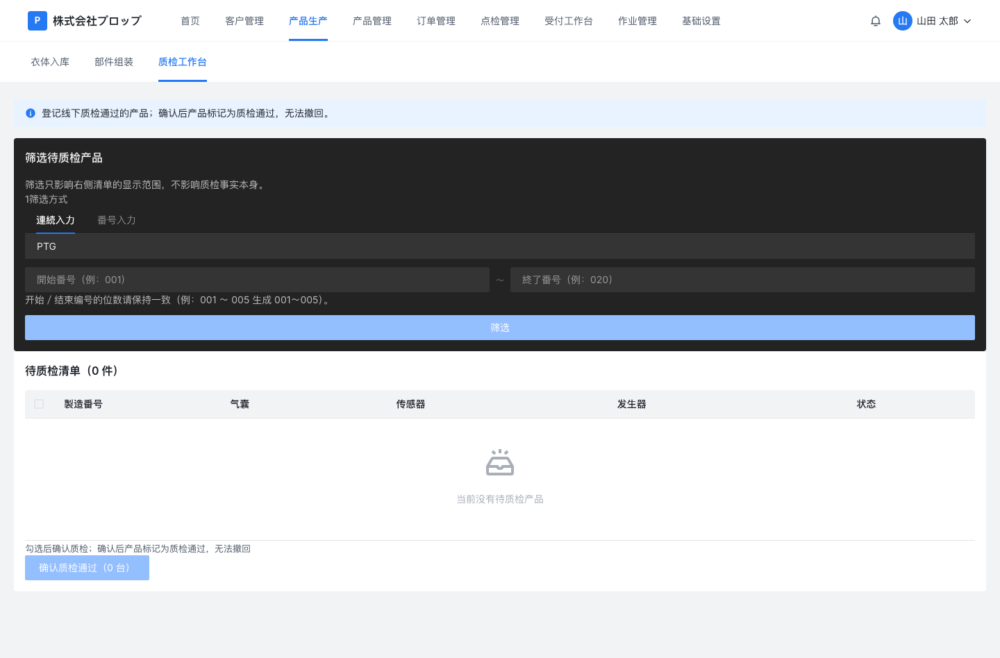

# FEAT-07 质检工作台

**状态：Current Truth**

> **写作纪律（2026-09-20 裁决）**：本文档只写业务事实和产品要求——页面为谁解决什么问题、展示什么信息、有什么操作、规则是什么。禁止写 mock 数据描述、代码字段名、技术词汇、代码实现细节；凡是「demo 恰好这么实现的」不写，凡是「业务上必须如此」才写。举例允许。字段命名规则写在对应数据模型文档，不在本文档。
>
> **页面如实纪律（2026-09-20 裁决）**：本文档只如实描述 demo 页面现状，不得在文档层修改页面内容——包括省略、改名、"清理"页面实际存在的字段或文案。页面内容要改必须先走「裁决 → demo 修改 → 验证」，再回到本文档。

## 1. 模块概述

质检工作台是产品从生产进入正式流通前的最后一道登记关口。员工在线下完成实物质检后，在本页面把「质检通过」这一事实登记进系统。系统只记录结果，不替代线下逐项检查。

质检通过是**单向动作**：确认后产品生产阶段由「待质检」转为「已完成质检」，无法撤回。误录只能由管理员在数据层更正，或走产品维修／换件流程。

```
衣体入库 → 部件组装 → [质检工作台] → 正式产品（可出货）
              ↑________________________↓
              （不满足最低构成时回到组装页补录）
```

## 2. 页面构成

| 页面 | 导航位置 | 主要作用 |
|---|---|---|
| 质检工作台 | 产品生产 → 质检工作台 | 登记线下质检通过的产品 |

## 3. 资料项目与规则

### 3.1 质检通过事实

| 资料项目 | 必填 | 规则 |
|---|---:|---|
| 产品 | 是 | 必须满足最低构成：衣体（必然存在）＋气囊×1＋传感器×1＋充气发生器位置 1 必须绑定（位置 2 可选，不计入构成判断）。不满足最低构成的产品不能进入待质检清单。 |
| 确认人 | 是 | 执行质检确认的员工。 |
| 确认时间 | 是 | 系统记录确认操作的时间。 |

质检通过事实不保存确认时的部件构成快照：不另存五个槽位的部件、资料、固件或显示内容。确认时仍须由服务端重新校验当下最低构成；产品／部件身份、绑定和操作历史继续由各自原有事实保留。

产品主档另保存“首次生产质检已通过”标记。正常新建产品初始为未通过；首次质检确认成功时，产品标记、质检通过事实及对应历史事件必须作为同一台产品的一次原子操作共同成功或共同回滚。该标记是后续资格与生产阶段判断的直接依据，质检记录继续承担确认人、确认时间和历史追溯，不以是否存在记录替代标记。标记一旦成立不因后续拆件、更换、返厂、维修或报废自动撤销。

“首次生产质检已通过”只表示产品已取得首次生产质检资格，不表示当前返厂点检或维修结果，也不单独代表产品当前满足全部出货条件。符合 FEAT-20 规则的历史质检认定也可建立该资格，但须保留历史业务日期与本次登记审计的区分；不能仅因存在订单、出货、当前构成完整或某个日期值而自动认定。

存量认定沿用已有有效、完整且可明确关联原产品身份的质检通过事实，保留原确认人和确认时间。缺少对应质检通过履历事件只记录为履历差异，不降低既有资格、不要求逐项人工确认，也不补造事件。没有可靠依据或存在事实矛盾的产品仍须单独核实；不能把全部存量一律认定为通过或未通过。已删除、报废对象同样按原首次质检事实认定，不因当前状态撤销。

以上存量认定针对需要迁入或继续承载真实业务的产品，不将可丢弃的开发测试样例视为生产历史待认定对象。本次字段结构同步以空产品目标库和新建产品的正常质检流程为验收范围；开发样例的一次性一致性初始化不等于历史交付合格认定，也不取消未来 FEAT-20 的业务规则。

### 3.2 质检最低构成

可以质检 = 衣体（必然存在）＋ 气囊×1 ＋ 传感器×1 ＋ 充气发生器位置 1×1。

- 发生器位置 1 有绑定即满足；位置 2 不影响构成判断；
- 不满足最低构成的产品不能进入质检待确认列表，只能在组装页继续补录。

## 4. 质检工作台

### 4.1 页面作用

支持员工批量登记线下质检通过的产品，并对待质检范围进行筛选定位。

### 4.2 页面入口与去向

- 入口：产品生产 → 质检工作台。
- 去向：质检通过后产品进入产品列表（已完成质检），可继续出货、受付等后续业务。

### 4.3 页面布局

2026-09-28人工验收调整：替代旧原型上下布局，桌面为左深色筛选卡＋右白色待检清单，栏宽比例/间距/控件风格与衣体入库一致，两栏利用主内容区高度。不可撤回说明保留；左栏标题、说明、模式、输入、筛选/重置按顺序排列，不要求50%分区。右栏标题/数量/已选和底部确认固定可见，表格占剩余高度内部滚动。短/窄视口可整体滚动或上下排列，不裁切操作；不新增分页或改变百件上限、失败保留及部分成功规则。



```text
┌──────────────────────────────────────────────────────────┐
│ 顶部说明条（登记线下质检通过；确认后产品标记为质检通过，无法撤回） │
├──────────────────────────────────────────────────────────┤
│ 左：筛选待质检产品（深色控制区）                          │
│  ├─ 筛选方式 Tabs：連続入力 ｜ 番号入力                   │
│  ├─ 范围：前缀 ＋ 开始～结束编号                          │
│  ├─ 单件：完整製造番号（扫码或输入，回车触发）             │
│  └─ [筛选] [重置筛选]                                    │
├──────────────────────────────────────────────────────────┤
│ 右：待质检清单（最多100件）／筛选结果（N 件）               │
│  表格：☑ │ 製造番号 │ 气囊 │ 传感器 │ 发生器 │ 状态       │
│  底部：勾选后确认质检；确认后产品标记为质检通过，无法撤回    │
│       [确认质检通过（N 台）]                              │
└──────────────────────────────────────────────────────────┘
```

### 4.4 展示信息

- **筛选区**：左侧深色卡片，与衣体入库协调；标题「筛选待质检产品」，副标题说明筛选只影响右侧清单显示范围，不影响质检事实本身。
- **筛选方式**：Tabs 切换「連続入力（范围筛选）」与「番号入力（单件筛选）」；切换只改变输入方式，不立即改变右侧清单。
- **待质检清单**：默认查询当前全部待质检产品（满足最低构成且未通过），匹配不超过100件时完整显示，超限按§4.8提示缩小范围；筛选后只显示命中范围内的待质检产品；已质检通过的产品自动从清单中消失。
- **表格列**：勾选框、製造番号（等宽）、气囊编号、传感器编号／固件版本、发生器编号（位置 1／2 合并显示）、状态。
- **状态列**：无失败时显示蓝色「可质检」标签；确认质检失败时显示红色标签，内容为具体失败原因（如「缺少必要部件，不满足质检条件」）。
- **底部操作栏**：左侧说明文案「勾选后确认质检；确认后产品标记为质检通过，无法撤回」，右侧「确认质检通过（N 台）」主按钮；勾选后标题行右侧显示已选件数。

### 4.5 功能

- **范围筛选**：输入编号前缀＋开始～结束数字 → 点击【筛选】→ 右侧替换为该范围内的待质检产品。开始／结束编号的位数请保持一致（例：001 ～ 005）。
- **单件筛选**：输入完整製造番号（支持扫码，回车即触发）→ 右侧只显示该件（若已满足质检条件且未通过）。
- **重置筛选**：文字按钮置于筛选卡标题行右侧，按§4.8重新查询默认待检清单，超过100件不截断。
- **勾选**：行首勾选框支持多选；底部显示已选件数。
- **确认质检通过**：点击后弹出最终确认框，列出全部选中製造番号，提示「确认后产品将标记为质检通过，无法撤回」；按钮为【取消】【确认质检通过】。确认后逐台建立质检事实：单台失败不影响其他选中产品；成功的产品从清单消失，失败的产品保留在清单中并显示失败原因；底部提示「成功 N 台，失败 M 台」。

### 4.6 校验与反馈

- **最低构成硬校验**：不满足最低构成的产品不能进入待质检清单；单件筛选时若产品不满足构成，提示「不满足质检最低构成，无法登记」。
- **已质检通过**：单件筛选时若产品已质检通过，提示「已质检通过」。
- **未找到编号**：单件筛选时若编号不存在，提示「未找到该製造番号」。
- **确认质检失败**：单台失败不影响其他选中产品；失败行保留并显示红色失败原因；底部提示「成功 N 台，失败 M 台」。

### 4.7 页面产生的数据

- 确认质检通过 → 为每台选中产品建立一条质检通过事实，只包含产品、确认人、确认时间（以及必要的系统标识），同时把该产品主档的“首次生产质检已通过”标记置为通过并记录对应历史事件；三者共同成功或共同回滚，不复制确认时部件构成。产品生产阶段由「待质检」转为「已完成质检」，取得首次生产质检资格。
- 确认质检失败 → 不产生任何数据，失败行保留在清单中。
- 质检通过不产生其他业务记录；出货、受付等后续业务在产品已完成质检后另行发生。

### 4.8 操作清单上限与交互保护（2026-09-28）

- 不分页、不提供每页条数选择。默认查询所有待检对象，但仅在匹配不超过100件时完整显示；超过100件则提示“待检产品超过100件，请按编号范围筛选”，初次进入保持空清单，不截取部分数据冒充全部。
- 范围查询同样最多100件。新查询/重置超限或失败时保留原清单、已生效摘要和勾选，明确新查询未生效；不得静默截断。上限由服务端执行，沿用既有清单顺序。
- 已有勾选时，更换清单前明确确认取消原选择；取消则保留原清单。只有新查询成功且未超限才替换清单并清空旧选择，不保留隐藏勾选。
- 查询或质检提交期间显示 loading，禁止修改筛选、重置、勾选和重复提交；结果返回后恢复。全选仅针对当前完整显示的清单，批量确认只处理本次勾选项。
- 部分成功只移除成功项；失败项及原因、未选中项保留，不自动补入其他产品。整个请求失败时保留清单与选择供用户处理。
- 范围筛选的前缀可空：有前缀时按前缀与起止数字组成完整编号；空前缀时仍按起止数字筛选纯数字编号，不取消范围条件。起止须同时填写、均为数字、位数一致且开始不大于结束，严格保留前导零和位数；半填或非法范围提示错误、不扩大查询。产品列表起止均为空时可不限制编号范围，组装和质检的范围筛选须填写起止。

## 5. 跨页面统一规则

- **质检通过不可撤回**：系统不提供撤回功能；误录由管理员在数据层更正，或走产品维修／换件流程。
- **与生产阶段的关系**：首次生产质检标记由未通过变为通过，是产品从「待质检」进入「已完成质检」的唯一动作；在制产品必须先补录部件满足最低构成，才能进入待质检清单。通过后即使拆除必需部件，生产阶段也不倒退。
- **与部件组装页的关系**：组装页负责把部件装到产品上；质检工作台只登记质检结果，不承担部件录入或更换。
- **与产品删除的关系**：已存在质检记录的产品禁止删除（见 FEAT-08 产品管理）。
- **与出货的关系**：产品必须已完成质检才能进入出货流程（见 FEAT-10 订单管理、FEAT-11 寄送）。
- **与首页统计的关系**：待质检 = 部件组装齐全且产品主档“首次生产质检已通过”标记为未通过的产品数（见 FEAT-00 首页看板）。

## 6. Feature 边界与明确不做

- 本模块负责：质检通过登记、待质检清单筛选、质检最低构成校验。
- 其他模块负责：部件录入与更换（FEAT-06 部件组装）、产品档案查看与删除（FEAT-08 产品管理）、部件追溯（FEAT-09 部件追溯）。
- 明确不做：
  - 质检撤回功能（质检通过为单向动作）；
  - 打印编号清单（已删除：该功能不产生业务事实、无消费方，保留会误导员工以为存在受控打印台账）；
  - 在系统内执行逐项出厂质检（线下完成，系统只记录结果）；
  - 质检不通过／返工登记（当前只登记通过事实；不通过的产品留在待质检清单继续补录或维修）。

## 7. 核对记录

- 2026-09-23：按二级导航粒度自 05-质检 拆分为本 feature（FEAT-07）；内容不变，章节与交叉引用已重编号。
- 核对日期：2026-09-21，已与当前 demo（InspectionPage.tsx）核对一致。
- 裁决来源：修改记录「产品统一列表与在制品管理合并」（产品在衣体入库时成立，生产阶段按部件构成和质检结果自动确定）、「删除打印编号清单功能」（2026-09-21）；V2.0 底稿 04-质检与产品.md §6 质检工作台。
- 二轮修订（2026-09-21）：修正质检通过后果表述——产品与 M番号于衣体入库时已成立／生成，质检通过只登记质检事实并将生产阶段转为「已完成质检」；删除「生成永久内部管理编号」旧口径。demo 确认框与底部说明文案同步修正。来源：用户批注（2026-09-21）。
- 三轮修订（2026-09-21）：质量补强——线框与 demo 文案同步；「页面产生的数据」补充质检事实字段与失败不产生数据；跨页面统一规则补充与产品删除／出货／首页统计的关系；明确不做补充打印编号清单的否决理由；展示信息补充状态列空值规则；功能补充确认框按钮文案与确认后行为。来源：用户对本次 spec 质量的批注（2026-09-21）。
- 四轮修订（2026-09-22）：Alert 文案修正——demo 顶部说明条旧口径「生成正式产品并退出在制品」改为「产品标记为质检通过」，与底部说明和确认框一致。来源：spec 审查发现 demo 残留旧口径（产品已于衣体入库时成立）。
- 五轮修订（2026-09-23）：质检最低构成中充气发生器口径统一为「位置 1 必需」——§3.1 产品行、§3.2 构成条款、validation VAL-05 三处由「位置 1 或 2 任一即可」改为「位置 1 必须绑定，位置 2 不影响构成判断」。来源：2026-09-23 用户裁决（不存在「只装位置 2」的合法产品形态，单发生器产品发生器必装位置 1）；仅改本 feature 三处表述，FEAT-00/02/05/08 正文原有「位置 1 必需」口径不动，FEAT-00 §3.6 与 FEAT-08 §3.2 增加定义引用句防漂移。

- 2026-09-28 最新裁决：请求中锁定相关操作；组装/质检单次100件且超限拒绝、不分页；产品/追溯可选分页条数；空前缀保留范围；页面级授权、即时筛选及列表字段导出按本正文执行。仅同步需求，修复与验收待完成；旧原型及历史记录冲突处以本次正文为准。
