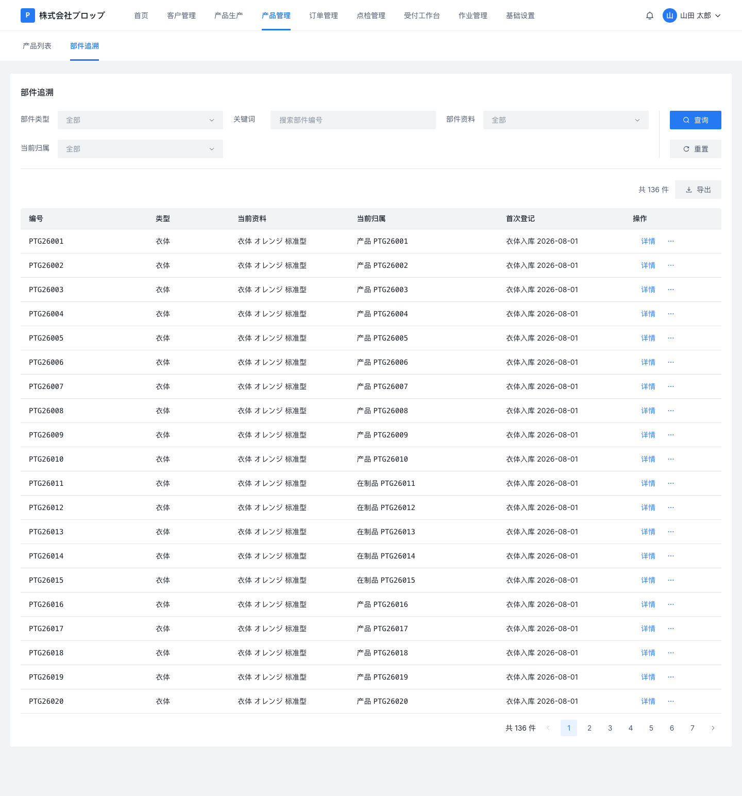

# FEAT-09 部件追溯

**状态：Current Truth**

> 撰写纪律见 [_template/spec.md](../../../../01-正式需求/_template/spec.md) 文件头：只写业务事实和产品要求；只如实描述 demo 页面现状。

> **2026-09-25 原型适用边界**：本目录既有原型资产未更新。部件删除确认、历史保留及编号复用以 §3.5～3.8 为准，不沿用旧删除全部历史或换下衣体可删除的演示行为。 此前 demo 核对及测试结论仅作历史记录，不证明本次规则已验收。

## 1. 模块概述

本模块覆盖部件个体的查询、履历查看与删除。部件个体的建档规则见 FEAT-05 衣体入库、FEAT-06 部件组装，资料版本规则见 FEAT-02 部件资料，绑定规则见 FEAT-06 部件组装；本模块是部件个体的统一查询出口，不提供页面间跳转。

```text
部件个体（建档见 FEAT-05／06，绑定见 FEAT-06 部件组装）
  → 部件追溯：查询 / 履历 / 删除未绑定部件
```

## 2. 页面构成

| 页面 | 导航位置 | 主要作用 |
|---|---|---|
| 部件追溯 | 产品管理 → 部件追溯 | 查询部件个体、查看履历、删除未绑定部件 |

## 3. 部件追溯

### 3.1 页面作用

查询当前有效部件个体的当前资料、当前归属与完整履历；删除不再需要的未绑定部件。

### 3.2 页面入口与去向

- 入口：产品管理 → 部件追溯。
- 「产品管理」为一级目录，「部件追溯」与「产品列表」为二级页面；不保留独立一级部件追溯入口。仅拥有追溯页面权限也可通过该目录访问，不要求产品页面权限，不扩大既有维护或业务接口授权。
- 去向：无页面间跳转（编号与归属均为纯文本，不提供到产品的链接）。

### 3.3 页面布局



```text
┌──────────────────────────────────────────────────────────┐
│ 部件追溯                                                  │
│  筛选：部件类型 │ 关键词（编号）│ 部件资料 │ 当前归属 [查询][重置]│
│  工具栏：共 N 件                              [导出]      │
│  表格：编号 │ 类型 │ 当前资料 │ 当前归属 │ 首次登记 │ 操作   │
│  分页（默认20/页，可选10/20/50/100）                                            │
└──────────────────────────────────────────────────────────┘
详情弹窗：基础信息（编号/类型/当前资料/当前归属/首次登记，一行三列）
  ＋ 履历 时间线（倒序，限高滚动）
删除：阻断弹窗（提示当前绑定产品）／二次确认弹窗（说明删除范围）
```

### 3.4 展示信息

- 筛选：部件类型（衣体／气囊／传感器／发生器）、关键词（按编号片段）、部件资料、当前归属（未绑定／使用中）。
- 列：编号（等宽）、类型、当前资料（资料名）、当前归属（在制品／产品 + 编号，未绑定显示「未绑定」）、首次登记（建档来源 + 日期）。
- 详情 弹窗：基础信息一行三列（编号、类型、当前资料、当前归属、首次登记）；履历倒序列出：首次登记、安装／解除安装、撤销安装、被更换、资料更正（从哪份内容到哪份内容）、固件变更，操作人有记录时显示。当前有效档案可从本页打开详情；原档案删除后不新增已删除档案查询或导航入口，但仍存在的产品或其他业务记录中的既有历史继续显示原部件当时的编号、采用资料与事件内容。历史始终关联原内部身份，不按同编号新档案重定向。

### 3.5 功能

- **查询／重置**：筛选即时生效；重置恢复默认条件。
- **详情**：行内「详情」打开 弹窗。
- **导出**：按当前筛选结果导出 Excel 文件；导出内容与页面列一致。
- **删除部件**（每行 ··· 菜单内）：
  - 当前已绑定产品 → 阻断弹窗，提示「该部件当前已绑定产品 XXX，请先解除绑定」。
  - 未绑定 → 二次确认弹窗：「删除后该部件不再可用，原身份及安装、拆除、更换、资料更正、固件变更历史保留；编号可重新登记，但新档案不继承原历史。确认删除？」确认后移出当前有效档案范围，记录删除时间和操作人；取消不改变数据。

### 3.6 校验与反馈

- 删除的唯一阻断条件：当前存在有效绑定。曾经绑定、曾经安装、已有履历或固件历史均不阻断，不得新增这些限制。
- 衣体说明：衣体在入库时即与产品绑定，存在当前绑定时删除仍被阻断。正常更换衣体保持原系统衣体及绑定，不产生可删除的“换下旧衣体”。错误衣体建档按 FEAT-08 产品删除及 FEAT-05 重新入库规则处理，仍遵守原删除条件。

### 3.7 页面产生的数据

- 删除部件 → 删除后部件退出当前有效档案、列表、选择与业务操作范围，不能再安装、资料更正或固件升级；保留删除时间和操作人。原身份及历史数据继续保留；仍存在的产品或其他业务记录中的安装、拆除、更换、资料更正及固件变更历史继续显示原部件当时的编号、采用资料和事件内容，足以理解发生过什么，不能只剩孤立 ID 或删除日志。历史不得因同编号重建而转向新身份。不新增已删除档案查询页、历史检索、回收站、恢复或指向已删除档案的导航入口；既有无页面跳转规则不变。
- 业务编号只在当前有效档案范围内保持全系统唯一。删除后可以复用同一编号，但重新登记产生独立身份；原身份的历史、固件、绑定与资料更正记录不得自动继承或按相同编号改指新档案。
- 衣体退出当前有效档案后，不计入原入库记录有效成员；无有效成员的入库记录不再作为有效记录展示，历史登记信息保留。
- “当前档案删除”与“历史身份保留”同时成立，不指定软删除、归档表或历史快照的技术实现。

### 3.8 纠错路径

- 档案正确、绑定对象错误：结束错误当前绑定后绑定正确产品，使用同一个部件身份，保留两个产品相关历史，不删除正确档案。
- 编号正确、资料错误：采用既有资料更正机制并保留更正记录，不要求删除重建；所引用资料版本仍按 FEAT-02 保留。
- 误建档或编号录错：先解除当前绑定，再删除错误档案；需要时重新登记。正常更换衣体不属于该路径。

### 3.9 查询、分页、权限及导出一致性（2026-09-28）

- 分页默认20条，可选10／20／50／100条；切换条数回到第1页并保留筛选条件，显示真实匹配总数，通过翻页访问全部结果，不设100件总结果上限。单页最多100条，由服务端限制；不能通过自行传入更大条数绕过。
- 仅采用页面访问权限：获得本页面权限即可使用本页规定的全部功能，不增加按钮或操作权限。本页实际需要的启用资料等共享只读选项对本页用户开放，但不因此授予资料维护页面、维护列表或写接口权限；业务校验和删除阻断仍执行。
- 类型、资料、当前归属下拉改变后即时查询并回到第1页；关键词沿用查询按钮。请求期间显示 loading，禁用筛选输入、查询/重置、分页及导出以避免重入，返回后恢复；失败明确提示，不让旧列表被当成新条件结果。
- 列表、总数、分页和导出共用已成功生效的筛选上下文。尚未执行的关键词修改或查询失败时，导出不得使用未生效条件；可保留旧列表及其已生效条件供导出。重置成功恢复默认条件。
- 导出为当前生效筛选下全部匹配部件，不限当前分页；只包含列表五个业务字段：编号、中文类型、当前资料、当前归属、首次登记（建档来源＋日期）。不导出操作按钮、详情履历或安装/更换事件。
- “首次登记”是列表摘要，不是历史明细；类型不能输出 sensor 等内部代码，来源与日期应与列表一致。导出内容正确性与大规模导出容量分别验证，100件单页上限不限制导出总量。

## 4. Feature 边界与明确不做

```text
部件资料不可变版本 → FEAT-02；衣体建档 → FEAT-05；非衣体建档、绑定与资料更正 → FEAT-06；产品详情／作业入口沿用既有更正机制
产品详情与删除 → FEAT-08 产品列表
```

明确不做：

- 部件个体停用／启用；
- 到产品的跳转链接；
- 删除的撤销与回收站。

## 5. 核对记录

- 2026-09-23：按二级导航粒度自 06-部件追溯 拆分为本 feature（FEAT-09）；内容不变，章节与交叉引用已重编号。
- 2026-09-23：拆分完整性核对发现 §4 Feature 边界残留旧模块编号「04-产品模块」，已修正为 FEAT-08 产品列表。

- 核对日期：2026-09-21，已与当前 demo 核对筛选、详情、删除功能一致（PartTracingListPage / partMockRepository.deletePart）；导出功能尚未实施。
- 裁决来源：修改记录 §24.25（部件追溯查询收敛）、§24.26（详情弹窗与布局）、§24.27（删除部件）；阶段 PRD 03-部件追溯-v21.md。
- 结构说明：2026-09-21 从 02-部件与生产拆出为独立模块（用户裁决：模块按业务职责拆分，不按二级导航合并）。

- 2026-09-25：根据已确认裁决修订删除、身份与编号复用、历史保留、实物衣体更换或单笔发货文件归属相关条款；此前核对记录中的冲突口径已被本次正文取代，旧 demo／测试结论不代表本次修订已实施或验收。

- 2026-09-28 最新裁决：请求中锁定相关操作；组装/质检单次100件且超限拒绝、不分页；产品/追溯可选分页条数；空前缀保留范围；页面级授权、即时筛选及列表字段导出按本正文执行。仅同步需求，修复与验收待完成；旧原型及历史记录冲突处以本次正文为准。
