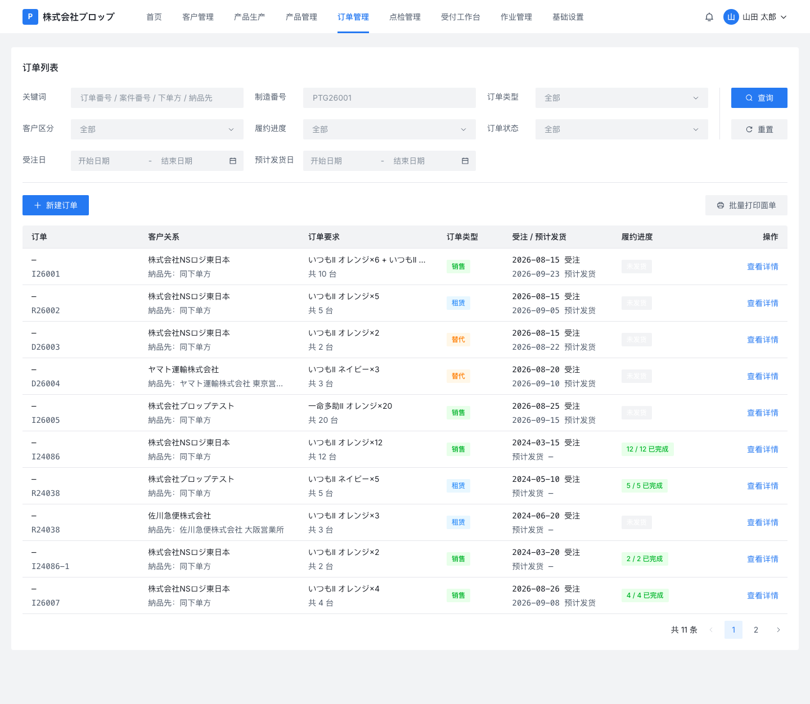
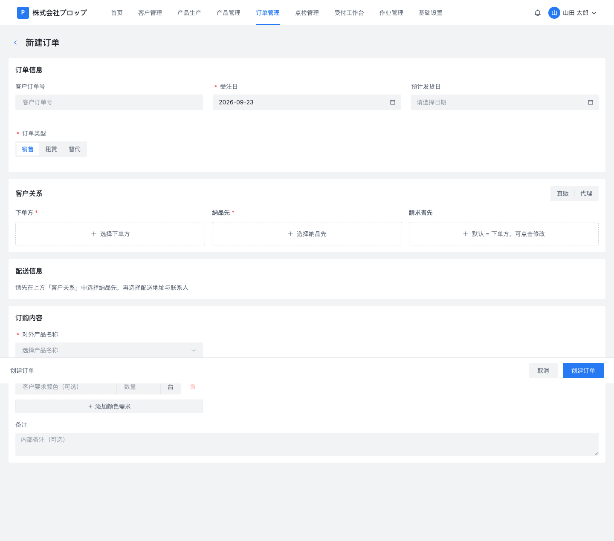
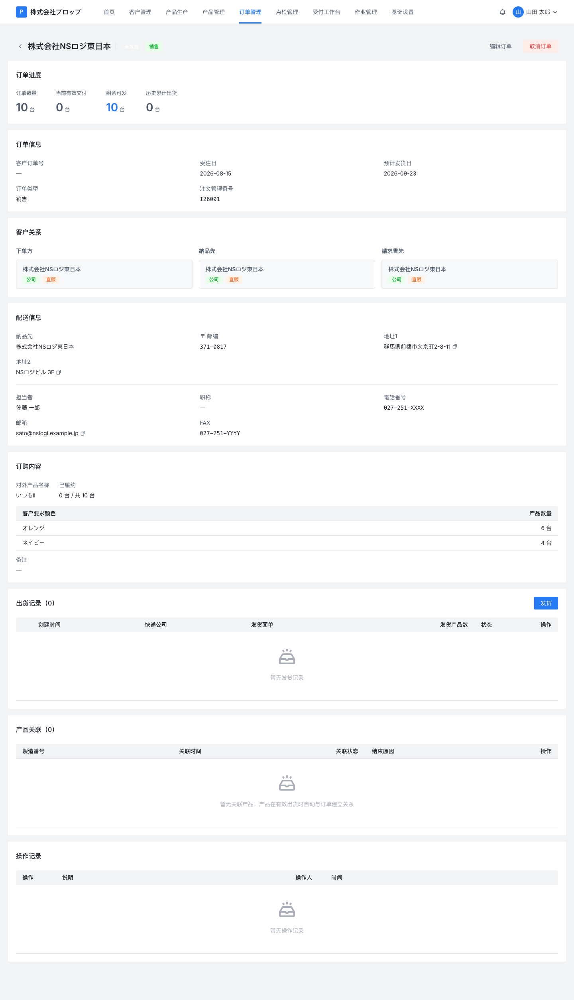

# FEAT-10 订单管理

**状态：Current Truth**

## 1. 模块概述

本模块供接单与发货人员记录客户订购需求，维护订单客户关系、配送资料、颜色要求与数量，查看交付进度，并在错误交付时解除产品关联。订单表示客户需求；实际寄出由寄送业务记录，实际回收由受付业务记录。

```text
客户资料 → 订单本次采用的客户、配送资料
              └─ 订购内容：一个对外产品名称、多行颜色要求与数量
                    → 寄送准备 → 确认寄出 → 产品与订单关联
订单详情 ← 出货记录、当前与历史关联
              ├─ 错误交付：解除关联，保留历史
              └─ 正常回收：进入受付处理
```

## 2. 页面构成

| 页面 | 导航位置 | 主要作用 |
|---|---|---|
| 订单列表 | 订单管理 | 查询订单，进入新建与详情 |
| 订单详情 | 订单列表 → 查看详情 | 查看需求、交付与关联记录，编辑、取消、发货及解除关联 |
| 新建／编辑订单 | 列表 → 新建订单；详情 → 编辑订单 | 维护订单资料和订购内容 |

「发货」及出货记录的「查看」打开寄送抽屉，其内部操作属于 FEAT-11 寄送，本模块维护入口及订单侧结果。批量打印由「订单管理 → 批量打印」同级菜单独立进入，订单列表不提供快捷入口。

## 3. 资料项目与规则

### 3.1 订单

| 资料项目 | 必填 | 规则 |
|---|---:|---|
| 注文管理番号 | 自动生成 | 成立时取得，员工不填写；编辑、取消不更换。编号规则见第 7 节 |
| 客户订单号 | 否 | 员工填写客户侧编号，可供查询和辨识；不替代注文管理番号 |
| 受注日 | 是 | 员工选择日期，新建默认当天 |
| 预计发货日 | 否 | 员工选择预计日期，未填显示「—」 |
| 订单类型 | 是 | 销售、租赁、替代；新建默认销售 |
| 客户区分 | 是 | 本单独立的操作流程选择，新建默认直販；员工可选择直販／代理，选择或更换公司、支店／现场均不得以客户主档类型覆盖。直販→納品先默认同下单方；代理→納品先清空待选。编辑加载本单已保存区分，与销售／租赁／替代订单类型无关；不修改客户主档或既有历史 |
| 下单方 | 是 | 选择公司或支店／现场，表示本次下单客户 |
| 納品先 | 是 | 选择公司或支店／现场；直販初始同下单方，代理须另选；默认带入后仍可修改 |
| 請求書先 | 自动带入 | 默认同下单方，可另选；清除后恢复为下单方。不同于下单方时显示提示，无额外确认步骤 |
| 配送地址 | 是 | 必须属于所选納品先自身，不能借用其所属公司或其他支店的地址 |
| 联系人 | 否 | 从所选配送地址的联系人中选择，可清除；不提供脱离客户资料的自由填写入口 |
| 对外产品名称 | 是 | 从启用的对外产品名称中选择；一个订单只有一种产品名称，所有订单行的产品名称必须相同；不决定实物颜色或规格 |
| 备注 | 否 | 员工填写内部备注，在详情订购内容下显示 |
| 订单状态 | 自动记录 | 有效、已取消；新建为有效，取消动作后为已取消 |

### 3.2 订购内容行

| 资料项目 | 必填 | 规则 |
|---|---:|---|
| 客户要求颜色 | 否 | 手工文字要求，不从颜色字典或衣体规格选择；不要求与实物规格文字一致 |
| 数量 | 是 | 正整数，单位「台」；一个订单可有多个订单行（每个颜色细节一行），但所有订单行的产品名称必须相同；已有有效交付时，整单需求总数量不得低于整单当前有效交付数量 |
| 已履约 | 自动显示 | 已成立且未被否定的交付数量；不由员工直接填写 |

业务上一个订单是一份统一产品需求。数据可保存多条产品名、备注（页面通常作为颜色要求）和数量明细，同单产品名称相同。颜色行仅表达需求，不分配具体产品，不校验实物颜色；履约、剩余可发及编辑数量下限均按整单总数计算。每条需求数量仍须为正整数。

### 3.3 本次配送采用资料与就地维护

客户管理删除支店、地址或联系人后，已有订单仍保留采用资料。编辑时未更换相应客户与配送选择，可沿用订单既有快照保存并继续发货，但配送必填资料必须完整；不得因当前主档已删除而一律阻断，也不得用快照绕过必填校验。更换客户、地址或联系人时，所选对象必须为有效主档并满足归属约束。沿用快照不提供自由修改历史快照内容的入口，不恢复已删除主档，不改写已寄出的快照和文件。

订单保留下单方、納品先、請求書先及配送资料在本次保存时采用的内容；客户主档之后修改，不自行覆盖已保存订单或已寄出记录。

| 资料项目 | 必填 | 规则 |
|---|---:|---|
| 邮编、地址1 | 新增／编辑地址时必填 | 在所选納品先下维护；保存成功后成为客户资料 |
| 地址2 | 否 | 地址补充内容 |
| 姓名 | 新增／编辑联系人时必填 | 在所选配送地址下维护；详情以「担当者」展示 |
| 职称、電話番号、邮箱、FAX、联系人备注 | 否 | 在联系人弹窗维护；联系人备注只在选择与编辑区域展示，订单详情不单列 |

### 3.4 产品关联与操作记录

| 资料项目 | 必填 | 规则 |
|---|---:|---|
| 关联产品 | 是 | 用製造番号辨识；关联从确认寄出成立，同一产品同时最多一个当前订单 |
| 关联时间、关联状态 | 自动记录 | 显示建立时间，以及「当前有效」或「已结束」 |
| 结束原因 | 结束时记录 | 本页手动解除显示「解除关联」；已有历史原因按原记录展示 |
| 结束时间、操作人 | 结束时记录 | 保留关系结束事实；当前关联表不另设这两列 |
| 操作、说明、操作人、时间 | 自动记录 | 创建、编辑、取消订单时记录；数量变化说明为「数量 X → Y 台」，取消说明保留取消原因 |

## 4. 订单列表

### 4.1 页面作用

按客户、日期、订购要求与交付情况查找订单，进入具体业务。

### 4.2 页面入口与去向

从导航「订单管理 → 订单列表」进入；客户详情的关联业务入口可带入客户名称查询。「新建订单」进入表单，「查看详情」进入对应订单。2026-09-29 导航裁决：批量打印与订单列表为同级菜单，删除订单列表批量打印快捷入口；本裁决覆盖原型对应工具栏安排。

### 4.3 页面布局



```text
订单列表
├─ 筛选区：条件按顺序排列，右侧查询／重置
├─ 工具栏：新建订单
└─ 订单表格 → 分页与总条数
```

### 4.4 展示信息

筛选项依次为：

| 字段 | 控件与选项 | 默认值及范围 |
|---|---|---|
| 关键词 | 可清空文字输入 | 空；匹配注文管理番号、客户订单号、下单方、納品先 |
| 制造番号 | 可清空文字输入，提示「PTG26001」 | 空；按部分编号查找相关订单，覆盖准备清单、正式寄出和已解除关联历史，与是否生成或打印文件无关 |
| 订单类型 | 单选 | 全部；销售、租赁、替代 |
| 客户区分 | 单选 | 全部；直販、代理 |
| 履约进度 | 单选 | 全部；未发货、部分发货、已完成 |
| 订单状态 | 单选 | 全部；有效、已取消 |
| 受注日 | 日期范围 | 空，不限日期，包含起止日 |
| 预计发货日 | 日期范围 | 空；指定范围后不包含未填预计发货日的订单 |


| 列顺序 | 列名 | 显示内容 |
|---|---|---|
| 1 | 订单 | 首行客户订单号，缺失为「—」；已取消加标签；次行注文管理番号 |
| 2 | 客户关系 | 首行下单方，次行「納品先：…」；显示名称相同时写「同下单方」 |
| 3 | 订单要求 | 产品名称与颜色要求摘要，次行「共 N 台」 |
| 4 | 订单类型 | 销售、租赁、替代标签 |
| 5 | 受注 / 预计发货 | 首行受注日期，次行预计发货日期；缺失为「预计发货 —」 |
| 6 | 履约进度 | 有效订单显示未发货、数量进度与部分发货／已完成；已取消显示「无出货」或「已出货 N台」 |
| 7 | 操作 | 查看详情 |

每页 10 条并显示总数；无列排序入口，也未定义按日期重排。空列表文字为「暂无订单，点击【新建订单】开始记录客户需求」。

### 4.5 功能

- 输入条件 → 点击「查询」或在关键词／制造番号输入框回车 → 按组合条件展示结果；仅改变条件尚不提交查询。
- 点击「重置」 → 清空全部条件和日期 → 恢复不限条件的列表。
- 点击「查看详情」 → 打开所选订单 → 可查其独立需求、出货与关系，不因历史编号重复合并订单。

### 4.6 校验与反馈

查询无匹配时显示空列表，不建立记录。订单状态筛选、制造番号查询覆盖范围及带入关键词的显示须按 validation 验收，当前差异见第 9 节。

### 4.7 页面产生的数据

无。查询、分页和进入其他页面不建立或修改订单。

## 5. 订单详情

### 5.1 页面作用

在一页核对需求、客户、配送、出货历史与产品关联，处理订单变更或错误交付。

### 5.2 页面入口与去向

列表「查看详情」及订单保存成功后进入。返回箭头回订单列表；「编辑订单」进入独立编辑页；「发货」及出货行「查看」打开寄送抽屉。

### 5.3 页面布局



```text
返回 ｜ 下单方名称、进度／已取消、订单类型 ｜ 编辑订单、取消订单
├─ 订单进度
├─ 订单信息
├─ 客户关系
├─ 配送信息
├─ 订购内容及备注
├─ 出货记录 ｜ 发货
├─ 产品关联
└─ 操作记录
```

### 5.4 展示信息

- **页头**：标题为下单方名称。有效订单显示履约进度，取消后显示「已取消」，并保留订单类型。有效订单可见「编辑订单」「取消订单」，包含已发足订单。
- **订单进度**：横排「订单数量」「当前有效交付」「剩余可发」「历史累计出货」，单位均为台；含义见第 7 节。
- **订单信息**：首行客户订单号、受注日、预计发货日；次行订单类型、注文管理番号。缺失客户订单号及预计发货日显示「—」。
- **客户关系**：下单方、納品先、請求書先三栏，显示本单采用的名称、公司／支店・现场标签及本单客户区分；不另列业务编号。
- **配送信息**：公司场景首行为納品先、〒 邮编、地址1，次行为地址2；支店场景首行为納品先所属公司、現場名・支店名、〒 邮编，次行为地址1、地址2。分隔后显示担当者、职称、電話番号，再显示邮箱、FAX。选填空值为「—」，地址1、地址2及邮箱支持复制。
- **订购内容**：表格上方显示「对外产品名称」及「已履约 X 台 / 共 Y 台」；表格依次为客户要求颜色、产品数量；下方为备注，空值「—」。无独立规格列、行内编辑按钮。已履约只统计总数，不按颜色拆分。
- **出货记录**：标题括号数为已确认发货笔数，表内可含待确认、已发货记录；准备删除后不保留该准备或“已放弃”业务历史。列为创建时间、快递公司、发货面单、发货产品数、状态、操作；缺失快递公司或面单显示「—」。按确认时间、未确认时按创建时间，由新到旧排列。展开后逐个显示製造番号及本次发货采用的订单产品名称；不展示逐台对应的客户颜色要求；无产品显示「尚未录入产品」，无记录显示「暂无发货记录」。
- **产品关联**：括号数含当前及已结束关系；列为製造番号、关联时间、关联状态、结束原因、操作。当前关系的结束原因显示「—」，仅当前关系显示危险色「解除关联」。空态为「暂无关联产品；产品在有效出货时自动与订单建立关系」。
- **操作记录**：列为操作、说明、操作人、时间；说明空值「—」，按时间倒序。每页 10 条；空态为「暂无操作记录」。

### 5.5 功能

- 编辑订单 → 打开预填当前内容的表单 → 保存后回本页；订单已发足不取消编辑入口。
- 取消订单 → 弹窗「取消订单＋注文管理番号」 → 填写取消原因，点击危险色「确认取消订单」后停止后续履约，显示「订单已取消」；「返回」关闭弹窗且不取消订单。
- 取消弹窗显示「取消订单表示这张订单的后续商业履约被终止。取消后禁止继续出货，核心业务字段锁定。」当前有效交付大于零时另提示「该订单已有 N 台出货记录。取消只终止后续履约，不撤销历史出货、不解除产品关联；已出货产品如需回收，请通过受付处理。」
- 有效订单仍有剩余可发数量 → 出货记录卡显示「发货」 → 打开本订单寄送抽屉。出货行「查看」打开所选记录；确认后的记录仍可按寄送规则维护物流资料。
- 出货行「查看」打开所选寄送抽屉；确认发货统一从抽屉内点击「补充运单号并确认寄出」，表格内不提供直接确认入口。
- 当前关联行点击「解除关联」 → 显示对应製造番号及后果，并选择基准月处理方式 → 点击危险色「确认解除」后显示「已解除关联」，关系保留并标记已结束；取消则无变化。

解除弹窗不要求选择原因。每次解除产品订单关联时，由员工选择「保留基准月」或「解除基准月」。选择保留时，产品首次出货日及生命周期基准月保持不变；选择解除时，两者同时清空。该选择不是解除原因，不删除历史寄送、文件或关联记录。

弹窗列明以下三条后果：

1. 「该次发货将从订单履约数中扣减，订单可能回到『部分发货 / 未发货』；」
2. 「产品计入成品在库，之后可重新关联其他订单；」
3. 「历史发货与关联记录保留，不删除。」

同时提醒「正常回收、租赁结束请通过受付的回收确认处理，不要在此解除。」

### 5.6 校验与反馈

取消原因空白时提示「请填写取消原因」且不关闭为成功；订单不存在时显示「订单不存在」。已取消订单不再提供编辑、取消和新建发货入口。当前关系不存在时不能重复解除；存在多条当前关系时提示先核对异常。已结束关系不提供解除按钮。确认发货统一从寄送抽屉进行，未满足寄送要求时由抽屉显示失败原因。

### 5.7 页面产生的数据

- 取消成功：更正订单状态，记录取消原因、操作人与时间，新增取消操作记录；不删除订单，不改变需求数量，不撤销历史出货，不解除产品关联，不自动建立受付、回收或报废记录。
- 解除成功：在原产品订单关系上记录结束时间、操作人及「解除关联」，保留原建立事实；相应交付不再算有效履约，历史出货继续保留。同时按本次选择保留首次出货日及生命周期基准月，或将两者一并清空。解除结果在关联表查看，不承诺新增订单操作记录行。
- 寄送成功：由寄送模块保存寄送记录、产品清单及产品订单关联；准备或打印本身不产生已交付事实。订单详情展示相应结果。

## 6. 新建／编辑订单

### 6.1 页面作用

记录或更正客户当前订购要求，在同一页选用客户资料并补充配送地址与联系人。

### 6.2 页面入口与去向

列表「新建订单」进入新建；详情「编辑订单」进入编辑。新建的返回／取消回列表，编辑的返回／取消回详情；成功保存均回订单详情。

### 6.3 页面布局



```text
返回 ｜ 新建订单／编辑订单＋注文管理番号
├─ 订单信息：客户订单号、受注日、预计发货日；订单类型
├─ 客户关系：客户区分；下单方、納品先、請求書先
├─ 配送信息：地址选择与详情 → 联系人选择与详情
├─ 订购内容：对外产品名称 → 颜色／数量各行 → 备注
└─ 常驻底部操作栏：取消 ｜ 创建订单／保存订单
```

订单信息和三方客户卡按三列排列；地址、联系人详情按三列换行。颜色与数量组合为一行，右侧删除，下方「＋ 添加颜色需求」。

### 6.4 展示信息

字段及必填见第 3 节。新建默认受注日当天、类型销售、客户区分直販、一条空订单行；产品名称、颜色与数量无预填。编辑预填当前订单资料。对外产品名称为选择框；订单类型与客户区分为单选按钮；日期为日期选择；客户订单号、颜色为文字输入；数量为带「台」的输入；备注为多行输入。

客户三方使用相同的选择卡及弹窗：左侧公司与支店／现场树，可搜索公司名称、支店名或编号；右侧显示主体类型、客户区分、编号，支店另显示所属公司，以及其自身地址与联系人。选中树节点只供查看，点击「选择：…」才采用；无节点时「选择」不可用。空态区分「无匹配客户」「暂无地址与联系人」「暂无联系人」。选中卡显示主体名、类型与客户区分，支店卡只显示支店名。

未选納品先时提示「请先在上方『客户关系』中选择納品先，再选择配送地址与联系人」；选后开放地址，选地址后开放联系人。地址详情显示〒 邮编、地址1、地址2；联系人详情显示担当者、职称、電話番号、邮箱、FAX、备注，选填空值为「—」。

有效订单全字段可编辑，包含已有有效交付的订单；整单需求总数量不得低于整单当前有效交付数量，所有订单行的产品名称必须相同。已取消订单不提供编辑入口。

### 6.5 功能

- 选择／更换下单方 → 保留本单当前客户区分，請求書先回到下单方，并按本单区分重新确定納品先 → 直販默认同下单方，代理清空待选；地址、联系人随之重新选择。公司及支店／现场遵循相同规则，客户主档的默认区分仅作为客户资料展示，不作为本单区分来源。
- 调整客户区分 → 按上述直販／代理规则重新确定納品先 → 清理旧配送地址及联系人并沿用单候选自动采用规则（选择器完整预览已加载唯一地址／联系人时自动采用；编辑采用快照未加载候选时，清空旧配送后等待员工经既有选择入口重新选择，不静默刷新主档）；未选下单方时納品先等待选择。保留此前已确认的另选請求書先，不因区分切换恢复默认；只有选择／更换下单方或清除請求書先时恢复同下单方。納品先及請求書先仍可手动另选，保存不得再次强制覆盖。调整区分仅影响本单，不修改客户管理中的公司类型或已寄出快照。
- 更换納品先 → 只提供其自身地址 → 仅一个地址时自动采用；多个时由员工选；所选地址只有一个联系人时自动采用。
- 更换地址 → 重新选择该地址下联系人 → 不继续保留原地址联系人；清除地址同时清除联系人，清除联系人保留地址。
- 选择不同請求書先 → 显示「請求書先与下单方不同：请款将面向『…』，请确认这是客户要求的特殊结算方式。」 → 可继续保存，无另加审批或确认动作。
- 点击地址卡 → 「选择配送地址」弹窗 → 点击一项即选用；各项有「编辑」，下方有「+ 新增地址」「关闭」。新增／编辑弹窗含邮编、地址1、地址2及保存／取消。
- 点击联系人卡 → 「选择联系人」弹窗 → 点击一项即选用；各项有「编辑」，下方有「+ 新增联系人」「关闭」。新增／编辑字段为姓名、职称、電話番号、邮箱、FAX、备注。
- 就地保存新增地址／联系人 → 在客户资料下建立记录并自动选用 → 分别提示「地址已新增」「联系人已新增」；编辑成功提示「地址已更新」「联系人已更新」。关闭或取消该弹窗不保存该次未提交编辑。
- 添加颜色需求 → 增加一行颜色／数量输入；所有订单行的产品名称必须相同；删除行 → 移除该行，最后一行不可删除；修改后的整单需求总数量不得低于整单当前有效交付数量。
- 点击「创建订单」／「保存订单」 → 检查必填与数量 → 成功提示「订单已创建」／「订单已更新」并返回详情。
- 返回或取消 → 放弃尚未保存的订单表单修改 → 已在地址／联系人弹窗保存的客户资料仍保留。

### 6.6 校验与反馈

受注日缺失提示「请选择受注日」；客户区分缺失提示「请选择客户区分」；未选下单方／納品先提示「请选择下单方与納品先」；配送地址缺失提示「请选择配送地址」；产品名称缺失提示「请选择对外产品名称」；数量为空提示「请输入数量」，零、负数、小数或非数字提示「数量为正整数」。整单需求总数量不得小于整单当前有效交付数量；所有订单行的产品名称必须相同。

新增／编辑地址缺少邮编或地址1时提示「请填写邮编与地址1」；联系人缺姓名提示「请填写联系人姓名」，没有配送地址不能新增联系人。客户资料自身的格式校验继续适用。校验失败不建立或更正订单，保留输入供修改。

颜色选填、客户订单号保存等尚存差异，须按第 9 节处理，不将失败行为转写为新业务限制。

### 6.7 页面产生的数据

创建成功建立一张订单及其订购内容行（一种产品名称，可有多个颜色细节行），保存本次采用客户与配送资料，生成注文管理番号并记录创建操作。仅创建订单不分配实物、不建立出货或产品关联。

编辑成功更正同一订单的当前需求及采用资料，保留订单身份与原有交付归属，新增编辑操作记录；总数量变化时写明前后数量。不改写已确认出货和既有正式文件。

就地新增／编辑地址或联系人会独立建立／更正客户主档资料，即使随后取消订单表单也保留该变化。仅选择已有地址／联系人不更正客户主档。

## 7. 跨页面统一规则

### 7.1 注文管理番号

新号格式为 `[I/R/D][YY][NNNN]`：I 为普通订单（页面类型「销售」），R 为租赁订单，D 为替代订单；YY 为生成年份后两位；NNNN 为年内四位连号。所有前缀共用系统新订单的年度序列，不按类型或月份分开起号；新年度重新从 0001 开始。

2026-10-27 最新编号裁决（取代上线年度人工初始化要求）：首次使用正常订单功能时，无论哪一年，系统在首次成功创建事务内自动按已用序号1000起号，首单为1001；不要求部署后另行执行编号初始化SQL。首次使用年度之后的新年度从0001开始。已存在的年度序列按原值递增，不因重新部署、重启、重试或历史补录被重置。

历史补录可先于或晚于正常新建，所有历史编号（含与系统新号相同的标准格式、重复号及后缀）均不参与首次使用判断或续号。若已有系统生成的正常订单而对应年度序列缺失，属于数据不一致，明确拒绝并交管理员核对，不能冒充首次使用从1001或0001重新分配；不自动扫描最大号码修复。正常新年度尚无订单且无序列不属于该异常。

例如首次在2027年使用，依次取得 I271001、R271002、D271003；2028年首次正常创建取得 I280001（按订单类型选择前缀）。订单编辑或取消不更换已取得编号，取消编号不重新使用。客户订单号是另一项客户提供资料，与本编号独立。首次初始化、序列递增与创建订单沿同一事务成功或回滚；成功请求重放返回原编号，不再次取号。

历史编号按原值保留，包括重复号、错录变体、其他前缀及 `-N` 后缀；例如 R24038 的两张订单均保留，I24086-1、R24032A 不自动重编号。系统不提供子单创建入口。新号按标准 `[I/R/D][YY][NNNN]` 格式生成；所有历史编号均不解析参与新号序列。

### 7.2 交付进度与历史

解除关联选择清空基准后，下一次有效确认寄出重新建立产品首次出货日及生命周期基准月；旧寄送日期更正不恢复已解除的基准。选择保留时，再次发货不重置基准（2026-09-29 用户裁决）。

订单数量表示客户当前要求；当前有效交付表示已经成立且未被错误交付纠正否定的数量；剩余可发表示尚未满足的需求，不显示负数；历史累计出货表示已经确认寄出的全部历史数量。

没有有效交付时显示「未发货」，尚未满足全部需求时显示「部分发货」，满足全部需求时页面显示「已完成」。此处「已完成」只表示数量已满足，不表示已请款、财务交接或人工关闭。有效订单增加需求后可再次出现剩余可发并继续发货。

手动解除用于否定错误交付，相应有效交付减少，历史累计出货不减少。正常回收、租赁结束等由受付处理，不否定已经完成的交付。普通收件、点检或维修不自动结束订单关联。

### 7.3 取消与关系边界

已取消订单的未确认寄送准备仅保留查看、查看已有文件及删除；禁止修改物流、生成新文件、加入产品或确认寄出，并从批量打印列表排除。已正式寄出的记录仍按寄送规则允许物流维护。

取消订单时自动释放其未确认寄送准备中的产品占用，准备内容及已有文件保留，可继续查看或删除；这些准备不得继续确认寄出，也不得重新占用产品。已正式寄出的产品订单关系不因此解除。

有效订单不论是否已发足均可取消，原因必填。取消只终止后续履约，保留历史出货和产品关系。已取消订单仍可查看历史，产品正常寄回时可进入受付。解除错误关联与取消是独立操作，不因订单取消自动执行；当前关联的解除入口仍按关系是否结束判断。

### 7.4 发货文件与删除准备边界

历史多名称订单继续发货时，新建寄送必须从该订单已有产品名称中明确选择本笔采用名称；本笔全部产品统一采用所选名称。订单原行名称保留，不按名称或颜色分配产品、不拆分履约统计。普通同名订单仍自动采用唯一订单产品名称，不增加选择步骤。

保障确认书归属于单笔发货，仅含生成时该笔清单中的产品；同订单多次发货分别生成不可覆盖的独立版本，不按订单汇总。删除发货准备时连同所属清单关联、全部文件及邮件版本一并删除，包括保障确认书；不删除产品或其他发货，不改变正式履约。正式寄出后不可删除，其保障确认书版本随发货保留。生成或打印不登记寄出、不改变履约或产品与订单关系。详见 FEAT-11 §4.7、§6.7。

## 8. Feature 边界与明确不做

本模块负责订单查询、创建、编辑、取消、编号及订单详情的错误交付解除入口。FEAT-11 寄送负责实际寄送、文件和物流维护；FEAT-14 受付工作台负责实际收件、回收与后续处理；FEAT-01 客户管理拥有客户、地址、联系人；FEAT-08 产品列表维护产品档案并展示当前及历史业务关系。

明确不做：

- 人工「确认完成」、待确认完成流程及财务交接确认。
- 受注案件页面、案件编号生成、父子订单或自动拆单流程。
- 订单列表、详情、出货记录及解除弹窗显示 M番号（含搜索等输入入口的提示与匹配键）；产品辨识使用製造番号。
- 手动解除时选择误发／错发等原因，或以解除入口代替正常回收、租赁结束。
- 独立产品预分配步骤，颜色／规格文字强匹配拦截，订单内独立规格或特殊要求输入项。
- 金额、收付款、记账、正式請求書及财务审批。

打印与报告的正式输出能力由对应模块以「目标稿（待转正）」维护；本稿只确认入口，不将文件输出列为已验收能力。

## 9. 核对记录

- 2026-09-23：按二级导航粒度自 06-订单管理 拆分为本 feature（FEAT-10）；内容不变，章节与交叉引用已重编号。

- 2026-09-21：依据主代理输入包，以 V2.0 对应 PRD 为底稿，按模板重组；完整核对订单列表、详情、表单及客户选择弹窗，核对寄送入口、订单保存、编号与关系行为。完成文档静态检查，未执行浏览器验收；本稿待终审。
- 裁决依据：[修改记录](../../../../修改记录.md) 第 01、02、18、19、20 节，以及 2026-09-18「手动解除订单关联取消原因选择，改为后果说明 + 二次确认」、2026-09-20「产品管理 / 订单详情不再显示 M番号」「编号规则定稿」「订单编号规则收敛」。输入包所写「§24.2000／2160／2184」实际对应相关条目附近行号，不是稳定章节号；「§24.1～6」也不对应订单章节，故按真实标题定位。
- 对照来源：[V2.0 订单 PRD](../../../../../V2.0/01-正式需求/06-订单管理.md)、[订单阶段记录](../../../../01-正式需求/06-订单管理-v21.md)、[V2.0 订单数据模型](../../../../../V2.0/03-数据模型/05-订单管理数据模型.md)。阶段记录的解除原因选择、旧基线优先说明及多名称编辑兼容，与当前裁决或页面存在差异，不能直接沿用。
- 差异修复（2026-09-21）：订单状态筛选已生效；客户订单号新建保存；颜色恢复选填；已交付订单全字段可编辑；配送资料更改后同步；历史多名称订单编辑保留各行名称。validation 第 6 节 R01～R07 已解决；R08～R13 为跨模块或后续数据模型事项，不影响本模块 Current Truth 状态。
- 数据核对：旧数据模型仍含旧编号、人工完成、单一数量及旧关系结束入口，尚未形成 V2.1 订单数据模型；现有订单样例仍有客户资料选择缺项及历史记录兼容待验收。本轮按委托范围仅交付 spec 与 validation，不修改旧模型、历史 PRD 或页面。完成差异处置前不将本稿标记为 Current Truth。
- 修订（2026-09-21）：客户区分改为操作流程选择（控制納品先默认行为，不修改客户主档）；删除「批量打印面单不产生数据」表述；删除操作记录「单页不显示分页」规则；删除出货记录「不分页」规则；字段锁定修正为「有效订单全字段可编辑」；订购内容行改为「一个订单可有多个订单行，但产品名称必须相同」；删除「订单侧打印编号清单」条目；操作记录标题去掉数量（demo 同步修改）。
- 修订（2026-09-21）：删除「指定类型入口带入相应类型」表述（无实际入口）；demo 同步删除 presetOrderType 相关代码。
- 修订（2026-09-21）：订单结构恢复多订单行（每个颜色细节一行），但约束所有订单行的产品名称必须相同；产品名称取第一行；已履约只统计总数，不按颜色拆分（表格上方显示「已履约 X 台 / 共 Y 台」）。
- 修订（2026-09-21）：确认发货弹窗恢复为订单详情页表格内弹窗的真实文案（「确认后将冻结本次发货并建立产品订单关联，不可再修改」）；demo mock 数据添加待确认且有发货面单的出货记录（供「确认发货」按钮演示）。
- 修订（2026-09-21）：取消订单详情页表格内「确认发货」入口，统一从寄送抽屉点击「补充运单号并确认寄出」；demo 同步删除表格内确认发货按钮及 handleConfirmShipment 函数。
- 修订（2026-09-21）：订购内容表格删除「已履约」列，改为表格上方显示「已履约 X 台 / 共 Y 台」；demo 同步删除 deriveLineF 导入及 lineF 计算。
- 修订（2026-09-23）：注文管理番号年内连号由 3 位扩为 4 位（格式 `[I/R/D][YY][NNNN]`，0001 起，年度重置），来源：2026-09-23 用户裁决（复查客户订单约每年 1400 件，3 位号段不适用）；「超过三位年度号段」留白表述删除，特殊历史前缀参与新号接续问题继续挂终审事项。
- 修订（2026-09-23）：修正四位年内连号的示例为 `I260001／R260002／D260003`，与 `[I/R/D][YY][NNNN]` 规则一致；来源：2026-09-23 用户裁决。

- 2026-09-25：根据已确认裁决修订删除、身份与编号复用、历史保留、实物衣体更换或单笔发货文件归属相关条款；此前核对记录中的冲突口径已被本次正文取代，旧 demo／测试结论不代表本次修订已实施或验收。

- 2026-09-29 用户裁决：整单履约、不按颜色行分配产品；关键词不含产品名和颜色；制造番号查询包含无文件准备；新号按标准格式接续、旧号原样保留；出货展开只显示制造番号及本次采用的订单产品名称。上述现行正文取代历史核对中的冲突或待定描述，尚未实施验证。

- 2026-09-29 用户补充裁决：每次解除关联由员工选择保留或解除生命周期基准月；解除基准月时同时清空产品首次出货日。历史寄送事实仍保留，尚未实施验证。


### 2026-10-24 问题04B裁决

§3.1及§6.4～6.5的新建直販默认、本单独立区分与三方联动取代此前“选下单方带入主档区分”的安排；客户主档继承读取问题04A独立处理，不是本单区分默认的前置条件。
