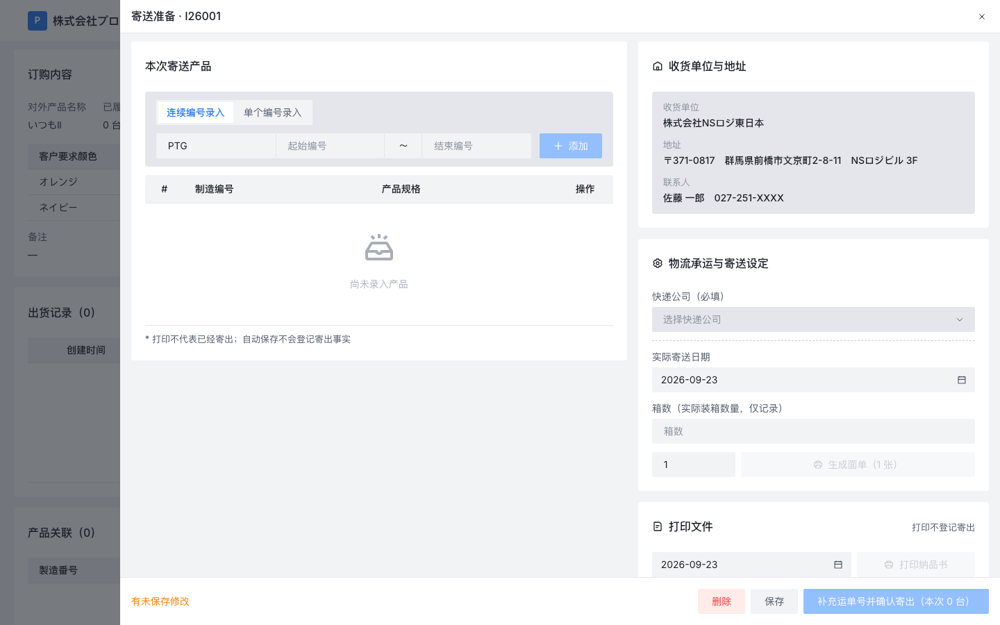
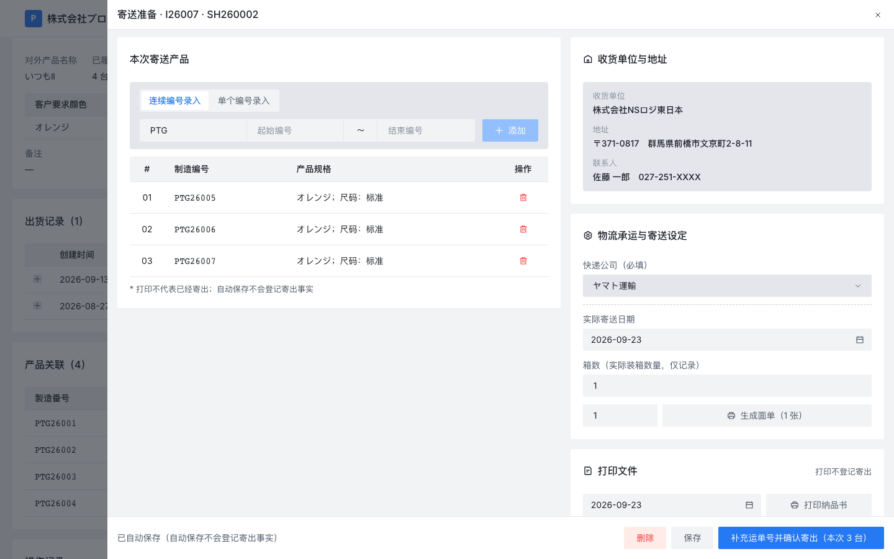
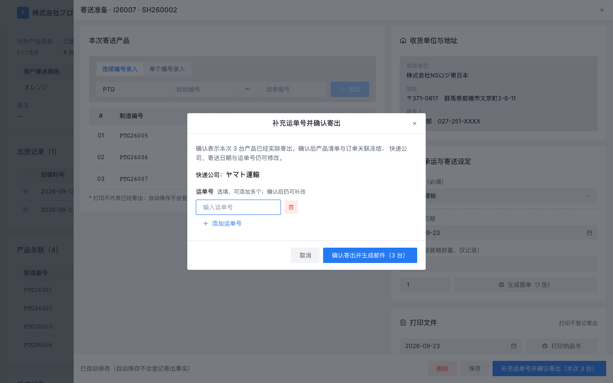

# FEAT-11 寄送

**状态：Current Truth**

2026-10-23需求状态：两家面单、订单納品書及保障确认书的字段和输出规则已逐项确认；邮件字段、只读及参数规则已确认，完整正文示例的排版、换行及分隔线已获用户确认。采用规则见本文末各类文件确认条款及[模板目录](assets/reports/README.md)。需求确认不代表WP4已实施、运行或实纸验收通过。

> **2026-09-25 原型适用边界**：本目录既有原型资产未更新。保障确认书归属、生成时产品范围及准备删除边界以 §4.7／§6.7 为准，旧演示中的订单级归集及删除例外已失效。 此前 demo 核对及测试结论仅作历史记录，不证明本次规则已验收。

## 1. 模块概述

本模块供发货人员维护订单出货的单笔寄送工作：录入本次产品、生成寄送相关文件、登记实际寄出、维护寄出后的物流资料。打印只产生文件记录；确认寄出才登记寄送事实并建立产品与订单的当前关系。

```text
订单详情 → 新建寄送准备
             ├─ 本次产品、收货快照、快递公司、寄送日期、箱数
             ├─ 面单 / 纳品书 / 保障确认书文件
             └─ 确认寄出 → 出货记录 + 产品与订单关系

```

## 2. 页面构成

| 页面 | 导航位置 | 主要作用 |
|---|---|---|
| 寄送抽屉 | 订单详情「发货」；订单详情出货记录「查看」 | 维护单笔订单寄送的产品、物流资料、文件和确认寄出 |
| 补充运单号并确认寄出弹窗 | 寄送抽屉底部「补充运单号并确认寄出」 | 在实际寄出时补充运单号并登记寄出事实 |

## 3. 资料项目与规则

### 3.1 寄送记录

| 资料项目 | 必填 | 规则 |
|---|---:|---|
| 寄送记录号 | 自动生成 | 创建寄送时取得，格式为 `SH[YY][NNNN]`：SH + 年份后两位 + 年内四位连番；每年从 0001 重新起号；与返送 RT 序列互不共用。历史 SHP 形态按原值保留 |
| 所属订单 | 是 | 每笔寄送只属于一个订单；同一订单可建立多笔寄送 |
| 收货单位与地址 | 自动带入 | 新建寄送时按订单配送资料保存本次采用内容；寄送页只读展示，不提供修改入口 |
| 本次寄送产品 | 确认前至少一台 | 准备中可通过连续编号或单个制造编号录入、移除；确认寄出后清单冻结，寄送页不提供修改入口 |
| 快递公司 | 确认寄出时必填 | 选项为 ヤマト運輸、佐川急便；表示该笔寄送最近一次实际使用的快递公司，只有一个值。抽屉内手动选择，准备中选择即保存，已寄出后修改也保存，下次打开显示最后保存值。准备中可暂缺；已寄出后仍可更正 |
| 实际寄送日期 | 是 | 新建默认当天，可在确认前维护；已寄出后仍可更正 |
| 箱数 | 否 | 记录实际装箱数量；不决定面单张数，不决定运单号数量 |
| 面单张数 | 打印面单时使用 | 打印面单时由员工输入，范围 1–99；表示本次要印出的面单份数（复印份数），每份使用同一份完整产品清单，不代表产品台数或箱数；一次「生成面单（N 张）」只产生一个面单文件版本，N 张共用同一版本（复印关系） |
| 运单号 | 否 | 可填写多个，可为空；唯一消费场景是寄送通知邮件正文。运单号数量不影响面单张数、箱数或寄送事实 |
| 已生成文件 | 自动记录 | 面单、纳品书、保障确认书、寄送通知邮件每次生成均形成独立版本行；历史版本不覆盖，可继续打印或查看当时内容 |

### 3.2 确认寄出后的可改与不可改

| 项目 | 确认后规则 |
|---|---|
| 产品清单 | 冻结；如需纠正错误交付，走订单维度解除产品关联 |
| 产品与订单关联 | 冻结为正式关系；寄送页不提供撤回、冲正、解锁或状态回退 |
| 收货地址快照 | 寄送页只读，不提供修改入口 |
| 快递公司、实际寄送日期、箱数 | 可更正；更正后只保留最后修改人员和时间，不保存修改历史 |
| 运单号 | 可追加、修改、删除；保存后影响此后生成的邮件版本正文，不改变已登记寄出事实 |

**版本保留的适用范围**：文件及邮件已生成版本不被后续生成覆盖；准备记录删除时其全部所属版本一并删除，不保留该准备业务历史。正式寄出后不得删除记录，所属版本继续保留。

## 4. 寄送抽屉

### 4.1 页面作用

在一页完成单笔订单寄送的准备、文件生成、确认寄出及已寄出后的物流资料维护。准备中与已寄出使用同一抽屉；标题分别为「寄送准备 · 订单号 · 寄送记录号」和「寄送详情 · 订单号 · 寄送记录号」。

### 4.2 页面入口与去向

从订单详情「发货」进入准备中抽屉；从订单详情出货记录「查看」进入对应记录。关闭后返回原页面。

### 4.3 页面布局





```text
寄送准备 / 寄送详情
├─ 左侧：本次寄送产品
│   └─ 已生成文件（已有文件或已寄出时显示）
├─ 右侧：收货单位与地址
│   ├─ 物流承运与寄送设定
│   ├─ 打印文件
│   └─ 运单号维护（仅已寄出）
└─ 底部操作栏
```

### 4.4 展示信息

- **本次寄送产品**：准备中显示灰底录入面板，录入方式为「连续编号录入」「单个编号录入」，默认连续编号。连续编号包含编号前缀、起始编号、结束编号和「添加」；单个编号包含「扫描或输入制造编号，回车加入」和「添加」。产品表列为 #、制造编号、产品规格；准备中另有操作列，删除按钮确认文案为「从本次清单移除？」。已寄出时不显示操作列，卡片右上角显示「已确认寄出」。准备中卡底部提示「* 打印不代表已经寄出；自动保存不会登记寄出事实」。
- **已生成文件**：已有文件或已寄出时显示。表格列为文件名称、生成时间、操作。面单、纳品书、保障确认书按版本逐行展示，操作为「继续打印」；寄送通知邮件按版本逐行展示，操作为「查看」，弹窗显示该版本的生成时间与正文全文，弹窗内可复制正文。
- **收货单位与地址**：模块顶部独立只读显示「注文先」（下单方），其后依次为收货单位、地址（〒邮编 + 地址）、联系人（姓名 + 电话）。下单方取本笔寄送的下单方快照：公司仅显示name，支店显示「companyName ／ name」（所属公司名称 ／ 支店名称）；缺任一名称时仅显示现存名称，均缺显示「—」，不去重、不回查主档、不以納品先代替。准备中及已寄出一致；即使与納品先同名仍保留独立字段。 本模块「納品先」为公司时显示公司名称，为支店时显示「所属公司名称 ／ 支店名称」，均采用本笔寄送收货方快照，不判断与下单方是否同公司。旧快照缺所属公司名时仅显示支店名，不以下单方补齐、不回查主档；已有非空名称按原值显示，全部缺失显示「—」。此项仅影响抽屉，不改变納品書或邮件。
- **物流承运与寄送设定**：快递公司必填，下拉为 ヤマト運輸、佐川急便；虚线分隔后显示实际寄送日期、箱数（说明「实际装箱数量，仅记录」）、面单张数和「生成面单（N 张）」。
- **打印文件**：卡片角标「打印不登记寄出」。两行分别为日期 +「打印纳品书」、日期 +「打印保障确认书」；无产品时按钮不可用。
- **运单号维护**：仅已寄出显示，角标「保存单号后，可生成新的邮件版本」（保存运单号即时生效；保存本身不生成邮件版本，下一次生成的邮件版本会使用新运单号）。每行以 1.、2.、3. 编号，包含运单号输入框和红色删除按钮；底部左侧「追加单号」，右侧「生成邮件正文」「保存单号」。无修改时「保存单号」不可用。
- **底部操作栏**：准备中左侧显示「已自动保存 HH:mm（自动保存不会登记寄出事实）」或「有未保存修改」，右侧为「删除」「保存」「补充运单号并确认寄出（本次 N 台）」。已寄出左侧显示「状态：已确认寄出 · 日期（寄送事实已登记，产品与订单关联不变；寄送内容可修改）」，右侧为「关闭并返回列表」。

### 4.5 功能

- 输入单个制造编号并添加 → 编号存在、可用于本订单且未重复时加入本次清单 → 表格新增一行。
- 输入连续编号范围并添加 → 对范围内编号逐个检查 → 可加入的产品加入清单；不可加入的编号按原因提示，不影响已加入编号。
- 点击产品行删除 → 确认「从本次清单移除？」 → 从准备中清单移除该产品。
- 修改快递公司、实际寄送日期、箱数 → 准备中标记为未保存；已寄出时立即保存并分别提示「快递公司已更新」「寄送日期已更新」「箱数已更新」。
- 点击「生成面单（N 张）」 → 在已有产品时生成一个面单文件版本（N 张共用同一版本，复印关系）并提供 Excel 工作簿下载（预览及整簿打印见 §4.8），提示「面单已生成（N 张，每张使用同一份完整产品清单）」 → 不登记寄出，不改变产品与订单关系。
- 点击「打印纳品书」或「打印保障确认书」 → 在已有产品时生成对应文件并打开预览 → 不登记寄出，不改变产品与订单关系。
- 已寄出状态点击「生成邮件正文」 → 按服务端已保存的寄送资料生成寄送通知邮件新版本（冻结当时正文全文与生成时间）并打开查看弹窗；点击「保存单号」保存运单号并提示「运单号已保存」。
- 准备中点击「删除」 → 确认「删除后不可恢复，是否确认删除？」 → 删除该准备、所属产品清单关联、全部所属文件及邮件版本（含保障确认书），不保留这些准备内容的业务历史，不填写原因；取消不改变数据。
- 准备中点击「保存」 → 把当前准备内容正式保存（提示「寄送已保存（准备中，暂未寄出）」）后关闭抽屉；保存失败（如无产品）停留在当前页。
- 准备中点击「补充运单号并确认寄出（本次 N 台）」 → 打开确认弹窗；确认成功后登记寄出事实并切换为已寄出资料。

#### 局部保存与未保存输入

已保存资料与当前未保存输入分别管理。承运、实际寄送日期、箱数或产品清单的局部操作成功后，只确认本次成功保存的内容及最新资料版本，不覆盖其他未保存输入；仍有未保存输入时继续显示相应未保存状态，不得将整笔显示为“已全部保存”。即使成功后重新读取整笔寄送，也必须保留其他未保存草稿。

例如：服务端已保存运单号 `A001`，员工改为 `B002` 尚未保存，再将承运从ヤマト改为佐川。承运自动保存成功并回读“佐川＋A001”后，应更新已保存承运及资料版本，保留输入框中的 `B002`，继续显示“运单号有未保存修改”。另如箱数自动保存明确失败，随后添加产品成功并刷新清单，箱数输入仍须保留为未保存状态，不得被回读值覆盖或误报全部已保存。

明确保存失败保留输入；结果未知时沿用结果确认与安全退出规则，不宣称已保存或已回滚。员工明确放弃未保存修改时才丢弃相应草稿；关闭或放弃草稿不撤销服务端已经完成的操作。本规则不要求新增公共状态框架。

### 4.6 校验与反馈

正常订单寄送在加入产品和确认寄出两个入口，均由服务端直接读取产品的首次生产质检通过标记（`initial_production_inspection_passed`）。仅整数1满足首次质检条件；0拒绝，NULL或非法值作为资格数据异常拒绝，不以质检记录存在、日期或前端数据替代。确认时重新读取锁定产品，既有准备也适用；保留原库存、删除／报废、占用、当前订单关系及剩余数量校验，1不代表全部出货条件成立。加入沿用逐编号业务失败反馈，确认任一产品不满足则整笔拒绝，不产生部分交付、关系、首次出货、生命周期或邮件写入。已成功寄出的重复确认仍返回原结果，不追溯重验或改写历史。

单个编号为空提示「请输入产品编号」；编号不存在、已报废、已关联其他订单、已在本次清单、超出订单剩余可发数量时阻止加入并提示原因。连续编号缺起止、起始大于结束、一次超过 100 台时阻止；部分失败时列出失败编号和原因。

保存前没有产品时提示「请先至少录入一台产品」。确认寄出前必须选择快递公司；订单已取消、产品清单为空、产品重复、产品已有关联或配送信息不完整（納品先／邮编／地址）时不得确认。已寄出的产品清单不可在寄送页增删。准备中删除成功提示「寄送已删除」；已寄出记录不显示删除入口，服务端同样拒绝删除，不能通过接口绕过。

### 4.7 页面产生的数据

- 保存准备：建立或更正一笔准备中的寄送记录，保存本次产品清单、收货快照、快递公司、实际寄送日期、箱数和运单号草稿；不登记实际寄出，不建立产品与订单关系。
- 生成面单／纳品书：建立本笔寄送的对应文件版本；一次「生成面单（N 张）」只产生一个面单版本（N 张为复印份数，共用该版本），「打印纳品书」每次新增一个版本；历史版本保留；不登记实际寄出。
- 生成保障确认书：建立本笔发货的保障确认书独立版本；产品范围仅为生成时本次发货清单中的产品，不汇总同订单其他发货。每次生成新增版本，既有版本不覆盖、不因清单后续变化而改写；不同发货的版本相互独立，不登记实际寄出或改变履约、产品与订单关系。
- 确认寄出：登记本次实际寄出，冻结产品清单，建立产品与订单当前关系，并自动生成第一封寄送通知邮件（v1，冻结当时正文与生成时间）；订单详情出货记录出现该笔（列为创建时间、快递公司、发货面单、发货产品数、状态、操作），其中快递公司与发货面单（运单号）读取该寄送记录自身的快递公司与运单号（多个运单号顿号连接）。
- 生成寄送通知邮件：为本笔寄送建立邮件文件版本（冻结当时正文全文与生成时间）；历史版本保留，可随时查看当时内容；不登记额外业务事实。
- 修改已寄出属性：更正该寄送的快递公司、实际寄送日期或箱数，记录最后修改人员和时间；不改变产品与订单关系。
- 保存运单号：更正该寄送的运单号列表，记录最后修改人员和时间；只影响此后邮件正文。
- 删除准备：删除准备中的寄送记录、所属产品清单关联、全部所属文件版本（含保障确认书）及邮件版本；该准备及其版本不保留为业务历史。无论是否已生成或打印文件均可删除；不删除产品档案、其他发货及其文件或其他业务记录，不改变已经发生的正式履约事实。

### 4.8 文件内容与模板采用规则

面单采用快递公司的 Excel 模板：单笔抽屉内生成时使用寄送当前快递公司。2026-10-22 用户确认 Excel 整簿打印满足需求：系统生成并提供工作簿下载，员工在桌面 Excel 中预览、选择“打印整个工作簿”后一次提交打印；无需应用内面单 PDF 预览、浏览器直接打印或本地打印插件。单笔 N 份共用一个业务版本，在工作簿中按份数编排；“继续打印”取得原版本内容，不重新生成业务版本。纳品书参考C05采用单联A4纵向PDF，显示本笔寄送全部制造番号并自动分页，不按原Excel48格截断；原Excel仅作为字段核对参考，不输出上下双联及线下控制区；保障确认书采用A4竖向PDF，原文保持，清单超过40个自动续页且不重复签署区；寄送通知邮件为纯文字正文（客户信息／商品名／発送予定日／数量／快递公司／运单号；不展示制造番号清单）。保障确认书归属和产品范围已按 §4.7 定稿；各类文件字段、编辑／空值、容量、输出与历史规则以本文末2026-10-23逐项确认条款为准；邮件完整正文示例已获用户确认。实现后仍须验证入口、版本、预览／下载、继续打印、长内容及打印不登记寄出的边界。

模板原件与核对材料统一收录于[订单寄送文件与模板目录](assets/reports/README.md)。Excel 整簿打印方式已确认，不再列为待决项；模板字段和容量采用各类已确认说明；长内容实际输出及实纸校准待实施验证，不自动继承返送专属业务规则。上述确认不代表 C03 已实现或实体打印已验收。

## 5. 补充运单号并确认寄出弹窗

### 5.1 页面作用

实际发出本次产品时，补充可选运单号并登记寄出事实。弹窗标题为「补充运单号并确认寄出」。

### 5.2 页面入口与去向

从准备中寄送抽屉底部「补充运单号并确认寄出（本次 N 台）」进入。点击「取消」返回抽屉且不登记寄出；点击「确认寄出并生成邮件（N 台）」通过校验后关闭弹窗，抽屉显示已寄出状态。

### 5.3 页面布局

```text
补充运单号并确认寄出
├─ 确认说明
├─ 快递公司
├─ 运单号多行输入
└─ 取消 ｜ 确认寄出并生成邮件（N 台）
```

### 5.4 展示信息

说明文案为「确认表示本次 N 台产品已经实际寄出。确认后产品清单与订单关联冻结；快递公司、寄送日期与运单号仍可修改。」快递公司以加粗文字展示当前选择，未选择显示「未选择」。运单号区域标注「选填，可添加多个；确认后仍可补改」，每行包含输入框和删除按钮，下方为「添加运单号」。

### 5.5 功能

- 填写或留空运单号 → 点击确认 → 保存运单号并登记实际寄出。
- 点击「添加运单号」 → 增加一行运单号输入。
- 点击行内删除 → 移除该行；只剩一行时清空为可输入状态。
- 点击「取消」 → 关闭弹窗，不保存本次未确认内容，不登记寄出事实。

### 5.6 校验与反馈

未选择快递公司时提示「请先在右侧「物流承运与寄送设定」中选择快递公司」。同一弹窗内运单号重复时提示「运单号存在重复，请检查后合并」。确认成功后提示「已登记寄出 N 台」并生成第一封寄送通知邮件。

### 5.7 页面产生的数据

确认成功后，登记寄送事实、确认人员和确认时间；保存本次运单号列表；自动生成第一封寄送通知邮件（v1，冻结当时正文与生成时间）。确认动作建立产品与订单当前关系；不因是否生成过面单、纳品书或保障确认书而改变确认结果。


## 6. 跨页面统一规则

### 6.1 打印与确认边界

面单、纳品书、保障确认书在本次寄送存在产品的任何阶段均可生成，次数不限。打印和继续打印只产生或使用文件记录，不登记寄出、不改变寄送状态、不建立产品与订单关系。只有「确认寄出」登记寄送事实。

### 6.2 寄送通知邮件版本化

寄送通知邮件是本笔寄送维度的文件，与面单、纳品书同等待遇：每次生成冻结当时的正文全文与生成时间，历史版本不被覆盖、可随时查看当时内容。确认寄出时自动生成第一封；此后由员工在运单号维护中点「生成邮件正文」生成新版本；自动保存、修改快递公司／寄送日期／箱数／运单号等动作本身不自动生成版本。复制正文统一走「生成 → 从文件版本中查看并复制」，不提供按当前内容现算后直接复制的旁路；系统存档的是生成正文，员工复制后在外部修改及实际发送的内容不由本系统回收或保证一致。

生成邮件始终使用服务端已保存的寄送资料，不采用输入框中尚未保存的草稿，也不隐式保存草稿。仅因运单号有未保存修改，不增加禁止生成或要求先保存的特殊限制；通过员工培训说明“先保存单号，再生成邮件”。例如已保存 `A001`、输入框改成 `B002` 但未保存时，生成的邮件仍使用 `A001`；保存 `B002` 后再次生成的新版本使用 `B002`，旧版本保持不变。该规则不改变已有写入执行中或结果未知时的交互保护。

### 6.3 运单号边界

运单号是寄送记录的附属信息，选填、可多个；确认弹窗和已寄出抽屉「运单号维护」维护同一份数据。运单号唯一消费场景是寄送通知邮件正文；与面单张数、实际箱数、产品台数无对应关系。

### 6.4 确认后的身份冻结

确认寄出后，产品清单与产品—订单关系冻结；寄送页不提供产品增删、整体撤回、冲正、解锁或状态回退。快递公司、实际寄送日期、箱数、运单号仍可维护；这些维护不影响产品与订单关系。

### 6.5 订单联动

订单采用的支店、地址或联系人主档已删除时，只要订单仍有效且保留的配送必填快照完整，允许沿用该快照新建准备及确认寄出；不得强制要求原主档仍存在。更换客户或配送选择须回订单按有效主档规则处理，寄送页不增加快照编辑入口。

新建寄送从订单详情发起，收货单位与地址按订单配送资料保存本次快照。确认寄出后，订单详情出货记录出现该笔寄送，订单履约数增加。错误交付（误发、错发）的纠正走订单维度解除产品关联——解除入口在订单详情，寄送页不提供解绑操作；正常回收、租赁结束走受付，不使用解除关联。

产品自身不设置固定业务类型，任何产品均可用于销售、租赁或替代订单；其他状态、当前关联及数量校验保留，不新增类型兼容限制。

首次寄送的实际寄送日期更正时，同步更正相应产品首次出货日及生命周期基准月；跨月更正亦同步改变基准月。

### 6.6 分批寄送

历史多名称订单新建寄送时，员工从本订单已有产品名称中明确选择本笔采用名称，本笔全部产品统一采用；不分配到颜色行，履约仍按整单总数。同名订单自动采用唯一名称。

已取消订单的未确认准备仅允许查看、查看已有文件和删除；禁止改物流、生成新文件、加入产品、确认寄出，不参与批量打印。此限制不影响已正式寄出记录按原规则维护物流。

准备需要占用产品：产品成功加入并保存到准备清单后，由该准备独占；同一订单及不同订单的其他准备均不能重复占用。移除产品或删除所属准备时释放占用；确认寄出时转为正式产品订单关联。占用不登记寄出、不增加履约数量；服务端须处理并发加入，不能仅靠页面禁选。订单取消时自动释放其未确认准备的产品占用，保留准备及文件供查看、删除；禁止继续确认寄出或重新占用产品，不解除既有正式关联。

清空首次出货日与基准月后，下一次有效确认寄出重新建立两者；更正旧寄送日期不恢复已解除的基准、不覆盖新的基准来源。保留基准时，再次寄出不重置基准。

同一订单可多次建立寄送。每次寄送只记录本次产品、文件、物流资料和确认结果。

### 6.7 文件归属与准备删除

保障确认书归属于单笔发货，不是订单级文件；生成时只包含该笔清单，版本互不覆盖，同订单多笔发货互不汇总、互不影响。正式寄出后版本随该发货记录保留。准备记录删除时，全部所属文件和邮件版本一并删除，不设保障确认书例外；“版本不覆盖”不意味着准备文件在准备删除后仍保留。正式寄出后前后端均禁止删除，不新增作废、取消或恢复流程。

## 7. Feature 边界与明确不做

本模块负责订单寄送准备、确认寄出、寄送文件生成、运单号维护、准备中寄送删除。订单需求、订单取消、解除产品关联由订单模块负责；点检返送由返送模块负责；客户地址与联系人主档由客户模块负责；产品身份和规格由产品管理负责。

明确不做：

- 按业务顺序分步的向导／步骤条。
- 打印前置、打印即寄出的联动。
- 确认后整体只读。
- 「补录物流信息」独立入口；运单号修改并入已寄出页运单号维护。
- 面单作废旧模型；不把录号、作废、更正作为独立环节。
- 撤回、冲正、解锁、状态回退。
- 寄送页面修改收货地址快照。
- 打印编号清单。
- 按当前内容现算邮件正文后直接复制的旁路（复制统一从邮件文件版本中取得，系统生成正文有存档，外部修改及发送不在存档保证范围）。

## 8. 核对记录

- 2026-09-23：按二级导航粒度自 09-寄送 拆分为本 feature（FEAT-11）；内容不变，章节与交叉引用已重编号。
- 2026-09-23：订单批量打印面单章节已移交 FEAT-19。

- 2026-09-22：按 `09-寄送/subagent-brief.md`、模板、寄送抽屉、确认弹窗、订单批量打印页、批量打印表格及修改记录 §24.1–§24.8、§24.10、§24.11、编号规则、批量打印产品摘要裁决、寄送抽屉两项口径定版完成静态核对并撰写本稿。
- 核对发现 1：确认弹窗说明曾写「地址、快递公司、寄送日期与运单号仍可修改」，但寄送抽屉没有地址修改入口。2026-09-22 已修订：页面弹窗文案删去「地址」，确认说明改为「快递公司、寄送日期与运单号仍可修改」；地址为快照只读、无修改入口，正文 §5.4 已按当前文案写明。
- 核对发现 2：单笔抽屉「生成面单（N 张）」张数为复印份数——一次生成只产生一个面单版本，N 张共用同一版本（每份使用同一份完整产品清单）。2026-09-22 用户裁决对齐订单与返送两侧，正文 §3.1／§4.5／§4.7 已按新口径写明。
- 核对发现 3：批量打印页生成面单使用寄送自身保存的快递公司，与页面顶部所选公司可能不一致。2026-09-22 用户裁决不符合业务预期，已改为「快递公司 = 最近一次实际使用的公司」单一口径：批量打印出单即把该笔寄送的快递公司改写为顶部所选公司。demo 已修改（tsc / 176 测试 / 构建通过），正文已按新口径描述，正式模板转正时复核样式。
- 历史核对发现 4（已被 2026-09-25 裁决取代，不再作为现行规则）：保障确认书为订单维度文件（产品范围为该订单当前全部有效寄送中的产品），与面单／纳品书的本笔寄送口径不同，属业务口径而非页面差异；正文已写明。 当前规则为单笔发货归属、仅本次清单、随所属准备删除，见 FEAT-11 §4.7／§6.7。
- 2026-09-22（邮件版本化）：寄送通知邮件改为本笔寄送维度的版本化文件——确认寄出自动生成 v1，「生成邮件正文」生成新版本，每次冻结当时正文全文与生成时间，列表操作为「查看」、弹窗内可复制；取消按当前内容现算后直接复制的旁路。demo 已修改（tsc / 176 测试 / 构建通过），正文与跨页面统一规则 6.2 已写明。

- 2026-09-25：根据已确认裁决修订删除、身份与编号复用、历史保留、实物衣体更换或单笔发货文件归属相关条款；此前核对记录中的冲突口径已被本次正文取代，旧 demo／测试结论不代表本次修订已实施或验收。

### 订单解除关联对产品基准的影响（2026-09-29 用户裁决）

每次解除产品订单关联时，由员工选择「保留基准月」或「解除基准月」。选择保留时，产品首次出货日及生命周期基准月保持不变；选择解除时，两者同时清空。该选择不是解除原因，不删除历史寄送、文件或关联记录。 操作入口仍只在订单详情，寄送页不新增解除或回退入口；寄送已确认状态、冻结清单及文件版本不因该选择改变。

### ヤマト面单制造番号显示范围（逐项确认）

用户确认：ヤマト面单只显示本笔寄送清单的前12个制造番号，不增加附页，不单独注明省略；数量显示本笔全部台数。完整产品清单仍作为本次文件版本的采用范围，复印份数不拆分产品；此前“每份使用同一份完整产品清单”不表示ヤマト面单逐项印出全部编号。用户确认选取顺序为制造番号升序，排序后取前12个；生成时冻结采用顺序，不改变业务清单录入顺序。本规则适用于单笔及批量生成的ヤマト面单，不推定佐川或其他文件的容量规则。

### ヤマト面单收件资料（逐项确认）

邮编、电话、地址1、地址2、公司名、支店／现场名、担当者，默认使用本笔寄送已保存的配送快照，不读取客户主档最新值。生成前可修改、可清空，仅影响本次面单，不回写订单、客户或寄送资料；生成后冻结实际采用值（包括清空值），历史版本不随主档变化。公司主体：公司名填公司名称，支店／现场名留空；支店主体：分别填所属公司名和支店名。本条不改变业务配送必填校验，不推定其他模板字段规则。

### ヤマト面单名称与颜色需求（逐项确认）

H6:J7默认采用“本笔寄送已采用的产品名称＋空格＋第一个颜色需求”。打开新文件生成编辑界面时，读取订单已保存的需求行，按页面顺序（sort_order、line_id）取第一行colorNote；第一行颜色为空时仅显示名称，不跳取下一行非空颜色。历史多名称订单仅在本笔采用名称对应的需求行中取第一行。此处使用订单需求文字，不使用产品实际颜色或颜色字典。允许员工仅为本次面单修改、清空；生成后冻结最终采用文字，不回写订单、寄送或产品资料，历史版本不重新取值。当前寄送未保存颜色需求快照，后续实现不得将其误作已有快照字段。本条不推定其他文件名称规则。

### ヤマト固定字段与收件单元格（逐项确认）

品名E6:G6固定为「ライフジャケット」，数量K6:K7为本笔全部台数自动只读，单位L6:L7固定「着」；其余无业务定义的空白区域不填入额外信息。收件字段沿用C05同一模板位置：邮编C2:D2、电话C4:D4、地址1 B6:D6、地址2 B7:D7、公司名B8:D8、支店／现场名B9:D9、担当B11:D11，实际写入各合并区左上角。位置一致不改变订单侧已确认的快照来源及本次编辑规则。

### 佐川沿用的共同面单规则（逐项确认）

用户确认佐川与ヤマト一致规则沿用：七项收件资料的本笔配送快照来源、本次修改／清空、不回写及冻结；所属订单号自动只读；名称采用本笔名称加对应名称第一行已保存颜色需求、可修改／清空；固定品名「ライフジャケット」、全部台数自动只读、固定单位「着」；无定义空白区不额外填值。佐川写入锚点分别为邮编D2、电话C11、地址1 B4、地址2 B6、公司名B7、支店／现场名B8、担当C9、订单号M12、名称M5、品名J5、数量P5、单位Q5。制造番号排序沿用升序；用户确认佐川按制造番号升序显示前16个，不加附页、不单独注明，数量显示本笔全部台数；完整产品记录及版本采用清单不删减，单笔与批量一致。配送时段、出荷日及箱数均已确认，规则见下文。

### 佐川出荷日（逐项确认）

I18:M19（写入I18）默认使用本笔寄送已保存的寄送日期，不用面单生成当天、不采用未保存草稿。允许仅为本次面单修改或清空；来源为空保持空白。有值按合法纯业务日期处理，不进行时区小时换算。修改不回写寄送日期，不改变产品首次出货日或生命周期基准月；生成后冻结实际采用值，历史面单不随后续寄送改期变化。

### 佐川箱数（逐项确认）

K3:K4（写入K3）默认使用本笔寄送已保存的箱数，不采用未保存草稿。来源空则留空，不默认填1；允许仅为本次面单修改或清空，填写时必须为正整数，拒绝0、负数及小数。箱数不等于产品台数或面单打印份数。不回写寄送资料，生成后冻结实际采用值及空值，历史版本不随后续箱数修改变化。

### 佐川配送时段（逐项确认）

L20默认空白（不指定），不使用原模板AM样例作为默认。员工可选择AM（午前）、PM（午後）或清空，仅用于本次面单并冻结实际采用值，不新增或回写寄送业务字段，历史版本保持原值。用户确认佐川面单字段规则收口，不代表代码、输出或打印验收完成。

### 订单納品書收件抬头来源（逐项确认）

用户确认采用字段核对表方式：上行显示下单公司，下行显示納品先。采用本笔寄送保存的下单方及收货方快照；下单方为公司时取公司名称，为支店时取其所属公司名称，第二行取納品先名称。上下两行的显示名称相同时，不显示下行，仅保留上行；名称不同时分别显示，不自动改为同一收货主体。相同判断按显示名称，不按主体ID，不替换成「同下单方」或「貴社」。此处不沿用C05返送抬头的主体组合。允许员工仅为本次納品書修改或清空上下两行，生成后冻结最终采用值（含空值），不回写业务资料。按最终采用名称判断：相同则下行不显示，不同则分别显示；不改写来源快照。

### 订单納品書两种编号（逐项确认）

上方原Excel「登録番号」对应区域改为「寄送番号」，显示本笔寄送号（SH…）；下方「受注番号」显示所属订单号，保留原编号字形及后缀。两者自动带入、不可编辑，生成后冻结。不使用原模板税务注册号样例，不使用C05受付大番号，不另编納品書编号。

### 订单納品書发行方信息（逐项确认）

沿用C05现有prop_report_company字典，读取company_name、postal_code、address_line1、address_line2、telephone、fax，分别用于发行公司、邮编、地址及TEL／FAX。生成表单不可编辑，需变更时维护字典。正常读取缺项留空，不补模板样例、不因缺项阻断生成；读取失败明确报错，不冒充缺项。生成后冻结实际采用内容，后续字典变化不影响历史文件。不新增模板没有的邮箱字段。

### 订单納品書発送日（逐项确认）

默认取本笔寄送已保存的寄送日期，不取生成当天或未保存草稿；允许仅为本次納品書修改、清空，缺失留空不阻止生成。有值以`YYYY 年 M 月 D 日`显示，按纯业务日期处理。不回写寄送或产品基准，生成后冻结，历史文件不随后续改期变化。与文件发行日期、实际生成时间分别处理，不额外增加模板没有的发行日期栏。

### 订单納品書担当（逐项确认）

默认取当前生成操作人的姓名（nickName），不取登录账号、客户联系人或订单创建人。允许仅为本次納品書修改、清空；姓名缺失留空，不阻止生成。不回写用户资料，生成后冻结。再次生成新版本时重新带入当前操作人姓名，不自动沿用上一版人工修改。

### 订单納品書商品名（逐项确认）

固定品名「ライフジャケット」不可修改或清空，取代原字段核对表允许修改固定品名的描述。后方名称默认采用本笔寄送已采用产品名称＋空格＋第一个颜色需求，沿用已确认面单细则：打开新文件编辑时读取订单已保存的对应名称需求行，按sort_order、line_id取第一行colorNote；首行颜色为空只显示名称，不跳行；历史多名称订单仅取本笔采用名称对应需求行。后方名称可仅为本次納品書修改或清空，不回写订单、寄送或产品，生成后冻结最终采用文字，历史版本不重算。

### 订单納品書数量、单位及管理番号（逐项确认）

数量为本笔寄送全部产品台数，自动计算、不可修改，不取整张订单需求数量或箱数。单位固定「着」、不可修改。「管理番号」清单为本笔全部产品制造番号，按制造番号升序、产品ID辅助排序，只读，每行4个，超出自动分页；生成后冻结清单及顺序，不套用面单前12／16个显示限制。

### 订单納品書備考（逐项确认）

默认空白，不自动复制订单或寄送备注；允许本次输入、修改、清空，支持多行。长内容完整显示，必要时自动续页，不截断。仅影响本次納品書，不回写业务资料，生成后冻结。再次生成新版本时默认空白，不自动继承上一版备注。

### 订单納品書标题与敬称（逐项确认）

系统功能称「订单納品書」，纸面标题固定「内 容 明 細 書」，不可编辑。敬称固定「様」、不可编辑，不自动切换为「御中」，位于客户抬头右侧上下居中。按最终实际显示的抬头处理：两行都为空时不单独显示敬称，仅剩一行时随该行居中（包括同名隐藏下行后的情况）。

### 订单納品書模板选择及历史（逐项确认）

使用若依参数选择已登记、随应用发布的订单納品書模板，不借用返送模板参数。新生成采用当前配置，冻结最终字段及模板版本；参数或字典后续变更不影响历史文件及原成功请求重放。历史预览、下载、打印按原冻结内容及原绑定模板生成PDF，不新增业务版本。不长期保存业务PDF，不新增模板管理页面。用户确认订单納品書需求收口；不代表编码、运行或打印验收完成。

### 保障确认书固定正文（逐项确认）

保留所提供原始模板全文，包括标题「ライフジャケットエアバッグご購入時の確認書兼保証書」、用途／免责说明、确认声明、DVD随附资料及寄回纸本要求，均固定不可编辑。确认项按原件14项结构保留（其中两项跨行，不按字段核对表误计为16项），勾选框保持未勾选，不由系统代客户确认。原件为本次确认依据，不擅自删改措辞或替换DVD为链接。签署日期及签署信息按下述客户纸面签署规则处理。

### 保障确认书客户签署区（逐项确认）

签署日期（年／月／日）、貴社名、お名前均保留原件固定标签及留白，供PROP客户纸面签署。系统不自动带入日期、客户公司、联系人或生成操作人，不提供生成时填写这三项的输入控件。签署日期不使用寄送日期、生成当天或文件发行日期代填；既有文件发行日期独立处理。签署区留白不阻断生成，不代表客户已签署或确认，不自动推算原件未定义的保障期限／起算日。

### 保障确认书注文管理番号（逐项确认）

注文管理番号自动显示本笔寄送所属订单号，保留原编号字形及后缀，只读、生成后冻结。不取产品制造番号或SH寄送号，不另编保障确认书编号。

### 保障确认书制造番号清单（逐项确认）

仅显示生成时本笔寄送的全部产品制造番号，不汇总同订单其他寄送；按制造番号升序、产品ID辅助排序，自动只读，生成后冻结完整清单及顺序。保留每行5个，不足留空；原模板40格，超过40个自动续页，续页带所属订单号和页码，不截断、不增加业务版本，不重复要求客户在续页签署。输出格式采用PDF、A4竖向，详见下述规则。

### 保障确认书输出格式与原文保留（2026-10-23逐项确认）

采用PDF、A4竖向输出，支持页面预览、下载和打印。原Excel仅作为正文及版式依据，原始附件不修改。D27随附资料清单中的「ご契約時の確認書（A4 サイズ横）」及其数量、其他原文全部保留，不因竖向输出删改文字；本文件纸张方向按A4竖向执行，不由该清单描述推定。完整清单及续页遵循已确认规则。

### 保障确认书模板选择及历史（逐项确认）

采用独立的订单保障确认书模板参数，选择已登记、随应用发布的模板，不借用其他文件参数。生成时冻结最终内容及模板版本；历史预览、下载、打印按原冻结内容和原模板按需生成PDF，不新增业务版本，不受当前参数或来源资料变化影响。不长期保存业务PDF，不新增模板管理页面。

### 订单Excel面单模板版本管理（逐项确认）

两家订单面单复用C05已登记的ヤマト／佐川Excel模板资源，每次生成按C03已确认字段映射和取值规则填入订单寄送资料，不复制一套相同模板。订单仍使用独立若依参数键和业务文件版本，不借用返送参数或返送业务取值；模板资源可共享，订单字段映射及冻结结果独立。已登记模板随应用发布，以模板版本、字段映射及摘要绑定；新生成采用当前配置，冻结实际字段、完整清单、显示编号、份数及模板绑定。业务文件版本与模板版本区分，多份复印共用一个业务版本。历史下载按原冻结内容及原模板重建Excel，不读取当前模板配置、不新增业务版本；原成功请求重放保持原身份与结果。升级模板时新增版本资源及登记，保留旧模板与历史读取能力，不覆盖原版本。具体订单参数键在后续方案中落实，不新增通用模板平台。

### 订单邮件纯文本参数模板（2026-10-23逐项确认）

订单邮件采用独立的若依系统参数维护纯文本模板，不借用返送邮件参数键。沿用现有参数维护入口及权限，新生成采用当前已保存模板；具体参数键在后续方案中确定，不新增模板管理平台。保留§6.2确认寄出生成首版、显式生成新版本、始终使用服务端已保存资料及正文全文冻结规则；不隐式保存草稿，历史及原成功请求重放不因当前模板变化而改写。查看与复制读取已保存正文，不自动投递、不生成PDF或附件。正文和取值按下列已确认条款执行，变量处理沿用C05机制，不照搬返送专属内容。

### 订单邮件正文开头（2026-10-23逐项确认）

初始正文删除原PDF中的「株式会社プロップ 管理者様」「Webサイトの注文商品の発送予定日のご案内フォームより、」「対応した内容が届いています。」「ご確認お願いします。」四行内部表单说明，直接从客户抬头开始。客户抬头按下述已确认的客户信息来源及缺项条款执行。Gmail导出的发件人、时间、返信先、To等邮件头不纳入正文、变量或默认值；本条不视为其他正文段落已确认。

### 订单邮件自动发送尾注（2026-10-23逐项确认）

初始正文删除原PDF末尾「※本メールは ホームぺージレンタル申し込みフォーム により自動送信されています。」；系统只生成并保存正文供查看、复制，不自动发送，不以该样稿尾注暗示真实投递能力。

### 订单邮件业务段落标题（2026-10-23逐项确认）

初始正文保留原PDF业务段落标题「■ 納期回答」，不改为C05的「■出荷内容」。该标题采用原PDF，内部表单引言和自动发送尾注已删除；其余字段及变量按下述已确认规则执行，完整正文示例的排版、换行及分隔线已获用户确认。

### 订单邮件客户信息区结构（2026-10-23逐项确认）

初始正文保留原PDF「■お客様情報」标题及公司名、支店名、联系人分行结构；联系人行格式为「姓名 様」。本次确认结构，不将原PDF样例姓名或公司作为默认，三项来源及缺值按下述已确认规则处理。

### 订单邮件客户信息来源（2026-10-23逐项确认）

公司名行取本笔寄送已保存的下单方快照中的下单公司名称；第二行取已保存的实际納品先名称，无论其为另一公司、子公司或支店，不强行解释为下单公司的下级。上下显示名称相同则不重复显示第二行。联系人取本笔寄送已采用的配送联系人快照，不取生成操作人或其他客户联系人。三项均不回查客户主档最新值，生成后随正文冻结；不采用此前建议的“公司行固定取納品先所属公司”来源。

### 订单邮件商品名默认内容（2026-10-23逐项确认）

初始正文商品名格式为`【商品名】ライフジャケット 产品名称「第一个颜色需求」`：固定品名与产品名称之间使用空格，仅颜色需求使用日文「」括起，产品名称不放入括号；颜色为空时显示`【商品名】ライフジャケット 产品名称`，不输出空括号。产品名称与颜色取值沿用已确认面单／納品書细则：本笔已采用名称、订单已保存的对应名称需求行按sort_order、line_id取第一行colorNote；首行颜色为空仅名称、不跳取后行，历史多名称不串用其他名称需求。不得采用原PDF样例或产品当前实物颜色。邮件生成界面全部只读，不提供本次字段覆盖或正文草稿。

### 订单邮件商品名本次覆盖（2026-10-23逐项确认）

2026-10-23最新裁决撤销本次覆盖：固定品名、产品名称及颜色需求均自动按已确认来源生成，业务界面只读，不允许本次修改或清空。此前商品名单字段覆盖建议及确认已被本次裁决取代；不新增覆盖字段或整封正文编辑。

### 订单邮件数量（2026-10-23逐项确认）

初始正文数量只显示本笔寄送全部产品台数的数字，不带单位；自动取值、只读，不允许本次修改或清空。最新裁决取代此前数量可编辑规则，不改变实际产品清单、台数或履约事实。

### 订单邮件発送予定日（2026-10-23逐项确认）

保留「【発送予定日】」标签，取本笔寄送已保存的寄送日期，不取订单预计发货日、未保存草稿或生成当天，以YYYY-MM-DD显示纯业务日期。自动取值、只读，不允许本次修改或清空；最新裁决取代此前本次覆盖规则，不回写寄送或产品基准，不改变既有生成时机。

### 订单邮件配送先文案（2026-10-23逐项确认）

初始模板保留固定文字「【配送先】貴社指定場所」，不自动拼入地址，不增加本次配送先编辑字段。管理员仍可通过订单邮件模板参数修改文字，仅影响后续新生成；历史正文保持冻结。

### 订单邮件備考（2026-10-23逐项确认）

初始正文只保留空白「【備考】」标签，不自动复制订单或其他业务备注，不加入C05的道歉及「本日出荷」固定文案。不增加本次备注输入、备注变量或专门的固定備考文案维护项；不要求管理员另行维护備考内容。正文生成后按既有规则冻结。

### 订单邮件運送便（2026-10-23逐项确认）

保留「【運送便】」项，取本笔寄送已保存承运商的显示名称（ヤマト運輸／佐川急便），不采用未保存草稿，不提供本次修改，生成后随正文冻结。原PDF未列该项不构成删除现行承运信息的依据。

### 订单邮件送り状番号格式（2026-10-23逐项确认）

运单号在「【送り状番号】」标题后同一行展示，多个单号使用日文顿号「、」分隔，不逐条换行。无运单号时仍显示标题，标题后留空，不隐藏该项、不填占位单号。沿用既有§6.2／§6.3已保存运单号取值及冻结边界，不采用未保存草稿、不隐式保存。

### 订单邮件不展示制造番号（2026-10-23逐项确认）

用户确认订单邮件参考原PDF及C05，不展示制造番号清单，取代此前邮件包含制造编号的要求。不因此删除本笔寄送产品记录或改变面单、納品書、保障确认书的清单规则；已生成历史正文不重写。

### 订单邮件不增加的C05字段（2026-10-23逐项确认）

初始正文不增加原订单PDF没有的「【納品予定日】」「【添付資料】」标签，不新增预计送达日或附件功能。此处沿用原PDF字段范围，不撤销已单独确认保留的運送便及送り状番号。

### 订单邮件客户信息缺项（2026-10-23逐项确认）

下单公司或实际納品先名称缺失时，对应行留空，不从当前主档或其他对象补值。联系人有值显示「姓名 様」，无值不单独输出「様」。保留「■お客様情報」标题，不因选填资料缺失阻止生成。真实数据读取失败必须明确报错，不得当作字段为空继续生成。既有同名不重复显示第二行规则保持。

### 订单邮件全部只读与外部编辑（2026-10-23最终编辑范围裁决）

业务生成及查看界面的所有邮件信息均只读，包括客户信息、商品名、数量、発送予定日、承运、运单和正文；不提供本次修改／清空或覆盖参数。员工复制后可在外部邮件自行编辑发送，外部编辑不回写业务资料或已冻结正文，系统不保证存档正文与外部最终发送内容一致。保留独立参数模板的管理员维护机制、既有生成时机、已保存资料取值、版本冻结及原请求结果确认／安全退出；本次不撤销其他打印文件已确认的编辑能力。

### 邮件参数变量处理（2026-10-23确认）

沿用C05 FEAT-17 §3.3的纯文本参数机制：管理员沿现有参数权限、非空及长度限制维护，可改删文字、行和变量，不要求变量齐全。合法变量可重复，同一生成中各处取同一值；缺值留空。未知或残缺占位符原样保留，不执行表达式／脚本，不再次解析插入值，不增加专门警告。删行、缺字段或正文不完整不阻断；已成功取得的模板值为空白时保存空白正文，不伪造默认内容，也不改造参数页面以支持全空保存。

配置无法取得或真实读取、生成、保存失败必须报错；确认寄出与首版邮件保持同一事务，失败一起回滚；寄出后的新版本生成失败不撤销既有寄出或旧正文。空正文记录仍可查看版本及生成时间，不等同记录不存在。订单参数键独立，变量取值遵循本节订单快照规则；尤其运单号同一行、以「、」分隔且空值保留标题，不照搬返送的换行／隐藏规则。业务邮件全部只读的裁决保持。

### 订单邮件完整正文采用版（2026-10-23最终确认）

用户确认以下完整示例的排版、换行、字段顺序及分隔线；本轮两家面单、订单納品書、保障确认书和寄送通知邮件的模板字段确认收口。示例公司、支店、姓名、产品名称、颜色、数量、日期及运单号只用于展示，实际值按前述已确认来源／空值／同名去重规则生成，不作为固定默认值。邮件业务界面全部只读，管理员参数维护和历史冻结规则保持；本确认不代表WP4已编码或运行／打印验收通过。

```text
――――――――――――――――――
■お客様情報
三田建設株式会社
神戸支店
佐藤 花子 様
――――――――――――――――――
■ 納期回答
――――――――――――――――――

【商品名】ライフジャケット いつも「赤」
【数量】2
【発送予定日】2026-10-23
【運送便】ヤマト運輸
【送り状番号】123456789001、123456789002
【配送先】貴社指定場所
――――――――――――――――――

【備考】
――――――――――――――――――
```

### 2026-10-23 人工验收模板更新裁决

- 面单默认邮编只显示号码（保留既定连字符），不自动添加「〒」。电话仍取本笔保存的配送联系人快照，可按既定本次编辑规则填写或清空；来源为空不补造号码、不转读当前客户主档。
- 新面单原件以两个承运商目录中同内容的 `2024新規受注管理.xlsx` 为准，分别采用其中「ヤマト送り状」「佐川送り状」Sheet；严格保留其列宽、行高、合并区域、字号、对齐及打印设置。其他业务Sheet和线下样例/公式不进入生产模板。与旧版资源不同，应发布订单自有新模板版本；此前复用C05同一原件的决定继续适用于旧v1，不能覆盖旧资源或重写历史绑定。字段语义、前12/16及份数规则不变。
- 保障确认书A4竖向内容区域水平居中，正文保持原件左对齐，标题居中；「注文管理番号」和编号为有框表格首行，与下面制造番号表连接成完整边框。保留14项原文、首页签署留白、每行5号及既定续页规则；长订单号完整换行，不裁切或缩小字号。
- 订单納品書保留原Excel横向比例、字号及字段位置关系，参考C05单张A4留白舒展排版；须核算原单元格行高/列宽，不能将原Excel半页布局局促堆在A4上。长内容仍完整分页。两PDF样式发布新版本，已冻结文件继续使用原模板。

### 2026-10-23 納品書发行方地址对齐裁决

发行方地址2与上一行邮编后地址1的起点竖向对齐，不靠右对齐，也不固定与发行公司名左沿对齐。地址1续行及地址2换行保持该起点；无邮编时地址1/2均从发行方内容左沿开始，地址1为空且邮编存在时地址2仍采用邮编后的起点。按实际字体和邮编宽度排版，不能按第几条渲染行推测字段。新版本生效，旧冻结模板不静默改写。仅样式裁决，不变更发行方字典来源、只读及冻结规则。

订单納品書补充：商品区数量/单位竖线与下面制造番号表对应边界对齐；固定品名和后方可编辑名称之间不画内竖线，保留商品名区域外框，字段语义及只读/可编辑规则不变。

2026-10-23 打印布局补充：納品書「商品名／数量／単位」表头与「発送日／受注番号／担当」使用相同灰色底色；制造番号与左右边框保留清晰内距。订单紙面编号标签改为「登録番号」，值仍为本笔SH寄送号；替代此前「寄送番号」标签裁决，不恢复原Excel税务编号样例。

### 面单商品名完整填值（2026-10-23 用户确认）

C03 两家面单的可编辑商品名采用 C05 的完整文本填值方式，不以粗略字符估宽拒绝生成，不为样稿缩短、截断或改写名称。保留原模板列宽、合并、行高、字号、对齐及换行设置，不以缩小字号或改动布局补偿；Excel 字符上限及既有输入规则仍保留。本条不改变商品名来源、本次编辑与冻结规则，不扩展到其他字段。原生 Excel 与实纸长文字显示由实际验收确认，完整写入不等于实纸已验证。

### C03／C05 共用新版面单资源（2026-10-23 用户确认）

订单与返送两家面单采用同一套最新Excel模板资源，后续版式调整统一新增版本、同步适配两业务；参数键、字段映射及业务文件版本各自独立。订单仍取订单号和订单名称规则，返送仍取大番号和返送首台对外名称等原规则，不因共用模板互换来源。旧模板和历史绑定保留，不覆盖历史内容；新模板保留原列宽、行高、合并、字号、对齐及打印设置。
