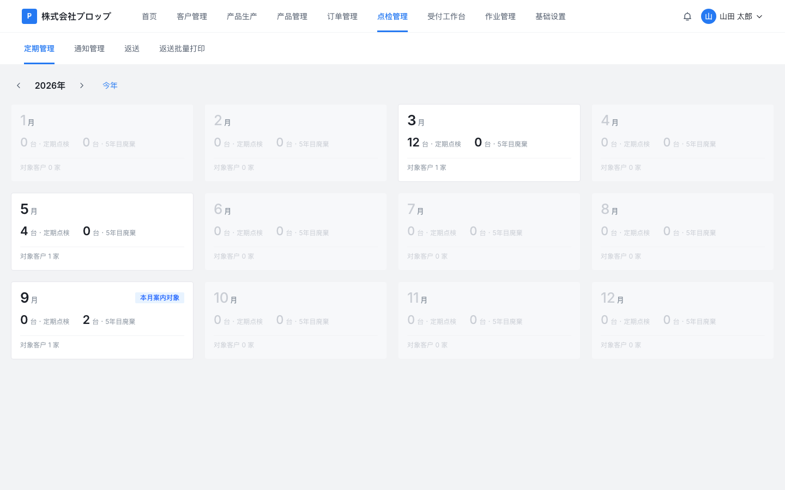
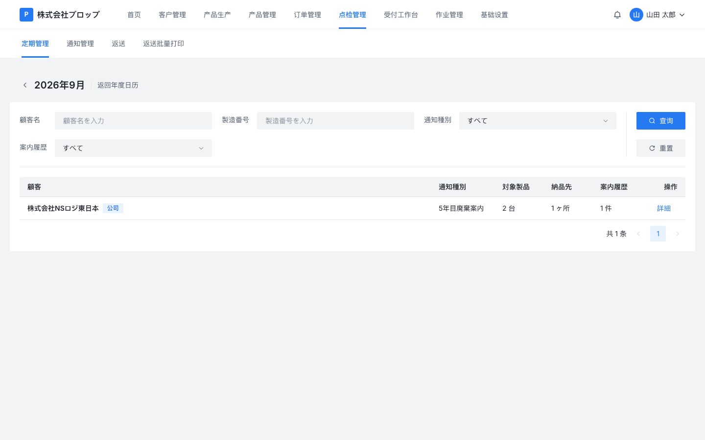
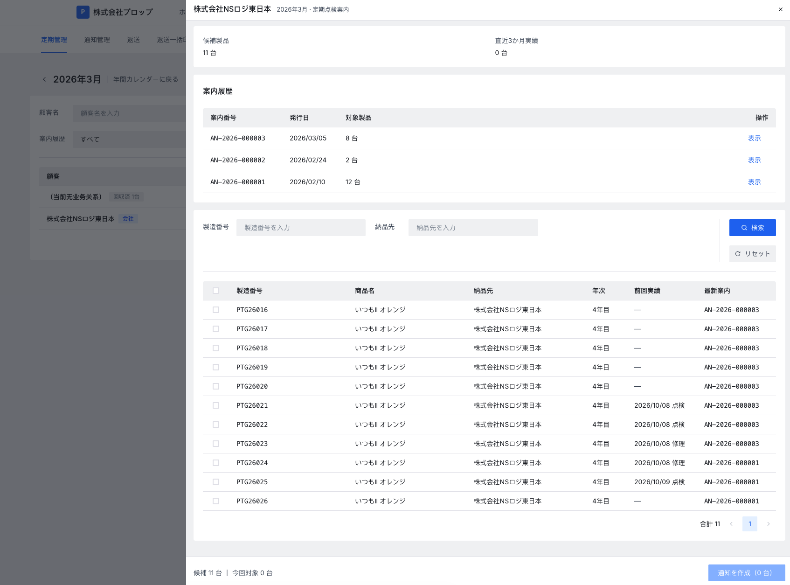
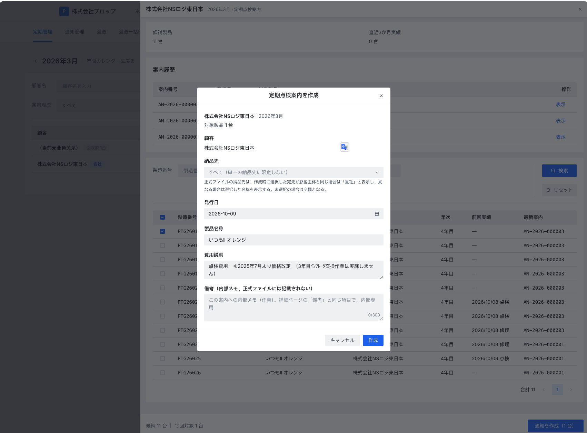

# FEAT-12 定期管理

**状态：Current Truth**

## 1. 模块概述

本 feature 供员工按产品生命周期查找当月应通知客户的对象产品，生成定期点検案内或 5年目廃棄案内。案内是一次确认成立的正式案内事实（冻结业务快照及模板绑定）；一份案内对应一份正式文件，生成后正式内容永久保留，不修改、不覆盖、不作废；内部備考可单独修改。内容有误时重新生成新案内番号的案内，旧案内继续作为历史记录保留。已生成案内的查询与跟踪见 FEAT-13 通知管理。

```text
寄送事实（首次出货） → 产品生命周期基准月
产品当前客户关系 ───┐
受付实绩 ─────────┤
                      ↓
              定期管理年度日历
                      ↓
              月度通知候选
                      ↓
       客户 × 对象月 × 案内種類
                      ↓
              案内作成
                      ↓
  案内事实（案内番号 + 案内文件 + 生成当时的信息；模板及字段见8.9）
                      ↓
          FEAT-13 通知管理
```

## 2. 页面构成

| 页面 | 导航位置 | 主要作用 |
|---|---|---|
| 定期管理年度日历 | 顶部导航「定期管理」 | 按年展示 12 个月生命周期候选台数，并进入月度通知候选 |
| 月度通知需求页 | 年度日历月份卡片 | 按客户、对象月和案内種類查看通知候选及案内履歴 |
| 通知创建抽屉 | 月度通知需求页「詳細」 | 固定客户、对象月和案内種類，勾选对象产品并生成一份新案内 |
| 创建确认弹窗 | 通知创建抽屉「通知を作成」 | 确认顾客、納品先、発行日与内部備考后生成正式案内 |

## 3. 资料项目与规则

本 feature 与 FEAT-13 通知管理共享同一份案内事实。

### 3.1 案内

| 资料项目 | 必填 | 规则 |
|---|---:|---|
| 案内番号 | 自动生成 | 格式为 `AN-YYYY-NNNNNN`：AN + 对象月年份四位 + 年内六位连号。生成案内时取得，员工不填写；重新生成案内取得新番号 |
| 案内種類 | 是 | 定期点検案内或 5年目廃棄案内。两类案内独立生成，不能混入同一份正式文件 |
| 対象月 | 是 | 表示本次案内面向的生命周期月份，格式为 YYYY年MM月 |
| 顧客 | 是 | 本次案内归属的客户。顾客就是产品当前有效订单的下单方，按公司或支店的客户身份归集，不按名称合并。月度候选按该下单方归集；无当前客户关系的产品可查看只读详情，不能生成案内 |
| 納品先 | 否 | 创建确认时可选择本次选中产品的納品先，也可不限制单一納品先。正式文件中纳品先与顾客相同时显示「貴社」，不同则显示真实納品先名；详情页产品表始终显示完整公司名称 |
| 発行日 | 是 | 创建确认时由员工选择，默认当天；只允许选择当天及之后的日期，不能回填过去日期（防止后建案内认领历史受付）。超期判断从该日期起算 |
| 対象製品 | 至少一台 | 通知创建抽屉中勾选的产品集合。创建时须仍属于当前月、当前案内種類和当前客户 |
| 正式 PDF | 按需生成 | 案内成立时保存完整业务快照、产品顺序、冻结文件名和不可变模板版本及资源摘要，不长期保存PDF二进制。首次完整渲染成功后才提交案内；以后按原快照和原模板重渲染，不查询当前主档或字典补值。缺模板、摘要不符或重渲染失败时明确报错并允许重试，不回退新版、不撤销案内、不换号或刷新作成时间。公共字体／渲染库升级须回归保留模板，不承诺PDF字节、换行或页数永久相同。 不含追記事項，模板字段见FEAT-12 §8.9。 |
| 備考 | 否 | 创建确认弹窗与通知详情页共用同一份内部备注，最多 300 字。仅内部使用，不进入正式文件；创建时填写的作为该案内初始值，详情页保存后覆盖当前值，不改变案内番号、正式 PDF 或対象製品 |
| 作成信息 | 自动记录 | 记录作成时间与操作人，详情页展示；不作为案内修改入口 |

### 3.2 生命周期候选

| 资料项目 | 必填 | 规则 |
|---|---:|---|
| 生命周期基准月 | 自动取得 | 来自产品首次出货月份；无基准月的产品不进入年度日历和月度候选 |
| 年次 | 自动判断 | 出货当年为 0 年目，不产生通知候选；基准月所在年 + 1 至 +4 为定期点検候选；基准月所在年 + 5 为 5年目廃棄候选 |
| 对象月份 | 自动判断 | 只有基准月所在月份与目标月份相同时产生候选 |
| 候选范围 | 自动判断 | 统计处于对应生命周期年次的产品；已报废产品不进入候选、不计台数（报废是生命周期终点）；已回收产品照常进入候选。同一产品按其当前生命周期进入一种案内種類 |
| 案内あり | 自动显示 | 产品在同一对象月和案内種類下至少曾被一份案内包含。该标记不表示当前有效、最终正确、已完成或已发送 |

### 3.3 受付状況

| 资料项目 | 必填 | 规则 |
|---|---:|---|
| 受付済み | 自动取得 | 本案内中的该产品已有符合第 8.5 节匹配规则的有效受付时，显示实际受付日 |
| 未受付 | 自动取得 | 本案内中的该产品尚无符合第 8.5 节匹配规则的有效受付时，显示「未受付」；其他案内已被受付满足，不代表本案内已受付 |
| 1か月以上未受付 | 自动判断 | 到达本案内发行日加 30 天的日期，且该产品仍无匹配的有效受付时计入。旧案内允许持续超期，具体规则见第 8.5 节 |

## 4. 定期管理年度日历

### 4.1 页面作用

按年度展示 12 个月中定期点検与 5年目廃棄的对象台数和对象客户数，帮助员工进入具体月份处理案内候选。

### 4.2 页面入口与去向

从顶部导航「定期管理」进入。点击月份卡片进入该月的月度通知需求页。「通知管理」入口进入已生成案内列表。

### 4.3 页面布局



```text
定期管理年度日历
├─ 年份切换：← ｜ YYYY年 ｜ 今年 ｜ →
└─ 12 个月卡片网格
    ├─ N月
    ├─ 本月案内对象
    ├─ 定期点検台数
    ├─ 5年目廃棄台数
    └─ 对象客户数
```

### 4.4 展示信息

- **年份切换条**：左箭头切换到上一年，右箭头切换到下一年；中间显示「YYYY年」；「今年」回到当前年。
- **月份卡片**：每张卡片显示月份数字「N月」、定期点検台数、5年目廃棄台数和对象客户数「N家」。
- **本月案内对象**：仅当前业务月卡片显示「本月案内对象」蓝色标签。
- **空月**：定期点検台数与 5年目廃棄台数均为 0 时，卡片置灰。
- **统计口径**：定期点検台数统计第 1～4 年目产品；5年目廃棄台数统计第 5 年目产品；对象客户数为该月存在至少一台对象产品的客户去重数，两类合计。已报废产品不计入台数与客户数，与月度候选口径一致。无当前业务关系的产品计入相应类型的产品台数，但「（当前无业务关系）」不算一家客户。

### 4.5 功能

- 点击上一年或下一年 → 切换展示年度 → 12 个月卡片按所选年度刷新。
- 点击「今年」 → 回到当前年 → 当前业务月卡片显示「本月案内对象」。
- 点击月份卡片 → 进入该月份通知需求页 → 可查看客户 × 案内種類的候选行。

### 4.6 校验与反馈

无可编辑输入。没有对象产品的月份仍显示卡片，台数为 0，卡片置灰。

### 4.7 页面产生的数据

无。

## 5. 月度通知需求页

### 5.1 页面作用

按指定对象月列出应创建案内的客户与案内種類组合，并展示该组合下是否已有案内履歴。

### 5.2 页面入口与去向

从年度日历点击月份进入。页头返回按钮回年度日历；各候选行均可点击「詳細」。有当前客户关系时打开通知创建抽屉；「（当前无业务关系）」行打开只读产品列表。

### 5.3 页面布局





```text
返回图标 ｜ YYYY年M月
├─ 筛选区：顧客名 / 製造番号 / 通知種別 / 案内履歴 / 查询 / 重置
└─ 候选列表
    ├─ 顧客
    ├─ 通知種別
    ├─ 対象製品
    ├─ 案内履歴
    └─ 操作
```

### 5.4 展示信息

- **页头**：返回图标＋「YYYY年M月」，不显示返回文字副标题；按钮保留可访问名称，点击返回对象月份所属年度。
- **筛选区**：固定四项条件：顧客名、製造番号、通知種別、案内履歴，并显示「查询」「重置」。
- **顧客名**：文本输入，按客户主档当前名称部分匹配，不搜索订单保存的旧名称。
- **製造番号**：文本输入，按製造番号部分匹配，不匹配 M番号。命中组内任一产品即展示整个客户与案内種類分组；该行台数仍为组内全部候选台数。进入详情显示该组全部候选产品，不自动继承月度页的编号条件。
- **通知種別**：选项为 すべて、定期点検、5年目廃棄。
- **案内履歴**：选项为 すべて、なし、あり；なし 表示该客户、该对象月、该案内種類没有任何案内；あり 表示至少存在 1 份案内。
- **候选列表**：一行表示一个客户 × 一个案内種類。同一客户当月同时有两类候选时显示两行。
- **顧客列**：按客户主体 ID 归组，显示客户主档当前名称，加粗；同时显示公司或支店标签，公司为蓝色，支店为紫色。同名不同身份不合并，公司与支店不合并。C04不设计客户主档删除后的名称回退；关系存在但客户身份缺失时标注数据异常，不按名称猜测归组，也不归入无关系组。
- **通知種別列**：显示定期点検或 5年目廃棄。
- **対象製品列**：显示「N台」。
- **案内履歴列**：无历史显示「なし」；有历史显示「N件」。
- **操作列**：统一显示「詳細」。无当前客户关系的产品集合归入「（当前无业务关系）」行，可进入只读产品列表，不可勾选产品或发通知。
- **分页与空态**：每页 20 条；无结果时显示「YYYY年M月没有符合条件的通知候选」。

### 5.5 功能

- 输入筛选条件并点击「查询」 → 按四项条件组合展示候选行 → 案内履歴按客户、对象月、案内種類判断。
- 点击「重置」 → 四项条件恢复默认 → 展示该月全部候选行。
- 点击可用行「詳細」 → 打开通知创建抽屉 → 抽屉固定为该客户、对象月和案内種類。
- 点击「（当前无业务关系）」行的「詳細」 → 打开只读产品列表 → 仅供查看，不生成案内。

### 5.6 校验与反馈

筛选无匹配时显示空态，不创建案内。无当前客户关系的候选行可查看只读详情，但不得勾选产品或生成案内。

### 5.7 页面产生的数据

无。

## 6. 通知创建抽屉

### 6.1 页面作用

在固定客户、对象月和案内種類下，从候选产品中勾选本次要包含的产品，并进入创建确认。抽屉只负责本次案内对象选择，不负责修改历史案内、作废案内、审批、发送状态或客户资料维护。

### 6.2 页面入口与去向

从月度通知需求页点击「詳細」打开。点击历史案内的「表示」打开只读PDF预览，下载／打印在预览弹窗内提供。点击底部「通知を作成（M 台）」打开创建确认弹窗；创建成功后显示成功弹窗；关闭成功弹窗或PDF预览均保留当前抽屉，不自动返回月度通知需求页。

### 6.3 页面布局

```text
通知创建抽屉：客户名 + 月份 + 案内種類
├─ 数据统计
│   ├─ 候補製品
│   └─ 直近3か月実績
├─ 案内履歴
│   └─ 案内番号 / 発行日 / 通知作成日時 / 対象製品 / 操作
├─ 筛选及候选产品
│   ├─ 製造番号 / 納品先 / 查询 / 重置
│   └─ 产品表
└─ 底部：候補 N 台 ｜ 今回対象 M 台 ｜ 通知を作成（M 台）
```

### 6.4 展示信息

- **标题**：客户名、月份和案内種類。客户、月份和案内種類在抽屉内不可切换。
- **数据统计卡片**：一行两列显示候補製品「N台」、直近3か月実績「N台」，标签在上，数值在下。
- **案内履歴卡片**：范围为当前客户、对象月和案内種類。按系统实际创建时间倒序、创建时间相同时按案内ID倒序稳定显示历史案内，不以発行日决定先后；列为案内番号、発行日、通知作成日時、対象製品「N台」、操作。通知作成日時复用实际创建时间，按日本业务时区以YYYY/MM/DD HH:mm显示；発行日保留其业务日期含义。无历史时固定显示「案内履歴はありません」，不隐藏区域。
- **案内履歴操作**：仅「表示」入口，打开只读PDF预览弹窗；下载／打印在预览内提供，使用冻结快照与原模板生成的PDF。
- **筛选及列表卡片**：筛选项为製造番号和納品先，均为部分匹配；筛选只影响当前显示的候选产品，不改变已勾选结果。
- **候选产品表**：列为勾选框、製造番号、商品名、納品先、年次、前回実績、最新案内。
- **候选納品先名称**：显示与部分匹配搜索同取产品当前关联订单保存的所选主体名称（快照 name）；公司显示公司名，支店仅显示支店名，不附加所属公司名。缺少该名称显示「—」，不使用所属公司名替代。此规则不改变客户归组及客户名称搜索。
- **产品状态标识**：已回收且未再派发新订单的产品无当前客户关系，归入「（当前无业务关系）」行并在製造番号旁显示「已回收」；回收后已再派发新订单的产品不带任何标识，正常归到新客户名下。已报废产品不进入候选，不显示任何标识。状态标识只出现在候选阶段，已生成案内的详情与正式 PDF 不回写产品当前状态。
- **年次**：定期点検显示第 1～4 年目；5年目廃棄显示第 5 年目。
- **前回実績**：实绩表示客户已有效寄回产品给PROP，不表示点检／维修已完成。只展示该产品最近一次有效受付的受付日期与该条受付内容（已选择的业务类型），不展示受付次数。“最近一次”按小番号实际建立时间判断，不按所属大番号受付日期、类型修改时间或作业时间排序；展示日期仍取所选小番号所属大番号的受付日期。不按点检／维修等受付类型筛选，类型尚未选择的有效受付也纳入，不回退到更早的有类型记录，不编造未选择的类型。同一条受付选择多个类型时展示全部已选类型，例如「2026/10/11 点検・修理」；同日有多条受付时仍只取实际建立时间最近的一条，不合并不同记录的类型。建立时间精度相同时按技术方案约定的稳定次序选取，不将跨年小番号直接视为建立先后。有效受付建立后即计入，不等待作业完了。日期取所属大番号受付日時的日本业务日期，旧批次追加产品仍使用该批次原日期。生产质检、仅扫描识别、空批次、报告生成、返送、回收或报废动作本身不代替此受付事实；无相应实绩显示「—」。仅供参考，不改变候选资格。
- **直近3か月実績口径**：范围为所选对象月及之前两个完整月份，例如对象月为 9 月时取 7 月 1 日至 9 月 30 日；统计本组全部候选产品中，至少建立过一次有效受付、且其所属大番号受付日期落在该期间的产品台数；不限制受付类型，类型尚未选择也纳入。同一产品多次受付只计一台，抽屉内筛选或分页不改变此统计。有效小番号的成立、类型及合法删除沿用FEAT-14／15真实受付事实；不以作业完成状态、完成日期或批次完成按钮为门槛。修改或清空受付类型不因类型资格改变统计台数；合法删除等有效受付变化后重新按当前有效事实计算，不新增实绩完成动作。统计卡按期间内全部有效受付判断是否计入，不以产品最近一条受付是否在期间内代替统计；前回実績列仅取最近一次，不受该卡片期间限制。
- **最新案内**：显示该产品最近一次被同类型案内包含的案内番号；提示中展示案内番号与発行日。无记录时显示「—」。
- **初始勾选**：打开客户详情抽屉时，所有候选产品默认不勾选，今回対象为0台；不根据是否被历史案内包含自动选择。员工手动勾选或全选，已被案内包含的产品仍可选择再次通知。筛选、翻页及取消创建返回抽屉不重置已有手动选择。
- **产品翻页**：加载期间保留原列表及上方区域，避免内容高度塌缩导致跳回抽屉顶部；最新分页响应完成后仅定位产品列表顶部，迟到响应不得覆盖当前页或改变滚动位置。
- **底部汇总**：显示候補 N 台、今回対象 M 台，以及「通知を作成（M 台）」按钮。

### 6.5 功能

- 输入製造番号或納品先并点击「查询」 → 候选产品表只显示匹配行 → 已勾选产品在筛选前后保持勾选结果。
- 点击「重置」 → 清空抽屉内筛选条件 → 恢复候选产品展示。
- 勾选或取消勾选产品 → 今回対象台数随全部已选产品更新 → 不要求填写原因。
- 点击全选 → 只作用于当前筛选可见行 → 不改变不可见行的既有勾选结果。
- 点击案内履歴「表示」 → 按原快照与模板生成并展示只读PDF → 在预览弹窗内下载／打印，不读取当前资料或新建案内。
- 点击「通知を作成（M 台）」 → 在已选产品大于 0 时打开创建确认弹窗。

### 6.6 校验与反馈

今回対象为 0 台时，「通知を作成（0 台）」不可用。抽屉内不提供修改、修正版、作废、删除、设为当前、覆盖、草稿、审批、发送状态或切换客户、月份、案内種類的入口。

### 6.7 页面产生的数据

无。勾选结果只有在创建确认弹窗确认成功后，才成为新案内的対象製品。

### 6.8 「（当前无业务关系）」详情

本节为无当前客户关系时的独立展示规则；上述统计、案内履歴、勾选和通知创建规则不适用于此详情。

- **内容范围**：只显示产品列表及其製造番号查询、重置操作，不显示数据统计、案内履歴或底部通知操作区。
- **列表字段**：製造番号、商品名、年次、前回実績。已回收且未再派发的产品在製造番号旁显示「已回收」。
- **納品先**：不显示筛选项，也不显示列表列。
- **操作限制**：没有单行勾选、全选和「通知を作成」入口，不可从此详情创建或发送通知。
- **业务结果**：查看、查询和重置均不建立或修改任何业务记录。

## 7. 创建确认弹窗

### 7.1 页面作用

确认本次案内的顾客、納品先、発行日和内部備考，并生成一份新案内及正式 PDF。本弹窗及通知详情均不提供寄送住所、連絡先・担当者；PDF模板与字段见8.9。提供本次报告产品名称及费用说明编辑，默认值、作用范围及冻结规则见8.9；具体页面接法在WP2方案中细化。

### 7.2 页面入口与去向

从通知创建抽屉底部「通知を作成（M 台）」进入。取消返回抽屉且不生成案内；确认成功后显示成功弹窗，展示案内番号、「表示」和「閉じる」。

### 7.3 页面布局

创建弹窗在桌面视口居中；内容超高时仅正文内部滚动，标题及底部操作始终可见，不要求滚动整个页面才能操作。

```text
案内種類を作成
├─ 客户名 / 月份 / 対象製品 N台
├─ 顾客（只读）
├─ 納品先
├─ 発行日
├─ 製品名称（仅点检，可编辑）
├─ 費用説明（仅点检，字典默认，可编辑）
├─ 備考（内部备注，不上正式文件）
└─ 取消 ｜ 作成
```

### 7.4 展示信息

- **标题**：案内種類 +「を作成」。
- **摘要**：显示客户名、月份和本次选中产品数「対象製品 N台」。
- 创建确认弹窗不显示客户已有案内数量／编号提示，也不新增所选产品重复包含提示。抽屉案内履歴和产品最新案内展示保持不变；允许员工明确再次创建，新案内取得新番号，既有案内不变。
- **顾客**：只读显示当前候选分组的下单方名称，不提供选择或编辑。需要为其他顾客创建时返回月度列表进入对应分组。
- **納品先**：下拉选择，可清空。候选来自本次选中产品的納品先，默认「すべて（不限制单一納品先）」。下方提示「报告采用本次选择的抬头；与下单方同主体显示『貴社』，不同显示所选名称，未选留空」。
- **発行日**：日期选择，默认当天；只允许选择当天及之后的日期。
- **備考**：可选多行文本，最多 300 字，仅内部使用、不进入正式文件；与通知详情页「備考」为同一份备注，创建时填写的内容作为该案内備考的初始值。

### 7.5 功能

- 确认只读顾客，选择納品先、発行日，填写内部備考 → 点击作成 → 通过校验后生成一份新案内和正式 PDF。
- 点击取消 → 关闭弹窗 → 不生成案内，抽屉勾选结果仍可继续调整。
- 创建采用创建后预览：点击「作成」后，后端完成资格校验、首次完整PDF渲染及快照／模板绑定提交；提交成功即案内成立，不以预览、下载或打印成功作为成立条件。
- 成功弹窗点击「表示」 → 关闭成功弹窗并打开该已成立案内的只读PDF预览弹窗；由服务端按冻结快照和绑定模板生成并展示PDF，下载／打印仅在预览弹窗内提供，使用该次成功预览的PDF及冻结文件名。
- 关闭预览直接返回当前抽屉，不重新显示成功弹窗、不撤销案内；预览、下载或打印失败允许重试，不重新提交创建、不换号。发现内容错误时只能主动创建新案内，旧案内保留。
- 成功弹窗点击「閉じる」 → 仅关闭成功弹窗，保留当前抽屉、筛选、分页及手动选择；成功后刷新案内履歴和产品最新案内。
- 员工主动再次创建时，重新准备当前数据并使用新的请求身份（requestId）；结果未知的原请求仍按原身份确认／安全重试，不能因关闭提示或返回抽屉而绕过恢复保护。
- 关闭或取消浏览器打印窗口后，可继续下载已有PDF及再次打印；不要求员工点击技术恢复按钮，不显示“打印已结束”等技术恢复提示。正常关闭预览时释放资源，不得因浏览器未回传打印结束事件而持续禁用下载／打印。

### 7.6 校验与反馈

顾客固定为当前分组的下单方。创建时再次检查选中产品仍属于当前月、当前案内種類和当前客户；不符合时不得生成案内。一次确认只生成一份完整案内和正式 PDF，不产生半成品。生成失败时保留本次选中产品与填写内容，说明失败原因并允许重试；未成功不显示成功提示。同一次操作重复点击或重试不得意外生成多份案内；员工明确再次创建时才产生另一份。

本次所有产品必须仍属于当前顾客，即其当前订单的下单方与本分组一致；缺少有效订单关系或已变更下单方时阻止生成，提示返回重新查询，不允许通过更换顾客继续创建。納品先选择只决定本次采用的抬头信息，不增减勾选产品、不覆盖各产品实际納品先；需要分开发通知时返回抽屉分别勾选。允许不同实际納品先的产品进入同一案内，不自动拆单；宛名与本次选择抬头的取值见8.9。

### 7.7 页面产生的数据

确认成功后建立一份新案内：取得新案内番号，保存案内種類、対象月、顧客、納品先、発行日、対象製品、作成信息及完整报告快照、冻结文件名、模板版本绑定；创建时填写的備考作为该案内備考的初始值（仅内部使用）。既有案内不修改、不覆盖、不删除、不作废。正式 PDF 中不出现追記事項区域。

## 8. 跨页面统一规则

### 8.1 案内事实

一份案内等于一次确认成立的正式通知事实；永久保存的是业务快照和模板绑定，不是PDF二进制。案内生成后正式内容永久保留，不修改、不覆盖、不作废；内部備考可单独修改。需要纠正时重新生成一份新案内，新案内取得新案内番号；旧案内继续保留并可查看、下载、印刷。

### 8.2 无版本与无有效状态

本模块不维护修正版、版本历史、当前有效版、有效状态或作废状态。多份案内之间不判断哪份正确、哪份当前有效或哪份已被替代。

### 8.3 两类案内独立

定期点検案内用于第 1～4 年目产品，5年目廃棄案内用于第 5 年目产品。候选查询可在同一页面统一查看，但正式案内按类型独立生成，不允许两类产品混入同一份正式文件。

### 8.4 生命周期与候选月份

生命周期基准月初始为首次出货月；订单解除关联时由员工每次选择保留或解除，解除时产品首次出货日及基准月同时清空，无基准月产品不进入年度日历和月度候选；首次寄送实际日期更正时，产品首次出货日及基准月同步更正，跨月更正后的候选按新基准月计算。已生成正式案内仍按 §8.1 保留，不被改写。出货当年为 0 年目；第 1～4 年目进入定期点検候选；第 5 年目进入 5年目廃棄候选。只有基准月所在月份与目标月份相同时才产生候选。

### 8.5 受付与超期判断

受付状況按每份案内中的每台対象製品分别判断，不以产品历史上是否曾经受付作为依据。

**受付匹配规则**

- 受付日期必须在该案内发行日当天或之后；发行日前的受付不能满足该案内。
- 一次受付只满足该产品在受付发生时已发行、且包含该产品的最新一份案内。员工无需手动选择案内番号。
- 受付发生后新发行的案内，不能使用此前的受付满足；新案内发行也不会把已经匹配旧案内的受付转移过去。
- 同一产品出现在多份案内中时，匹配最新案内的受付不会同时满足更早的案内。

**超期判断规则**

- 超期日期为发行日加 30 天，不按自然月计算；按日本业务日期判断，到达该日期即开始判断超期。
- 到达超期日期仍无匹配的有效受付，该产品计入本案内的超期未受付；尚未到达时为未受付。
- 有匹配的有效受付后，该产品在对应案内中显示受付済み和实际受付日，不再计入该案内超期。
- 旧案内不因新案内发行、新案内被受付满足而解除超期；没有匹配受付的旧案内允许一直显示超期。
- 现有「1か月以上未受付」「1か月超」显示文案均按上述 30 天规则解释。

例如：同一产品先后收到 9 月 1 日和 9 月 10 日发行的案内，9 月 15 日受付，只满足 9 月 10 日的案内。9 月 1 日的案内仍未受付，10 月 1 日起计入超期；之后发行的新案内也不能使用 9 月 15 日的受付满足。

**匹配边界**

- 有效受付指按FEAT-14／15成功建立且仍合法存在的小番号记录；类型未选或必填暂缺不使其无效，不提供受付作废或恢复流程。只收到空包裹或建立空大番号不算受付；不要求完成登记、作业、报告或返送。
- 受付日期使用该小番号所属大番号的实际受付日期。以该受付发生时已经生成、发行日不晚于受付日期的案内为范围；补填较早发行日不能使后来生成的案内满足过去的受付。
- “最新”先按发行日由近到远确定，同一发行日按实际生成先后取最后一份；生成先后须能唯一确定。未来发行日的案内在到达发行日前不参与匹配。
- 匹配不额外限制案内種類或本次受付类型：点检与廃棄案内均在候选范围内。这里表示产品已实际来件，不表示已经完成点检或确认报废。
- 最新案内已有受付时，之后的受付也不向前补配旧案内。同一案内有多次匹配的有效受付时，显示最早一次实际受付日期。
- 匹配受付按FEAT-14／15既有删除限制合法删除后，如仍有其他匹配的有效受付，显示其中最早日期；如已没有，恢复未受付，并按原发行日加 30 天判断是否超期。不得将其他案内的受付转来填补。
- 所属大番号原受付日期保持不变，不新增受付日期更正入口。向旧批次追加时，以新小番号实际建立时点判断案内是否已经生成，以原批次受付日期判断发行日条件；后生成的案内仍不得追溯匹配此前已发生的受付。

### 8.6 生成内容的保留规则

案内成立时保存完整业务快照、产品顺序、冻结文件名和不可变模板版本及资源摘要，不长期保存PDF二进制。首次完整渲染成功后才提交案内；以后按原快照和原模板重渲染，不查询当前主档或字典补值。缺模板、摘要不符或重渲染失败时明确报错并允许重试，不回退新版、不撤销案内、不换号或刷新作成时间。公共字体／渲染库升级须回归保留模板，不承诺PDF字节、换行或页数永久相同。 内部備考独立保存，不进入渲染内容。

### 8.7 「貴社」显示规则

「貴社」仅用于报告所选納品先抬头：本次选择主体与下单方相同则显示「貴社」，不同显示所选名称，未选留空；不对PDF产品明细逐项替换或新增納品先列。通知详情页的対象製品表中，納品先始终显示完整公司名称。

### 8.8 案内履歴口径

案内履歴按客户、对象月和案内種類统计实际生成过的案内份数。产品级「最新案内」只表示该产品最近一次被同类型案内包含，不表示通知完成、当前有效或已发送。

### 8.9 正式案内报告模板与字段（2026-10-08用户裁决）

#### 8.9.1 正式附件与适用范围

业务字典、业务数据、员工输入、版本化模板及模板选择参数的逐项来源和冻结时点，见[两类案内 PDF 字段来源与冻结对照](report-field-sources.md)，供后续实现与验收校对。

| 案内種類 | 唯一采用模板 | 字段取值核对 |
|---|---|---|
| 定期点検案内 | [标准版示例模板](assets/reports/模板-定期点検案内状.xlsx)，仅Sheet「案内状」 | [字段核对表](assets/reports/字段核对表-定期点検案内状.xlsx) |
| 5年目廃棄案内 | [簿内版示例模板](assets/reports/模板-廃棄案内状.xlsx)，仅Sheet「廃棄案内状」 | [字段核对表](assets/reports/字段核对表-廃棄案内状.xlsx) |

原始依据为用户指定的20260708定期点検案内状工作簿及客户确认目录C列裁决；来源及修订说明见[附件说明](assets/reports/README.md)。本次不采用きこり着专用版或旧回収版，不因机型自动切换模板。正文定义业务语义，核对表定位单元格，模板定义示例版式；不从Excel示例值或旧VLOOKUP台账反推业务规则。剩余未决事项以8.9.6为准。

#### 8.9.2 宛名、抬头及日期

| 字段 | 点检坐标 | 廃棄坐标 | 取值与规则 |
|---|---|---|---|
| 客户编号 | A2 | A3 | 本次案内下单方客户主体编号；不是订单号、製造番号或Excel查找键 |
| 宛名公司 | A3 | A4 | 下单方是支店：其上级公司名称；下单方是一级公司：该公司名称 |
| 宛名支店 | A4 | A5 | 下单方支店名称；一级公司下单则留空，不显示「同上」，不取納品先填此行 |
| 納品先抬头 | B15 | D16 | 本次创建时选择的抬头；不任取某笔订单或首个产品的納品先。允许产品实际納品先不同，不限制选择、不自动拆单、不改变产品集合 |
| 発行日 | J2 | M3 | 员工创建时采用的发行日，默认日本当天且不得早于当天；保存后重印不取当前日期或Excel TODAY() |

同一主体判断按客户主体身份，不以同名判断；选定抬头与下单方相同仍沿用PDF「貴社」规则，其他显示选定抬头名。未选择抬头时，PDF对应位置留空，不填「貴社」或推定名称。宛名采用创建时客户主档当前公司／支店名称，支店的上级公司名称同取当前主档；生成后冻结，改名不回写旧案内。

#### 8.9.3 产品明细及标准版文字

- 点检仅标准版。创建报告时提供可修改的「产品名称」字段，对应模板G6。所选产品按製造番号升序、产品ID辅助排序，PDF明细沿用同一顺序；默认取排序首个产品当前档案的对外产品名称，不按点击／跨页勾选顺序取值。允许多台产品名称不同，员工可为本次报告编辑统一名称，不自动拆单；最终采用名称生成时冻结，不修改产品档案。
- 點检明细为製造番号、年次及客户纸面清洗要／不要空框；年次按对象月与当前生命周期基准计算第1～4年目，不按发行日重新计算。纸面勾选不建立系统清洗／作业事实。
- 廃棄明细为製造番号及期限年月。期限为当前生命周期基准月加5年，显示YYYY年M月；模板「廃棄日」列不代表真实报废日期，生成通知不改变产品报废状态。
- 同一案内生成一份正式PDF，可含多页，不截断、不拆成多个案内。点检采用A4纵向、日文、Excel的左右双列产品布局、字号和粗细（字体统一采用公共开源字体）；动态读取通知和产品信息，按实际内容高度自然分页，16台只是原Excel示例位置数，不是固定每页数量或选择上限。续页保留通知标题和必要识别信息，页脚统一显示页码；注意事项按完整段落排版，避免段落跨页，不再强制全部费用和注意事项只出现在末页，不再强制完整宛名和联系信息每页重印。具体字段及排版以Excel为准，用户示意图仅说明分页方式，不新增其示例措辞。服务端按冻结快照及绑定模板统一生成PDF，不长期保存PDF二进制。
- 廃棄同样采用A4纵向、日文、按实际内容高度自然分页，内容、字号和粗细参照所选Excel，字体统一采用公共开源字体。保留左右双列製造番号／廃棄日；20台仅原样例容量，不固定每页台数。续页保留标题、客户编号、发行日等必要识别信息，明细跨页重复表头，页脚统一页码。注意事项接在明细后并保持段落完整，放不下移到下一页，不强制全部仅末页。PROP信息保留模板原位置，不要求每页重复；不新增产品名称输入、费用说明或金额模块。服务端按同一案内快照与模板按需生成一份PDF。
- 点检A33费用说明默认读取独立的若依业务字典项，创建时自动填入，员工可修改本次内容；案内成立时冻结最终采用文字，不回写字典或全局模板。下次新建读取字典当前值，历史案内重渲染只读冻结文字，不受字典变更影响。该项是说明文字，不是金额；字典初始值采用模板原文「点検費用：※2025年7月より価格改定　（3年目ｲﾝﾌﾚｰﾀ交換作業は実施しません）」。A25原文「※この点検日はご購入日を基準としております。」按用户裁决保留；该客户说明不改变系统既定首次出货生命周期基准，不据此改用购买日期计算。
- 廃棄保留簿内版的「廃棄」标题及産廃警告，不恢复旧回収版的11,000円／更新购买免费条款；删除收费文字不等于裁决免费。

#### 8.9.4 金额及自社信息字典

- 点检金额、清洗金额、替代品租赁金额分别读取若依业务字典值，按用途独立管理，供后续报告复用。字典键名由开发定义；初始金额及自社信息采用当前选定模板中的值，后续通过字典维护，不在生成代码中硬编码或在字典缺值时静默回退。
- 点检费用说明作为独立业务字典项维护，与点检／清洗／租赁金额分开；默认值、单次编辑及历史冻结规则见8.9.3。廃棄不新增费用说明字段。
- 金额单位及税別标识沿模板；此处是报告单价展示，不新增账务、收款或计费引擎。
- PROP邮编、地址1、地址2、公司名称、分社名称、电话、FAX各自拆分为可复用的字典项；不是客户联系方式，不新增创建弹窗的客户地址／联系人输入。
- 复用若依字典管理能力，不另建配置页面，不将这些字段强行并入FEAT-03现有产品名称／固件版本数据。字典类型、键名及缺值处理由实施方案明确，客户无需裁决技术键名；本次需求同步未创建字典数据，不代表已可取值。

#### 8.9.5 生成、冻结与查询边界

案内成立时保存完整业务快照、产品顺序、冻结文件名和不可变模板版本及资源摘要，不长期保存PDF二进制。首次完整渲染成功后才提交案内；以后按原快照和原模板重渲染，不查询当前主档或字典补值。缺模板、摘要不符或重渲染失败时明确报错并允许重试，不回退新版、不撤销案内、不换号或刷新作成时间。公共字体／渲染库升级须回归保留模板，不承诺PDF字节、换行或页数永久相同。 内部備考不进入PDF。历史重渲染不换号，员工主动再次创建新案内才取得新号。FEAT-13消费同一快照与模板，不另建一套模板。

两类产品均按製造番号、产品ID排序，逐行左→右两台（1｜2、3｜4），奇数台右侧留空，不生成假产品或清洗框。行高度取左右内容最大值，整行放不下时移至下一页。统一使用允许商用、部署及PDF嵌入的开源免费字体，公共字体不随每个模板版本重复管理；保留Excel字号、粗细和内容，固定框／提示勾可绘制，清洗仍为纸面填写。

模板资源随代码部署，完整保留每个已使用版本的HTML、CSS、文案、图片及兼容读取能力；不得覆盖旧版本。复用系统管理“参数设置”分别维护两类当前模板标识，不新增模板管理页或修改公共参数页。管理员手填已部署标识，后台按登记资源解析，不开放任意路径或URL。创建读取并校验所需参数唯一、非空、类型匹配、资源完整，无效则阻止创建，不静默回退；配置页面本期允许保存错误字符串。一次创建锁定一次版本，中途切换不影响该次操作；旧案内与成功重试不重新读取当前配置。模板维护沿既有系统管理权限，不授予普通员工。

#### 8.9.6 剩余就绪事项

1. 实现会话落实字典技术契约与缺值校验、生成时资格复核、编号分配、文件与数据库一致性、失败恢复及重复提交保护；这些是技术方案事项，不重新要求客户裁决已明确规则。
2. 按公共免费字体和两类自然分页规则制作真实PDF样稿，核对续页识别信息、长名称、完整段落及实际打印效果。示例Excel不是动态PDF生成实现；运行与打印验收在实现后执行。

名称排序／来源、宛名时点、字典初值、字体、空抬头、单次费用说明编辑和保留旧措辞均已裁决，不再列为待确认。附件入库不代表WP2方案或编码通过；后续须完成能力调查及独立复核。

## 9. Feature 边界与明确不做

本模块负责生命周期候选发现、案内创建、案内查询、超期未受付跟踪、通知详情、正式 PDF 入口与内部備考。受付事实由受付模块负责；产品生命周期基准月来自寄送模块首次出货；客户主档由客户管理负责；产品档案由产品管理负责。本模块只读取这些事实，不生产受付事实，不维护客户主档和产品档案。

明确不做：

- 通知修改、修正版、版本历史、当前有效版。
- 通知作废、有效状态、恢复。
- 通知草稿、审批、发送状态、已读状态、未读状态。
- 跳过原因、永久排除。
- 两类通知混入同一份文件。
- 通知创建抽屉内切换客户、月份、通知类型。
- M番号筛选、商品名筛选、直近実績筛选。
- 月度页以页签区分定期点検和 5年目廃棄。
- 列表页顶部以页签区分类型。
- 「案内作成状況」列。
- 「初回案内」列。
- 「未受付」统计项。
- 页头「通知を表示」按钮。
- 備考追加日志。
- 多份通知间判断哪份正确、当前有效或已被替代。
- 产品作废功能。已确认报废的产品不进入候选，也不计入候选台数。

## 10. 核对记录

- 2026-09-23：按二级导航粒度自 10-定期管理与通知 拆分为本 feature（FEAT-12）；内容不变，章节与交叉引用已重编号。

- 2026-09-22：顾客明确为当前订单下单方；生成弹窗改只读顾客，详情删除重复注文者。删除多注文者选择及跨下单方同案内的旧方案，资格变化时返回重新查询。PDF 内容仍待正式需求。


- 2026-09-22：按用户裁决，通知详情删除寄送住所、連絡先・担当者及对应空白项目；同步删除资料项目和验收中的显示要求，納品先保留。PDF 内容继续待正式需求。

- 2026-09-22：按用户授权补齐业务边界：最新案内取发行日优先、同日按实际生成先后；有效受付按小番号存在判断，删除后重新观察原案内；跨案内类型只判断来件；超期汇总产品去重；无关系产品不计客户家数；月度搜索定位整组；实绩限定售后点检／维修；抬头选择不改变勾选产品；生成失败保留输入且避免重复生成。以上为本轮补充方案，待用户审核。
- 实现差距：本轮只改文档。现有实绩读取生产质检，须改为上述售后实绩；受付匹配、30 天判断及去重统计须按规则验证，不能因文档完成而认定页面通过。PDF 版式与内容待正式需求。

- 2026-09-22：按用户裁决修订受付匹配与超期规则：受付只能满足发生时已发行的最新案内，受付日期不得早于发行日；超期按发行日加 30 天，旧案内允许持续超期。本轮仅修改文档，现有页面的受付接入和自然月算法尚待按本规则调整；同日案内先后及受付删除后的处理待确认。

- 2026-09-22：根据用户确认及月度需求页、详情抽屉当前展示，补充「（当前无业务关系）」可进入只读产品列表的规则；删除「需补关联、不可进入详情」旧表述，并同步验收用例。

- 2026-09-22：按 `FEAT-12 定期管理／FEAT-13 通知管理/subagent-brief.md`、模板、年度日历、月度通知需求页、通知创建抽屉、创建确认弹窗、通知管理列表、通知详情及通知核心模型完成静态核对并撰写本稿。
- 2026-09-22：通知候选中已报废／已回收产品的展示裁决落地，同日按业务复核收敛——已报废产品不进入候选、不计台数，候选表无任何报废标识（报废是生命周期终点，不留在待通知清单制造噪音）；已回收且未再派发的产品归入「（当前无业务关系）」行并带「已回收」标识，回收后已再派发的正常归到新客户名下、不带标识；状态标识只在候选阶段展示，不回写已生成案内。同步删除产品主档作废状态的残留字段与分支（报废事实由受付报废记录表达）。
- 2026-09-22：创建确认弹窗收敛。寄送地址／联系人经两次裁决确定为 PROP 自身信息、不从客户主档带入，本期留空，PDF 具体内容待正式需求（预览界面为临时内容）；弹窗中的「追記事項」改为「備考」，与详情页備考为同一内部字段（最多 300 字，仅内部使用）；正式 PDF 不出现追記事項区域。
- 2026-09-23：补审复核追加（用户裁决）：発行日只允许选择当天及之后（杜绝后建案内回填过去日期认领历史受付）；「前回実績」按实际受付类型显示日期＋「点検／维修」，修复维修误显示为点検的实现缺陷。
- 2026-09-23：补审修复落地（用户逐条裁决）：demo 侧——受付事实接入真实受付记录（受付只满足发生时已发行且包含该产品的最新案内，受付日＝所属大番号实际受付日，超期＝発行日＋30 天）、实绩改从受付侧读取（售后点检／维修受付，不再使用生产质检记录）、案内顧客显示统一为生成时快照、创建确认弹窗按钮「取消｜作成」、案内種類名「5年目廃棄案内」；文档侧——禁词清理、PDF 表述全局统一为「待正式需求」（A3 裁决，demo 提示语不改）。
- 核对重点 1：本文按「一份案内 = 一份正式文件」写入，案内永不修改、覆盖或作废；纠正只能重新生成新案内番号；不设版本概念、有效状态或作废状态。
- 核对重点 2：案内番号规则为 `AN-YYYY-NNNNNN`；生命周期候选按首次出货月、第 1～4 年目定期点検、第 5 年目 5年目廃棄、仅基准月份产生候选。
- 核对重点 3：「貴社」仅用于正式 PDF；详情页対象製品表的納品先显示完整公司名称。

## 2026-10-06 用户裁决

- 删除納品先数量（Nヶ所）展示：月度候选列、抽屉统计及案内履歴数量列不再显示。保留产品实际納品先名称、筛选及创建时抬头选择；涉及纳品先身份时按主体（支店主体）区分，不按地址条数。原型中对应旧数量区域由本裁决覆盖。
- 候选按客户主体ID归组，以客户主档当前名称展示和搜索；不增加旧名称搜索或主档删除后回退机制。仅标注身份缺失的数据异常，不扩展异常处置流程。已生成案内的冻结名称不受此规则改变。


2026-10-08 报告附件裁决：点检仅标准版、廃棄仅最新簿内版；字段核对表及示例模板纳入assets/reports。宛名按下单方公司／支店层级，納品先按本次创建选择的抬头；混合实际納品先不限制、不自动拆单。§8.9取代前述历史“PDF全部内容待正式需求”的笼统状态，未决分页／配置／措辞仍明确保留。

## 2026-10-10 桌面人工验收交互裁决

成功提示与预览关闭均保留抽屉；再次创建使用新请求身份，未知请求保护不变。创建弹窗居中并采用正文内滚动；产品翻页只定位产品列表。浏览器打印窗口关闭／取消后仍可下载及再次打印。以上替代此前成功提示关闭即退出抽屉、预览关闭返回成功提示的规则；案内成立、冻结及编号规则不变。

## 2026-10-11 用户裁决：实绩按有效受付计入

- 前回実績及直近3か月実績表示客户有效寄回产品给PROP。有效定期点检／维修受付建立即计入，日期取所属大番号受付日時的日本业务日期，不等待作业完了。
- 本裁决替代此前“已完成售后点检／维修、按完成日期统计”的口径；不改写旧核对记录。作业完成、撤销完成或重新完成不改变本项受付实绩；旧批次追加沿用原批次日期。
- D02完成日期不再是C04实绩接续依赖；真实受付事实生产、有效性及删除接续仍需实施和验证。本次仅同步正式规则，不表示代码已接入。

## 2026-10-11 最新用户裁决：任意类型受付与最近一次展示

本节取代同日较早“仅有效点检／维修受付计实绩”的限制。保留直近3か月実績卡片，按既有批次受付日期及三完整月窗口，统计有任意类型有效受付的候选产品台数，同一产品只计一台；类型未选择也纳入。前回実績只展示最近一次有效受付，不统计或展示次数。日期仍取所属大番号受付日期，不改用作业完成日期或旧批次追加日期；其他候选资格、案内匹配及超期规则不变。旧裁决记录仅供追溯，本次尚未实现或运行验证。

- 2026-10-11（后续明确）：前回実績按小番号实际建立时间选取最近一条有效受付，展示日期仍取该条所属大番号受付日期；追加旧批次不改变此选择依据，不以批次日期较早而退回更早建立的小番号。

- 2026-10-11（多类型及同日展示确认）：前回実績展示最近一条有效受付的全部已选类型；同日多条不合并类型，类型未选只展示该条日期，不回退旧记录。相同建立时间精度的稳定次序由技术契约明确；本项不改变批次业务日期、三个月统计及案内匹配。
