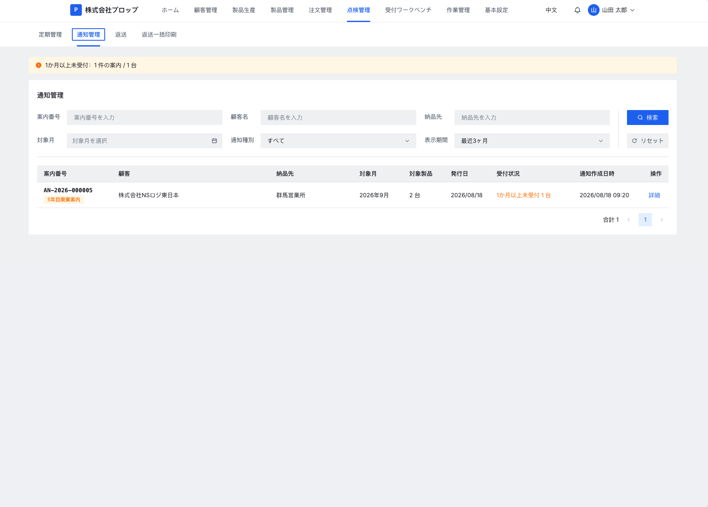
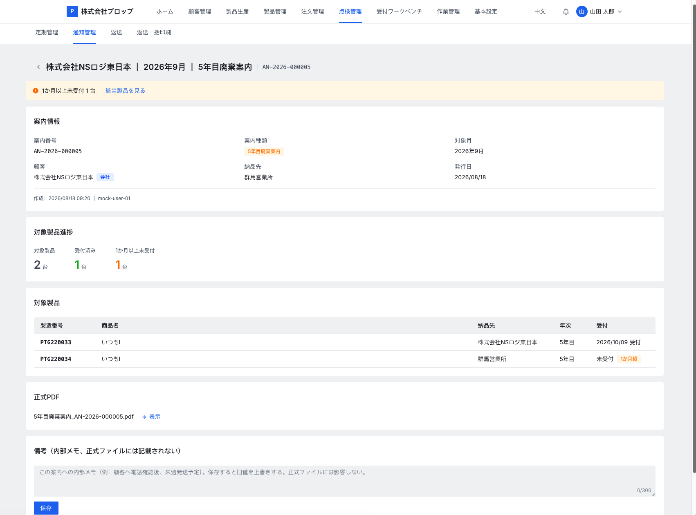

# FEAT-13 通知管理

**状态：Current Truth**

## 1. 模块概述

本 feature 供员工查询与跟踪已生成案内，查看到达发行日加 30 天仍未受付的产品，以及单份案内的生成当时的信息、对象产品受付情况、正式 PDF 和内部備考。案内由 FEAT-12 定期管理生成；本 feature 不建立案内。案内是一次确认成立的正式案内事实（冻结业务快照及模板绑定）；生成后正式内容永久保留，不修改、不覆盖、不作废；内部備考可单独修改。

## 2. 页面构成

| 页面 | 导航位置 | 主要作用 |
|---|---|---|
| 通知管理列表 | 顶部导航「通知管理」 | 查询已生成案内，并查看到达发行日加 30 天仍未受付的产品 |
| 通知详情 | 通知管理列表「詳細」 | 查看单份案内的生成当时的信息、对象产品受付情况、正式 PDF 和内部備考 |

## 3. 资料项目与规则

本 feature 与 FEAT-12 定期管理共享同一份案内事实。

### 3.1 案内

| 资料项目 | 必填 | 规则 |
|---|---:|---|
| 案内番号 | 自动生成 | 格式为 `AN-YYYY-NNNNNN`：AN + 对象月年份四位 + 年内六位连号。生成案内时取得，员工不填写；重新生成案内取得新番号 |
| 案内種類 | 是 | 定期点検案内或 5年目廃棄案内。两类案内独立生成，不能混入同一份正式文件 |
| 対象月 | 是 | 表示本次案内面向的生命周期月份，格式为 YYYY年MM月 |
| 顧客 | 是 | 本次案内归属的客户。顾客就是产品当前有效订单的下单方，按公司或支店的客户身份归集，不按名称合并。月度候选按该下单方归集；无当前客户关系的产品可查看只读详情，不能生成案内 |
| 納品先 | 否 | 创建确认时可选择本次选中产品的納品先，也可不限制单一納品先。正式文件中纳品先与顾客相同时显示「貴社」，不同则显示真实納品先名；详情页产品表始终显示完整公司名称 |
| 発行日 | 是 | 创建确认时由员工选择，默认当天；只允许选择当天及之后的日期，不能回填过去日期（防止后建案内认领历史受付）。超期判断从该日期起算 |
| 対象製品 | 至少一台 | 通知创建抽屉中勾选的产品集合。创建时须仍属于当前月、当前案内種類和当前客户 |
| 正式 PDF | 按需生成 | 案内成立时保存完整业务快照、产品顺序、冻结文件名和不可变模板版本及资源摘要，不长期保存PDF二进制。首次完整渲染成功后才提交案内；以后按原快照和原模板重渲染，不查询当前主档或字典补值。缺模板、摘要不符或重渲染失败时明确报错并允许重试，不回退新版、不撤销案内、不换号或刷新作成时间。公共字体／渲染库升级须回归保留模板，不承诺PDF字节、换行或页数永久相同。 不含追記事項，模板字段见FEAT-12 §8.9。 |
| 備考 | 否 | 创建确认弹窗与通知详情页共用同一份内部备注，最多 300 字。仅内部使用，不进入正式文件；创建时填写的作为该案内初始值，详情页保存后覆盖当前值，不改变案内番号、正式 PDF 或対象製品 |
| 作成信息 | 自动记录 | 记录作成时间与操作人，详情页展示；不作为案内修改入口 |

### 3.2 生命周期候选

| 资料项目 | 必填 | 规则 |
|---|---:|---|
| 生命周期基准月 | 自动取得 | 来自产品首次出货月份；无基准月的产品不进入年度日历和月度候选 |
| 年次 | 自动判断 | 出货当年为 0 年目，不产生通知候选；基准月所在年 + 1 至 +4 为定期点検候选；基准月所在年 + 5 为 5年目廃棄候选 |
| 对象月份 | 自动判断 | 只有基准月所在月份与目标月份相同时产生候选 |
| 候选范围 | 自动判断 | 统计处于对应生命周期年次的产品；已报废产品不进入候选、不计台数（报废是生命周期终点）；已回收产品照常进入候选。同一产品按其当前生命周期进入一种案内種類 |
| 案内あり | 自动显示 | 产品在同一对象月和案内種類下至少曾被一份案内包含。该标记不表示当前有效、最终正确、已完成或已发送 |

### 3.3 受付状況

| 资料项目 | 必填 | 规则 |
|---|---:|---|
| 受付済み | 自动取得 | 本案内中的该产品已有符合第 6.5 节匹配规则的有效受付时，显示实际受付日 |
| 未受付 | 自动取得 | 本案内中的该产品尚无符合第 6.5 节匹配规则的有效受付时，显示「未受付」；其他案内已被受付满足，不代表本案内已受付 |
| 1か月以上未受付 | 自动判断 | 到达本案内发行日加 30 天的日期，且该产品仍无匹配的有效受付时计入。旧案内允许持续超期，具体规则见第 6.5 节 |

### 3.4 WP3受付尚未接入的阶段展示

在真实受付事实尚未接入的WP3阶段，列表及详情明确提示“受付事实尚未接入，受付与超期暂不可判定”。列表受付状況、详情受付済み／1か月以上未受付统计及产品受付列显示“未接入”；对应接口的受付数量、超期数量、受付日期和超期判断返回null，不转换为0、false、「—」或「未受付」。対象製品数量继续显示真实冻结台数。

本阶段不显示超期警告数量及「該当製品を見る」，空列表同样保留阶段提示。该状态表示功能尚未接入，不是产品业务状态；WP4接入真实事实后执行§3.3、§4～6的最终受付与超期规则，不把本阶段检查记为最终受付验收通过。

## 4. 通知管理列表

### 4.1 页面作用

查询已生成案内，并查看当前查询结果中是否存在到达发行日加 30 天仍未受付的产品。

### 4.2 页面入口与去向

从顶部导航「通知管理」进入；客户详情「关联业务」可带入客户名称进入。点击列表「詳細」进入通知详情。

### 4.3 页面布局



```text
通知管理列表
├─ 超期提醒（存在时）
├─ 筛选区：案内番号 / 顧客名 / 納品先 / 対象月 / 通知種別 / 表示期間 / 查询 / 重置
└─ 案内列表
    ├─ 案内番号
    ├─ 顧客
    ├─ 收货方
    ├─ 対象月
    ├─ 対象製品
    ├─ 発行日
    ├─ 受付状況
    ├─ 通知生成时间（通知作成日時）
    └─ 操作
```

### 4.4 展示信息

- **超期提醒**：仅当当前查询结果中存在满 30 天仍未受付产品的案内时显示警告「1か月以上未受付：N 件の案内 / M 台」。只统计当前查询结果，不显示普通未受付数量。N 为有超期产品的案内份数，M 为这些案内中的超期产品去重台数；同一产品在两份案内中超期时为「2 件案内 / 1 台」。
- **筛选区**：固定六项条件，条件之间同时满足才展示：案内番号、顧客名、納品先、対象月、通知種別、表示期間。
- **案内番号**：文本部分匹配。
- **顧客名**：文本部分匹配。
- **納品先**：文本部分匹配，仅匹配列表「收货方」显示的、创建时选定并冻结的名称；不匹配案内内产品的納品先，也不匹配顾客名称。未选择收货方、显示「—」的记录不命中非空搜索；清空此条件后不因缺少收货方而排除，仍按其他条件展示。客户资料后续修改不影响既有案内查询。
- **対象月**：按 YYYY-MM 精确匹配；指定后不受表示期間限制。
- **通知種別**：选项为 すべて、定期点検、5年目廃棄。
- **表示期間**：选项为 最近3ヶ月、すべて；默认 最近3ヶ月，按通知首次创建成立时的生成时间判断，范围为包含日本今天在内的最近90个自然日：日本今天前89日00:00起，至明日00:00前。不按三个自然月或发行日判断；发行日在未来的案内，只要生成时间在范围内也应展示。修改备注、重试原创建结果或重渲染PDF不刷新生成时间。
- **客户详情入口带入**：通过客户详情关联业务进入时，顧客名带入公司名并立即查询，表示期間为「すべて」。
- **案内番号列**：首行显示案内番号，加粗等宽；同列显示案内種類标签，定期点検为蓝色，5年目廃棄为橙色。
- **顧客列**：只显示客户名称。
- **收货方列**：显示创建本份定期点検案内或5年目廃棄案内时选择并保存的納品先公司名称。该列为单一抬头，不从対象製品的納品先集合汇总，不显示Nヶ所；客户主档后续改名不回写此名称。未选择单一納品先时显示「—」，不从产品列表推断收货方。
- **対象月列**：显示 YYYY年MM月。
- **対象製品列**：显示「N台」。
- **発行日列**：只显示日期，格式 YYYY/MM/DD，不显示操作人。
- **受付状況列**：满 30 天仍未受付大于 0 时显示「1か月以上未受付 N台」并使用警告色；为 0 时显示「—」。不显示未受付总数、已受付数或受付済み。
- **通知生成时间列**：位于受付状況之后、操作之前；日文表头为「通知作成日時」。显示首次创建成立的日期与时分，格式 YYYY/MM/DD HH:mm，按日本业务时间展示，来源与详情作成时间一致，不显示操作人，不取发行日或备注更新时间。
- **操作列**：只显示「詳細」。
- **排序与空态**：按発行日倒序；默认每页 20 条，可调整每页数量（10／20／50／100）。切换数量回第一页；查询、重置保留所选每页数量，翻页使用已提交的筛选条件；无数据时显示「暂无案内。可在定期管理的月度页面为客户创建案内」。

### 4.5 功能

- 输入筛选条件并点击「查询」 → 按组合条件展示案内 → 超期提醒按当前查询结果更新。
- 点击「重置」 → 恢复默认筛选条件 → 表示期間回到 最近3ヶ月。
- 从客户详情关联业务进入 → 自动带入顧客名并查询 → 展示该客户全部期间案内。
- 点击「詳細」 → 进入通知详情 → 查看该案内生成时的内容、対象製品受付情况、正式 PDF 与内部備考。

### 4.6 校验与反馈

无匹配结果时显示空态，不生成或修改案内。列表页不提供案内修改、作废、版本、发送状态、已读状态或未读状态入口。

### 4.7 页面产生的数据

无。

## 5. 通知详情

### 5.1 页面作用

查看单份案内的生成当时的信息、対象製品受付情况、正式 PDF 和内部備考。上半部分还原当时发出的案内内容，下半部分观察这些产品之后是否受付。

### 5.2 页面入口与去向

从通知管理列表「詳細」进入。返回按钮回通知管理列表；超期提醒中的「該当製品を見る」滚动到対象製品卡片；正式PDF卡片仅提供「表示」，下载／打印在PDF预览弹窗内提供。

### 5.3 页面布局



```text
返回 ｜ 顧客名 ｜ 対象月 ｜ 案内種類
└─ 案内番号
├─ 超期提醒（存在时）
├─ 案内情報
├─ 対象製品進捗
├─ 対象製品
├─ 正式PDF
└─ 備考
```

### 5.4 展示信息

- **页头**：标题为「顧客名 ｜ 対象月 ｜ 案内種類」；副标题以等宽样式显示案内番号。
- **超期提醒**：存在满 30 天仍未受付产品时显示警告「1か月以上未受付 N台」和「該当製品を見る」。
- **案内情報卡片**：三列展示案内番号、案内種類、対象月、顧客、納品先、発行日。顧客显示公司或支店标签；不显示寄送住所、連絡先・担当者，也不显示对应空白项目；底部弱化展示「作成：YYYY/MM/DD HH:mm ｜ 操作人」。
- **顧客**：显示本案内生成时采用的订单下单方，不另列重复的注文者。
- **対象製品進捗卡片**：显示対象製品、受付済み、1か月以上未受付三项大数字。受付済み大于 0 时使用绿色；1か月以上未受付大于 0 时使用橙色，等于 0 时显示「—」。不显示「未受付」统计项。
- **対象製品卡片**：列为製造番号、商品名、納品先、年次、受付。製造番号加粗等宽单行，不显示 M番号；納品先显示生成时保存的完整公司名称，不用「貴社」；受付列未受付显示「未受付」，已受付显示「YYYY/MM/DD 受付」，满 30 天仍未受付追加橙色「1か月超」标签。不显示「初回案内」列，不单独展示追記事項。
- **正式PDF卡片**：显示文件名「通知类型_案内番号.pdf」，仅显示「表示」入口；打开只读PDF预览后，提供「ダウンロード」「印刷」。操作对象为该案内冻结快照及绑定模板重渲染的PDF；文件版式与字段按FEAT-12 §8.9执行。
- **備考卡片**：显示可编辑多行文本，最多 300 字，带字数提示，输入框下方左侧显示保存按钮。初始值为该案内当前备注（创建时填写的内容）；无内容则为空。
- **不存在案内**：显示「案内不存在或已被移除」和返回按钮。

### 5.5 功能

- 点击「該当製品を見る」 → 页面滚动到対象製品卡片 → 员工可直接查看超期未受付产品。
- 点击正式PDF「表示」 → 按原快照及绑定模板生成PDF并在只读弹窗中预览 → 预览内提供下载／打印，使用该次PDF与冻结文件名。
- 关闭或取消浏览器打印窗口后，可继续下载同次PDF及再次打印，无需技术恢复按钮或“打印已结束”提示；关闭预览正常释放资源。
- 生成中或失败时不提供可用下载／打印，允许重试与关闭；关闭返回详情，失败不撤销案内、不换号、不重新创建。
- 编辑備考并点击保存 → 覆盖该案内当前备注 → 不改变报告冻结内容、対象製品、案内番号或其他历史数据。
- 返回 → 回到通知管理列表 → 不改变案内内容。

### 5.6 校验与反馈

内部備考最多 300 字，超出时不得保存。案内不存在时显示空态并提供返回，不创建新案内。详情页不提供修改案内内容、作废、恢复、版本历史、追加日志、删除、发送状态、已读状态或未读状态入口。

### 5.7 页面产生的数据

保存備考后，仅更新该案内的备注当前值；不修改报告冻结内容、対象製品、案内番号、発行日或案内履歴。

## 6. 跨页面统一规则

### 6.1 案内事实

一份案内等于一次确认成立的正式通知事实；永久保存的是业务快照和模板绑定，不是PDF二进制。案内生成后正式内容永久保留，不修改、不覆盖、不作废；内部備考可单独修改。需要纠正时重新生成一份新案内，新案内取得新案内番号；旧案内继续保留并可查看、下载、印刷。

### 6.2 无版本与无有效状态

本模块不维护修正版、版本历史、当前有效版、有效状态或作废状态。多份案内之间不判断哪份正确、哪份当前有效或哪份已被替代。

### 6.3 两类案内独立

定期点検案内用于第 1～4 年目产品，5年目廃棄案内用于第 5 年目产品。候选查询可在同一页面统一查看，但正式案内按类型独立生成，不允许两类产品混入同一份正式文件。

### 6.4 生命周期与候选月份

生命周期基准月为首次出货月。出货当年为 0 年目；第 1～4 年目进入定期点検候选；第 5 年目进入 5年目廃棄候选。只有基准月所在月份与目标月份相同时才产生候选。

### 6.5 受付与超期判断

受付状況按每份案内中的每台対象製品分别判断，不以产品历史上是否曾经受付作为依据。

**受付匹配规则**

- 受付日期必须在该案内发行日当天或之后；发行日前的受付不能满足该案内。
- 一次受付只满足该产品在受付发生时已发行、且包含该产品的最新一份案内。员工无需手动选择案内番号。
- 受付发生后新发行的案内，不能使用此前的受付满足；新案内发行也不会把已经匹配旧案内的受付转移过去。
- 同一产品出现在多份案内中时，匹配最新案内的受付不会同时满足更早的案内。

**超期判断规则**

- 超期日期为发行日加 30 天，不按自然月计算；按日本业务日期判断，到达该日期即开始判断超期。
- 到达超期日期仍无匹配的有效受付，该产品计入本案内的超期未受付；尚未到达时为未受付。
- 有匹配的有效受付后，该产品在对应案内中显示受付済み和实际受付日，不再计入该案内超期。
- 旧案内不因新案内发行、新案内被受付满足而解除超期；没有匹配受付的旧案内允许一直显示超期。
- 现有「1か月以上未受付」「1か月超」显示文案均按上述 30 天规则解释。

例如：同一产品先后收到 9 月 1 日和 9 月 10 日发行的案内，9 月 15 日受付，只满足 9 月 10 日的案内。9 月 1 日的案内仍未受付，10 月 1 日起计入超期；之后发行的新案内也不能使用 9 月 15 日的受付满足。

**匹配边界**

- 有效受付指按FEAT-14／15成功建立且仍合法存在的小番号记录；类型未选或必填暂缺不使其无效，不提供受付作废或恢复流程。只收到空包裹或建立空大番号不算受付；不要求完成登记、作业、报告或返送。
- 受付日期使用该小番号所属大番号的实际受付日期。以该受付发生时已经生成、发行日不晚于受付日期的案内为范围；补填较早发行日不能使后来生成的案内满足过去的受付。
- “最新”先按发行日由近到远确定，同一发行日按实际生成先后取最后一份；生成先后须能唯一确定。未来发行日的案内在到达发行日前不参与匹配。
- 匹配不额外限制案内種類或本次受付类型：点检与廃棄案内均在候选范围内。这里表示产品已实际来件，不表示已经完成点检或确认报废。
- 最新案内已有受付时，之后的受付也不向前补配旧案内。同一案内有多次匹配的有效受付时，显示最早一次实际受付日期。
- 匹配受付按FEAT-14／15既有删除限制合法删除后，如仍有其他匹配的有效受付，显示其中最早日期；如已没有，恢复未受付，并按原发行日加 30 天判断是否超期。不得将其他案内的受付转来填补。
- 所属大番号原受付日期保持不变，不新增受付日期更正入口。向旧批次追加时，以新小番号实际建立时点判断案内是否已经生成，以原批次受付日期判断发行日条件；后生成的案内仍不得追溯匹配此前已发生的受付。

### 6.6 生成内容的保留规则

案内成立时保存完整业务快照、产品顺序、冻结文件名和不可变模板版本及资源摘要，不长期保存PDF二进制。首次完整渲染成功后才提交案内；以后按原快照和原模板重渲染，不查询当前主档或字典补值。缺模板、摘要不符或重渲染失败时明确报错并允许重试，不回退新版、不撤销案内、不换号或刷新作成时间。公共字体／渲染库升级须回归保留模板，不承诺PDF字节、换行或页数永久相同。 内部備考独立保存，不进入渲染内容。

### 6.7 「貴社」显示规则

「貴社」仅用于报告所选納品先抬头：本次选择主体与下单方相同则显示「貴社」，不同显示所选名称，未选留空；不对PDF产品明细逐项替换或新增納品先列。通知详情页的対象製品表中，納品先始终显示完整公司名称。

### 6.8 案内履歴口径

案内履歴按客户、对象月和案内種類统计实际生成过的案内份数。产品级「最新案内」只表示该产品最近一次被同类型案内包含，不表示通知完成、当前有效或已发送。

## 7. Feature 边界与明确不做

本模块负责生命周期候选发现、案内创建、案内查询、超期未受付跟踪、通知详情、正式 PDF 入口与内部備考。受付事实由受付模块负责；产品生命周期基准月来自寄送模块首次出货；客户主档由客户管理负责；产品档案由产品管理负责。本模块只读取这些事实，不生产受付事实，不维护客户主档和产品档案。

明确不做：

- 通知修改、修正版、版本历史、当前有效版。
- 通知作废、有效状态、恢复。
- 通知草稿、审批、发送状态、已读状态、未读状态。
- 跳过原因、永久排除。
- 两类通知混入同一份文件。
- 通知创建抽屉内切换客户、月份、通知类型。
- M番号筛选、商品名筛选、直近実績筛选。
- 月度页以页签区分定期点検和 5年目廃棄。
- 列表页顶部以页签区分类型。
- 「案内作成状況」列。
- 「初回案内」列。
- 「未受付」统计项。
- 页头「通知を表示」按钮。
- 備考追加日志。
- 多份通知间判断哪份正确、当前有效或已被替代。
- 产品作废功能。已确认报废的产品不进入候选，也不计入候选台数。

## 8. 核对记录

- 2026-09-23：按二级导航粒度自 10-定期管理与通知 拆分为本 feature（FEAT-13）；内容不变，章节与交叉引用已重编号。

- 2026-09-22：顾客明确为当前订单下单方；生成弹窗改只读顾客，详情删除重复注文者。删除多注文者选择及跨下单方同案内的旧方案，资格变化时返回重新查询。PDF 内容仍待正式需求。


- 2026-09-22：按用户裁决，通知详情删除寄送住所、連絡先・担当者及对应空白项目；同步删除资料项目和验收中的显示要求，納品先保留。PDF 内容继续待正式需求。

- 2026-09-22：按用户授权补齐业务边界：最新案内取发行日优先、同日按实际生成先后；有效受付按小番号存在判断，删除后重新观察原案内；跨案内类型只判断来件；超期汇总产品去重；无关系产品不计客户家数；月度搜索定位整组；实绩限定售后点检／维修；抬头选择不改变勾选产品；生成失败保留输入且避免重复生成。以上为本轮补充方案，待用户审核。
- 实现差距：本轮只改文档。现有实绩读取生产质检，须改为上述售后实绩；受付匹配、30 天判断及去重统计须按规则验证，不能因文档完成而认定页面通过。PDF 版式与内容待正式需求。

- 2026-09-22：按用户裁决修订受付匹配与超期规则：受付只能满足发生时已发行的最新案内，受付日期不得早于发行日；超期按发行日加 30 天，旧案内允许持续超期。本轮仅修改文档，现有页面的受付接入和自然月算法尚待按本规则调整；同日案内先后及受付删除后的处理待确认。

- 2026-09-22：根据用户确认及月度需求页、详情抽屉当前展示，补充「（当前无业务关系）」可进入只读产品列表的规则；删除「需补关联、不可进入详情」旧表述，并同步验收用例。

- 2026-09-22：按 `FEAT-12 定期管理／FEAT-13 通知管理/subagent-brief.md`、模板、年度日历、月度通知需求页、通知创建抽屉、创建确认弹窗、通知管理列表、通知详情及通知核心模型完成静态核对并撰写本稿。
- 2026-09-22：通知候选中已报废／已回收产品的展示裁决落地，同日按业务复核收敛——已报废产品不进入候选、不计台数，候选表无任何报废标识（报废是生命周期终点，不留在待通知清单制造噪音）；已回收且未再派发的产品归入「（当前无业务关系）」行并带「已回收」标识，回收后已再派发的正常归到新客户名下、不带标识；状态标识只在候选阶段展示，不回写已生成案内。同步删除产品主档作废状态的残留字段与分支（报废事实由受付报废记录表达）。
- 2026-09-22：创建确认弹窗收敛。寄送地址／联系人经两次裁决确定为 PROP 自身信息、不从客户主档带入，本期留空，PDF 具体内容待正式需求（预览界面为临时内容）；弹窗中的「追記事項」改为「備考」，与详情页備考为同一内部字段（最多 300 字，仅内部使用）；正式 PDF 不出现追記事項区域。
- 2026-09-23：补审复核追加（用户裁决）：発行日只允许选择当天及之后（杜绝后建案内回填过去日期认领历史受付）；「前回実績」按实际受付类型显示日期＋「点検／维修」，修复维修误显示为点検的实现缺陷。
- 2026-09-23：补审修复落地（用户逐条裁决）：demo 侧——受付事实接入真实受付记录（受付只满足发生时已发行且包含该产品的最新案内，受付日＝所属大番号实际受付日，超期＝発行日＋30 天）、实绩改从受付侧读取（售后点检／维修受付，不再使用生产质检记录）、案内顧客显示统一为生成时快照、创建确认弹窗按钮「取消｜作成」、案内種類名「5年目廃棄案内」；文档侧——禁词清理、PDF 表述全局统一为「待正式需求」（A3 裁决，demo 提示语不改）。
- 核对重点 1：本文按「一份案内 = 一份正式文件」写入，案内永不修改、覆盖或作废；纠正只能重新生成新案内番号；不设版本概念、有效状态或作废状态。
- 核对重点 2：案内番号规则为 `AN-YYYY-NNNNNN`；生命周期候选按首次出货月、第 1～4 年目定期点検、第 5 年目 5年目廃棄、仅基准月份产生候选。
- 核对重点 3：「貴社」仅用于正式 PDF；详情页対象製品表的納品先显示完整公司名称。

## 2026-10-06 用户裁决

保留通知列表「收货方」列，显示创建案内时选定并保存的納品先公司名称，不存在汇总多个纳品先的展示逻辑，不显示Nヶ所。取代此前误写的“删除整列”说明。納品先查询条件、详情信息及产品实际納品先名称保留，创建时未选择单一納品先的既有规则不变。原型中的数量展示由本裁决覆盖。

- 2026-10-10（WP3用户裁决）：最近3ヶ月改按通知生成时间取最近90天；增加通知作成日時列；批准受付未接入＋null阶段展示。列表发行日排序、受付匹配及发行日加30天超期规则保持不变。

- 2026-10-10（WP3人工验收裁决）：通知列表「納品先」搜索收窄为列表收货方的冻结名称，取代原“抬头或产品级納品先任一命中”规则；不匹配顾客名称。空收货方不命中非空条件，清空条件后仍可展示。其他筛选、分页、详情与PDF不变。

- 2026-10-11（业务再次确认）：允许旧案内因没有匹配受付而长期保持超期，即使同产品的新案内已被受付满足；沿用§6.5，不新增解除或替代状态。跨案内汇总仍按案内份数、超期产品去重台数分别统计。
