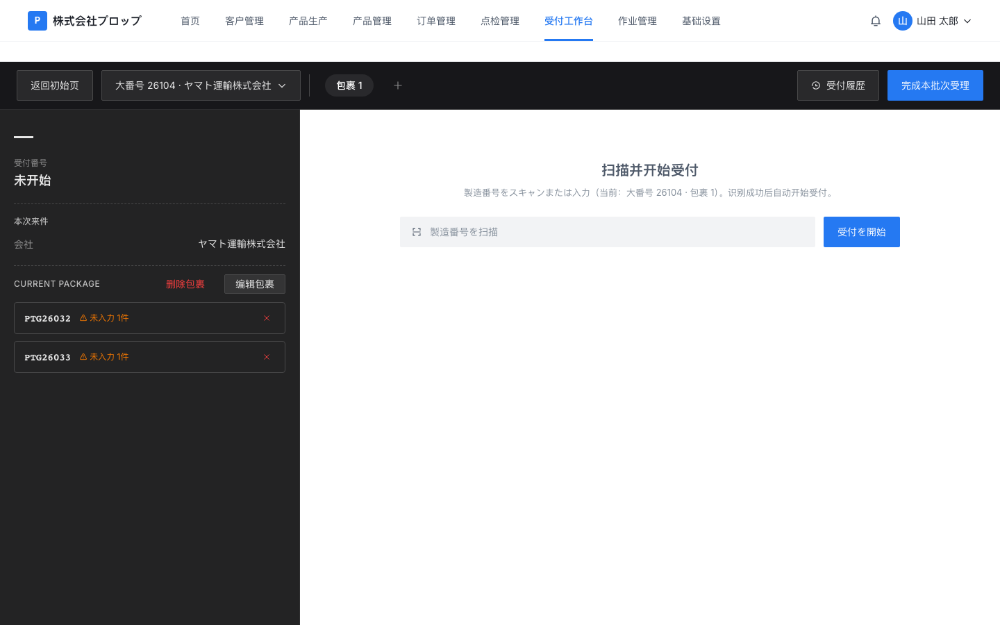
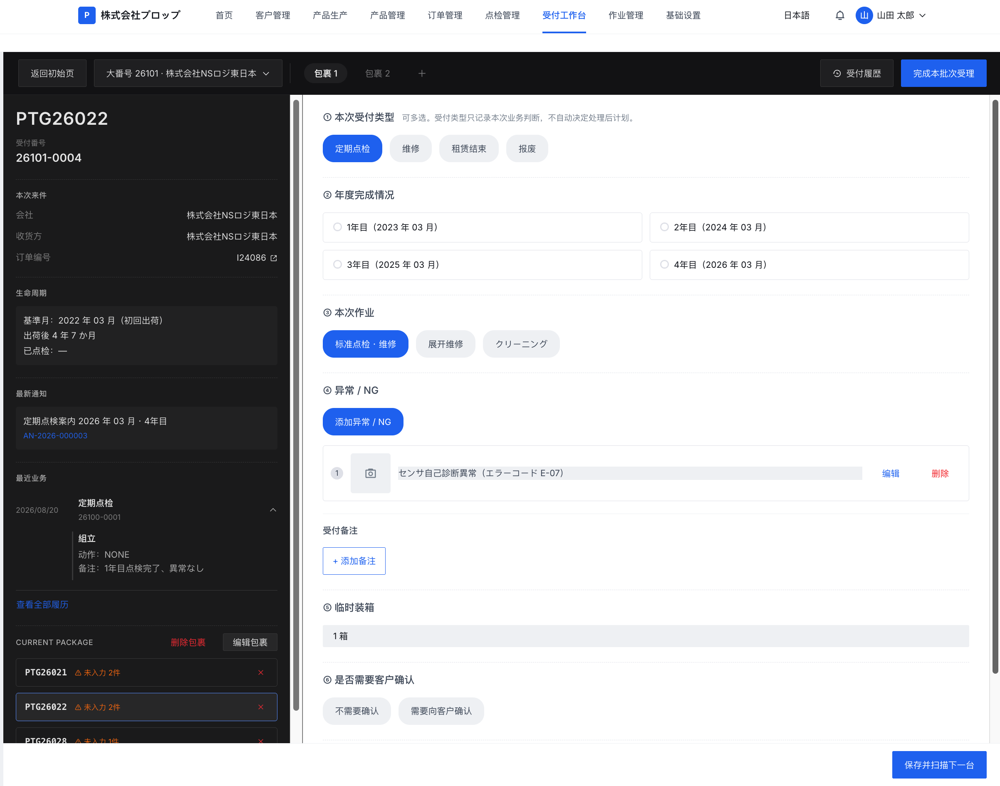

# FEAT-14 受付工作台

> **2026-10-17入口裁决**：大番号回收／报废报告统一在作业管理大番号头部生成；历史查看也仅在作业管理，返送详情不提供这两类报告。大番号维度、候选、版本及删除规则不变。旧原型中的返送生成入口不再适用；本轮仅需求同步，未实现或运行验证。

> **需求定版（2026-10-11）**：本轮FEAT-14受付业务规则及FEAT-15～17关联条款已经用户确认定版。定版内容以当前正文为准；历史demo、讨论方案及撤回裁决不覆盖正文。本轮不进入开发；原有明确标注待定稿的报告／打印模板不在本次定版范围内。

> **2026-10-13报告规则已更新**：单台仅点检报告，任何计划下可生成；大番号回收／报废报告生成按FEAT-16 §5.9执行，返送详情不展示这两类报告，边界见FEAT-17 §5.8。删除边界以FEAT-14 §6.8／FEAT-15 §5.8为准，历史计划映射不再适用。

**状态：Current Truth（批次记录表模板为目标稿，待正式定稿）**

> **2026-10-16 单台报告关联裁决**：小番号成立时保存部件编号和传感器固件版本的起始状态，见§3.3／§3.4及[FEAT-16 §5.8](../FEAT-16-work/spec.md#58-单台点检报告内容与输出2026-10-16裁决)。报告内补录不回写起始状态，不改变本页左侧参考回退、当前绑定展示或受付必填规则；仅同步需求，待实施。

## 1. 模块概述

本 feature 供员工在来件到达时建立受付批次，按大番号、包裹、小番号三层登记本次实际来件，并维护受付类型、年度完成情况、本次作业、异常/NG、受付备注、客户确认、产品处理计划和临时装箱。客户、订单、通知、作业、返送等信息在本 feature 中只作为参考或后续边界，不由受付回写。受付批次的查询与批次记录表见 FEAT-15 受付履历。

```text
客户主档 / 当前订单关系 / 最新案内 / 最近业务历史
        │
        ↓
来件到达
        ↓
大番号（一次实际收件批次：本次来件信息）
        ↓
包裹（实际物理包裹：图片、备注）
        ↓
小番号建立 → FEAT-15受付履历 / FEAT-16作业管理可查询
        │          （不等待填齐、底部校验或完成批次）
        ↓
持续维护受付内容（按操作保存，允许暂缺必填项）
        ├─ 完成本批次受理：查漏提示并返回初始页，不记录完成状态或时间
        └─ FEAT-15批次记录表：独立按当前已保存事实生成，不依赖完成按钮

后续点检、维修、报告、返送、回收、报废由其他模块处理
```

## 2. 页面构成

| 页面 | 导航位置 | 主要作用 |
|---|---|---|
| 受付工作台 | 顶部导航「受付工作台」 | 从来件到达开始建立大番号与包裹，登记单台产品受付，并维护批次、包裹和产品受付信息 |

## 3. 资料项目与规则

本 feature 与 FEAT-15 受付履历共享同一份受付事实。

### 3.1 大番号

| 资料项目 | 必填 | 规则 |
|---|---:|---|
| 大番号 | 自动生成 | 格式为年 2 位 + 年内连番 4 位，一个受付批次一个号。按当年最大号加 1 取得 |
| 受付日時 | 自动记录 | 表示大番号建立时自动记录的原始业务时间，用于履歴排序、年度登记日期和最近业务日期显示；旧批次追加不改写。不作为C04前回実績选取最近小番号的依据 |
| 公司名称 | 是 | 本次实际来件来源的公司名称。建立时可从客户主档或第一台产品当前订单关系带出候选值，员工按面单或现场情况确认；保存后只影响本大番号 |
| 納品先 | 否 | 本次来件相关的納品先信息。确认来件信息时由第一台产品当前订单关系带出候选值，保存为本大番号来件记录；左侧参考中的納品先读取本大番号来件记录，未保存时回退第一台产品当前订单关系 |
| 来件邮编 | 否 | 本次实际来件来源的邮编，保存为本大番号来件记录 |
| 来件地址 | 是 | 本次实际来件来源地址，员工按面单或现场情况确认；保存后不回写客户或订单主数据 |
| 来件地址补充 | 否 | 建筑名等补充地址，保存为本大番号来件记录 |
| 联系人姓名 | 否 | 本次来件联系人，保存为本大番号来件记录 |
| 联系电话 | 否 | 本次来件电话，保存为本大番号来件记录 |
| 来件备注 | 否 | 大番号层级备注，在编辑大番号弹窗维护 |
| 大番号画像 | 否 | 与大番号相关的图片，可追加、预览和删除；与包裹图片分开保存 |

### 3.2 包裹

| 资料项目 | 必填 | 规则 |
|---|---:|---|
| 包裹序号 | 自动生成 | 在同一大番号内从 1 起递增。删除包裹后其他包裹序号不重排；新增包裹取现有最大序号加 1 |
| 包裹名称 | 自动生成 | 页面显示为 Package N 或包裹 N，用于区分同一大番号下的实际物理包裹 |
| 包裹备注 | 否 | 包裹层级备注。新建批次前置流程确认来件信息时填写的受付备注保存到包裹 1 |
| 包裹图片 | 否 | 包裹面单、外箱或开箱相关图片，可多张，支持删除 |
| 所属大番号 | 自动关联 | 每个包裹必须属于一个大番号。包裹删除不影响小番号计数 |

### 3.3 单台受付

| 资料项目 | 必填 | 规则 |
|---|---:|---|
| 小番号 | 自动生成 | 按所属大番号年度取号，该年度内连续整数，从 1 起，每台来件加 1；跨批次、跨包裹不重置；新年度的大番号使用新年度从1起的序列；跨年向旧大番号追加时继续旧大番号所属年度的序列，不使用操作当天的年度。删除后不复用，允许空号。显示时固定 4 位补零，超过 9999 按自然位数显示 |
| 小番号实际建立时间 | 自动记录 | 该条产品受付成功成立的时间，与所属大番号受付日時分开保留；修改内容及后续作业不重置。成立入口、稳定先后及消费边界见§3.4；不要求新增页面展示列 |
| 本次作业起始状态 | 自动保存 | 小番号成立时保存当时衣体、气囊、传感器、发生器1／2编号及绑定传感器的固件版本；无内容留空，后续更换、补录、升级不覆盖。供单台报告使用，不把保存起始状态视为发生作业 |
| 受付番号 | 自动显示 | 单台身份为大番号 + 小番号，显示形态为「大番号-小番号4位」 |
| 製造番号 | 是 | 通过扫描或输入识别产品。扫描本身不建立单台受付；点击「受付を開始」或在前置流程确认后才建立 |
| 所属包裹 | 是 | 单台受付必须属于一个包裹。包裹归属通过大番号下的包裹关系表达 |
| 受付类型 | 是 | 可多选定期点检、维修、租赁结束；报废与前三项互斥 |
| 年度完成情况 | 条件必填 | 受付类型含定期点检且非报废时必填。一次受付最多对应 1 个年度，范围为 1～4年目；无基准月仍可登记年目，目标年月暂缺 |
| 本次作业 | 条件必填 | 已选择受付类型且非报废时必填，可多选标准点检・维修、展开维修、クリーニング |
| 异常 / NG | 否 | 非报废受付可登记异常/NG。每项包含内容与最多 1 张照片，是受付阶段的正式异常事实 |
| 受付备注 | 条件必填 | 客户确认为「需要向客户确认」时至少 1 条；其他情况下可为空。备注保留录入人和日期 |
| 临时装箱 | 是 | 填写本次临时装箱箱数，必须为 1 以上整数 |
| 客户确认 | 是 | 选择「不需要确认」或「需要向客户确认」。再次点击可取消选择 |
| 产品处理计划 | 条件必填 | 客户确认为「不需要确认」时必填，可选返回客户、PROP回收、报废。客户确认为「需要向客户确认」时允许暂空。处理计划只是受付人员当前判断，不产生回收或报废事实 |

### 3.4 有效受付与两个时间的事实契约

- 已成功建立且仍合法存在的小番号就是有效受付，必填暂缺、类型未选不使其无效；不另设有效性、发布或受付完成状态。不提供小番号作废或恢复流程；历史资料中的“未作废受付”按本节有效受付理解，不产生作废功能。
- 首台在前置流程确认成功并实际建立小番号时成立；后续产品在工作台点击「受付を開始」并成功建立小番号时成立。仅扫描识别、空大番号、空包裹及建立失败均不产生产品受付事实。空批次重开后沿用工作台开始受付入口。
- 小番号实际建立时间只在该条受付成功成立时记录。修改类型、年度、本次作业、NG、备注、客户确认、处理计划、装箱，重新打开或切换包裹，以及后续作业完成／撤销完成／重新完成、报告生成，均不重置该时间，也不改变所属大番号原受付日期。
- 同次成功成立时保存该产品当时的部件编号与传感器固件版本起始记录，首台及后续单台入口一致。缺失／未绑定的位置留空，不从历史绑定补齐，也不因该内容缺失阻止成立；仅扫描或成立失败不形成有效起始记录。后续更换、补录、升级及受付编辑均不覆盖该记录，不据此建立工作组作业记录。旧小番号缺起始记录时不自动用当前状态倒填；报告中可仅补录本次报告起始值，具体见FEAT-16 §5.8。
- 向旧批次追加时，新小番号记录自己的实际建立时间，但业务日期仍沿用原大番号受付日期；不判断是否同一次来件、不新增改期入口。跨年追加仍按大番号所属年度取号，编号不能代替跨年建立先后。
- 须保留可稳定判断小番号建立先后的事实；相同时间精度下的稳定次序由详细技术方案确定，不强制数据库字段名、全局序列或事件平台。大番号受付日期按日本业务日期提供给C04；不能以小番号建立日期或更新时间替代。
- 取消弹窗仅放弃尚未保存的输入，不删除已建立的小番号，不撤销已保存操作。大番号图片追加／删除即时保存，取消弹窗仍保留该图片操作；其他输入沿用各弹窗保存规则。

## 4. 受付工作台

### 4.1 页面作用

本工作台面向现场人员使用三星安卓平板（Chrome）收件登记；先建立小番号、随操作记录和持续更正，不依赖额外统一提交。

受付工作台负责从来件到达开始登记受付。页面包含初始页、新建批次前置流程和工作台三个状态，覆盖大番号、包裹和单台产品受付的建立与维护。

### 4.2 页面入口与去向

从顶部导航「受付工作台」进入。初始页可新建受付，也可跳转到业务子页面「受付履歴」；履历不再设置独立一级导航入口，既有工作台与履历页面授权保持独立。工作台中可通过「受付履歴」按钮携带当前大番号、包裹和受付位置进入履歴页；从履歴页切回时恢复原位置。

### 4.3 页面布局



原有15张及新增17张demo截图的场景、命名映射及图文核对见[截图索引](assets/README.md)。

```text
受付工作台
├─ 初始页
│   ├─ 标题与说明
│   └─ 新しい受付を開始 / 既存の受付を開く
├─ 新建批次前置流程
│   ├─ 顶部信息栏
│   ├─ 4 步箭头步骤条
│   ├─ 面单拍照
│   ├─ 扫描第一台产品
│   ├─ 确认来件信息
│   └─ 填写受付
└─ 工作台
    ├─ 顶部操作区
    ├─ 左侧上下文面板
    └─ 右侧扫描面板或受付表单
```

### 4.4 初始页展示信息

- 标题为「受付を開始」。
- 说明为「来件到达后，先建立大番号，再拍摄 Package 1 面单。拆箱后才扫描产品」。
- 入口卡片「新しい受付を開始」：说明「立即建立新的大番号与 Package 1，然后进入面单拍照」。
- 入口卡片「既存の受付を開く」：说明「从受付履历进入已经建立的大番号，继续追加产品或补充输入」。

### 4.5 初始页功能

- 点击「新しい受付を開始」 → 立即建立新的大番号与包裹 1 → 进入新建批次前置流程。
- 点击「既存の受付を開く」 → 跳转受付履歴 → 员工从已建立的大番号继续登记。

### 4.6 初始页校验与反馈

初始页无可编辑字段。新建受付允许客户、地址和产品暂空。

### 4.7 初始页产生的数据

点击「新しい受付を開始」后，建立一个大番号并取得大番号，同时建立一个空包裹 1。

### 4.8 新建批次前置流程展示信息

- 步骤条固定为 4 步：面单拍照 → 扫描第一台产品 → 确认来件信息 → 填写受付。
- 顶部信息栏显示返回初始页按钮、大番号标签、Package 1 标签。
- 第 1 步「面单拍照」说明为「此时还不知道箱内产品，因此不显示产品番号，也不要求客户/地址信息」。未拍照时显示虚线框、📷、「面单拍照（可选）」、说明和拍照按钮；已拍照时显示缩略图、「已保存到 Package 1」标签和重新拍摄按钮。
- 第 2 步「扫描第一台产品」说明为「拆箱后看到产品番号，再扫描製造番号」。输入框内提示文字为「製造番号」，旁边为「识别产品」按钮。识别成功后显示製造番号大字和六格候选信息：当前下单方、当前納品先、订单番号、地址、联系人、电话。无当前订单关系时提示「该产品无当前订单关系，来件信息需人工确认」；不阻断进入第 3 步，允许进入「确认来件信息」，此时各项候选内容为空，由员工按面单或现场情况自行填写。
- 第 3 步「确认来件信息」显示提示条：「已根据第一台产品的当前关系带出候选信息。这里确认的是本次实际来件来源信息，可按面单/现场情况修改。修改只影响当前大番号，不回写客户或订单主数据。」表单为两列栅格：公司名称、納品先、来件邮编、来件地址、联系人姓名、联系电话、受付备注。

### 4.9 新建批次前置流程功能

- 第 1 步点击拍照 → 调用设备相机 → 图片保存为包裹 1 的面单图片；0 张图片也可点击「面单完成，开始拆箱」进入下一步。
- 第 2 步输入製造番号并点击「识别产品」或回车 → 识别产品 → 展示候选信息或警告。
- 第 2 步点击「使用该产品信息确认来件来源」 → 使用识别产品带出的候选信息 → 进入确认来件信息。
- 第 3 步修改来件信息并点击「确认并进入受付工作台」 → 保存本次来件信息与包裹 1 备注 → 自动开始第一台产品受付并取得小番号 → 进入工作台。

### 4.10 新建批次前置流程校验与反馈

- 第 2 步未输入时「识别产品」不可用。
- 产品未找到时给出警告，不得进入确认来件信息。
- 第 2 步未识别产品时「使用该产品信息确认来件来源」不可用。
- 第 3 步公司名称和来件地址必填（无当前订单关系时为空，需人工填写后方可确认）；保存后不回写客户或订单主数据。

### 4.11 新建批次前置流程产生的数据

本流程更正大番号来件信息，保存包裹 1 备注，并建立第一条产品受付记录及其小番号。

### 4.12 工作台展示信息

#### 顶部操作区

- 显示「返回初始页」按钮。
- 大番号信息按钮显示「大番号 N · 客户名/未确认客户」，点击打开编辑大番号弹窗。
- 包裹页签逐个显示「包裹 N」；含需要客户确认产品的包裹页签显示橙色 ⚑，提示「含需要客户确认的产品」。
- 末尾「＋」页签打开新建包裹弹窗。
- 打开批次时始终显示「完成本批次受理」按钮，用于查漏提示并返回初始页；不显示完成时间或完成标记。
- 显示「受付履歴」按钮。

#### 左侧上下文面板

左侧按固定顺序显示：

1. 製造番号，未开始时显示「—」。
2. 受付番号，label 小字加编号大字连写形态；需要客户确认时编号旁显示 ⚑；未开始显示「未开始」。
3. 本次来件：有大番号客户名时，分三行显示公司名称、納品先名称、订单编号，不在此摘要显示地址、联系人或电话。公司及納品先采用本大番号已保存来件记录；納品先未保存时沿§3.1回退第一台产品当前订单候选，不能随当前选中产品改变已保存快照。订单编号沿批次首台来源参考；无来源显示「—」。地址与联系方式仍保留于来件确认、批次编辑、详情和后续文件所需数据中。
4. ライフサイクル：有基准月时显示三行——「基準月：YYYY 年 MM 月（初回出荷）」「出荷後 X 年 Y か月」「点検済み：…」；无基准月时基準月、出荷後时长显示「—」，点検済み仍按已登记年度显示；无登记年度时该项显示「—」。只读，不显示次回予定。「点検済み」的取值：翻本台产品全部历史受付记录（排除当前正在编辑的这条、排除已删除的受付记录），挑出其中已填写「年度完成情况（第 N 年）」的记录，把这些年度数字升序收集；有几个列几个，每个加「年目」、中间用「・」连接（如「点検済み：2年目・3年目」）；一条都没有时显示「点検済み：—」。该行用于让员工结合起算月与已登记的年度自行判断本次应登记第几年，系统不替员工推算。
5. 最新案内：存在包含本产品的最新案内时显示通知类型、対象月、N年目和案内番号。
6. 最近业务：显示最近 3 条历史受付，排除当前编辑中与已删除的受付记录，按受付日期倒序。每条头部显示实际受付日期、N年目/受付类型、受付番号，以及已回收或已报废灰色标签。默认展开最新 1 条；展开后按工作组显示未作废作业记录中有值的动作、处置、备注、换件新编号、固件 旧→新。无记录显示「尚无作业记录」。底部「すべての履歴を見る」打开全量历史弹窗。
7. CURRENT PACKAGE：显示标题、删除包裹、编辑包裹按钮和产品行。产品行显示製造番号、必要时 ⚑、未入力 N件和删除图标；空包裹显示「当前包裹尚未受付产品」。产品列表不另设「扫描下一台」按钮；已选产品通过底部「保存并扫描下一台」按必填查漏推进，未选产品时保留右侧扫描区。

最近业务有作业记录时的补充原型（用户于2026-10-12提供）：



此图用于说明记录头部的日期、受付类型与番号、展开后的工作组及有值作业内容、底部全量履历入口，以及左侧面板的信息层次。图中编号、日期、客户、年次和动作 `NONE` 均为示例；字段语义、筛选及空态仍按本节和正式作业规格执行。本图不是当前系统的运行验收证据。

#### 右侧扫描面板与受付表单

- 未开始受付时显示扫描面板：标题「扫描并开始受付」、说明含当前大番号和包裹、输入框内提示文字「製造番号を扫描」、按钮「受付を開始」。
- 已确认回收或报废的受付显示实际处理事实及日期作为参考，受付表单仍可读写；修改受付不撤销该实际事实。
- 正常受付表单按编号区块展示；报废时隐藏年度完成情况、本次作业、异常/NG。
- ① 本次受付类型：圆角多选按钮「定期点检」「维修」「租赁结束」「报废」，标题下注「可多选。受付类型只记录本次业务判断，不自动决定处理后计划」。
- ② 年度完成情况：仅定期点检且非报废时显示，两列等宽单选；有基准月时每项显示「N年目（YYYY 年 MM 月）」；无基准月时仍显示1～4年目选项，标注「N年目（目标年月不明）」。其他受付已登记年度置灰并追加登记日期。
- ③ 本次作业：非报废时显示圆角多选「标准点检・维修」「展开维修」「クリーニング」。
- ④ 异常 / NG：非报废时显示「添加异常 / NG」按钮和 NG 卡片列表。卡片显示序号徽章、照片缩略图或空相机图标、内容、编辑和删除确认。下方受付备注区显示标题；需要确认且 0 条时显示红色提示「需要客户确认时至少填写 1 条备注」；备注以灰底卡片显示内容、录入人、日期、编辑和删除；另有「+ 添加备注」按钮。
- ⑤ 临时装箱：只读输入框，显示「N 箱」或框内提示文字「填写本次临时装箱箱数」，点击打开编辑临时装箱弹窗。
- ⑥ 是否需要客户确认：圆角单选「不需要确认」「需要向客户确认」，再次点击取消选择。
- ⑦ 产品处理计划：圆角单选「返回客户」「PROP回收」「报废」，再次点击取消；受付类型给出默认计划，员工可按实物判断修改。
- 底部常驻主按钮「保存并扫描下一台」。

### 4.13 工作台功能

- 点击大番号信息按钮 → 打开编辑大番号弹窗 → 可维护来件信息、来件备注和大番号画像。
- 点击「＋」页签 → 打开新建包裹弹窗 → 保存后新增一个包裹。
- 点击包裹页签 → 切换当前包裹 → 左侧 CURRENT PACKAGE 与右侧扫描面板切换到该包裹。
- 点击「完成本批次受理」 → 弹出确认「结束本次录入并返回初始页？已保存内容保留，以后可从受付履历再次打开修改或追加。」→ 按既有未入力规则查漏，通过后返回初始页；取消则留在当前页。不建立完成状态或时间，不锁定任何受付。
- 点击「受付履歴」 → 携带当前大番号、包裹和受付位置跳转受付履歴。
- 在扫描面板输入製造番号并点击「受付を開始」 → 识别成功后建立新的单台受付并取得小番号 → 打开受付表单。
- 点击左侧产品行 → 回到该受付继续编辑。
- 点击「保存并扫描下一台」 → 通过未入力校验后结束本次填写并切换下一台 → 清空当前受付的选中状态并回到扫描面板（字段在各操作时已实时保存，本按钮不再保存字段，仅校验并推进）。

### 4.13A 保存机制

**2026-10-11 用户裁决：先建小番号、实时保存，允许暂缺必填项。** 首台在前置流程确认来件信息后建立受付及小番号；后续产品在工作台识别成功并开始受付时建立。仅识别产品不建号，不等待单台填写齐全或底部按钮校验通过才建号。已建立的受付可由受付履历、作业管理直接读取，仍遵守各页面原有查询筛选；不增加“登记中／登记通过／待发布”状态或作业放行步骤。

选择类及各弹窗已确认的内容按下列节点保存；未输入的必填项允许暂缺，不阻止其他合法字段保存，也不阻止切换已有产品、包裹或返回初始页。未填写不等于“不需要”。适用条件或内容变化后重新计算未入力；曾经校验通过不代表以后永久齐全。允许缺项不等于允许非法值，箱数正整数、年度单选与禁重复、类型互斥等仍按各操作校验。

“保存并扫描下一台”仍检查缺项，有缺项时不执行该按钮的换台动作；这只是集中查漏，不是受付生效或作业管理可见的门槛。未点击该按钮、校验失败或未完成批次，都不撤销已保存内容。每次保存失败须明确提示，不能把失败内容表示为已保存；本规则不承诺未确认弹窗输入或离线输入自动保存。

受付工作台不使用「填完一张表单、最后统一提交」的方式。单台受付按下列节点保存：选择类字段点击即写入，输入类字段在各自弹窗确认后写入，无需再点底部按钮。

- 选择类字段：点击即保存。包括① 本次受付类型、② 年度完成情况、③ 本次作业、⑥ 是否需要客户确认、⑦ 产品处理计划。这些都是点选或勾选，点击的那一刻就把结果保存到当前受付。
- 输入类字段：在各自弹窗中点击「保存」即生效。包括④ 异常/NG、受付备注、⑤ 临时装箱。员工在表单区点击只读框或「添加」打开弹窗，填写后点弹窗里的「保存」才写入；点「取消」不保存。临时装箱弹窗对箱数有校验（须为大于 0 的整数），不合法时拦截并提示。
- 底部主按钮「保存并扫描下一台」不保存任何字段。它只做三件事：按统一未入力规则校验当前受付是否填写齐全；有缺失时提示并定位，不推进；齐全后清空当前选中状态并回到扫描面板，等待扫描下一台。

已点击选择或已在弹窗确认保存的内容，不依赖底部按钮再次提交；弹窗内尚未确认的输入不属于已保存内容。底部按钮的职责是「确认本台填完了，换下一台」。

### 4.14 工作台校验与反馈

- 完成本批次受理时，校验本批次所有有效受付的未入力项；有缺失时按小番号逐项列出缺失，留在工作台，不执行本次按钮返回；不涉及完成状态。
- 点击「保存并扫描下一台」时按统一未入力规则校验；有缺失时对应区块显示红字「请选择或填写此项」，页面定位到第一个缺失区块，顶部消息列出缺失项名。
- 扫描未找到产品时给出警告，不建立受付。
- 已确认报废的产品不允许再次受付，提示「该产品已确认报废，不能受付」。报废是生命周期终点。
- 已确认回收的产品允许再次受付：回收后客户再次寄回属于正常业务。新受付是全新的小番号记录，不继承原受付的任何状态；原受付记录保留回收事实，不受影响。无当前订单关系时按前置流程提示「无当前订单关系，来件信息需人工确认」。
- 删除包裹只允许空包裹；已有受付产品时提示「包裹内已有受付产品，不能删除；可将产品移动到其他包裹后再删除」。

### 4.15 工作台产生的数据

工作台可持续更正当前受付记录的受付类型、年度完成情况、本次作业、异常/NG、受付备注、客户确认、产品处理计划和临时装箱；扫描开始可建立新的单台受付并取得小番号；完成本批次受理仅提示并返回初始页，不产生业务数据；新建、编辑或删除包裹会改变本大番号下的包裹记录；编辑大番号会更正本大番号来件信息、来件备注和大番号画像。

## 5. 工作台内弹窗

### 5.1 页面作用

工作台弹窗用于维护大番号、包裹、异常/NG、受付备注、临时装箱和查看产品业务历史，并执行小番号删除。

### 5.2 页面入口与去向

弹窗从工作台顶部、左侧 CURRENT PACKAGE、受付表单或产品行打开。保存或关闭后返回原工作台位置。

### 5.3 弹窗构成

```text
工作台弹窗
├─ 编辑大番号
├─ 新建/编辑包裹
├─ 添加/编辑事项
├─ 添加/编辑备注
├─ 编辑临时装箱
├─ 删除小番号确认
└─ 产品全量业务历史
```

### 5.4 展示信息与功能

- 编辑大番号弹窗：由顶栏大番号按钮打开。字段为公司名称、納品先、联系人姓名、来件邮编、电话、来件地址、来件地址（建筑等补充）、来件备注；下半部「大番号画像」网格支持预览、删除误上传和追加画像，说明为「大番号画像与包裹面单/外箱/开箱照片分开保存」。点击保存提交来件信息（含納品先）；图片追加或删除在操作完成时保存，取消弹窗不撤销已完成的图片操作。
- 新建/编辑包裹弹窗：由「＋」页签或编辑包裹按钮打开。字段为包裹名称、包裹备注和包裹面单图片；包裹名称自动生成并禁用显示；包裹图片可多张显示缩略图、删除和上传。
- 添加/编辑事项弹窗：由「添加异常 / NG」或 NG 卡片打开。显示快捷选项胶囊、NG 内容输入框和 NG 照片。快捷选项来自 FEAT-04 作业选项维护的受付 NG 快捷选项（全局启用项），点击后填入内容并允许编辑；登记保存当时输入的文本内容，字典之后停用或修改不回写。照片默认调用相机拍摄，最多 1 张，删除后可重拍。添加时可点击「保存」或「添加下一项」连续登记。
- 添加/编辑备注弹窗：显示多行文本，框内提示文字为「客户申告、产品整体状态、多个异常之间关系、给后续作业人员的说明」。
- 编辑临时装箱弹窗：显示数字输入，必须为 1 以上整数。
- 删除小番号：点击产品行删除图标后先校验后续业务；有阻断时弹窗一次性列出全部原因并提供「知道了」；无阻断时二次确认「删除后该受付记录及其受付备注、正式 NG 将一并删除，且小番号不再复用。该操作不可恢复」。
- 产品全量业务历史弹窗：由「すべての履歴を見る」打开，只读时间线按倒序显示当前产品全部有效受付，包含当前受付；每条显示工作组记录原始字段；无历史显示「暂无历史记录」。

### 5.5 弹窗校验与反馈

- 编辑临时装箱仅允许 1 以上整数。
- 添加/编辑事项最多保存 1 张 NG 照片。
- 小番号删除按三层删除规则校验后续业务；任何阻断项存在时不得删除。
- 包裹名称由页面自动给出，员工不可改。

### 5.6 弹窗产生的数据

弹窗可更正大番号来件信息、来件备注和大番号画像；建立或更正包裹备注、包裹图片；建立、更正或删除异常/NG和受付备注；更正临时装箱箱数；在允许时删除单台受付及其受付备注、正式 NG。

## 6. 跨页面统一规则

### 6.1 编号规则

- 大番号格式为 `[YY][NNNN]`，一个受付批次一个号，按年内最大号加 1 取得。
- 小番号按所属大番号的年度取号，为该年度内连续整数，从 1 起，每台来件加 1；跨批次、跨包裹不重置；新年度的大番号使用新年度从1起的序列；跨年向旧大番号追加时继续旧大番号所属年度的序列，不使用操作当天的年度。删除后不复用，允许空号。
- 小番号取得时为年度内连续数字；页面显示固定 4 位补零，超过 9999 按自然位数显示。
- 单台身份为大番号 + 小番号，连写形态为「大番号-小番号4位」。
- 包裹序号在大番号内从 1 起递增，删除包裹后不重排其他包裹序号；新增取现有最大序号加 1。
- 删除大番号不影响小番号计数。

### 6.2 未入力

未入力用于判断当前受付在其业务条件下仍缺少的必要输入。只有「适用、必填、缺失」同时成立时计入。允许已建立的受付暂缺必填项，未入力不是记录无效或不可被作业管理查询的标志；相关内容每次变化后重新计算，不依赖底部按钮。

| 项目 | 计入条件 |
|---|---|
| 受付类型 | 未选择任何受付类型 |
| 年度完成情况 | 受付类型含定期点检但未选择年度，报废时跳过 |
| 本次作业 | 已选受付类型但本次作业为空，报废时跳过 |
| 客户确认 | 未选择 |
| 产品处理计划 | 客户确认为不需要确认，且处理计划为空 |
| 受付备注 | 客户确认为需要向客户确认，且备注为 0 条 |
| 临时装箱 | 未填写箱数 |

- 报废类型跳过年度完成情况、本次作业和异常/NG相关检查。
- 不计入未入力：无 NG、NG 无图、普通备注空、图片少、无关联通知、无历史维修、无当前订单关系、无基准月及目标年月暂缺、需要确认时处理计划空、作业未完、未返送、未回收、未报废。
- 包裹和大番号层只显示「未入力 N台」，统计至少缺 1 项的台数，不显示字段缺失总数。
- 产品层可显示具体缺失项名。

### 6.3 ⚑ 客户确认旗标

- 单台受付选择「需要向客户确认」且仍有效时，该受付显示 ⚑。
- 所属包裹页签显示 ⚑。
- 受付履歴中对应大番号的「確認」列显示「⚑ 要確認 N台」。
- 改为「不需要确认」后，旗标自动消失；已填写的受付备注保留。
- 旗标只判断「有效且需要向客户确认」，不判断该产品是否已回收或已报废。已回收/已报废的受付只要仍标记为需要确认，旗标照常显示；若不希望显示，需在受付工作台把该受付的「需要向客户确认」取消（改为不需要确认或取消选择）。
- 员工不能手工增删旗标；左侧产品标题不另设「需要客户确认」文字标签。

### 6.4 年度口径

- 一次受付最多对应 1 个年度，范围为 1～4年目。
- 受付类型含定期点检时必选年度；不含定期点检时为空；报废时不适用。
- 基准月为首次出货月。N年目为基准月加 N 年；出货当年为 0 年目。
- 年度选项有基准月时按基准月推算目标月；无法查明基准月时，仍允许员工选择1～4年目，目标年月暂缺，显示「目标年月不明」。不因无基准月阻止年度登记、单台查漏通过或批次完成，也不以受付年目反推或补写首次出货日期、基准月。
- 年目与目标年月分开判断：定期点检未选择年目仍计未入力；已选择合法年目但目标年月未知，不计缺项。同产品其他有效受付已登记年度仍禁选，当前受付自身仍不参与禁用，此规则不依赖基准月。
- 年度登记是受付事实，不是售后作业完成事实；无基准月可登记年目也不使产品自动进入生命周期通知候选，候选条件继续由FEAT-12／13规定。
- 哪些年度不能选：同一台产品如果在之前的其他受付里已经登记过某个年度（例如上次来件登记了第 2 年），那么这次新受付里该年度就置灰、不能再选——该年度已经登记，不能重复登记；不据此认定实际作业已完成。判断时只看其他有效受付。
- 当前这条受付不受这个限制：员工给本次受付选了某个年度后，如果重新打开想改，他自己选过的那个年度仍然可选、可以改回去或改选别的。不能因为「自己已经选过」就把这个年度锁死，否则员工将无法修改。
- 年度完成日期以所属大番号受付日時为准。
- 左卡生命周期只读显示基準月、出荷後 X 年 Y か月和点検済み，不显示次回予定；点検済み取本台产品历史受付中已填写年度的集合（排除当前编辑中与已删除的受付记录），升序以「・」连接，无记录显示「—」。

### 6.5 受付类型与处理计划联动

- 受付类型可多选定期点检、维修、租赁结束；报废与前三项互斥，选择报废清空其他类型，选择其他类型清掉报废。
- 未人工选择处理计划时，按当前类型组合给默认值，不依赖点击顺序：报废→报废；包含租赁结束→PROP回收；其余包含定期点检或维修→返回客户；全部类型清空→清除此前自动带出的计划。人工选择或人工清空仍按下条保护。
- 员工手动选择或清空过处理计划后，后续类型变化不覆盖人工判断。取消报废类型时，只清除仍由报废类型自动带出的报废计划；不能仅因当前值是报废就清除人工选择。
- 取消定期点检时清除原年度；切为报废时清除原年度、本次作业、受付NG及其照片。切回原类型不恢复这些值，需重新填写；非报废类型间切换仅清除不再适用的年度，仍适用的作业和NG保留。
- 受付备注、客户确认和临时装箱不因类型切换而清除。报废时备注仍可编辑，客户确认为需要时仍须有备注。类型切换及关联清除按同一次操作保存，不保留隐藏的受付旧值给作业管理读取。受付NG清除不删除工作组自己登记的检查、处置或NG，也不改写历史报告。

### 6.6 来件信息与完成边界

- 大番号的公司名称、来件地址、联系人和电话是本次实际来件保存的信息。
- 保存时可从客户主档或第一台产品当前订单关系带出候选值，员工按面单或现场确认后保存。
- 保存后不回写客户或订单主数据；客户主档后续修改不影响历史大番号。
- 完成本批次受理仅用于查漏提示和返回初始页，不记录批次完成状态或时间，不表示作业、报告、返送、回收或报废完成。
- 返回初始页后仍可从受付履歴再次打开修改或追加；每次打开均保留完成按钮。

### 6.7 报废与回收产品的受付边界

- 已确认报废的产品不允许再次受付。报废事实以报废记录为唯一判断依据。
- 已确认回收的产品允许再次受付。新受付建立新的小番号，原受付记录作为历史事实保留，不受影响。

### 6.8 三层删除

| 层级 | 允许删除条件 | 删除后果 |
|---|---|---|
| 小番号 | 无下列五项自身下游阻断；大番号回收／报废报告不构成小番号阻断 | 受付记录及其受付备注、正式 NG 一并删除；小番号不复用；不可恢复 |
| 包裹 | 包裹下无任何受付产品 | 包裹连同图片、备注删除；同事务清理该包裹全部批次记录表版本及照片副本，不因记录表增加阻断；其他包裹及已下载副本不受影响，不重排其他包裹序号 |
| 大番号 | 大番号下无任何受付产品，且无正式点检／回收／报废报告 | 大番号及其全部空包裹、图片、备注一并删除；批次记录表同步删除；不可恢复 |

小番号删除阻断项共五条，每条对应一个明确的下游业务事实，一次性全部列出：

1. 已存在作业记录
2. 该小番号已生成单台点检报告
3. 已存在返送记录
4. 已确认回收
5. 已确认报废

「已确认回收／已确认报废」以作业管理产生的回收确认记录、报废记录为唯一判断依据；受付记录上的回收／报废时间只是该事实的展示，不作为独立的第二来源。

大番号回收／报废报告只阻断大番号本身删除，不阻断小番号或空包裹删除，不按是否被报告选中增加小番号限制。小番号仍校验自身作业、单台点检报告、返送、实际回收／报废等阻断；包裹仍须为空。小番号合法删除后，既有大番号报告保留生成时的产品清单及内容，大番号因存在报告继续保留。批次记录表不阻断删除；大番号删除时其一并清理。2026-10-22进一步明确单独合法删除包裹时，同事务清理该包裹全部记录表版本及照片副本，其他包裹和已下载副本不受影响（替代FEAT-15此前待定项）；包裹仍须满足既有空包裹条件。C04实绩统计、前回実績展示及案内受付匹配仅为消费结果，不新增小番号删除阻断；上述“单台点检报告”不包含产品被生命周期案内PDF列入。合法删除后，C04按剩余有效事实及各自规则重新判断，不影响既有五项删除阻断。

### 6.9 处理计划边界

产品处理计划表示受付人员当前填写的判断，可随时修改，包括已有作业、报告、返送、正式回收或报废之后。受付信息与实际处理事实分别维护，允许两者不一致；更改计划会改变大番号回收／报废报告的候选归属，不限制单台点检报告生成，不产生、撤销或改写回收、报废、返送事实，不改写已生成的报告和寄送快照。

## 7. Feature 边界与明确不做

### 7.1 模块边界

- 本模块负责建立与维护大番号、包裹、单台受付记录；批次记录表由FEAT-15受付履历按当前已保存事实生成。
- 客户主档由客户管理维护；本模块只读取候选信息并保存本次来件信息。
- 产品档案由产品管理维护。
- 当前订单关系由订单管理维护；本模块只读取候选来件信息和左侧订单参考。
- 最新案内由定期管理与通知维护；本模块只读取产品编号对应的最新案内作为参考。
- 作业记录由作业管理维护；本模块只读取最近业务历史，不建立作业事实。
- 返送、回收和报废结果由后续模块负责；受付处理计划不替代实际结果。
- FEAT-14生产和维护真实受付，FEAT-15查询同一事实并按既定条件删除大番号；供C04读取产品身份、受付身份、当前全部已选类型（含空集合）、所属大番号原受付日期、小番号实际建立时间及稳定先后、合法删除后的有效事实。类型仍遵守点检／维修／租赁结束可多选、报废互斥规则。
- C04实绩统计及前回実績选取按[FEAT-12 §6.4](../FEAT-12-periodic/spec.md#64-展示信息)，验证按其[VAL-39／VAL-39A](../FEAT-12-periodic/validation.md)。任意类型及未选类型的有效受付均可消费，不等待作业、年度选择、报告、返送或完成按钮；不改变生命周期候选资格，也不将年度登记或受付报废类型视为正式作业完成／报废事实。
- 案内匹配及超期由[FEAT-13 §6.5](../FEAT-13-notice/spec.md#65-受付与超期判断)定义，不能套用前回実績只取最近一条的算法。受付侧仅提供成立时点及批次业务日期，不维护关联案内字段，不要求员工选择案内或执行匹配。
- 两种时间的引入不改变FEAT-15按大番号受付日時倒序的历史列表，也不改变FEAT-14最近业务的既有受付日期排序；显示日期与C04选记录依据分别理解。FEAT-16自身作业完了规则继续适用，C04计入实绩不代表作业完成。

### 7.2 明确不做

- 不设置「结束本包裹」按钮及包裹完成时间。
- 不提供受付/小番号作废流程与修订受付模式。
- 不复用小番号。
- 删除包裹后不重排其他包裹序号。
- 不设置独立「来件管理」页面。
- 受付成立不以存在点检通知为前提。
- 左卡不显示今回候補或次回予定推算。
- 不按客户×月猜测关联通知；最新案内按产品编号查询。
- 不维护受付记录关联通知字段。
- 左侧不另设「需要客户确认」文字标签。
- 包裹和大番号层不显示字段缺失总数，只显示未入力台数。
- 受付履歴产品行不设置「受付詳細」操作列。
- NG 照片最多 1 张。
- 受付备注不设置分类、负责人、完成状态或版本。
- 产品处理计划不设置「未决定」选项；未决定以空值表示。

## 8. 核对记录

以下是历史变更记录；旧示例或解释不覆盖当前正文及最新用户裁决。

- 2026-09-23：按二级导航粒度自 11-受付 拆分为本 feature（FEAT-14）；内容不变，章节与交叉引用已重编号。
- 2026-09-23：拆分完整性核对后补回状态行限定「批次记录表模板为目标稿，待正式定稿」（拆分前旧稿状态行原有，拆分时丢失）。

- 2026-09-22：依据 FEAT-14 受付工作台／FEAT-15 受付履历输入包完成 spec.md 初稿。正文仅采用输入包中已核对页面事实与裁决，覆盖受付工作台、工作台内弹窗、受付履歴、统一规则、三层删除、Feature 边界和明确不做。
- 2026-09-22：独立审查修复：「顶部 workbar」改为「顶部操作区」；删除实现层表述「小番号保存为整数」；前置流程第 2 步按现状仅校验产品未找到（产品正式无效校验仅存在于工作台扫描开始受付）；删除不可达的「建立大番号弹窗」残留描述（代码中残留无入口弹窗，不作为当前页面事实）。
- 2026-09-22：大番号納品先保存落地（用户裁决「应该改为保存」）：前置流程第 3 步納品先保存为本大番号来件记录，编辑大番号弹窗新增納品先字段并可更正，左侧参考納品先读取本大番号来件记录、未保存时回退第一台产品当前订单关系；删除「納品先不保存」的临时口径。
- 2026-09-22：受付履歴客户地址搜索口径修订（用户裁决「邮编严格匹配」）：输入为 7 位数字（可带连字符）时按邮编严格匹配，其余输入按地址部分匹配；同步 Demo 与验收用例。
- 2026-09-22：措辞统一（用户裁决方案 A）：界面与 spec 全文「快照」改为业务语言。Demo 界面左侧区块标题「本次来件快照」→「本次来件」，第 3 步提示条「来源快照」→「来源信息」，建立弹窗说明「形成快照」→「记录本次大番号来件信息」；spec 规则描述统一为「本次来件保存的信息／来件记录」，7.6 节标题改「来件信息与完成边界」。
- 2026-09-22：受付类型与处理计划联动表述澄清（用户指出「取消报废且处理计划仍为报废时，处理计划一并清空」写得绕）：明确两个「报废」分属受付类型与处理计划两个字段——取消受付类型的报废时，若处理计划仍是当初自动带出的报废值则一并清空（依据已消失，否则前后矛盾）；员工手动改过的处理计划不覆盖。同步验收用例 VAL-09。
- 2026-09-22：年度完成情况置灰规则改写直白（用户要求「写的更直白一些」）：明确「同一台产品在之前其他受付里已登记的年度不能再选（已做完不重复登记）」与「当前这条受付自身不锁死自己已选的年度，可改回或改选」；同步验收用例 VAL-10。
- 2026-09-22：⚑ 客户确认旗标补充（用户裁决「照常显示即可，不判断是否已经作废（回收/报废）」）：旗标只判断「未作废且需要向客户确认」，不判断产品是否已回收或已报废；已回收/已报废的受付仍标记需要确认时旗标照常显示，要去掉须在工作台取消「需要向客户确认」。
- 2026-09-22：新增 4.13A 保存机制（用户要求）：明确受付工作台为「操作即保存」——选择类字段点击即写入当前受付，输入类字段在弹窗点「保存」生效；底部「保存并扫描下一台」不保存字段，仅做未入力校验并推进到下一台。同步修正 4.13 中该按钮「保存当前受付」的旧表述，并补验收用例 VAL-40A 与回归检查。
- 2026-09-22：左卡ライフサイクル「点検済み」补充判断逻辑（用户要求）：明确取值为「本台产品历史受付中已填写年度完成情况的年度集合（排除当前编辑中与已作废记录），升序以「・」连接，无记录显示「—」」，并说明用途是让员工结合起算月与已完成年度自行判断本次年次，系统不推算次回予定。
- 2026-09-22：受付模块移除 M番号（用户裁决「不要输入M番号，删去M番号相关描述」）：前置流程与工作台扫描仅按製造番号识别产品，提示文字、输入框占位与校验文案同步删除 M番号；数据层 internalNo 保留用于其他模块，受付页面不再出现。
- 2026-09-22：无订单产品受付规则明确（用户裁决）：前置流程第 2 步扫描到无当前订单关系的产品时，不阻断进入第 3 步「确认来件信息」，候选内容为空由员工按面单或现场自行填写；Demo 现状已符合（goBatchConfirm 空值处理 + 必填兜底校验），仅补全 spec 与验收用例描述。
- 2026-09-22：8.1 模块边界补充（用户裁决）：新增「本模块建立的受付记录及其受付日期，是定期管理与通知判断案内产品是否超期未受付的依据」，使受付与通知两模块口径互相呼应。
- 2026-09-22：记录实施差距待主代理后续处理：创建批次备注写入包裹 1，编辑大番号备注写入大番号，归属按现状描述；最近业务缺大番号时间时回退创建时间；批次记录表模板为临时内容待正式 spec。
- 2026-09-23：大番号年内连号由 3 位扩为 4 位（格式 `[YY][NNNN]`），来源：2026-09-23 用户裁决（复查受付大番号约每年 1000 个，3 位号段不适用）；「年内号用完后进入下一年段」留白表述随之删除。
- 2026-09-23：小番号措辞修正（纯措辞，规则行为不变）——「年度全局连续整数」改为「年度内连续整数」，并补充「跨包裹不重置」。原因：开发反馈「全局连续」与「新年度从 1 重新起号」字面冲突，易误读为跨年终身序列；本意是年度内跨批次、跨包裹连续，年度边界重置。

## 9. 原型实测补充（2026-10-11，非业务裁决）

用户提供本地demo后的主流程、弹窗、保存与联动观察见[demo核对记录](reports/demo-flow-review-20261011.md)，全部证据见[截图索引](assets/README.md)。demo中五位大番号、小数箱数被转换、处理计划被类型切换覆盖、报废备注入口隐藏等现象不替代本正文规则。无基准产品年度登记已按本次用户裁决纳入§6.4；空批次完成及重开方式已按后续用户裁决保留；历史报告的待裁决表述以最新正文为准。此次仅澄清§4.13～4.14已有保存语义，并补齐validation中的对应表述和VAL-40A，不将demo差异直接纳入正式规则。

## 10. 本次需求裁决与关联核对（2026-10-11）

采用方案一：先建小番号、按操作保存，允许必填项暂时不完整；不采用整单草稿提交或首次填齐才建号。无基准月仍可登记年目，目标年月暂缺。关联冲突、同步范围和未解决项见[裁决核对记录](reports/requirements-ruling-20261011.md)。本次只修订需求与验收要求，未执行开发或运行验收。

### 2026-10-11 后续业务裁决

- 受付类型、年度、本次作业、NG、备注、客户确认、处理计划及装箱信息均可持续维护，不因已产生作业、报告、返送、回收或报废事实而整条只读；各字段自身合法性及类型联动仍适用。修改现有受付不同于给已报废产品建立新的受付，后者仍禁止；既有三层删除限制不变。

### 2026-10-16 单台报告起始状态关联裁决

新增§3.3／§3.4的小番号成立时起始状态保存规则，用于区分报告上的来件起始编号／固件与本次作业最新保存结果。后续不覆盖，缺失仅允许在本次报告补录、不回写受付；不改变左侧参考納品先回退、年目登记、作业放行或删除边界。仅同步需求，新增验证场景待实施执行。
- 保留空批次及现有完成方式，不增加至少一台产品才能完成的限制；有产品时仍检查其适用必填项。空批次、未完成前置流程的批次可从履历重开工作台，来件资料通过左上角大番号／公司名称编辑补充，不强制恢复向导。首次新建向导中公司名称、地址必填规则不变。
- 旧批次可继续追加产品，不区分同次来件补录还是后来新来件，不增加日期判断；追加受付继续使用该批次原受付日期，不修改批次日期，也不新增改期入口。

### 受付保存反馈

本工作台按单人操作使用，不新增多人编辑冲突弹窗或人工选择版本流程。保存期间显示loading，成功或失败给出toast等明确反馈；失败不能冒充保存成功，保留当前输入供重试。不要求完整离线草稿恢复。失败或保存中切换时提示当前情况；已成功保存的内容不因切换丢失。此约定只适用于受付工作台，不取消作业管理多个工作组的既有编辑冲突规则。

### 2026-10-11 实际处理互斥更正（最新裁决）

【历史裁决：其中报告生成类型的旧约定已由2026-10-13报告对象变更替代；以下一次实际处理限制继续有效。】

受付处理计划可继续修改，但只决定报告生成类型，以及本条受付尚未实际处理时的回收／报废操作入口。一旦作业管理处理列执行了回收或报废，本条受付不允许再次执行任一种处理，不允许回收改报废或报废改回收；修改计划不撤销结果，不重新开放处理按钮。此前“允许回收后再报废”的裁决已撤回。此处约束本条受付的处理操作，既有回收产品再次来件建立新受付、已报废产品禁止新受付规则未改变。

### 最新裁决：移除受付完了时间，保留完成按钮

不设置受付完了日時及持久化的受付完成状态；完成按钮仅按既有规则提示缺项、确认返回初始页。缺项时仍提示并留在当前页，不撤销已保存内容；直接返回初始页的原入口不受此检查限制。取消确认留在当前页，无缺项或空批次确认后返回初始页。履历和返送不展示受付完成时间／标记；批次记录表不以完成按钮为生成门槛。

### 2026-10-11 C04事实契约补充（用户确认）

有效受付及两种时间以§3.4为准；消费算法引用FEAT-12／13，不引入受付完成、发布、作废或改期流程。新增小番号实际建立时间及稳定先后契约；澄清缺项有效、多类型读取、取消已保存操作不回滚、C04消费不阻断合法删除。历史裁决保留，C04残留表述及责任见[冲突交接说明](reports/c04-reception-contract-handoff-20261011.md)。仅文档同步，未实现或运行验证。

### 2026-10-13 报告对象变更（历史裁决；生成入口由2026-10-17调整）

本次替代历史按处理计划切换单台报告类型的规则：单台仅点检报告，任何计划下可生成；回收／报废报告在返送详情按大番号及类型分别生成、计版。大番号报告仅阻止删除大番号本身，单台点检报告阻止对应小番号删除；包裹仍按空包裹规则。既有实际处理、返送及完成边界不变。无历史数据，不设置旧单台回收／报废兼容。
