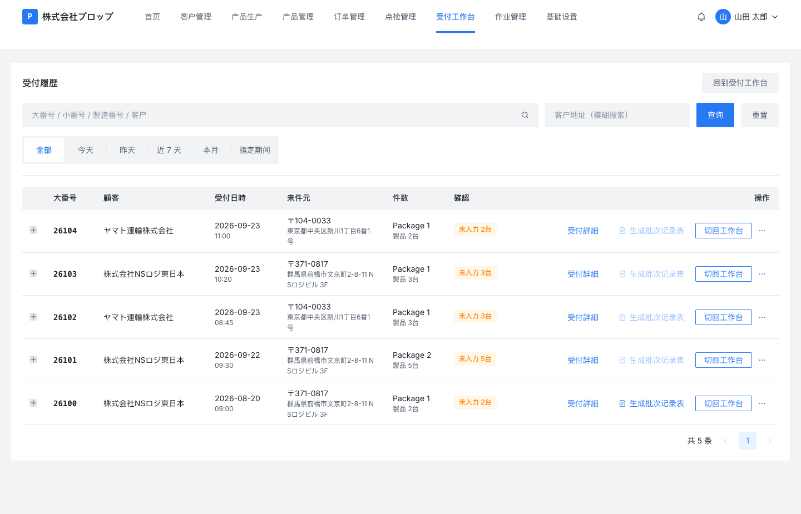
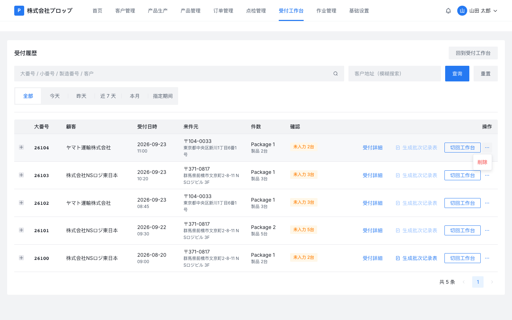
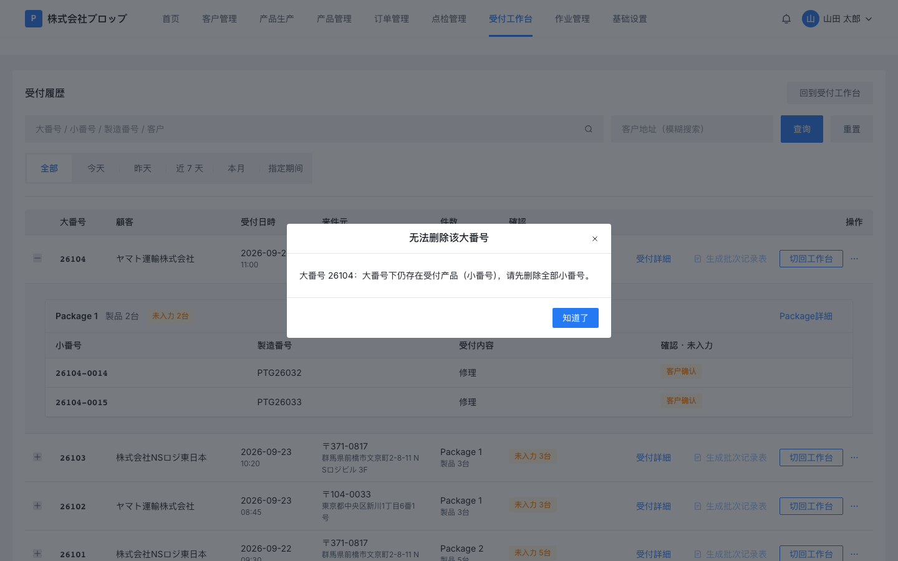
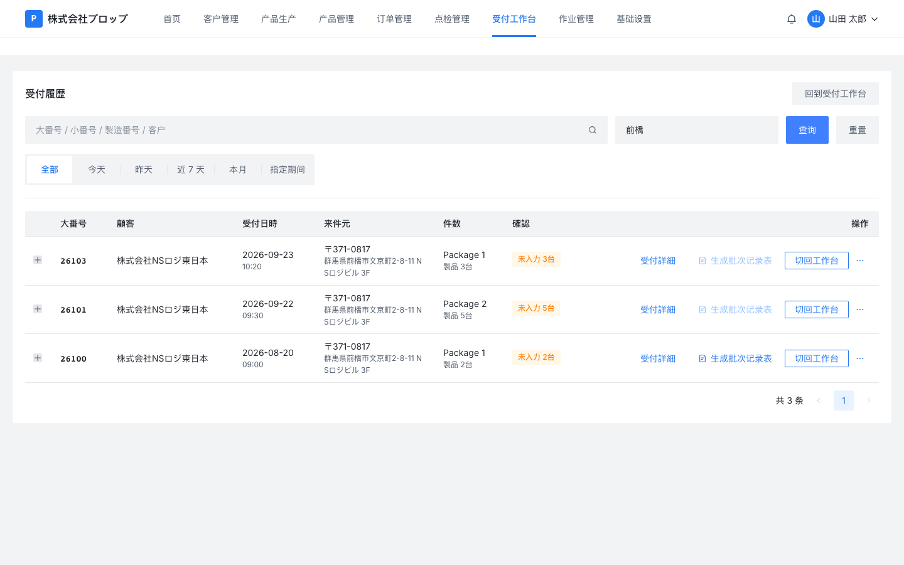

# FEAT-15 受付履历

> **2026-10-17入口裁决**：大番号回收／报废报告统一在作业管理大番号头部生成；历史查看也仅在作业管理，返送详情不提供这两类报告。大番号维度、候选、版本及删除规则不变。旧原型中的返送生成入口不再适用；本轮仅需求同步，未实现或运行验证。

> **需求定版（2026-10-11）**：本轮FEAT-14受付业务规则及FEAT-15～17关联条款已经用户确认定版。定版内容以当前正文为准；历史demo、讨论方案及撤回裁决不覆盖正文。本轮不进入开发；原有明确标注待定稿的报告／打印模板不在本次定版范围内。

> **2026-10-13报告规则已更新**：单台仅点检报告，任何计划下可生成；大番号回收／报废报告生成按FEAT-16 §5.9执行，返送详情不展示这两类报告，边界见FEAT-17 §5.8。删除边界以FEAT-14 §6.8／FEAT-15 §5.8为准，历史计划映射不再适用。

**状态：Current Truth（批次记录表为包裹维度的线下流转用PDF；字段及HTML参考样式已确认；动态PDF分页待方案与验证）**

> **2026-10-19字段、维度及精简裁决**：批次记录表按单个包裹生成，供纸质资料随实际产品线下流转；字段、来源、只读与冻结规则见§4.8及[字段对照](batch-record-fields.md)。保留所属大番号、公司名称、地址、联系人、包裹照片及本包裹各产品信息；产品NG图片不进入PDF，历史仅含受付日期、类型及年目。客户手记HTML仅为参考材料；其中旧的版式待确认状态由下述2026-10-21裁决更新。当时未定的包裹删除处理已由2026-10-22裁决替代：包裹合法删除时，同事务清理该包裹全部批次记录表版本及照片副本，不增加删除阻断，不影响其他包裹和已下载副本。不代表已实现或验收通过。

> **2026-10-21 HTML采用及补充裁决**：采用[当前HTML参考样式](assets/reports/批次记录表/prop-package-reception-record.html)，采用范围及来源见[模板README](assets/reports/批次记录表/README.md)。数据及图片占位均为虚构示例。备注只输出正文，不输出录入人和日期；保留本包裹清洗／展开维修两项需求台数，以及逐台「是否需向客户确认」「产品处理计划」。包裹标识展示名称为「包裹号」。生成时间和模板版本仍仅留系统；其余已确认产品内容不删减。

## 1. 模块概述

本 feature 供员工按大番号、客户、地址、产品和日期查询受付批次，展开包裹与产品，查看详情，生成批次记录表，删除符合条件的大番号。受付批次、大番号、包裹与小番号由 FEAT-14 受付工作台建立和维护；本 feature 查询并呈现同一份受付事实。

## 2. 页面构成

| 页面 | 导航位置 | 主要作用 |
|---|---|---|
| 受付履歴 | 受付工作台的业务子页面（无独立一级菜单） | 按大番号、客户、地址、产品和日期查询受付批次，展开包裹与产品，查看详情，生成批次记录表，删除大番号 |

## 3. 资料项目与规则

本 feature 与 FEAT-14 受付工作台共享同一份受付事实。

### 3.1 大番号

| 资料项目 | 必填 | 规则 |
|---|---:|---|
| 大番号 | 自动生成 | 格式为年 2 位 + 年内连番 4 位，一个受付批次一个号。按当年最大号加 1 取得 |
| 受付日時 | 自动记录 | 表示大番号建立时自动记录的原始业务时间，用于履歴排序、年度登记日期和最近业务日期显示；旧批次追加不改写。不作为C04前回実績选取最近小番号的依据 |
| 公司名称 | 是 | 本次实际来件来源的公司名称。建立时可从客户主档或第一台产品当前订单关系带出候选值，员工按面单或现场情况确认；保存后只影响本大番号 |
| 納品先 | 否 | 本次来件相关的納品先信息。确认来件信息时由第一台产品当前订单关系带出候选值，保存为本大番号来件记录；左侧参考中的納品先读取本大番号来件记录，未保存时回退第一台产品当前订单关系 |
| 来件邮编 | 否 | 本次实际来件来源的邮编，保存为本大番号来件记录 |
| 来件地址 | 是 | 本次实际来件来源地址，员工按面单或现场情况确认；保存后不回写客户或订单主数据 |
| 来件地址补充 | 否 | 建筑名等补充地址，保存为本大番号来件记录 |
| 联系人姓名 | 否 | 本次来件联系人，保存为本大番号来件记录 |
| 联系电话 | 否 | 本次来件电话，保存为本大番号来件记录 |
| 来件备注 | 否 | 大番号层级备注，在编辑大番号弹窗维护 |
| 大番号画像 | 否 | 与大番号相关的图片，可追加、预览和删除；与包裹图片分开保存 |

### 3.2 包裹

| 资料项目 | 必填 | 规则 |
|---|---:|---|
| 包裹序号 | 自动生成 | 在同一大番号内从 1 起递增。删除包裹后其他包裹序号不重排；新增包裹取现有最大序号加 1 |
| 包裹名称 | 自动生成 | 页面显示为 Package N 或包裹 N，用于区分同一大番号下的实际物理包裹 |
| 包裹备注 | 否 | 包裹层级备注。新建批次前置流程确认来件信息时填写的受付备注保存到包裹 1 |
| 包裹图片 | 否 | 包裹面单、外箱或开箱相关图片，可多张，支持删除 |
| 所属大番号 | 自动关联 | 每个包裹必须属于一个大番号。包裹删除不影响小番号计数 |

### 3.3 单台受付

| 资料项目 | 必填 | 规则 |
|---|---:|---|
| 小番号 | 自动生成 | 按所属大番号年度取号，该年度内连续整数，从 1 起，每台来件加 1；跨批次、跨包裹不重置；新年度的大番号使用新年度从1起的序列；跨年向旧大番号追加时继续旧大番号所属年度的序列，不使用操作当天的年度。删除后不复用，允许空号。显示时固定 4 位补零，超过 9999 按自然位数显示 |
| 小番号实际建立时间 | 自动记录 | 该条产品受付成功成立的时间，与所属大番号受付日時分开保留；修改内容及后续作业不重置。成立入口、稳定先后及消费边界见§3.4；不要求新增页面展示列 |
| 受付番号 | 自动显示 | 单台身份为大番号 + 小番号，显示形态为「大番号-小番号4位」 |
| 製造番号 | 是 | 通过扫描或输入识别产品。扫描本身不建立单台受付；点击「受付を開始」或在前置流程确认后才建立 |
| 所属包裹 | 是 | 单台受付必须属于一个包裹。包裹归属通过大番号下的包裹关系表达 |
| 受付类型 | 是 | 可多选定期点检、维修、租赁结束；报废与前三项互斥 |
| 年度完成情况 | 条件必填 | 受付类型含定期点检且非报废时必填。一次受付最多对应 1 个年度，范围为 1～4年目；无基准月仍可登记年目，目标年月暂缺 |
| 本次作业 | 条件必填 | 已选择受付类型且非报废时必填，可多选标准点检・维修、展开维修、クリーニング |
| 异常 / NG | 否 | 非报废受付可登记异常/NG。每项包含内容与最多 1 张照片，是受付阶段的正式异常事实 |
| 受付备注 | 条件必填 | 客户确认为「需要向客户确认」时至少 1 条；其他情况下可为空。备注保留录入人和日期 |
| 临时装箱 | 是 | 填写本次临时装箱箱数，必须为 1 以上整数 |
| 客户确认 | 是 | 选择「不需要确认」或「需要向客户确认」。再次点击可取消选择 |
| 产品处理计划 | 条件必填 | 客户确认为「不需要确认」时必填，可选返回客户、PROP回收、报废。客户确认为「需要向客户确认」时允许暂空。处理计划只是受付人员当前判断，不产生回收或报废事实 |

### 3.4 有效受付与两个时间的事实契约

- 已成功建立且仍合法存在的小番号就是有效受付，必填暂缺、类型未选不使其无效；不另设有效性、发布或受付完成状态。不提供小番号作废或恢复流程；历史资料中的“未作废受付”按本节有效受付理解，不产生作废功能。
- 首台在前置流程确认成功并实际建立小番号时成立；后续产品在工作台点击「受付を開始」并成功建立小番号时成立。仅扫描识别、空大番号、空包裹及建立失败均不产生产品受付事实。空批次重开后沿用工作台开始受付入口。
- 小番号实际建立时间只在该条受付成功成立时记录。修改类型、年度、本次作业、NG、备注、客户确认、处理计划、装箱，重新打开或切换包裹，以及后续作业完成／撤销完成／重新完成、报告生成，均不重置该时间，也不改变所属大番号原受付日期。
- 向旧批次追加时，新小番号记录自己的实际建立时间，但业务日期仍沿用原大番号受付日期；不判断是否同一次来件、不新增改期入口。跨年追加仍按大番号所属年度取号，编号不能代替跨年建立先后。
- 须保留可稳定判断小番号建立先后的事实；相同时间精度下的稳定次序由详细技术方案确定，不强制数据库字段名、全局序列或事件平台。大番号受付日期按日本业务日期提供给C04；不能以小番号建立日期或更新时间替代。
- 取消弹窗仅放弃尚未保存的输入，不删除已建立的小番号，不撤销已保存操作。大番号图片追加／删除即时保存，取消弹窗仍保留该图片操作；其他输入沿用各弹窗保存规则。

## 4. 受付履歴

### 4.1 页面作用

受付履歴用于按大番号、客户、地址、产品和日期查询受付批次，以大番号为主表展开包裹和产品，查看大番号与包裹详情，生成批次记录表，并按规则删除大番号。

### 4.2 页面入口与去向

从受付工作台的业务子页面（无独立一级菜单）进入，也可从受付工作台携带上下文进入。右上「回到受付工作台」按钮携带来时上下文返回。客户详情的「关联业务」快捷链接可带关键词进入并立即查询。

### 4.3 页面布局






```text
受付履歴
├─ 标题卡片：受付履歴 / 回到受付工作台
├─ 筛选区：关键词 / 客户地址 / 日期快捷页签 / 查询 / 重置
├─ 产品命中提示
├─ 大番号主表
│   └─ 展开区：Package 分组 + 产品子表
├─ 大番号詳細抽屉
├─ Package詳細抽屉
└─ 批次记录表预览（生成后直接打开；暂不提供记录表历史查看）
```

### 4.4 展示信息

#### 筛选区

- 关键词搜索框内提示文字为「大番号 / 小番号 / 製造番号 / 客户」，回车或点击查询生效。大番号和客户名命中大番号本体；小番号和製造番号命中产品。
- 客户地址搜索框内提示文字为「客户地址（模糊搜索）」，匹配大番号来件元信息中的邮编和地址。输入为 7 位数字（可带连字符）时按邮编严格匹配；其余输入按地址部分匹配。
- 显示「查询」主按钮和「重置」按钮；重置清空全部条件并将日期页签回到「全部」。
- 日期快捷页签为按钮式单选：全部、今天、昨天、近 7 天、本月、指定期间。默认选中「全部」。选指定期间时出现开始/结束日期，年、月、日均为下拉；起止均完整且结束不早于开始后随查询生效。
- 产品命中时显示「产品编号命中 N 台，已自动展开对应大番号」，命中的大番号自动展开，命中产品行浅主色背景并带左侧主色线高亮，同时滚动定位。

#### 主表

- 大番号粒度，按受付日時倒序，分页每页 10 条并显示总数。
- 固定列为大番号、顧客、受付日時、来件元、件数、確認、操作。
- 顧客无值时显示「未确认客户」。
- 受付日時以日期和时间两行显示。
- 来件元以「〒邮编」和地址两行显示。
- 件数以 Package N 和製品 N台两行显示。
- 確認列显示未入力 N台橙色、⚑ 要確認 N台紫色；无则显示「—」。
- 操作列显示受付詳細、切回工作台和「···」下拉；记录表仅在本页对应包裹区域生成，暂不提供历史查看入口。下拉中危险色操作为「削除」。
- 点击行展开或收起包裹区。

#### 展开区

- 按包裹序号升序分组。
- 包裹头显示 Package N、製品 N台、未入力 N台、⚑ 要確認 N台、Package詳細，以及该包裹的「生成批次记录表」；暂不显示「记录表历史」。
- 产品子表按小番号升序；列为小番号、製造番号、受付内容、確認・未入力。
- 小番号显示连写形态。
- 受付内容按固定顺序「定期点检・维修・租赁结束・报废」连接；定期点检含年度时追加「· N年目」。
- 確認・未入力列显示 ⚑ 要確認紫色标签和缺失项逐项橙色标签；无则显示「—」。

#### 抽屉与弹窗

- 大番号詳細抽屉只展示大番号层级事实：本次来件公司/客户、受付日時、来件地址、联系人、电话、大番号备注和大番号图片；无图片显示「无图片」。
- Package詳細抽屉只展示包裹层级事实：所属大番号、Package、产品数、Package备注和Package图片。
- 点击生成后直接按已保存资料生成并打开预览，不先打开字段修改／补充或发行日选择弹窗。发行日采用生成当天；系统说明为「记录表保存生成时的包裹事实及所属大番号信息，受付仍可继续修改」。系统预览界面提供所属大番号、实际包裹标识、业务版本号、发行日、生成时间、模板版本及§4.8确认的文件内容，不提供本次字段编辑。其中业务版本号、发行日、生成时间、模板版本均仅保留在系统预览／内部版本记录中，不进入PDF或纸面；不因纸面精简取消其系统记录或版本历史。原按多个包裹分组的描述由单包裹内容替代，不据此确定文件版式；完整受付编号替代仅显示小番号的简略描述。
- 2026-10-22入口裁决：仅从受付履歴页面（/reception-history）按包裹生成批次记录表；受付工作台不提供生成入口。暂不提供记录表历史查看入口，每次明确点击生成都按当前已保存事实重新生成并预览。系统内部继续按包裹保存版本及冻结内容，不因暂不提供历史查看而覆盖或删除旧版；成功请求重放或本次PDF读取重试仍读取原成功版本，不当作重新生成。原工作台入口及记录表历史弹窗／按钮的规则或建议由本条替代。

### 4.5 功能

- 输入关键词、客户地址或日期条件并查询 → 展示符合条件的大番号 → 产品命中时自动展开并定位产品行。
- 点击重置 → 清空条件，日期回到「全部」 → 展示默认结果。
- 点击「受付詳細」 → 打开大番号詳細抽屉 → 只查看大番号层级事实。
- 点击「Package詳細」 → 打开Package詳細抽屉 → 只查看包裹层级事实。
- 点击包裹头部「生成批次记录表」 → 按该包裹已保存资料及所属大番号信息生成一份新版本并直接打开预览，发行日取生成当天，不经字段修改／补充或日期选择弹窗。
- 本页暂不提供「记录表历史」按钮或历史查看弹窗；需要新文件时重新点击生成，按当前已保存事实形成新版本并预览。
- 点击「切回工作台」 → 打开该大番号的工作台。
- 点击「削除」 → 按大番号删除规则校验 → 允许时删除大番号及其空包裹和批次记录表。

### 4.6 校验与反馈

- 指定期间必须开始日期和结束日期均完整，且结束日期不早于开始日期。
- 批次记录表按所选包裹当前已保存事实及所属大番号信息生成，不以点击完成按钮、完成状态或完成时间为前提。生成时提示「按当前事实生成新版本」，既有版本保留规则不变。
- 大番号下仍有小番号时不得删除，提示「大番号下仍存在受付产品（小番号），请先删除全部小番号」。

- 大番号即使已无小番号，只要仍有正式点检／回收／报废报告也不得删除，提示「本大番号已有正式报告，不能删除」。只有批次记录表不构成该阻断。

### 4.7 页面产生的数据

普通查询、展开、查看抽屉、返回工作台不建立或更正业务记录。生成批次记录表会为所选包裹新增一份版本化记录表，冻结生成时的包裹及所属大番号采用信息、该包裹产品内容；同批其他包裹不生成版本。删除大番号会删除该大番号及其全部空包裹、包裹图片、备注和批次记录表。

### 4.8 批次记录表字段规则（2026-10-19逐项确认）

本节补齐原§4.4的字段简述，逐项来源、空值及替代关系见[批次记录表字段对照](batch-record-fields.md)。本文件为随包裹实际产品线下流转的纸质资料，主要用于识别包裹、核对产品及了解本次受付要求，不承担完整历史档案展示。输出为PDF；采用2026-10-22用户确认的日文化R4 HTML作为当前参考样式（2026-10-21原稿保留历史），见[模板采用说明](assets/reports/批次记录表/README.md)。原手记整理稿与本次设计HTML是不同材料；样例业务值、固定示例数量及占位图片不升级为业务规则，参考样式不证明真实PDF分页已通过。

#### 2026-10-22 R4样式确认（当前有效）

用户已确认[日文化R4 HTML](assets/reports/批次记录表/prop-package-reception-record-r4.html)版式，取代2026-10-21设计HTML及R2／R3中不一致的样式；旧附件保留历史。采用无装饰底色、无纸面标题、页首大番号与Package番号同行放大、右侧两项台数、照片及公司信息左右区域、横向四产品参数对照、四处通栏分区及历史／备注条目虚线。公司标题和值上下排列且左对齐。字段、空值、只读、冻结和删除规则不变；照片占位和虚构业务值不能成为默认值或固定数量。R4为参考样式，不是已注册业务模板，不证明真实图片接入或生产自动分页通过。

#### 来源、编辑与冻结

- 2026-10-22最新入口裁决：仅从受付履歴页面（/reception-history）按包裹生成批次记录表；受付工作台不提供生成入口。暂不提供记录表历史查看入口，每次明确点击生成都按当前已保存事实重新生成并预览。内部版本保存、旧版冻结、成功请求重放及读取重试规则保持；不将“每次重新生成”用于已成功请求的重试。此前工作台生成／历史建议及履歴历史弹窗要求由本条替代。
- 生成对象改为一个已存在的包裹，不再是整个大番号；每份只包含该包裹及其产品，关联展示所属大番号信息。各包裹独立版本、独立历史。功能名称暂仍为「批次记录表」，不因维度调整自动改名。本节确认的字段均自动带出、只读；生成不经过字段修改／补充弹窗，直接打开预览，发行日采用生成当天。需要更正已保存的受付内容时，先回受付资料修改，不在本次记录表中另设人工覆盖。
- 包裹所属信息保留大番号、公司名称、地址主行、地址补充行及联系人。大番号为所属大番号本身；其余只取本大番号已保存值，不回退客户主档、当前或历史订单。地址主行与补充行完整保留、分别输出；担当者即该联系人，不取生成操作人。客户编号、納品先、邮编、电话及大番号原受付日期不再作为本文件输出字段；不改变源业务资料及查看界面原有元信息的含义。
- 本节确认的业务字段缺失留空，不补其他来源或编号、不阻断生成；清洗／展开维修未登记时按下述规则留空，不自动视为「無」。发行日自动采用生成当天，不要求用户填写或选择；版本规则保持。
- 文件保留所属大番号及系统实际已有的包裹标识，展示名称统一为「包裹号」。不自行新增包裹业务编号或自定义名称；HTML中虚构的编号仅为示例，不作为真实编号规则或需求缺陷。业务版本号、发行日、生成时间、模板版本均仅在系统中保存和查看，不进入PDF／纸面，也不因此取消系统记录、历史或模板元信息。
- 生成时冻结采用的文字、空值、日期、历史内容及包裹照片内容。后续受付、产品、客户资料修改及原包裹照片修改／删除不改写旧版本；生成不回写这些业务资料，也不锁定受付。未采用的图片及字段不因冻结规则而重新加入输出。发行日、版本、生成时间及模板元信息沿既有规则，未在本轮另设技术存储方案。

- 已有空包裹仍可按其已保存事实生成，不增加至少一台产品的门槛；空大番号若没有包裹则没有生成对象，不凭空建立包裹。既有不要求受付完成及字段缺失不阻断的规则保持。
- 批次记录表不增加正式报告删除阻断；大番号合法删除时仍清理其所属记录表。包裹合法删除时，同事务清理该包裹全部批次记录表版本及照片副本，不增加删除阻断，不影响其他包裹和已下载副本。删除后系统不再提供该包裹记录表的历史查看／下载；包裹既有合法删除条件不变。

#### 包裹及单台内容

- 图片只保留当前包裹弹窗已保存的包裹照片；不输出大番号照片、产品照片或产品NG照片，不保留NG图片占位区域。包裹备注及原「預かり品」备注／照片组合栏不再输出，不新增人工随附物品输入，也不混作单台備考；保留包裹照片本身。
- 製品名按每台产品分别取其当前对外名称，不以首台名称统一该包裹。製造No.取本小番号对应产品的製造番号；受付管理No.显示完整`大番号-小番号`，小番号至少4位补零、超过4位完整显示，不另设记录表业务编号。本次受付类型及已登记年目继续展示。
- クリーニング及展開修理分别读取本次单台受付的「本次作业」：已勾选对应项目显示「有」；已登记其他作业但未勾选该项目显示「無」；本次作业尚未登记则留空。两项均逐台展示，另保留本包裹需清洗、需展开维修的两项台数汇总，分别统计对应逐台需求为「有」的产品台数，生成时冻结。不输出其他需求分类汇总，不统计其他包裹；未登记不计为「無」。只表示受付需求，不表示实际作业完成，不取作业管理的完成结果替代。
- 検／修履歴只展示该产品在本次受付成立之前的历史受付日期、受付类型及已登记年目；不展示历史作业明细、维修／换件过程、历史备注或历史照片，不把年度登记表述为实际点检／维修完成。本轮不另定历史条数、排序或摘要截取规则。
- センサバージョン取本次小番号成立时保存的传感器固件版本。旧资料无起始事实时留空，不以当前固件版本伪造历史，不增加起始补录功能。
- 「外観状況」改为「异常・NG」，只读取本次单台受付登记的NG文字，不输出NG图片、NG录入人或NG日期；无文字留空，不自动显示「OK」或「きれい」，不将其解释为完整外观检查结论。排除这些内容仅作用于本文件，不删除或改变源受付资料。
- 单台「備考」读取本小番号全部已保存受付备注正文、完整展示，不输出录入人和日期，不混入大番号、包裹或作业备注；源资料的录入人和日期仍保留，不因文件精简而删除。临时装箱读取本次单台受付已保存箱数，显示「N 箱」；没有独立装箱备注字段，不固定输出「A120」。

- 「是否需向客户确认」读取本次受付已保存选择，自动、只读；未选择留空，不自行判为不需要确认。「产品处理计划」读取本次受付已保存计划（返送／PROP回收／报废或空值），自动、只读，不取实际处理结果。两项均生成时冻结，缺失不阻断，不在报告中修改，也不增加实际处理或作业完成门槛。

#### 纸张尺寸与方向（2026-10-22确认）

- 采用A4纵向，内容超出时按已确认规则续页。四台分组、组内接续、照片、续页识别与整份连续页码仍按本节现行条款，不因纸张确认增加台数或内容上限。
- 本条替代此前A4纵向仅为研究稿建议的待确认状态；不一并确认研究稿8mm页边距、字号、栏宽或其他打印参数，不代表真实PDF分页已经验证。

#### 产品分组与阅读顺序（2026-10-22确认）

- 每组横向对照4台，当前组内容过长时先完成该组续页，再展示下一组，不限制包裹总台数。四台是每组的横向对照列数，不是生成或输出上限；所有产品及已确认内容仍须完整输出。产品分组按本文件采用的产品顺序连续进行，本裁决不另定产品排序。
- 例如7台先展示第1～4台；该组若占多页，先续完该组，再展示第5～7台。不得将不同组的续页交叉穿插。此项替代此前“每组四台及分组续页顺序仅为样稿建议”的待确认状态；其中续页识别及正文去重现由下述同日裁决进一步明确，纸张参数和页脚未因分组裁决自动定稿。

#### 续页识别与正文接续（2026-10-22确认）

- 续页页首将大番号及包裹号放在同一行并放大字号，不输出标题，表头重复当前组各产品完整受付编号，续写字段标注「続き」，不重复已展示完的正文。识别信息按当前续写组保持对应关系，不混入下一组或其他包裹编号。完整受付编号沿既定格式，不另设续页业务编号。
- 「続き」是续写字段的展示标识，不作为源备注或NG正文的一部分，不改写源业务内容；正文从上页结束处接续，保留完整内容及原始换行，不重复已经展示完的正文。
- 此项替代此前续页识别及续段标识仅作为样稿建议的待确认状态。业务版本／发行日纸面展示已由下述同日最新裁决撤回；页码按下述同日最新裁决采用；其他未确认样式不因续页识别规则自动采用。

#### 包裹照片展示及续页（2026-10-22确认）

- 包裹照片按保存顺序完整展示，保持比例、不裁剪；放不下时续页，已展示照片不在后续产品续页重复。输出全部已保存包裹照片，不以样例照片数量设上限；不恢复产品照片、NG图片或包裹备注。
- 本条替代此前照片顺序、比例／裁剪及续页重复方式待确认的状态；真实图片及分页效果仍待后续实施验证。

#### 页码（2026-10-22确认）

- 每页底部居中显示「当前页／总页数」。页数对应当前整份包裹记录表，不以产品组重新从1计数；单页也显示「1／1」。不因显示页码恢复业务版本、发行日、生成时间或模板版本的纸面输出。
- 本条替代此前页码待确认及仅作样稿建议的状态；真实分页、总页数及居中位置仍需后续实施验证。

#### 打印版式调整（2026-10-22逐项确认）

- 不为打印文件添加底色，包括表头、产品区、NG区及图片区的装饰底色；照片内容仍按已确认规则完整展示。
- 「過去の受付」中不同日期的历史受付条目之间以横向虚线分隔；内容仍仅为历史受付日期、类型及年目，不恢复维修作业明细或其他已撤回资料。
- 「会社名」「住所」「住所の補足」「担当者」均按标题在上、值在下排列，标题及值左对齐；原字段来源、空值及完整展示规则不变。
- 取消PDF／纸面「Package受付記録表」标题；大番号和Package编号在页首同一行左对齐并放大字号。续页同样只保留该行两种编号，不再重复简短标题；当前组完整受付编号及「続き」、正文接续规则不变。清洗／展开维修两项台数仍在右侧原编号区域、仅首次展示。

2026-10-22后续页首裁决替代原“编号靠标题左侧”及“续页保留简短标题”：两种编号同一行、放大字号，不再输出标题；不改变字段来源或系统功能名称。

以上替代旧样稿中的装饰底色、历史无分隔、公司字段横排及编号／汇总旧位置；用户列表第5项为空，不自行补充。离线修订样稿供进一步确认，不代表业务分页已实现。

#### 纸面去重与说明精简

- 2026-10-22信息重复裁决：公司名称、地址、联系人及清洗／展开维修两项台数汇总，仅在首次对应区域展示，后续产品续页不重复；续页保留已确认的识别信息。公司名称、地址主行／补充行、联系人及两项汇总的有效内容仍须完整展示，不能借去重截断内容或删除字段；不改变逐台清洗／展开维修需求的保留规则。本条替代此前公司信息及汇总是否在产品续页重复的待定状态。
- 产品一览及详情中的同一业务字段不重复输出。撤去重复的「本次受付要点」内容及详情标题中重复的名称、类型等，但保留用于识别对应产品的必要编号；不得借去重删除有效字段。每台完整受付编号、製造番号、对外名称、本次类型／年目、清洗／展开维修需求、起始固件、箱数、NG文字、本次受付全部备注正文、历史受付日期／类型／年目、「是否需向客户确认」「产品处理计划」均继续保留；另保留本包裹两项需求台数。备注录入人／日期不进入文件。
- 业务版本、发行日、生成时间及模板版本均不在PDF／纸面输出。大番号、包裹标识不在文件头、来件区和页脚无必要地重复；包裹照片下不再重复输出归属说明。必要的产品／包裹识别仍须保留；续页重复同一行的大番号／包裹号及当前组完整受付编号按2026-10-22现行条款处理，不恢复已展示完的正文。其他未确认版式不由此推定。
- 不将取值来源、联系人并非操作人、受付编号组成／补零、历史不代表作业完成、只读／冻结、不补其他来源、不构成业务完成凭证等系统规则作为纸面解释或长段页脚输出；这些规则本身继续有效，系统内必要提示不取消。
- 对缺失字段不自动填「留空。」「未登记」等解释文字，不以「無」「正常」「已完成」代替空值；没有可展示历史时留空，不自动断言「本次为首次受付」。该规则不删改源受付备注等已保存正文，不新增历史条数限制或内容截断。

#### 删除项、替代及未确认范围

- 2026-10-22最新纸面精简裁决：业务版本、发行日不在PDF及纸面显示；系统中的业务版本、发行日及版本历史记录继续保留。本条替代此前“PDF保留业务版本／发行日”和方案“仅末页显示一次”的描述；生成当天取发行日、系统只读预览及按包裹独立计版规则不变，当时尚未采用的页码建议，现由同日后续页码裁决明确；两项裁决分别留存替代关系。

- 2026-10-22包裹删除裁决替代此前“单独删除包裹后的记录表处理待确认”：包裹合法删除时，同事务清理该包裹全部批次记录表版本及照片副本，不增加删除阻断，不影响其他包裹和已下载副本。仅确认该生命周期规则，不代表代码、数据库或运行验收已完成。

- 删除手记中的「エアバッグ展開経緯」「FAX・E-MAIL」「スマイル管理No.」「動作確認」「直代」「改訂」展示栏，不新增这些字段或取值。删除「お届け先」及PROP收件方信息，来件方仅保留本节指定的公司、地址及联系人；不从PROP字典另补收件方。
- 不另设「クリーニング まち」便签或等待清洗状态；以逐台清洗需求及本包裹需清洗台数替代。手记「A120」曾被误解为标记／装箱备注，最终只对应现有临时装箱箱数。顧客管理No.此前已明确为系统客户编号，本次精简后不再输出，并非改为未知编号或人工输入。
- 「改訂」删除的是手记修订号展示项，不固定采用`20240101`，不与发行日或记录表业务版本混用；原查看界面的模板版本元信息仍沿§4.4，不新增独立改訂栏。此前将改訂与模板版本合并的建议不再采用。
- 2026-10-19包裹维度裁决替代此前「按整个大番号生成、包含全部包裹、批次汇总及大番号统一计版」描述：入口、产品范围、版本及历史改为单包裹，当时的汇总也限本包裹；后续线下流转精简曾撤回汇总输出，2026-10-21又确认保留本包裹清洗／展开维修两项需求台数；其他汇总不恢复，所属资料按最新保留范围及既定来源读取。不改变正式点检／回收／报废报告的归属。
- 2026-10-19直接预览裁决替代此前「生成弹窗选择发行日并确认」流程：不提供本次字段修改／补充，发行日采用原默认的生成当天，直接生成并预览；历史版本规则不变。
- 2026-10-19线下流转精简裁决替代此前扩展内容：所属信息只保留大番号、公司、地址及联系人；撤回客户编号、納品先、邮编、电话、大番号受付日、包裹备注及需求汇总的输出要求。「三层图片及NG照片」由仅包裹照片替代，产品图片来源不再作为本文件待决项；历史内容仅受付日期、类型、年目，完整历史维护资料不进入本文件。其中需求汇总的撤回已由2026-10-21两项需求台数裁决部分替代，其他撤回项不恢复。原来源说明保留在字段对照的替代记录中，不构成现行输出要求；源业务资料不删除。
- 2026-10-19样稿二次删减裁决替代样稿中重复产品要点、重复标题及系统规则长说明：有效产品字段仍完整保留，NG录入人／日期不输出而受付备注录入人／日期保留；生成时间、模板版本仅留系统，撤回纸面展示，不撤回其系统记录要求。其中备注录入人／日期保留的要求已由2026-10-21仅备注正文裁决替代。原样稿的虚构包裹编号／名称、空值解释及「首次受付」自动断言不作为正式规则。
- 2026-10-21采用当前HTML参考样式，替代此前全部版式待确认的笼统状态；备注仅正文、两项需求台数保留、客户确认与处理计划保留，以及「包裹号」名称按本节现行条款执行。HTML中的公司、编号、日期、版本、产品及图片占位均为合成示例，不因示例值与实际业务格式不同判为需求错误。
- 输出仍为PDF，功能仍叫「批次记录表」；HTML中「包裹受付记录表」用于包裹维度样式展示，不据此改动功能名称。当前区域结构及展示样式以归档HTML为参考；每组四台、先完成当前组续页再展示下一组的顺序已由2026-10-22裁决确认；续页识别及「続き」标识按同日现行条款；包裹照片顺序、比例及续页按上述已确认规则；多照片、长内容的实际分页及其他未定细节仍需方案及验证，不把示例4台、3张图片或CSS纸张参数推定为包裹数量上限、裁剪规则或正式打印参数。不自动加入大番号备注或其他未确认字段，不在本轮确定渲染或存储技术方案。

## 5. 跨页面统一规则

### 5.1 编号规则

- 大番号格式为 `[YY][NNNN]`，一个受付批次一个号，按年内最大号加 1 取得。
- 小番号按所属大番号的年度取号，为该年度内连续整数，从 1 起，每台来件加 1；跨批次、跨包裹不重置；新年度的大番号使用新年度从1起的序列；跨年向旧大番号追加时继续旧大番号所属年度的序列，不使用操作当天的年度。删除后不复用，允许空号。
- 小番号取得时为年度内连续数字；页面显示固定 4 位补零，超过 9999 按自然位数显示。
- 单台身份为大番号 + 小番号，连写形态为「大番号-小番号4位」。
- 包裹序号在大番号内从 1 起递增，删除包裹后不重排其他包裹序号；新增取现有最大序号加 1。
- 删除大番号不影响小番号计数。

### 5.2 未入力

未入力用于判断当前受付在其业务条件下仍缺少的必要输入。只有「适用、必填、缺失」同时成立时计入。允许已建立的受付暂缺必填项，未入力不是记录无效或不可被作业管理查询的标志；相关内容每次变化后重新计算，不依赖底部按钮。

| 项目 | 计入条件 |
|---|---|
| 受付类型 | 未选择任何受付类型 |
| 年度完成情况 | 受付类型含定期点检但未选择年度，报废时跳过 |
| 本次作业 | 已选受付类型但本次作业为空，报废时跳过 |
| 客户确认 | 未选择 |
| 产品处理计划 | 客户确认为不需要确认，且处理计划为空 |
| 受付备注 | 客户确认为需要向客户确认，且备注为 0 条 |
| 临时装箱 | 未填写箱数 |

- 报废类型跳过年度完成情况、本次作业和异常/NG相关检查。
- 不计入未入力：无 NG、NG 无图、普通备注空、图片少、无关联通知、无历史维修、无当前订单关系、无基准月及目标年月暂缺、需要确认时处理计划空、作业未完、未返送、未回收、未报废。
- 包裹和大番号层只显示「未入力 N台」，统计至少缺 1 项的台数，不显示字段缺失总数。
- 产品层可显示具体缺失项名。

### 5.3 ⚑ 客户确认旗标

- 单台受付选择「需要向客户确认」且仍有效时，该受付显示 ⚑。
- 所属包裹页签显示 ⚑。
- 受付履歴中对应大番号的「確認」列显示「⚑ 要確認 N台」。
- 改为「不需要确认」后，旗标自动消失；已填写的受付备注保留。
- 旗标只判断「有效且需要向客户确认」，不判断该产品是否已回收或已报废。已回收/已报废的受付只要仍标记为需要确认，旗标照常显示；若不希望显示，需在受付工作台把该受付的「需要向客户确认」取消（改为不需要确认或取消选择）。
- 员工不能手工增删旗标；左侧产品标题不另设「需要客户确认」文字标签。

### 5.4 年度口径

- 一次受付最多对应 1 个年度，范围为 1～4年目。
- 受付类型含定期点检时必选年度；不含定期点检时为空；报废时不适用。
- 基准月为首次出货月。N年目为基准月加 N 年；出货当年为 0 年目。
- 年度选项有基准月时按基准月推算目标月；无法查明基准月时，仍允许员工选择1～4年目，目标年月暂缺，显示「目标年月不明」。不因无基准月阻止年度登记、单台查漏通过或批次完成，也不以受付年目反推或补写首次出货日期、基准月。
- 年目与目标年月分开判断：定期点检未选择年目仍计未入力；已选择合法年目但目标年月未知，不计缺项。同产品其他有效受付已登记年度仍禁选，当前受付自身仍不参与禁用，此规则不依赖基准月。
- 年度登记是受付事实，不是售后作业完成事实；无基准月可登记年目也不使产品自动进入生命周期通知候选，候选条件继续由FEAT-12／13规定。
- 哪些年度不能选：同一台产品如果在之前的其他受付里已经登记过某个年度（例如上次来件登记了第 2 年），那么这次新受付里该年度就置灰、不能再选——该年度已经登记，不能重复登记；不据此认定实际作业已完成。判断时只看其他有效受付。
- 当前这条受付不受这个限制：员工给本次受付选了某个年度后，如果重新打开想改，他自己选过的那个年度仍然可选、可以改回去或改选别的。不能因为「自己已经选过」就把这个年度锁死，否则员工将无法修改。
- 年度完成日期以所属大番号受付日時为准。
- 左卡生命周期只读显示基準月、出荷後 X 年 Y か月和点検済み，不显示次回予定；点検済み取本台产品历史受付中已填写年度的集合（排除当前编辑中与已删除的受付记录），升序以「・」连接，无记录显示「—」。无基准月时基准与经过时长显示「—」，已登记年目仍展示，不整区隐藏。

### 5.5 受付类型与处理计划联动

- 受付类型可多选定期点检、维修、租赁结束；报废与前三项互斥，选择报废清空其他类型，选择其他类型清掉报废。
- 未人工选择处理计划时，按当前类型组合给默认值，不依赖点击顺序：报废→报废；包含租赁结束→PROP回收；其余包含定期点检或维修→返回客户；全部类型清空→清除此前自动带出的计划。人工选择或人工清空仍按下条保护。
- 员工手动选择或清空过处理计划后，后续类型变化不覆盖人工判断。取消报废类型时，只清除仍由报废类型自动带出的报废计划；不能仅因当前值是报废就清除人工选择。
- 取消定期点检时清除原年度；切为报废时清除原年度、本次作业、受付NG及其照片。切回原类型不恢复这些值，需重新填写；非报废类型间切换仅清除不再适用的年度，仍适用的作业和NG保留。
- 受付备注、客户确认和临时装箱不因类型切换而清除。报废时备注仍可编辑，客户确认为需要时仍须有备注。类型切换及关联清除按同一次操作保存，不保留隐藏的受付旧值给作业管理读取。受付NG清除不删除工作组自己登记的检查、处置或NG，也不改写历史报告。

### 5.6 来件信息与完成边界

- 大番号的公司名称、来件地址、联系人和电话是本次实际来件保存的信息。
- 保存时可从客户主档或第一台产品当前订单关系带出候选值，员工按面单或现场确认后保存。
- 保存后不回写客户或订单主数据；客户主档后续修改不影响历史大番号。
- 完成本批次受理仅用于查漏提示和返回初始页，不记录批次完成状态或时间，不表示作业、报告、返送、回收或报废完成。
- 返回初始页后仍可从受付履歴再次打开修改或追加；每次打开均保留完成按钮。

### 5.7 报废与回收产品的受付边界

- 已确认报废的产品不允许再次受付。报废事实以报废记录为唯一判断依据。
- 已确认回收的产品允许再次受付。新受付建立新的小番号，原受付记录作为历史事实保留，不受影响。

### 5.8 三层删除

| 层级 | 允许删除条件 | 删除后果 |
|---|---|---|
| 小番号 | 无下列五项自身下游阻断；大番号回收／报废报告不构成小番号阻断 | 受付记录及其受付备注、正式 NG 一并删除；小番号不复用；不可恢复 |
| 包裹 | 包裹下无任何受付产品 | 包裹连同图片、备注删除；同事务清理该包裹全部批次记录表版本及照片副本，不因记录表增加阻断；其他包裹及已下载副本不受影响，不重排其他包裹序号 |
| 大番号 | 大番号下无任何受付产品，且无正式点检／回收／报废报告 | 大番号及其全部空包裹、图片、备注一并删除；批次记录表同步删除；不可恢复 |

小番号删除阻断项共五条，每条对应一个明确的下游业务事实，一次性全部列出：

1. 已存在作业记录
2. 该小番号已生成单台点检报告
3. 已存在返送记录
4. 已确认回收
5. 已确认报废

「已确认回收／已确认报废」以作业管理产生的回收确认记录、报废记录为唯一判断依据；受付记录上的回收／报废时间只是该事实的展示，不作为独立的第二来源。

大番号回收／报废报告只阻断大番号本身删除，不阻断小番号或空包裹删除，不按是否被报告选中增加小番号限制。小番号仍校验自身作业、单台点检报告、返送、实际回收／报废等阻断；包裹仍须为空。小番号合法删除后，既有大番号报告保留生成时的产品清单及内容，大番号因存在报告继续保留。批次记录表不阻断删除；大番号删除时其一并清理。C04实绩统计、前回実績展示及案内受付匹配仅为消费结果，不新增小番号删除阻断；上述“单台点检报告”不包含产品被生命周期案内PDF列入。合法删除后，C04按剩余有效事实及各自规则重新判断，不影响既有五项删除阻断。

### 5.9 处理计划边界

产品处理计划表示受付人员当前填写的判断，可随时修改，包括已有作业、报告、返送、正式回收或报废之后。受付信息与实际处理事实分别维护，允许两者不一致；更改计划会改变大番号回收／报废报告的候选归属，不限制单台点检报告生成，不产生、撤销或改写回收、报废、返送事实，不改写已生成的报告和寄送快照。

## 6. Feature 边界与明确不做

### 6.1 模块边界

- 本模块负责查询和展示FEAT-14维护的受付事实、生成和查看版本化批次记录表，并按既有条件删除大番号；登记及更正通过切回FEAT-14工作台进行。
- 客户主档由客户管理维护；本模块只读取候选信息并保存本次来件信息。
- 产品档案由产品管理维护。
- 当前订单关系由订单管理维护；本模块只读取候选来件信息和左侧订单参考。
- 最新案内由定期管理与通知维护；本模块只读取产品编号对应的最新案内作为参考。
- 作业记录由作业管理维护；本模块只读取最近业务历史，不建立作业事实。
- 返送、回收和报废结果由后续模块负责；受付处理计划不替代实际结果。
- FEAT-14生产和维护真实受付，FEAT-15查询同一事实并按既定条件删除大番号；供C04读取产品身份、受付身份、当前全部已选类型（含空集合）、所属大番号原受付日期、小番号实际建立时间及稳定先后、合法删除后的有效事实。类型仍遵守点检／维修／租赁结束可多选、报废互斥规则。
- C04实绩统计及前回実績选取按[FEAT-12 §6.4](../FEAT-12-periodic/spec.md#64-展示信息)，验证按其[VAL-39／VAL-39A](../FEAT-12-periodic/validation.md)。任意类型及未选类型的有效受付均可消费，不等待作业、年度选择、报告、返送或完成按钮；不改变生命周期候选资格，也不将年度登记或受付报废类型视为正式作业完成／报废事实。
- 案内匹配及超期由[FEAT-13 §6.5](../FEAT-13-notice/spec.md#65-受付与超期判断)定义，不能套用前回実績只取最近一条的算法。受付侧仅提供成立时点及批次业务日期，不维护关联案内字段，不要求员工选择案内或执行匹配。
- 两种时间的引入不改变FEAT-15按大番号受付日時倒序的历史列表，也不改变FEAT-14最近业务的既有受付日期排序；显示日期与C04选记录依据分别理解。FEAT-16自身作业完了规则继续适用，C04计入实绩不代表作业完成。

### 6.2 明确不做

- 不设置「结束本包裹」按钮及包裹完成时间。
- 不提供受付/小番号作废流程与修订受付模式。
- 不复用小番号。
- 删除包裹后不重排其他包裹序号。
- 不设置独立「来件管理」页面。
- 受付成立不以存在点检通知为前提。
- 左卡不显示今回候補或次回予定推算。
- 不按客户×月猜测关联通知；最新案内按产品编号查询。
- 不维护受付记录关联通知字段。
- 左侧不另设「需要客户确认」文字标签。
- 包裹和大番号层不显示字段缺失总数，只显示未入力台数。
- 受付履歴产品行不设置「受付詳細」操作列。
- NG 照片最多 1 张。
- 受付备注不设置分类、负责人、完成状态或版本。
- 产品处理计划不设置「未决定」选项；未决定以空值表示。

## 7. 核对记录

以下为历史记录；旧解释不覆盖当前正文及最新裁决。

- 2026-09-23：按二级导航粒度自 11-受付 拆分为本 feature（FEAT-15）；内容不变，章节与交叉引用已重编号。
- 2026-09-23：拆分完整性核对后修复两项：状态行补回限定「批次记录表模板为目标稿，待正式定稿」；§5 小节顺排重编号（5.7 报废与回收产品的受付边界／5.8 三层删除／5.9 处理计划边界），与 FEAT-14 §6.7～6.9 对齐（拆分时继承了旧稿 5.9 在前的乱序）。

- 2026-09-22：依据 FEAT-14 受付工作台／FEAT-15 受付履历输入包完成 spec.md 初稿。正文仅采用输入包中已核对页面事实与裁决，覆盖受付工作台、工作台内弹窗、受付履歴、统一规则、三层删除、Feature 边界和明确不做。
- 2026-09-22：独立审查修复：「顶部 workbar」改为「顶部操作区」；删除实现层表述「小番号保存为整数」；前置流程第 2 步按现状仅校验产品未找到（产品正式无效校验仅存在于工作台扫描开始受付）；删除不可达的「建立大番号弹窗」残留描述（代码中残留无入口弹窗，不作为当前页面事实）。
- 2026-09-22：大番号納品先保存落地（用户裁决「应该改为保存」）：前置流程第 3 步納品先保存为本大番号来件记录，编辑大番号弹窗新增納品先字段并可更正，左侧参考納品先读取本大番号来件记录、未保存时回退第一台产品当前订单关系；删除「納品先不保存」的临时口径。
- 2026-09-22：受付履歴客户地址搜索口径修订（用户裁决「邮编严格匹配」）：输入为 7 位数字（可带连字符）时按邮编严格匹配，其余输入按地址部分匹配；同步 Demo 与验收用例。
- 2026-09-22：措辞统一（用户裁决方案 A）：界面与 spec 全文「快照」改为业务语言。Demo 界面左侧区块标题「本次来件快照」→「本次来件」，第 3 步提示条「来源快照」→「来源信息」，建立弹窗说明「形成快照」→「记录本次大番号来件信息」；spec 规则描述统一为「本次来件保存的信息／来件记录」，7.6 节标题改「来件信息与完成边界」。
- 2026-09-22：受付类型与处理计划联动表述澄清（用户指出「取消报废且处理计划仍为报废时，处理计划一并清空」写得绕）：明确两个「报废」分属受付类型与处理计划两个字段——取消受付类型的报废时，若处理计划仍是当初自动带出的报废值则一并清空（依据已消失，否则前后矛盾）；员工手动改过的处理计划不覆盖。同步验收用例 VAL-09。
- 2026-09-22：年度完成情况置灰规则改写直白（用户要求「写的更直白一些」）：明确「同一台产品在之前其他受付里已登记的年度不能再选（已做完不重复登记）」与「当前这条受付自身不锁死自己已选的年度，可改回或改选」；同步验收用例 VAL-10。
- 2026-09-22：⚑ 客户确认旗标补充（用户裁决「照常显示即可，不判断是否已经作废（回收/报废）」）：旗标只判断「未作废且需要向客户确认」，不判断产品是否已回收或已报废；已回收/已报废的受付仍标记需要确认时旗标照常显示，要去掉须在工作台取消「需要向客户确认」。
- 2026-09-22：新增 4.13A 保存机制（用户要求）：明确受付工作台为「操作即保存」——选择类字段点击即写入当前受付，输入类字段在弹窗点「保存」生效；底部「保存并扫描下一台」不保存字段，仅做未入力校验并推进到下一台。同步修正 4.13 中该按钮「保存当前受付」的旧表述，并补验收用例 VAL-40A 与回归检查。
- 2026-09-22：左卡ライフサイクル「点検済み」补充判断逻辑（用户要求）：明确取值为「本台产品历史受付中已填写年度完成情况的年度集合（排除当前编辑中与已作废记录），升序以「・」连接，无记录显示「—」」，并说明用途是让员工结合起算月与已完成年度自行判断本次年次，系统不推算次回予定。
- 2026-09-22：受付模块移除 M番号（用户裁决「不要输入M番号，删去M番号相关描述」）：前置流程与工作台扫描仅按製造番号识别产品，提示文字、输入框占位与校验文案同步删除 M番号；数据层 internalNo 保留用于其他模块，受付页面不再出现。
- 2026-09-22：无订单产品受付规则明确（用户裁决）：前置流程第 2 步扫描到无当前订单关系的产品时，不阻断进入第 3 步「确认来件信息」，候选内容为空由员工按面单或现场自行填写；Demo 现状已符合（goBatchConfirm 空值处理 + 必填兜底校验），仅补全 spec 与验收用例描述。
- 2026-09-22：8.1 模块边界补充（用户裁决）：新增「本模块建立的受付记录及其受付日期，是定期管理与通知判断案内产品是否超期未受付的依据」，使受付与通知两模块口径互相呼应。
- 2026-09-22：记录实施差距待主代理后续处理：创建批次备注写入包裹 1，编辑大番号备注写入大番号，归属按现状描述；最近业务缺大番号时间时回退创建时间；批次记录表模板为临时内容待正式 spec。
- 2026-09-23：大番号年内连号由 3 位扩为 4 位（格式 `[YY][NNNN]`），来源：2026-09-23 用户裁决（复查受付大番号约每年 1000 个，3 位号段不适用）；「年内号用完后进入下一年段」留白表述随之删除。
- 2026-09-23：小番号措辞修正（纯措辞，规则行为不变）——「年度全局连续整数」改为「年度内连续整数」，并补充「跨包裹不重置」。原因：开发反馈「全局连续」与「新年度从 1 重新起号」字面冲突，易误读为跨年终身序列；本意是年度内跨批次、跨包裹连续，年度边界重置。

## 9. 2026-10-11 关联裁决同步

与FEAT-14共享的受付在小番号建立后即可查询，允许必填暂缺；已保存修改按操作生效，不等待底部校验或批次完成。无基准月仍可登记年目，目标年月暂缺；本页未入力统计不得将目标年月未知算作缺项。批次记录表不再依赖完成按钮或完成状态，按当前已保存事实生成，不增加作业放行状态。

### 2026-10-11 后续业务裁决

- 受付类型、年度、本次作业、NG、备注、客户确认、处理计划及装箱信息均可持续维护，不因已产生作业、报告、返送、回收或报废事实而整条只读；各字段自身合法性及类型联动仍适用。修改现有受付不同于给已报废产品建立新的受付，后者仍禁止；既有三层删除限制不变。
- 保留空批次及现有完成方式，不增加至少一台产品才能完成的限制；有产品时仍检查其适用必填项。空批次、未完成前置流程的批次可从履历重开工作台，来件资料通过左上角大番号／公司名称编辑补充，不强制恢复向导。首次新建向导中公司名称、地址必填规则不变。
- 旧批次可继续追加产品，不区分同次来件补录还是后来新来件，不增加日期判断；追加受付继续使用该批次原受付日期，不修改批次日期，也不新增改期入口。

### 2026-10-11 实际处理互斥更正（最新裁决）

【历史裁决：其中报告生成类型的旧约定已由2026-10-13报告对象变更替代；以下一次实际处理限制继续有效。】

受付处理计划可继续修改，但只决定报告生成类型，以及本条受付尚未实际处理时的回收／报废操作入口。一旦作业管理处理列执行了回收或报废，本条受付不允许再次执行任一种处理，不允许回收改报废或报废改回收；修改计划不撤销结果，不重新开放处理按钮。此前“允许回收后再报废”的裁决已撤回。此处约束本条受付的处理操作，既有回收产品再次来件建立新受付、已报废产品禁止新受付规则未改变。

### 最新裁决：移除受付完了时间，保留完成按钮

不设置受付完了日時及持久化的受付完成状态；完成按钮仅按既有规则提示缺项、确认返回初始页。缺项时仍提示并留在当前页，不撤销已保存内容；直接返回初始页的原入口不受此检查限制。取消确认留在当前页，无缺项或空批次确认后返回初始页。履历和返送不展示受付完成时间／标记；批次记录表不以完成按钮为生成门槛。

### 2026-10-11 C04事实契约补充（用户确认）

有效受付及两种时间以§3.4为准；消费算法引用FEAT-12／13，不引入受付完成、发布、作废或改期流程。新增小番号实际建立时间及稳定先后契约；澄清缺项有效、多类型读取、取消已保存操作不回滚、C04消费不阻断合法删除。历史裁决保留，C04残留表述及责任见[冲突交接说明](../FEAT-14-reception/reports/c04-reception-contract-handoff-20261011.md)。仅文档同步，未实现或运行验证。

### 2026-10-13 报告对象变更（历史裁决；生成入口由2026-10-17调整）

本次替代历史按处理计划切换单台报告类型的规则：单台仅点检报告，任何计划下可生成；回收／报废报告在返送详情按大番号及类型分别生成、计版。大番号报告仅阻止删除大番号本身，单台点检报告阻止对应小番号删除；包裹仍按空包裹规则。既有实际处理、返送及完成边界不变。无历史数据，不设置旧单台回收／报废兼容。


### 2026-10-22 当前HTML模板参数裁决

当前模板改由若依现有「参数设置」维护：`prop.packageRecord.template`，初始标识`package-reception-record-v1`；沿用现有维护权限和缓存机制，不新增模板管理、上传或编辑器。新模板须先随应用发布并登记、保留旧资源，再切换参数。生成时冻结模板绑定，历史及成功请求重放不读取当前参数、不回退新模板。缺失、重复、空值、未登记或资源无效仅阻止本次新生成，不改变其他业务和旧版本。初始化默认Y，不以config_type作为生成门槛。此前代码固定选择v1的安排由本条替代，既有v1版式和摘要不变。
