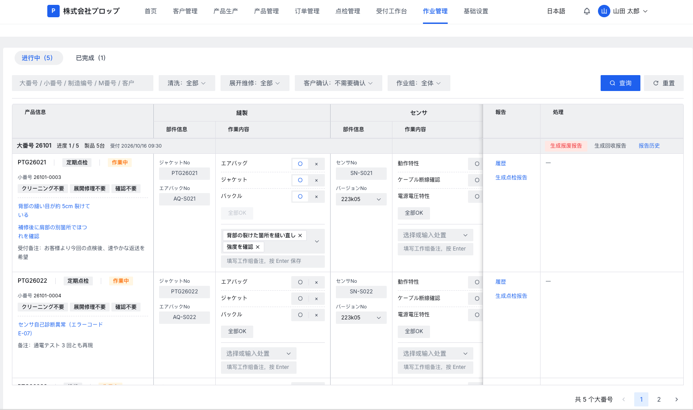
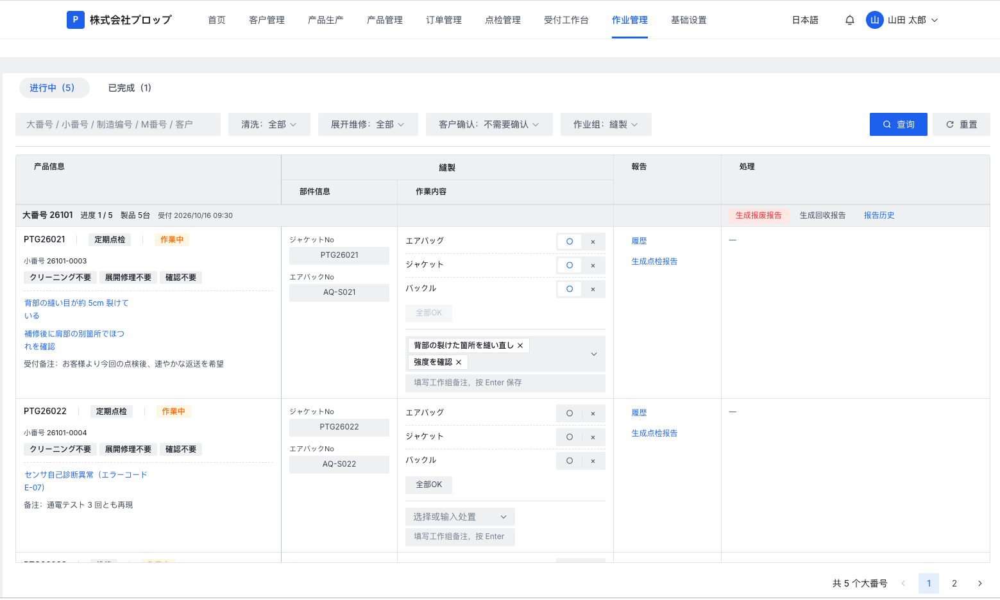
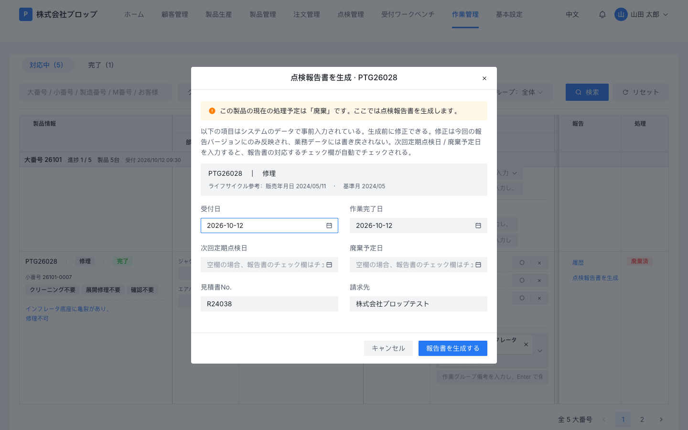
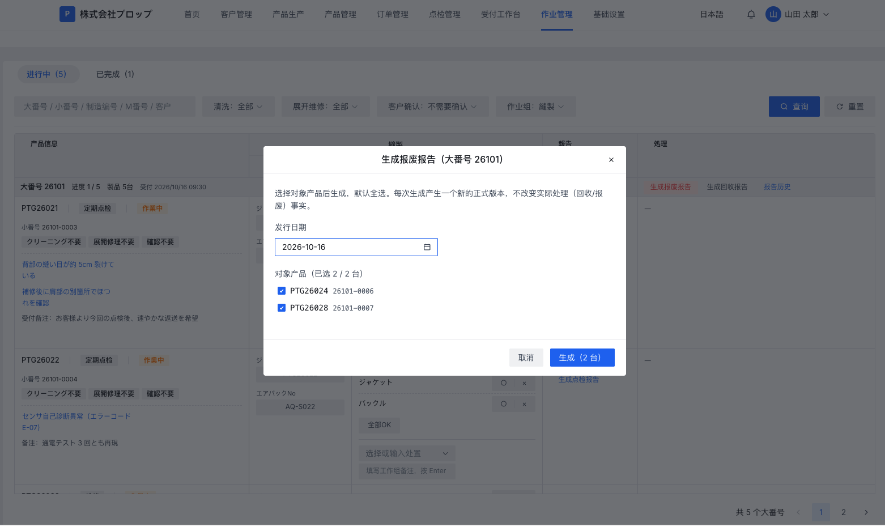
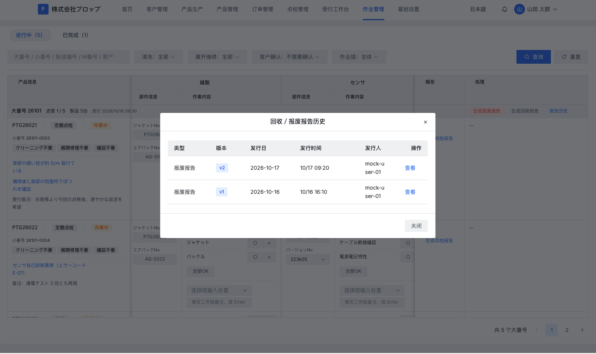
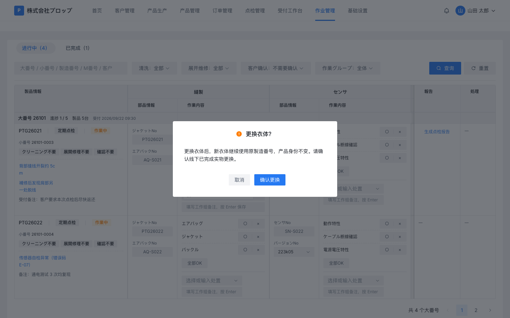

# FEAT-16 作业管理

> **2026-10-17入口裁决**：大番号回收／报废报告统一在作业管理大番号头部生成；历史查看也仅在作业管理，返送详情不提供这两类报告。大番号维度、候选、版本及删除规则不变。旧原型中的返送生成入口不再适用；本轮仅需求同步，未实现或运行验证。

> **需求定版（2026-10-11）**：本轮FEAT-14受付业务规则及FEAT-15～17关联条款已经用户确认定版。定版内容以当前正文为准；历史demo、讨论方案及撤回裁决不覆盖正文。本轮不进入开发；原有明确标注待定稿的报告／打印模板不在本次定版范围内。

> **2026-10-13报告规则已更新**：单台仅点检报告，任何计划下可生成；大番号回收／报废报告生成按FEAT-16 §5.9执行，返送详情不展示这两类报告，边界见FEAT-17 §5.8。删除边界以FEAT-14 §6.8／FEAT-15 §5.8为准，历史计划映射不再适用。

> **2026-10-16 单台点检报告裁决已同步**：单台点检报告的字段、来源、报告内编辑、起始状态、编号／固件版本比较、快照和A4纵向输出，以§5.8、[字段对照](inspection-report-fields.md)及[模板采用说明](assets/reports/点検修理報告書/README.md)为准，替代此前单台PDF「目标稿／待正式需求」及原字段表中的冲突内容。仅落实需求，不代表实现、运行验收或解除C05-D整体实施延期；其他报告及打印模板不在本次确认范围内。

> **2026-10-17 回收报告需求已整理**：已确认字段与版式以§5.9.1、[回收字段对照](recovery-report-fields.md)、[模板采用说明](assets/reports/終了返却証明書/README.md)及VAL-RR为准；发行日允许清空，抬头、PROP等报告内容缺失不阻断生成，缺失处留空，不自动补取其他来源。此裁决取代此前缺项校验待决状态。报废模板仍待提供。

**状态：Current Truth（含2026-10-16单台点检及2026-10-17回收报告已确认需求；回收待实施验证）**

> **写作纪律（2026-09-20 裁决）**：本文档只写业务事实和产品要求——页面为谁解决什么问题、展示什么信息、有什么操作、规则是什么。禁止写 mock 数据描述、代码字段名、技术词汇、代码实现细节；凡是「demo 恰好这么实现的」不写，凡是「业务上必须如此」才写。举例允许。字段命名规则写在对应数据模型文档，不在本文档。
>
> **历史页面如实纪律（2026-09-20；本次已裁决的文档修订不受“先改 demo”限制）**：本文档只如实描述 demo 页面现状，不得在文档层修改页面内容——包括省略、改名、"清理"页面实际存在的字段或文案。页面内容要改必须先走「裁决 → demo 修改 → 验证」，再回到本文档。

> **2026-09-25 原型适用边界**：本目录既有原型资产未更新。更换衣体的确认、事件与身份不变规则以 §4.5／§4.7 为准；旧演示不能作为创建新衣体或改变绑定的依据。 此前 demo 核对及测试结论仅作历史记录，不证明本次规则已验收。

## 1. 模块概述

作业管理是各工作组完成本次返厂产品作业登记的主工作台。PROP 现场以受付批次（大番号）为实际流转单位：一批产品先到縫製组，再到センサ组，再到組立组。本模块以「一台产品一行」的方式连续展示同一批次的全部产品，让各组在同一页面上按自己的工作内容登记检查结果、处置和备注，并从这里生成正式报告、确认回收或报废。

本模块维护的事实是**作业记录**：每台受付产品在每个工作组各有一份当前作业记录，记录该组的检查结果、处置内容、备注、换件与固件升级事实、以及清洗完成／展开维修报告目录等特殊登记。普通修改直接更新这份记录，不产生历史版本；跨次作业历史来自过去不同的受付；衣体实物更换、非衣体换件与固件升级事件另行保留。

```
受付（FEAT-14 受付工作台）决定本次要求与处理计划
        │
        ▼
受付批次（大番号）── 批次进度（已完成台数 / 有效总台数）
   └─ 单台受付（一行一台）── 单台作业状态（作業中 / 完了）
        └─ 作业记录 × 工作组（縫製 / センサ / 組立 / 展開修理 / クリーニング）
        │
        ├─ 单台点检报告（每次生成一个新版本，不可变；大番号报告见本页§5.9）
        └─ 实际处理（回収確認 → 回收事实；廃棄確認 → 报废事实）
              │
              ▼
        订单管理（结束产品订单关系）、部件与生产（换件 / 固件事实）
```

## 2. 页面构成

| 页面 | 导航位置 | 主要作用 |
|---|---|---|
| 作业管理 | 主导航「作业管理」 | 按批次连续展示返厂产品，登记各组作业内容，生成报告、确认回收／报废 |

本页为 PC 端专用页面，不面向 iPad 适配。

## 3. 资料项目与规则

### 3.1 单台作业记录

每台受付产品在每个工作组各有一份当前作业记录。该记录随作业持续编辑，修改覆盖当前值，不保留编辑历史。

| 资料项目 | 必填 | 规则 |
|---|---:|---|
| 检查结果 | 否 | 仅縫製／センサ／組立三组有检查区。该组规定的检查项目逐项给出「○（通过）／×（未通过）」；未选择的项目视为未检查。选择 × 时可就地登记 NG 内容（可多项，可从该组常用 NG 清单选择或现场输入；现场输入的新值只保存到该台作业记录，**不进入**该组常用清单）和检查备注（按 Enter 保存）。本组作业事实，不升级为受付正式 NG。常用 NG 清单 = FEAT-04 作业选项「作业 NG 描述」按工作组维护（新增／停用／启用），作业现场不回写；字典仅含縫製／センサ／組立三组 |
| 处置内容 | 否 | 仅縫製／センサ／組立三组有处置选择。多项选择，可从该组常用处置清单中选择，也可现场输入新值；现场输入的新值只保存到该台作业记录，**不进入**该组常用清单。常用处置清单 = FEAT-04 作业选项「作业处置内容」按工作组维护（新增／停用／启用），作业现场不回写；字典仅含縫製／センサ／組立三组 |
| 工作组备注 | 否 | 一段自由文本；各组统一使用一个备注，不拆分为检查备注与处置备注 |
| 换件事实 | 否 | 更换气囊／传感器／发生器时记录「原部件 → 新部件」；更换衣体时只显示“更换衣体”，产品及系统衣体身份、制造编号与绑定不变 |
| 补录事实 | 否 | 未绑定部件（气囊／传感器／发生器位置 1／2）补录时记录「无 → 新部件」；编号可现场新入库，详见 4.5「补录部件」。衣体必经入库必有绑定，不支持补录 |
| 固件升级事实 | 否 | 选择新的传感器固件版本时记录「原版本 → 新版本」 |
| 展开维修报告目录 | 否 | 展开维修组专用：登记 PROP 保存原始数据／分析资料的目录文本（如共享盘路径）；仅文本记录 |
| 清洗完成 | 否 | 清洗组专用：勾选表示该台已完成清洗 |

### 3.2 报告

| 资料项目 | 必填 | 规则 |
|---|---:|---|
| 报告类型与对象 | 是 | 点检报告以单台受付为对象，由本页或返送详情产品行生成；回收／报废报告以大番号为对象，仅在作业管理大番号头部生成，规则见本页§5.9；历史仅在作业管理查看。当前无历史数据，不提供旧单台回收／报废报告入口或兼容流程 |
| 版本 | 是 | 每点击一次生成产生一个新的、不可变的正式版本（v1、v2……）；新版本不是对旧版本的修改；报告生成后不可修改，之后作业记录变化不影响已生成报告 |
| 发行时间与发行人 | 是 | 生成时自动记录 |

上述必填为报告成立时由系统维护的归属与版本事实，不是报告内容的填写门槛。报告内容有缺项也可生成，具体取值、编辑范围与冻结规则见§5.8。

### 3.3 实际处理（回收／报废）

| 资料项目 | 必填 | 规则 |
|---|---:|---|
| 回收确认 | — | 处理计划为「PROP回收」且本条受付尚未确认回收或报废时可执行；确认后形成回收事实，产品与当前订单的关系结束；不可逆。这是**结束当前关系**，不是取消履约——已发生的交付保留，订单有效履约数不因此扣减，也不取消订单；与订单侧「解除关联」（否定原交付、扣减履约数）是两个不同动作 |
| 报废确认 | — | 处理计划为「报废」且本条受付尚未确认回收或报废时可执行；确认后形成报废事实，产品生命周期终结，禁止继续出货与再次受付；不可逆。报废只终结产品与衣体编号（製造番号）；气囊／传感器／发生器部件个体**不随之报废**，解除绑定后可继续用于其他产品（与产品管理「删除产品部件个体本身保留」同口径） |

报告与实际处理完全分离：生成回收报告不等于已回收，生成报废报告不等于已报废。

## 4. 作业管理

### 4.1 页面作用

让各工作组按批次连续看到返厂产品，在同一行内完成本组的检查登记、处置登记与备注；让现场随时知道当前产品属于哪个大番号、该批次整体进度如何；提供报告生成与回收／报废确认入口。

### 4.2 页面入口与去向

- 入口：主导航「作业管理」；受付工作台建立单台受付并取得小番号后，该记录即进入本页可查询范围；仍按本页Tab与筛选显示。不等待必填项齐全、「保存并扫描下一台」或「完成本批次受理」。只有大番号、空包裹或只识别产品而未建立受付时，没有对应产品行。
- 受付内容可持续更正，本页读取各操作已成功保存的最新内容；允许必填项暂缺，不增加受付登记通过状态或统一作业放行步骤。查到产品行不等于产生作业记录，作业事实仍按§4.7产生；单台作业完成仍按§5.1判断。无基准月但已登记年目的受付同样可查询，不因此阻止作业登记。
- 去向：报告生成弹窗（生成／预览）、报告版本历史弹窗、NG 详情弹窗（只读）、换件弹窗、回收／报废确认弹窗。

报告相关截图及适用边界见[截图说明](assets/README.md)。

### 4.3 页面布局









```
┌ 进行中（N）/ 已完成（N） Tab ────────────────────────────┐
│ 筛选区（一行）                                              │
│  [关键词输入] [清洗▾] [展开维修▾] [客户确认▾] [作業グループ▾] [查询] [重置] │
├──────────────────────────────────────────────┤
│ 主表（表头固定，内容区内部滚动；可横向滚动）                    │
│ ┌ 大番号 101  進捗 3/5  製品5台  受付 2026/09/16 09:30 ┐ ← 批次行，滚动时吸附在表头下方
│   [生成报废报告] [生成回收报告] [报告历史] ← 属于上述大番号头部
│ 製品情報 │ 縫製（部品情報｜作業内容）│ センサ（部品情報｜作業内容）│ 組立（部品情報｜作業内容）│ 報告 │ 処理
│ PTG26021 …                                                 │
│ PTG26022 …                                                 │
│ ┌ 大番号 102  進捗 1/3  製品3台  受付 … ┐                  │
│ …                                                          │
├──────────────────────────────────────────────┤
│ 分页：共 N 个大番号  < 1 2 3 >                              │
└──────────────────────────────────────────────┘
```

### 4.4 展示信息

**大番号头部报告操作**：「生成报废报告」（红色）、「生成回收报告」及「报告历史」，与批次信息同属大番号头部，不放入单台报告列。生成、候选及历史规则见§5.9。

**顶部 Tab**：进行中／已完成两个视图，括号内数字为大番号批次数。批次内只要还有一台未完成，整批属于进行中；批次全部完成后整批进入已完成。同一大番号绝不拆到两个视图。

**筛选区（一行排列）**：

- 关键词输入：提示文字「大番号 / 小番号 / 製造番号 / 客户」；点击查询或按 Enter 生效。
- 清洗：全部／需要／不需要。
- 展开维修：全部／需要／不需要。
- 客户确认：全部／需要确认／不需要确认；**默认「不需要确认」**——默认优先看到可以直接作业的产品，可主动切换。
- 作業グループ：全体／縫製／センサ／組立／センサ+組立。选择后只显示对应工作组列，其他组列暂时隐藏；只改变列，不改变任何行与批次；仅为当前查看方式，刷新页面后恢复全体。
- 查询、重置横置；重置恢复默认筛选（关键词清空、三项是否筛选恢复默认、客户确认恢复「不需要确认」），不改变作業グループ选择。

未填写值不归入“不需要”：客户确认未选择显示「未填写」，仅客户确认“全部”包含；本次作业整个为空时显示「作业要求未填写」，清洗／展开维修仅“全部”包含。已选择其他作业但未选清洗／展开维修时，对应要求为不需要；已选对应作业时为需要。报废时本次作业不适用，显示「—」，清洗／展开维修仅“全部”包含。不新增登记状态或作业放行逻辑。

**主表行**：一行对应一台受付产品。行的排列顺序固定：先按批次先后，再按同批次内受付先后，受付顺序相同时按製造番号升序。同一大番号的产品必须连续显示，任何操作（搜索、筛选、切换工作组、切换 Tab）都不改变行顺序，只隐藏不匹配的行。

**批次行（每个大番号第一条）**：该行第一台可见产品之前出现一条整行宽度的批次行，浅灰不透明底色，单行显示四项内容，从左到右：

```
大番号 101    進捗 3 / 5    製品 5台    受付 2026/09/16 09:30
```

- 大番号：该批次编号，加粗显示。
- 進捗：该批次已完成台数／有效总台数。始终代表完整批次的真实进度——即使当前搜索只命中该批次的一台，仍显示完整批次的进度与总台数。
- 製品数量：该批次有效总台数。
- 受付日時：该批次受付时间，格式「YYYY/MM/DD HH:mm」。
- 批次行不显示客户、NG、作业要求、报告或任何操作按钮。
- 表格内容区上下滚动时，当前批次的批次行吸附在表头下方，滚动到下一批次时由下一批次的批次行替换。

**製品情報列（左侧固定）**，从上到下固定顺序：

1. 第一行：製造番号（本行最强信息）｜受付类型（如「定期点检」「修理」；报废类型用红色标识）｜单台作业状态（「完了」绿色／「作業中」橙色）。
2. 第二行：小番号，以「大番号-小番号4位」连写形态显示（如 260102-0008）。
3. 第三行：本次作业要求标签——清洗「クリーニング要／不要」、展开维修「展開修理要／不要」、客户确认「顧客確認要／確認不要」；需要的用醒目色，不需要的用中性色。这里只表达受付决定的要求，不表达实际是否完成。
4. 有 NG 或受付备注时，以一条浅色分隔线进入异常／备注区：受付正式 NG（可点击查看详情，只读）、受付备注。
5. 本列不显示 M番号、不显示客户公司名；大番号与受付日時统一由批次行展示。

**工作组列**：全体视图下依次显示縫製、センサ、組立三组，每组分为「部品情報」「作業内容」两个子列。各列宽度固定：製品情報 320px、各组部品情報 140px、各组作業内容 260px、報告 130px、処理 100px；同一类型列宽在所有行保持一致。

- 部品情報（只读为主）：该组关心的部件，部件名称在上、编号在下。縫製：ジャケットNo、エアバックNo；センサ：センサNo、バージョンNo；組立：インフレータ1 No、インフレータ2 No。编号读取产品当前实际绑定。可操作的编号显示为可点击控件：衣体编号点击后记录衣体更换；其他部件编号点击后进入换件弹窗；固件版本为下拉选择，选择新版本即完成升级登记。未绑定的气囊／传感器／发生器显示可点击的「—」，点击打开补录弹窗（见 4.5「补录部件」）；衣体与固件版本的未绑定不补录，显示「—」。
- 作業内容：该组作业区域，从上到下依次为检查区（见 4.5）、一条浅色分隔线、处置与备注区（处置多选输入 + 工作组备注输入）。
- 清洗与展开维修不设独立列。该台本次要求需要清洗、或已经存在清洗组作业记录时，清洗作业区出现在縫製作業内容下方（标题与状态标签同行，勾选「已完成清洗」+ 备注）；需要展开维修、或已经存在展开维修组作业记录时，展开维修作业区出现在センサ作業内容下方（标题与状态标签同行，报告目录输入 + 备注）。要求不需要且无作业记录时该区域不显示。登记的内容仍分别属于清洗组／展开维修组的作业记录。

**報告列（右侧固定）**：

- 固定显示「履歴」和「生成点检报告」，不按计划切换类型，不显示单台回收／报废报告入口；计划为空也可生成点检报告。
- 履歴显示该台点检报告版本，无历史显示空列表；操作只提供「查看」，下载／打印在预览内提供。
- 生成点检报告时，当前计划为PROP回收／报废的，在弹窗顶部提示当前计划，不阻止生成。

**処理列（右侧固定）**：每条受付的实际处理只能执行一次，回收与报废互斥——

- 已确认报废：始终显示「廃棄済」，不再提供回收或报废确认按钮。
- 已确认回收：始终显示「回収済」，不再提供回收或报废确认按钮。
- 本条受付尚未确认回收或报废：当前计划为报废时显示「廃棄確認」，为PROP回收时显示「回収確認」，其余显示「—」。
- 已执行任一种实际处理后，修改或清空受付计划均不重新开放处理入口，也不能将原处理变更为另一种。实际结果保持不变，报告列仍固定提供单台点检报告，任何计划下均可生成。
- 已返送不占用回收／报废的一次处理机会；本条受付尚未确认回收或报废且当前计划为报废时，仍显示「廃棄確認」，不得仅因已返送隐藏或阻断。

**分页**：页脚独立分页，每页固定 3 个大番号，同一大番号不跨页；总数按大番号批次数显示（「共 N 个大番号」）；匹配批次不超过一页（3 个）时不显示分页条。第一版不提供每页数量切换。查询、是否筛选、重置、Tab 切换后回到第 1 页。

**空态**：当前 Tab 无批次时提示「当前没有进行中的大番号批次／当前没有已完成的大番号批次」；搜索筛选无结果时提示「没有符合搜索条件的产品」。

### 4.5 功能

**登记检查结果**

- 检查区按该组规定的检查项目纵向排列：每项一行，项目名称靠左、「○／×」选择靠右，项目之间以虚线分隔。
- 点击 ○ 或 × → 该项目结果立即保存到本组当前作业记录。
- 选择 × 后，该项目下方展开 NG 内容多选（可从该组常用 NG 清单选择或现场输入；现场输入的新值只保存到该台作业记录，不自动进入该组常用清单）与检查备注输入（按 Enter 保存）；改选 ○ 后，该项的 NG 内容与备注清除。
- 「全部OK」作用于当前产品、当前工作组的三个检查项：无论原为未检查、○ 或 ×，均统一设为 ○，同时清除这三项的 NG 内容和检查备注；工作组备注、处置及其他组不变。「全部OK」入口在本组检查区持续显示：有未检查、×或待处理检查变更时可点击；三项均已保存为 ○ 且无待处理检查变更时，保留按钮并置灰，不重复提交。不增加逐项清空检查结果的入口。
- 以用户最新明确操作为准：全部OK之后再选某项 ×，该项以新选择为准；选 × 后再点全部OK，三项统一为 ○。失败后的「重试全部OK」视为此刻重新执行全部OK，覆盖此前的检查选择及NG附属输入，按钮须明确标示该含义；重试发出后新增的选择和输入仍须保留，较早响应不得静默覆盖。备注仍按 Enter 保存，保留后续文字草稿不等于已保存；既有服务端版本冲突核对规则不变，最新操作不等于可越过冲突保护。
- 全部OK明确失败后，同一入口显示「重试全部OK」，不另外长期保留重复按钮；仅编辑尚未保存的输入不结束该重试状态。本组后续新的检查操作保存成功后，同一入口恢复「全部OK」，按当前检查状态决定是否可点击；全部OK重试成功后亦恢复普通文案。其他组或仅工作组备注／处置的保存不作为此切换条件。入口持续显示不取消既有在途防重复、结果未知及版本冲突保护，不能把超时直接视为明确失败。
- 检查项目为 PROP 实际工作内容（按页面显示原文）：縫製＝エアバッグ／ジャケット／バックル；センサ＝動作特性／ケーブル断線確認／電源電圧特性；組立＝ケーブル接続確認／外観確認／動作確認。展開修理／クリーニング不设检查区（清洗只做完成勾选、展开维修只登记报告目录），故无检查项目；这两组也不设处置与 NG 常用清单（FEAT-04 作业选项的工作组字典只含縫製／センサ／組立三组）。

**登记处置与备注**

- 处置为多选输入：可从该组常用处置清单选择，也可直接输入新值；输入的新值只保存到该台作业记录，不自动进入该组常用清单。选择变化即保存。
- 工作组备注为单行文本，输入后按 Enter 保存。
- 处置与备注都只保存当前值，重复修改不产生历史。

**清洗登记（寄宿縫製列）**

- 勾选「已完成清洗」→ 清洗组作业记录登记完成事实；取消勾选 → 清除该完成事实，回到待清洗状态。勾选框是完成状态的唯一入口。
- 备注输入按 Enter 保存；未登记清洗前填写备注，将在登记时一并保存。保存备注只更新备注，不改变完成状态——取消勾选后修改备注，完成状态不会被恢复。

**展开维修登记（寄宿センサ列）**

- 目录输入框输入报告保存目录文本后按 Enter → 展开维修组作业记录登记该目录，状态标签变为「已登记」。目录输入框是登记的唯一入口。
- 清空输入后按 Enter → 撤销本次展开维修登记，回到「需要」状态。
- 目录下方提供工作组备注，按 Enter 保存；登记目录前填写备注，将在登记时一并保存；保存备注只更新备注，不改变目录登记状态。
- 仅登记目录文本；不提供打开本地文件、校验文件是否存在、读取目录内容等功能。

**更换衣体**

- 点击縫製部品情報中的衣体编号 → 弹出确认：「请确认线下已完成实物更换。产品、製造番号、系统衣体身份与绑定保持不变，确认后登记更换衣体事件。」→ 确认后，縫製作业记录登记本次衣体更换，处置内容自动加入「ジャケット交換済」作为可见痕迹。
- 更换衣体只登记线下实物更换事件；产品身份、製造番号、系统衣体身份及现有绑定均不变，不创建新衣体档案、不解除旧衣体绑定，不产生可删除的换下衣体对象。换下实物线下报废，系统不登记其报废过程、不触发产品报废；衣体资料不自动变化，资料错误仍通过既有资料更正机制处理。事件内容显示“更换衣体”，不显示新旧编号或编号对照；时间与操作人沿用原规则，取消不登记事件。

**更换部件（气囊／传感器／发生器）**

- 点击对应部件编号 → 换件弹窗显示当前部件编号（只读，含绑定产品）；部件资料默认带出原部件资料、可改选；传感器更换时同时选择固件版本。
- 输入新部件编号后：
  - 新编号库存已有 → 校验未绑定其他产品（已绑定他人 → 拦截并提示）；空闲但当前资料与所选资料不一致 → 弹窗内确认「以所选资料为准」后更换并更正该部件资料。
  - 新编号库存没有 → 按所选资料现场建档入库后更换。
- 确认后：部件绑定更换为新部件，本组作业记录登记换件事实（原部件 → 新部件）。

**补录部件（气囊／传感器／发生器，未绑定时）**

- 未绑定的气囊／传感器／发生器在部品情報区显示可点击的「—」→ 点击打开补录弹窗 → 输入部件编号、**必选部件资料**（本页无默认部件资料提示，员工现场选择该部件所属资料）→ 传感器另选固件版本；发生器按点击的位置（1／2）确定，不重复选。
- 校验与行为：编号已绑定其他产品 → 弹窗内提示「该部件已安装在 XX」，不执行；编号空闲但当前资料与所选不一致 → 弹窗内提示「以所选资料为准」二次确认；编号不存在 → 用所选资料**现场新入库**（非衣体部件首次使用即建档，与组装页同一机制）再绑定。
- 确认后：部件绑定到该产品，本组作业记录登记补录事实（无 → 新部件），部品情報区显示编号与资料标签（可点击更正资料）。衣体必经入库必有绑定，不支持补录。

**固件升级**

- センサ部品情報中的バージョンNo 为下拉选择，选项来自基础设置中启用的传感器固件版本。
- 选择新版本 → 传感器固件事实更新为新版本，本组作业记录登记升级事实（原版本 → 新版本）；版本未变化时不产生记录。

**生成单台点检报告**

- 点击「生成点检报告」→ 打开生成弹窗，按§5.8带出本次单台受付的内容，仅允许编辑规定的报告内字段；确认后生成新的不可变版本并打开PDF预览。任何处理计划下均可生成，不要求作业完成或已返送／回收／报废，不以内容是否填齐阻断生成；不产生实际处理事实，不锁定作业记录。
- 当前计划为PROP回收／报废时，弹窗顶部提示当前计划。作业管理与返送详情使用同一套字段、版本、快照及预览／下载／打印规则；原始材料与采用差异见[模板采用说明](assets/reports/点検修理報告書/README.md)。

**查看报告**

- 「履歴」按实际生成时间倒序显示该台点检报告版本、类型、生成时间及发行人；操作只有「查看」，预览内提供下载／打印。旧版本不失效。

**确认回收／确认报废**

- 已正式返送后客户要求报废的，可在原受付修改计划为报废，再首次确认报废；无需产品再次实物返厂或新建受付。确认时须检查当前计划为报废，且本条受付未确认回收／报废；已返送不构成阻断。线上确认登记正式报废事实，不表示系统已经核实线下实物销毁。本裁决仅明确返送后报废，不扩展返送后回收规则。
- 后续报废与原返送事实并存，不撤销返送、不删除或改写原运单、納品書及历史文件，不扣减已返送数量；返送详情的同时展示见[FEAT-17 §5.4](../FEAT-17-return/spec.md#54-展示信息)。

- 同一条受付一旦确认回收或报废，不允许再次执行任一种处理：既不能重复，也不能回收改报废或报废改回收。仅修改计划不执行实际确认；保存实际确认时也须遵守此限制，不仅是隐藏按钮。

- 点击「回収確認／廃棄確認」→ 弹窗显示该台製造番号、大番号、客户与操作结果说明，并明确提示「此操作不可逆」→ 二次确认后生效：
  - 确认回收 → 形成回收事实，产品与当前订单的关系结束（历史关系永久保留），该台作业状态视为完了。这是结束当前关系，不是取消履约：已发生的交付保留，订单有效履约数不扣减；与订单侧「解除关联」（否定原交付）不同。
  - 确认报废 → 形成报废事实，产品生命周期终结、禁止继续出货与再次受付，该台作业状态视为完了。产品与当前订单的关系保持，不自动解除或结束，不取消订单、不扣减有效履约；历史销售与交付事实保留。报废终结的是产品使用资格，不是否定原交付，区别于回收结束当前关系。

**查看 NG 详情**

- 点击製品情報中的正式 NG 内容 → 只读弹窗显示 NG 内容、图片、备注；作业人员不能在此修改正式 NG。

**多人同时编辑**

- 同一台同一组的作业内容被多人同时编辑时，后保存的人会看到冲突提示弹窗：显示对方已保存的内容（保存时间、操作人、内容），可选择「放弃我的修改」（查看对方最新内容）或「保留我的内容并保存」。系统不静默覆盖他人内容。

换件与补录按 FEAT-06／09 的身份规则处理：同编号当前有效档案仍为同一身份；原档案已删除时重新登记为独立身份，不继承其固件、绑定或资料更正历史。绑错对象先结束错误绑定，资料选错使用既有更正机制，不要求删除正确档案。

### 4.6 校验与反馈

- 换件校验：新编号无当前有效档案 → 按 §4.5 用所选资料新建独立档案；已删除档案不能直接用于更换；编号无效 → 提示原因；已绑定其他产品 →「该部件已绑定其他产品，不能重复使用」；新部件资料与当前产品要求不一致 → 提示确认部件资料；均未通过时不执行更换。
- 固件升级：未找到当前绑定传感器时提示无法登记。
- 回收／报废确认为不可逆动作，弹窗内明确警示，须二次确认。
- 保存成功的各操作均有成功提示；编辑冲突以弹窗阻断，由人裁决。

### 4.7 页面产生的数据

- 登记检查／处置／备注 → 建立或更新该台该组的**当前作业记录**（覆盖当前值，不产生历史版本）；现场输入的新处置内容、新 NG 内容只进入该台作业记录，**不进入**该组常用处置清单、常用 NG 清单。
- 全部OK／重试全部OK → 按本次明确操作将当前产品本组三项统一为 ○，清除对应NG内容和检查备注，更新当前作业记录；后续输入保护按§4.5执行。
- 清洗勾选／取消 → 建立／更新／清除清洗组作业记录的完成事实。
- 展开维修目录登记／清空 → 建立／更新／清除展开维修组作业记录的目录事实。
- 更换衣体 → 登记实物更换事件，同时保留縫製作业记录中的「ジャケット交換済」处置痕迹；产品身份、制造编号、系统衣体身份及绑定不变，不创建新衣体或线上报废对象；资料不自动更改。
- 更换部件 → 产品部件绑定更换（旧关系保留为历史），本组作业记录登记换件事实。
- 补录部件 → 部件绑定到该产品（编号不存在时同时新入库建档），本组作业记录登记补录事实（无 → 新部件）；编号已绑定其他产品时不产生任何变化。
- 固件升级 → 传感器固件版本事实更新（历史版本保留），本组作业记录登记升级事实。
- 大番号头部生成回收／报废报告 → 当前大番号新增对应类型不可变版本及本次所选产品清单，不登记实际处理或返送事实。
- 生成点检报告 → 为该单台受付新增一个不可变的正式点检报告版本；不修改作业记录，不产生回收／报废／返送事实。
- 确认回收 → 建立回收事实；结束产品与当前订单的关系（历史保留）。不是取消履约：订单有效履约数不扣减、不取消订单，仅结束当前关系。
- 确认报废 → 建立报废事实；保持当前产品订单关系，不自动解除或结束，不取消订单、不扣减有效履约，保留历史销售与交付；产品生命周期终结（产品与衣体编号终结，编号不可再次使用）；部件个体不随之报废，解除绑定后可继续用于其他产品。
- 本页不产生：受付正式 NG（只能由受付侧追加）、返送事实（走寄送流程）、作业历史版本。

## 5. 跨页面统一规则

### 5.1 单台完成口径（唯一）

一台受付产品的作业状态只有两种结果，随相关事实自动变化、不可人工标记：

- **完了**：組立组规定的 3 个检查项目全部已有结果（○／× 皆可，不要求全部 ○）；或本条受付已确认回收；或本条受付已确认报废。
- **作業中**：上述条件均不满足。

判断只读取当前受付的作业与实际处理事实；同一产品过去其他受付的回收事实不使新受付自动完了，也不占用新受付的处理机会。已报废产品仍不得建立新受付。

已完成 tab 的进入与单台状态标签都只看这一口径。报告是否生成、清洗是否完成、展开维修是否登记、是否返送，都不影响作业完成判断。

### 5.2 批次进度口径

批次进度＝已完成台数／批次内有效（未作废）总台数，随作业实时变化，任何人不能直接填写。批次进度始终按完整批次计算，与当前 Tab、搜索、筛选无关——筛选只隐藏行，不改变批次的真实进度。

### 5.3 行的连续与顺序

同一大番号的产品必须连续显示；行顺序固定为批次顺序 → 批内受付顺序 → 製造番号升序。搜索、筛选、工作组聚焦、Tab 切换只隐藏行或列，绝不改变行顺序，绝不把一个大番号拆到两个 Tab 或两页。

### 5.4 工作组事实与页面列

作业事实分属五个工作组（縫製／センサ／組立／展開修理／クリーニング），各自独立记录，不合并。页面上为压缩宽度只显示縫製／センサ／組立三列，清洗与展开维修的登记入口分别寄宿在縫製／センサ列内，但保存的内容仍属于清洗组／展开维修组自己的作业记录。

### 5.5 编号显示

- 小番号以「大番号-小番号4位」连写显示（如 260102-0008）。
- 受付日時格式统一「YYYY/MM/DD HH:mm」，只出现在批次行。
- 关键词搜索对大番号、小番号（原始整数／4位补零／连写形态均可命中）、製造番号、客户名做部分匹配；匹配前忽略首尾空格、统一字符宽度、忽略英文大小写。

### 5.6 报告对象与处理计划

受付信息即使已有实际作业、报告、返送、回收或报废仍可在受付侧修改；本页读取已成功保存的最新要求与NG。受付侧清除NG不删除工作组NG、已发生作业或已生成报告。处理计划与实际事实可不一致，改计划不撤销实际事实。

单台点检报告在任何计划下均可生成；大番号回收／报废报告按当前计划确定候选，由本页大番号头部生成，历史仅在作业管理查看。每次生成形成新的不可变版本，不存在「修正版」「过期」「需更新」概念，报告与实际处理独立。

### 5.7 作业记录是当前台账

作业记录是「当前受付 × 工作组」的一份持续编辑的台账：普通修改直接覆盖当前值，不因为保存或修改产生版本、历史或「查看作业历史」入口。更换衣体、非衣体换件与固件升级仍分别登记业务事件；普通作业编辑不覆盖这些已发生事件。跨次作业历史来自过去不同的受付；衣体实物更换、非衣体换件与固件升级事件另行保留（见 FEAT-15 受付履历／FEAT-08 产品管理的历史展示）。

### 5.8 单台点检报告内容与输出（2026-10-16裁决）

#### 5.8.1 对象、内容缺项与来源边界

- 一份报告对应一个小番号，标题为「点検(定期・臨時)･修理報告書」。任何计划下均可生成，计划为空、作业尚未完成或内容不完整也不阻断。
- 任何报告内容字段均不以必填与否限制生成；自动来源缺失、人工未填写、未检查均按对应空白状态输出，不拿样例值、零、当天或历史值补齐。日期字段仅在本节明确指定时默认当天。
- 客户名称、支店／现场分别只取大番号已保存的客户名称、納品先；报告不回退首台产品订单。此规则不改变FEAT-14左侧参考的既有回退规则。
- 請求先取本报告对应产品当前关联订单已保存的請求先名称；販売年月日取该产品在当前关联订单下第一次实际寄出的日期。无当前订单或无对应出货事实时留空，不自动取历史订单，不用产品生命周期首次出货日替代販売年月日。
- 機種名取产品当前对外产品名称；見積書No.由生成时人工填写，允许为空。
- 受付番号、原大番号受付日期、製造番号、受付年目及正式NG、检查结果、作业处置文字为只读来源；需纠正时先修改对应业务资料，再生成新报告。各项字段与空值处理逐项见[字段对照](inspection-report-fields.md)。

#### 5.8.2 起始状态与最新保存结果

- 本次小番号成立时保存当时的衣体、气囊、传感器、发生器1／2编号及当时绑定传感器的固件版本，作为本次作业起始状态；后续更换、补录、升级及受付编辑均不覆盖这份起始状态。成立时无对应内容即留空，不取历史绑定倒填。受付侧保存职责见[FEAT-14 §3.4](../FEAT-14-reception/spec.md#34-有效受付与两个时间的事实契约)。
- 报告上方部件栏显示起始状态。「バージョンNo.」是传感器固件版本，不是产品资料版本。
- 缺失起始值（包括没有起始记录的旧小番号）默认留空，允许生成报告时人工补录；补录仅进入本次报告，不回写产品、作业或受付起始记录，不用当前编号自动冒充起始编号。已有起始值为只读。
- 与起始状态比较的另一端是本次小番号作业截至生成时的**最新保存结果**，不设作业「最终版本」，不要求作业完成。读取当前有效的对应绑定／固件结果；缺失或已解绑时留空，不恢复历史绑定，不混入其他小番号后续作业的结果。
- 逐个部件位置、逐个固件版本比较本次报告采用的起始值（含本次报告补录）与最新保存值：相同则不在处置内容中重复显示；不同则在对应工作组处置内容中显示最新编号／版本。最新值无内容时留空，不用旧值代替。
- 系统按编号／版本值区分差异，不额外核实线下实物更换；「更换」文字来自已经勾选的作业处置选项，不由编号差异另造一条处置文字。中间更换、补录、升级或录错后修正的过程不展开；报告仅呈现起始状态与生成时最新保存结果。

#### 5.8.3 実施内容、检查与处置

- 「実施内容」只包含本次受付登记的「N年目点検」及受付阶段登记的全部异常／NG文字；只读，需修改时先改受付资料。不以工作组NG、已做作业或样例文字替代，不放入照片。
- 三组各三项检查读取本小番号当前已保存的检查结果：縫製为エアバッグ／ジャケット／バックル；センサ为動作特性／ケーブル断線確認／電源電圧特性；組立为ケーブル接続確認／外観確認／動作確認。通过显示○，未通过显示×，未记录留空；报告中只读。
- 编号和版本之外的处置文字，读取本小番号各组最新保存的处置选项及补充文字；已有衣体更换形成的固定处置痕迹仍按作业规则读取，同一处置不因同时有事件与选项而重复展示。报告中只读，需调整先修改作业资料。
- 内容完整显示，区域允许增高并续页；原Excel的四格実施内容、每组五行处置不构成内容数量或长度上限。

#### 5.8.4 底部勾选、展开经过、日期与落款

- 「定期点検」与N年目：本次受付选择并保存可登记的年目时，报告自动勾选定期点检及对应年目；沿用受付的年目规则，只读。未登记年目时不自行按年龄推断。
- 「展開修理」：本小番号展开维修有目录登记时默认勾选；「クリーニング」：本小番号已有清洗完成记录时默认勾选。两项不读取受付作业要求来判断，均允许生成时人工修改，仅影响本次报告。
- 「メンテナンス」「その他」由生成报告时人工勾选，仅影响本次报告，不从受付类型自动勾选。
- 「エアバッグ展開経緯」由生成时人工填写，仅保存在本次报告；不读取展开维修目录内文件。始终选填，即使勾选展开维修也不要求填写。
- 「作業完了日」标签保留，默认本次报告生成当天的日本业务日期，允许人工补充或修改；该值是本次报告采用的日期，不作为实际作业完成事实，不回写作业记录，也不替代系统实际生成时间。
- 下次安排按产品生命周期基准月与本次受付登记的年目计算：本次为1／2／3年目时，分别取基准月加2／3／4年并显示为下次定期点检；本次为4年目时，取基准月加5年并显示为报废予定。缺少基准月或本次年目时，默认年月留空，不按报告日期加一年、不按今天跳到某一期、不反推基准月；允许生成时人工补充或修改安排年月，仅影响本次报告。此报告值不改变产品生命周期或通知候选。
- PROP落款读取业务字典，报告中只读，生成时保存实际采用的文字快照；字典变更不改写旧报告。

#### 5.8.5 报告内修改、冻结与再次生成

- 允许本次补充／修改的字段为：客户名称、支店／现场、請求先、販売年月日、機種名、見積書No.、缺失的起始编号／固件版本、展开维修与清洗勾选、维护与其他勾选、展开经过、作業完了日、下次安排年月。具体默认值和限制见字段对照；其余来源字段只读。
- 所有报告内修改仅保存到本次报告，不回写大番号、产品、订单、寄送、作业、受付起始记录或业务字典。
- 正式生成时保存本次报告实际采用的完整内容，包括自动带出后采用的内容、人工补充／修改后的内容、勾选及落款；之后的业务资料修改、解绑、目录清空、处置变动或字典变化均不改变旧报告。具体保存方式由后续实施方案确定，不在本需求中强制另存多份来源原值、完整比较数据、计算依据或模板标识。
- 每次再生成均按各字段规则重新带出业务资料；报价单号、报告内补录、覆盖值、人工勾选和展开经过等不自动继承上一份报告。旧报告保持不变，新报告独立递增版本。
- 取消生成不形成正式版本；真实文件生成或保存失败不得显示生成成功、留下虚假正式报告版本或因此触发报告删除保护。实际生成时间、发行人和版本由系统记录，与员工修改的报告日期分开。
- 单台正式报告保护对应小番号删除，真实报告生产与FEAT-14删除保护须同批接入；不因报告生成锁定作业或登记回收／报废／返送事实。

#### 5.8.6 PDF、附件与原型适用

- 正式输出PDF，采用A4纵向；保留原模板的标题、信息区、三工作组及底部说明区关系。全部内容完整显示，允许区域增高、超出一页时自然续页，不截断。
- 原模板右侧填写提醒旁注不进入正式报告，也不放在生成界面；不根据这些旁注设置必填校验。底部版式号「PAF-2401.1」不保留；系统报告版本与历史仍保留。
- 所选版本在预览中查看、下载和打印，三者采用同一冻结内容。旧截图和Excel样例不覆盖本节；附件文件、Sheet、采用版本和被替代内容见[模板采用说明](assets/reports/点検修理報告書/README.md)。

### 5.9 大番号回收／报废报告（2026-10-17入口调整）

- 作业管理每个大番号头部无条件显示红色「生成报废报告」和「生成回收报告」。进行中／已完成Tab采用同一入口规则，不放在单台产品行。点击时无对应候选，分别提示「本批次无报废产品」或「本批次无回收产品」。
- 报告对象是当前有效大番号；候选为其下当前计划为报废或PROP回收的有效受付，按所选报告类型列出全部候选。无作业完成、实际回收／报废或返送前置条件，已实际处理不另行排除。
- 弹窗标题含报告类型及大番号，候选显示製造番号＋受付番号，默认全选，允许调整；发行日默认当天、可修改。至少选择一台；取消不生成报告。
- 确认生成时重新检查所选产品仍属于该大番号、仍有效且当前计划符合报告类型；不符合时说明对应产品及原因，提示重新确认，不静默剔除或生成部分报告。失败不宣称生成成功。
- 按“大番号＋报告类型”分别连续编号，从v1起；每次成功生成产生一个新的不可变正式版本并打开预览。点检报告版本仍归单台受付，二者不混用；无旧单台回收／报废报告兼容入口。
- 每个版本保存生成时的大番号报告内容及当次勾选产品清单，预览为多台汇总形态。回收报告PDF显示製造番号，不显示受付番号；候选选择清单仍显示製造番号＋受付番号用于识别。报废报告暂保留製造番号及受付番号的现行要求，待客户模板核对，本轮不裁决其字段或版式。之后追加产品、修改计划、合法删除小番号均不改写历史版本。PDF尚未确认的字段与版式仍为目标稿，待正式定稿。
- 发行日是员工选择的报告日期；实际生成时间及发行人自动记录，不能用可修改的发行日替代生成先后。
- 作业管理大番号头部提供「报告历史」入口，弹窗只列回收／报废报告，按实际生成时间倒序逐版本显示类型、版本、发行日、生成时间及发行人；操作仅「查看」，下载／打印在预览内。不与返送面单、納品書或批次记录表混为一类。
- 生成报告不产生回收／报废／返送事实，不锁定作业或受付；实际回收／报废确认仍在FEAT-16。正式大番号报告只阻止删除大番号本身，不阻止无自身阻断的小番号或空包裹删除；即使产品全部合法删除，大番号及历史报告仍保留。单台点检报告继续阻止对应小番号删除。批次记录表不构成上述报告删除阻断。
- **全部受付删除后的访问边界（2026-10-17用户裁决）**：该大番号下全部小番号合法删除后，不要求作业管理继续展示空大番号或提供其回收／报废报告历史入口；数据库中仍须完整保留大番号、报告版本、冻结快照及模板绑定，可通过运维查询追溯。不得因此删除或改写历史，正式报告对大番号的删除保护保持。不为历史访问新增页面或改变作业完成、筛选及分页口径。

生成及历史查看沿作业管理页面授权；返送详情不提供这两类报告的生成、历史或预览入口。候选按整个大番号的有效受付判定，不被当前工作组列或列表显示筛选截断。

#### 5.9.1 回收报告字段增量（2026-10-17逐项确认）

本报告的正式依据为本节、[字段对照](recovery-report-fields.md)、[模板采用说明及附件](assets/reports/終了返却証明書/README.md)与[VAL-RR验证清单](validation.md#val-rr-01-抬头与身份待实施)。字段对照逐项记录来源、取值、编辑范围和冻结内容；本节只保留业务规则。客户原件为版式基底，样例值不是默认业务规则，缺少的客户字段核对表不补造为已收到材料。

- **抬头及身份**：客户名称与支店／现场（納品先）只取大番号已保存值，无值带出为空；生成时可补充或修改，仅保存本次报告，不回写大番号，不回退首台或本台当前／历史订单。No.为对应大番号，自动带出、只读，不另设报告编号。
- **发行日及系统时间**：发行日默认生成当天的日本业务日期，允许修改或清空；有值时按`YYYY 年 M 月 D 日`显示，清空后留空，不重新补当天。仅保存本次报告，不影响其他业务日期或已生成版本。实际生成时间、发行人及报告业务版本由系统记录，不用可修改或清空的发行日代替生成先后。
- **PROP与固定文字**：PROP落款从业务字典读取，只读，不放在生成界面，生成时保留采用内容，后续字典修改不影响历史。报告标题「ライフジャケットレンタル終了返却証明書」、客户旁「御中」、明细标题「ご返却明細」、证明正文及底部三条说明均保留客户原文，生成时不可编辑；全文见字段对照RC01／RC03／RC07／RC08／RC12。固定文字不触发收费、账单或实际回收，也不增加实际回收等生成门槛。
- **产品明细**：左右两栏标题统一为「製造番号」，自动读取本次所选、当前计划为PROP回收的有效受付对应产品製造番号，只读，不在报告中改写。原件未列受付番号，回收PDF不新增该字段，取代旧§5.9要求回收PDF附受付番号的条款；候选列表仍显示製造番号＋受付番号用于识别。生成前整组复核及失效处理沿§5.9。
- **逐台返却日**：默认所属大番号受付日；生成时允许逐台修改或留空，仅保存在本次报告，不回写受付资料。不取发行日、小番号成立时间或实际回收确认时间替代默认值，不增加实际回收前置条件。
- **采用内容与历史**：每次成功生成保留本次实际采用的完整文字、日期、产品清单及顺序，形成所属大番号回收类型的独立版本。以后修改大番号、受付日、产品编号、计划、字典或合法删除小番号不改写历史；预览、下载、打印使用同一版本内容。真实生成或保存失败不伪造成功版本，不因假报告新增删除阻断；真实报告仅保护大番号，其他删除与实际处理边界沿§5.9。
- **纸张与字体**：A4纵向，沿用单台点检报告的Noto日文字体。主标题18pt；客户名称、「御中」、明细标题及表格主要内容14pt，按原件加粗；製造番号与返却日的值统一14pt（2026-10-17最新裁决，替代返却日12pt）；正文、PROP落款及底部说明11pt。
- **排列与留白**：保留左右双栏，按小番号升序，每页先左栏从上到下、再右栏从上到下，满页续页；不限制最多20台，不截断清单。产品较少时保留明细区基本高度及未用空白行，三条说明放在表格之后；长编号允许增高，左右同行取较大高度、横线对齐，超出续页，不缩小文字硬塞。
- **续页**：沿用报废通知的续页呈现，保留报告标题、大番号及发行日；明细跨页重复左右两组表头，页脚居中显示当前页／总页数；三条说明逐条保持完整段落、自然接续，不强制仅末页；PROP信息不逐页重复。只沿用续页呈现，不改变本报告先左栏后右栏的产品顺序。
- **内容缺项与生成边界**：沿用单台点检报告的内容缺项规则，发行日允许清空，抬头、PROP等报告内容缺失或未填写均不阻断生成，缺失处留空，不自动补取其他来源、样例或历史值。空值也属于本次采用内容，后续来源补齐不改写旧版；不因此扩大字段编辑范围，PROP仍只读。至少选择一台、生成前整组候选复核及真实生成／保存失败处理继续有效，不将真实读取失败伪装成业务空值。此规则取代此前缺项校验待决状态。页边距、栏宽、间距及基本高度具体尺寸随后续PDF样稿目视核对。

以上替代回收PDF字段及版式全部待定的笼统状态和已撤回建议，原讨论与评审记录保留为历史。当前是已确认需求的整理，不代表详细方案、PDF样稿、实现、运行或设备验收通过。报废报告模板待提供，继续延期，不借本模板推测其字段或版式。

## 6. Feature 边界与明确不做

**本模块负责**：各组作业登记（检查、处置、备注、清洗、展开维修目录）、单台与批次完成口径的展示、单台点检报告生成与版本历史、大番号回收／报废报告生成与历史、回收／报废确认、换件与固件升级的登记入口。

**其他模块负责**：受付要求与正式 NG 的登记（FEAT-14 受付工作台）；部件资料建档与停用、部件个体建档与纠错（部件个体无启停功能）（FEAT-02 部件资料／FEAT-05～08 产品生产、FEAT-09 部件追溯）；产品与订单关系的建立（FEAT-10 订单管理、FEAT-11 寄送）；点检通知（FEAT-12 定期管理／FEAT-13 通知管理）；作业处置内容与作业 NG 描述清单的维护（FEAT-04 作业选项，新增／停用／启用；本页只读取使用，不回写；工作组字典仅含縫製／センサ／組立三组）。

**明确不做**：

- 人工「确认完成」按钮或人工修改完成状态的入口；完成判断必须符合 5.1 的业务口径。
- 同一大番号多行的纵向合并单元格。
- 换件、固件升级的原地自由文本编辑（必须走换件弹窗／版本选择动作）。
- 工作组备注拆分为检查备注与处置备注两个独立保存字段。
- 展开维修目录的本地文件打开、存在性校验、内容读取。
- 报告生成后锁定作业记录；报告的「修正版／过期／需更新」状态。
- 清洗事实并入縫製组、展开维修事实并入センサ组（仅页面列寄宿，数据不合并）。
- Package 与临时装箱信息在本页的展示与筛选（属于受付侧）。
- 工作组列的固定显示与「固定工作组」按钮。
- 「查看作业历史」弹窗与作业记录版本机制。
- 清洗与展开维修的处置／NG 常用清单（两组作业现场只有完成勾选／目录登记与备注，无处置与 NG 选择环节）。
- iPad 端适配（本页为 PC 端专用）。
- 按产品条数分页（分页单位是大番号批次）。
- 跨多个大番号一次批量生成报告；本页允许按单个大番号生成回收／报废汇总报告，见§5.9。

## 7. 核对记录

- 2026-09-23：按二级导航粒度自 12-作业管理 拆分为本 feature（FEAT-16）；内容不变，章节与交叉引用已重编号。
- 2026-09-23：拆分完整性核对后补回状态行限定「报告 PDF 内容与格式章节标注「目标稿（待转正）」」（拆分前旧稿状态行原有，拆分时丢失；正文 §4.5 字样一直在）。

- 核对日期：2026-09-22，已与当前 demo 页面逐区块核对一致：Tab／筛选行／製品情報列／三工作组列／寄宿清洗与展开维修／報告・処理列／批次行吸附／分页／各弹窗（NG 详情、换件、冲突、报告履歴、回收报废确认）。报告生成弹窗的字段内容在共享组件中实现，本轮未逐字段核对，§4.5 相关描述按既有规则撰写。
- 裁决来源：V2.1/修改记录.md「作业管理改版裁决」「大番号批次展示规则 v1」「WorkExecution 当前作业记录规则」「作业管理 UI 布局规范 v2」「センサ+組立组合视图」「报告列版本信息下线」「单台完成口径扩展（回收／报废）」「更换衣体确认制」「紧凑查询头方案 A」「大番号分页（每页 3 批次）」。
- 检查项目（縫製／センサ／組立三组）为 PROP 实际工作内容，2026-09-22 用户确认非临时占位；NG 清单与处置清单为暂定内容（无客户原始依据），正式清单待 PROP 确认。
- 报告生成弹窗的字段读取规则按 FEAT-14 受付工作台／返送共用组件的当前实现描述；PDF 字段内容与版式为「目标稿（待转正）」，待正式需求。（历史状态；单台点检报告已由2026-10-16的§5.8、字段对照及模板采用说明替代，不证明旧原型或源码已经符合新规则。）
- 多人编辑冲突的弹窗交互为当前实现；持久化与服务端并发属后台实现范畴。
- 2026-09-22 修订（独立审查后）：修复 demo 清洗备注保存意外恢复完成状态的问题（勾选框／目录框为唯一入口，备注保存不翻转状态）；补写检查项目页面原文、清洗／展开维修区域显示条件（要求需要或已有记录）、展开维修备注规则、常用处置／NG 清单更新、列宽、分页隐藏边界与页码重置规则、报告履歴倒序；「不存储／不保存为字段」等实现层表述改为业务表达。
- 2026-09-22 修订（用户裁决，demo 已改并全绿）：(1) 新增未绑定部件补录——气囊／传感器／发生器位置 1／2 点击「—」补录，弹窗内必选部件资料（方案 B，本页无默认资料提示）、传感器另选固件，编号可现场新入库，已绑定他人拦截、资料不一致二次确认；(2) 报废确认补「不级联部件」（只终结产品与衣体编号，部件个体保留可再用）；(3)(4) 检查 NG 与处置的现场输入新值改为只进该台作业记录、不自动进入该组常用清单（清单固定，正式清单待 PROP 确认）。
- 2026-09-22 修订（用户裁决，demo 已改并全绿）：清洗与展开维修撤销处置／NG 常用清单——FEAT-04 作业选项的工作组字典收敛为縫製／センサ／組立三组，这两组不再提供字典配置入口；其作业现场本就无处置与 NG 选择环节（清单自始无消费方），种子数据同步清除。
- 2026-09-22 修订（用户裁决，demo 已改并全绿）：换件弹窗与产品管理换件同构——部件资料默认带出原部件资料、可改选，传感器更换同时选择固件版本；新编号库存没有时按所选资料现场建档入库，空闲但资料不一致改为弹窗内确认「以所选资料为准」（原为硬拦截）。
- 2026-09-23 修订（用户裁决，纯文档）：M番号退出搜索键——§4.4 关键词提示文字与 §5.5 搜索匹配键删除 M番号（提示改为「大番号 / 小番号 / 製造番号 / 客户」），validation VAL-03 同步；M番号为内部番号，「不在任何界面显示」的覆盖范围含搜索等输入入口的提示与匹配键（FEAT-08 §3.1/§6、FEAT-10 §8 同步加固表述）。来源：2026-09-23 用户裁决「搜索框也不应出现 M番号」。

- 2026-09-25：根据已确认裁决修订删除、身份与编号复用、历史保留、实物衣体更换或单笔发货文件归属相关条款；此前核对记录中的冲突口径已被本次正文取代，旧 demo／测试结论不代表本次修订已实施或验收。

### 2026-10-11 最新裁决：返送后首次确认报废

§4.4、§4.5明确已返送不阻止原受付首次报废，无需再次返厂或新建受付；当前报废计划及一次处理校验继续适用。不扩展返送后回收，不把线上确认视为已核实线下销毁。仅需求同步，待实现验证。

### 2026-10-13 报告对象变更（历史裁决；生成入口由2026-10-17调整）

本次替代历史按处理计划切换单台报告类型的规则：单台仅点检报告，任何计划下可生成；回收／报废报告在返送详情按大番号及类型分别生成、计版。大番号报告仅阻止删除大番号本身，单台点检报告阻止对应小番号删除；包裹仍按空包裹规则。既有实际处理、返送及完成边界不变。无历史数据，不设置旧单台回收／报废兼容。

### 2026-10-14 全部OK操作裁决

用户确认全部OK覆盖本组三项，不再仅补未选项；重试全部OK视为最新明确操作，但其后输入仍受保护。与之不一致的旧demo及历史评审仅作历史依据，不代表新规则已实现或验收。验证见VAL-06，待新规则实施后定点验证。

### 2026-10-16 单台点检报告逐项裁决

本轮仅回写已确认的单台点检报告需求。§5.8及字段对照取代旧PDF待定条款；原Excel和原字段核对表只读保留，冲突项逐条见模板README。此前讨论中的「部件栏取当前绑定」「按当前时间找下一次」「展开维修勾选取受付要求」「维护由维修受付自动勾选」「展开经过条件必填」「保留PAF版式号」「重复生成沿用上版输入」均不作为当前规则。当前以起始快照／最新保存值比较、作业事实默认勾选且可本次覆盖、所有内容缺项不阻断生成为准。验证清单新增场景均待实施执行；不启动其他报告需求、不解除D实施延期。

后续核对澄清：报告保存要求为保留本次实际采用的完整内容、保证历史报告不变；不将另外保存多份来源原值、完整比较数据、计算依据或模板标识作为已确认业务要求。小番号成立时保存起始状态、报告内补录及修改仅本次生效的规则继续保留。
