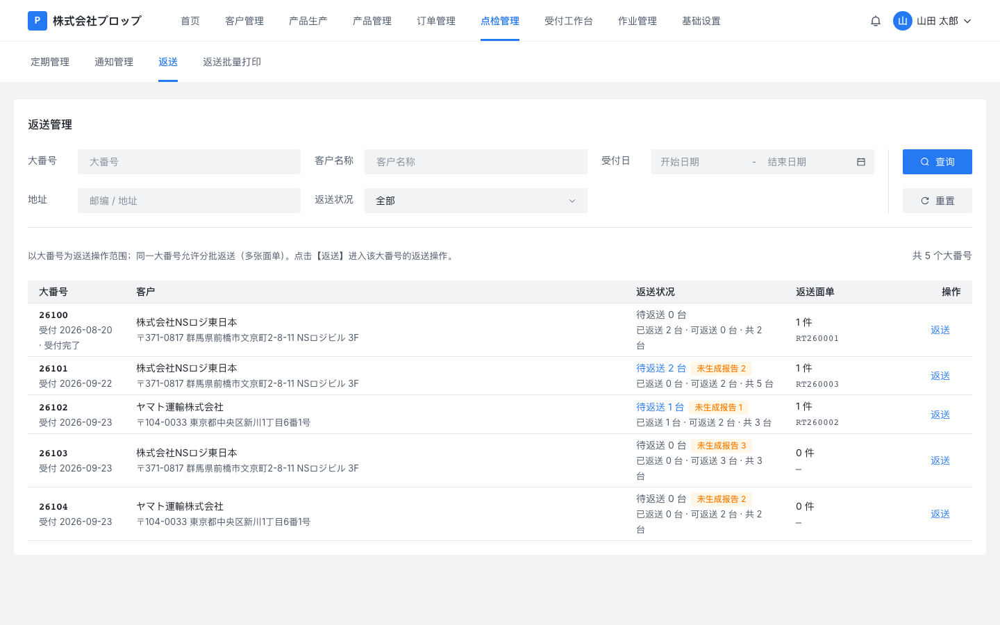
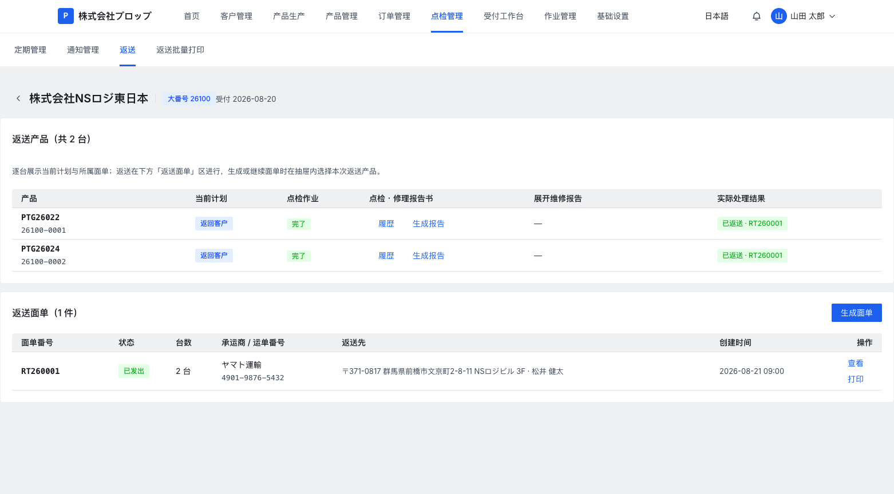
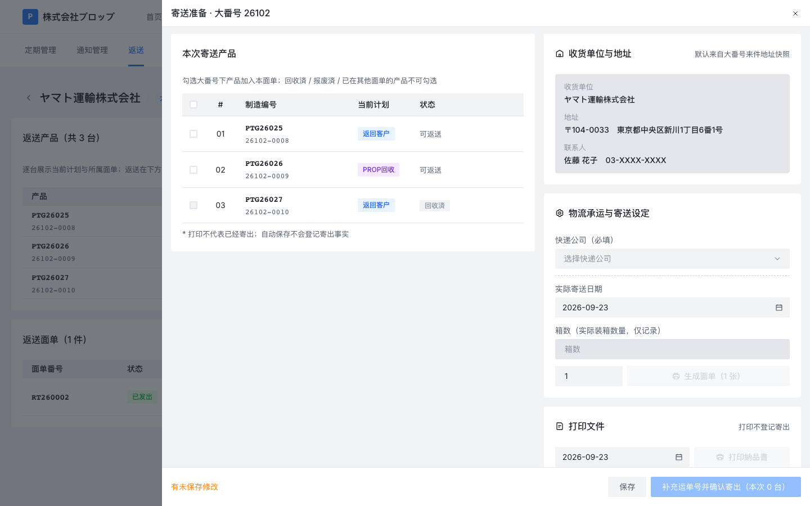
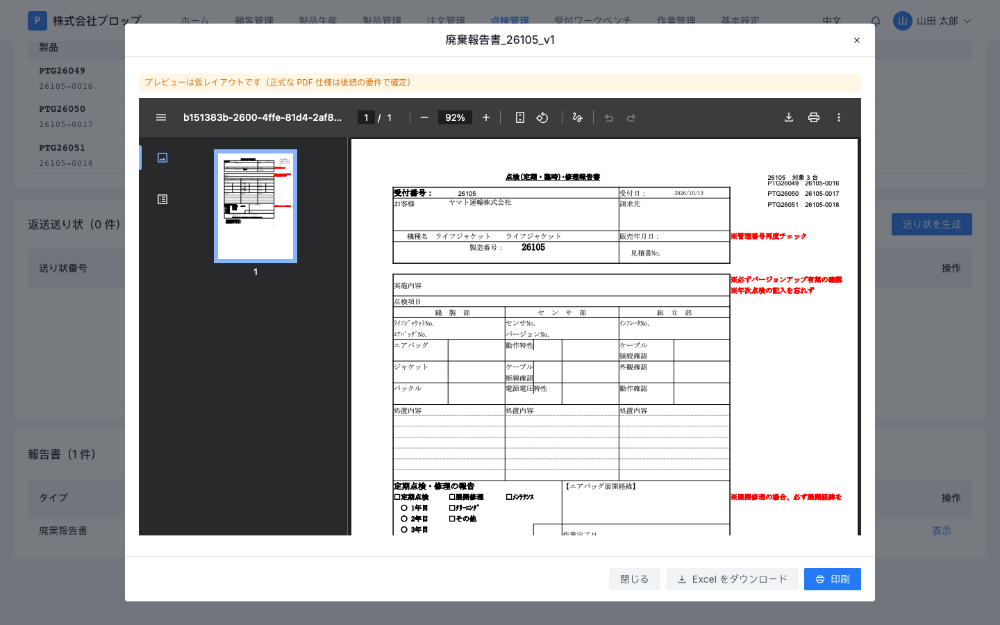

# FEAT-17 返送

> **2026-10-17入口裁决**：大番号回收／报废报告统一在作业管理大番号头部生成；历史查看也仅在作业管理，返送详情不提供这两类报告。大番号维度、候选、版本及删除规则不变。旧原型中的返送生成入口不再适用；本轮仅需求同步，未实现或运行验证。

> **需求定版（2026-10-11）**：本轮FEAT-14受付业务规则及FEAT-15～17关联条款已经用户确认定版。定版内容以当前正文为准；历史demo、讨论方案及撤回裁决不覆盖正文。本轮不进入开发；原有明确标注待定稿的报告／打印模板不在本次定版范围内。

> **2026-10-13报告规则已更新**：单台仅点检报告，任何计划下可生成；大番号回收／报废报告生成按FEAT-16 §5.9执行，返送详情不展示这两类报告，边界见FEAT-17 §5.8。删除边界以FEAT-14 §6.8／FEAT-15 §5.8为准，历史计划映射不再适用。

> **2026-10-15邮件裁决已同步**：正文维护、动态替换、商品名本次覆盖及历史冻结按§3.3／§6.5～6.7执行，取代旧制造编号清单、商品名后续沿用和正文内容完整性阻断方案。仅同步需求，不表示C-S2已实现、获编码授权或通过运行验收；报告／打印待定范围不变。

> **2026-10-16 单台点检报告关联更新**：返送详情复用[FEAT-16 §5.8](../FEAT-16-work/spec.md#58-单台点检报告内容与输出2026-10-16裁决)及[字段对照](../FEAT-16-work/inspection-report-fields.md)，单台PDF字段及A4纵向输出不再标为待正式需求。面单、納品書与大番号回收／报废报告模板继续单独确认；仅回写需求，不解除D整体实施延期。

> **2026-10-18返送納品書需求整理**：已确认字段与基础版式以§3.2.1、[字段对照](delivery-note-fields.md)、[模板采用说明](assets/reports/模板-受付返回納品書/README.md)及VAL-DN系列为准。管理番号清单每行4个製造番号，替代原件每行8个；原Excel只读保留。输出已确认HTML→PDF、不生成Excel；R5离线样式已获用户确认，实际自动分页仍待实施验证；首台对外名称缺失／清空留空不补源不阻断。本次只整理正式需求，不表示实现或验收通过；下文历史记录中的全部納品書字段待定状态由本次已确认范围替代。

> **2026-10-18返送面单逐项裁决**：字段、ヤマト12格／佐川16格及超出编号不显示规则按§3.2.2、[字段对照](waybill-fields.md)、两家模板README与VAL-WB系列。输出采用Excel，同一家快递公司一批一个工作簿、每张面单一个工作表，由客户在桌面Excel一次打印整个工作簿、人工逐张放纸；具体打印设置待定，型号／驱动不作为需求或开发阻断项。本次仅需求同步，未编码或验证打印。

**状态：Current Truth（納品書、单台点检及大番号回收按各自已确认规则；返送面单字段、格数及Excel批量输出已确认，具体打印设置待定；报废模板继续单独确认）**

> **写作纪律（2026-09-20 裁决）**：本文档只写业务事实和产品要求——页面为谁解决什么问题、展示什么信息、有什么操作、规则是什么。禁止写 mock 数据描述、代码字段名、技术词汇、代码实现细节；凡是「demo 恰好这么实现的」不写，凡是「业务上必须如此」才写。举例允许。字段命名规则写在对应数据模型文档，不在本文档。
>
> **历史页面如实纪律（2026-09-20；本次已裁决的文档修订不受“先改 demo”限制）**：本文档只如实描述 demo 页面现状，不得在文档层修改页面内容——包括省略、改名、"清理"页面实际存在的字段或文案。页面内容要改必须先走「裁决 → demo 修改 → 验证」，再回到本文档。

> **2026-09-25 原型适用边界**：本目录既有原型资产未更新。准备含已生成文件仍可删除，正式寄出后前后端均禁止删除，按 §6.5～6.7／§7.6 验收。 此前 demo 核对及测试结论仅作历史记录，不证明本次规则已验收。

## 1. 模块概述

返送模块处理点检完成后产品寄回客户的业务。PROP 现场以大番号为返送操作范围：员工在返送管理中按大番号找到要寄回的批次，为该批次开一张返送面单、勾选本次要寄的产品、选择承运信息，确认寄出后形成正式返送事实。同一大番号允许多次分批返送（多张面单）。

本模块维护的事实是**返送寄送**：一次实际寄送的一批受付产品、一个返送地址、承运与运单信息。返送只记录产品寄回客户这一结果，不建立、结束或修改任何订单关系，不增加订单交付数量，不决定作业或报告是否完成。跨大番号的集中打印面单在「FEAT-18 返送批量打印」，不在本模块。

```
受付（FEAT-14 受付工作台）／作业管理（FEAT-16 作业管理）提供受付产品与当前计划
        │
        ▼
返送管理（大番号列表）→ 返送详情（产品清单 + 面单列表）
        │                      │
        │                      ├─ 产品维度：生成／查看报告（与作业管理同一机制）
        │                      └─ 面单：生成面单 → 返送寄送抽屉（准备中）
        │                                │ 勾选产品 + 承运/日期/箱数
        │                                │ 打印面单・納品書（打印 ≠ 寄出）
        │                                ▼
        │                        补充运单号并确认寄出 → 正式返送事实（不可逆）
        │                                │
        ▼                                ▼
返送事实影响：首页待返送统计、受付/产品的返送历史；不影响订单关系与履约
```

## 2. 页面构成

| 页面 | 导航位置 | 主要作用 |
|---|---|---|
| 返送管理 | 点检管理「返送管理」 | 大番号列表，按批次进入返送操作 |
| 返送详情 | 返送管理行内进入 | 展示一个大番号的产品与面单，生成单台点检报告、生成面单 |
| 返送寄送抽屉 | 返送详情内打开 | 单笔返送的准备、打印、确认寄出与寄出后维护 |

## 3. 资料项目与规则

### 3.1 返送寄送

一张返送面单对应一次实际寄送：来源大番号下的一批受付产品、一个返送地址、承运与运单信息。返送地址在新建面单时取大番号来件地址，形成该笔寄送自己的地址快照；此后在返送页面只读展示、没有修改入口，也不随大番号来件地址的后续修改而变化。准备中可以反复修改产品与承运信息；确认寄出后产品清单冻结，其余属性仍可更正。

| 资料项目 | 必填 | 规则 |
|---|---:|---|
| 返送编号 | 是 | 系统生成，形态 RT[YY][NNNN]（RT＋年 2 位＋年内 4 位连番，年度重置）；每张面单一个号 |
| 来源大番号 | 是 | 建立时确定，不可更改；同一大番号可有多张面单（分批返送） |
| 本次寄送产品 | 是 | 该大番号下的有效受付产品，至少 1 台；确认寄出后冻结不可再改 |
| 返送地址 | 是 | 新建面单时取大番号来件地址（收货单位、邮编、地址、联系人、电话），形成该笔寄送的地址快照；此后在返送页面只读展示、没有修改入口，也不随大番号来件地址的后续修改而变化。返送前发现地址有误：准备中面单可删除后重建；已寄出的按线下订正处理 |
| 快递公司 | 确认寄出前必填 | 准备中可空；确认寄出前必须选择；确认寄出后仍可修改；取值 = 该笔寄送最近一次实际使用的快递公司，只有一个值、两个写入路径：抽屉内手动选择（准备中选择即随保存生效，已寄出后修改立即生效，下次打开显示最后生效值）；批量打印出单时写入（出单即视为使用该公司，同时把该笔寄送的快递公司改写为批量打印页所选公司，见 FEAT-18 返送批量打印） |
| 实际寄送日期 | 否 | 默认当天业务日期，可修改；确认寄出后仍可修改 |
| 箱数 | 否 | 仅记录实际装箱数量，不决定打印张数 |
| 运单号 | 否 | 选填、可多个；准备中可空，确认寄出时可补充，确认寄出后仍可补改 |
| 已生成文件 | 否 | 该笔寄送生成的面单、納品書；面单张数为复印份数（一次「生成面单（N 张）」只产生一个版本，N 张共用同一版本），納品書每次生成一个新版本；历史版本保留（详见 3.2） |

### 3.2 返送文件

| 资料项目 | 必填 | 规则 |
|---|---:|---|
| 文件类型 | 是 | 面单按快递公司模板输出Excel，字段、格数与批量工作簿按§3.2.2，具体打印设置待定；返送納品書字段与基础版式按§3.2.1 |
| 版本 | 是 | 同一笔寄送同一类型每生成一次版本号递增，旧版本保留、可继续打印；面单张数是复印份数，一次生成只产生一个面单版本，几张面单共用同一版本（不逐张产生版本） |
| 文件内容 | 是 | 生成当时采用的内容，之后寄送属性修改不影响已生成文件。面单按§3.2.2冻结并显示指定字段，不能因寄送另存运单号而新增原模板没有的运单展示栏；納品書按§3.2.1的字段及清单冻结，不因这份通用资料表另增客户邮编／地址、联系人、承运或运单展示栏 |
| 发行日期 | 是 | 生成时可指定，默认当天 |

打印是打印、寄出是寄出：生成或打印任何文件都不登记寄出事实，不产生产品占用，也不要求先确认寄出。

#### 3.2.1 返送納品書字段与基础版式（2026-10-18逐项确认）

正式依据为本节、[字段对照](delivery-note-fields.md)、[模板采用说明及原件](assets/reports/模板-受付返回納品書/README.md)与[VAL-DN验证清单](validation.md#val-dn-01-固定文字与两种编号待实施)。字段对照记录逐项来源、取值时点、编辑范围及冻结内容；客户原件仅作字段定位及版式基底，样例不是业务默认值。系统功能仍叫「返送納品書」，文档标题保留客户原文「内 容 明 細 書」，生成时不可编辑。

- **对象及两种编号**：一份納品書对应本笔返送及其包含产品，不取整个大番号的全部产品。原「登録番号」区域改取本笔独立返送编号，自动带出、只读；「受注番号」取本笔所属大番号，自动带出、只读，不取订单号。两种编号同时保留，不另编納品書流水号；不采用原件登记号或样例订单号。展示标签采用「返送番号」。
- **客户抬头与敬称**：公司名称及納品先名称只取本笔返送地址快照，允许本次补充、修改或清空，不回写业务资料；缺失留空，不补订单、大番号当前值、客户主档或其他来源，也不阻断生成。敬称保留「様」，不可编辑、不自动切换，放在客户抬头右侧上下居中。
- **PROP信息**：公司名、邮编、地址、TEL及FAX从业务字典读取，只读，不放在生成表单中编辑。生成时保留实际采用内容，之后字典修改不影响历史；缺失处留空，不补其他来源、不阻断生成。不因字典另有邮箱而增加原件没有的邮箱字段。
- **発送日**：默认取本笔返送已保存的寄送日期，允许本次修改或清空；仅保存在本次納品書，不回写寄送记录，缺失留空、不阻断生成。有值时按`YYYY 年 M 月 D 日`显示，不取文件生成当天或作业完成日替代。它与§3.2的发行日期及实际生成时间含义不同；本次不变更既有发行日期规则，也不因模板没有发行日期栏而擅加展示栏。
- **担当**：默认带出生成操作人的姓名，允许本次修改或清空，仅保存在本次納品書，留空不阻断生成，不回写用户或其他业务资料。
- **商品名称**：固定品名「ライフジャケット」不可编辑。后方统一名称按本笔包含产品的製造番号升序、产品ID辅助排序，取第一台产品当前保存的对外名称；允许本次修改或清空，仅保存在納品書，不回写产品；首台对外名称缺失或本次清空时留空、不补其他产品或来源、不阻断生成。不拆分／推导型号和颜色，不因不同名称分组列多条商品行；不取其他产品、订单或部件规格替代首台来源。
- **数量与单位**：数量为本笔返送包含产品总台数，自动计算、只读，不是全大番号台数，也不只计首台同名产品；单位固定「着」，不可编辑，不随名称或数量改变。
- **管理番号清单**：标题保留「管理番号」，自动带出本笔各产品的製造番号，只读，全部显示；按製造番号升序、产品ID辅助排序。每行4个，从左到右、从上到下，替代原件每行8个；不按小番号或返送录入顺序重排。生成时冻结完整编号及顺序，后续清单或产品资料变化不改写历史。
- **備考**：默认留空，生成时人工填写，支持多行或清空，不自动带入受付、作业、订单或其他备注；仅保存在本次納品書，不回写业务资料，留空不阻断生成。
- **采用内容、空值及版本**：所有本次补充或修改只进入本次文件；成功生成时冻结采用文字、日期、数量、完整产品清单及顺序，后续业务、用户姓名及字典变化不影响已生成版本。已确认可空的抬头、PROP、発送日、担当及備考缺失留空，不用样例或其他来源补齐。未裁决内容不擅加必填或生成门槛；真实读取／生成／保存失败不冒充空值或成功，不留下假成功版本。每笔返送每类型的既有版本及删除规则继续按§3.2／§6.5～6.7，不移植大番号回收报告的删除保护。
- **纸张、字体与长内容**：A4纵向，区域顺序为标题→客户抬头与PROP信息→発送日／受注番号／担当→商品信息→管理番号清单→備考。采用Noto日文字体，字号及粗细参照当前原Excel，详细对照见字段文档。长抬头、名称、编号、地址及多行備考通过换行、增高或续页完整容纳，不缩小字号硬塞，不截断内容或限制为原件槽位数量。

2026-10-18用户确认当前离线PDF版式：管理番号标题四字竖排、编号每行4个；商品区与编号区内部竖线连续对齐，保留普通稿六行基本编号空间及适度纵向留白；「様」在客户抬头右侧上下居中并按确认稿向左微调，独立编号展示标签为「返送番号」。续页保留标题与返送编号、页脚居中页码，编号区域续页保留侧标题，PROP及商品汇总不逐页重复。长内容按前述完整显示规则处理；离线分页面研究稿的样式确认不等于生产自动分页已经验证。不得自动套用回收报告的双栏或固定文字。首台对外名称缺失／本次清空留空、不补其他来源、不阻断的裁决同步本节及字段对照。**输出形态已确认：统一采用既有HTML→PDF，提供PDF预览、下载及打印，不生成Excel。原Excel仅为字段与版式参考材料。** 当前样式已经用户确认；实际生成、自动分页、下载及打印运行验证仍待实施和另行授权。需求保存采用与回收报告相同的“正文＋字段对照＋附件README＋验证清单”组织，不预先指定文件持久化或渲染技术方案。

#### 3.2.2 返送快递面单字段与Excel输出（2026-10-18逐项确认）

正式依据为本节、[字段对照](waybill-fields.md)、[ヤマト采用说明及原件](assets/reports/模板-快递面单-ヤマト送り状/README.md)、[佐川采用说明及原件](assets/reports/模板-快递面单-佐川送り状/README.md)与[VAL-WB验证清单](validation.md#val-wb-01-地址快照与本次编辑待实施)。原件及客户字段核对Excel只读保留，样例及旧订单查找说明不作为现行业务规则。

- **对象与地址**：一份面单对应本笔返送包含的产品。邮编、住所1、住所2、会社名、現場名・支店名、担当者及電話番号，只取本笔返送已保存地址快照的对应内容。住所1取地址主行、住所2取补充行，分别输出、不拼接；会社名与納品先名称分别输出、不拼接；担当者取地址联系人，不取生成操作人；电话保留保存格式。
- **本次补充与空值**：上述地址七项可在生成时补充、修改或清空，只进入本次面单，不回写返送地址或其他业务资料。缺失留空，不补当前大番号、订单、客户主档或其他来源，不阻断生成；这不改变返送地址卡只读及准备保存的原有规则。
- **品名、名称、数量及单位**：品名固定客户原文「ライフジャケット」、单位固定「着」，不可编辑。型号／颜色区域按本笔产品的製造番号升序、产品ID辅助排序，取首台产品当前对外名称，不另拼型号或颜色、不从订单取值；允许本次修改或清空。首台缺失留空，不跳取其他产品、不补源、不阻断。数量为本笔返送全部产品总台数，自动计算、只读，不取全大番号数量、箱数或打印份数。
- **製造番号**：取本笔全部产品，按製造番号升序、产品ID辅助排序，自动带出、只读。ヤマト显示前12个（3行×4格），佐川显示前16个（4行×4格），均先左到右再上到下；超出编号不显示，不为补齐超出编号自动续页、增加面单或附件，数量仍显示全部产品总台数。生成时冻结全部编号、产品身份及顺序，不仅冻结显示前缀。
- **编号区域**：取本笔所属大番号，系统自动带出、只读并冻结；不取独立RT返送编号、订单号或另设面单业务编号。ヤマト大番号输出在原小框N10:O10，位置不变；删除右上方Q2:T4大字框及其内容，不作第二处重复输出（2026-10-19确认）。客户原Excel只读保留，以上为输出模板采用规则；其他纸面设置仍待确认。
- **佐川独有字段**：出荷日默认取本笔已保存寄送日期，允许修改或清空，缺失留空、不补其他日期；箱数默认取本笔已保存箱数，允许修改或清空，缺失不自动填1，不混产品台数或打印份数；配送时段默认空，生成时可选AM、PM或空。均仅进入本次面单、不回写、不增加返送属性，留空不阻断。不为统一字段给ヤマト新增对应打印内容；出荷日显示格式尚待确认。
- **采用内容与版本**：成功生成时冻结完整采用内容及空值、日期、箱数、配送时段、总数量、归属及完整产品顺序，之后业务变化不改历史。真实读取、生成或保存失败不能当作空值成功，不留下假成功版本。沿用§3.2及§6.5～6.7的版本／历史／合法删除规则，不移植大番号回收报告永久保护；本节不改变发行日期规则或擅加发行日期打印栏。
- **输出与复印**：采用原Excel模板填值后下载，不生成面单PDF。同一家快递公司的批量面单生成一个Excel工作簿，每张实际面单一个工作表；本笔N张复印对应N个工作表且共用同一个业务版本，不逐Sheet计版。多笔合在工作簿不合并寄送对象，批量业务仍按[FEAT-18](../FEAT-18-return-batch-print/spec.md)执行。客户在桌面版Excel一次打印整个工作簿，不必逐个打开文件；打印预览在桌面Excel进行，不套用PDF弹窗或新增本地打印服务。
- **预印纸与待定设置**：两家使用快递公司预印面单纸，系统只在对应位置打印文字，不重印预印框线、标签或背景。人工逐张放纸，不增加自动连续进纸控制。单张纸尺寸、打印区域、方向、缩放、页边距、起印位置／偏移、字号及长内容在固定纸面内的处理待确认，不预设A4、100%或报告类的增高续页。客户后续补充纸张尺寸；型号与驱动不作为需求确认或开发阻断项，不绑定固定设备，后续实纸核对当时可用设备及Excel设置、按需校准。

上述裁决替代面单“字段全部待定”、PDF输出建议及统一弹PDF预览的旧安排；原Excel字段核对表中的订单来源、ヤマト10格及佐川明细范围旧说明，按字段对照及采用README标注替代，不改原件。仅同步需求，不表示已完成Excel生成、批量打印或实纸验证，也不授权实施其他D范围。

### 3.3 寄送通知邮件

| 资料项目 | 必填 | 规则 |
|---|---:|---|
| 邮件正文 | — | 每次读取当前已保存模板生成并保存正文全文与生成时间，历史版本不覆盖。确认寄出时与寄出事实同一事务生成并保存第一份正文；此后在运单号维护中点「生成邮件正文」生成新版本。查看与复制读取该版本已保存全文，不按当前模板重算旧正文，不提供现算后直接复制的旁路。正文只供查看／复制，不生成PDF、附件或自动投递 |

**模板维护与初始内容**：现有系统管理员在「系统管理→参数设置」维护一条当前纯文本模板，保存后新生成采用新内容，无需重新部署；参数维护沿现有权限、非空及长度限制，不修改公共参数入口、不增加全空保存特例。普通返送页面权不赋予模板维护权。PDF「ライフジャケット発送のご案内」仅为初始正文载体：客户抬头取本返送冻结来件地址快照的公司／联系人；显示商品名、台数、発送日、承运及运单，不列制造编号清单。初始模板删除网站表单引言三句及自动发送尾句；保留「大変お待たせして申し訳ございませんでした。」「本日出荷させていただきます。」作为普通固定文案，不按日期改写。配送先初值为「貴社指定場所」，納品予定日及添付資料初始为空标签，不产生附件；预计送达日不提供系统字段或编辑能力，员工复制后可在外部邮件自行补充。以上均为初始内容，管理员可自由改删变量、行及文字，不要求保持完整。

**支持的动态替换**（全部选用，不要求任意变量出现）：

| 占位符 | 取值 |
|---|---|
| `{{addressee}}` | 本返送冻结来件快照的公司、联系人；联系人有值时单独一行「姓名 様」，空时留空，不补称谓或当前主档 |
| `{{productName}}` | 每次实际新生成读取本次清单首台返送产品当前的对外产品名称；确认弹窗修改仅覆盖本次生成，下次重新读默认，不沿用改名、不回写产品或订单 |
| `{{quantity}}` | 本次冻结受付清单的台数，不取箱数或运单数 |
| `{{shipDateText}}` | 该笔返送已保存寄送日期，按YYYY-MM-DD输出；空则留空，不补当天或确认时间 |
| `{{carrierName}}` | 该笔返送当时已保存承运公司的显示名称 |
| `{{trackingNumbersBlock}}` | 已保存运单存在时为「【送り状番号】」及按保存顺序逐行列出的全部单号；无则为空 |

每个合法变量可重复，各处使用本次同一值；字段缺值直接输出空白。未知或残缺占位符原样作为普通文字保留，不执行表达式／脚本，不再次解析插入值，不增加专门警告或修复流程。删除任意变量／行、缺字段、空值或正文不完整，不阻断生成与寄出；如已取得的模板值为空白，也实际生成并保存该空白正文，不伪造默认文案。参数维护不要求额外支持保存完全空白模板，与生成端不做内容质量校验分开。

**执行与内容质量分开**：确认寄出仍须真实完成正文生成及保存；配置无法取得、技术读取／生成／保存失败不能冒称成功，确认与第一份正文一起回滚。寄出后的独立新生成失败仅影响本次生成，不撤销既有寄出或旧正文。返送资格、承运必选等原业务校验保持，不借邮件完整性名义新增门槛。已保存空正文仍能按对应版本查看生成时间及复制，不把空内容当作记录不存在。

**版本保留的适用范围**：文件及邮件已生成版本不被后续生成覆盖；准备记录删除时其全部所属版本一并删除，不保留该准备业务历史。正式寄出后不得删除记录，所属版本继续保留。

## 4. 返送管理

### 4.1 页面作用

让员工按大番号找到需要返送的批次，看到每个批次的待返送、已返送、可返送数量，进入对应批次的返送操作。

### 4.2 页面入口与去向

- 入口：点检管理「返送管理」。
- 去向：行内「返送」→ 该大番号的返送详情。

### 4.3 页面布局



```
┌ 返送管理 ─────────────────────────────────────┐
│ 筛选区：大番号 / 客户名称 / 受付日 / 地址 / 返送状况 [查询] [重置] │
├──────────────────────────────────────────┤
│ 说明行（以大番号为返送操作范围；允许分批返送）      共 N 个大番号 │
│ 大番号 │ 客户 │ 返送状况 │ 返送面单 │ 操作                  │
└──────────────────────────────────────────┘
```

### 4.4 展示信息

- 大番号：批次编号（等宽加粗）；下排受付日期，不附受付完成标记。
- 客户：客户名称；下排大番号来件邮编与地址。
- 返送状况：第一行「待返送 N 台」（有待返送时醒目色）；有可返送但尚未生成报告的产品时附「未生成报告 N」标签；第二行「已返送 N 台 · 可返送 N 台 · 共 N 台」。
- 返送面单：面单件数；下排最新一张面单的返送编号，无则「—」。
- 行排序：受付日期最早的批次排最前（最久未处理完优先）。

### 4.5 功能

- 筛选：大番号、客户名称、地址（邮编／地址）为部分匹配；受付日为日期范围；返送状况为 全部／有待返送／暂无待返送。查询或按 Enter 生效；重置清空全部条件。
- 点击行内「返送」→ 进入该大番号的返送详情。

### 4.6 校验与反馈

无录入项；筛选无结果时提示「没有符合条件的大番号」。

### 4.7 页面产生的数据

无（纯查询入口页）。

## 5. 返送详情

### 5.1 页面作用

一个大番号的返送工作页：逐台看到产品的当前计划、点检作业完成情况、报告与所属面单；生成／查看单台点检报告；维护该批次的全部返送面单。

### 5.2 页面入口与去向

- 入口：返送管理行内「返送」。
- 去向：报告生成弹窗／报告预览（与作业管理同一机制）；返送寄送抽屉（新建或继续面单、查看已发出面单）；返回返送管理。

### 5.3 页面布局







该旧图仅保留为单台点检报告预览结构参考；其中报废标题、批次报告列表背景及临时内容不适用，不据此恢复返送的大番号报告功能。具体字段／输出沿FEAT-16 §5.8。

```
┌ ← 客户名称（大番号 N · 受付日期）─────────────┐
│ 卡片：返送产品（共 N 台）                                    │
│   产品 │ 当前计划 │ 点检作业 │ 点检・修理报告书 │ 展开维修报告 │ 实际处理结果 │
│ 卡片：返送面单（N 件）                          [生成面单]    │
│   面单番号 │ 状态 │ 台数 │ 承运商/运单番号 │ 返送先 │ 创建时间 │ 操作 │
└──────────────────────────────────────────────┘
```

页面区域顺序为页头（不含大番号报告生成入口）→返送产品卡→返送面单卡。报告弹窗与既有截图的适用差异见[截图说明](assets/README.md)。

### 5.4 展示信息

**页头**：不提供回收／报废报告生成及历史入口，边界见§5.8。客户名称（未确认客户时显示「客户后补」）、大番号标签、受付日期，不显示受付完成标记。

**返送产品卡**（默认展示该大番号下全部有效受付产品，按小番号排序；只读，选择产品在面单抽屉内进行）：

- 产品：製造番号（等宽加粗）；下排受付番号连写（大番号-小番号4位）。
- 当前计划：返回客户／PROP回收／报废标签；未定显示「未定」。
- 点检作业：返回客户的产品显示 完了／作業中（与作业管理同一完成口径）；报废产品已确认显示「廃棄済」、未确认显示「—」；回收产品已确认显示「回収済」、未确认显示「—」。
- 点检・修理报告书：固定「履歴」＋「生成报告」（单台点检报告），任何计划含空计划下均可生成；回收／报废计划在生成弹窗顶部提示。履歴只列本台点检报告版本，操作仅查看，下载／打印在预览内。
- 展开维修报告：该台作业管理登记的展开维修报告存放路径，无则「—」。
- 实际处理结果：报废済／回收済／已返送（附返送编号）／面单准备中（附返送编号）／未返送。已返送后又确认报废时，同一产品行同时显示「已返送（附返送编号）」和「已报废」（日文界面沿用「廃棄済」），不得以报废标签覆盖或隐藏返送信息；两项表示先后发生且并存的事实。

**返送面单卡**：面单番号、状态（准备中／已发出）、台数、承运商与运单番号、返送先（邮编＋地址＋联系人）、创建时间；操作——准备中为「继续返送」，已发出仅为「查看」。详情「返送送り状」区域不提供独立「印刷／打印」按钮；文件生成、历史下载及预览仍在抽屉内。

### 5.5 功能

- 产品行「生成报告」生成新的单台点检报告，规则与作业管理一致，不按处理计划切换类型；「履歴」查看本台点检版本。字段来源、报告内补充／修改、起始状态与最新保存值比较、所有内容缺项不阻断、冻结及重新生成不继承等规则，统一见[FEAT-16 §5.8](../FEAT-16-work/spec.md#58-单台点检报告内容与输出2026-10-16裁决)及其字段对照；不因返送入口另建字段或版本序列。
- 履歴中查看选定版本：预览该台所选点检报告版本，下载／打印在预览内提供。
- 「生成面单」：打开返送寄送抽屉（新建态）；抽屉内的首次保存、生成文件或确认寄出才会正式建立准备中面单并取得返送编号。
- 「继续返送」：打开准备中面单的抽屉继续编辑。
- 「查看」：打开已发出面单的抽屉（产品清单只读，属性可更正）。
- 详情面单表不提供「印刷／打印」操作。经「查看／继续返送」进入抽屉，使用有效的文件生成、历史下载及预览入口；不删除实际文件能力。

### 5.6 校验与反馈

- 大番号不存在时提示「大番号不存在或已删除」，提供返回返送管理入口。
- 单台点检报告生成规则与作业管理一致（不受计划限制、每次生成新版本、不锁定作业记录）；大番号回收／报废报告不在本页展示或生成。

### 5.7 页面产生的数据

- 产品行生成点检报告 → 对应单台受付新增不可变点检报告版本，不产生返送或实际处理事实；本页不产生大番号回收／报废报告版本。

### 5.8 大番号回收／报废报告的页面边界

- 大番号回收／报废报告的生成、历史查看及预览统一归[FEAT-16作业管理§5.9](../FEAT-16-work/spec.md#59-大番号回收报废报告2026-10-17入口调整)，返送详情不提供这两类报告的按钮、弹窗或历史列表。
- 产品行单台点检报告的「履歴＋生成报告」、预览／下载／打印保持；展开维修目录、面单、納品書及邮件功能保持，不合并成大番号报告列表。
- 仅调整页面职责，不删除已有报告或改变其大番号归属、候选、版本冻结及删除保护规则；删除仍按FEAT-14 §6.8／FEAT-15 §5.8执行。

## 6. 返送寄送抽屉

### 6.1 页面作用

处理一张返送面单的完整生命周期：勾选本次寄送产品、维护承运信息、打印面单与納品書、补充运单号并确认寄出；确认寄出后更正寄送属性、维护运单号与邮件。

### 6.2 页面入口与去向

- 入口：返送详情「生成面单」（新建）／「继续返送」（准备中）／「查看」（已发出）。
- 去向：确认寄出弹窗；文件预览（面单／納品書）；关闭后返回返送详情并刷新。

### 6.3 页面布局

```
┌ 寄送准备／寄送详情 · 大番号 N · 返送编号 ──────────────────┐
│ 左栏                              │ 右栏                     │
│  本次寄送产品（勾选表／已确认只读表）  │  收货单位与地址（该笔寄送的地址快照，只读）│
│  [已有准备] 已生成文件             │  物流承运与寄送设定         │
│   面单 / 納品書 / [已确认时] 邮件 │   快递公司・寄送日期・箱数・生成面单 │
│                                   │  打印文件（日期＋打印納品書）   │
│                                   │  [已确认时] 运单号维护        │
├───────────────────────────────────┴─────────────────────┤
│ 状态说明                    [删除] [保存] [补充运单号并确认寄出（本次 N 台）] │
└──────────────────────────────────────────────────────┘
```

### 6.4 展示信息

**标题**：准备中为「寄送准备 · 大番号 N」、已确认寄出为「寄送详情 · 大番号 N · 返送编号」。

**本次寄送产品卡**：

- 准备中：展示该大番号下全部有效受付产品（#、製造番号、受付番号、当前计划、状态），可勾选；报废済／回收済／已在其他面单的产品不可勾选，状态列标签说明原因（附日期或面单号）。
- 已确认寄出：只读展示本次产品清单（#、製造番号、受付番号、当前计划），附「已确认寄出」标签。
- 本次包含计划为「PROP回收／报废」的产品时，顶部提示「本次面单包含 N 台当前计划为「PROP回收 / 报废」的产品。面单只是寄送记录，允许混装；请确认实物装运无误」（不改变这些产品的计划）。
- 准备中底部说明：「打印不代表已经寄出；保存准备不会登记寄出事实」。

**收货单位与地址卡**：只读展示四组「会社名」「納品先」「住所」「担当者・電話番号」。住所合并展示邮编、住所1、住所2；担当者与电话同组，长内容自然换行。七项底层内容各自保留，缺项不逐项重复显示「—」，整组全空才显示一个「—」。納品先只称納品先，来自来源大番号来件信息的納品先，建立返送时复制入本笔快照；不解释为支店，不关联、推导或补取订单／客户主档的支店。抽屉没有地址修改入口，文件仍按各自规则取七项独立快照内容。

**物流承运与寄送设定卡**：快递公司下拉（必填提示）、实际寄送日期（默认当天）、箱数（仅记录）、「生成面单（N 张）」按钮（张数由左侧数字输入指定，默认 1）。

**打印文件卡**：发行日期（默认当天）＋「打印納品書」；说明「打印不登记寄出」。納品書字段及基础版式按§3.2.1，本次可编辑内容不反写寄送；発送日不等同发行日期。输出统一采用HTML→PDF；具体字段编辑交互沿后续页面蓝图、PDF样式采用2026-10-18已确认稿，不改变本笔返送地址卡的只读规则。

**已生成文件卡**：已保存准备及已确认寄出均可查看面单、納品書的真实历史；寄送通知邮件仅在确认寄出后显示。三类文件合并为一张完整列表，以名称／类型区分，保留各类型独立版本号、生成时间及读取操作。按生成时间倒序，同一时间按文件记录的稳定次序倒序；统一每页10条，总数包含全部真实记录，不能只合并各类型第一页。面单下载原版本Excel，納品書沿既有PDF预览／下载，邮件查看冻结正文并可复制。历史行只读取已有版本，不提供「新しい版を生成／继续打印」；新生成仅从右侧面单、納品書及邮件入口发起。

**运单号维护卡（确认寄出后）**：运单号逐行输入、追加／删除单号、「生成邮件正文」「保存单号」（有改动才可保存）；说明「保存单号后，可生成新的邮件版本」。多个单号保存后，重新打开抽屉仍按多个独立行显示。

**底部状态**：准备中按实际状态显示「尚未建立准备／准备已保存／有未保存修改」；已确认显示「已确认寄出 · 日期（寄送事实已登记，产品清单不变；寄送内容可修改）」。

### 6.5 功能

**准备中**

- 勾选产品、修改承运信息（快递公司／寄送日期／箱数／运单号）→ 内容自动保留在抽屉内；「保存」写入该面单（准备中，不登记寄出）。
- 「生成面单（N 张）」→ 按§3.2.2采用本次字段并生成一个面单文件版本（N 张为复印份数，共用同一版本；提示「面单已生成（N 张，同一版本复印）」），下载包含N个面单工作表的Excel工作簿，由客户在桌面Excel预览及打印；要求至少 1 台产品；打印不登记寄出。
- 「打印納品書」→ 按发行日期生成納品書（新版本），弹出预览。
- 「删除」→ 二次确认「删除后不可恢复，是否确认删除？」后删除该准备记录、所属产品清单关联及全部所属文件和邮件版本；取消不改变数据。已生成或打印文件不阻断准备删除。
- 「补充运单号并确认寄出（本次 N 台）」→ 打开确认寄出弹窗。

**确认寄出弹窗**

- 展示说明「确认表示本次 N 台产品已经实际寄出。确认后产品清单冻结，不改变订单关系；快递公司、寄送日期与运单号仍可修改。」
- 本次包含计划非「返送」的产品时提示：确认返送后计划保持不变，如需调整请在受付工作台中修改。
- 显示已选快递公司（未选则提示先选择，不得确认）；运单号选填、可添加多个。
- 商品名称选填，默认本次清单首台返送产品当前对外名称，首台名称空则留空、不跳取其他产品；本次可修改或清空，仅用于本次生成，不作为返送属性保存供后续沿用。取消不保存本次名称或运单草稿；未修改名称时生成重新取默认。
- 「确认寄出并生成邮件（N 台）」→ 同一事务登记寄出事实（不可逆）并实际生成／保存正文，成功后关闭弹窗；抽屉切换为寄送详情态，正文在「已生成文件」卡查看与复制。正文内容质量不阻断，实际执行失败按§3.3处理。

**确认寄出后**

- 产品清单冻结只读；快递公司、实际寄送日期、箱数修改即保存（记最后修改人／时间）；邮件不因属性修改自动变化，需点「生成邮件正文」产生新版本。
- 运单号维护：追加／修改／删除单号后「保存单号」保存（有改动才可保存）；「生成邮件正文」取当前模板、已保存寄送信息及重新读取的首台产品当前默认名称，生成一个新版本并打开查看，不沿用确认时改名。
- 已生成文件：统一历史列表只读；面单下载原Excel在桌面Excel打印，納品書沿原版本PDF预览，邮件查看冻结正文并复制。新版本统一从右侧相应生成入口进入，不由历史查看／下载隐式生成。

### 6.6 校验与反馈

- 面单内至少需要 1 台产品；不足时保存被阻断并提示（如不再寄出请使用删除）。
- 新建面单时取大番号来件地址形成地址快照；大番号无来件地址时保存被阻断并提示（先在受付侧补来件地址）。
- 确认寄出弹窗：快递公司未选择不得确认；运单号重复时提示合并。
- 确认寄出时重新检查当前已选产品的返送资格，不能只依赖加入面单时的检查。若准备期间任一产品已确认回收／报废或不再满足§7.1条件，列出对应产品及原因，阻止整笔确认寄出；不产生寄出事实或寄出邮件，不自动移除产品、删除面单或拆分寄出。员工在准备中面单手动移除不合格产品并保存后，方可重新确认；若移除后无产品，则按已有规则删除准备记录，不保存空面单。单纯改变计划不影响未实际处理产品的混装资格。
- 勾选产品所在的其他面单、报废済、回收済状态在状态列直接说明，不可勾选。
- 删除仅适用于准备中记录；正式确认寄出后界面和服务端均禁止删除。

- 确认寄出为不可逆动作，弹窗内明确说明后果。
- 邮件只做§3.3支持的动态替换，不做正文完整性／必填检查；未知／残缺文字或空白内容不产生专门警告。实际生成或保存失败反馈本次未完成，不显示确认／生成成功。

### 6.7 页面产生的数据

- 保存（准备中）→ 建立或更新该返送寄送的当前内容（产品勾选、承运、日期、箱数；地址快照随面单建立时确定）；不登记寄出事实。
- 生成面单 → 一次「生成面单（N 张）」只产生一个面单版本（N 张为复印份数，共用该版本，版本号连续、历史保留）；打印納品書 → 每次新增一个納品書版本。如面单尚未建立（新建抽屉首次操作），生成文件前会先建立准备中寄送并保存产品清单；打印不登记寄出。
- 确认寄出 → 建立正式返送事实：该批受付产品已返送（计入批次已返送数量）、运单号与承运信息确定；同一事务实际生成并保存第一份邮件正文（v1），真实执行失败整次不成立，正文内容不完整不作为失败条件；不可逆，旧记录全部保留。
- 删除准备中面单 → 删除该准备记录、所属产品清单关联、全部所属文件版本与邮件版本，该准备及其版本不保留为业务历史；其中产品解除该准备占用并按 §7.1 恢复可勾选状态；无论是否已生成或打印文件均可删除。不删除产品档案、受付、作业、报告或其他业务记录，不改变已经发生的正式履约事实。
- 确认后属性修改 → 更新该笔寄送的快递公司／寄送日期／箱数／运单号（记最后修改人／时间），不保存修改历史。
- 生成邮件正文 → 该笔寄送新增一个邮件版本（冻结本次当前模板与字段生成的正文及生成时间，历史保留）；商品名本次覆盖不延续到下一次，产品名称变化不改旧正文；删除准备中面单时其邮件版本一并移除。
- 本抽屉不产生：订单履约变化、报告版本（单台点检在作业管理或返送详情产品行生成，大番号回收／报废仅在作业管理大番号头部生成）、作业记录变化。

## 7. 跨页面统一规则

### 7.1 返送资格（谁能进入面单）

受付产品同时满足以下条件才可勾选进入返送面单：

- 未确认报废、未确认回收；
- 未在任何已确认寄出的面单中（已实际返送的永久退出普通返送候选）；
- 未在其他准备中面单中（一台产品同一时间只在一张面单里）。

当前计划为「PROP回收／报废」但尚未正式执行的产品仍可勾选——面单只是寄送记录，允许混装，勾选不改变其计划。

### 7.2 返送与订单严格分离

返送只维护本次受付产品的寄送结果：不建立、结束或修改任何订单关系，不增加订单交付数量，不决定作业或报告完成。客户再次寄回时需要新一轮点检的，建立新的受付，不能用同一次受付的重复返送代替新的来件登记。

### 7.3 待返送口径

- 待返送＝当前计划为「返回客户」且本条受付未确认回收、未确认报废、未实际返送（不在任何已确认寄出面单中）的受付产品；只反映业务事实，不反映员工勾选过程（准备中面单不影响待返送数量）。
- 批次已返送数量按已确认寄出面单内的不同受付产品计数：已实际返送的受付产品永久退出返送候选（见 7.1），不会被再次寄送，计数自然等于各批不同受付产品的合计。

后续确认报废不扣减本条受付已计入的批次已返送数量，不恢复返送候选资格。

### 7.4 打印与寄出分离

生成或打印面单、納品書不是确认寄出的必要条件，也不登记寄出事实；没有系统文件同样可以确认寄出。实际寄送日期不等于文件生成日期。

### 7.5 快递公司唯一语义

一笔寄送的快递公司 = 该笔寄送最近一次实际使用的快递公司，只有一个值、两个写入路径：抽屉内选择；或批量打印出单时写入（见 FEAT-18 返送批量打印）。面单上印的快递公司与系统记录始终一致。

### 7.6 确认寄出冻结边界

确认寄出只冻结产品清单；快递公司、实际寄送日期、箱数、运单号确认后仍可更正（记最后修改人／时间）。返送地址为该笔寄送建立时的地址快照，返送页面不提供修改入口。已确认寄出不允许删除，界面不提供入口，服务端拒绝删除请求；不新增作废、取消或恢复流程。已确认寄出不提供撤回——登记错误走线下订正，不在系统内撤销。

正式返送与后续报废事实可以并存。已返送的原受付在当前计划为报废且尚未确认回收／报废时，可由FEAT-16首次确认报废，无需再次实物返厂或新建受付。该报废动作不撤销返送、不删除或改写运单、納品書及历史文件，也不改变原返送清单；既有寄出后承运信息维护权限不受影响。详情按§5.4同时显示已返送和已报废。

方向有别：先确认报废再尝试寄出，仍按§7.1及§6.6阻止；先正式返送再首次确认报废，允许。本条不扩展返送后回收规则，也不将线上报废确认表述为已经核实线下销毁。

### 7.7 编号与显示

- 返送编号形态 RT[YY][NNNN]，按年度连番。
- 受付番号显示为「大番号-小番号4位」连写。

## 8. Feature 边界与明确不做

**本模块负责**：返送批次查找、单笔返送的准备／打印／确认寄出／寄出后维护、返送文件版本、寄送通知邮件、返送详情的单台点检报告入口。

**其他模块负责**：大番号回收／报废报告生成及历史查看（FEAT-16 §5.9）；单台点检报告的共享规则（FEAT-16 §5.8及字段对照，2026-10-16已确认，待实施验证）；跨大番号集中打印面单（FEAT-18 返送批量打印）；回收／报废事实（FEAT-16 作业管理）；订单出货寄送（FEAT-11 寄送）。

**明确不做**：

- 人工「关注／不再关注」返送标记与按关注状态分流。
- 已确认寄出的撤回或作废。
- 按产品分配不同返送地址（同一次返送共用一个地址）。
- 返送确认时自动修正或变更产品当前计划。
- 返送产生订单履约或建立产品订单关联。
- 「批次仍有未处理产品」的催办提醒与返送阻断。
- 物流丢件补寄的系统记录（线下特殊处理）。
- 一次操作批量生成多份单台点检报告。大番号回收／报废报告勾选多台汇总为一份，在作业管理按FEAT-16 §5.9执行，不属于此禁项。
- 面单作为确认寄出的前置条件。

## 9. 核对记录

- 2026-09-23：按二级导航粒度自 13-返送 拆分为本 feature（FEAT-17）；内容不变，章节与交叉引用已重编号。
- 2026-09-23：拆分完整性核对后补回状态行限定「面单与納品書的版式、报告 PDF 内容标注「目标稿（待转正）」」（拆分前旧稿状态行原有，拆分时丢失）。

- 核对日期：2026-09-22，已与当前演示页面逐区块核对一致：返送管理列表（筛选／返送状况／面单数）、返送详情（产品表六列／面单表／报告入口）、返送寄送抽屉（准备中与已确认两态、确认寄出弹窗、已生成文件卡、运单号维护卡）。
- 裁决来源：V2.1/修改记录.md §11～§15（返送准备、提醒与地址、一次寄送）、§22.5（返送灵活性与计数）、§24.8～§24.12（交互定版与批量打印拆分）、§24.16～§24.20（关注规则撤去、receptionId 关联、仓储校验、文案统一）、「返送环节提供报告生成」「批量打印快递公司与寄送记录统一」「编号规则定稿」。
- 2026-09-22 修复：返送批量打印出单未回写快递公司（§2336 裁决在返送侧的缺口），已在撰写本文档前补齐页面并追加修改记录；本 spec §7.5 按修复后行为撰写。
- 面单、納品書的版式与字段内容为「目标稿（待转正）」，待正式需求；邮件正文已按2026-10-15用户裁决同步§3.3，不再列为整套文案待确认。
- 历史记录（2026-09-22）：当时已确认寄出的「打印」按钮仅为简单提示；2026-10-23裁决取消该详情表按钮，取代原待对齐安排。
- 2026-09-22 独立审查修订：返送地址改为只读展示大番号来件地址（页面本不提供修改入口，先前误写「本次可修改」）；确认寄出后邮件在已生成文件卡取得；批次已返送计数改为「按不同受付产品合计」表述；删除准备中面单不受是否已生成文件限制（与当前页面实现一致）。
- 2026-09-22 对齐订单侧：寄送通知邮件版本化（每次生成冻结正文与时间、历史保留、查看弹窗内复制、删除面单级联清理）；运单号维护与订单侧同一逻辑（确认弹窗补充的运单号与抽屉运单号维护为同一份数据）。
- 2026-09-22 二次独立审查修订：地址统一为该笔寄送的地址快照（新建时取大番号来件地址，此后只读、不随受付侧修改变化）；确认弹窗文案删去「地址仍可修改」（页面同步修订）；「生成面单」按钮语义澄清为打开新建抽屉（首次保存／生成文件／确认寄出时才建立面单）；运单号维护卡说明改为「保存单号后，可生成新的邮件版本」（页面同步修订）；多个运单号重开抽屉按独立行恢复（页面同步修订）；混装提示文案统一为「PROP回收 / 报废」（页面同步修订）。
- 2026-09-22 张数语义裁决对齐（用户裁决「寄送/返送面单张数语义与订单侧四项对齐」）：面单张数 = 复印份数，不产生多版本——一次「生成面单（N 张）」只产生一个面单文件版本，N 张共用同一版本（复印关系）；返送侧原「逐张生成 N 个版本」口径回退，与订单侧、两个批量打印页统一。正文 §3.1／§3.2／§6.5／§6.7 已按新口径修订。

- 2026-09-25：根据已确认裁决修订删除、身份与编号复用、历史保留、实物衣体更换或单笔发货文件归属相关条款；此前核对记录中的冲突口径已被本次正文取代，旧 demo／测试结论不代表本次修订已实施或验收。

### 2026-10-11 最新裁决：返送与后续报废并存

§5.4、§7.3、§7.6明确同时展示已返送与已报废，后续报废不改变已返送数量、运单及历史文件；先报废后寄出仍禁止。仅需求同步，待实现验证。

### 2026-10-13 报告对象变更（历史裁决；生成入口由2026-10-17调整）

本次替代历史按处理计划切换单台报告类型的规则：单台仅点检报告，任何计划下可生成；回收／报废报告在返送详情按大番号及类型分别生成、计版。大番号报告仅阻止删除大番号本身，单台点检报告阻止对应小番号删除；包裹仍按空包裹规则。既有实际处理、返送及完成边界不变。无历史数据，不设置旧单台回收／报废兼容。

### 2026-10-18 返送納品書逐项裁决与正式需求整理

正文§3.2.1、字段对照、模板采用README及VAL-DN清单同步本轮已确认字段与基础版式，按回收报告同样的四层方式保存。原「登録番号」区域最终采用独立返送编号，「受注番号」采用大番号；统一名称最终采用按製造番号／产品ID排序后的首台对外名称，替代分组商品行建议。最新每行4个製造番号裁决替代原8个；原Excel不改写。§9早期「納品書字段全部待定」及旧材料位置保留为历史，本次确认范围以§3.2.1为现行依据。新设计仍待确认；输出形态按下述最新裁决，不表示获编码／部署授权或已验收。

### 2026-10-18 返送納品書输出裁决补充

统一采用已有HTML→PDF及PDF预览／下载／打印，不生成Excel，替代此前输出形态待确认及Excel下载建议。原Excel只作字段和版式参考，离线PDF新样式尚待确认。本次不改变字段、每行4个製造番号、版本／冻结／历史、发行日期及准备删除／正式寄出的业务规则，不授权实施或部署。

### 2026-10-18返送納品書样式与首台空名称追加裁决

用户确认当前R5离线PDF样式，取代上文早期“新样式待确认”的历史状态；具体采用规则以§3.2.1为准。首台对外名称缺失或本次清空时留空、不补其他产品或来源、不阻断生成。自动分页实际实现与运行仍待验证，不因离线样式确认宣称完成。其他字段、版本及删除边界不变。

### 2026-10-18 返送快递面单逐项裁决与Excel批量输出

§3.2.2、字段对照、两家原件README及VAL-WB清单同步本轮已确认字段、ヤマト12格／佐川16格、超出编号不显示但数量仍为全部台数。编号区域取所属大番号，旧订单查找及来源不再适用。统一Excel输出，同公司一批一个工作簿、每张实际面单一个工作表，客户在桌面Excel一次打印整个工作簿、人工逐张放纸；N张复印仍为一个业务版本。此裁决替代历史“面单字段全部待定”及弹PDF预览建议；具体打印设置、纸张尺寸及固定纸面长文字处理仍待定，型号／驱动不是需求或开发阻断项。本次只改需求，不编码、不部署、不表示打印验证通过。


### 2026-10-22 当前HTML模板参数裁决

当前模板改由若依现有「参数设置」维护：`prop.returnDeliveryNote.template`，初始标识`return-delivery-v1`；沿用现有维护权限和缓存机制，不新增模板管理、上传或编辑器。新模板须先随应用发布并登记、保留旧资源，再切换参数。生成时冻结模板绑定，历史及成功请求重放不读取当前参数、不回退新模板。缺失、重复、空值、未登记或资源无效仅阻止本次新生成，不改变其他业务和旧版本。初始化默认Y，不以config_type作为生成门槛。此前代码固定选择v1的安排由本条替代，既有v1版式和摘要不变。

### 2026-10-23 納品書发行方地址对齐裁决

发行方地址2与上一行邮编后地址1的起点竖向对齐，不靠右对齐，也不固定与发行公司名左沿对齐。地址1续行及地址2换行保持该起点；无邮编时地址1/2均从发行方内容左沿开始，地址1为空且邮编存在时地址2仍采用邮编后的起点。按实际字体和邮编宽度排版，不能按第几条渲染行推测字段。新版本生效，旧冻结模板不静默改写。仅样式裁决，不变更发行方字典来源、只读及冻结规则。

2026-10-23 打印布局补充：納品書「商品名／数量／単位」表头与「発送日／受注番号／担当」使用相同灰色底色；制造番号与左右边框保留清晰内距。

### C03／C05 共用新版面单资源（2026-10-23 用户确认）

订单与返送两家面单采用同一套最新Excel模板资源，后续版式调整统一新增版本、同步适配两业务；参数键、字段映射及业务文件版本各自独立。订单仍取订单号和订单名称规则，返送仍取大番号和返送首台对外名称等原规则，不因共用模板互换来源。旧模板和历史绑定保留，不覆盖历史内容；新模板保留原列宽、行高、合并、字号、对齐及打印设置。

### 2026-10-23 返送详情无效印刷入口与保存语义

用户确认取消返送详情「返送送り状」区域无效的「印刷」按钮；准备保留继续返送、已寄出保留查看，抽屉内有效文件生成／下载／预览保持。§5.4～5.5及VAL-06同步，旧原型详情表最右操作列的「打印」待移除，截图本轮不改。

保留现有准备保存机制：修改只在页面草稿，保存才写入；生成文件前有未保存修改或尚未建立准备时，先询问是否保存并继续，取消不保存不生成。§6.4的“已自动保存”旧表述不表示自动写库，现按真实保存状态表达；不改寄出后局部物流保存、请求身份、冲突或未知结果处理。面单仍为Excel，納品書仍为PDF，历史输出裁决不撤回。

2026-10-23最新抽屉裁决：本节四组地址、统一历史及历史只读取代旧三类型小节／历史行生成新版要求；原型图片未改，待调整抽屉地址与文件区域、右侧控件排布，详情无效印刷保持删除。保存确认、请求身份及冻结规则不变。
