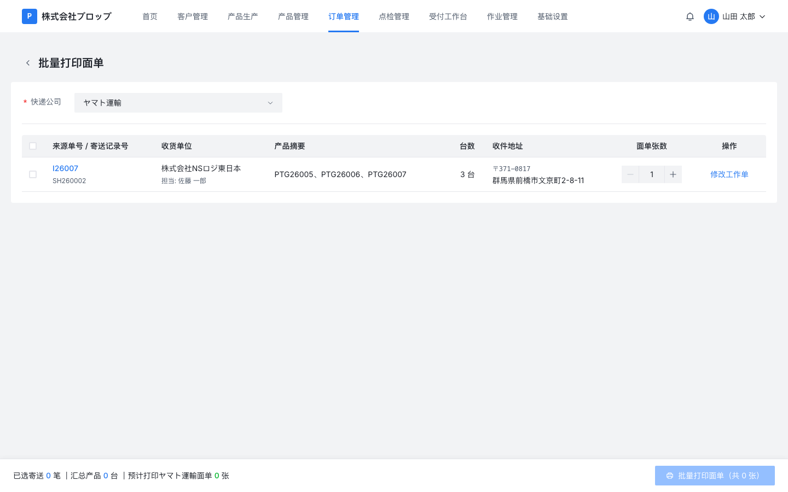

# FEAT-19 订单批量打印

**状态：Current Truth**

2026-10-23需求状态：面单字段及输出规则已在FEAT-11确认；本页引用其模板与字段规则，Excel整簿打印已确认满足需求，C03实际实现及打印验证尚未完成。

## 1. 模块概述

订单批量打印是订单管理下的批量面单打印页，集中查看订单来源的准备中寄送，逐笔设置面单张数，并一次生成多笔面单。打印只产生文件记录；不登记寄出、不改变寄送状态、不建立产品与订单关系。

```text
订单管理 → 批量打印 → 勾选准备中的订单寄送
                           → 逐笔设置面单张数
                           → 批量生成面单
                           → 打开准备中的寄送工作单
```

## 2. 页面构成

| 页面 | 导航位置 | 主要作用 |
|---|---|---|
| 订单批量打印面单 | 订单管理下「批量打印」同级菜单 | 勾选准备中的订单寄送，按笔设置面单张数并批量生成面单 |

## 3. 资料项目与规则

| 资料项目 | 必填 | 规则 |
|---|---:|---|
| 快递公司 | 确认寄出时必填 | 选项为 ヤマト運輸、佐川急便；表示该笔寄送最近一次实际使用的快递公司，只有一个值。两个写入路径：抽屉内手动选择（准备中选择即保存，已寄出后修改也保存，下次打开显示最后保存值）；批量打印出单（出单即视为使用该公司，同时把该笔寄送的快递公司改写为批量打印页所选公司）。准备中可暂缺；已寄出后仍可更正 |
| 面单张数 | 打印面单时使用 | 打印面单时由员工输入，范围 1–99；表示本次要印出的面单份数（复印份数），每份使用同一份完整产品清单，不代表产品台数或箱数；一次「生成面单（N 张）」只产生一个面单文件版本，N 张共用同一版本（复印关系） |

## 4. 订单批量打印面单

### 4.1 页面作用

集中查看订单来源的准备中寄送，逐笔设置面单张数，并一次生成多笔面单。批量范围只含面单，不含纳品书和保障确认书。

### 4.2 页面入口与去向

2026-09-29 导航裁决：在「订单管理」目录下，「订单列表」与「批量打印」为同级可见菜单，分别按各自页面权限显示；批量打印不再仅作为隐藏页面依赖订单列表进入。页面标题仍为「批量打印面单」。

批量打印仅通过同级导航进入，订单列表不保留批量打印快捷入口，批量页不设置返回订单列表按钮。两页只做页面级可见性及访问授权；获得页面权限即可使用该页面规定的全部业务功能，不增加页面下的操作级或数据级权限。后端仍校验页面访问权限及对象归属、状态、字段和事务等业务规则。

表格行内「修改工作单」打开该笔寄送抽屉，关闭后回到批量打印页并刷新列表。本次裁决覆盖原型中的入口与返回安排，其余页面布局保持原约定。

### 4.3 页面布局



```text
批量打印面单
├─ 快递公司
├─ 准备中寄送表格
└─ 底部汇总栏：已选寄送 / 汇总产品 / 预计打印面单 / 批量打印按钮
```

### 4.4 展示信息

- **快递公司**：必填，默认 ヤマト運輸；选项为 ヤマト運輸、佐川急便。该选择即本次批量打印的面单模板；出单的同时把每笔被打印寄送的快递公司改写为该公司，不筛选表格数据。
- **数据范围**：只列所属订单有效、订单来源且未确认、未删除的准备中寄送；已取消订单的准备不参与批量打印，服务端生成时也须重查订单状态。空态文字为「当前没有准备中的订单寄送」。
- **表格列**：勾选；来源单号／寄送记录号（第一行订单号为蓝色，第二行 SH 记录号为次级小字）；收货单位（第一行单位，第二行「担当: 姓名」）；产品摘要（本次寄送产品制造编号以顿号连接，过长省略并可查看完整内容）；台数；收件地址（第一行邮编 〒XXX-XXXX，第二行地址，过长省略）；面单张数（1–99，默认 1）；操作「修改工作单」。
- **底部汇总栏**：显示「已选寄送 N 笔｜汇总产品 N 台｜预计打印［快递公司］面单 N 张」；按钮为「批量打印面单（共 N 张）」。

### 4.5 功能

2026-09-29 用户最终裁决：批量打印只实现连续打印。用户一次选择多笔寄送，系统按各笔份数一次性生成整批Excel工作簿并提供下载，员工在桌面Excel中选择“打印整个工作簿”，一次提交给打印机／打印队列，按顺序打印全部内容，不要求用户逐张发起打印。各笔面单文件版本及快递公司更新仍遵循 §4.7；整批打印内容不合并各笔文件的业务归属。生成内容、提交打印和实体打印完成是不同事实，不能用生成成功冒充打印完成。本条取代此前逐笔结果及失败重试队列的规划，不引入应用级打印任务管理。

- 勾选一笔或多笔寄送 → 底部汇总随所选笔数、产品数和面单张数更新。
- 调整行内面单张数 → 该笔预计打印张数更新；面单张数只影响打印份数，不影响该笔产品台数的统计。
- 点击「修改工作单」 → 打开该笔寄送抽屉 → 关闭后刷新批量打印列表，产品摘要和台数按修改后的清单展示。
- 点击「批量打印面单（共 N 张）」 → 按已选寄送及各笔张数一次性生成整批面单，使用顶部所选快递公司模板，同时把各笔寄送的快递公司改写为该公司 → 下载整批Excel工作簿，在桌面Excel中选择“打印整个工作簿”一次提交全部内容。生成阶段提示「已生成 N 张［快递公司］面单（打印不登记寄出）」不代表实体打印已完成。

**2026-10-22 用户确认**：Excel整簿打印已满足上述连续打印需求，并已进行多轮技术验证，不再是输出渠道待决项；不要求系统浏览器直接提交打印，不引入本地打印插件或自动进纸控制。工作簿按所选寄送顺序及各笔份数组织，同笔复印内容相邻、共用一个业务版本。面单模板及订单字段统一引用[FEAT-11模板目录](../FEAT-11-shipment/assets/reports/README.md)，不另建批量专属模板。面单字段已另经逐项确认，实纸校准仍待验证；C05 FEAT-18不替代本页实现及验收。

### 4.6 校验与反馈

未勾选寄送时批量打印按钮不可用。面单张数限制为 1–99；空值按 1 处理。切换快递公司不清空已勾选寄送。批量打印不登记寄出、不改变寄送状态、不建立产品与订单关系。

### 4.7 页面产生的数据

批量打印成功后，为每笔所选准备中寄送建立面单文件版本，并把该笔寄送的快递公司改写为页面顶部所选公司；不建立打印批次台账，不登记实际寄出，不修改产品清单，不改变订单履约数。

## 5. 跨页面统一规则

### 5.1 打印与确认边界

面单、纳品书、保障确认书在本次寄送存在产品的任何阶段均可生成，次数不限。打印和继续打印只产生或使用文件记录，不登记寄出、不改变寄送状态、不建立产品与订单关系。只有「确认寄出」登记寄送事实。

### 5.2 分批寄送

同一订单可多次建立寄送。每次寄送只记录本次产品、文件、物流资料和确认结果；批量打印页面一行表示一笔准备中的寄送，不把同一订单下多笔准备合并成一行。

## 6. Feature 边界与明确不做

明确不做：

- 批量生成三种文件的套打入口；三种文件各自独立生成。
- 批量打印页打印纳品书／保障确认书；批量范围只含面单。
- 打印批次台账实体。
- 刷新后恢复、关闭页面后的前端续跑、后台续跑、单张打印进度、断点续打、批量打印任务历史或复杂状态管理。
- 打印编号清单。

## 7. 核对记录

- 2026-09-23：按二级导航粒度自 09-寄送 §6 拆分为本 feature（FEAT-19）；内容不变，章节与交叉引用已重编号。
- 2026-09-22：按 `09-寄送/subagent-brief.md`、模板、寄送抽屉、确认弹窗、订单批量打印页、批量打印表格及修改记录 §24.1–§24.8、§24.10、§24.11、编号规则、批量打印产品摘要裁决、寄送抽屉两项口径定版完成静态核对并撰写本稿。
- 核对发现 1：确认弹窗说明曾写「地址、快递公司、寄送日期与运单号仍可修改」，但寄送抽屉没有地址修改入口。2026-09-22 已修订：页面弹窗文案删去「地址」，确认说明改为「快递公司、寄送日期与运单号仍可修改」；地址为快照只读、无修改入口，正文 FEAT-11 §5.4 已按当前文案写明。
- 核对发现 2：单笔抽屉「生成面单（N 张）」张数为复印份数——一次生成只产生一个面单版本，N 张共用同一版本（每份使用同一份完整产品清单）。2026-09-22 用户裁决对齐订单与返送两侧，正文 FEAT-11 §3.1／§4.5／§4.7 已按新口径写明。
- 核对发现 3：批量打印页生成面单使用寄送自身保存的快递公司，与页面顶部所选公司可能不一致。2026-09-22 用户裁决不符合业务预期，已改为「快递公司 = 最近一次实际使用的公司」单一口径：批量打印出单即把该笔寄送的快递公司改写为顶部所选公司。demo 已修改（tsc / 176 测试 / 构建通过），正文已按新口径描述，正式模板转正时复核样式。
- 历史核对发现 4（已被 2026-09-25 裁决取代，不再作为现行规则）：保障确认书为订单维度文件（产品范围为该订单当前全部有效寄送中的产品），与面单／纳品书的本笔寄送口径不同，属业务口径而非页面差异；正文 FEAT-11 已写明。 当前规则为单笔发货归属、仅本次清单、随所属准备删除，见 FEAT-11 §4.7／§6.7。
- 2026-09-22（邮件版本化）：寄送通知邮件改为本笔寄送维度的版本化文件——确认寄出自动生成 v1，「生成邮件正文」生成新版本，每次冻结当时正文全文与生成时间，列表操作为「查看」、弹窗内可复制；取消按当前内容现算后直接复制的旁路。demo 已修改（tsc / 176 测试 / 构建通过），正文与 FEAT-11 跨页面统一规则已写明。

- 2026-09-25：根据已确认裁决修订删除、身份与编号复用、历史保留、实物衣体更换或单笔发货文件归属相关条款；此前核对记录中的冲突口径已被本次正文取代，旧 demo／测试结论不代表本次修订已实施或验收。

### ヤマト面单制造番号显示范围（逐项确认）

用户确认：ヤマト面单只显示本笔寄送清单的前12个制造番号，不增加附页，不单独注明省略；数量显示本笔全部台数。完整产品清单仍作为本次文件版本的采用范围，复印份数不拆分产品；此前“每份使用同一份完整产品清单”不表示ヤマト面单逐项印出全部编号。用户确认选取顺序为制造番号升序，排序后取前12个；生成时冻结采用顺序，不改变业务清单录入顺序。本规则适用于单笔及批量生成的ヤマト面单，不推定佐川或其他文件的容量规则。

佐川面单沿用FEAT-11已确认容量规则：制造番号升序显示前16个，不附页、不注明，数量显示本笔全部台数，版本保留完整采用清单；单笔与批量一致。

### 面单模板资源复用（2026-10-23确认）

批量订单面单沿用FEAT-11的C05 Excel模板资源复用规则：模板资源共享，每笔仍按C03订单寄送字段填值并独立冻结；订单参数和业务版本不与返送共用。Excel整簿打印已确认满足需求，本条不改变既定顺序、份数及生成与打印完成的区分。
