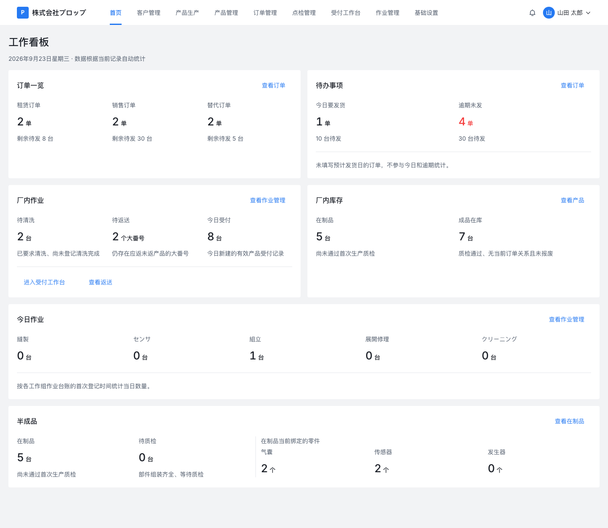

# FEAT-00 首页看板

**状态：Current Truth**

## 1. 模块概述

首页工作看板是员工进入系统后的第一个页面，回答一个问题：**今天要做什么、厂里现在是什么状况**。本页不维护任何业务事实，所有数字都根据其他模块的当前记录自动统计得出，点击进入对应模块处理。统计口径与各业务模块的规则保持一致；本页只读，不提供任何修改入口。

```
订单管理 ──→ 订单一览（进行中（=未发完）/剩余待发，按租赁·销售·替代分列）
订单管理 ──→ 待办事项（今日要发货 / 逾期未发，按预计发货日）
受付·作业 ─→ 厂内作业（待清洗 / 待返送 / 今日受付）
作业管理 ──→ 今日作业（五个工作组当日登记台数）
生产·质检 ─→ 厂内库存（在制品 / 成品在库）
生产·部件 ─→ 半成品（在制品·待质检 / 在制品当前绑定的零件数）
```

## 2. 页面构成

| 页面 | 导航位置 | 主要作用 |
|---|---|---|
| 工作看板 | 顶部导航「首页」 | 六个统计卡片纵览全局，逐卡跳转到对应模块 |

## 3. 统计口径与规则

看板的每个数字都是**展示时的统计结果**，系统不保存这些数字本身；任一模块的记录变化后，看板下次显示即随之变化。统计只认有效记录：已删除、已作废的记录不计入。日期判断一律按日本业务日。

### 3.1 订单一览

按业务类型分「租赁订单」「销售订单」「替代订单」三列，每列两项：

| 项目 | 口径 |
|---|---|
| 进行中 | 有效发货数 < 订购数的订单数（含一台未发；已发完的订单不计入进行中） |
| 剩余待发 | 进行中订单的「订购数 − 有效发货数」合计台数 |

- 已结束的订单不参与统计。
- 发完不冻结订单——已发完的订单不计入进行中，但仍可继续业务（追加发货、编辑等）。

### 3.2 待办事项

| 项目 | 口径 |
|---|---|
| 今日要发货 | 预计发货日为今天的订单数，附「N 台待发」（这些订单的剩余待发合计） |
| 逾期未发 | 预计发货日早于今天的订单数，附「N 台待发」；订单数大于 0 时数字显示为红色 |

- 只统计仍有剩余待发数量的订单；已发完的订单即使预计发货日已过也不计入逾期。
- 未填写预计发货日的订单不参与今日与逾期统计。

### 3.3 厂内作业

| 项目 | 口径 |
|---|---|
| 待清洗 | 本次受付要求需要清洗、尚未登记清洗完成的产品数（台）。已回收、已报废的产品不再计入 |
| 待返送 | 仍存在应返未返产品的大番号数。「应返未返」= 处置决定为返回客户、尚未实际返送、未回收、未报废。只认实际寄出：返送面单已建立或已打印、但尚未确认寄出的产品，仍计入应返未返 |
| 今日受付 | 今天新建的有效产品受付数（台） |

### 3.4 今日作业

五个工作组（縫製／センサ／組立／展開修理／クリーニング）各一个数字，横向并排：

- 每组数字 = 该组**今天首次登记**作业记录的产品台数；一台产品的同组作业当天只计一次。
- 只看「首次登记时间」属于今天；当天之后的修改不改变归属，不会从今日数字中消失。
- 已作废的作业记录不计入。
- 只按工作组区分，不按作业人员区分。

### 3.5 厂内库存

| 项目 | 口径 |
|---|---|
| 在制品 | 尚未通过首次生产质检的产品数（台） |
| 成品在库 | 质检通过、当前无未结束订单关系、未报废的产品数（台） |

- 订单关系无论从哪个入口结束（订单管理解除关联、受付侧确认回收），结束后产品都进入成品在库口径；确认回收的产品不另外要求重新入库质检。

### 3.6 半成品

| 项目 | 口径 |
|---|---|
| 在制品 | 与厂内库存卡的「在制品」同一口径 |
| 待质检 | 部件组装齐全（气囊、传感器、发生器位置 1 均已绑定）但尚未通过首次生产质检的产品数（台；最低构成定义见 FEAT-07 §3.2） |
| 零件数（气囊／传感器／发生器） | 在制品当前有效绑定中的各类型部件个体数（个）：发生器位置 1／2 各算一个；衣体是产品本体不计入；已解除绑定、已过质检产品的绑定不计入 |

## 4. 工作看板

### 4.1 页面作用

让员工打开系统第一眼看到今天要做什么（待办事项）、厂里流转到什么状态（厂内作业、今日作业）、库存与生产进度（厂内库存、半成品）、订单整体情况（订单一览），并一键进入对应模块处理。

### 4.2 页面入口与去向

- 入口：顶部导航「首页」，登录后默认页。
- 去向：每张卡片右上角或底部提供跳转链接——订单一览／待办事项 → 订单管理；厂内作业 → 作业管理（另附受付工作台、返送入口）；厂内库存 → 产品管理；今日作业 → 作业管理；半成品 → 产品管理在制品视图。

### 4.3 页面布局



```
┌ 工作看板 ───────────────────────────── 当前日期 · 数据根据当前记录自动统计 ─┐
│                                                                          │
│  ┌ 订单一览 [查看订单] ────────────┐  ┌ 待办事项 [查看订单] ──────────────┐ │
│  │  租赁订单 N单                  │  │  今日要发货 N单（N台待发）         │ │
│  │   未发完·已发完·剩余待发        │  │  逾期未发 N单（N台待发，>0 红色）   │ │
│  │  销售订单 N单 · 替代订单 N单    │  │   ※未填预计发货日不参与统计        │ │
│  │   未发完·已发完·剩余待发        │  │                                  │ │
│  └───────────────────────────────┘  └──────────────────────────────────┘ │
│  ┌ 厂内作业 [查看作业管理] ────────┐  ┌ 厂内库存 [查看产品] ──────────────┐ │
│  │  待清洗 N台                   │  │  在制品 N台                       │ │
│  │  待返送 N个大番号              │  │  成品在库 N台                     │ │
│  │  今日受付 N台                 │  │                                  │ │
│  │  [进入受付工作台] [查看返送]   │  │                                  │ │
│  └───────────────────────────────┘  └──────────────────────────────────┘ │
│  ┌ 今日作业 [查看作业管理] ──────────────────────────────────────────────┐ │
│  │  縫製 N台 │ センサ N台 │ 組立 N台 │ 展開修理 N台 │ クリーニング N台     │ │
│  └────────────────────────────────────────────────────────────────────────┘ │
│  ┌ 半成品 [查看在制品] ───────────────────────────────────────────────────┐ │
│  │  在制品 N台 · 待质检 N台  │  气囊 N个 · 传感器 N个 · 发生器 N个         │ │
│  └────────────────────────────────────────────────────────────────────────┘ │
└──────────────────────────────────────────────────────────────────────────────┘
```

### 4.4 展示信息

- 卡片顺序固定：第一行「订单一览／待办事项」，第二行「厂内作业／厂内库存」，第三行「今日作业」通栏，第四行「半成品」通栏。
- 订单一览：租赁、销售、替代三列并排，每列大数字为进行中单数（= 未发完，含一台未发），下方一行明细「剩余待发 N 台」。
- 待办事项：今日要发货、逾期未发两项并排；逾期未发的单数大于 0 时以红色显示，为 0 时保持普通色；底部注明「未填写预计发货日的订单，不参与今日和逾期统计」。
- 厂内作业：待清洗、待返送、今日受付三项并排，各带一行口径说明。
- 厂内库存：在制品、成品在库两项并排，各带一行口径说明。
- 今日作业：五个工作组均分一行横排，各显示组名与台数；底部注明「按各工作组作业台账的首次登记时间统计当日数量」。
- 半成品：左侧产品数（在制品／待质检），右侧零件数（气囊／传感器／发生器），两组之间竖向分隔线分区；零件数上方注明「在制品当前绑定的零件」。
- 页面顶部显示当前日期（含星期）与「数据根据当前记录自动统计」说明。

### 4.5 功能

- 页面打开或刷新 → 按当前全部有效记录统计并展示各卡片数字 → 数字反映最新状态。
- 点击卡片链接 → 进入对应模块页面 → 在该模块中处理具体业务。

### 4.6 校验与反馈

本页为纯统计展示，无输入与校验。

### 4.7 页面产生的数据

无。本页不建立、更正或删除任何业务记录；所有数字由其他模块的当前记录统计得出。

## 5. 跨页面统一规则

- **统计而非存储**：看板数字不保存为独立数据，不存在「看板数字与业务数据不一致需要同步」的情况。
- **有效记录**：已删除、已作废的记录一律不参与统计。
- **业务日**：「今日」「逾期」等日期判断按日本业务日。
- **口径唯一来源**：每个数字的口径以本文件 §3 为准；各业务模块的规则变化时，看板口径随之对齐，不允许看板单独发明口径。

## 6. Feature 边界与明确不做

**本模块负责**：六个统计卡片的展示与跳转入口。

**其他模块负责**：订单、发货计划、受付、作业、库存、部件等一切业务事实的登记与维护（分别见 FEAT-10 订单管理、FEAT-11 寄送、FEAT-14 受付工作台／FEAT-15 受付履历、FEAT-16 作业管理、FEAT-08 产品管理、FEAT-02 部件资料／FEAT-05～08 生产）；本页只读取统计，不产生事实。

**明确不做**：

- 「需核对」订单节点（进行中订单 = 未发完；超发在发货确认时硬阻止，不产生待核对状态）。
- 「不再关注」式的待返送人工标记（待返送只认「仍存在应返未返产品」）。
- 员工个人维度的工作量统计（今日作业只按工作组）。
- 绩效考核、任务中心、派工流程。
- 看板数字的保存、快照与历史趋势。

## 7. 核对记录

- 2026-09-23：按二级导航粒度自 07-首页看板 拆分为本 feature（FEAT-00）；内容不变，章节与交叉引用已重编号。

- 核对日期：2026-09-22，已与当前 demo 页面逐区块核对一致：四行卡片顺序、订单一览三列两口径、待办事项红字与底部注释、厂内作业三项、厂内库存两项、今日作业五组横排与底部注释、半成品分区与口径标注、各跳转链接。
- 裁决来源：修改记录「首页工作看板三项调整」（2026-09-18：删除需核对节点、待返送文案与口径、成品在库含租赁回收与订单关系结束三入口）、「首页新增三块统计」（2026-09-18：订单按租赁／销售分列、今日作业按工作组、半成品卡三口径）、「首页工作看板布局美化」（2026-09-18：卡片顺序与排版）。
- 说明：今日作业卡五组台数与今日受付按业务日统计，既有作业记录多为历史日期，故当日数字通常为 0——这是统计口径的正确表现，不是缺失。
- 2026-09-22 修订（独立审查后）：spec 零禁词、与页面零不一致；validation 修正厂内作业卡跳转表述、VAL-04 补「昨天登记今天修改不计入」、VAL-05 补订单管理解除关系入口、VAL-06 补已解除绑定不计入。
- 2026-09-22 修订（用户裁决，demo 已改并全绿）：成品在库的订单关系结束入口收敛为两个——订单管理解除关联、受付侧确认回收；产品详情页已无解除入口，类型层死枚举同步清理。
- 2026-09-22 修订（用户裁决，demo 已改并全绿）：订单一览「进行中」口径改为 = 未发完（含一台未发），已发完的订单不再计入进行中；明细不再显示「已发完」，只保留「剩余待发 N 台」。
- 2026-09-22 修订（用户裁决，demo 已改并全绿）：替代订单不移除并计入统计——订单一览改为租赁／销售／替代三列，每列两项（进行中单数、剩余待发台数）。
