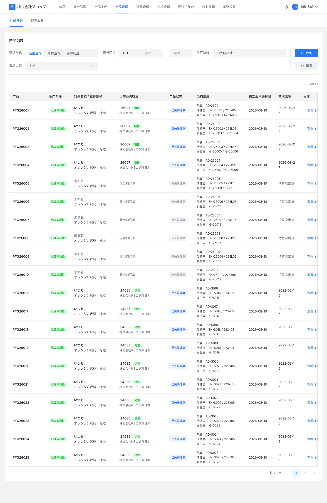
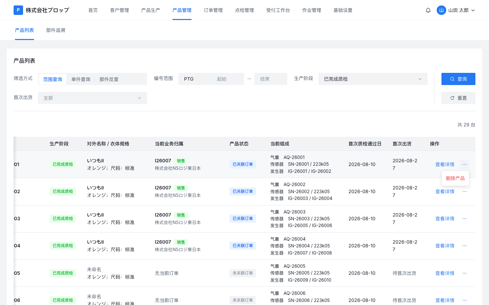
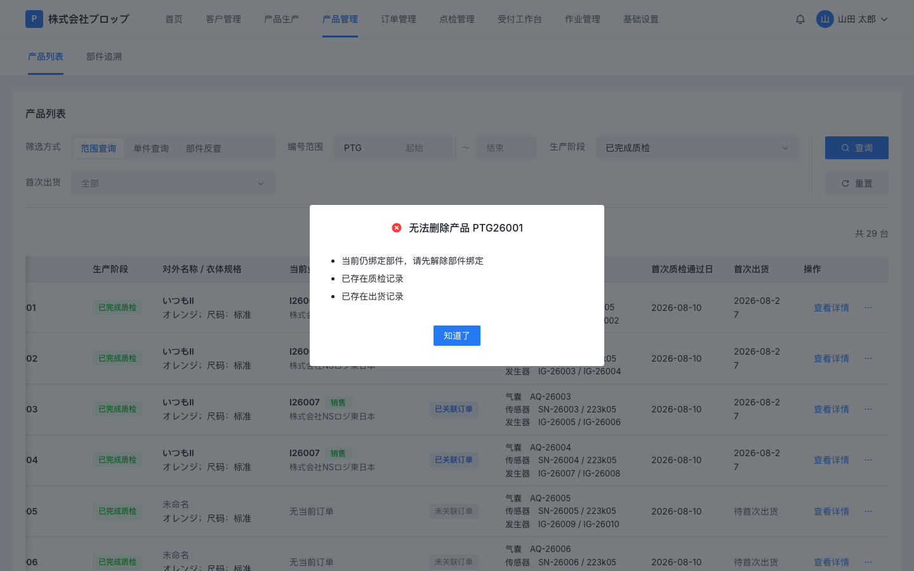
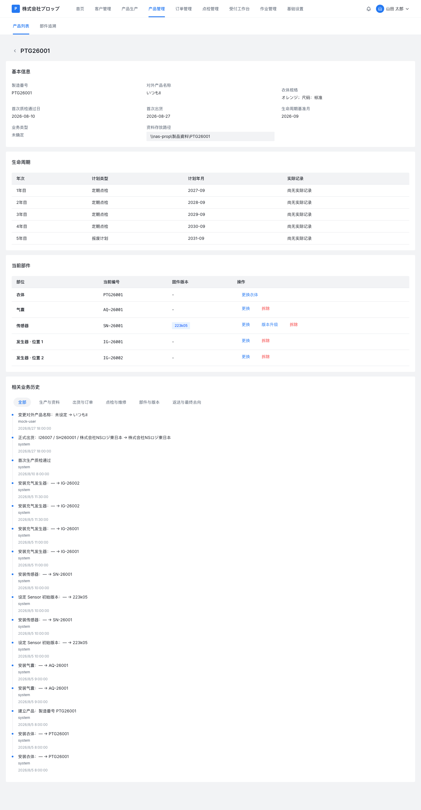
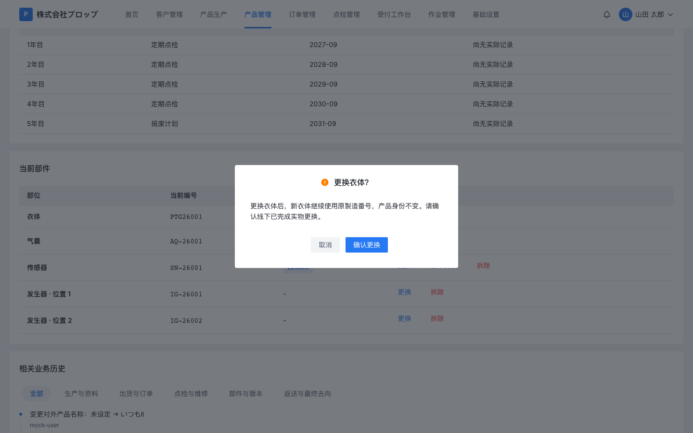

# FEAT-08 产品列表

**状态：Current Truth**

> 撰写纪律见 [_template/spec.md](../../../../01-正式需求/_template/spec.md) 文件头：只写业务事实和产品要求；只如实描述 demo 页面现状。

> **2026-09-25 原型适用边界**：用户已确认原型图片无需修改。FEAT-08-modal-replace.png 中“新衣体”指实物，不代表新建系统档案；FEAT-08-delete-confirm.png 为删除阻断弹窗。现行行为按 §4.5～4.7、§5.5～5.8 验收。本次需求评审通过，不表示实现或页面验收通过。

## 1. 模块概述

本模块覆盖产品建档后的统一管理：产品列表的查询与筛选、产品详情的查看与维护、产品删除。产品在衣体入库时成立（见 FEAT-05 衣体入库）；本模块是员工了解「这台产品现在是什么状态、经历过什么」的统一入口。

```text
产品（衣体入库时成立，见 FEAT-05 衣体入库）
  ├─ 基本信息（製造番号、对外名称、业务类型、生命周期基准月…）
  ├─ 当前部件（衣体 + 气囊 + 传感器 + 发生器位置 1/2）
  ├─ 生命周期（第 1～5 年点检/报废计划与实际记录）
  └─ 相关业务历史（生产、出货订单、点检维修、部件版本、返送去向）
       ↓ 下游读取
  订单／出货 → 受付／作业 → 返送／回收／报废
```

## 2. 页面构成

| 页面 | 导航位置 | 主要作用 |
|---|---|---|
| 产品列表 | 产品管理 → 产品列表 | 查询、筛选全部产品；进入详情；删除产品 |
| 产品详情 | 产品列表 → 查看详情 | 查看基本信息、当前部件、生命周期、业务历史；部件操作；资料存放路径录入 |

质检工作台见 FEAT-07 质检；部件追溯见 FEAT-09 部件追溯。

## 3. 资料项目与规则

### 3.1 产品

| 资料项目 | 必填 | 规则 |
|---|---:|---|
| 製造番号 | 是 | = 衣体编号，入库时确定，终身不变；更换衣体不改变 |
| M番号 | — | 产品成立时按全系统单调递增序列配发；删除后不复用、允许空号；不在任何界面显示（含搜索等输入入口的提示与匹配键） |
| 对外产品名称 | — | 首次正式发货时按订单采用；之后可通过名称更正事件更新；无事件时显示「未命名」 |
| 衣体规格 | — | 读取当前衣体的最新资料规格（建档时内容 + 最近一次资料更正）；实物更换不自动改变系统衣体资料；资料更正后列表与详情同步变化 |
| 业务类型 | — | 销售／租赁／未确定；首次发货确认时写入 |
| 生命周期基准月 | — | 由首次实际发货的月份确定；未出货时为空 |
| 首次质检通过日 | — | 首次生产质检通过的日期 |
| 首次出货日 | — | 首次正式发货的日期；未出货显示「待首次出货」 |
| 资料存放路径 | — | 员工手动录入的 NAS 路径，仅作记录展示 |

### 3.2 生产阶段

产品的生产阶段由事实自动确定：

| 阶段 | 含义 |
|---|---|
| 在制 | 尚未满足首次质检最低构成——衣体、气囊、传感器、发生器位置 1 四项中有任何一项未安装（发生器位置 2 始终可空，不影响判断；最低构成定义见 FEAT-07 §3.2） |
| 待质检 | 已满足最低构成，尚未质检通过 |
| 已完成质检 | 已有质检通过事实；之后拆除必需部件不退回在制 |

### 3.3 产品状态

| 状态 | 含义 |
|---|---|
| 已报废 | 已有正式报废事实。报废只终结产品与衣体编号（製造番号）；气囊／传感器／发生器部件个体不随之报废，解除绑定后可继续用于其他产品（与作业管理报废确认、删除产品部件个体保留同口径） |
| 已关联订单 | 存在当前有效的订单关系 |
| 未关联订单 | 无当前有效的订单关系 |

## 4. 产品列表

### 4.1 页面作用

查询与筛选全部产品（含在制、待质检、已完成质检），进入产品详情，删除不再需要的产品。

### 4.2 页面入口与去向

- 入口：产品管理 → 产品列表。
- 去向：行内「查看详情」进入产品详情；单件查询与部件反查命中后直接进入详情。

### 4.3 页面布局





```text
┌──────────────────────────────────────────────────────────┐
│ 产品列表                                                  │
│  筛选区：[筛选方式页签]                                    │
│   范围查询：编号范围（前缀+起始～结束）│ 生产阶段 │ 首次出货  │
│   单件查询：製造番号                                      │
│   部件反查：部件编号                                      │
│                                          [查询] [重置]   │
├──────────────────────────────────────────────────────────┤
│  工具栏：共 N 台                                          │
│  表格：产品 │ 生产阶段 │ 对外名称/衣体规格 │ 当前业务归属  │
│        │ 产品状态 │ 当前组成 │ 首次质检通过日 │ 首次出货 │ 操作 │
│  分页（20/页）                                            │
└──────────────────────────────────────────────────────────┘
```

### 4.4 展示信息

- 筛选区：
  - 筛选方式页签（胶囊样式）：范围查询（默认）／单件查询／部件反查。
  - 范围查询：编号前缀＋起始～结束数字、生产阶段下拉（默认已完成质检）、首次出货状态下拉（全部／待首次出货／已首次出货）。
  - 单件查询：製造番号输入框（回车或查询按钮触发，命中直接进入详情）。
  - 部件反查：部件编号输入框（气囊／传感器／发生器编号，命中当前绑定产品直接进入详情）。
- 表格列：
  - 产品：製造番号（粗体，单行）。
  - 生产阶段：在制（灰）／待质检（橙）／已完成质检（绿）标签。
  - 对外名称／衣体规格：第一行对外产品名称（未命名显示「未命名」弱化），第二行衣体规格文本。
  - 当前业务归属：第一行订单号＋订单类型标签（已取消订单标注「（已取消）」），第二行下单方名称；无当前关系显示「无当前订单」。
  - 产品状态：已报废（红）／已关联订单（蓝）／未关联订单（灰）标签。
  - 当前组成：三行——气囊编号、传感器编号／固件版本、发生器编号（位置 1／2 有则斜杠连接）；未安装显示「-」。
  - 首次质检通过日：日期或「-」。
  - 首次出货：日期或「待首次出货」。
  - 操作：「查看详情」＋「···」菜单（含「删除产品」）。
- 排序：按製造番号数字后缀升序。
- 分页：20 条/页，底部显示总数。

### 4.5 功能

- **范围查询**：输入前缀与起止编号后点「查询」→ 列表按范围收窄；起止均填写才生效，否则清除范围条件。
- **生产阶段／首次出货筛选**：下拉选择即时生效。生产阶段初次进入默认「已完成质检」；清除后显示全部。
- **单件查询**：输入完整製造番号，回车或点「查询」→ 命中直接进入该产品详情；未命中提示「未找到该产品编号」。
- **部件反查**：输入部件编号，回车或点「查询」→ 命中当前绑定该部件的产品直接进入详情；未命中提示「未找到绑定该部件的产品」。
- **重置**：清空起止编号、单件、部件输入与范围条件，首次出货恢复全部；生产阶段、编号前缀与查询模式保留当前值。
- **查看详情**：进入产品详情页。
- **删除产品**（··· 菜单内）：
  - 点击后先校验阻断条件；存在阻断 → 弹窗一次性列出全部阻断原因，不执行删除。
  - 无阻断 → 二次确认弹窗，说明「产品与衣体将退出当前有效业务范围，原身份及绑定、组装、资料更正历史保留；非衣体部件不删除，M番号不复用，衣体编号可重新入库」。确认后执行删除；取消不改变数据。

### 4.6 校验与反馈

- 删除的阻断条件（任一命中即禁止删除）：
  - 当前仍绑定气囊／传感器／发生器部件（提示先解除绑定）；
  - 已存在质检记录；
  - 已存在出货记录；
  - 已存在受付记录。
- 出货记录按既有记录范围判定，包含准备中的出货记录，不得缩小为仅正式寄出；不得增加其他删除阻断条件。

- 阻断弹窗逐条列出全部命中原因，员工可据此逐项处理。
- 删除确认弹窗说明删除后果；确认后行即时从列表消失。

### 4.7 页面产生的数据

- 删除产品 → 产品及随其删除的衣体退出当前有效业务范围；原产品与衣体的历史身份、历史绑定（含已结束）、组装操作及资料更正等历史继续保留且可读，不因删除丢失，不以孤立 ID 或删除日志代替。非衣体部件档案及其在本产品或其他产品上的历史均保留。
- 删除衣体后，该衣体不再计入对应入库记录的当前有效成员；无有效成员的入库记录不再作为有效记录展示，历史登记信息仍保留。
- 衣体制造编号可重新入库，新登记产品和衣体为独立对象，不继承旧对象历史；M番号不复用。当前档案删除与历史身份保留同时成立，不指定软删除、归档表或历史快照等实现。

- 查询、筛选、重置 → 不产生业务数据。

## 5. 产品详情

### 5.1 页面作用

查看一台产品的完整档案：基本信息、当前部件构成、生命周期计划与实际、全部业务历史。在制／待质检产品提供补录部件入口；衣体提供更换入口。

### 5.2 页面入口与去向

- 入口：产品列表「查看详情」；单件查询／部件反查命中直接进入。
- 去向：无页面间跳转（历史中的订单号、番号均为纯文本）。

### 5.3 页面布局




```text
┌──────────────────────────────────────────────────────────┐
│ ← 製造番号（页头）                                        │
├──────────────────────────────────────────────────────────┤
│ 阶段提示条（在制／待质检时显示；已完成质检不显示）           │
├──────────────────────────────────────────────────────────┤
│ 基本信息卡                                                │
│  製造番号 │ 对外产品名称 │ 衣体规格                        │
│  首次质检通过日 │ 首次出货 │ 生命周期基准月                 │
│  业务类型 │ 资料存放路径（输入框）                          │
├──────────────────────────────────────────────────────────┤
│ 生命周期卡                                                │
│  表格：年次 │ 计划类型 │ 计划年月 │ 实际记录                │
├──────────────────────────────────────────────────────────┤
│ 当前部件卡                                                │
│  表格：部位 │ 当前编号 │ 固件版本 │ 操作                    │
├──────────────────────────────────────────────────────────┤
│ 相关业务历史卡                                            │
│  [全部][生产与资料][出货与订单][点检与维修][部件与版本][返送与最终去向]│
│  时间线（倒序）                                           │
└──────────────────────────────────────────────────────────┘
```

### 5.4 展示信息

- 页头：製造番号为主标题，带返回按钮。
- 阶段提示条（仅在制／待质检显示）：
  - 在制：提示缺少的部件名称，可在下方当前部件中补录。
  - 待质检：提示已满足最低构成，请前往质检工作台完成质检登记。
- 基本信息（八项，三列栅格）：
  - 製造番号、对外产品名称（未命名显示「未命名（首次正式发货时按订单采用）」）、衣体规格（允许多行）、首次质检通过日、首次出货、生命周期基准月、业务类型（销售蓝／租赁绿／未确定弱化文本）、资料存放路径（输入框，提示「可从 NAS 复制路径到此处」）。
- 生命周期（表格，未出货时显示空状态「首次出货后生成生命周期日程」）：
  - 固定 5 行：第 1～4 年定期点检、第 5 年报废计划。
  - 计划年月由生命周期基准月推算：1年目 = 基准月 + 1 年、2年目 = 基准月 + 2 年、依此类推；5年目报废计划 = 基准月 + 5 年。出货当年无年次。
  - 实际记录：已有对应受付或报废事实时显示「已计入 · 日期」或「已报废 · 日期」；无记录显示「尚无实际记录」。
- 当前部件（表格，固定 5 行：衣体／气囊／传感器／发生器位置 1／发生器位置 2）：
  - 部位（粗体）、当前编号（等宽，未安装显示「未安装」）、固件版本（仅传感器行显示蓝色标签，其余显示「-」）。
  - 操作列见 5.5。
- 相关业务历史（6 个页签，统一时间线展示，默认「全部」页签）：
  - 每条记录固定三部分：事件名称与核心内容（第一行）、操作人（第二行弱化，无值显示 system）、业务实际发生时间（左侧时间列，倒序）。
  - 部件与版本页签的操作人当前统一显示 system（其他页签按源记录显示）。
  - 各页签事件范围见 5.6「相关业务历史」。

### 5.5 功能

- **当前部件操作**（按部件类型区分）：
  - 衣体：「更换衣体」→ 确认弹窗「请确认线下已完成实物更换。产品、製造番号、系统衣体身份与绑定保持不变，确认后登记更换衣体事件。」确认后实际记录事件；取消不产生事件，不引导前往组装工作台绑定新衣体。
  - 气囊／发生器：「更换」「拆除」。
  - 传感器：「更换」「版本升级」「拆除」。
  - 未安装部件（仅在制／待质检产品显示）：「补录」。
- **更换部件（仅气囊／传感器／发生器）**：弹窗选择部件资料（默认带出旧部件当前资料，可切换）＋输入新部件编号（传感器加选固件版本）→ 结束旧关系并建立新关系；发生器更换保持原安装位置。新编号已建档时校验资料一致性（不一致时提供确认更正选项）；未建档时允许首次使用时建档（按所选资料）。
- **拆除部件**：确认弹窗（说明结束当前安装关系、部件恢复空闲、历史保留）→ 确认后拆除。
- **版本升级**（仅传感器）：弹窗选择新版本 → 追加版本记录，不覆盖历史。
- **补录部件**（在制／待质检产品）：点击对应槽位的「补录」按钮，弹窗选择部件资料＋输入编号（传感器加选固件版本）→ 建立绑定到该槽位，编号首次使用时建档。发生器位置 1／2 各有独立补录按钮，点哪个位置就补录哪个位置，弹窗内不再选择位置。
- **资料存放路径**：输入框内录入，失焦或回车保存；仅作记录展示，不提供打开或校验。
- **资料不一致确认**：更换或补录时，输入的编号已在系统中建档且该编号当前资料与弹窗中选择的资料不一致 → 弹窗内显示确认区，说明该编号当前资料与所选资料；员工可选择「以所选资料为准」继续执行（同时追加一条资料更正记录，从旧资料更正为所选资料，不覆盖旧值），或「取消」放弃本次操作。产品详情与组装工作台共用同一套冲突处理逻辑。

### 5.6 相关业务历史

6 个页签统一时间线，事件范围固定：

| 页签 | 事件范围 | 格式示例 |
|---|---|---|
| 全部 | 其他 5 个页签的合集，倒序 | — |
| 生产与资料 | 建立产品、对外产品名称变更（展示变更前后名称）、生产安装部件、设定初始传感器版本、首次生产质检通过 | 建立产品：製造番号 PTG26001 |
| 出货与订单 | 正式出货、订单关系结束 | 见下方说明 |
| 点检与维修 | 每次受付一条 | 见下方说明 |
| 部件与版本 | 安装、拆除、非衣体更换、初始版本、版本升级（旧值 → 新值），以及仅显示“更换衣体”的实物更换事件 | 更换气囊：AQ-26001 → AQ-27015 |
| 返送与最终去向 | 正式返送、确认回收、确认报废 | 正式返送：RT260001 |


出货与订单显示规则：

- 正式出货：`正式出货：订单号 / 寄送编号 / 下单方 → 納品先`。
- 订单关系结束：`订单关系结束：订单号 / 结束原因`。
- 无出货记录但有关系历史时，仍显示关系建立与结束记录。

点检与维修显示规则：

- 有计入年度（受付时选择了年检年度）的定期点检：`N年目定期点检：大番号 XXX / Package N / 小番号 XXXX`。
- 无计入年度的定期点检：`定期点检：大番号 XXX / Package N / 小番号 XXXX`（不拼接年度前缀）。
- 非定期点检类型（维修、清洁等）：直接显示受付类型名，不拼接年度。
- 同一受付包含多种类型时，类型名以「、」连接；含定期点检且有年度时，年度前缀仅拼接在定期点检类型前。

衣体更换事件内容固定显示：

```text
更换衣体
```

不显示旧衣体编号、新衣体编号或编号对照；事件时间、操作人仍按 §5.4 原规则展示。更换衣体只登记线下实物更换事件；产品身份、製造番号、系统衣体身份及现有绑定均不变，不创建新衣体档案、不解除旧衣体绑定，不产生可删除的换下衣体对象。换下实物线下报废，系统不登记其报废过程、不触发产品报废；衣体资料不自动变化，资料错误仍通过既有资料更正机制处理。

### 5.7 校验与反馈

- 更换部件时新编号已安装在其他产品 → 报错提示，不执行。
- 更换或补录时未选择部件资料／未输入编号 → 弹窗内校验提示，不关闭。
- 拆除确认前必须二次确认。
- 阶段提示条引导未完成组装或未质检的产品前往对应工作台。

### 5.8 页面产生的数据

- 更换非衣体部件 → 结束旧绑定、建立新绑定，产生更换操作记录；新编号首次使用时建立部件个体。
- 更换部件时接受资料不一致确认 → 追加一条部件资料更正记录；更换传感器时记录新安装关系对应的固件版本；拆除后旧部件恢复空闲，历史记录保留。
- 拆除部件 → 结束当前绑定，产生拆除操作记录。
- 版本升级 → 追加一条传感器固件版本记录（旧版本 → 新版本）。
- 补录部件 → 建立绑定与安装操作记录；编号首次使用时建立部件个体；传感器同时追加初始固件版本记录。
- 更换衣体确认 → 登记“更换衣体”事件，保留原有事件时间与操作人规则。更换衣体只登记线下实物更换事件；产品身份、製造番号、系统衣体身份及现有绑定均不变，不创建新衣体档案、不解除旧衣体绑定，不产生可删除的换下衣体对象。换下实物线下报废，系统不登记其报废过程、不触发产品报废；衣体资料不自动变化，资料错误仍通过既有资料更正机制处理。
- 资料存放路径保存 → 更正产品的资料存放路径字段。

**档案查找范围**：本模块按编号查询或选择待安装部件时，只匹配当前有效档案；“未建档／首次使用”包括旧同编号档案已按规则删除后重新登记，不表示复用旧身份。按原身份发起对已删除部件的安装、资料更正或固件升级均不得执行。

## 6. 跨页面统一规则

- **M番号**：产品成立时配发，删除后不复用，不在任何界面显示（含列表、详情、历史、订单、出货，以及搜索等输入入口的提示与匹配键）。
- **製造番号不变**：更换衣体不改变製造番号；产品身份终身不变。
- **产品创建唯一入口**：衣体入库（见 FEAT-05 衣体入库）；组装、详情补录不创建新产品。
- **删除与编号**：删除产品后其 M番号不复用；衣体製造番号允许重新入库。新产品与新衣体身份独立，不继承原对象历史；历史引用不得因编号相同改指新对象。当前有效列表、查找和选择不包含已删除对象。
- **生产阶段**：由部件构成与质检事实自动确定；列表与详情显示一致。

## 7. Feature 边界与明确不做

```text
产品列表、产品详情、产品删除 → 本模块
产品创建（衣体入库）→ FEAT-05 衣体入库；部件组装 → FEAT-06 部件组装；部件资料 → FEAT-02 部件资料
质检判定 → FEAT-07 质检；部件个体查询与删除 → FEAT-09 部件追溯
订单关系建立与结束、出货 → FEAT-10 订单管理／FEAT-11 寄送
受付事实 → FEAT-14 受付工作台／FEAT-15 受付履历；作业、返送事实 → FEAT-16 作业管理／FEAT-17 返送
```

明确不做：

- 在制品独立管理页（在制／待质检／已完成质检为产品的生产阶段，见 3.2）；
- 产品作废、恢复、回收站及失效状态（产品删除不新增中间状态）；
- 当前业务归属大卡（订单归属通过「出货与订单」页签查看）；
- 对外名称设定／更正按钮（名称事件由发货采用与名称更正事实产生）；
- 直接改写既有编号的功能（误建档或编号录错可在满足既有删除条件后删除错误档案，再按 FEAT-05／06 重新登记）；
- 产品详情的编辑弹窗（资料存放路径为页内输入框，其余字段由业务事实产生）；
- 历史中的跳转链接（订单号、番号均为纯文本展示）；
- 解除当前订单关联入口（统一由订单模块处理，见 FEAT-10 订单管理）；

## 8. 核对记录

- 2026-09-23：按二级导航粒度自 04-产品管理 拆分更名为本 feature（FEAT-08）；内容不变，章节与交叉引用已重编号。

- 核对日期：2026-09-21，已与当前 demo 核对产品列表、产品详情、删除功能（ProductListPage / ProductDetailPage / partMockRepository.deleteProduct / getProductDeleteBlockers / getProductStage）。实施差距：生命周期计划年月已修正为基准月 + N 年（2026-09-21 修复）；「全部」页签按用户裁决为其他 5 个页签的完整合集（覆盖 §24.24 原始口径）；部件与版本页签操作人统一显示 system；衣体更换事件未追加「製造番号不变」后缀（此旧格式要求已于 2026-09-25 取代，现行事件内容仅为“更换衣体”）。
- 裁决来源：修改记录 §24.22（产品统一列表与在制品管理合并）、§24.23（产品详情页收敛）、§24.24（相关业务历史统一时间线）、产品列表新增「删除产品」（2026-09-19）、产品管理/订单详情不再显示 M番号（2026-09-20）、产品详情新增资料存放路径（2026-09-19）；阶段 PRD 04-产品管理-v21.md；V2.0 底稿 04-质检与产品.md §7/§8。
- 结构说明：质检工作台拆出为 FEAT-07 质检；产品列表与产品详情合并为本模块。
- 三轮修订（2026-09-21）：生产阶段「任一」表述改清晰（四项中有任何一项未安装）；相关业务历史补充出货与订单、点检与维修的详细显示规则（含无年度形态、多类型拼接、非定期点检不拼年度）；资料不一致确认改为精确描述（确认区、追加更正记录、与组装工作台行为一致）。来源：用户批注（2026-09-21）。
- 修订（2026-09-21）：对外产品名称来源从「按订单行采用」改为「按订单采用」（与 FEAT-10 订单管理「一个订单只有一种产品名称」口径一致）。

- 2026-09-25：根据已确认裁决修订删除、身份与编号复用、历史保留、实物衣体更换或单笔发货文件归属相关条款；此前核对记录中的冲突口径已被本次正文取代，旧 demo／测试结论不代表本次修订已实施或验收。
