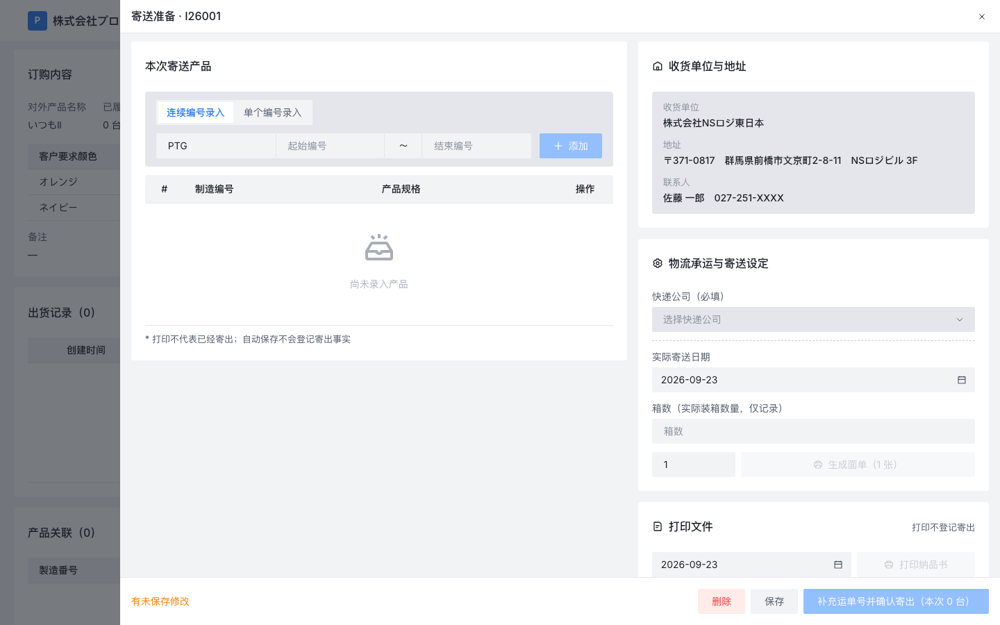
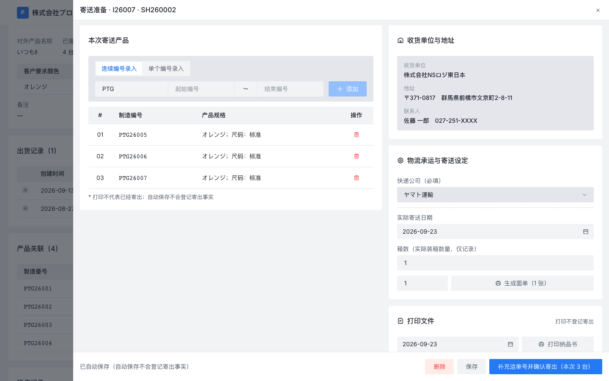
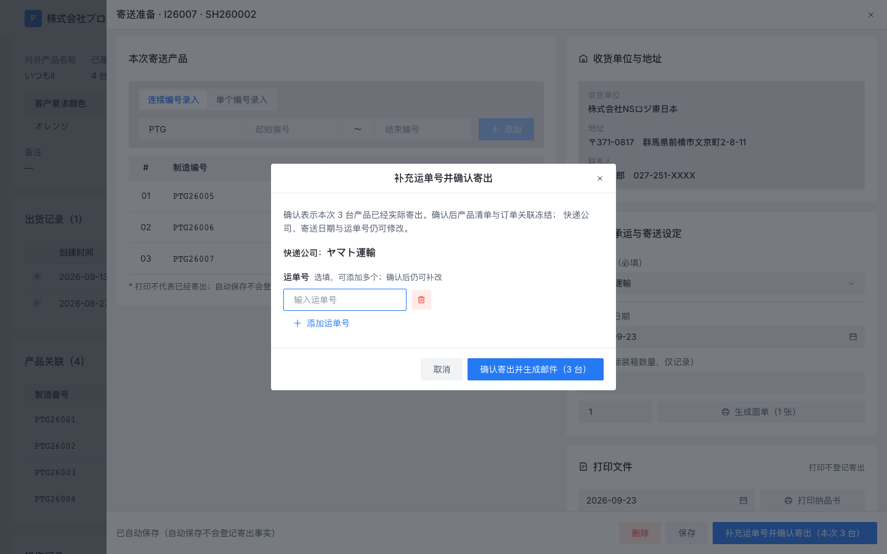

# FEAT-11 寄送

**状态：Current Truth**

（面单／纳品书／保障确认书／寄送通知邮件四类文件的模板与内容均为临时内容，后续以正式 spec 为准）

> **2026-09-25 原型适用边界**：本目录既有原型资产未更新。保障确认书归属、生成时产品范围及准备删除边界以 §4.7／§6.7 为准，旧演示中的订单级归集及删除例外已失效。 此前 demo 核对及测试结论仅作历史记录，不证明本次规则已验收。

## 1. 模块概述

本模块供发货人员维护订单出货的单笔寄送工作：录入本次产品、生成寄送相关文件、登记实际寄出、维护寄出后的物流资料。打印只产生文件记录；确认寄出才登记寄送事实并建立产品与订单的当前关系。

```text
订单详情 → 新建寄送准备
             ├─ 本次产品、收货快照、快递公司、寄送日期、箱数
             ├─ 面单 / 纳品书 / 保障确认书文件
             └─ 确认寄出 → 出货记录 + 产品与订单关系

```

## 2. 页面构成

| 页面 | 导航位置 | 主要作用 |
|---|---|---|
| 寄送抽屉 | 订单详情「发货」；订单详情出货记录「查看」 | 维护单笔订单寄送的产品、物流资料、文件和确认寄出 |
| 补充运单号并确认寄出弹窗 | 寄送抽屉底部「补充运单号并确认寄出」 | 在实际寄出时补充运单号并登记寄出事实 |

## 3. 资料项目与规则

### 3.1 寄送记录

| 资料项目 | 必填 | 规则 |
|---|---:|---|
| 寄送记录号 | 自动生成 | 创建寄送时取得，格式为 `SH[YY][NNNN]`：SH + 年份后两位 + 年内四位连番；每年从 0001 重新起号；与返送 RT 序列互不共用。历史 SHP 形态按原值保留 |
| 所属订单 | 是 | 每笔寄送只属于一个订单；同一订单可建立多笔寄送 |
| 收货单位与地址 | 自动带入 | 新建寄送时按订单配送资料保存本次采用内容；寄送页只读展示，不提供修改入口 |
| 本次寄送产品 | 确认前至少一台 | 准备中可通过连续编号或单个制造编号录入、移除；确认寄出后清单冻结，寄送页不提供修改入口 |
| 快递公司 | 确认寄出时必填 | 选项为 ヤマト運輸、佐川急便；表示该笔寄送最近一次实际使用的快递公司，只有一个值。抽屉内手动选择，准备中选择即保存，已寄出后修改也保存，下次打开显示最后保存值。准备中可暂缺；已寄出后仍可更正 |
| 实际寄送日期 | 是 | 新建默认当天，可在确认前维护；已寄出后仍可更正 |
| 箱数 | 否 | 记录实际装箱数量；不决定面单张数，不决定运单号数量 |
| 面单张数 | 打印面单时使用 | 打印面单时由员工输入，范围 1–99；表示本次要印出的面单份数（复印份数），每份使用同一份完整产品清单，不代表产品台数或箱数；一次「生成面单（N 张）」只产生一个面单文件版本，N 张共用同一版本（复印关系） |
| 运单号 | 否 | 可填写多个，可为空；唯一消费场景是寄送通知邮件正文。运单号数量不影响面单张数、箱数或寄送事实 |
| 已生成文件 | 自动记录 | 面单、纳品书、保障确认书、寄送通知邮件每次生成均形成独立版本行；历史版本不覆盖，可继续打印或查看当时内容 |

### 3.2 确认寄出后的可改与不可改

| 项目 | 确认后规则 |
|---|---|
| 产品清单 | 冻结；如需纠正错误交付，走订单维度解除产品关联 |
| 产品与订单关联 | 冻结为正式关系；寄送页不提供撤回、冲正、解锁或状态回退 |
| 收货地址快照 | 寄送页只读，不提供修改入口 |
| 快递公司、实际寄送日期、箱数 | 可更正；更正后只保留最后修改人员和时间，不保存修改历史 |
| 运单号 | 可追加、修改、删除；保存后影响此后生成的邮件版本正文，不改变已登记寄出事实 |

**版本保留的适用范围**：文件及邮件已生成版本不被后续生成覆盖；准备记录删除时其全部所属版本一并删除，不保留该准备业务历史。正式寄出后不得删除记录，所属版本继续保留。

## 4. 寄送抽屉

### 4.1 页面作用

在一页完成单笔订单寄送的准备、文件生成、确认寄出及已寄出后的物流资料维护。准备中与已寄出使用同一抽屉；标题分别为「寄送准备 · 订单号 · 寄送记录号」和「寄送详情 · 订单号 · 寄送记录号」。

### 4.2 页面入口与去向

从订单详情「发货」进入准备中抽屉；从订单详情出货记录「查看」进入对应记录。关闭后返回原页面。

### 4.3 页面布局





```text
寄送准备 / 寄送详情
├─ 左侧：本次寄送产品
│   └─ 已生成文件（已有文件或已寄出时显示）
├─ 右侧：收货单位与地址
│   ├─ 物流承运与寄送设定
│   ├─ 打印文件
│   └─ 运单号维护（仅已寄出）
└─ 底部操作栏
```

### 4.4 展示信息

- **本次寄送产品**：准备中显示灰底录入面板，录入方式为「连续编号录入」「单个编号录入」，默认连续编号。连续编号包含编号前缀、起始编号、结束编号和「添加」；单个编号包含「扫描或输入制造编号，回车加入」和「添加」。产品表列为 #、制造编号、产品规格；准备中另有操作列，删除按钮确认文案为「从本次清单移除？」。已寄出时不显示操作列，卡片右上角显示「已确认寄出」。准备中卡底部提示「* 打印不代表已经寄出；自动保存不会登记寄出事实」。
- **已生成文件**：已有文件或已寄出时显示。表格列为文件名称、生成时间、操作。面单、纳品书、保障确认书按版本逐行展示，操作为「继续打印」；寄送通知邮件按版本逐行展示，操作为「查看」，弹窗显示该版本的生成时间与正文全文，弹窗内可复制正文。
- **收货单位与地址**：只读展示收货单位、地址（〒邮编 + 地址）、联系人（姓名 + 电话）。
- **物流承运与寄送设定**：快递公司必填，下拉为 ヤマト運輸、佐川急便；虚线分隔后显示实际寄送日期、箱数（说明「实际装箱数量，仅记录」）、面单张数和「生成面单（N 张）」。
- **打印文件**：卡片角标「打印不登记寄出」。两行分别为日期 +「打印纳品书」、日期 +「打印保障确认书」；无产品时按钮不可用。
- **运单号维护**：仅已寄出显示，角标「保存单号后，可生成新的邮件版本」（保存运单号即时生效；保存本身不生成邮件版本，下一次生成的邮件版本会使用新运单号）。每行以 1.、2.、3. 编号，包含运单号输入框和红色删除按钮；底部左侧「追加单号」，右侧「生成邮件正文」「保存单号」。无修改时「保存单号」不可用。
- **底部操作栏**：准备中左侧显示「已自动保存 HH:mm（自动保存不会登记寄出事实）」或「有未保存修改」，右侧为「删除」「保存」「补充运单号并确认寄出（本次 N 台）」。已寄出左侧显示「状态：已确认寄出 · 日期（寄送事实已登记，产品与订单关联不变；寄送内容可修改）」，右侧为「关闭并返回列表」。

### 4.5 功能

- 输入单个制造编号并添加 → 编号存在、可用于本订单且未重复时加入本次清单 → 表格新增一行。
- 输入连续编号范围并添加 → 对范围内编号逐个检查 → 可加入的产品加入清单；不可加入的编号按原因提示，不影响已加入编号。
- 点击产品行删除 → 确认「从本次清单移除？」 → 从准备中清单移除该产品。
- 修改快递公司、实际寄送日期、箱数 → 准备中标记为未保存；已寄出时立即保存并分别提示「快递公司已更新」「寄送日期已更新」「箱数已更新」。
- 点击「生成面单（N 张）」 → 在已有产品时生成一个面单文件版本（N 张共用同一版本，复印关系）并打开预览，提示「面单已生成（N 张，每张使用同一份完整产品清单）」 → 不登记寄出，不改变产品与订单关系。
- 点击「打印纳品书」或「打印保障确认书」 → 在已有产品时生成对应文件并打开预览 → 不登记寄出，不改变产品与订单关系。
- 已寄出状态点击「生成邮件正文」 → 按当前寄送内容生成寄送通知邮件新版本（冻结当时正文全文与生成时间）并打开查看弹窗；点击「保存单号」保存运单号并提示「运单号已保存」。
- 准备中点击「删除」 → 确认「删除后不可恢复，是否确认删除？」 → 删除该准备、所属产品清单关联、全部所属文件及邮件版本（含保障确认书），不保留这些准备内容的业务历史，不填写原因；取消不改变数据。
- 准备中点击「保存」 → 把当前准备内容正式保存（提示「寄送已保存（准备中，暂未寄出）」）后关闭抽屉；保存失败（如无产品）停留在当前页。
- 准备中点击「补充运单号并确认寄出（本次 N 台）」 → 打开确认弹窗；确认成功后登记寄出事实并切换为已寄出资料。

### 4.6 校验与反馈

单个编号为空提示「请输入产品编号」；编号不存在、已报废、已关联其他订单、已在本次清单、超出订单剩余可发数量时阻止加入并提示原因。连续编号缺起止、起始大于结束、一次超过 100 台时阻止；部分失败时列出失败编号和原因。

保存前没有产品时提示「请先至少录入一台产品」。确认寄出前必须选择快递公司；订单已取消、产品清单为空、产品重复、产品已有关联、产品业务属性与订单不兼容或配送信息不完整（納品先／邮编／地址）时不得确认。已寄出的产品清单不可在寄送页增删。准备中删除成功提示「寄送已删除」；已寄出记录不显示删除入口，服务端同样拒绝删除，不能通过接口绕过。

### 4.7 页面产生的数据

- 保存准备：建立或更正一笔准备中的寄送记录，保存本次产品清单、收货快照、快递公司、实际寄送日期、箱数和运单号草稿；不登记实际寄出，不建立产品与订单关系。
- 生成面单／纳品书：建立本笔寄送的对应文件版本；一次「生成面单（N 张）」只产生一个面单版本（N 张为复印份数，共用该版本），「打印纳品书」每次新增一个版本；历史版本保留；不登记实际寄出。
- 生成保障确认书：建立本笔发货的保障确认书独立版本；产品范围仅为生成时本次发货清单中的产品，不汇总同订单其他发货。每次生成新增版本，既有版本不覆盖、不因清单后续变化而改写；不同发货的版本相互独立，不登记实际寄出或改变履约、产品与订单关系。
- 确认寄出：登记本次实际寄出，冻结产品清单，建立产品与订单当前关系，并自动生成第一封寄送通知邮件（v1，冻结当时正文与生成时间）；订单详情出货记录出现该笔（列为创建时间、快递公司、发货面单、发货产品数、状态、操作），其中快递公司与发货面单（运单号）读取该寄送记录自身的快递公司与运单号（多个运单号顿号连接）。
- 生成寄送通知邮件：为本笔寄送建立邮件文件版本（冻结当时正文全文与生成时间）；历史版本保留，可随时查看当时内容；不登记额外业务事实。
- 修改已寄出属性：更正该寄送的快递公司、实际寄送日期或箱数，记录最后修改人员和时间；不改变产品与订单关系。
- 保存运单号：更正该寄送的运单号列表，记录最后修改人员和时间；只影响此后邮件正文。
- 删除准备：删除准备中的寄送记录、所属产品清单关联、全部所属文件版本（含保障确认书）及邮件版本；该准备及其版本不保留为业务历史。无论是否已生成或打印文件均可删除；不删除产品档案、其他发货及其文件或其他业务记录，不改变已经发生的正式履约事实。

### 4.8 文件内容与模板样式（临时内容，待正式 spec）

面单按快递公司的 Excel 模板预览：单笔抽屉内生成时使用寄送当前快递公司。纳品书按 Excel 模板预览；保障确认书按文档模板预览；寄送通知邮件为纯文字正文（收件人／寄送日期／制造编号清单／台数／快递公司／运单号）。保障确认书归属和产品范围已按 §4.7 定稿；四类文件的模板样式、版面及正文措辞仍为临时内容，后续以正式 spec 为准；在正式内容确定前，验收重点为入口、生成版本、预览、继续打印及打印不登记寄出的边界。

## 5. 补充运单号并确认寄出弹窗

### 5.1 页面作用

实际发出本次产品时，补充可选运单号并登记寄出事实。弹窗标题为「补充运单号并确认寄出」。

### 5.2 页面入口与去向

从准备中寄送抽屉底部「补充运单号并确认寄出（本次 N 台）」进入。点击「取消」返回抽屉且不登记寄出；点击「确认寄出并生成邮件（N 台）」通过校验后关闭弹窗，抽屉显示已寄出状态。

### 5.3 页面布局

```text
补充运单号并确认寄出
├─ 确认说明
├─ 快递公司
├─ 运单号多行输入
└─ 取消 ｜ 确认寄出并生成邮件（N 台）
```

### 5.4 展示信息

说明文案为「确认表示本次 N 台产品已经实际寄出。确认后产品清单与订单关联冻结；快递公司、寄送日期与运单号仍可修改。」快递公司以加粗文字展示当前选择，未选择显示「未选择」。运单号区域标注「选填，可添加多个；确认后仍可补改」，每行包含输入框和删除按钮，下方为「添加运单号」。

### 5.5 功能

- 填写或留空运单号 → 点击确认 → 保存运单号并登记实际寄出。
- 点击「添加运单号」 → 增加一行运单号输入。
- 点击行内删除 → 移除该行；只剩一行时清空为可输入状态。
- 点击「取消」 → 关闭弹窗，不保存本次未确认内容，不登记寄出事实。

### 5.6 校验与反馈

未选择快递公司时提示「请先在右侧「物流承运与寄送设定」中选择快递公司」。同一弹窗内运单号重复时提示「运单号存在重复，请检查后合并」。确认成功后提示「已登记寄出 N 台」并生成第一封寄送通知邮件。

### 5.7 页面产生的数据

确认成功后，登记寄送事实、确认人员和确认时间；保存本次运单号列表；自动生成第一封寄送通知邮件（v1，冻结当时正文与生成时间）。确认动作建立产品与订单当前关系；不因是否生成过面单、纳品书或保障确认书而改变确认结果。


## 6. 跨页面统一规则

### 6.1 打印与确认边界

面单、纳品书、保障确认书在本次寄送存在产品的任何阶段均可生成，次数不限。打印和继续打印只产生或使用文件记录，不登记寄出、不改变寄送状态、不建立产品与订单关系。只有「确认寄出」登记寄送事实。

### 6.2 寄送通知邮件版本化

寄送通知邮件是本笔寄送维度的文件，与面单、纳品书同等待遇：每次生成冻结当时的正文全文与生成时间，历史版本不被覆盖、可随时查看当时内容。确认寄出时自动生成第一封；此后由员工在运单号维护中点「生成邮件正文」生成新版本；自动保存、修改快递公司／寄送日期／箱数／运单号等动作本身不自动生成版本。复制正文统一走「生成 → 从文件版本中查看并复制」，不提供按当前内容现算后直接复制的旁路——发出的每一封邮件都有存档。

### 6.3 运单号边界

运单号是寄送记录的附属信息，选填、可多个；确认弹窗和已寄出抽屉「运单号维护」维护同一份数据。运单号唯一消费场景是寄送通知邮件正文；与面单张数、实际箱数、产品台数无对应关系。

### 6.4 确认后的身份冻结

确认寄出后，产品清单与产品—订单关系冻结；寄送页不提供产品增删、整体撤回、冲正、解锁或状态回退。快递公司、实际寄送日期、箱数、运单号仍可维护；这些维护不影响产品与订单关系。

### 6.5 订单联动

新建寄送从订单详情发起，收货单位与地址按订单配送资料保存本次快照。确认寄出后，订单详情出货记录出现该笔寄送，订单履约数增加。错误交付（误发、错发）的纠正走订单维度解除产品关联——解除入口在订单详情，寄送页不提供解绑操作；正常回收、租赁结束走受付，不使用解除关联。

### 6.6 分批寄送

同一订单可多次建立寄送。每次寄送只记录本次产品、文件、物流资料和确认结果。

### 6.7 文件归属与准备删除

保障确认书归属于单笔发货，不是订单级文件；生成时只包含该笔清单，版本互不覆盖，同订单多笔发货互不汇总、互不影响。正式寄出后版本随该发货记录保留。准备记录删除时，全部所属文件和邮件版本一并删除，不设保障确认书例外；“版本不覆盖”不意味着准备文件在准备删除后仍保留。正式寄出后前后端均禁止删除，不新增作废、取消或恢复流程。

## 7. Feature 边界与明确不做

本模块负责订单寄送准备、确认寄出、寄送文件生成、运单号维护、准备中寄送删除。订单需求、订单取消、解除产品关联由订单模块负责；点检返送由返送模块负责；客户地址与联系人主档由客户模块负责；产品身份和规格由产品管理负责。

明确不做：

- 按业务顺序分步的向导／步骤条。
- 打印前置、打印即寄出的联动。
- 确认后整体只读。
- 「补录物流信息」独立入口；运单号修改并入已寄出页运单号维护。
- 面单作废旧模型；不把录号、作废、更正作为独立环节。
- 撤回、冲正、解锁、状态回退。
- 寄送页面修改收货地址快照。
- 打印编号清单。
- 按当前内容现算邮件正文后直接复制的旁路（复制统一从邮件文件版本中取得，发出的每一封都有存档）。

## 8. 核对记录

- 2026-09-23：按二级导航粒度自 09-寄送 拆分为本 feature（FEAT-11）；内容不变，章节与交叉引用已重编号。
- 2026-09-23：订单批量打印面单章节已移交 FEAT-19。

- 2026-09-22：按 `09-寄送/subagent-brief.md`、模板、寄送抽屉、确认弹窗、订单批量打印页、批量打印表格及修改记录 §24.1–§24.8、§24.10、§24.11、编号规则、批量打印产品摘要裁决、寄送抽屉两项口径定版完成静态核对并撰写本稿。
- 核对发现 1：确认弹窗说明曾写「地址、快递公司、寄送日期与运单号仍可修改」，但寄送抽屉没有地址修改入口。2026-09-22 已修订：页面弹窗文案删去「地址」，确认说明改为「快递公司、寄送日期与运单号仍可修改」；地址为快照只读、无修改入口，正文 §5.4 已按当前文案写明。
- 核对发现 2：单笔抽屉「生成面单（N 张）」张数为复印份数——一次生成只产生一个面单版本，N 张共用同一版本（每份使用同一份完整产品清单）。2026-09-22 用户裁决对齐订单与返送两侧，正文 §3.1／§4.5／§4.7 已按新口径写明。
- 核对发现 3：批量打印页生成面单使用寄送自身保存的快递公司，与页面顶部所选公司可能不一致。2026-09-22 用户裁决不符合业务预期，已改为「快递公司 = 最近一次实际使用的公司」单一口径：批量打印出单即把该笔寄送的快递公司改写为顶部所选公司。demo 已修改（tsc / 176 测试 / 构建通过），正文已按新口径描述，正式模板转正时复核样式。
- 历史核对发现 4（已被 2026-09-25 裁决取代，不再作为现行规则）：保障确认书为订单维度文件（产品范围为该订单当前全部有效寄送中的产品），与面单／纳品书的本笔寄送口径不同，属业务口径而非页面差异；正文已写明。 当前规则为单笔发货归属、仅本次清单、随所属准备删除，见 FEAT-11 §4.7／§6.7。
- 2026-09-22（邮件版本化）：寄送通知邮件改为本笔寄送维度的版本化文件——确认寄出自动生成 v1，「生成邮件正文」生成新版本，每次冻结当时正文全文与生成时间，列表操作为「查看」、弹窗内可复制；取消按当前内容现算后直接复制的旁路。demo 已修改（tsc / 176 测试 / 构建通过），正文与跨页面统一规则 6.2 已写明。

- 2026-09-25：根据已确认裁决修订删除、身份与编号复用、历史保留、实物衣体更换或单笔发货文件归属相关条款；此前核对记录中的冲突口径已被本次正文取代，旧 demo／测试结论不代表本次修订已实施或验收。
