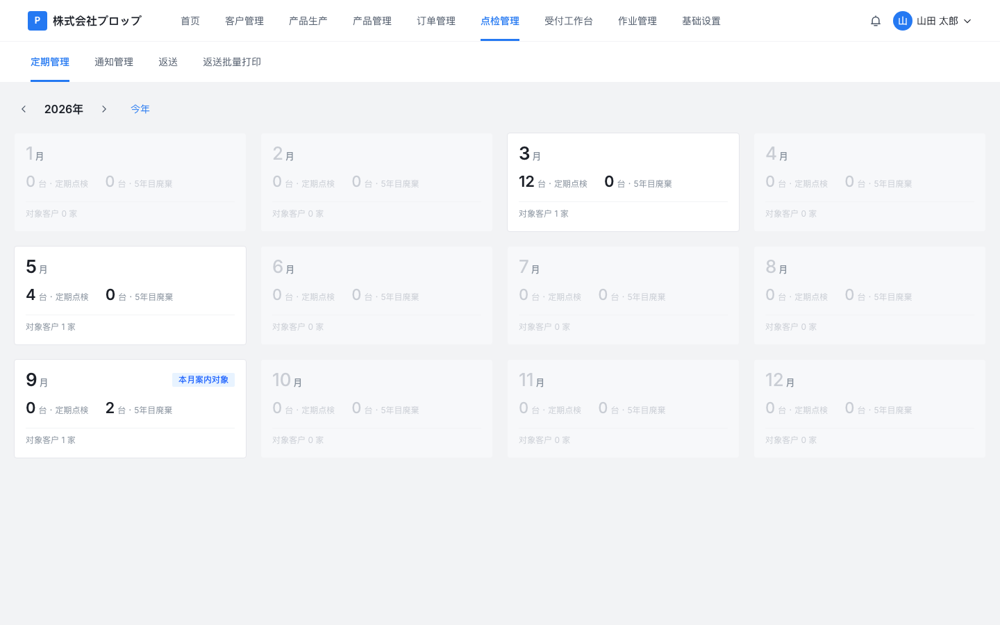
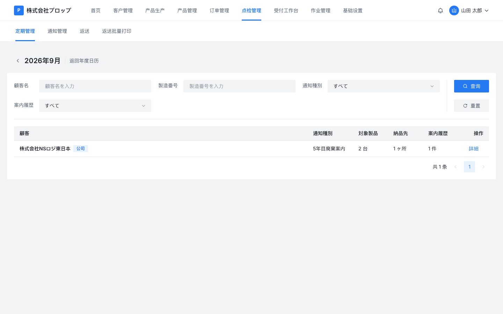
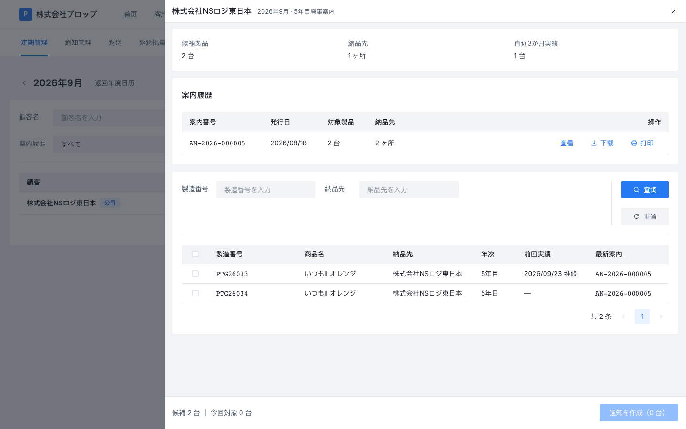
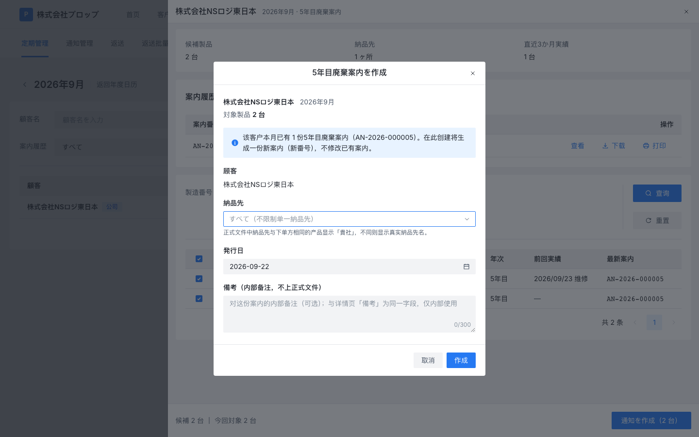

# FEAT-12 定期管理

**状态：Current Truth**

## 1. 模块概述

本 feature 供员工按产品生命周期查找当月应通知客户的对象产品，生成定期点検案内或 5年目廃棄案内。案内是一次实际生成的正式文件事实；一份案内对应一份正式文件，生成后正式内容永久保留，不修改、不覆盖、不作废；内部備考可单独修改。内容有误时重新生成新案内番号的案内，旧案内继续作为历史记录保留。已生成案内的查询与跟踪见 FEAT-13 通知管理。

```text
寄送事实（首次出货） → 产品生命周期基准月
产品当前客户关系 ───┐
点检实绩 ───────────┤
                      ↓
              定期管理年度日历
                      ↓
              月度通知候选
                      ↓
       客户 × 对象月 × 案内種類
                      ↓
              案内作成
                      ↓
  案内事实（案内番号 + 案内文件 + 生成当时的信息；文件版式待正式需求）
                      ↓
          FEAT-13 通知管理
```

## 2. 页面构成

| 页面 | 导航位置 | 主要作用 |
|---|---|---|
| 定期管理年度日历 | 顶部导航「定期管理」 | 按年展示 12 个月生命周期候选台数，并进入月度通知候选 |
| 月度通知需求页 | 年度日历月份卡片 | 按客户、对象月和案内種類查看通知候选及案内履歴 |
| 通知创建抽屉 | 月度通知需求页「詳細」 | 固定客户、对象月和案内種類，勾选对象产品并生成一份新案内 |
| 创建确认弹窗 | 通知创建抽屉「通知を作成」 | 确认顾客、納品先、発行日与内部備考后生成正式案内 |

## 3. 资料项目与规则

本 feature 与 FEAT-13 通知管理共享同一份案内事实。

### 3.1 案内

| 资料项目 | 必填 | 规则 |
|---|---:|---|
| 案内番号 | 自动生成 | 格式为 `AN-YYYY-NNNNNN`：AN + 对象月年份四位 + 年内六位连号。生成案内时取得，员工不填写；重新生成案内取得新番号 |
| 案内種類 | 是 | 定期点検案内或 5年目廃棄案内。两类案内独立生成，不能混入同一份正式文件 |
| 対象月 | 是 | 表示本次案内面向的生命周期月份，格式为 YYYY年MM月 |
| 顧客 | 是 | 本次案内归属的客户。顾客就是产品当前有效订单的下单方，按公司或支店的客户身份归集，不按名称合并。月度候选按该下单方归集；无当前客户关系的产品可查看只读详情，不能生成案内 |
| 納品先 | 否 | 创建确认时可选择本次选中产品的納品先，也可不限制单一納品先。正式文件中纳品先与顾客相同时显示「貴社」，不同则显示真实納品先名；详情页产品表始终显示完整公司名称 |
| 発行日 | 是 | 创建确认时由员工选择，默认当天；只允许选择当天及之后的日期，不能回填过去日期（防止后建案内认领历史受付）。超期判断从该日期起算 |
| 対象製品 | 至少一台 | 通知创建抽屉中勾选的产品集合。创建时须仍属于当前月、当前案内種類和当前客户 |
| 正式 PDF | 自动生成 | 一次确认生成一份正式 PDF。查看、下载、印刷均使用该案内生成时保存的正式文件，不按后续资料变化重新生成。正式 PDF 不含追記事項区域。**版式与具体内容待正式需求；本节只规定文件生成与保留要求** |
| 備考 | 否 | 创建确认弹窗与通知详情页共用同一份内部备注，最多 300 字。仅内部使用，不进入正式文件；创建时填写的作为该案内初始值，详情页保存后覆盖当前值，不改变案内番号、正式 PDF 或対象製品 |
| 作成信息 | 自动记录 | 记录作成时间与操作人，详情页展示；不作为案内修改入口 |

### 3.2 生命周期候选

| 资料项目 | 必填 | 规则 |
|---|---:|---|
| 生命周期基准月 | 自动取得 | 来自产品首次出货月份；无基准月的产品不进入年度日历和月度候选 |
| 年次 | 自动判断 | 出货当年为 0 年目，不产生通知候选；基准月所在年 + 1 至 +4 为定期点検候选；基准月所在年 + 5 为 5年目廃棄候选 |
| 对象月份 | 自动判断 | 只有基准月所在月份与目标月份相同时产生候选 |
| 候选范围 | 自动判断 | 统计处于对应生命周期年次的产品；已报废产品不进入候选、不计台数（报废是生命周期终点）；已回收产品照常进入候选。同一产品按其当前生命周期进入一种案内種類 |
| 案内あり | 自动显示 | 产品在同一对象月和案内種類下至少曾被一份案内包含。该标记不表示当前有效、最终正确、已完成或已发送 |

### 3.3 受付状況

| 资料项目 | 必填 | 规则 |
|---|---:|---|
| 受付済み | 自动取得 | 本案内中的该产品已有符合第 8.5 节匹配规则的有效受付时，显示实际受付日 |
| 未受付 | 自动取得 | 本案内中的该产品尚无符合第 8.5 节匹配规则的有效受付时，显示「未受付」；其他案内已被受付满足，不代表本案内已受付 |
| 1か月以上未受付 | 自动判断 | 到达本案内发行日加 30 天的日期，且该产品仍无匹配的有效受付时计入。旧案内允许持续超期，具体规则见第 8.5 节 |

## 4. 定期管理年度日历

### 4.1 页面作用

按年度展示 12 个月中定期点検与 5年目廃棄的对象台数和对象客户数，帮助员工进入具体月份处理案内候选。

### 4.2 页面入口与去向

从顶部导航「定期管理」进入。点击月份卡片进入该月的月度通知需求页。「通知管理」入口进入已生成案内列表。

### 4.3 页面布局



```text
定期管理年度日历
├─ 年份切换：← ｜ YYYY年 ｜ 今年 ｜ →
└─ 12 个月卡片网格
    ├─ N月
    ├─ 本月案内对象
    ├─ 定期点検台数
    ├─ 5年目廃棄台数
    └─ 对象客户数
```

### 4.4 展示信息

- **年份切换条**：左箭头切换到上一年，右箭头切换到下一年；中间显示「YYYY年」；「今年」回到当前年。
- **月份卡片**：每张卡片显示月份数字「N月」、定期点検台数、5年目廃棄台数和对象客户数「N家」。
- **本月案内对象**：仅当前业务月卡片显示「本月案内对象」蓝色标签。
- **空月**：定期点検台数与 5年目廃棄台数均为 0 时，卡片置灰。
- **统计口径**：定期点検台数统计第 1～4 年目产品；5年目廃棄台数统计第 5 年目产品；对象客户数为该月存在至少一台对象产品的客户去重数，两类合计。已报废产品不计入台数与客户数，与月度候选口径一致。无当前业务关系的产品计入相应类型的产品台数，但「（当前无业务关系）」不算一家客户。

### 4.5 功能

- 点击上一年或下一年 → 切换展示年度 → 12 个月卡片按所选年度刷新。
- 点击「今年」 → 回到当前年 → 当前业务月卡片显示「本月案内对象」。
- 点击月份卡片 → 进入该月份通知需求页 → 可查看客户 × 案内種類的候选行。

### 4.6 校验与反馈

无可编辑输入。没有对象产品的月份仍显示卡片，台数为 0，卡片置灰。

### 4.7 页面产生的数据

无。

## 5. 月度通知需求页

### 5.1 页面作用

按指定对象月列出应创建案内的客户与案内種類组合，并展示该组合下是否已有案内履歴。

### 5.2 页面入口与去向

从年度日历点击月份进入。页头返回按钮回年度日历；各候选行均可点击「詳細」。有当前客户关系时打开通知创建抽屉；「（当前无业务关系）」行打开只读产品列表。

### 5.3 页面布局





```text
返回 ｜ YYYY年M月
└─ 返回年度日历
├─ 筛选区：顧客名 / 製造番号 / 通知種別 / 案内履歴 / 查询 / 重置
└─ 候选列表
    ├─ 顧客
    ├─ 通知種別
    ├─ 対象製品
    ├─ 納品先
    ├─ 案内履歴
    └─ 操作
```

### 5.4 展示信息

- **页头**：标题为「YYYY年M月」，副标题为「返回年度日历」。
- **筛选区**：固定四项条件：顧客名、製造番号、通知種別、案内履歴，并显示「查询」「重置」。
- **顧客名**：文本输入，按客户名部分匹配。
- **製造番号**：文本输入，按製造番号部分匹配，不匹配 M番号。命中组内任一产品即展示整个客户与案内種類分组；该行台数仍为组内全部候选台数。进入详情显示该组全部候选产品，不自动继承月度页的编号条件。
- **通知種別**：选项为 すべて、定期点検、5年目廃棄。
- **案内履歴**：选项为 すべて、なし、あり；なし 表示该客户、该对象月、该案内種類没有任何案内；あり 表示至少存在 1 份案内。
- **候选列表**：一行表示一个客户 × 一个案内種類。同一客户当月同时有两类候选时显示两行。
- **顧客列**：显示客户名，加粗；同时显示公司或支店标签，公司为蓝色，支店为紫色。
- **通知種別列**：显示定期点検或 5年目廃棄。
- **対象製品列**：显示「N台」。
- **納品先列**：显示「Nヶ所」；为 0 时显示「—」。
- **案内履歴列**：无历史显示「なし」；有历史显示「N件」。
- **操作列**：统一显示「詳細」。无当前客户关系的产品集合归入「（当前无业务关系）」行，可进入只读产品列表，不可勾选产品或发通知。
- **分页与空态**：每页 20 条；无结果时显示「YYYY年M月没有符合条件的通知候选」。

### 5.5 功能

- 输入筛选条件并点击「查询」 → 按四项条件组合展示候选行 → 案内履歴按客户、对象月、案内種類判断。
- 点击「重置」 → 四项条件恢复默认 → 展示该月全部候选行。
- 点击可用行「詳細」 → 打开通知创建抽屉 → 抽屉固定为该客户、对象月和案内種類。
- 点击「（当前无业务关系）」行的「詳細」 → 打开只读产品列表 → 仅供查看，不生成案内。

### 5.6 校验与反馈

筛选无匹配时显示空态，不创建案内。无当前客户关系的候选行可查看只读详情，但不得勾选产品或生成案内。

### 5.7 页面产生的数据

无。

## 6. 通知创建抽屉

### 6.1 页面作用

在固定客户、对象月和案内種類下，从候选产品中勾选本次要包含的产品，并进入创建确认。抽屉只负责本次案内对象选择，不负责修改历史案内、作废案内、审批、发送状态或客户资料维护。

### 6.2 页面入口与去向

从月度通知需求页点击「詳細」打开。点击历史案内的「查看」打开只读案内查看；点击「下载/打印」使用该案内生成时保存的正式文件。点击底部「通知を作成（M 台）」打开创建确认弹窗；创建成功后显示成功弹窗，关闭后同时关闭抽屉并返回月度通知需求页。

### 6.3 页面布局

```text
通知创建抽屉：客户名 + 月份 + 案内種類
├─ 数据统计
│   ├─ 候補製品
│   ├─ 納品先
│   └─ 直近3か月実績
├─ 案内履歴
│   └─ 案内番号 / 発行日 / 対象製品 / 納品先 / 操作
├─ 筛选及候选产品
│   ├─ 製造番号 / 納品先 / 查询 / 重置
│   └─ 产品表
└─ 底部：候補 N 台 ｜ 今回対象 M 台 ｜ 通知を作成（M 台）
```

### 6.4 展示信息

- **标题**：客户名、月份和案内種類。客户、月份和案内種類在抽屉内不可切换。
- **数据统计卡片**：一行三列显示候補製品「N台」、納品先「Nヶ所」、直近3か月実績「N台」，标签在上，数值在下。
- **案内履歴卡片**：范围为当前客户、对象月和案内種類。按発行日倒序显示历史案内；列为案内番号、発行日、対象製品「N台」、納品先「Nヶ所」、操作。无历史时固定显示「案内履歴はありません」，不隐藏区域。
- **案内履歴操作**：只允许「查看」与「下载/打印」。查看打开只读案内内容；下载/打印使用该案内生成时保存的正式文件。
- **筛选及列表卡片**：筛选项为製造番号和納品先，均为部分匹配；筛选只影响当前显示的候选产品，不改变已勾选结果。
- **候选产品表**：列为勾选框、製造番号、商品名、納品先、年次、前回実績、最新案内。
- **产品状态标识**：已回收且未再派发新订单的产品无当前客户关系，归入「（当前无业务关系）」行并在製造番号旁显示「已回收」；回收后已再派发新订单的产品不带任何标识，正常归到新客户名下。已报废产品不进入候选，不显示任何标识。状态标识只出现在候选阶段，已生成案内的详情与正式 PDF 不回写产品当前状态。
- **年次**：定期点検显示第 1～4 年目；5年目廃棄显示第 5 年目。
- **前回実績**：显示该产品最近一次已完成的售后定期点检或维修的完成日期与业务类型；不把生产质检、单纯受付、报告生成、返送、回收或报废当作点检／维修完成。无相应实绩显示「—」。仅供参考，不改变候选资格。
- **直近3か月実績口径**：范围为所选对象月及之前两个完整月份，例如对象月为 9 月时取 7 月 1 日至 9 月 30 日；统计本组全部候选产品中，期间至少完成一次售后点检或维修的产品台数。同一产品多次完成只计一台，抽屉内筛选不改变此统计。完成与完成日期沿用作业管理规则，不在通知模块另设完成动作。
- **最新案内**：显示该产品最近一次被同类型案内包含的案内番号；提示中展示案内番号与発行日。无记录时显示「—」。
- **默认勾选**：未被本月同类型案内包含的产品默认勾选；已被包含的产品不默认勾选，但可手动勾选再次通知。
- **底部汇总**：显示候補 N 台、今回対象 M 台，以及「通知を作成（M 台）」按钮。

### 6.5 功能

- 输入製造番号或納品先并点击「查询」 → 候选产品表只显示匹配行 → 已勾选产品在筛选前后保持勾选结果。
- 点击「重置」 → 清空抽屉内筛选条件 → 恢复候选产品展示。
- 勾选或取消勾选产品 → 今回対象台数随全部已选产品更新 → 不要求填写原因。
- 点击全选 → 只作用于当前筛选可见行 → 不改变不可见行的既有勾选结果。
- 点击案内履歴「查看」 → 打开该案内的只读内容 → 不允许编辑。
- 点击案内履歴「下载/打印」 → 使用该案内保存的正式 PDF → 不按当前资料重新生成。
- 点击「通知を作成（M 台）」 → 在已选产品大于 0 时打开创建确认弹窗。

### 6.6 校验与反馈

今回対象为 0 台时，「通知を作成（0 台）」不可用。抽屉内不提供修改、修正版、作废、删除、设为当前、覆盖、草稿、审批、发送状态或切换客户、月份、案内種類的入口。

### 6.7 页面产生的数据

无。勾选结果只有在创建确认弹窗确认成功后，才成为新案内的対象製品。

### 6.8 「（当前无业务关系）」详情

本节为无当前客户关系时的独立展示规则；上述统计、案内履歴、勾选和通知创建规则不适用于此详情。

- **内容范围**：只显示产品列表及其製造番号查询、重置操作，不显示数据统计、案内履歴或底部通知操作区。
- **列表字段**：製造番号、商品名、年次、前回実績。已回收且未再派发的产品在製造番号旁显示「已回收」。
- **納品先**：不显示筛选项，也不显示列表列。
- **操作限制**：没有单行勾选、全选和「通知を作成」入口，不可从此详情创建或发送通知。
- **业务结果**：查看、查询和重置均不建立或修改任何业务记录。

## 7. 创建确认弹窗

### 7.1 页面作用

确认本次案内的顾客、納品先、発行日和内部備考，并生成一份新案内及正式 PDF。本弹窗及通知详情均不提供寄送住所、連絡先・担当者；PDF 版式与内容待正式需求。

### 7.2 页面入口与去向

从通知创建抽屉底部「通知を作成（M 台）」进入。取消返回抽屉且不生成案内；确认成功后显示成功弹窗，展示案内番号、下载/打印入口和「閉じる」。

### 7.3 页面布局

```text
案内種類を作成
├─ 客户名 / 月份 / 対象製品 N台
├─ 已有案内履歴提示（需要时）
├─ 顾客（只读）
├─ 納品先
├─ 発行日
├─ 備考（内部备注，不上正式文件）
└─ 取消 ｜ 作成
```

### 7.4 展示信息

- **标题**：案内種類 +「を作成」。
- **摘要**：显示客户名、月份和本次选中产品数「対象製品 N台」。
- **已有案内履歴提示**：若该客户本月已有该类型案内，提示已有 N 份，列出案内番号，并说明「在此创建将生成一份新案内（新番号），不修改已有案内」。
- **顾客**：只读显示当前候选分组的下单方名称，不提供选择或编辑。需要为其他顾客创建时返回月度列表进入对应分组。
- **納品先**：下拉选择，可清空。候选来自本次选中产品的納品先，默认「すべて（不限制单一納品先）」。下方提示「正式文件中納品先与下单方相同的产品显示『貴社』，不同则显示真实納品先名」。
- **発行日**：日期选择，默认当天；只允许选择当天及之后的日期。
- **備考**：可选多行文本，最多 300 字，仅内部使用、不进入正式文件；与通知详情页「備考」为同一份备注，创建时填写的内容作为该案内備考的初始值。

### 7.5 功能

- 确认只读顾客，选择納品先、発行日，填写内部備考 → 点击作成 → 通过校验后生成一份新案内和正式 PDF。
- 点击取消 → 关闭弹窗 → 不生成案内，抽屉勾选结果仍可继续调整。
- 成功弹窗点击下载/打印 → 使用新案内的正式 PDF。
- 成功弹窗点击「閉じる」 → 关闭成功弹窗和通知创建抽屉 → 月度通知需求页刷新案内履歴。

### 7.6 校验与反馈

顾客固定为当前分组的下单方。创建时再次检查选中产品仍属于当前月、当前案内種類和当前客户；不符合时不得生成案内。一次确认只生成一份完整案内和正式 PDF，不产生半成品。生成失败时保留本次选中产品与填写内容，说明失败原因并允许重试；未成功不显示成功提示。同一次操作重复点击或重试不得意外生成多份案内；员工明确再次创建时才产生另一份。

本次所有产品必须仍属于当前顾客，即其当前订单的下单方与本分组一致；缺少有效订单关系或已变更下单方时阻止生成，提示返回重新查询，不允许通过更换顾客继续创建。納品先选择只决定本次采用的抬头信息，不增减勾选产品、不覆盖各产品实际納品先；需要分开发通知时返回抽屉分别勾选。PDF 抬头具体排版待正式需求。

### 7.7 页面产生的数据

确认成功后建立一份新案内：取得新案内番号，保存案内種類、対象月、顧客、納品先、発行日、対象製品、作成信息和正式 PDF；创建时填写的備考作为该案内備考的初始值（仅内部使用）。既有案内不修改、不覆盖、不删除、不作废。正式 PDF 中不出现追記事項区域。

## 8. 跨页面统一规则

### 8.1 案内事实

一份案内等于一次实际生成的正式通知文件事实。案内生成后正式内容永久保留，不修改、不覆盖、不作废；内部備考可单独修改。需要纠正时重新生成一份新案内，新案内取得新案内番号；旧案内继续保留并可查看、下载、印刷。

### 8.2 无版本与无有效状态

本模块不维护修正版、版本历史、当前有效版、有效状态或作废状态。多份案内之间不判断哪份正确、哪份当前有效或哪份已被替代。

### 8.3 两类案内独立

定期点検案内用于第 1～4 年目产品，5年目廃棄案内用于第 5 年目产品。候选查询可在同一页面统一查看，但正式案内按类型独立生成，不允许两类产品混入同一份正式文件。

### 8.4 生命周期与候选月份

生命周期基准月为首次出货月。出货当年为 0 年目；第 1～4 年目进入定期点検候选；第 5 年目进入 5年目廃棄候选。只有基准月所在月份与目标月份相同时才产生候选。

### 8.5 受付与超期判断

受付状況按每份案内中的每台対象製品分别判断，不以产品历史上是否曾经受付作为依据。

**受付匹配规则**

- 受付日期必须在该案内发行日当天或之后；发行日前的受付不能满足该案内。
- 一次受付只满足该产品在受付发生时已发行、且包含该产品的最新一份案内。员工无需手动选择案内番号。
- 受付发生后新发行的案内，不能使用此前的受付满足；新案内发行也不会把已经匹配旧案内的受付转移过去。
- 同一产品出现在多份案内中时，匹配最新案内的受付不会同时满足更早的案内。

**超期判断规则**

- 超期日期为发行日加 30 天，不按自然月计算；按日本业务日期判断，到达该日期即开始判断超期。
- 到达超期日期仍无匹配的有效受付，该产品计入本案内的超期未受付；尚未到达时为未受付。
- 有匹配的有效受付后，该产品在对应案内中显示受付済み和实际受付日，不再计入该案内超期。
- 旧案内不因新案内发行、新案内被受付满足而解除超期；没有匹配受付的旧案内允许一直显示超期。
- 现有「1か月以上未受付」「1か月超」显示文案均按上述 30 天规则解释。

例如：同一产品先后收到 9 月 1 日和 9 月 10 日发行的案内，9 月 15 日受付，只满足 9 月 10 日的案内。9 月 1 日的案内仍未受付，10 月 1 日起计入超期；之后发行的新案内也不能使用 9 月 15 日的受付满足。

**匹配边界**

- 有效受付指已经建立且未删除、未作废的小番号记录。只收到空包裹或建立空大番号不算受付；不要求完成登记、作业、报告或返送。
- 受付日期使用该小番号所属大番号的实际受付日期。以该受付发生时已经生成、发行日不晚于受付日期的案内为范围；补填较早发行日不能使后来生成的案内满足过去的受付。
- “最新”先按发行日由近到远确定，同一发行日按实际生成先后取最后一份；生成先后须能唯一确定。未来发行日的案内在到达发行日前不参与匹配。
- 匹配不额外限制案内種類或本次受付类型：点检与廃棄案内均在候选范围内。这里表示产品已实际来件，不表示已经完成点检或确认报废。
- 最新案内已有受付时，之后的受付也不向前补配旧案内。同一案内有多次匹配的有效受付时，显示最早一次实际受付日期。
- 匹配受付被删除或作废后，如仍有其他匹配的有效受付，显示其中最早日期；如已没有，恢复未受付，并按原发行日加 30 天判断是否超期。不得将其他案内的受付转来填补。
- 实际受付日期更正后，按更正后的受付事实重新判断；后生成的案内仍不得追溯匹配此前已发生的受付。

### 8.6 生成内容的保留规则

案内生成时保存本次顾客、納品先、対象製品和正式 PDF。客户、产品资料之后变化，不回写既有案内内容。備考是可单独修改的内部备注，不改变正式文件内容，也不进入正式文件。

### 8.7 「貴社」显示规则

「貴社」只用于正式 PDF：产品納品先与下单方相同时显示「貴社」，不同时显示真实納品先名。通知详情页的対象製品表中，納品先始终显示完整公司名称。

### 8.8 案内履歴口径

案内履歴按客户、对象月和案内種類统计实际生成过的案内份数。产品级「最新案内」只表示该产品最近一次被同类型案内包含，不表示通知完成、当前有效或已发送。

## 9. Feature 边界与明确不做

本模块负责生命周期候选发现、案内创建、案内查询、超期未受付跟踪、通知详情、正式 PDF 入口与内部備考。受付事实由受付模块负责；产品生命周期基准月来自寄送模块首次出货；客户主档由客户管理负责；产品档案由产品管理负责。本模块只读取这些事实，不生产受付事实，不维护客户主档和产品档案。

明确不做：

- 通知修改、修正版、版本历史、当前有效版。
- 通知作废、有效状态、恢复。
- 通知草稿、审批、发送状态、已读状态、未读状态。
- 跳过原因、永久排除。
- 两类通知混入同一份文件。
- 通知创建抽屉内切换客户、月份、通知类型。
- M番号筛选、商品名筛选、直近実績筛选。
- 月度页以页签区分定期点検和 5年目廃棄。
- 列表页顶部以页签区分类型。
- 「案内作成状況」列。
- 「初回案内」列。
- 「未受付」统计项。
- 页头「通知を表示」按钮。
- 備考追加日志。
- 多份通知间判断哪份正确、当前有效或已被替代。
- 产品作废功能。已确认报废的产品不进入候选，也不计入候选台数。

## 10. 核对记录

- 2026-09-23：按二级导航粒度自 10-定期管理与通知 拆分为本 feature（FEAT-12）；内容不变，章节与交叉引用已重编号。

- 2026-09-22：顾客明确为当前订单下单方；生成弹窗改只读顾客，详情删除重复注文者。删除多注文者选择及跨下单方同案内的旧方案，资格变化时返回重新查询。PDF 内容仍待正式需求。


- 2026-09-22：按用户裁决，通知详情删除寄送住所、連絡先・担当者及对应空白项目；同步删除资料项目和验收中的显示要求，納品先保留。PDF 内容继续待正式需求。

- 2026-09-22：按用户授权补齐业务边界：最新案内取发行日优先、同日按实际生成先后；有效受付按小番号存在判断，删除后重新观察原案内；跨案内类型只判断来件；超期汇总产品去重；无关系产品不计客户家数；月度搜索定位整组；实绩限定售后点检／维修；抬头选择不改变勾选产品；生成失败保留输入且避免重复生成。以上为本轮补充方案，待用户审核。
- 实现差距：本轮只改文档。现有实绩读取生产质检，须改为上述售后实绩；受付匹配、30 天判断及去重统计须按规则验证，不能因文档完成而认定页面通过。PDF 版式与内容待正式需求。

- 2026-09-22：按用户裁决修订受付匹配与超期规则：受付只能满足发生时已发行的最新案内，受付日期不得早于发行日；超期按发行日加 30 天，旧案内允许持续超期。本轮仅修改文档，现有页面的受付接入和自然月算法尚待按本规则调整；同日案内先后及受付删除后的处理待确认。

- 2026-09-22：根据用户确认及月度需求页、详情抽屉当前展示，补充「（当前无业务关系）」可进入只读产品列表的规则；删除「需补关联、不可进入详情」旧表述，并同步验收用例。

- 2026-09-22：按 `FEAT-12 定期管理／FEAT-13 通知管理/subagent-brief.md`、模板、年度日历、月度通知需求页、通知创建抽屉、创建确认弹窗、通知管理列表、通知详情及通知核心模型完成静态核对并撰写本稿。
- 2026-09-22：通知候选中已报废／已回收产品的展示裁决落地，同日按业务复核收敛——已报废产品不进入候选、不计台数，候选表无任何报废标识（报废是生命周期终点，不留在待通知清单制造噪音）；已回收且未再派发的产品归入「（当前无业务关系）」行并带「已回收」标识，回收后已再派发的正常归到新客户名下、不带标识；状态标识只在候选阶段展示，不回写已生成案内。同步删除产品主档作废状态的残留字段与分支（报废事实由受付报废记录表达）。
- 2026-09-22：创建确认弹窗收敛。寄送地址／联系人经两次裁决确定为 PROP 自身信息、不从客户主档带入，本期留空，PDF 具体内容待正式需求（预览界面为临时内容）；弹窗中的「追記事項」改为「備考」，与详情页備考为同一内部字段（最多 300 字，仅内部使用）；正式 PDF 不出现追記事項区域。
- 2026-09-23：补审复核追加（用户裁决）：発行日只允许选择当天及之后（杜绝后建案内回填过去日期认领历史受付）；「前回実績」按实际受付类型显示日期＋「点検／维修」，修复维修误显示为点検的实现缺陷。
- 2026-09-23：补审修复落地（用户逐条裁决）：demo 侧——受付事实接入真实受付记录（受付只满足发生时已发行且包含该产品的最新案内，受付日＝所属大番号实际受付日，超期＝発行日＋30 天）、实绩改从受付侧读取（售后点检／维修受付，不再使用生产质检记录）、案内顧客显示统一为生成时快照、创建确认弹窗按钮「取消｜作成」、案内種類名「5年目廃棄案内」；文档侧——禁词清理、PDF 表述全局统一为「待正式需求」（A3 裁决，demo 提示语不改）。
- 核对重点 1：本文按「一份案内 = 一份正式文件」写入，案内永不修改、覆盖或作废；纠正只能重新生成新案内番号；不设版本概念、有效状态或作废状态。
- 核对重点 2：案内番号规则为 `AN-YYYY-NNNNNN`；生命周期候选按首次出货月、第 1～4 年目定期点検、第 5 年目 5年目廃棄、仅基准月份产生候选。
- 核对重点 3：「貴社」仅用于正式 PDF；详情页対象製品表的納品先显示完整公司名称。
