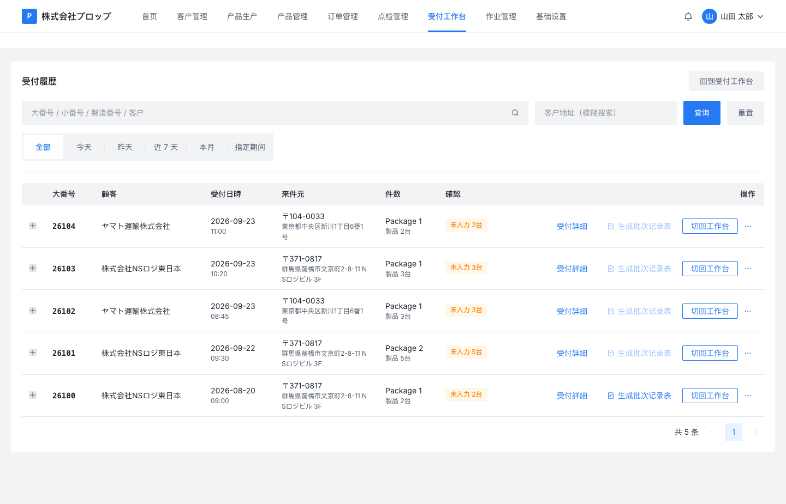
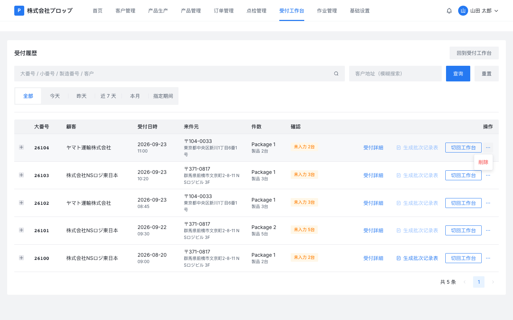
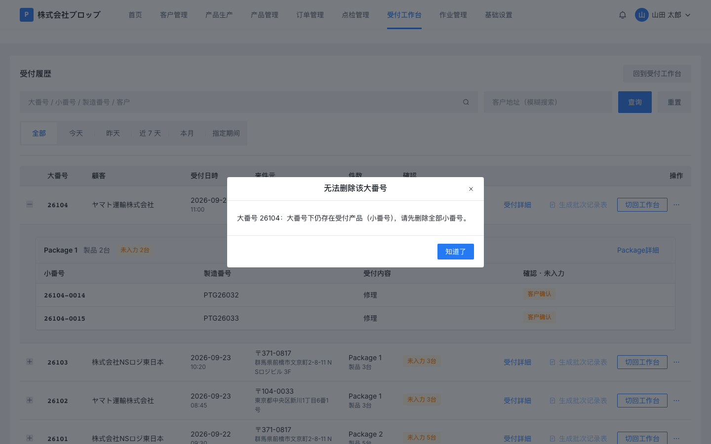
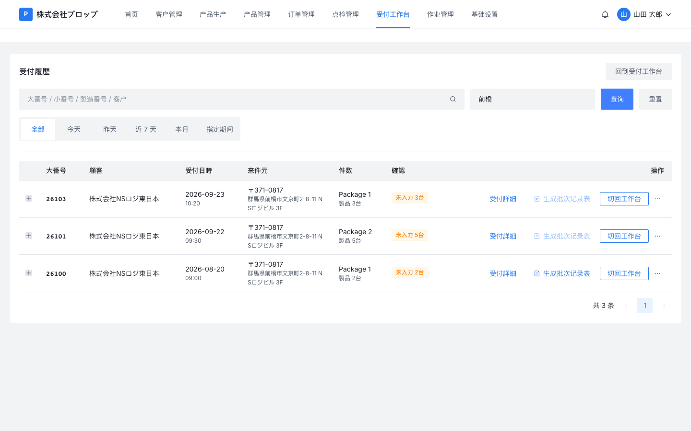

# FEAT-15 受付履历

**状态：Current Truth（批次记录表模板为目标稿，待正式定稿）**

## 1. 模块概述

本 feature 供员工按大番号、客户、地址、产品和日期查询受付批次，展开包裹与产品，查看详情，生成批次记录表，删除符合条件的大番号。受付批次、大番号、包裹与小番号由 FEAT-14 受付工作台建立和维护；本 feature 查询并呈现同一份受付事实。

## 2. 页面构成

| 页面 | 导航位置 | 主要作用 |
|---|---|---|
| 受付履歴 | 顶部导航「受付履歴」 | 按大番号、客户、地址、产品和日期查询受付批次，展开包裹与产品，查看详情，生成批次记录表，删除大番号 |

## 3. 资料项目与规则

本 feature 与 FEAT-14 受付工作台共享同一份受付事实。

### 3.1 大番号

| 资料项目 | 必填 | 规则 |
|---|---:|---|
| 大番号 | 自动生成 | 格式为年 2 位 + 年内连番 4 位，一个受付批次一个号。按当年最大号加 1 取得 |
| 受付日時 | 自动记录 | 表示大番号建立时间，用于履歴排序、年度完成日期和最近业务显示 |
| 受付完了日時 | 否 | 员工点击「完成本批次受理」并通过校验时记录。只表示首次收件范围登记结束；记录后不清除、不覆盖，不自动完成作业、报告或返送 |
| 公司名称 | 是 | 本次实际来件来源的公司名称。建立时可从客户主档或第一台产品当前订单关系带出候选值，员工按面单或现场情况确认；保存后只影响本大番号 |
| 納品先 | 否 | 本次来件相关的納品先信息。确认来件信息时由第一台产品当前订单关系带出候选值，保存为本大番号来件记录；左侧参考中的納品先读取本大番号来件记录，未保存时回退第一台产品当前订单关系 |
| 来件邮编 | 否 | 本次实际来件来源的邮编，保存为本大番号来件记录 |
| 来件地址 | 是 | 本次实际来件来源地址，员工按面单或现场情况确认；保存后不回写客户或订单主数据 |
| 来件地址补充 | 否 | 建筑名等补充地址，保存为本大番号来件记录 |
| 联系人姓名 | 否 | 本次来件联系人，保存为本大番号来件记录 |
| 联系电话 | 否 | 本次来件电话，保存为本大番号来件记录 |
| 来件备注 | 否 | 大番号层级备注，在编辑大番号弹窗维护 |
| 大番号画像 | 否 | 与大番号相关的图片，可追加、预览和删除；与包裹图片分开保存 |

### 3.2 包裹

| 资料项目 | 必填 | 规则 |
|---|---:|---|
| 包裹序号 | 自动生成 | 在同一大番号内从 1 起递增。删除包裹后其他包裹序号不重排；新增包裹取现有最大序号加 1 |
| 包裹名称 | 自动生成 | 页面显示为 Package N 或包裹 N，用于区分同一大番号下的实际物理包裹 |
| 包裹备注 | 否 | 包裹层级备注。新建批次前置流程确认来件信息时填写的受付备注保存到包裹 1 |
| 包裹图片 | 否 | 包裹面单、外箱或开箱相关图片，可多张，支持删除 |
| 所属大番号 | 自动关联 | 每个包裹必须属于一个大番号。包裹删除不影响小番号计数 |

### 3.3 单台受付

| 资料项目 | 必填 | 规则 |
|---|---:|---|
| 小番号 | 自动生成 | 受付台账年度内连续整数，从 1 起，每台来件加 1；跨批次、跨包裹不重置；新年度从 1 重新起号。删除后不复用，允许空号。显示时固定 4 位补零，超过 9999 按自然位数显示 |
| 受付番号 | 自动显示 | 单台身份为大番号 + 小番号，显示形态为「大番号-小番号4位」 |
| 製造番号 | 是 | 通过扫描或输入识别产品。扫描本身不建立单台受付；点击「受付を開始」或在前置流程确认后才建立 |
| 所属包裹 | 是 | 单台受付必须属于一个包裹。包裹归属通过大番号下的包裹关系表达 |
| 受付类型 | 是 | 可多选定期点检、维修、租赁结束；报废与前三项互斥 |
| 年度完成情况 | 条件必填 | 受付类型含定期点检且非报废时必填。一次受付最多对应 1 个年度，范围为 1～4年目 |
| 本次作业 | 条件必填 | 已选择受付类型且非报废时必填，可多选标准点检・维修、展开维修、クリーニング |
| 异常 / NG | 否 | 非报废受付可登记异常/NG。每项包含内容与最多 1 张照片，是受付阶段的正式异常事实 |
| 受付备注 | 条件必填 | 客户确认为「需要向客户确认」时至少 1 条；其他情况下可为空。备注保留录入人和日期 |
| 临时装箱 | 是 | 填写本次临时装箱箱数，必须为 1 以上整数 |
| 客户确认 | 是 | 选择「不需要确认」或「需要向客户确认」。再次点击可取消选择 |
| 产品处理计划 | 条件必填 | 客户确认为「不需要确认」时必填，可选返回客户、PROP回收、报废。客户确认为「需要向客户确认」时允许暂空。处理计划只是受付人员当前判断，不产生回收或报废事实 |

## 4. 受付履歴

### 4.1 页面作用

受付履歴用于按大番号、客户、地址、产品和日期查询受付批次，以大番号为主表展开包裹和产品，查看大番号与包裹详情，生成批次记录表，并按规则删除大番号。

### 4.2 页面入口与去向

从顶部导航「受付履歴」进入，也可从受付工作台携带上下文进入。右上「回到受付工作台」按钮携带来时上下文返回。客户详情的「关联业务」快捷链接可带关键词进入并立即查询。

### 4.3 页面布局






```text
受付履歴
├─ 标题卡片：受付履歴 / 回到受付工作台
├─ 筛选区：关键词 / 客户地址 / 日期快捷页签 / 查询 / 重置
├─ 产品命中提示
├─ 大番号主表
│   └─ 展开区：Package 分组 + 产品子表
├─ 大番号詳細抽屉
├─ Package詳細抽屉
├─ 生成批次记录表弹窗
└─ 记录表历史弹窗
```

### 4.4 展示信息

#### 筛选区

- 关键词搜索框内提示文字为「大番号 / 小番号 / 製造番号 / 客户」，回车或点击查询生效。大番号和客户名命中大番号本体；小番号和製造番号命中产品。
- 客户地址搜索框内提示文字为「客户地址（模糊搜索）」，匹配大番号来件元信息中的邮编和地址。输入为 7 位数字（可带连字符）时按邮编严格匹配；其余输入按地址部分匹配。
- 显示「查询」主按钮和「重置」按钮；重置清空全部条件并将日期页签回到「全部」。
- 日期快捷页签为按钮式单选：全部、今天、昨天、近 7 天、本月、指定期间。默认选中「全部」。选指定期间时出现开始/结束日期，年、月、日均为下拉；起止均完整且结束不早于开始后随查询生效。
- 产品命中时显示「产品编号命中 N 台，已自动展开对应大番号」，命中的大番号自动展开，命中产品行浅主色背景并带左侧主色线高亮，同时滚动定位。

#### 主表

- 大番号粒度，按受付日時倒序，分页每页 10 条并显示总数。
- 固定列为大番号、顧客、受付日時、来件元、件数、確認、操作。
- 顧客无值时显示「未确认客户」。
- 受付日時以日期和时间两行显示。
- 来件元以「〒邮编」和地址两行显示。
- 件数以 Package N 和製品 N台两行显示。
- 確認列显示未入力 N台橙色、⚑ 要確認 N台紫色；无则显示「—」。
- 操作列显示受付詳細、记录表历史、生成批次记录表、切回工作台和「···」下拉。下拉中危险色操作为「削除」。
- 点击行展开或收起包裹区。

#### 展开区

- 按包裹序号升序分组。
- 包裹头显示 Package N、製品 N台、未入力 N台、⚑ 要確認 N台和 Package詳細。
- 产品子表按小番号升序；列为小番号、製造番号、受付内容、確認・未入力。
- 小番号显示连写形态。
- 受付内容按固定顺序「定期点检・维修・租赁结束・报废」连接；定期点检含年度时追加「· N年目」。
- 確認・未入力列显示 ⚑ 要確認紫色标签和缺失项逐项橙色标签；无则显示「—」。

#### 抽屉与弹窗

- 大番号詳細抽屉只展示大番号层级事实：本次来件公司/客户、受付日時、受付完了日時、来件地址、联系人、电话、大番号备注和大番号图片；无图片显示「无图片」。
- Package詳細抽屉只展示包裹层级事实：所属大番号、Package、产品数、Package备注和Package图片。
- 生成批次记录表弹窗显示发行日，默认当天；说明为「生成后冻结当前批次事实」。生成后打开记录表查看，展示版本号、发行日、模板版本、客户、受付时间、来件地址、联系人，以及按包裹分组的折叠产品表，小番号、製造番号、受付类型、异常・NG。
- 记录表历史弹窗显示版本 vN、发行日、生成时间和查看操作。

### 4.5 功能

- 输入关键词、客户地址或日期条件并查询 → 展示符合条件的大番号 → 产品命中时自动展开并定位产品行。
- 点击重置 → 清空条件，日期回到「全部」 → 展示默认结果。
- 点击「受付詳細」 → 打开大番号詳細抽屉 → 只查看大番号层级事实。
- 点击「Package詳細」 → 打开Package詳細抽屉 → 只查看包裹层级事实。
- 点击「生成批次记录表」 → 选择发行日并确认 → 生成一份新的版本化批次记录表并打开查看。
- 点击「记录表历史」 → 查看已生成记录表版本 → 可查看指定版本。
- 点击「切回工作台」 → 打开该大番号的工作台。
- 点击「削除」 → 按大番号删除规则校验 → 允许时删除大番号及其空包裹和批次记录表。

### 4.6 校验与反馈

- 指定期间必须开始日期和结束日期均完整，且结束日期不早于开始日期。
- 未完成首次登记的大番号不能生成批次记录表，悬停提示「请先在受付工作台完成本批次受理」。
- 已完成首次登记的大番号生成批次记录表时提示「按当前事实生成新版本」。
- 大番号下仍有小番号时不得删除，提示「大番号下仍存在受付产品（小番号），请先删除全部小番号」。

### 4.7 页面产生的数据

普通查询、展开、查看抽屉、返回工作台不建立或更正业务记录。生成批次记录表会新增一份版本化批次记录表，并冻结生成时的批次事实。删除大番号会删除该大番号及其全部空包裹、包裹图片、备注和批次记录表。

## 5. 跨页面统一规则

### 5.1 编号规则

- 大番号格式为 `[YY][NNNN]`，一个受付批次一个号，按年内最大号加 1 取得。
- 小番号为受付台账年度内连续整数，从 1 起，每台来件加 1；跨批次、跨包裹不重置；新年度从 1 重新起号。删除后不复用，允许空号。
- 小番号取得时为年度内连续数字；页面显示固定 4 位补零，超过 9999 按自然位数显示。
- 单台身份为大番号 + 小番号，连写形态为「大番号-小番号4位」。
- 包裹序号在大番号内从 1 起递增，删除包裹后不重排其他包裹序号；新增取现有最大序号加 1。
- 删除大番号不影响小番号计数。

### 5.2 未入力

未入力用于判断当前受付在其业务条件下仍缺少的必要输入。只有「适用、必填、缺失」同时成立时计入。

| 项目 | 计入条件 |
|---|---|
| 受付类型 | 未选择任何受付类型 |
| 年度完成情况 | 受付类型含定期点检但未选择年度，报废时跳过 |
| 本次作业 | 已选受付类型但本次作业为空，报废时跳过 |
| 客户确认 | 未选择 |
| 产品处理计划 | 客户确认为不需要确认，且处理计划为空 |
| 受付备注 | 客户确认为需要向客户确认，且备注为 0 条 |
| 临时装箱 | 未填写箱数 |

- 报废类型跳过年度完成情况、本次作业和异常/NG相关检查。
- 不计入未入力：无 NG、NG 无图、普通备注空、图片少、无关联通知、无历史维修、无当前订单关系、需要确认时处理计划空、作业未完、未返送、未回收、未报废。
- 包裹和大番号层只显示「未入力 N台」，统计至少缺 1 项的台数，不显示字段缺失总数。
- 产品层可显示具体缺失项名。

### 5.3 ⚑ 客户确认旗标

- 单台受付选择「需要向客户确认」且未作废时，该受付显示 ⚑。
- 所属包裹页签显示 ⚑。
- 受付履歴中对应大番号的「確認」列显示「⚑ 要確認 N台」。
- 改为「不需要确认」后，旗标自动消失；已填写的受付备注保留。
- 旗标只判断「未作废且需要向客户确认」，不判断该产品是否已回收或已报废。已回收/已报废的受付只要仍标记为需要确认，旗标照常显示；若不希望显示，需在受付工作台把该受付的「需要向客户确认」取消（改为不需要确认或取消选择）。
- 员工不能手工增删旗标；左侧产品标题不另设「需要客户确认」文字标签。

### 5.4 年度口径

- 一次受付最多对应 1 个年度，范围为 1～4年目。
- 受付类型含定期点检时必选年度；不含定期点检时为空；报废时不适用。
- 基准月为首次出货月。N年目为基准月加 N 年；出货当年为 0 年目。
- 年度选项按基准月推算目标月并显示。
- 哪些年度不能选：同一台产品如果在之前的其他受付里已经登记过某个年度（例如上次来件登记了第 2 年），那么这次新受付里该年度就置灰、不能再选——因为那一年已经做完了，不能重复登记。判断时只看其他未作废的受付。
- 当前这条受付不受这个限制：员工给本次受付选了某个年度后，如果重新打开想改，他自己选过的那个年度仍然可选、可以改回去或改选别的。不能因为「自己已经选过」就把这个年度锁死，否则员工将无法修改。
- 年度完成日期以所属大番号受付日時为准。
- 左卡生命周期只读显示基準月、出荷後 X 年 Y か月和点検済み，不显示次回予定；点検済み取本台产品历史受付中已填写年度的集合（排除当前编辑中与已作废记录），升序以「・」连接，无记录显示「—」。

### 5.5 受付类型与处理计划联动

- 受付类型可多选定期点检、维修、租赁结束。
- 报废与定期点检、维修、租赁结束互斥；选择报废时清空其他类型，选择其他类型时清掉报废。
- 选择报废后，产品处理计划默认报废。
- 取消受付类型里的「报废」时，如果产品处理计划当时正好是「报废」（即之前选报废类型时自动带出来的那个值），就把这个处理计划一并清空成未选择，让员工重新判断。原因：处理计划的「报废」是跟着受付类型自动填的，类型都取消了，计划还留着报废就前后矛盾。但若员工已自己手动把处理计划改成过别的值，则不动员工的判断（见下条）。
- 选择定期点检或维修时，处理计划默认返回客户。
- 选择租赁结束时，处理计划默认 PROP回收。
- 员工已自己手动选定过处理计划时，之后受付类型再怎么变化都不覆盖员工的这个选择；唯一例外是上面的报废互斥与清空规则。

### 5.6 来件信息与完成边界

- 大番号的公司名称、来件地址、联系人和电话是本次实际来件保存的信息。
- 保存时可从客户主档或第一台产品当前订单关系带出候选值，员工按面单或现场确认后保存。
- 保存后不回写客户或订单主数据；客户主档后续修改不影响历史大番号。
- 完成本批次受理只记录首次收件范围登记结束时间，不表示作业、报告、返送、回收或报废完成。
- 完成后仍可从受付履歴再次打开补充登记，受付完了日時不清除、不覆盖。

### 5.7 报废与回收产品的受付边界

- 已确认报废的产品不允许再次受付。报废事实以报废记录为唯一判断依据。
- 已确认回收的产品允许再次受付。新受付建立新的小番号，原受付记录作为历史事实保留，不受影响。

### 5.8 三层删除

| 层级 | 允许删除条件 | 删除后果 |
|---|---|---|
| 小番号 | 无任何后续业务数据 | 受付记录及其受付备注、正式 NG 一并删除；小番号不复用；不可恢复 |
| 包裹 | 包裹下无任何受付产品 | 包裹连同图片、备注删除；不重排其他包裹序号 |
| 大番号 | 大番号下无任何受付产品 | 大番号及其全部空包裹、图片、备注一并删除；批次记录表同步删除；不可恢复 |

小番号删除阻断项共五条，每条对应一个明确的下游业务事实，一次性全部列出：

1. 已存在作业记录
2. 已生成报告
3. 已存在返送记录
4. 已确认回收
5. 已确认报废

「已确认回收／已确认报废」以作业管理产生的回收确认记录、报废记录为唯一判断依据；受付记录上的回收／报废时间只是该事实的展示，不作为独立的第二来源。

批次记录表不阻断删除；大番号删除时其一并清理。

### 5.9 处理计划边界

产品处理计划表示受付人员在受付阶段的当前判断，可在下游正式事实未约束前修改。它不产生回收事实、报废事实或返送事实。

## 6. Feature 边界与明确不做

### 6.1 模块边界

- 本模块负责建立与维护大番号、包裹、单台受付记录，以及生成批次记录表。
- 客户主档由客户管理维护；本模块只读取候选信息并保存本次来件信息。
- 产品档案由产品管理维护。
- 当前订单关系由订单管理维护；本模块只读取候选来件信息和左侧订单参考。
- 最新案内由定期管理与通知维护；本模块只读取产品编号对应的最新案内作为参考。
- 作业记录由作业管理维护；本模块只读取最近业务历史，不建立作业事实。
- 返送、回收和报废结果由后续模块负责；受付处理计划不替代实际结果。
- 本模块建立的受付记录及其受付日期，是定期管理与通知判断案内产品是否超期未受付的依据；本模块不感知该判断逻辑，只保证受付事实准确。

### 6.2 明确不做

- 不设置「结束本包裹」按钮及包裹完成时间。
- 不提供受付/小番号作废流程与修订受付模式。
- 不复用小番号。
- 删除包裹后不重排其他包裹序号。
- 不设置独立「来件管理」页面。
- 受付成立不以存在点检通知为前提。
- 左卡不显示今回候補或次回予定推算。
- 不按客户×月猜测关联通知；最新案内按产品编号查询。
- 不维护受付记录关联通知字段。
- 左侧不另设「需要客户确认」文字标签。
- 包裹和大番号层不显示字段缺失总数，只显示未入力台数。
- 受付履歴产品行不设置「受付詳細」操作列。
- NG 照片最多 1 张。
- 受付备注不设置分类、负责人、完成状态或版本。
- 产品处理计划不设置「未决定」选项；未决定以空值表示。

## 7. 核对记录

- 2026-09-23：按二级导航粒度自 11-受付 拆分为本 feature（FEAT-15）；内容不变，章节与交叉引用已重编号。
- 2026-09-23：拆分完整性核对后修复两项：状态行补回限定「批次记录表模板为目标稿，待正式定稿」；§5 小节顺排重编号（5.7 报废与回收产品的受付边界／5.8 三层删除／5.9 处理计划边界），与 FEAT-14 §6.7～6.9 对齐（拆分时继承了旧稿 5.9 在前的乱序）。

- 2026-09-22：依据 FEAT-14 受付工作台／FEAT-15 受付履历输入包完成 spec.md 初稿。正文仅采用输入包中已核对页面事实与裁决，覆盖受付工作台、工作台内弹窗、受付履歴、统一规则、三层删除、Feature 边界和明确不做。
- 2026-09-22：独立审查修复：「顶部 workbar」改为「顶部操作区」；删除实现层表述「小番号保存为整数」；前置流程第 2 步按现状仅校验产品未找到（产品正式无效校验仅存在于工作台扫描开始受付）；删除不可达的「建立大番号弹窗」残留描述（代码中残留无入口弹窗，不作为当前页面事实）。
- 2026-09-22：大番号納品先保存落地（用户裁决「应该改为保存」）：前置流程第 3 步納品先保存为本大番号来件记录，编辑大番号弹窗新增納品先字段并可更正，左侧参考納品先读取本大番号来件记录、未保存时回退第一台产品当前订单关系；删除「納品先不保存」的临时口径。
- 2026-09-22：受付履歴客户地址搜索口径修订（用户裁决「邮编严格匹配」）：输入为 7 位数字（可带连字符）时按邮编严格匹配，其余输入按地址部分匹配；同步 Demo 与验收用例。
- 2026-09-22：措辞统一（用户裁决方案 A）：界面与 spec 全文「快照」改为业务语言。Demo 界面左侧区块标题「本次来件快照」→「本次来件」，第 3 步提示条「来源快照」→「来源信息」，建立弹窗说明「形成快照」→「记录本次大番号来件信息」；spec 规则描述统一为「本次来件保存的信息／来件记录」，7.6 节标题改「来件信息与完成边界」。
- 2026-09-22：受付类型与处理计划联动表述澄清（用户指出「取消报废且处理计划仍为报废时，处理计划一并清空」写得绕）：明确两个「报废」分属受付类型与处理计划两个字段——取消受付类型的报废时，若处理计划仍是当初自动带出的报废值则一并清空（依据已消失，否则前后矛盾）；员工手动改过的处理计划不覆盖。同步验收用例 VAL-09。
- 2026-09-22：年度完成情况置灰规则改写直白（用户要求「写的更直白一些」）：明确「同一台产品在之前其他受付里已登记的年度不能再选（已做完不重复登记）」与「当前这条受付自身不锁死自己已选的年度，可改回或改选」；同步验收用例 VAL-10。
- 2026-09-22：⚑ 客户确认旗标补充（用户裁决「照常显示即可，不判断是否已经作废（回收/报废）」）：旗标只判断「未作废且需要向客户确认」，不判断产品是否已回收或已报废；已回收/已报废的受付仍标记需要确认时旗标照常显示，要去掉须在工作台取消「需要向客户确认」。
- 2026-09-22：新增 4.13A 保存机制（用户要求）：明确受付工作台为「操作即保存」——选择类字段点击即写入当前受付，输入类字段在弹窗点「保存」生效；底部「保存并扫描下一台」不保存字段，仅做未入力校验并推进到下一台。同步修正 4.13 中该按钮「保存当前受付」的旧表述，并补验收用例 VAL-40A 与回归检查。
- 2026-09-22：左卡ライフサイクル「点検済み」补充判断逻辑（用户要求）：明确取值为「本台产品历史受付中已填写年度完成情况的年度集合（排除当前编辑中与已作废记录），升序以「・」连接，无记录显示「—」」，并说明用途是让员工结合起算月与已完成年度自行判断本次年次，系统不推算次回予定。
- 2026-09-22：受付模块移除 M番号（用户裁决「不要输入M番号，删去M番号相关描述」）：前置流程与工作台扫描仅按製造番号识别产品，提示文字、输入框占位与校验文案同步删除 M番号；数据层 internalNo 保留用于其他模块，受付页面不再出现。
- 2026-09-22：无订单产品受付规则明确（用户裁决）：前置流程第 2 步扫描到无当前订单关系的产品时，不阻断进入第 3 步「确认来件信息」，候选内容为空由员工按面单或现场自行填写；Demo 现状已符合（goBatchConfirm 空值处理 + 必填兜底校验），仅补全 spec 与验收用例描述。
- 2026-09-22：8.1 模块边界补充（用户裁决）：新增「本模块建立的受付记录及其受付日期，是定期管理与通知判断案内产品是否超期未受付的依据」，使受付与通知两模块口径互相呼应。
- 2026-09-22：记录实施差距待主代理后续处理：创建批次备注写入包裹 1，编辑大番号备注写入大番号，归属按现状描述；最近业务缺大番号时间时回退创建时间；批次记录表模板为临时内容待正式 spec。
- 2026-09-23：大番号年内连号由 3 位扩为 4 位（格式 `[YY][NNNN]`），来源：2026-09-23 用户裁决（复查受付大番号约每年 1000 个，3 位号段不适用）；「年内号用完后进入下一年段」留白表述随之删除。
- 2026-09-23：小番号措辞修正（纯措辞，规则行为不变）——「年度全局连续整数」改为「年度内连续整数」，并补充「跨包裹不重置」。原因：开发反馈「全局连续」与「新年度从 1 重新起号」字面冲突，易误读为跨年终身序列；本意是年度内跨批次、跨包裹连续，年度边界重置。
