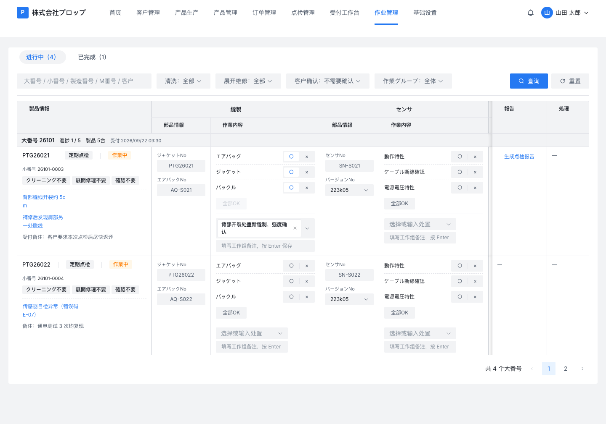
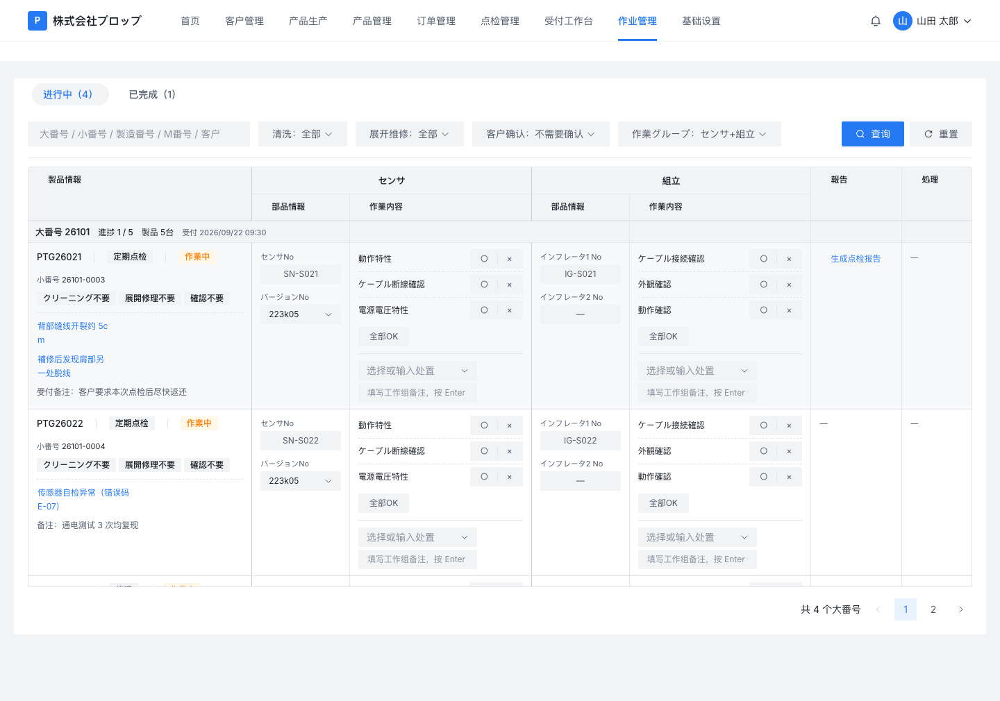
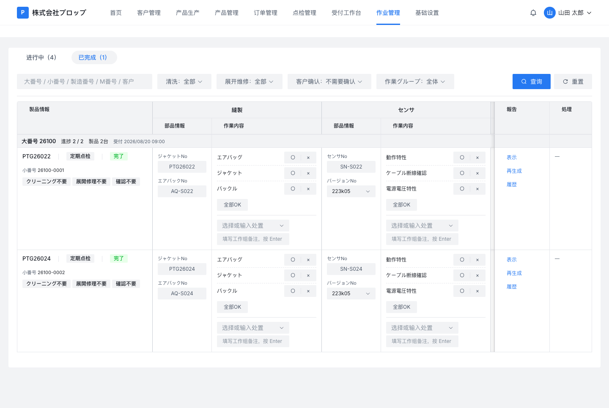
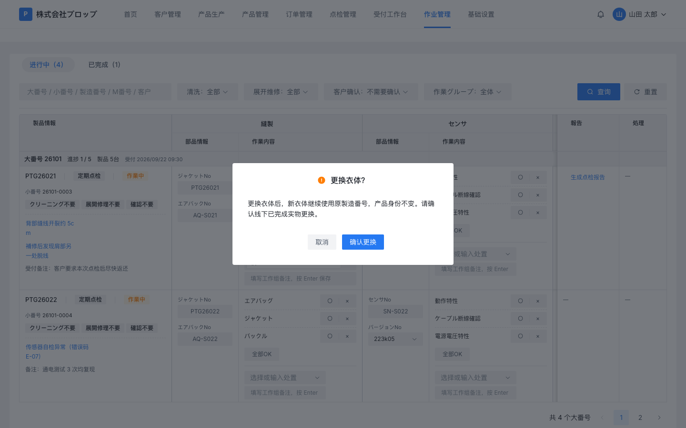

# FEAT-16 作业管理

**状态：Current Truth（报告 PDF 内容与格式章节标注「目标稿（待转正）」）**

> **写作纪律（2026-09-20 裁决）**：本文档只写业务事实和产品要求——页面为谁解决什么问题、展示什么信息、有什么操作、规则是什么。禁止写 mock 数据描述、代码字段名、技术词汇、代码实现细节；凡是「demo 恰好这么实现的」不写，凡是「业务上必须如此」才写。举例允许。字段命名规则写在对应数据模型文档，不在本文档。
>
> **历史页面如实纪律（2026-09-20；本次已裁决的文档修订不受“先改 demo”限制）**：本文档只如实描述 demo 页面现状，不得在文档层修改页面内容——包括省略、改名、"清理"页面实际存在的字段或文案。页面内容要改必须先走「裁决 → demo 修改 → 验证」，再回到本文档。

> **2026-09-25 原型适用边界**：本目录既有原型资产未更新。更换衣体的确认、事件与身份不变规则以 §4.5／§4.7 为准；旧演示不能作为创建新衣体或改变绑定的依据。 此前 demo 核对及测试结论仅作历史记录，不证明本次规则已验收。

## 1. 模块概述

作业管理是各工作组完成本次返厂产品作业登记的主工作台。PROP 现场以受付批次（大番号）为实际流转单位：一批产品先到縫製组，再到センサ组，再到組立组。本模块以「一台产品一行」的方式连续展示同一批次的全部产品，让各组在同一页面上按自己的工作内容登记检查结果、处置和备注，并从这里生成正式报告、确认回收或报废。

本模块维护的事实是**作业记录**：每台受付产品在每个工作组各有一份当前作业记录，记录该组的检查结果、处置内容、备注、换件与固件升级事实、以及清洗完成／展开维修报告目录等特殊登记。普通修改直接更新这份记录，不产生历史版本；跨次作业历史来自过去不同的受付；衣体实物更换、非衣体换件与固件升级事件另行保留。

```
受付（FEAT-14 受付工作台）决定本次要求与处理计划
        │
        ▼
受付批次（大番号）── 批次进度（已完成台数 / 有效总台数）
   └─ 单台受付（一行一台）── 单台作业状态（作業中 / 完了）
        └─ 作业记录 × 工作组（縫製 / センサ / 組立 / 展開修理 / クリーニング）
        │
        ├─ 报告（点检 / 回收 / 报废；每次生成一个新版本，不可变）
        └─ 实际处理（回収確認 → 回收事实；廃棄確認 → 报废事实）
              │
              ▼
        订单管理（结束产品订单关系）、部件与生产（换件 / 固件事实）
```

## 2. 页面构成

| 页面 | 导航位置 | 主要作用 |
|---|---|---|
| 作业管理 | 主导航「作业管理」 | 按批次连续展示返厂产品，登记各组作业内容，生成报告、确认回收／报废 |

本页为 PC 端专用页面，不面向 iPad 适配。

## 3. 资料项目与规则

### 3.1 单台作业记录

每台受付产品在每个工作组各有一份当前作业记录。该记录随作业持续编辑，修改覆盖当前值，不保留编辑历史。

| 资料项目 | 必填 | 规则 |
|---|---:|---|
| 检查结果 | 否 | 仅縫製／センサ／組立三组有检查区。该组规定的检查项目逐项给出「○（通过）／×（未通过）」；未选择的项目视为未检查。选择 × 时可就地登记 NG 内容（可多项，可从该组常用 NG 清单选择或现场输入；现场输入的新值只保存到该台作业记录，**不进入**该组常用清单）和检查备注（按 Enter 保存）。本组作业事实，不升级为受付正式 NG。常用 NG 清单 = FEAT-04 作业选项「作业 NG 描述」按工作组维护（新增／停用／启用），作业现场不回写；字典仅含縫製／センサ／組立三组 |
| 处置内容 | 否 | 仅縫製／センサ／組立三组有处置选择。多项选择，可从该组常用处置清单中选择，也可现场输入新值；现场输入的新值只保存到该台作业记录，**不进入**该组常用清单。常用处置清单 = FEAT-04 作业选项「作业处置内容」按工作组维护（新增／停用／启用），作业现场不回写；字典仅含縫製／センサ／組立三组 |
| 工作组备注 | 否 | 一段自由文本；各组统一使用一个备注，不拆分为检查备注与处置备注 |
| 换件事实 | 否 | 更换气囊／传感器／发生器时记录「原部件 → 新部件」；更换衣体时只显示“更换衣体”，产品及系统衣体身份、制造编号与绑定不变 |
| 补录事实 | 否 | 未绑定部件（气囊／传感器／发生器位置 1／2）补录时记录「无 → 新部件」；编号可现场新入库，详见 4.5「补录部件」。衣体必经入库必有绑定，不支持补录 |
| 固件升级事实 | 否 | 选择新的传感器固件版本时记录「原版本 → 新版本」 |
| 展开维修报告目录 | 否 | 展开维修组专用：登记 PROP 保存原始数据／分析资料的目录文本（如共享盘路径）；仅文本记录 |
| 清洗完成 | 否 | 清洗组专用：勾选表示该台已完成清洗 |

### 3.2 报告

| 资料项目 | 必填 | 规则 |
|---|---:|---|
| 报告类型 | 是 | 由该台受付的处理计划决定：返回客户 → 点检报告；PROP回收 → 回收报告；报废 → 报废报告；处理计划为空时不提供生成入口 |
| 版本 | 是 | 每点击一次生成产生一个新的、不可变的正式版本（v1、v2……）；新版本不是对旧版本的修改；报告生成后不可修改，之后作业记录变化不影响已生成报告 |
| 发行时间与发行人 | 是 | 生成时自动记录 |

### 3.3 实际处理（回收／报废）

| 资料项目 | 必填 | 规则 |
|---|---:|---|
| 回收确认 | — | 处理计划为「PROP回收」时可执行；确认后形成回收事实，产品与当前订单的关系结束；不可逆。这是**结束当前关系**，不是取消履约——已发生的交付保留，订单有效履约数不因此扣减，也不取消订单；与订单侧「解除关联」（否定原交付、扣减履约数）是两个不同动作 |
| 报废确认 | — | 处理计划为「报废」时可执行；确认后形成报废事实，产品生命周期终结，禁止继续出货与再次受付；不可逆。报废只终结产品与衣体编号（製造番号）；气囊／传感器／发生器部件个体**不随之报废**，解除绑定后可继续用于其他产品（与产品管理「删除产品部件个体本身保留」同口径） |

报告与实际处理完全分离：生成回收报告不等于已回收，生成报废报告不等于已报废。

## 4. 作业管理

### 4.1 页面作用

让各工作组按批次连续看到返厂产品，在同一行内完成本组的检查登记、处置登记与备注；让现场随时知道当前产品属于哪个大番号、该批次整体进度如何；提供报告生成与回收／报废确认入口。

### 4.2 页面入口与去向

- 入口：主导航「作业管理」；受付工作台保存受付后本页即出现对应行。
- 去向：报告生成弹窗（生成／预览）、报告版本历史弹窗、NG 详情弹窗（只读）、换件弹窗、回收／报废确认弹窗。

### 4.3 页面布局






```
┌ 进行中（N）/ 已完成（N） Tab ────────────────────────────┐
│ 筛选区（一行）                                              │
│  [关键词输入] [清洗▾] [展开维修▾] [客户确认▾] [作業グループ▾] [查询] [重置] │
├──────────────────────────────────────────────┤
│ 主表（表头固定，内容区内部滚动；可横向滚动）                    │
│ ┌ 大番号 101  進捗 3/5  製品5台  受付 2026/09/16 09:30 ┐ ← 批次行，滚动时吸附在表头下方
│ 製品情報 │ 縫製（部品情報｜作業内容）│ センサ（部品情報｜作業内容）│ 組立（部品情報｜作業内容）│ 報告 │ 処理
│ PTG26021 …                                                 │
│ PTG26022 …                                                 │
│ ┌ 大番号 102  進捗 1/3  製品3台  受付 … ┐                  │
│ …                                                          │
├──────────────────────────────────────────────┤
│ 分页：共 N 个大番号  < 1 2 3 >                              │
└──────────────────────────────────────────────┘
```

### 4.4 展示信息

**顶部 Tab**：进行中／已完成两个视图，括号内数字为大番号批次数。批次内只要还有一台未完成，整批属于进行中；批次全部完成后整批进入已完成。同一大番号绝不拆到两个视图。

**筛选区（一行排列）**：

- 关键词输入：提示文字「大番号 / 小番号 / 製造番号 / 客户」；点击查询或按 Enter 生效。
- 清洗：全部／需要／不需要。
- 展开维修：全部／需要／不需要。
- 客户确认：全部／需要确认／不需要确认；**默认「不需要确认」**——默认优先看到可以直接作业的产品，可主动切换。
- 作業グループ：全体／縫製／センサ／組立／センサ+組立。选择后只显示对应工作组列，其他组列暂时隐藏；只改变列，不改变任何行与批次；仅为当前查看方式，刷新页面后恢复全体。
- 查询、重置横置；重置恢复默认筛选（关键词清空、三项是否筛选恢复默认、客户确认恢复「不需要确认」），不改变作業グループ选择。

**主表行**：一行对应一台受付产品。行的排列顺序固定：先按批次先后，再按同批次内受付先后，受付顺序相同时按製造番号升序。同一大番号的产品必须连续显示，任何操作（搜索、筛选、切换工作组、切换 Tab）都不改变行顺序，只隐藏不匹配的行。

**批次行（每个大番号第一条）**：该行第一台可见产品之前出现一条整行宽度的批次行，浅灰不透明底色，单行显示四项内容，从左到右：

```
大番号 101    進捗 3 / 5    製品 5台    受付 2026/09/16 09:30
```

- 大番号：该批次编号，加粗显示。
- 進捗：该批次已完成台数／有效总台数。始终代表完整批次的真实进度——即使当前搜索只命中该批次的一台，仍显示完整批次的进度与总台数。
- 製品数量：该批次有效总台数。
- 受付日時：该批次受付时间，格式「YYYY/MM/DD HH:mm」。
- 批次行不显示客户、NG、作业要求、报告或任何操作按钮。
- 表格内容区上下滚动时，当前批次的批次行吸附在表头下方，滚动到下一批次时由下一批次的批次行替换。

**製品情報列（左侧固定）**，从上到下固定顺序：

1. 第一行：製造番号（本行最强信息）｜受付类型（如「定期点检」「修理」；报废类型用红色标识）｜单台作业状态（「完了」绿色／「作業中」橙色）。
2. 第二行：小番号，以「大番号-小番号4位」连写形态显示（如 260102-0008）。
3. 第三行：本次作业要求标签——清洗「クリーニング要／不要」、展开维修「展開修理要／不要」、客户确认「顧客確認要／確認不要」；需要的用醒目色，不需要的用中性色。这里只表达受付决定的要求，不表达实际是否完成。
4. 有 NG 或受付备注时，以一条浅色分隔线进入异常／备注区：受付正式 NG（可点击查看详情，只读）、受付备注。
5. 本列不显示 M番号、不显示客户公司名；大番号与受付日時统一由批次行展示。

**工作组列**：全体视图下依次显示縫製、センサ、組立三组，每组分为「部品情報」「作業内容」两个子列。各列宽度固定：製品情報 320px、各组部品情報 140px、各组作業内容 260px、報告 130px、処理 100px；同一类型列宽在所有行保持一致。

- 部品情報（只读为主）：该组关心的部件，部件名称在上、编号在下。縫製：ジャケットNo、エアバックNo；センサ：センサNo、バージョンNo；組立：インフレータ1 No、インフレータ2 No。编号读取产品当前实际绑定。可操作的编号显示为可点击控件：衣体编号点击后记录衣体更换；其他部件编号点击后进入换件弹窗；固件版本为下拉选择，选择新版本即完成升级登记。未绑定的气囊／传感器／发生器显示可点击的「—」，点击打开补录弹窗（见 4.5「补录部件」）；衣体与固件版本的未绑定不补录，显示「—」。
- 作業内容：该组作业区域，从上到下依次为检查区（见 4.5）、一条浅色分隔线、处置与备注区（处置多选输入 + 工作组备注输入）。
- 清洗与展开维修不设独立列。该台本次要求需要清洗、或已经存在清洗组作业记录时，清洗作业区出现在縫製作業内容下方（标题与状态标签同行，勾选「已完成清洗」+ 备注）；需要展开维修、或已经存在展开维修组作业记录时，展开维修作业区出现在センサ作業内容下方（标题与状态标签同行，报告目录输入 + 备注）。要求不需要且无作业记录时该区域不显示。登记的内容仍分别属于清洗组／展开维修组的作业记录。

**報告列（右侧固定）**：按处理计划决定——

- 处理计划为空：显示「—」。
- 该类型尚无报告：显示「生成点检报告／生成回收报告／生成报废报告」文字按钮；若该台存在其他类型的历史报告，同时显示「履歴」入口。
- 已有该类型报告：显示「表示」「再生成」「履歴」三个文字按钮。本列不显示版本号或版本时间，版本信息统一在履歴弹窗查看。

**処理列（右侧固定）**：按处理计划决定——

- 报废：未确认时显示「廃棄確認」按钮（红色）；已确认显示「廃棄済」标签。
- PROP回收：未确认时显示「回収確認」按钮；已确认显示「回収済」标签。
- 其他情况：显示「—」。

**分页**：页脚独立分页，每页固定 3 个大番号，同一大番号不跨页；总数按大番号批次数显示（「共 N 个大番号」）；匹配批次不超过一页（3 个）时不显示分页条。第一版不提供每页数量切换。查询、是否筛选、重置、Tab 切换后回到第 1 页。

**空态**：当前 Tab 无批次时提示「当前没有进行中的大番号批次／当前没有已完成的大番号批次」；搜索筛选无结果时提示「没有符合搜索条件的产品」。

### 4.5 功能

**登记检查结果**

- 检查区按该组规定的检查项目纵向排列：每项一行，项目名称靠左、「○／×」选择靠右，项目之间以虚线分隔。
- 点击 ○ 或 × → 该项目结果立即保存到本组当前作业记录。
- 选择 × 后，该项目下方展开 NG 内容多选（可从该组常用 NG 清单选择或现场输入；现场输入的新值只保存到该台作业记录，不自动进入该组常用清单）与检查备注输入（按 Enter 保存）；改选 ○ 后，该项的 NG 内容与备注清除。
- 「全部OK」按钮（检查项目多于一个时显示）：点击后把当前**未选择**的检查项目全部填为 ○；已经有结果（○ 或 ×）的项目不受影响，避免误删已发现的异常；所有项目都已有结果时按钮不可用。
- 检查项目为 PROP 实际工作内容（按页面显示原文）：縫製＝エアバッグ／ジャケット／バックル；センサ＝動作特性／ケーブル断線確認／電源電圧特性；組立＝ケーブル接続確認／外観確認／動作確認。展開修理／クリーニング不设检查区（清洗只做完成勾选、展开维修只登记报告目录），故无检查项目；这两组也不设处置与 NG 常用清单（FEAT-04 作业选项的工作组字典只含縫製／センサ／組立三组）。

**登记处置与备注**

- 处置为多选输入：可从该组常用处置清单选择，也可直接输入新值；输入的新值只保存到该台作业记录，不自动进入该组常用清单。选择变化即保存。
- 工作组备注为单行文本，输入后按 Enter 保存。
- 处置与备注都只保存当前值，重复修改不产生历史。

**清洗登记（寄宿縫製列）**

- 勾选「已完成清洗」→ 清洗组作业记录登记完成事实；取消勾选 → 清除该完成事实，回到待清洗状态。勾选框是完成状态的唯一入口。
- 备注输入按 Enter 保存；未登记清洗前填写备注，将在登记时一并保存。保存备注只更新备注，不改变完成状态——取消勾选后修改备注，完成状态不会被恢复。

**展开维修登记（寄宿センサ列）**

- 目录输入框输入报告保存目录文本后按 Enter → 展开维修组作业记录登记该目录，状态标签变为「已登记」。目录输入框是登记的唯一入口。
- 清空输入后按 Enter → 撤销本次展开维修登记，回到「需要」状态。
- 目录下方提供工作组备注，按 Enter 保存；登记目录前填写备注，将在登记时一并保存；保存备注只更新备注，不改变目录登记状态。
- 仅登记目录文本；不提供打开本地文件、校验文件是否存在、读取目录内容等功能。

**更换衣体**

- 点击縫製部品情報中的衣体编号 → 弹出确认：「请确认线下已完成实物更换。产品、製造番号、系统衣体身份与绑定保持不变，确认后登记更换衣体事件。」→ 确认后，縫製作业记录登记本次衣体更换，处置内容自动加入「ジャケット交換済」作为可见痕迹。
- 更换衣体只登记线下实物更换事件；产品身份、製造番号、系统衣体身份及现有绑定均不变，不创建新衣体档案、不解除旧衣体绑定，不产生可删除的换下衣体对象。换下实物线下报废，系统不登记其报废过程、不触发产品报废；衣体资料不自动变化，资料错误仍通过既有资料更正机制处理。事件内容显示“更换衣体”，不显示新旧编号或编号对照；时间与操作人沿用原规则，取消不登记事件。

**更换部件（气囊／传感器／发生器）**

- 点击对应部件编号 → 换件弹窗显示当前部件编号（只读，含绑定产品）；部件资料默认带出原部件资料、可改选；传感器更换时同时选择固件版本。
- 输入新部件编号后：
  - 新编号库存已有 → 校验未绑定其他产品（已绑定他人 → 拦截并提示）；空闲但当前资料与所选资料不一致 → 弹窗内确认「以所选资料为准」后更换并更正该部件资料。
  - 新编号库存没有 → 按所选资料现场建档入库后更换。
- 确认后：部件绑定更换为新部件，本组作业记录登记换件事实（原部件 → 新部件）。

**补录部件（气囊／传感器／发生器，未绑定时）**

- 未绑定的气囊／传感器／发生器在部品情報区显示可点击的「—」→ 点击打开补录弹窗 → 输入部件编号、**必选部件资料**（本页无默认部件资料提示，员工现场选择该部件所属资料）→ 传感器另选固件版本；发生器按点击的位置（1／2）确定，不重复选。
- 校验与行为：编号已绑定其他产品 → 弹窗内提示「该部件已安装在 XX」，不执行；编号空闲但当前资料与所选不一致 → 弹窗内提示「以所选资料为准」二次确认；编号不存在 → 用所选资料**现场新入库**（非衣体部件首次使用即建档，与组装页同一机制）再绑定。
- 确认后：部件绑定到该产品，本组作业记录登记补录事实（无 → 新部件），部品情報区显示编号与资料标签（可点击更正资料）。衣体必经入库必有绑定，不支持补录。

**固件升级**

- センサ部品情報中的バージョンNo 为下拉选择，选项来自基础设置中启用的传感器固件版本。
- 选择新版本 → 传感器固件事实更新为新版本，本组作业记录登记升级事实（原版本 → 新版本）；版本未变化时不产生记录。

**生成报告（目标稿（待转正）：PDF 内容与格式）**

- 点击「生成点检报告／生成回收报告／生成报废报告」（或已有版本时的「再生成」）→ 打开报告生成弹窗：展示本次报告的读取内容，其中可由系统带出的项目直接显示并允许修改（如日期类），无法带出的项目留空由人工填写 → 确认后生成一个新的正式版本并弹出预览，可查看／下载／打印。
- 只要处理计划已确定即可生成，不要求作业完成、不要求已返送／回收／报废；生成报告不产生任何实际处理事实，不锁定作业记录。
- 报告 PDF 的字段内容与版式待正式需求。

**查看报告**

- 「表示」→ 预览最新版本，可下载／打印。
- 「履歴」→ 弹窗按发行时间倒序列出该台全部报告版本（最新在前；版本、类型、发行时间、发行人），每个版本可查看／下载／打印；旧版本永不失效。

**确认回收／确认报废**

- 点击「回収確認／廃棄確認」→ 弹窗显示该台製造番号、大番号、客户与操作结果说明，并明确提示「此操作不可逆」→ 二次确认后生效：
  - 确认回收 → 形成回收事实，产品与当前订单的关系结束（历史关系永久保留），该台作业状态视为完了。这是结束当前关系，不是取消履约：已发生的交付保留，订单有效履约数不扣减；与订单侧「解除关联」（否定原交付）不同。
  - 确认报废 → 形成报废事实，产品生命周期终结、禁止继续出货与再次受付，该台作业状态视为完了。

**查看 NG 详情**

- 点击製品情報中的正式 NG 内容 → 只读弹窗显示 NG 内容、图片、备注；作业人员不能在此修改正式 NG。

**多人同时编辑**

- 同一台同一组的作业内容被多人同时编辑时，后保存的人会看到冲突提示弹窗：显示对方已保存的内容（保存时间、操作人、内容），可选择「放弃我的修改」（查看对方最新内容）或「保留我的内容并保存」。系统不静默覆盖他人内容。

换件与补录按 FEAT-06／09 的身份规则处理：同编号当前有效档案仍为同一身份；原档案已删除时重新登记为独立身份，不继承其固件、绑定或资料更正历史。绑错对象先结束错误绑定，资料选错使用既有更正机制，不要求删除正确档案。

### 4.6 校验与反馈

- 换件校验：新编号无当前有效档案 → 按 §4.5 用所选资料新建独立档案；已删除档案不能直接用于更换；编号无效 → 提示原因；已绑定其他产品 →「该部件已绑定其他产品，不能重复使用」；新部件资料与当前产品要求不一致 → 提示确认部件资料；均未通过时不执行更换。
- 固件升级：未找到当前绑定传感器时提示无法登记。
- 回收／报废确认为不可逆动作，弹窗内明确警示，须二次确认。
- 保存成功的各操作均有成功提示；编辑冲突以弹窗阻断，由人裁决。

### 4.7 页面产生的数据

- 登记检查／处置／备注 → 建立或更新该台该组的**当前作业记录**（覆盖当前值，不产生历史版本）；现场输入的新处置内容、新 NG 内容只进入该台作业记录，**不进入**该组常用处置清单、常用 NG 清单。
- 全部OK → 仅补全未选项目为 ○，更新当前作业记录。
- 清洗勾选／取消 → 建立／更新／清除清洗组作业记录的完成事实。
- 展开维修目录登记／清空 → 建立／更新／清除展开维修组作业记录的目录事实。
- 更换衣体 → 登记实物更换事件，同时保留縫製作业记录中的「ジャケット交換済」处置痕迹；产品身份、制造编号、系统衣体身份及绑定不变，不创建新衣体或线上报废对象；资料不自动更改。
- 更换部件 → 产品部件绑定更换（旧关系保留为历史），本组作业记录登记换件事实。
- 补录部件 → 部件绑定到该产品（编号不存在时同时新入库建档），本组作业记录登记补录事实（无 → 新部件）；编号已绑定其他产品时不产生任何变化。
- 固件升级 → 传感器固件版本事实更新（历史版本保留），本组作业记录登记升级事实。
- 生成报告 → 新增一个不可变的正式报告版本；不修改作业记录，不产生回收／报废／返送事实。
- 确认回收 → 建立回收事实；结束产品与当前订单的关系（历史保留）。不是取消履约：订单有效履约数不扣减、不取消订单，仅结束当前关系。
- 确认报废 → 建立报废事实；产品生命周期终结（产品与衣体编号终结）；部件个体不随之报废，解除绑定后可继续用于其他产品。
- 本页不产生：受付正式 NG（只能由受付侧追加）、返送事实（走寄送流程）、作业历史版本。

## 5. 跨页面统一规则

### 5.1 单台完成口径（唯一）

一台受付产品的作业状态只有两种结果，随相关事实自动变化、不可人工标记：

- **完了**：組立组规定的 3 个检查项目全部已有结果（○／× 皆可，不要求全部 ○）；或该产品已确认回收；或已确认报废。
- **作業中**：上述条件均不满足。

已完成 tab 的进入与单台状态标签都只看这一口径。报告是否生成、清洗是否完成、展开维修是否登记、是否返送，都不影响作业完成判断。

### 5.2 批次进度口径

批次进度＝已完成台数／批次内有效（未作废）总台数，随作业实时变化，任何人不能直接填写。批次进度始终按完整批次计算，与当前 Tab、搜索、筛选无关——筛选只隐藏行，不改变批次的真实进度。

### 5.3 行的连续与顺序

同一大番号的产品必须连续显示；行顺序固定为批次顺序 → 批内受付顺序 → 製造番号升序。搜索、筛选、工作组聚焦、Tab 切换只隐藏行或列，绝不改变行顺序，绝不把一个大番号拆到两个 Tab 或两页。

### 5.4 工作组事实与页面列

作业事实分属五个工作组（縫製／センサ／組立／展開修理／クリーニング），各自独立记录，不合并。页面上为压缩宽度只显示縫製／センサ／組立三列，清洗与展开维修的登记入口分别寄宿在縫製／センサ列内，但保存的内容仍属于清洗组／展开维修组自己的作业记录。

### 5.5 编号显示

- 小番号以「大番号-小番号4位」连写显示（如 260102-0008）。
- 受付日時格式统一「YYYY/MM/DD HH:mm」，只出现在批次行。
- 关键词搜索对大番号、小番号（原始整数／4位补零／连写形态均可命中）、製造番号、客户名做部分匹配；匹配前忽略首尾空格、统一字符宽度、忽略英文大小写。

### 5.6 报告三类与处理计划

报告类型只由该台受付的处理计划决定（返回客户→点检报告、PROP回收→回收报告、报废→报废报告），不按受付类型猜测；处理计划为空不提供生成入口。每次生成产生新的不可变版本，不存在「修正版」「过期」「需更新」概念；报告与回收／报废实际处理是完全独立的两件事。

### 5.7 作业记录是当前台账

作业记录是「当前受付 × 工作组」的一份持续编辑的台账：普通修改直接覆盖当前值，不因为保存或修改产生版本、历史或「查看作业历史」入口。更换衣体、非衣体换件与固件升级仍分别登记业务事件；普通作业编辑不覆盖这些已发生事件。跨次作业历史来自过去不同的受付；衣体实物更换、非衣体换件与固件升级事件另行保留（见 FEAT-15 受付履历／FEAT-08 产品管理的历史展示）。

## 6. Feature 边界与明确不做

**本模块负责**：各组作业登记（检查、处置、备注、清洗、展开维修目录）、单台与批次完成口径的展示、报告生成与版本历史、回收／报废确认、换件与固件升级的登记入口。

**其他模块负责**：受付要求与正式 NG 的登记（FEAT-14 受付工作台）；部件资料建档与停用、部件个体建档与纠错（部件个体无启停功能）（FEAT-02 部件资料／FEAT-05～08 产品生产、FEAT-09 部件追溯）；产品与订单关系的建立（FEAT-10 订单管理、FEAT-11 寄送）；点检通知（FEAT-12 定期管理／FEAT-13 通知管理）；作业处置内容与作业 NG 描述清单的维护（FEAT-04 作业选项，新增／停用／启用；本页只读取使用，不回写；工作组字典仅含縫製／センサ／組立三组）。

**明确不做**：

- 人工「确认完成」按钮或人工修改完成状态的入口；完成判断必须符合 5.1 的业务口径。
- 同一大番号多行的纵向合并单元格。
- 换件、固件升级的原地自由文本编辑（必须走换件弹窗／版本选择动作）。
- 工作组备注拆分为检查备注与处置备注两个独立保存字段。
- 展开维修目录的本地文件打开、存在性校验、内容读取。
- 报告生成后锁定作业记录；报告的「修正版／过期／需更新」状态。
- 清洗事实并入縫製组、展开维修事实并入センサ组（仅页面列寄宿，数据不合并）。
- Package 与临时装箱信息在本页的展示与筛选（属于受付侧）。
- 工作组列的固定显示与「固定工作组」按钮。
- 「查看作业历史」弹窗与作业记录版本机制。
- 清洗与展开维修的处置／NG 常用清单（两组作业现场只有完成勾选／目录登记与备注，无处置与 NG 选择环节）。
- iPad 端适配（本页为 PC 端专用）。
- 按产品条数分页（分页单位是大番号批次）。
- 大番号维度的报告批量生成。

## 7. 核对记录

- 2026-09-23：按二级导航粒度自 12-作业管理 拆分为本 feature（FEAT-16）；内容不变，章节与交叉引用已重编号。
- 2026-09-23：拆分完整性核对后补回状态行限定「报告 PDF 内容与格式章节标注「目标稿（待转正）」」（拆分前旧稿状态行原有，拆分时丢失；正文 §4.5 字样一直在）。

- 核对日期：2026-09-22，已与当前 demo 页面逐区块核对一致：Tab／筛选行／製品情報列／三工作组列／寄宿清洗与展开维修／報告・処理列／批次行吸附／分页／各弹窗（NG 详情、换件、冲突、报告履歴、回收报废确认）。报告生成弹窗的字段内容在共享组件中实现，本轮未逐字段核对，§4.5 相关描述按既有规则撰写。
- 裁决来源：V2.1/修改记录.md「作业管理改版裁决」「大番号批次展示规则 v1」「WorkExecution 当前作业记录规则」「作业管理 UI 布局规范 v2」「センサ+組立组合视图」「报告列版本信息下线」「单台完成口径扩展（回收／报废）」「更换衣体确认制」「紧凑查询头方案 A」「大番号分页（每页 3 批次）」。
- 检查项目（縫製／センサ／組立三组）为 PROP 实际工作内容，2026-09-22 用户确认非临时占位；NG 清单与处置清单为暂定内容（无客户原始依据），正式清单待 PROP 确认。
- 报告生成弹窗的字段读取规则按 FEAT-14 受付工作台／返送共用组件的当前实现描述；PDF 字段内容与版式为「目标稿（待转正）」，待正式需求。
- 多人编辑冲突的弹窗交互为当前实现；持久化与服务端并发属后台实现范畴。
- 2026-09-22 修订（独立审查后）：修复 demo 清洗备注保存意外恢复完成状态的问题（勾选框／目录框为唯一入口，备注保存不翻转状态）；补写检查项目页面原文、清洗／展开维修区域显示条件（要求需要或已有记录）、展开维修备注规则、常用处置／NG 清单更新、列宽、分页隐藏边界与页码重置规则、报告履歴倒序；「不存储／不保存为字段」等实现层表述改为业务表达。
- 2026-09-22 修订（用户裁决，demo 已改并全绿）：(1) 新增未绑定部件补录——气囊／传感器／发生器位置 1／2 点击「—」补录，弹窗内必选部件资料（方案 B，本页无默认资料提示）、传感器另选固件，编号可现场新入库，已绑定他人拦截、资料不一致二次确认；(2) 报废确认补「不级联部件」（只终结产品与衣体编号，部件个体保留可再用）；(3)(4) 检查 NG 与处置的现场输入新值改为只进该台作业记录、不自动进入该组常用清单（清单固定，正式清单待 PROP 确认）。
- 2026-09-22 修订（用户裁决，demo 已改并全绿）：清洗与展开维修撤销处置／NG 常用清单——FEAT-04 作业选项的工作组字典收敛为縫製／センサ／組立三组，这两组不再提供字典配置入口；其作业现场本就无处置与 NG 选择环节（清单自始无消费方），种子数据同步清除。
- 2026-09-22 修订（用户裁决，demo 已改并全绿）：换件弹窗与产品管理换件同构——部件资料默认带出原部件资料、可改选，传感器更换同时选择固件版本；新编号库存没有时按所选资料现场建档入库，空闲但资料不一致改为弹窗内确认「以所选资料为准」（原为硬拦截）。
- 2026-09-23 修订（用户裁决，纯文档）：M番号退出搜索键——§4.4 关键词提示文字与 §5.5 搜索匹配键删除 M番号（提示改为「大番号 / 小番号 / 製造番号 / 客户」），validation VAL-03 同步；M番号为内部番号，「不在任何界面显示」的覆盖范围含搜索等输入入口的提示与匹配键（FEAT-08 §3.1/§6、FEAT-10 §8 同步加固表述）。来源：2026-09-23 用户裁决「搜索框也不应出现 M番号」。

- 2026-09-25：根据已确认裁决修订删除、身份与编号复用、历史保留、实物衣体更换或单笔发货文件归属相关条款；此前核对记录中的冲突口径已被本次正文取代，旧 demo／测试结论不代表本次修订已实施或验收。
