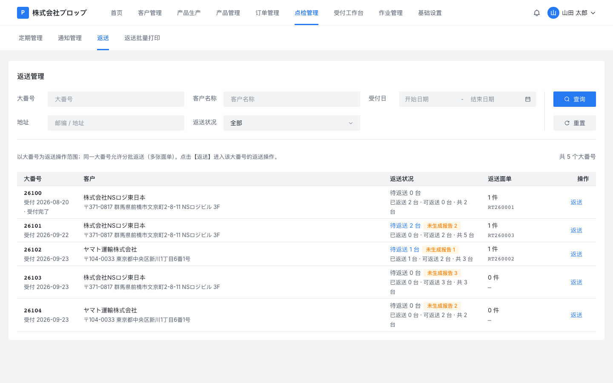
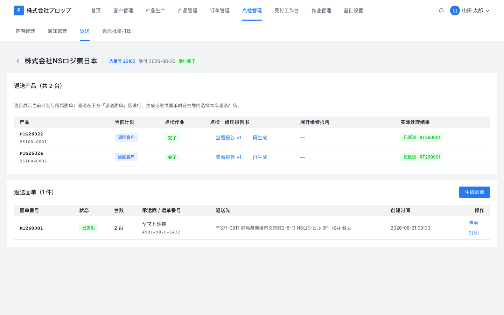
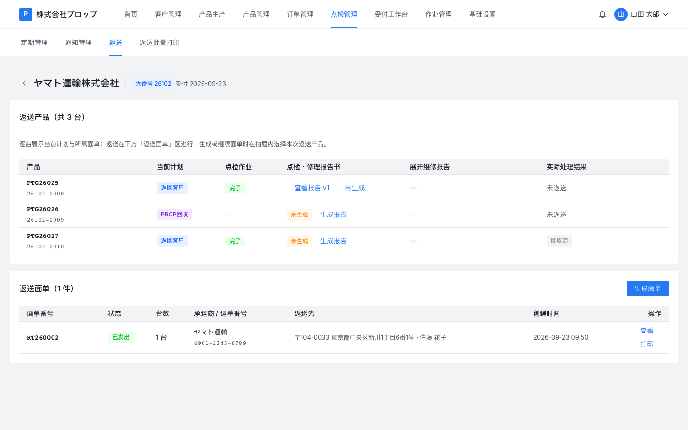
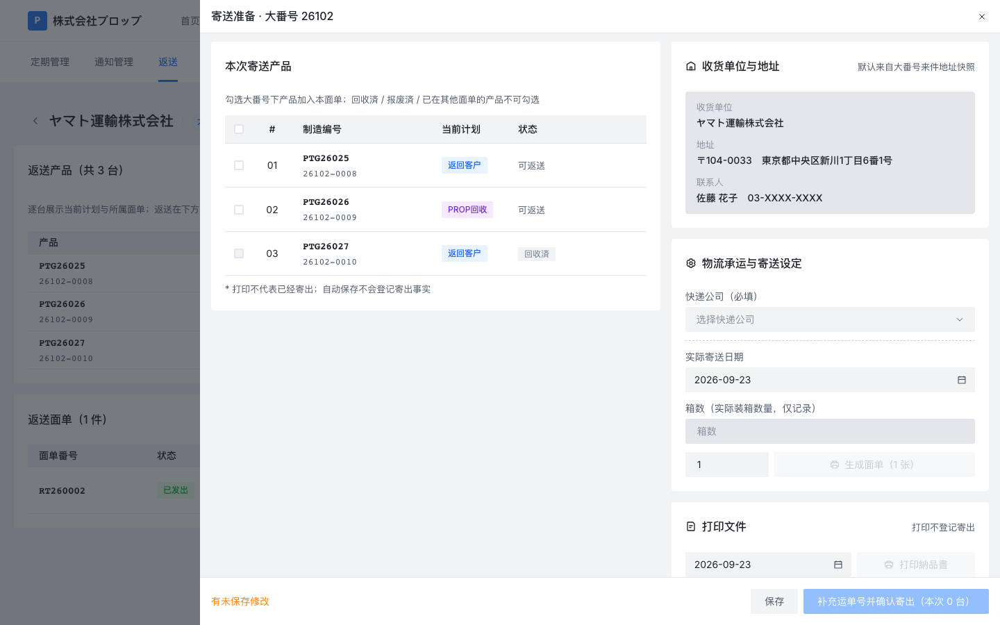
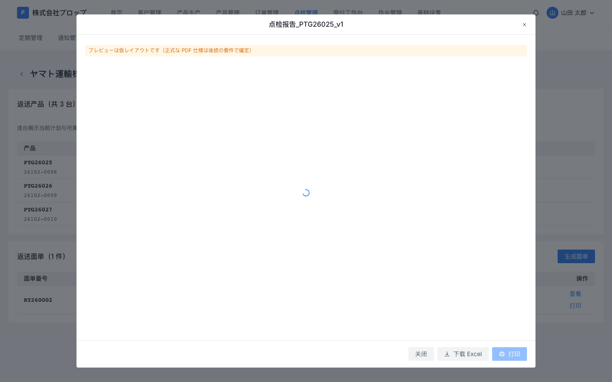
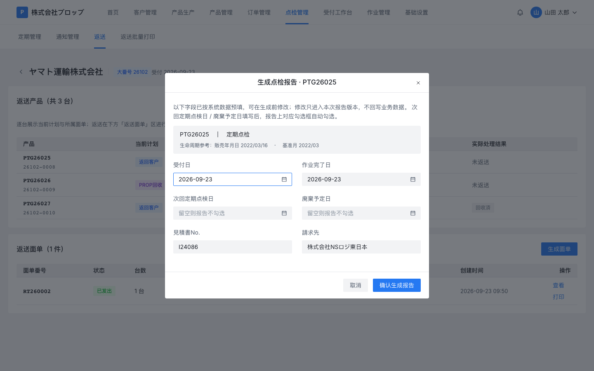

# FEAT-17 返送

**状态：Current Truth（面单与納品書的版式、报告 PDF 内容标注「目标稿（待转正）」）**

> **写作纪律（2026-09-20 裁决）**：本文档只写业务事实和产品要求——页面为谁解决什么问题、展示什么信息、有什么操作、规则是什么。禁止写 mock 数据描述、代码字段名、技术词汇、代码实现细节；凡是「demo 恰好这么实现的」不写，凡是「业务上必须如此」才写。举例允许。字段命名规则写在对应数据模型文档，不在本文档。
>
> **历史页面如实纪律（2026-09-20；本次已裁决的文档修订不受“先改 demo”限制）**：本文档只如实描述 demo 页面现状，不得在文档层修改页面内容——包括省略、改名、"清理"页面实际存在的字段或文案。页面内容要改必须先走「裁决 → demo 修改 → 验证」，再回到本文档。

> **2026-09-25 原型适用边界**：本目录既有原型资产未更新。准备含已生成文件仍可删除，正式寄出后前后端均禁止删除，按 §6.5～6.7／§7.6 验收。 此前 demo 核对及测试结论仅作历史记录，不证明本次规则已验收。

## 1. 模块概述

返送模块处理点检完成后产品寄回客户的业务。PROP 现场以大番号为返送操作范围：员工在返送管理中按大番号找到要寄回的批次，为该批次开一张返送面单、勾选本次要寄的产品、选择承运信息，确认寄出后形成正式返送事实。同一大番号允许多次分批返送（多张面单）。

本模块维护的事实是**返送寄送**：一次实际寄送的一批受付产品、一个返送地址、承运与运单信息。返送只记录产品寄回客户这一结果，不建立、结束或修改任何订单关系，不增加订单交付数量，不决定作业或报告是否完成。跨大番号的集中打印面单在「FEAT-18 返送批量打印」，不在本模块。

```
受付（FEAT-14 受付工作台）／作业管理（FEAT-16 作业管理）提供受付产品与当前计划
        │
        ▼
返送管理（大番号列表）→ 返送详情（产品清单 + 面单列表）
        │                      │
        │                      ├─ 产品维度：生成／查看报告（与作业管理同一机制）
        │                      └─ 面单：生成面单 → 返送寄送抽屉（准备中）
        │                                │ 勾选产品 + 承运/日期/箱数
        │                                │ 打印面单・納品書（打印 ≠ 寄出）
        │                                ▼
        │                        补充运单号并确认寄出 → 正式返送事实（不可逆）
        │                                │
        ▼                                ▼
返送事实影响：首页待返送统计、受付/产品的返送历史；不影响订单关系与履约
```

## 2. 页面构成

| 页面 | 导航位置 | 主要作用 |
|---|---|---|
| 返送管理 | 点检管理「返送管理」 | 大番号列表，按批次进入返送操作 |
| 返送详情 | 返送管理行内进入 | 展示一个大番号的产品与面单，生成报告、生成面单 |
| 返送寄送抽屉 | 返送详情内打开 | 单笔返送的准备、打印、确认寄出与寄出后维护 |

## 3. 资料项目与规则

### 3.1 返送寄送

一张返送面单对应一次实际寄送：来源大番号下的一批受付产品、一个返送地址、承运与运单信息。返送地址在新建面单时取大番号来件地址，形成该笔寄送自己的地址快照；此后在返送页面只读展示、没有修改入口，也不随大番号来件地址的后续修改而变化。准备中可以反复修改产品与承运信息；确认寄出后产品清单冻结，其余属性仍可更正。

| 资料项目 | 必填 | 规则 |
|---|---:|---|
| 返送编号 | 是 | 系统生成，形态 RT[YY][NNNN]（RT＋年 2 位＋年内 4 位连番，年度重置）；每张面单一个号 |
| 来源大番号 | 是 | 建立时确定，不可更改；同一大番号可有多张面单（分批返送） |
| 本次寄送产品 | 是 | 该大番号下的有效受付产品，至少 1 台；确认寄出后冻结不可再改 |
| 返送地址 | 是 | 新建面单时取大番号来件地址（收货单位、邮编、地址、联系人、电话），形成该笔寄送的地址快照；此后在返送页面只读展示、没有修改入口，也不随大番号来件地址的后续修改而变化。返送前发现地址有误：准备中面单可删除后重建；已寄出的按线下订正处理 |
| 快递公司 | 确认寄出前必填 | 准备中可空；确认寄出前必须选择；确认寄出后仍可修改；取值 = 该笔寄送最近一次实际使用的快递公司，只有一个值、两个写入路径：抽屉内手动选择（准备中选择即随保存生效，已寄出后修改立即生效，下次打开显示最后生效值）；批量打印出单时写入（出单即视为使用该公司，同时把该笔寄送的快递公司改写为批量打印页所选公司，见 FEAT-18 返送批量打印） |
| 实际寄送日期 | 否 | 默认当天业务日期，可修改；确认寄出后仍可修改 |
| 箱数 | 否 | 仅记录实际装箱数量，不决定打印张数 |
| 运单号 | 否 | 选填、可多个；准备中可空，确认寄出时可补充，确认寄出后仍可补改 |
| 已生成文件 | 否 | 该笔寄送生成的面单、納品書；面单张数为复印份数（一次「生成面单（N 张）」只产生一个版本，N 张共用同一版本），納品書每次生成一个新版本；历史版本保留（详见 3.2） |

### 3.2 返送文件

| 资料项目 | 必填 | 规则 |
|---|---:|---|
| 文件类型 | 是 | 面单（按快递公司模板）、納品書（内容明细）；版式与字段内容待正式需求 |
| 版本 | 是 | 同一笔寄送同一类型每生成一次版本号递增，旧版本保留、可继续打印；面单张数是复印份数，一次生成只产生一个面单版本，几张面单共用同一版本（不逐张产生版本） |
| 文件内容 | 是 | 生成当时的寄送内容（客户、地址、联系人、快递公司、运单号、产品清单）；之后寄送属性修改不影响已生成文件 |
| 发行日期 | 是 | 生成时可指定，默认当天 |

打印是打印、寄出是寄出：生成或打印任何文件都不登记寄出事实，不产生产品占用，也不要求先确认寄出。

### 3.3 寄送通知邮件

| 资料项目 | 必填 | 规则 |
|---|---:|---|
| 邮件正文 | — | 每次生成冻结当时正文全文与生成时间，历史版本不覆盖、可随时查看当时内容：收件人（客户＋联系人）、寄送日期、制造编号清单、台数、快递公司、运单号（有则列出）。确认寄出时自动生成第一封；此后在运单号维护中点「生成邮件正文」生成新版本；复制统一从文件版本中查看并复制，不提供按当前内容现算后直接复制的旁路——发出的每一封都有存档 |

**版本保留的适用范围**：文件及邮件已生成版本不被后续生成覆盖；准备记录删除时其全部所属版本一并删除，不保留该准备业务历史。正式寄出后不得删除记录，所属版本继续保留。

## 4. 返送管理

### 4.1 页面作用

让员工按大番号找到需要返送的批次，看到每个批次的待返送、已返送、可返送数量，进入对应批次的返送操作。

### 4.2 页面入口与去向

- 入口：点检管理「返送管理」。
- 去向：行内「返送」→ 该大番号的返送详情。

### 4.3 页面布局



```
┌ 返送管理 ─────────────────────────────────────┐
│ 筛选区：大番号 / 客户名称 / 受付日 / 地址 / 返送状况 [查询] [重置] │
├──────────────────────────────────────────┤
│ 说明行（以大番号为返送操作范围；允许分批返送）      共 N 个大番号 │
│ 大番号 │ 客户 │ 返送状况 │ 返送面单 │ 操作                  │
└──────────────────────────────────────────┘
```

### 4.4 展示信息

- 大番号：批次编号（等宽加粗）；下排受付日期，已完成首次受付登记的附「受付完了」。
- 客户：客户名称；下排大番号来件邮编与地址。
- 返送状况：第一行「待返送 N 台」（有待返送时醒目色）；有可返送但尚未生成报告的产品时附「未生成报告 N」标签；第二行「已返送 N 台 · 可返送 N 台 · 共 N 台」。
- 返送面单：面单件数；下排最新一张面单的返送编号，无则「—」。
- 行排序：受付日期最早的批次排最前（最久未处理完优先）。

### 4.5 功能

- 筛选：大番号、客户名称、地址（邮编／地址）为部分匹配；受付日为日期范围；返送状况为 全部／有待返送／暂无待返送。查询或按 Enter 生效；重置清空全部条件。
- 点击行内「返送」→ 进入该大番号的返送详情。

### 4.6 校验与反馈

无录入项；筛选无结果时提示「没有符合条件的大番号」。

### 4.7 页面产生的数据

无（纯查询入口页）。

## 5. 返送详情

### 5.1 页面作用

一个大番号的返送工作页：逐台看到产品的当前计划、点检作业完成情况、报告与所属面单；集中生成／查看各台报告；维护该批次的全部返送面单。

### 5.2 页面入口与去向

- 入口：返送管理行内「返送」。
- 去向：报告生成弹窗／报告预览（与作业管理同一机制）；返送寄送抽屉（新建或继续面单、查看已发出面单）；返回返送管理。

### 5.3 页面布局










```
┌ ← 客户名称（大番号 N · 受付日期 · [受付完了]）─────────────┐
│ 卡片：返送产品（共 N 台）                                    │
│   产品 │ 当前计划 │ 点检作业 │ 点检・修理报告书 │ 展开维修报告 │ 实际处理结果 │
│ 卡片：返送面单（N 件）                          [生成面单]    │
│   面单番号 │ 状态 │ 台数 │ 承运商/运单番号 │ 返送先 │ 创建时间 │ 操作 │
└──────────────────────────────────────────────┘
```

### 5.4 展示信息

**页头**：客户名称（未确认客户时显示「客户后补」）、大番号标签、受付日期；已完成首次受付登记的附「受付完了」。

**返送产品卡**（默认展示该大番号下全部有效受付产品，按小番号排序；只读，选择产品在面单抽屉内进行）：

- 产品：製造番号（等宽加粗）；下排受付番号连写（大番号-小番号4位）。
- 当前计划：返回客户／PROP回收／报废标签；未定显示「未定」。
- 点检作业：返回客户的产品显示 完了／作業中（与作业管理同一完成口径）；报废产品已确认显示「廃棄済」、未确认显示「—」；回收产品已确认显示「回収済」、未确认显示「—」。
- 点检・修理报告书：未生成显示「未生成」标签＋「生成报告」（处理计划已定时）；已有报告显示「查看报告 vN」「再生成」。
- 展开维修报告：该台作业管理登记的展开维修报告存放路径，无则「—」。
- 实际处理结果：报废済／回收済／已返送（附返送编号）／面单准备中（附返送编号）／未返送。

**返送面单卡**：面单番号、状态（准备中／已发出）、台数、承运商与运单番号、返送先（邮编＋地址＋联系人）、创建时间；操作——准备中为「继续返送」，已发出为「查看」「打印」。

### 5.5 功能

- 「生成报告／再生成」：打开报告生成弹窗（与作业管理共用同一机制），确认后生成新的正式版本并弹出预览，可查看／下载／打印；报告类型由该台处理计划决定，处理计划为空不提供入口。
- 「查看报告 vN」：预览该台最新版本报告，可下载／打印。
- 「生成面单」：打开返送寄送抽屉（新建态）；抽屉内的首次保存、生成文件或确认寄出才会正式建立准备中面单并取得返送编号。
- 「继续返送」：打开准备中面单的抽屉继续编辑。
- 「查看」：打开已发出面单的抽屉（产品清单只读，属性可更正）。
- 「打印」：打印该已发出面单。

### 5.6 校验与反馈

- 大番号不存在时提示「大番号不存在或已删除」，提供返回返送管理入口。
- 报告生成规则与作业管理一致（类型由处理计划映射、每次生成新版本、不锁定作业记录）。

### 5.7 页面产生的数据

- 生成／再生成报告 → 该台新增一个不可变的正式报告版本（与作业管理同一事实）；不产生返送事实。

## 6. 返送寄送抽屉

### 6.1 页面作用

处理一张返送面单的完整生命周期：勾选本次寄送产品、维护承运信息、打印面单与納品書、补充运单号并确认寄出；确认寄出后更正寄送属性、维护运单号与邮件。

### 6.2 页面入口与去向

- 入口：返送详情「生成面单」（新建）／「继续返送」（准备中）／「查看」（已发出）。
- 去向：确认寄出弹窗；文件预览（面单／納品書）；关闭后返回返送详情并刷新。

### 6.3 页面布局

```
┌ 寄送准备／寄送详情 · 大番号 N · 返送编号 ──────────────────┐
│ 左栏                              │ 右栏                     │
│  本次寄送产品（勾选表／已确认只读表）  │  收货单位与地址（该笔寄送的地址快照，只读）│
│  [已确认时] 已生成文件             │  物流承运与寄送设定         │
│   面单 ×N 张 / 納品書 / 寄送通知邮件 │   快递公司・寄送日期・箱数・生成面单 │
│                                   │  打印文件（日期＋打印納品書）   │
│                                   │  [已确认时] 运单号维护        │
├───────────────────────────────────┴─────────────────────┤
│ 状态说明                    [删除] [保存] [补充运单号并确认寄出（本次 N 台）] │
└──────────────────────────────────────────────────────┘
```

### 6.4 展示信息

**标题**：准备中为「寄送准备 · 大番号 N」、已确认寄出为「寄送详情 · 大番号 N · 返送编号」。

**本次寄送产品卡**：

- 准备中：展示该大番号下全部有效受付产品（#、製造番号、受付番号、当前计划、状态），可勾选；报废済／回收済／已在其他面单的产品不可勾选，状态列标签说明原因（附日期或面单号）。
- 已确认寄出：只读展示本次产品清单（#、製造番号、受付番号、当前计划），附「已确认寄出」标签。
- 本次包含计划为「PROP回收／报废」的产品时，顶部提示「本次面单包含 N 台当前计划为「PROP回收 / 报废」的产品。面单只是寄送记录，允许混装；请确认实物装运无误」（不改变这些产品的计划）。
- 准备中底部说明：「打印不代表已经寄出；自动保存不会登记寄出事实」。

**收货单位与地址卡**：显示该笔寄送的地址快照（收货单位、邮编、地址、联系人、电话），只读展示，本抽屉不提供修改入口。

**物流承运与寄送设定卡**：快递公司下拉（必填提示）、实际寄送日期（默认当天）、箱数（仅记录）、「生成面单（N 张）」按钮（张数由左侧数字输入指定，默认 1）。

**打印文件卡**：发行日期（默认当天）＋「打印納品書」；说明「打印不登记寄出」。

**已生成文件卡（确认寄出后）**：面单、納品書、寄送通知邮件均按版本逐行显示（名称附版本号与生成时间）；面单与納品書操作为「继续打印」（生成新版本），邮件操作为「查看」（弹窗显示该版本生成时间与正文全文，弹窗内可复制）。

**运单号维护卡（确认寄出后）**：运单号逐行输入、追加／删除单号、「生成邮件正文」「保存单号」（有改动才可保存）；说明「保存单号后，可生成新的邮件版本」。多个单号保存后，重新打开抽屉仍按多个独立行显示。

**底部状态**：准备中显示「已自动保存（自动保存不会登记寄出事实）／有未保存修改」；已确认显示「已确认寄出 · 日期（寄送事实已登记，产品清单不变；寄送内容可修改）」。

### 6.5 功能

**准备中**

- 勾选产品、修改承运信息（快递公司／寄送日期／箱数／运单号）→ 内容自动保留在抽屉内；「保存」写入该面单（准备中，不登记寄出）。
- 「生成面单（N 张）」→ 按当前快递公司与地址生成一个面单文件版本（N 张为复印份数，共用同一版本；提示「面单已生成（N 张，同一版本复印）」），弹出预览；要求至少 1 台产品；打印不登记寄出。
- 「打印納品書」→ 按发行日期生成納品書（新版本），弹出预览。
- 「删除」→ 二次确认「删除后不可恢复，是否确认删除？」后删除该准备记录、所属产品清单关联及全部所属文件和邮件版本；取消不改变数据。已生成或打印文件不阻断准备删除。
- 「补充运单号并确认寄出（本次 N 台）」→ 打开确认寄出弹窗。

**确认寄出弹窗**

- 展示说明「确认表示本次 N 台产品已经实际寄出。确认后产品清单冻结，不改变订单关系；快递公司、寄送日期与运单号仍可修改。」
- 本次包含计划非「返送」的产品时提示：确认返送后计划保持不变，如需调整请先在作业管理中修改。
- 显示已选快递公司（未选则提示先选择，不得确认）；运单号选填、可添加多个。
- 「确认寄出并生成邮件（N 台）」→ 登记寄出事实（不可逆）并关闭弹窗；抽屉切换为寄送详情态，寄送通知邮件正文在「已生成文件」卡查看与复制。

**确认寄出后**

- 产品清单冻结只读；快递公司、实际寄送日期、箱数修改即保存（记最后修改人／时间）；邮件不因属性修改自动变化，需点「生成邮件正文」产生新版本。
- 运单号维护：追加／修改／删除单号后「保存单号」保存（有改动才可保存）；「生成邮件正文」按当前寄送内容生成一个新版本并打开查看。
- 已生成文件：历史面单／納品書可「继续打印」（生成新版本）；邮件逐版本「查看」，弹窗内复制正文。

### 6.6 校验与反馈

- 面单内至少需要 1 台产品；不足时保存被阻断并提示（如不再寄出请使用删除）。
- 新建面单时取大番号来件地址形成地址快照；大番号无来件地址时保存被阻断并提示（先在受付侧补来件地址）。
- 确认寄出弹窗：快递公司未选择不得确认；运单号重复时提示合并。
- 勾选产品所在的其他面单、报废済、回收済状态在状态列直接说明，不可勾选。
- 删除仅适用于准备中记录；正式确认寄出后界面和服务端均禁止删除。

- 确认寄出为不可逆动作，弹窗内明确说明后果。

### 6.7 页面产生的数据

- 保存（准备中）→ 建立或更新该返送寄送的当前内容（产品勾选、承运、日期、箱数；地址快照随面单建立时确定）；不登记寄出事实。
- 生成面单 → 一次「生成面单（N 张）」只产生一个面单版本（N 张为复印份数，共用该版本，版本号连续、历史保留）；打印納品書 → 每次新增一个納品書版本。如面单尚未建立（新建抽屉首次操作），生成文件前会先建立准备中寄送并保存产品清单；打印不登记寄出。
- 确认寄出 → 建立正式返送事实：该批受付产品已返送（计入批次已返送数量）、运单号与承运信息确定；同时自动生成第一封寄送通知邮件（v1）；不可逆，旧记录全部保留。
- 删除准备中面单 → 删除该准备记录、所属产品清单关联、全部所属文件版本与邮件版本，该准备及其版本不保留为业务历史；其中产品解除该准备占用并按 §7.1 恢复可勾选状态；无论是否已生成或打印文件均可删除。不删除产品档案、受付、作业、报告或其他业务记录，不改变已经发生的正式履约事实。
- 确认后属性修改 → 更新该笔寄送的快递公司／寄送日期／箱数／运单号（记最后修改人／时间），不保存修改历史。
- 生成邮件正文 → 该笔寄送新增一个邮件版本（冻结当时正文与生成时间，历史保留）；删除准备中面单时其邮件版本一并移除。
- 本抽屉不产生：订单履约变化、报告版本（报告在返送详情生成）、作业记录变化。

## 7. 跨页面统一规则

### 7.1 返送资格（谁能进入面单）

受付产品同时满足以下条件才可勾选进入返送面单：

- 未确认报废、未确认回收；
- 未在任何已确认寄出的面单中（已实际返送的永久退出普通返送候选）；
- 未在其他准备中面单中（一台产品同一时间只在一张面单里）。

当前计划为「PROP回收／报废」但尚未正式执行的产品仍可勾选——面单只是寄送记录，允许混装，勾选不改变其计划。

### 7.2 返送与订单严格分离

返送只维护本次受付产品的寄送结果：不建立、结束或修改任何订单关系，不增加订单交付数量，不决定作业或报告完成。客户再次寄回时需要新一轮点检的，建立新的受付，不能用同一次受付的重复返送代替新的来件登记。

### 7.3 待返送口径

- 待返送＝当前计划为「返回客户」且未实际返送（不在任何已确认寄出面单中）的受付产品；只反映业务事实，不反映员工勾选过程（准备中面单不影响待返送数量）。
- 批次已返送数量按已确认寄出面单内的不同受付产品计数：已实际返送的受付产品永久退出返送候选（见 7.1），不会被再次寄送，计数自然等于各批不同受付产品的合计。

### 7.4 打印与寄出分离

生成或打印面单、納品書不是确认寄出的必要条件，也不登记寄出事实；没有系统文件同样可以确认寄出。实际寄送日期不等于文件生成日期。

### 7.5 快递公司唯一语义

一笔寄送的快递公司 = 该笔寄送最近一次实际使用的快递公司，只有一个值、两个写入路径：抽屉内选择；或批量打印出单时写入（见 FEAT-18 返送批量打印）。面单上印的快递公司与系统记录始终一致。

### 7.6 确认寄出冻结边界

确认寄出只冻结产品清单；快递公司、实际寄送日期、箱数、运单号确认后仍可更正（记最后修改人／时间）。返送地址为该笔寄送建立时的地址快照，返送页面不提供修改入口。已确认寄出不允许删除，界面不提供入口，服务端拒绝删除请求；不新增作废、取消或恢复流程。已确认寄出不提供撤回——登记错误走线下订正，不在系统内撤销。

### 7.7 编号与显示

- 返送编号形态 RT[YY][NNNN]，按年度连番。
- 受付番号显示为「大番号-小番号4位」连写。

## 8. Feature 边界与明确不做

**本模块负责**：返送批次查找、单笔返送的准备／打印／确认寄出／寄出后维护、返送文件版本、寄送通知邮件、返送详情的报告生成入口。

**其他模块负责**：报告的正式生成机制与内容（FEAT-16 作业管理共享机制；PDF 内容待正式需求）；跨大番号集中打印面单（FEAT-18 返送批量打印）；回收／报废事实（FEAT-16 作业管理）；订单出货寄送（FEAT-11 寄送）。

**明确不做**：

- 人工「关注／不再关注」返送标记与按关注状态分流。
- 已确认寄出的撤回或作废。
- 按产品分配不同返送地址（同一次返送共用一个地址）。
- 返送确认时自动修正或变更产品当前计划。
- 返送产生订单履约或建立产品订单关联。
- 「批次仍有未处理产品」的催办提醒与返送阻断。
- 物流丢件补寄的系统记录（线下特殊处理）。
- 批量生成报告（逐台生成）。
- 面单作为确认寄出的前置条件。

## 9. 核对记录

- 2026-09-23：按二级导航粒度自 13-返送 拆分为本 feature（FEAT-17）；内容不变，章节与交叉引用已重编号。
- 2026-09-23：拆分完整性核对后补回状态行限定「面单与納品書的版式、报告 PDF 内容标注「目标稿（待转正）」」（拆分前旧稿状态行原有，拆分时丢失）。

- 核对日期：2026-09-22，已与当前演示页面逐区块核对一致：返送管理列表（筛选／返送状况／面单数）、返送详情（产品表六列／面单表／报告入口）、返送寄送抽屉（准备中与已确认两态、确认寄出弹窗、已生成文件卡、运单号维护卡）。
- 裁决来源：V2.1/修改记录.md §11～§15（返送准备、提醒与地址、一次寄送）、§22.5（返送灵活性与计数）、§24.8～§24.12（交互定版与批量打印拆分）、§24.16～§24.20（关注规则撤去、receptionId 关联、仓储校验、文案统一）、「返送环节提供报告生成」「批量打印快递公司与寄送记录统一」「编号规则定稿」。
- 2026-09-22 修复：返送批量打印出单未回写快递公司（§2336 裁决在返送侧的缺口），已在撰写本文档前补齐页面并追加修改记录；本 spec §7.5 按修复后行为撰写。
- 面单、納品書的版式与字段内容为「目标稿（待转正）」，待正式需求；邮件正文模板同样待正式确认。
- 已确认寄出的「打印」按钮在返送详情面单表为简单提示，正式打印行为待批量打印与文件能力统一时对齐。
- 2026-09-22 独立审查修订：返送地址改为只读展示大番号来件地址（页面本不提供修改入口，先前误写「本次可修改」）；确认寄出后邮件在已生成文件卡取得；批次已返送计数改为「按不同受付产品合计」表述；删除准备中面单不受是否已生成文件限制（与当前页面实现一致）。
- 2026-09-22 对齐订单侧：寄送通知邮件版本化（每次生成冻结正文与时间、历史保留、查看弹窗内复制、删除面单级联清理）；运单号维护与订单侧同一逻辑（确认弹窗补充的运单号与抽屉运单号维护为同一份数据）。
- 2026-09-22 二次独立审查修订：地址统一为该笔寄送的地址快照（新建时取大番号来件地址，此后只读、不随受付侧修改变化）；确认弹窗文案删去「地址仍可修改」（页面同步修订）；「生成面单」按钮语义澄清为打开新建抽屉（首次保存／生成文件／确认寄出时才建立面单）；运单号维护卡说明改为「保存单号后，可生成新的邮件版本」（页面同步修订）；多个运单号重开抽屉按独立行恢复（页面同步修订）；混装提示文案统一为「PROP回收 / 报废」（页面同步修订）。
- 2026-09-22 张数语义裁决对齐（用户裁决「寄送/返送面单张数语义与订单侧四项对齐」）：面单张数 = 复印份数，不产生多版本——一次「生成面单（N 张）」只产生一个面单文件版本，N 张共用同一版本（复印关系）；返送侧原「逐张生成 N 个版本」口径回退，与订单侧、两个批量打印页统一。正文 §3.1／§3.2／§6.5／§6.7 已按新口径修订。

- 2026-09-25：根据已确认裁决修订删除、身份与编号复用、历史保留、实物衣体更换或单笔发货文件归属相关条款；此前核对记录中的冲突口径已被本次正文取代，旧 demo／测试结论不代表本次修订已实施或验收。
