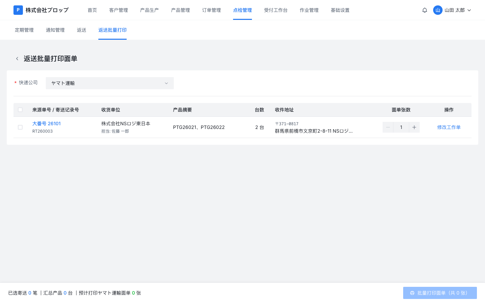

# FEAT-18 返送批量打印

**状态：Current Truth**

（面单版式标注「目标稿（待转正）」）

> **写作纪律（2026-09-20 裁决）**：本文档只写业务事实和产品要求——页面为谁解决什么问题、展示什么信息、有什么操作、规则是什么。禁止写 mock 数据描述、代码字段名、技术词汇、代码实现细节；凡是「demo 恰好这么实现的」不写，凡是「业务上必须如此」才写。举例允许。字段命名规则写在对应数据模型文档，不在本文档。
>
> **页面如实纪律（2026-09-20 裁决）**：本文档只如实描述 demo 页面现状，不得在文档层修改页面内容——包括省略、改名、"清理"页面实际存在的字段或文案。页面内容要改必须先走「裁决 → demo 修改 → 验证」，再回到本文档。

## 1. 模块概述

返送批量打印是跨大番号集中打印面单的工作页。负责返送的员工把多张准备中的返送面单勾选在一起，一次性连续打印，而不必逐笔进入返送详情。本页只做一件事——批量生成面单文件；不登记寄出、不改变产品清单、不合并寄送。单笔返送的准备与确认寄出在「FEAT-17 返送」。

```
FEAT-17 返送（各批次准备中的返送面单）
        │
        ▼
返送批量打印（本页）：选快递公司（本次出单模板）
   → 逐笔勾选 + 设张数 → 批量打印
   → 逐笔生成面单版本 + 回写该笔寄送的快递公司
   → 不登记寄出、不动产品清单
```

## 2. 页面构成

| 页面 | 导航位置 | 主要作用 |
|---|---|---|
| 返送批量打印面单 | 点检管理二级导航「返送批量打印」 | 跨大番号勾选多笔准备中返送面单，连续打印 |

## 3. 资料项目与规则

本页不建立自己的业务记录，操作对象是 FEAT-17 返送的返送寄送与返送文件（规则见 FEAT-17 §3）。本页特有的展示与行为口径：

| 项目 | 规则 |
|---|---|
| 列表范围 | 全部准备中（未确认寄出）的返送面单；已确认寄出的不进入本页，历史文件从 FEAT-17 返送的寄送详情打印 |
| 快递公司 | 页面顶部选择，决定这批面单印哪家公司的模板；出单的同时把每笔被打印寄送的快递公司改写成所选公司（见 FEAT-17 §7.5） |
| 产品摘要 | 直接显示该笔寄送内产品的製造番号列表，以「、」连接 |
| 张数 | 每笔独立设置，默认 1 张；为复印份数——每笔本次出单只产生一个面单版本，几张面单共用同一版本（复印关系），不逐张产生版本 |

## 4. 返送批量打印面单

### 4.1 页面作用

让员工一次选择多家大番号的准备中返送面单，按统一快递公司模板连续打印，提高出单效率。

### 4.2 页面入口与去向

- 入口：点检管理二级导航「返送批量打印」。
- 去向：修改工作单（打开对应返送寄送抽屉，关闭后本页刷新）；返回返送管理。

### 4.3 页面布局



```
┌ ← 返送批量打印面单 ─────────────────────────────┐
│ 快递公司（必选，仅决定本次打印模板）                  │
├──────────────────────────────────────────┤
│ 面单表（准备中）：勾选 │ 来源单号／寄送记录号 │ 收货单位 │ 产品摘要 │ 台数 │ 收件地址 │ 面单张数 │ 操作 │
├──────────────────────────────────────────┤
│ 底部固定汇总栏：已选寄送 N 笔｜汇总产品 N 台｜预计打印{快递公司}面单 N 张  [批量打印面单（共 N 张）] │
└──────────────────────────────────────────┘
```

### 4.4 展示信息

- 快递公司：下拉必选，默认ヤマト運輸；只决定本次打印使用哪家面单模板。
- 面单表（仅准备中返送面单）：
  - 来源单号／寄送记录号：合并为一列，上行为来源「大番号 N」、下行为该笔返送编号（RT 形态）；
  - 收货单位：上行为客户名称、下行为联系人；
  - 产品摘要：该笔寄送内产品製造番号列表（「、」连接）；
  - 台数：产品数量；
  - 收件地址：两行显示——第一行邮编、第二行地址；
  - 面单张数：每笔独立数字输入，默认 1；
  - 操作：修改工作单（打开该笔返送寄送抽屉）。
- 底部固定汇总栏：实时显示「已选寄送 N 笔｜汇总产品 N 台｜预计打印{快递公司}面单 N 张」；右侧「批量打印面单（共 N 张）」，未选择时不可用。
- 空态：「当前没有准备中的返送寄送」。

### 4.5 功能

- 勾选面单、逐笔设置张数。
- 切换快递公司：只改变本次打印模板，不清空勾选、不筛选列表。
- 「修改工作单」：打开该笔返送的寄送抽屉（与 FEAT-17 同一抽屉）；抽屉关闭后本页列表刷新（产品摘要、张数等随最新内容更新）。
- 「批量打印面单」：对每笔选中寄送按张数生成面单文件（每笔本次出单产生一个面单版本，张数为复印份数、共用同一版本），同时把每笔被打印寄送的快递公司改写成顶部所选公司；成功后提示「已生成 N 张{快递公司}面单（打印不登记寄出）」（快递公司以全称显示，如 ヤマト運輸／佐川急便）。

### 4.6 校验与反馈

- 未选择任何寄送时打印按钮不可用。
- 打印不登记寄出事实、不改变产品清单、不改变准备状态；仅生成面单文件版本，并把每笔被打印寄送的快递公司更新为本次所选公司。

### 4.7 页面产生的数据

- 批量打印 → 每笔选中寄送本次出单新增一个面单文件版本（张数为复印份数、共用该版本，历史保留）；该笔寄送的快递公司改写为本次所选公司；不产生寄出事实、不占用产品。

## 5. Feature 边界与明确不做

**本模块负责**：跨大番号准备中返送面单的集中勾选、张数设置与连续打印。

**其他模块负责**：返送的准备、确认寄出与寄出后维护（FEAT-17 返送）；订单发货的批量打印（FEAT-19 订单批量打印，独立页面，操作人员不同，不合并列表）。

**明确不做**：

- 订单与返送混合为一个批量打印列表。
- 已确认寄出的面单进入本页（历史打印走 FEAT-17）。
- 批量打印登记寄出、改变产品清单或准备状态。
- 随附文件（納品書、报告等）的跨笔批量打印——本页只打印面单。
- 切换快递公司时清空勾选。

## 6. 核对记录

- 2026-09-23：按二级导航粒度自 14-返送批量打印 拆分为本 feature（FEAT-18）；内容不变，章节与交叉引用已重编号。
- 核对日期：2026-09-22，已与当前演示页面逐区块核对一致：快递公司选择、面单表列（来源单号／寄送记录号合并列、收货单位合并列、产品摘要、台数、收件地址两行、面单张数、操作）、底部汇总栏、空态。
- 裁决来源：V2.1/修改记录.md §24.8～§24.12（批量打印拆分两页、订单与返送入口分离）、「批量打印产品摘要：订单/返送统一显示製造番号列表」「批量打印快递公司与寄送记录统一」「收件地址列两行（邮编＋地址）」。
- 2026-09-22 修复：本页出单时回写被打印寄送的快递公司（快递公司唯一语义裁决在返送侧的缺口），已补齐页面并追加修改记录；本 spec §3/§4.5 按修复后行为撰写。
- 2026-09-22 独立审查修订：面单表列名按页面实际表头改写（来源单号／寄送记录号、收货单位为合并列）；汇总栏与成功提示补全「{快递公司}面单」全称文案。
- 面单版式为「目标稿（待转正）」，待正式需求。
- 2026-09-22 张数语义裁决对齐（用户裁决「寄送/返送面单张数语义与订单侧四项对齐」）：面单张数 = 复印份数，不产生多版本——每笔本次出单只产生一个面单文件版本，几张面单共用同一版本（复印关系）；原「每张一个版本」口径回退，与单笔抽屉、订单批量打印统一。正文 §3／§4.5／§4.7 已按新口径修订。
