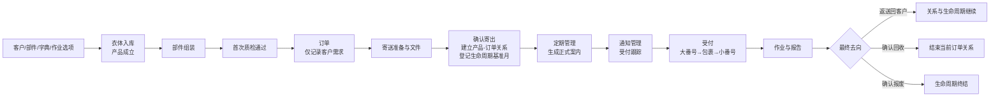
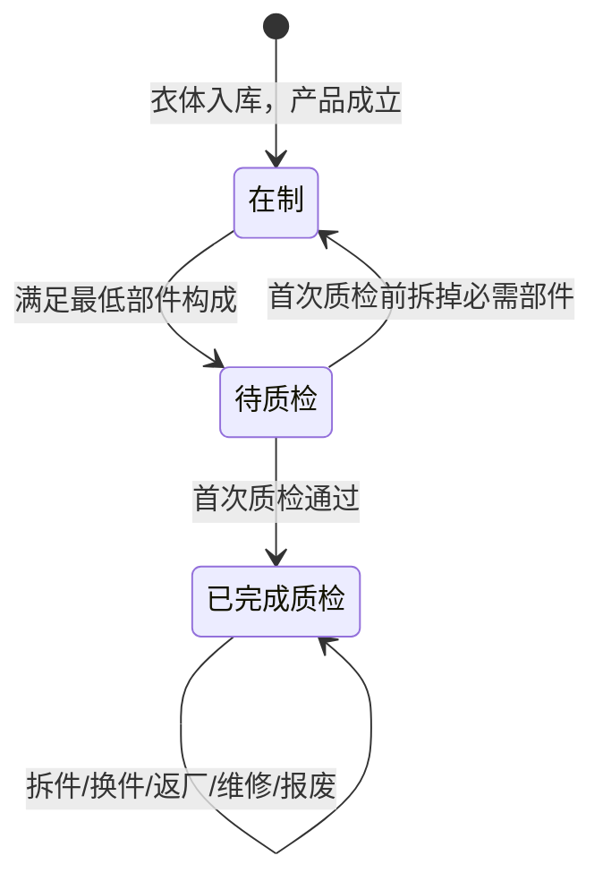

# PROP V2.1 测试业务流程梳理文档

> 依据：`E:\proptest\spec\spec10-28\spec` 最新正式需求（含 2026-10-26 FEAT-20 补充裁决），并以 `spec10-28-vs-spec9-29-变更分析.md` 识别版本差异。
> 用途：帮助测试人员建立端到端业务认知，独立开展主流程验证；本文不替代各 Feature 的 `spec.md`，也不展开为详细测试用例。
> 标记说明：凡需求尚不足以确定预期结果处，统一标注 **【Spec未明确，需确认】**。

## 1. 业务概述

### 1.1 系统定位

PROP V2.1 是气囊产品的全生命周期管理系统，覆盖客户与基础资料、衣体入库、部件组装、首次质检、正式产品、订单与实际出货、定期通知、返厂受付、专业作业、报告，以及返送、回收、报废等业务。

系统要解决的核心问题是：**同一台产品从生产、交付、生命周期通知到来件处理、最终去向，其身份、关系、状态和历史必须连续且可追溯，同时不同业务事实不能被混为一谈。**

### 1.2 全局业务主线

图中的顺序是常见上下游，不是所有业务的硬前置：

- 订单可以不经过案内直接来件受付；产品也可以先入库、后接订单。
- 报告不是返送的硬前置；返送也不自动结束订单关系。
- 返送回客户后，仍可再次来件；返送后也可在符合条件的场景首次确认报废。

### 1.3 四条业务线

| 业务线 | 主要模块 | 关键结果 |
|---|---|---|
| 主档线 | FEAT-01～04 | 客户、部件资料、对外产品名称、固件版本、作业选项可被后续业务引用；停用只影响之后的选择 |
| 产品形成线 | FEAT-05～09 | 衣体入库即产品成立；组装绑定部件；首次质检通过后取得正式流通资格；产品与部件身份可追溯 |
| 订单履约线 | FEAT-10～13、19 | 订单记录需求；确认寄出才建立产品与订单关系；首次实际出货月成为生命周期基准 |
| 返厂闭环线 | FEAT-14～18 | 来件按大番号、包裹、小番号登记；作业与报告独立；最终返送、回收或报废有不同业务含义 |

### 1.4 必须理解的事实边界

| 事实 | 不等于 | 业务含义 |
|---|---|---|
| 点击批次受理“完成” | 作业完成 | 该按钮只做查漏提示，不保存完成状态/时间，也不锁记录；受付只登记来件和本次要求，小番号建立后即可进入作业管理 |
| 作业记录 | 正式报告 | 作业记录是可持续修改的当前台账，报告是生成时冻结的版本 |
| 生成报告 | 已回收/已报废 | 报告与实际处理完全独立 |
| 打印面单/文件 | 已寄出 | 只有“确认寄出”才登记正式寄送事实 |
| 返送回客户 | 订单关系结束 | 返送不新增履约、不解除关系、不影响生命周期 |
| 确认回收 | 取消订单/否定交付 | 回收只结束产品与当前订单的关系，已交付数量不扣减 |
| 确认报废 | 删除产品或部件 | 报废终结产品与衣体编号，气囊/传感器/发生器部件不随之报废 |
| 文件版本不覆盖 | 准备记录不可删除 | 准备中的出货/返送删除时，所属文件和邮件版本随删；正式寄出后不可删除 |

### 1.5 三类最终去向

| 去向 | 执行入口 | 订单关系 | 产品生命周期 | 后续来件 |
|---|---|---|---|---|
| 返送回客户 | FEAT-17 返送，确认寄出 | 不变 | 继续计算 | 可再次受付 |
| 确认回收 | FEAT-16 作业管理 | 结束当前关系，历史保留；有效履约不扣减 | 不终结；已回收产品仍可进入生命周期候选 | 可再次受付 |
| 确认报废 | FEAT-16 作业管理 | 保持当前关系，不自动解除 | 终结，禁止继续出货与再次受付 | 不可再次受付 |

## 2. 前置准备

### 2.1 测试环境与授权

| 准备项 | 要求 |
|---|---|
| 需求版本 | 以 `spec10-28\spec` 为准，不使用 `spec9-29` 的旧结论；模板字段以最新 Feature 裁决和字段对照为准 |
| 构建状态 | 10-28 多项需求仅完成文档同步。测试前须确认构建是否已包含目标 Change；未实现项单独标记，不能仅凭文档判定通过 |
| 时间环境 | 全系统按日本业务时间运行和显示；事件时刻接口应为带 `+09:00` 的 ISO8601，业务日期为 `YYYY-MM-DD`，业务月份为 `YYYY-MM` |
| 账号权限 | 按页面授权准备角色；同时验证菜单、直达 URL、刷新访问和后端接口，不能只验证前端隐藏 |
| 终端 | 受付工作台建议使用安卓平板 Chrome；作业管理为 PC 端；Excel 面单和 PDF 报告需准备桌面端环境 |
| 打印条件 | 返送/订单面单使用快递公司预印纸；需要准备 Excel、PDF 预览及打印设备，打印验证与系统生成验证分开记录 |

### 2.2 主档与字典准备

建议准备一套能贯穿生产、订单、通知、受付、作业和返送的数据：

| 类别 | 最低准备 |
|---|---|
| 客户 | 至少 1 家公司及支店/现场；各自有地址、联系人；包含直販/代理不同场景 |
| 部件资料 | 衣体、气囊、传感器、充气发生器各至少 1 个启用资料；建议同时准备前缀为空和有前缀的衣体资料 |
| 基础数据 | 至少 1 个启用对外产品名称、至少 1 个启用传感器固件版本 |
| 作业选项 | 准备縫製、センサ、組立三组的 NG/处置选项，以及全局受付 NG 快捷选项 |
| 订单数据 | 准备下单方、納品先、請求書先；納品先地址必须属于其自身；准备销售/租赁/替代场景 |
| 物流数据 | 准备ヤマト運輸、佐川急便及对应面单模板、运单号样例；返送还需预印面单纸 |
| 产品数据 | 至少 1 台可完成“衣体入库→组装→质检→订单→寄送”的产品；建议另备 2～3 台用于分批、回收、报废和返送分支 |

### 2.3 产品最低构成

产品在衣体入库时成立。进入正式流通前必须满足：

- 衣体 1 个；
- 气囊 1 个；
- 传感器 1 个；
- 充气发生器位置 1 1 个；
- 充气发生器位置 2 可空，不影响最低构成。

只有满足最低构成的产品才能进入待质检清单。首次质检通过后，即使后续拆件、换件、返厂或维修，生产阶段也不退回“在制/待质检”。

### 2.4 生命周期数据准备

要验证当月案内，应让产品的首次实际出货月与目标月份匹配：

- 第 1～4 年目定期点检：基准月为同月份向前 1～4 年；
- 第 5 年目廃棄：基准月为同月份向前 5 年；
- 出货当年为 0 年目，不产生通知候选；
- 已报废产品不进入候选；已回收产品仍可进入候选。

### 2.5 当前待确认事项

- **【Spec未明确，需确认】** FEAT-17 两家快递面单的纸张尺寸、打印区域、方向、缩放、页边距、起印偏移、字号、固定纸面长文字处理，以及佐川出荷日格式。
- **【Spec未明确，需确认】** FEAT-16 报废报告模板尚未提供，当前只明确报废报告的存在、候选与版本边界，不能据回收报告推定其字段和版式。
- **【Spec未明确，需确认】** FEAT-15 批次记录表已确认 R4 参考样式，但正式模板注册、真实图片接入及生产自动分页/实纸效果仍需验证。
- **【Spec未明确，需确认】** FEAT-12 案内 PDF 的最终样稿、长名称/长段落分页和实纸效果仍需按已确认规则验证；字段来源已基本明确，不代表打印验收完成。
- **【Spec未明确，需确认】** 日语 UI 最终用词仍以客户确认为准；这通常不改变业务链路，但会影响界面文案核对。

## 3. 主业务时序流程

### 3.1 主流程总表

| 时序 | 业务动作 | 系统反馈/产生事实 | 关键业务校验 |
|---:|---|---|---|
| 0 | 配置客户、部件资料、基础数据和作业选项 | 形成可复用主档与字典 | 必填项完整；同类型字典判重；停用项不再用于新选择，历史值不回写 |
| 1 | 新建客户公司/支店，并维护地址、联系人 | 生成客户编号并保存客户主体 | 公司/支店编号不可重复；地址只能属于一个主体；邮编 7 位；至少 1 个地址时必须地址 1 完整 |
| 2 | 衣体入库：选择资料、录入单个或连续编号 | 建立衣体个体、产品、衣体与产品绑定，生成 M番号 | 衣体编号 = 製造番号；当前有效档案全系统唯一；连续范围保留前导零；已有档案跳过；结果以整批事实成立 |
| 3 | 部件组装：为产品录入气囊、传感器、发生器编号 | 建立部件个体/绑定/安装记录；传感器记录固件版本 | 同一产品同类型同位置最多一个有效绑定；部件类型与列一致；未建档时按默认资料建档；不满足最低构成不能质检 |
| 4 | 质检工作台勾选产品并确认“质检通过” | 写入质检通过事实，产品主档“首次生产质检已通过”置为通过 | 服务端重新校验最低构成；标记、质检事实和历史事件同一事务；确认后不可撤回 |
| 5 | 新建订单，选择三方客户、配送资料、产品名称和数量 | 生成注文管理番号，保存订单需求与客户快照 | 下单方/納品先/請求書先完整；配送地址属于納品先；一个订单只有一种产品名称；数量为正整数 |
| 6 | 订单详情“发货”，建立寄送准备并录入本笔产品 | 生成寄送记录号；保存产品清单、收货快照和物流草稿 | 产品须已过首次质检、未报废、无其他当前订单、未在本次清单、不超订单剩余可发 |
| 7 | 生成面单、納品書、保障确认书或邮件正文 | 生成独立文件版本，可预览/下载/复制 | 打印不等于寄出；文件生成不改变履约和产品订单关系；版本不覆盖 |
| 8 | 补充运单号并确认寄出 | 登记确认人/时间；冻结产品清单；建立产品与订单关系；增加有效履约；首次出货月写入生命周期基准月；自动生成邮件 v1 | 快递公司必选；订单有效；产品资格和剩余数量在服务端重验；整笔成功或整笔回滚 |
| 9 | 定期管理年度日历与月度候选 | 按基准月展示第 1～4 年目和 5 年目候选 | 仅有基准月产品；同年月才产生候选；报废排除；按当前订单下单方归组；无当前关系只读 |
| 10 | 勾选产品并生成案内 | 生成案内番号、案内快照、模板绑定和正式 PDF | 产品仍属于当前月/类型/客户；发行日不得早于当天；首次 PDF 渲染成功后才提交；案内不可修改/覆盖/作废 |
| 11 | 通知管理查询案内并跟踪受付 | 显示已生成案内、每台产品的受付状态和超期 | 一次受付只满足受付时已发行且包含该产品的最新案内；发行日 +30 天判断超期；旧案内可长期超期 |
| 12 | 来件：新建受付，建立大番号和 Package 1，拍摄面单 | 生成大番号，建立空包裹 | 客户、地址、产品可暂空；面单照片可选；大番号按年度序列生成 |
| 13 | 扫描首台产品，确认来件信息，建立小番号 | 保存本次来件快照；首台受付成立；小番号取得 | 产品必须存在；无当前订单允许人工填写来件信息；公司名称、来件地址必填；保存不回写客户/订单 |
| 14 | 继续添加产品、维护受付类型/年目/作业要求/NG/备注/客户确认/处理计划 | 字段按操作实时保存；未入力实时计算 | 报废与点检/维修/租赁结束互斥；定期点检必选年目；需要客户确认时至少 1 条备注；箱数为正整数 |
| 15 | 作业管理按批次登记五组作业 | 当前作业记录持续更新；“作業中/完了”与批次进度自动计算 | 完成只认組立三项检查均有结果，或已确认回收/报废；报告、返送、清洗、展开维修不决定完成 |
| 16 | 生成单台点检报告/大番号回收报废报告 | 生成不可变报告版本 | 单台报告任何计划均可生成；大番号报告按当前计划筛候选；报告不产生实际处理事实 |
| 17 | 返送管理按大番号建立面单，勾选本次返送产品 | 生成返送编号，保存产品清单、地址快照、承运与文件 | 已回收/已报废/已实际返送/在其他准备面单中的产品不可选；计划为回收或报废但未实际处理的仍可混装 |
| 18 | 生成面单/納品書并确认返送寄出 | 登记正式返送事实；冻结产品清单；生成邮件 v1 | 打印不等于寄出；确认后产品永久退出普通返送候选；返送不改变订单关系和履约 |
| 19 | 根据实际业务执行回收或报废 | 形成不可逆的回收/报废事实，并影响订单关系或生命周期 | 同一受付只能首次确认回收或报废，两者不能重复或互换；返送后可首次报废 |

### 3.2 主链路最小闭环

若只验证一条最短主链路，建议使用：

`客户 → 四类部件资料 → 1 台衣体入库 → 补齐最低构成 → 质检通过 → 1 张订单 → 1 笔寄送并确认寄出 → 当月案内候选 → 生成案内 → 1 次受付 → 五组作业 → 单台点检报告 → 返送面单 → 确认返送`

该闭环可同时验证产品身份、订单关系、生命周期基准、受付层次、作业完成、报告版本和返送事实。回收/报废作为后续分支分别验证，不要塞进同一条最短链路。

## 4. 分支流程

| 分支 | 触发场景 | 业务路径 | 关键结果/边界 |
|---|---|---|---|
| B01 无案内直接来件 | 客户未收到通知或临时寄回 | 产品识别 → 建立受付 → 人工确认来件信息 | 受付不以存在案内为前提；无当前订单也允许受付 |
| B02 产品无当前订单来件 | 已回收、订单关系已解除或历史产品 | 扫描产品 → 提示人工确认来源 → 填写公司/地址 | 可继续建立受付；不自动回查或补写订单/客户主档 |
| B03 分批寄送 | 订单未一次发完 | 订单多次建立寄送 → 逐笔确认寄出 | 每笔独立寄送号、文件、物流资料；同订单可多笔；履约按整单总数累计 |
| B04 取消订单 | 后续商业履约终止 | 填写取消原因 → 确认取消 | 保留历史出货和产品关系；未确认寄送准备释放占用、不可再确认；已取消订单不进入批量打印 |
| B05 手动解除产品关联 | 误发/错发，需否定原交付 | 订单详情选择产品 → 选择保留或清空基准月 → 确认解除 | 有效履约减少、历史累计出货不减少；保留基准则再次发货不重置，清空则下次有效寄出重建 |
| B06 案内重新生成 | 已发行案内内容有误 | 返回定期管理重新勾选 → 生成新案内 | 旧案内永久保留；新旧案内无“当前有效/作废”判断；受付只匹配最新案内 |
| B07 案内受付超期 | 发行日 +30 天仍无匹配受付 | 通知管理显示超期 | 后续新案内被受付不会解除旧案内超期；合法删除受付后重新按剩余事实判断 |
| B08 多包裹/追加产品 | 同一批来件分多个包裹，或后续补录 | 新建包裹 → 扫描产品 → 建立新小番号 | 大番号内包裹序号递增且不重排；跨年向旧大番号追加仍使用旧大番号年度的小番号序列 |
| B09 客户确认与处理计划冲突 | 需要向客户确认，或实际处理与计划不同 | 标记需要确认并填写备注 → 后续可修改计划 | 处理计划不产生实际事实；计划修改不撤销回收/报废/返送事实 |
| B10 部件更换/资料更正/固件升级 | 实物换件、资料选错或固件更新 | 结束旧绑定 → 建立新绑定；资料追加更正；固件追加版本 | 业务编号可在删除后复用，但新身份不继承旧历史；更换衣体不改变製造番号与系统衣体绑定 |
| B11 清洗/展开维修 | 受付要求清洗或展开维修 | 作业管理勾选清洗完成或登记展开维修目录 | 两种事实独立；不决定单台作业完成；目录只登记文本，不校验本地文件 |
| B12 回收/报废与报告 | 计划为 PROP 回收或报废 | 生成大番号回收/报废报告 → 确认实际回收/报废 | 报告与处理独立；实际确认不可逆；回收结束关系，报废终结生命周期 |
| B13 返送后报废 | 产品已返送，客户随后要求报废 | 修改原受付处理计划为报废 → 在作业管理首次确认报废 | 不要求再次来件；返送、运单、納品書历史保留；同一产品行同时显示已返送和已报废 |
| B14 历史客户/订单补录 | 迁移已确认老客户及历史订单 | 先保存历史客户 → 再进入“過去の注文を登録” → 录入产品/出货日/出租状态 → 统一提交 | 原客户号不可改；历史订单号允许重复；首次/再次出租由人工选择；整单原子保存；不提供草稿、审批、导入、撤销 |
| B15 删除与纠错 | 误建档、绑定错误、准备记录作废 | 先解绑/结束关系 → 删除当前档案或准备记录；历史保留 | 产品、部件、受付各有独立阻断条件；准备删除会连带删除文件版本，正式寄出后不可删除 |

## 5. 状态流转规则

### 5.1 产品生产阶段

| 阶段 | 判定 | 可否回退 |
|---|---|---|
| 在制 | 衣体、气囊、传感器、发生器位置 1 任一未安装 | 首次质检前可随构成变化回退 |
| 待质检 | 最低构成齐全，但产品主档“首次生产质检已通过”未通过 | 首次质检前可因拆件回到在制 |
| 已完成质检 | 首次生产质检通过标记为通过 | 不因后续拆件、换件、返厂、维修或报废自动撤销 |

产品业务状态与生产阶段相互独立：

| 状态 | 判定 | 说明 |
|---|---|---|
| 未关联订单 | 无当前有效产品-订单关系 | 可在满足条件后寄送 |
| 已关联订单 | 存在当前有效产品-订单关系 | 同一产品同时最多一个当前订单 |
| 已报废 | 已有正式报废事实 | 生命周期终结；不得再出货或再次受付 |

### 5.2 订单状态

| 状态/进度 | 判定 | 可执行动作 |
|---|---|---|
| 有效·未发货 | 有效交付为 0 | 编辑、取消、建立寄送 |
| 有效·部分发货 | 0 < 有效交付 < 订单数量 | 编辑、取消、继续寄送 |
| 有效·数量已满足 | 有效交付 >= 订单数量 | 仍可编辑、取消；可追加需求后继续发货 |
| 已取消 | 取消动作成功 | 禁止继续出货；保留历史出货与产品关系；未确认寄送不可再确认 |

注意：这里的“数量已满足”只是履约进度口径，不是独立业务状态，也不表示财务结清、人工关闭或订单归档。

### 5.3 寄送与返送

| 对象 | 状态 | 允许变化 |
|---|---|---|
| 订单寄送 | 准备中 | 可改产品、物流资料、生成文件；可删除，删除后准备及所属文件/邮件版本不保留 |
| 订单寄送 | 已确认寄出 | 产品清单冻结；不可撤回、删除或回退；承运、日期、箱数、运单号仍可维护 |
| 返送寄送 | 准备中 | 可勾选产品、生成文件、删除准备 |
| 返送寄送 | 已发出 | 产品清单冻结；不可删除、撤回或作废；承运信息可更正 |

批量打印只生成文件并回写该笔寄送的快递公司，**不会**把准备中变为已寄出。

### 5.4 受付与作业

| 对象 | 状态/口径 | 规则 |
|---|---|---|
| 大番号 | 已建立 | 一个受付批次；批次受理“完成”按钮只做查漏并返回，不保存完成状态/时间，不锁记录 |
| 包裹 | 已建立 | 可含多台受付；删除前必须为空包裹；删除后序号不重排 |
| 小番号 | 有效受付 | 建立即有效，必填暂缺不使其无效；不提供作废/恢复；删除后不复用 |
| 小番号 | 未入力 N 项 | 按适用字段实时计算；不是记录无效标志，也不阻断作业管理读取 |
| 单台作业 | 作業中 | 組立三项检查未全部有结果，且未确认回收/报废 |
| 单台作业 | 完了 | 組立三项均有结果（○/×皆可），或已确认回收，或已确认报废 |
| 批次作业 | 进行中/已完成 | 批次内仍有任一台未完成则进行中；有效台全部完成则已完成 |

### 5.5 案内与受付跟踪

案内是永久保留的正式事实，不存在草稿、有效/作废、修正版或“当前版本”：

- 生成即成立，正式内容和模板绑定冻结；
- 内容错误只能重新生成新案内番号，旧案内继续保留；
- 受付状态按每台产品分别计算；
- 受付只能满足“受付发生时已发行、且包含该产品的最新一份案内”；
- 到达发行日 +30 天仍无匹配受付，计入超期；旧案内可长期超期。

### 5.6 实际处理（回收/报废）

| 当前事实 | 可执行 | 结果 |
|---|---|---|
| 同一受付尚未回收/报废，当前计划=PROP 回收 | 确认回收 | 结束当前订单关系；有效履约不扣减；不可逆 |
| 同一受付尚未回收/报废，当前计划=报废 | 确认报废 | 终结产品生命周期；保持当前订单关系；不可逆 |
| 已回收或已报废 | 不能再执行任一处理 | 不能重复，也不能回收改报废或报废改回收 |
| 已正式返送、计划=报废、尚未实际处理 | 可首次确认报废 | 返送事实保留，两事实并存 |

仅修改处理计划不产生实际处理事实，也不能替代回收/报废确认。

## 6. 核心字段规则

### 6.1 编号与身份

| 对象 | 规则 |
|---|---|
| 客户编号 | 正常新建为 `C + 连续数字`，公司与支店共用序列；历史补录使用原客户编号，保存后不可修改；历史编号保留前导零、大小写和符号 |
| 部件个体编号 | 建档时录入；当前有效档案范围内全系统唯一；删除后可复用编号，但新登记是独立身份，不继承旧历史 |
| 製造番号 | 等于衣体编号；产品入库时确定，终身不变；更换实物衣体也不改变 |
| M番号 | 产品成立时生成 `M + 6 位流水`；单调递增、不复用、允许空号；所有界面均不显示 |
| 注文管理番号 | 新号格式 `[I/R/D][YY][NNNN]`，分别对应销售/租赁/替代；所有类型共用年度序列；首次使用年度从 1001 起，之后新年度从 0001 起；编辑、取消不换号 |
| 历史订单号 | 保留原完整号码，允许重复和 `-N` 后缀，以内部订单 ID 区分；不参与新号序列 |
| 寄送记录号 | `SH[YY][NNNN]`，按年重新起号；与返送编号互不共用 |
| 返送编号 | `RT[YY][NNNN]`，按年连番 |
| 受付大番号 | `[YY][NNNN]`，一个来件批次一个号；按年内最大号 +1 |
| 受付小番号 | 按大番号所属年度连续整数，从 1 起；跨批次、跨包裹不重置；显示为 4 位补零，单台身份为“大番号-小番号4位” |
| 包裹序号 | 大番号内从 1 递增；删除后不重排，新包裹取现有最大序号 +1 |
| 案内番号 | `AN-YYYY-NNNNNN`，年份取对象月年份；每次重新生成取得新号 |

### 6.2 时间规则

| 类别 | 规则 |
|---|---|
| 事件时刻 | 创建、修改、确认、关系、解除、审计等；数据库按东京当地 DATETIME 约定，接口返回 `+09:00` 偏移 |
| 业务日期 | 受注日、寄送日、首次出货日、受付日等，格式 `YYYY-MM-DD`，不附时刻和偏移 |
| 业务月份 | 生命周期基准月，格式 `YYYY-MM` |
| 同事件时间 | 同一确认动作产生的寄送事实、产品订单关系等共用同一事件时刻；解除是后续独立事件 |
| 显示 | 任意浏览器所在地均按 Asia/Tokyo 显示与筛选；纯日期/月份不做小时偏移 |
| 重复请求 | 成功重放返回原结果，不刷新原事件时刻、不重复取号、不重复生成业务事实 |

### 6.3 客户与业务快照

- 订单、受付、出货、返送在成立时保存各自采用的客户/地址/联系人信息。
- 客户主档之后修改或删除不自动回写历史业务；已保存单据继续显示当时信息。
- 订单的客户区分是本单独立选择，不因公司主档类型覆盖；直販默认納品先同下单方，代理需另选。
- 寄送/返送页面只读使用订单或大番号保存的地址快照，不提供快照编辑入口。
- 受付的来件公司、地址、联系人只影响本大番号，不回写客户主档或订单。

### 6.4 产品、订单与生命周期

- 订单只记录需求，不分配具体产品，也不提前建立产品订单关系。
- 产品与订单关系在“确认寄出”时建立；同一产品同时最多一个当前订单。
- 订单履约口径：订单数量=当前需求；当前有效交付=已成立且未被手动解除否定的数量；剩余可发=需求−有效交付，不显示负数；历史累计出货=全部已确认寄出数量。
- 首次实际寄送月份成为生命周期基准月；首次寄送日期跨月更正时，基准月同步更正。
- 解除产品订单关系时由员工选择“保留基准月”或“解除基准月”；清空后下一次有效确认寄出重新建立。
- 返送不改变订单关系与履约；回收结束当前关系但不扣减履约；报废保持关系并终结生命周期。

### 6.5 受付、作业与报告

- 受付类型可多选“定期点检/维修/租赁结束”，报废与前三项互斥。
- 定期点检且非报废时必须选择 1 个年度，范围 1～4 年目；同产品其他有效受付已登记年度不可重复选择，当前受付自身可修改。
- 客户确认=需要向客户确认时至少 1 条受付备注；处理计划只是当前判断。
- 小番号成立时保存衣体、气囊、传感器、发生器 1/2 编号及传感器固件的起始状态；后续换件/补录/升级不覆盖。
- 单台点检报告任何处理计划下均可生成；内容缺项不阻断生成，缺失处留空，不自动补值；报告不锁定作业记录。
- 大番号回收/报废报告候选按当前处理计划确定，不与单台点检报告混用版本序列。

### 6.6 文件与版本

- 面单、納品書、保障确认书、寄送通知邮件、案内 PDF、点检报告、回收/报废报告均按次生成独立版本。
- 已生成版本不覆盖；历史查看、下载、打印使用生成时冻结内容。
- 出货/返送准备记录删除时，其所属产品清单关联、全部文件版本和邮件版本一并删除；保障确认书不例外。
- 正式寄出后不可删除寄送/返送记录，版本继续保留。
- 邮件只是系统生成的正文版本，供查看/复制；系统不自动投递，也不保证外部修改后的正文一致。

### 6.7 删除与历史保留

| 对象 | 删除条件 | 删除结果 |
|---|---|---|
| 产品 | 当前仍绑定气囊/传感器/发生器、已有质检记录、已有出货记录（含准备中）、已有受付记录，任一命中即禁止 | 产品与衣体退出当前有效范围；原身份及历史保留；非衣体部件不删除；製造番号可重新入库但为新身份；M番号不复用 |
| 部件 | 当前存在有效绑定即禁止；曾绑定/有履历不阻断 | 退出当前有效档案；编号可复用但新身份不继承历史 |
| 受付小番号 | 已有作业记录、单台点检报告、返送记录、确认回收、确认报废，任一命中即禁止 | 受付及备注、正式 NG 删除；小番号不复用 |
| 受付包裹 | 包裹必须为空 | 删除包裹及图片/备注、该包裹批次记录表版本；不重排其他序号 |
| 受付大番号 | 无任何受付产品且无正式点检/回收/报废报告 | 删除大番号、空包裹、图片、备注、批次记录表 |

### 6.8 权限与数据范围

- PROP 只做页面级授权，不建立按钮权限矩阵。
- 服务端必须校验页面权限，不能只隐藏菜单或按钮。
- 共享查询接口按实际消费页面权限开放；只授予读取，不因此授予维护页面或写接口权限。
- 业务数据在公司内共享，不按部门、个人或记录归属过滤；对象归属、状态、删除阻断等业务校验仍必须执行。

## 7. 主流程验证 checklist

### 7.1 使用方式

- 先按“3.2 主链路最小闭环”完整走通 1 次，确认事实能跨模块接续，再使用本节检查分支和边界。
- 本清单是业务链路核对项，不是详细测试用例；同一检查点允许用多组数据覆盖。
- 标“主链”的检查点阻断端到端验证；标“分支/回归”的检查点在对应场景触发时执行。
- 每个检查点至少保留页面状态、关键结果、相关单据/版本、必要时接口或数据库证据；不能只以按钮可点击作为通过。

### 7.2 A. 基础与权限

- [ ] **A1 主链｜需求基线与构建**：确认被测构建对应的需求/Change 清单；10-28 仅完成文档同步的功能已单列，未把“文档存在”当作功能通过。
- [ ] **A2 主链｜主档可用**：客户、部件资料、基础数据、作业选项的启用项可用于新业务；停用只影响之后的选择，已引用历史仍显示原值。
- [ ] **A3 主链｜页面权限**：无权限时菜单、直达 URL、刷新、服务端接口均拒绝；有权限时可正常读取和维护。
- [ ] **A4 主链｜共享接口权限**：共享查询接口只按消费页面开放读取，不因可查看订单/产品而获得维护或写权限。
- [ ] **A5 主链｜日本业务时间**：在上海、东京、UTC 等浏览器时区下，同一事实的日期/月份显示与筛选一致；跨日、跨月边界按 Asia/Tokyo 判断。

### 7.3 B. 产品形成

- [ ] **B1 主链｜衣体入库**：单个及连续编号均建立衣体、产品和绑定；製造番号=衣体编号；整批成功或整批失败，不留下半批产品。
- [ ] **B2 主链｜编号唯一性**：连续范围保留前导零；当前有效档案全系统唯一；已存在档案按规则跳过/拒绝；M番号不复用且业务界面不显示。
- [ ] **B3 主链｜部件组装**：同产品同类型同位置最多一个有效绑定；类型或位置错配被拒绝；未建档部件建档后不影响既有个体历史。
- [ ] **B4 主链｜最低构成**：衣体、气囊、传感器、发生器位置 1 不全时不能质检；绕过前端仍被服务端拒绝；质检不要求先有订单。
- [ ] **B5 主链｜质检单向**：质检确认后无撤回入口；后续拆件、换件、返厂、维修、回收或报废均不撤销“首次生产质检已通过”。
- [ ] **B6 主链｜状态独立**：生产阶段与当前订单关系、已回收、已报废分别展示，任一状态变化不覆盖另一维度。
- [ ] **B7 分支/回归｜事实保留**：换件、固件升级、资料更正/历史补录均追加新事实；不静默覆盖旧绑定、旧版本或小番号建立时的起始状态。
- [ ] **B8 分支/回归｜产品删除**：仍绑定非衣体部件、已有质检、已有出货（含准备中）、已有受付任一命中即禁止删除；成功删除后身份与历史可读，非衣体部件不删除，M番号不复用。

### 7.4 C. 订单与寄送

- [ ] **C1 主链｜订单输入**：下单方、納品先、請求書先可不同；配送地址属于納品先，联系人属于该地址；一个订单只有一种对外产品名称；数量为正整数。
- [ ] **C2 主链｜订单编号**：新订单按销售/租赁/替代类型和年度共用序列取号；编辑、取消不换号；重复提交不重复取号。
- [ ] **C3 主链｜寄送候选**：仅符合条件的有效产品可加入本次寄送；分批累计不超过订单需求；剩余可发不为负，超发被硬阻止。
- [ ] **C4 主链｜寄送准备**：准备中可调整产品、快递公司、日期、箱数和运单号；文件生成只形成独立版本，不改变“准备中”状态。
- [ ] **C5 主链｜打印与寄出分离**：生成/打印面单、納品書、保障确认书、邮件均不建立寄送事实、不建立产品订单关系、不生成生命周期基准月。
- [ ] **C6 主链｜确认寄出原子性**：一次确认同时冻结产品清单、建立产品订单当前关系、增加有效交付、在首次出货时建立基准月，并使用同一事件时刻；任一步失败均不留下部分事实。
- [ ] **C7 主链｜首次出货基准**：首次实际出货月成为生命周期基准月；首次寄送日期跨月更正时基准月同步更正；已清空基准后再次有效寄出可重新建立。
- [ ] **C8 分支/回归｜取消订单**：保留已确认寄出、产品和关系历史；未确认寄送不得再确认；未确认准备释放占用；已取消订单不进入批量打印。
- [ ] **C9 分支/回归｜解除关联**：员工必须选择保留或清空基准月；当前有效交付减少、历史累计出货不减少；关系、基准、产品详情和订单履约同步一致。

### 7.5 D. 生命周期与案内

- [ ] **D1 主链｜候选资格**：0 年目不候选；1～4 年目进入定期点检候选；5 年目进入廃棄候选；已回收仍可候选，已报废排除。
- [ ] **D2 主链｜案内成立**：只有员工明确创建才生成案内；发行日、对象客户、产品、通知类型、客户/模板快照冻结；无草稿、审批、作废或内容编辑。
- [ ] **D3 主链｜重新生成**：内容有误时生成新案内番号；旧案内永久保留，不产生“当前有效/已替代”判断。
- [ ] **D4 主链｜受付匹配**：受付只匹配受付发生日已发行、且包含该产品的最新同类型案内；未来案内和晚生成的旧发行日案内不匹配；无案内仍可受付。
- [ ] **D5 主链｜超期判断**：到发行日 +30 天仍无匹配受付显示超期；旧案内可长期超期；合法删除受付后按剩余有效事实重算。
- [ ] **D6 分支/回归｜案内文件**：已生成 PDF/文件版本不覆盖，历史查看、下载、打印使用生成时内容；正式模板和长内容分页未定稿项不得判为通过。

### 7.6 E. 受付与作业

- [ ] **E1 主链｜三层编号**：大番号按年取号；包裹序号只增不重排；小番号按大番号年度连续、跨包裹不重置，显示 4 位；跨年向旧大番号追加仍使用旧年度序列。
- [ ] **E2 主链｜来件信息**：候选客户/地址/联系人可人工修改，仅影响本大番号；不回写客户主档、订单或根据客户×月份猜关联案内。
- [ ] **E3 主链｜实时保存与暂缺**：受付可边填边存；必填暂缺不使记录无效；未入力数量实时计算，且不阻断作业管理读取。
- [ ] **E4 主链｜类型与年度**：定期点检/维修/租赁结束可多选，报废互斥；定期点检非报废必须选 1 个年度（1～4 年目），同产品其他有效受付年度不可重复；客户确认备注联动，处理计划不等于实际处理。
- [ ] **E5 主链｜进入作业**：小番号建立后即可在作业管理查询和使用，不要求完成登记、作业、报告或返送；有作业、报告、返送、回收、报废事实后删除被阻断。
- [ ] **E6 主链｜五组作业**：縫製、センサ、組立、展開修理、クリーニング可分别保存并重载；組立三项检查有结果；清洗完成和展开维修目录分别登记。
- [ ] **E7 主链｜完成口径**：单台“完了”只由組立三项均有结果（○/×）或已回收/已报废触发；无人工完成按钮；批次进度按有效台实时汇总。
- [ ] **E8 主链｜报告独立**：单台点检报告在任何处理计划下均可生成；内容缺项留空且不阻断；生成报告不锁定作业记录，也不产生回收/报废事实；大番号回收/报废报告按当前计划确定候选。
- [ ] **E9 分支/回归｜换件与升级**：换件结束旧绑定、建立新绑定；固件升级追加版本；当前事实更新，但小番号起始部件/固件状态不被覆盖。

### 7.7 F. 返送与最终去向

- [ ] **F1 主链｜返送候选**：待返送只认仍存在应返未返产品；候选产品按大番号来件地址返送；已确认回收/报废的产品排除；报告和作业完成不是返送硬前置。
- [ ] **F2 主链｜返送寄出**：准备中可勾选产品、生成文件、删除准备；打印不改变寄出状态；确认寄出后清单冻结，不可撤回/作废/删除，承运信息仍可更正。
- [ ] **F3 主链｜返送影响边界**：确认返送不建立/结束订单关系，不增加履约，不改变生命周期、处理计划、作业记录或报告版本；返送后仍可再次受付。
- [ ] **F4 分支/回归｜返送后报废**：已返送但尚未回收/报废、处理计划改为报废时，可在作业管理首次确认报废；返送、运单和納品書历史保留，详情同时显示已返送和已报废。
- [ ] **F5 主链｜回收/报废结果**：回收结束当前订单关系但有效履约不扣减；报废终结产品与衣体编号、禁止再出货和再次受付，气囊/传感器/发生器不随产品报废。
- [ ] **F6 主链｜不可逆与互斥**：回收、报废确认后不可重复、不可互换；修改处理计划不产生实际处理；已回收/报废不能返送。
- [ ] **F7 分支/回归｜记录删除与打印**：准备中寄送/返送删除时连带删除清单关联、全部文件版本和邮件版本；已正式寄出不可删除；批量打印只处理准备中面单且不登记寄出。

### 7.8 G. 跨模块一致性与可靠性

- [ ] **G1 主链｜看板一致**：订单、在制、库存、厂内作业、受付、待返送等统计与源模块当前事实一致，刷新后不出现无法追溯的差额。
- [ ] **G2 主链｜事实同源**：产品详情、受付履历、作业记录、报告、寄送/返送详情中的产品、客户、数量、日期、状态和文件版本相互一致。
- [ ] **G3 主链｜删除联动**：删除或结束关系后，源模块、详情页、看板、候选清单和批量打印范围同步更新，无孤儿记录或仍可选用的已删对象。
- [ ] **G4 分支/回归｜幂等与并发**：重复请求、双击、网络重试不重复取号或生成业务事实；并发编辑受控冲突不静默覆盖。
- [ ] **G5 分支/回归｜未知结果恢复**：确认或提交结果未知时提供原请求查询/原样重试；离开重进不能将“未确认”误判为失败并新建第二笔事实。
- [ ] **G6 分支/回归｜文件生命周期**：每版文件可按生成时内容独立查看/下载/打印；删除准备记录和正式寄出后的保留边界符合 6.6。

### 7.9 H. 历史客户与订单补录

- [ ] **H1 主链｜历史客户**：原客户编号必填、保留前导零/大小写/符号，保存后不可修改；同号不重复；不提供多主体客户图。
- [ ] **H2 主链｜历史订单号**：完整原订单号必填并保留后缀，允许重复，以内部订单 ID 区分，不消费当前年度序号，不自动归并疑似旧单。
- [ ] **H3 主链｜出租规则**：首次交付、再次出租、已结束出租由人工明确选择，不从查号结果推断；再次出租保留原首次日期/基准月；已结束必须填真实回收日且不早于本次出货日。
- [ ] **H4 主链｜产品与部件**：可引用已有产品或建立新产品；已有产品不被覆盖；部件类型/版本/占用校验通过；未知部件或固件允许留空，不生成假值。
- [ ] **H5 主链｜整单原子性**：保存整张订单及本次新建产品、绑定和历史依据；任一校验失败不留下部分订单、产品、关系或基准；成功后无整笔撤销/级联删除。
- [ ] **H6 分支/回归｜保存后维护**：可纠正订单号、受注日、三方客户/地址和备注；订单类型、产品明细、数量、历史出货/回收日、部件和质检事实不可普通编辑；禁止新增正常发货。

## 8. 需求不包含范围

> 本章只列各 Feature 已明确排除的能力。**未实现、待实施或模板未定稿不等于“不包含”**，应放入待确认项或构建差异单独跟踪。

### 8.1 明确不包含的业务能力

| 领域 | 不包含 |
|---|---|
| 财务与销售管理 | 价格、报价、正式請求書、收款、付款、对账、会计、税务、金额计算、财务交接与审批；SMILE BS 得意先コード管理 |
| 客户与主档 | 客户启用/停用、字段级更正履历、默认請求書先管理、支店独立客户区分、公司删除、地址换所属、联系人换地址、邮箱格式校验/疑似重复提示、关联业务件数统计 |
| 生产与产品 | 系统内逐项质检、质检不通过/返工登记、质检撤回；部件个体启停；在制品独立管理页；产品作废/恢复/回收站；直接改写既有编号；动态规格参数和独立颜色字典；编号清单打印及打印台账；产品自身固定销售/租赁/替代类型 |
| 订单 | 受注案件页及案件编号、父子订单、自动拆单、产品预分配、颜色/规格文字强匹配拦截、订单内独立规格或特殊要求、人工“确认完成”与财务交接确认；M番号显示、搜索或匹配 |
| 定期通知 | 案内修改/修正版/版本历史/当前有效版、作废/恢复、草稿、审批、发送/已读状态、跳过原因、永久排除；两类案内混入同一文件；按月/客户自动猜测通知 |
| 受付 | 受付/小番号作废与恢复、修订受付模式、结束包裹按钮及完成时间、独立来件管理页、受付完成状态/时间；备注分类/负责人/版本；超过 1 张 NG 照片；大番号/包裹层字段缺失总数；自动关联通知字段 |
| 作业 | 人工完成按钮或修改完成状态、作业历史版本、报告生成后锁定作业、报告“修正版/过期/需更新”、跨大番号批量生成报告、一次操作批量生成多份单台点检报告、iPad 适配、按产品条数分页；清洗/展开维修处置与 NG 常用清单 |
| 返送 | 人工关注/不再关注、已确认寄出的撤回或作废、按产品分配不同返送地址、返送自动修改处理计划、返送产生订单履约、物流丢件补寄系统记录、“仍有未处理产品”催办/阻断、面单作为寄出前置 |
| 文件与打印 | 自动发送邮件、外部修改后的正文存档保证、打印即寄出、打印批次台账、单张进度、断点续打、刷新恢复、后台续跑、任务历史；订单与返送混合批量列表；批量打印納品書/保障确认书/报告；面单作废旧模型 |
| 权限与数据范围 | 按钮级权限矩阵；按部门、个人或记录归属过滤 PROP 业务数据；对“仅读取”共享接口授予维护权限 |
| 看板 | “需核对”订单节点、“不再关注”待返送标记、员工个人绩效/工作量、任务中心、派工流程、看板数字保存/快照/历史趋势 |
| 历史补录 | 文件导入、草稿、审批、连续录入、跨页输入恢复；配件、库存批次；正在进行的点检/维修/返送；销售/替代品后续再次交付；历史全量作业链；整笔订单撤销或级联删除；相似旧单归并 |

### 8.2 容易误解的边界

- “确认回收”不是取消订单，也不扣减有效履约；“确认报废”不是删除产品/部件，也不自动解除当前订单关系。
- “生成报告”不是实际回收/报废，“确认返送”不是订单履约，也不是生命周期结束。
- 看板、受付履历、产品列表等查询/展示页面只消费源模块事实，不替代源模块登记。
- 订单批量打印、返送批量打印只生成对应面单，不登记寄出、不修改准备状态，也不跨订单/返送混合。
- “数量已满足”只是订单履约进度，不是独立订单状态；批次受理“完成”只是查漏动作，不是受付完成状态。

### 8.3 验收前仍需确认，不属于排除

| 待确认项 | 处理要求 |
|---|---|
| 10-28 各 Change 的实际构建/部署状态 | 【Spec未明确，需确认】逐项核对实现归属；仅文档存在时不得判通过 |
| 两家快递面单的纸张尺寸、打印区域、方向、缩放、页边距、起印偏移、字号及长文本处理 | 【Spec未明确，需确认】实纸打印单独验证，不与系统生成结果混同 |
| 佐川急便面单的出荷日实际格式 | 【Spec未明确，需确认】以正式模板/客户确认结果为准 |
| 报废报告正式模板、字段和版式 | 【Spec未明确，需确认】不得从回收报告推定 |
| 受付批次记录表正式模板注册、真实图片接入及生产自动分页 | 【Spec未明确，需确认】R4 参考样式不等于生产模板已验收 |
| 案内 PDF 最终样稿、长名称/长段落分页及实纸效果 | 【Spec未明确，需确认】字段规则明确不等于打印验收完成 |
| 日语 UI 最终用词 | 【Spec未明确，需确认】以客户最终确认为准，影响文案核对但不改变主业务链路 |
| FEAT-20 历史补录的迁移、导入及构建可用性 | 当前需求明确未实现、未授权编码/迁移/导入；构建未包含时只做需求审阅，不判功能通过 |
