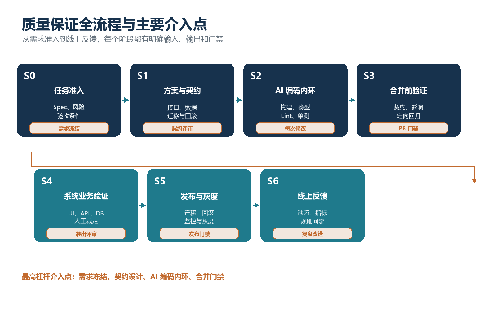

# 质量保证全流程与介入点

## 1. 设计原则

质量体系以变更为主线，而不是以部门或工具为主线。每一次需求变更、缺陷修复、配置调整、数据库迁移和 AI 生成代码，都应进入同一个流程，生成同一类证据，并按同一套规则判定是否可以进入下一阶段。

体系遵循六条原则。

1. 需求基准独立于实现。需求判断以项目外 `spec` 为准，开发项目内的规格文档只用于交叉核对实现。
2. 确定性工具优先。编译、构建、类型检查、单元测试、Schema、数据库约束和安全扫描能够给出稳定结论，应优先执行。
3. AI 只做生成、归纳和初筛，不担任最终裁判。最终判定必须由可复现证据和明确责任人完成。
4. 风险决定验证深度。高风险模块和不可逆动作需要更完整的接口、数据库、业务和人工证据。
5. 证据必须与提交号、环境、工具版本和执行时间绑定。无法复现或无法追溯的“已通过”不进入门禁。
6. 门禁必须可降级。任何新增自动化能力都要有告警模式、人工替代和恢复条件，避免工具故障成为交付单点。

## 2. 七阶段流程

| 阶段 | 触发时间 | 核心目标 | 主要输入 | 关键活动 | 必须输出 | 门禁 |
|---|---|---|---|---|---|---|
| S0 任务准入 | AI 编码开始前 | 确认需求、边界和风险 | 外部 Spec、变更分析、风险清单、历史缺陷 | 需求澄清、风险分级、确定验收条件、准备测试数据 | 需求基线、风险画像、质量任务单 | G0 任务准入 |
| S1 方案与契约 | 设计完成、编码前 | 把业务规则转成可验证契约 | 需求基线、影响模块、接口和表结构 | 变更边界、接口 Schema、数据库迁移、测试策略、回滚方案 | 技术方案、契约清单、验证计划 | G1 设计准入 |
| S2 AI 编码内环 | 每次 AI 修改后 | 快速排除不可运行和明显错误 | Git 差异、上下文包、编码规则 | 编译、类型检查、Lint、相关单元测试、Secret 扫描 | 本地检查结果、失败修复记录 | G2 提交前 |
| S3 合并前验证 | 提交代码或创建 PR 后 | 验证模块逻辑、契约和影响范围 | PR、测试、契约、依赖图 | 全量相关测试、Schema、架构规则、依赖扫描、定向回归 | PR 证据包、变更影响报告 | G3 合并门禁 |
| S4 系统业务验证 | 测试环境部署后 | 证明业务结果和跨模块事实正确 | V5 用例、风险清单、测试数据、构建号 | UI、API、数据库三路验证，不可逆动作和文件检查，人工裁定 | 用例结果、运行时证据、缺陷或裁定 | G4 系统准出 |
| S5 发布与灰度 | 发布候选版本确定后 | 控制生产风险和回滚成本 | 发布包、迁移脚本、证据包、监控方案 | 发布检查、迁移校验、灰度、指标观察、回滚演练 | 发布记录、灰度结果、回滚结论 | G5 发布门禁 |
| S6 线上反馈 | 发布后持续执行 | 把线上问题转为规则和回归资产 | 监控、日志、缺陷、用户反馈 | 缺陷逃逸分析、规则补充、用例回流、门禁调整 | 复盘记录、回归用例、门禁优化项 | 质量改进门禁 |

## 3. 可介入时间点

质量介入越早，修复成本越低。项目不需要在七个阶段平均投入，而应把最强能力放在需求、契约、提交前和合并前四个时点。

| 时间点 | 建议介入方式 | 主要拦截问题 | 自动化程度 | 人工职责 |
|---|---|---|---|---|
| 需求进入前 | 需求基线核对、风险分级、验收条件检查 | 需求含糊、范围漂移、测试不可执行 | 中 | 产品、需求、测试共同确认 |
| AI 提示词和上下文组装时 | 注入项目规则、相关 Spec、接口和测试约束 | AI 幻觉、上下文缺失、越界修改 | 高 | 开发者确认上下文范围 |
| 设计完成时 | 接口契约、数据库迁移、架构规则评审 | 结构错误、跨模块耦合、不可回滚 | 中 | 架构或模块负责人确认 |
| 每次代码修改后 | 快速确定性检查 | 无法构建、类型错误、明显逻辑失败 | 高 | 开发者修复 |
| 提交或创建 PR 时 | 完整模块测试、依赖和影响分析 | 局部通过但影响旧功能 | 高 | 开发者提交证据，质量人员复核 |
| 测试环境部署后 | 业务链路、数据库结果和文件验证 | 接口成功但业务事实错误 | 中 | 测试裁定、业务确认 |
| 发布候选形成后 | 证据完整性、迁移、安全和回滚检查 | 发布条件缺失、不可逆失败 | 高 | 发布负责人批准 |
| 灰度或上线后 | 监控、错误预算、自动回滚 | 测试环境无法发现的真实问题 | 高 | 运维、开发和业务联合处置 |
| 缺陷关闭后 | 回归用例和规则回流 | 同类问题重复发生 | 中 | 测试维护资产，负责人验收 |

AI 编码模式下的特殊介入点是“上下文和提示词”。如果给 AI 的上下文包含过期规格、旧接口或与当前模块无关的代码，后续所有测试都可能建立在错误前提上。因此每次任务都应记录使用的 Spec 版本、相关模块、模型和工具版本以及实际变更范围。

## 4. 人与 AI 的职责边界

| 活动 | AI 可承担 | AI 不得承担 | 最终责任人 |
|---|---|---|---|
| 需求分析 | 摘要、提取规则、生成候选测试点 | 替代业务确认需求 | 产品、需求负责人 |
| 方案设计 | 生成候选方案、发现依赖和风险 | 独立批准架构和数据结构 | 架构或模块负责人 |
| 代码生成 | 生成实现、测试和修复建议 | 以自检代替执行结果 | 开发负责人 |
| 缺陷判定 | 汇总证据、初步归类 | 单方面决定真实缺陷和发布风险 | 测试或指定裁定人 |
| 回归选择 | 根据差异推荐测试范围 | 在漏选风险未知时取消全量兜底 | 测试负责人 |
| 发布放行 | 生成证据摘要、提示风险 | 替代发布责任人签字 | 发布负责人 |

项目现有的“人工裁定问题点”是正确设计，应保留。AI 可以帮助收集 Spec 依据、代码位置、接口响应和数据库差异，但“真实缺陷、需求偏差、环境问题、待定、不修改”的结论必须有人签字并记录理由。

## 5. 变更分级与验证深度

每个变更进入流程时先分级。分级不是按代码行数，而是按业务影响、不可逆程度、跨模块范围、权限敏感度和可检测性综合确定。

| 等级 | 判定条件 | 最低验证要求 | 放行方式 |
|---|---|---|---|
| P0 | 不可逆业务动作、权限边界、核心数据一致性、正式文件产物、跨模块主链 | 确定性门禁全部通过；P0 业务链路 UI、API、数据库证据齐全；关键回归通过；人工复核 | 质量负责人和业务负责人共同批准 |
| P1 | 重要业务流程、批量操作、历史数据、统计口径、时间边界 | 模块测试、契约测试、定向回归、必要的运行时验证 | 质量负责人批准 |
| P2 | 普通 CRUD、展示、文案、导航和非关键排序 | 构建、类型、Lint、相关测试、页面检查 | 开发自证，质量抽查 |
| P3 | 纯文档、注释、无运行影响的配置说明 | 文档检查和基础构建 | 开发自证 |

项目中的产品生产、质检、订单、寄送、返送、报废、受付、权限、编号分配、日本业务时间和 PDF/Excel 文件应默认按 P0 或 P1 处理。AI 生成代码不因“改动不大”自动降级，只要触及这些区域就按高风险验证。

## 6. 阶段进入与退出条件

### 6.1 S0 任务准入

进入条件：存在明确需求来源、变更范围、验收条件和风险等级。

退出条件：需求版本可追溯，边界和异常已明确，关键业务规则有 REQ 或 BR 编号，测试数据和环境责任已确定。

### 6.2 S1 方案与契约

退出条件：接口入参、出参、错误码、数据库变更、权限要求、回滚方式和验证策略明确。高风险变更必须说明对现有功能的影响。

### 6.3 S2 AI 编码内环

退出条件：构建、类型检查、Lint 和受影响的单元测试通过；没有新增 Secret；变更范围与任务单一致；失败项有修复记录。

### 6.4 S3 合并前验证

退出条件：相关模块测试通过；接口契约和架构规则通过；依赖漏洞和静态安全问题已处置；定向回归覆盖率满足风险等级；PR 证据可追溯。

### 6.5 S4 系统业务验证

退出条件：P0/P1 业务事实有 UI、API 和数据库证据；不可逆动作和失败路径已验证；人工裁定完成；未通过项有缺陷号或明确残余风险。

### 6.6 S5 发布与灰度

退出条件：发布包与证据绑定；数据库迁移有前置检查、后置检查和回滚方案；灰度指标和自动回滚阈值明确；所有阻断项已关闭或按规则豁免。

### 6.7 S6 线上反馈

退出条件：发布结果被记录；异常、缺陷和回滚完成归因；逃逸缺陷已补回归用例或质量规则；下轮门禁调整有数据依据。

## 7. 项目落地建议

第一阶段不建议覆盖全部业务模块，应选择一个同时具备跨模块、不可逆动作、权限和文件产物的纵切面。建议选择“订单管理到寄送和面单”链路，覆盖订单查询、寄送准备、承运商选择、面单生成、数据库状态和权限检查。

该试点可同时验证：

- Git 差异到测试范围的映射是否有效。
- 接口契约、权限和数据库状态是否能够自动判定。
- Playwright、网络探针和数据库探针能否形成一条业务证据。
- 质量门禁是否会在真实变更中产生可接受的误报和耗时。
- 降级后是否仍能保证核心业务安全。

试点期间，旧流程和新增门禁并行运行。新增门禁先以影子模式记录结果，不改变交付决定；达到稳定标准后再分批转为阻断。这样可以避免第一次上线就因误报或环境问题造成团队抵触。
