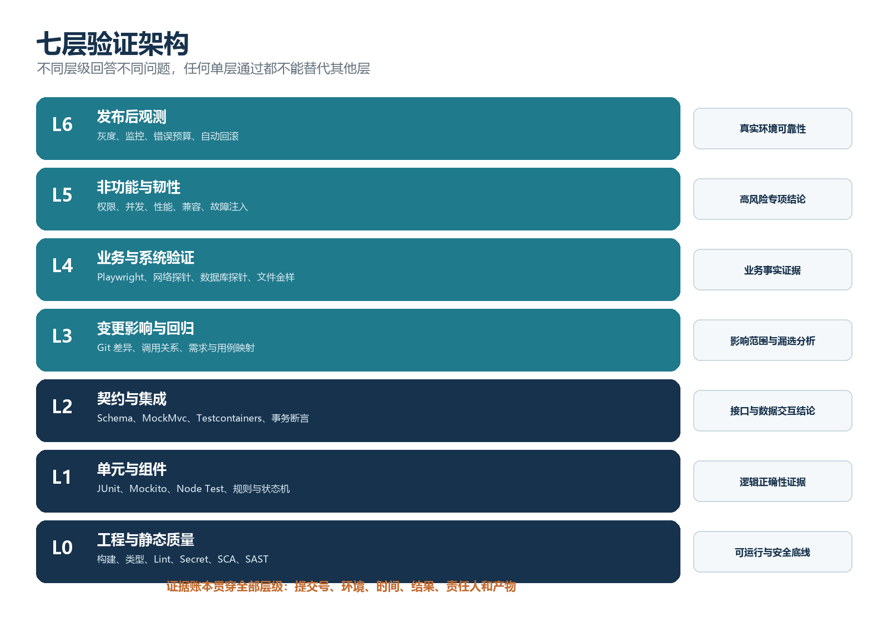

# 架构验证与门禁体系

## 1. 总体结构

建议采用“七层验证、六道门禁、一套证据账本”的结构。七层验证回答“用什么手段证明质量”，六道门禁回答“什么时候可以进入下一阶段”，证据账本回答“凭什么相信这个结论”。



| 层级 | 验证对象 | 核心手段 | 主要产物 | 适用时机 |
|---|---|---|---|---|
| L0 工程与静态质量 | 代码能否构建、依赖是否安全、是否存在敏感信息 | Maven、npm 构建、类型检查、Lint、Secret 扫描、依赖扫描、静态分析 | 构建日志、扫描报告、问题清单 | 每次 AI 修改和 PR |
| L1 单元与组件 | 业务规则、状态机、计算、权限判断、前端逻辑 | JUnit 5、Mockito、Node Test、快照和规则测试 | 测试报告、失败用例、覆盖信息 | 每次提交和合并 |
| L2 契约与集成 | 接口真实性、请求响应结构、数据库事务、外部适配器 | OpenAPI/JSON Schema、MockMvc、Testcontainers、数据库断言 | 契约报告、集成报告、数据差异 | PR 和测试环境 |
| L3 变更影响与定向回归 | AI 修改是否影响其他模块和历史功能 | Git 差异、符号和调用关系、需求与用例映射、历史缺陷 | 影响报告、测试选择清单、漏选分析 | 每次 PR |
| L4 业务与系统验证 | 页面操作后业务事实是否真的正确 | Playwright、网络探针、数据库探针、文件产物检查、人工裁定 | UI/API/DB 证据、缺陷或裁定 | 测试环境 |
| L5 非功能与韧性 | 安全、权限、并发、性能、兼容性、可恢复性 | 权限矩阵、并发脚本、性能基线、故障注入、文件金样 | 专项报告、残余风险 | 高风险变更和发布前 |
| L6 发布后观测 | 真实流量下是否仍然可靠 | 灰度、监控、日志、错误预算、回滚 | 灰度报告、告警、复盘 | 发布后持续 |

七层之间是互补关系。构建通过不代表业务正确，单元测试通过不代表接口契约正确，接口返回成功不代表数据库事实正确，端到端页面通过也不代表生产环境稳定。任何一层都不能单独作为发布放行依据。

## 2. 架构适应度函数

架构验证不应只检查“代码风格”，还要把项目结构和关键约束写成可执行检查。建议建设以下适应度函数，并按风险分批启用。

| 编号 | 适应度函数 | 建议实现 | 阻断级别 | 优先级 |
|---|---|---|---|---|
| AF-01 | 后端可构建、可启动、配置可加载 | Maven 构建、Spring Boot 启动冒烟、健康检查 | 阻断 | P0 |
| AF-02 | 模块依赖方向合法 | ArchUnit；禁止公共层反向依赖业务层，禁止 Controller 直接访问 Mapper | 阻断 | P0 |
| AF-03 | 接口契约与实现一致 | OpenAPI 或 JSON Schema；关键接口请求响应校验 | 阻断 | P0 |
| AF-04 | 数据库变更可迁移、可回滚、前后检查一致 | 迁移脚本、前置检查、后置检查、事务和备份校验 | 阻断 | P0 |
| AF-05 | 权限矩阵与路由、菜单、接口一致 | 角色权限矩阵、接口 401/403/404 预期、前端路由守卫 | 阻断 | P0 |
| AF-06 | 不可逆动作原子且无部分数据 | 服务事务测试、失败注入、数据库前后快照 | 阻断 | P0 |
| AF-07 | 日本业务日、年份和时区边界正确 | 固定时钟、边界用例、数据库时间字段断言 | 阻断 | P0/P1 |
| AF-08 | 正式文件产物结构与内容正确 | PDF/Excel 渲染测试、页数、字段、文件名、版本金样 | 阻断 | P0/P1 |
| AF-09 | 前端构建、类型、路由和国际化资源可用 | `npm run build`、`vue-tsc`、路由和 i18n 完整性检查 | 阻断 | P1 |
| AF-10 | 关键接口和业务动作可观测 | 请求标识、错误日志、业务计数、告警字段 | 告警后升级 | P1 |

AF-02 的具体规则需要在试点时根据真实依赖关系确认，不能仅凭目录名称推断。首批规则应只覆盖已经确认的依赖方向，避免规则本身产生大量误报。

## 3. 项目适配的验证矩阵

| 业务能力 | 重点风险 | 必选层级 | 关键 Oracle |
|---|---|---|---|
| 客户与历史客户 | 名称、编号、快照、权限和历史关系 | L1、L2、L4 | 页面值、接口值、数据库快照一致 |
| 产品资料与部件 | 编号规则、并发写入、历史快照、关联关系 | L0、L1、L2、L3 | 唯一约束、版本历史、关联完整性 |
| 产品生产与质检 | 状态机、不可逆动作、跨模块事实 | L1、L2、L4、L5 | 质检结果、产品状态、订单关系、库存统计一致 |
| 订单与寄送 | 订单关系、寄送确认、面单、权限 | L0、L1、L2、L4、L5 | 订单状态、寄送记录、面单文件、数据库状态一致 |
| 返送与报废 | 不可逆状态、重复提交、幂等 | L1、L2、L4、L5 | 只能成功一次，失败不留下部分数据 |
| 受付与作业 | 时间归属、年度编号、跨日边界 | L1、L2、L4 | 日本业务日、年度、作业记录和统计口径一致 |
| 首页看板 | 统计口径、报废和作废排除、加载失败 | L1、L2、L4 | 页面指标等于数据库聚合结果 |
| 权限与菜单 | 越权、404/403、数据范围 | L0、L2、L4 | 同角色多账号、多数据范围的访问矩阵 |
| PDF 与 Excel | 字段、页数、字体、版本和文件完整性 | L1、L4、L5 | 文件金样和真实产物比对 |

## 4. 风险驱动测试

测试范围应由风险和变更共同决定，不能只看覆盖率，也不能每次无差别全量执行。

建议采用四个输入：业务影响、不可逆程度、跨模块范围、历史缺陷密度。每个变更输出 P0 到 P3 的风险等级，并据此选择层级。

| 风险信号 | 处理方式 |
|---|---|
| 涉及不可逆动作或许可、库存、订单状态 | 强制 L2、L4 和 L5 的核心项 |
| 涉及数据库结构或批量数据 | 强制迁移前置检查、后置检查、回滚演练 |
| 涉及多个模块共享事实 | 增加跨观察点一致性断言 |
| 涉及 AI 生成的新接口或新依赖 | 强制接口存在性、Schema 和依赖安全扫描 |
| 历史缺陷密集或近期反复修改 | 提高定向回归范围，加入历史缺陷回归集 |
| 只有展示或文案变化 | 保留构建、类型、相关页面检查和轻量回归 |

覆盖率只能说明代码被执行，不能说明业务结果被验证。对于 P0 模块，应同时要求关键分支、关键状态和数据结果断言；如果覆盖率上升但业务 Oracle 没有增加，不应视为质量提升。

## 5. 变更影响分析

每次变更至少记录以下内容：

1. 变更的 Git 提交号、分支和文件清单。
2. 变更对应的 REQ、BR、FEAT 和 V5 用例。
3. 受影响的 Controller、Service、Mapper、XML、Vue 页面、路由和权限。
4. 受影响的数据表和关键字段。
5. 需要执行的单元、契约、接口、业务和文件验证。
6. 未选择的测试及理由。

第一期可以用“人工维护的模块映射加 Git 差异”实现，不必立即建设完整调用图。等映射稳定后，再引入静态分析或 AI 推荐。无论推荐结果多好，高风险变更都应保留全量核心回归兜底。

## 6. 业务 Oracle 设计

业务 Oracle 是质量体系的核心。项目不能只验证页面是否响应，而应验证业务事实是否一致。建议至少覆盖以下四类。

### 6.1 状态 Oracle

验证状态流转的起点、终点和中间状态。例如寄送确认后订单状态、面单状态、数据库时间和操作人必须一致。

### 6.2 数据一致性 Oracle

同一事实在页面、接口和数据库中的值必须一致。跨模块统计必须能从上游数据重新计算出来，而不是只比对页面显示。

### 6.3 不可逆动作 Oracle

报废、删除、质检、确认寄出等动作必须验证成功一次、重复执行被拦截、失败时无部分写入，并可通过审计或状态回读证明结果。

### 6.4 文件产物 Oracle

PDF 和 Excel 需要验证页数、关键字段、表格行数、字体或字符、文件名、版本和再次生成结果。不能只验证接口返回 200 或浏览器触发下载。

## 7. 门禁定义

| 门禁 | 名称 | 位置 | 默认模式 | 主要检查 | 失败动作 |
|---|---|---|---|---|---|
| G0 | 任务准入 | S0 结束 | 影子后转阻断 | 需求版本、验收条件、风险等级、数据和环境准备 | 退回补充需求或拆分任务 |
| G1 | 设计准入 | S1 结束 | 影子后转阻断 | 变更边界、接口契约、数据库变更、权限、测试策略、回滚 | 退回设计或评审 |
| G2 | 提交前 | S2 每次修改后 | 阻断 | 构建、类型、Lint、相关单元测试、Secret 扫描 | 开发者修复后重跑 |
| G3 | 合并门禁 | PR 创建或更新后 | 阻断 | 模块测试、契约、架构规则、依赖扫描、定向回归 | 禁止合并或进入条件通过 |
| G4 | 系统准出 | S4 完成 | 阻断 | P0/P1 业务证据、UI/API/DB、不可逆动作、人工裁定 | 禁止进入发布候选 |
| G5 | 发布门禁 | 发布候选确定后 | 阻断 | 证据完整性、迁移、回滚、灰度方案、监控 | 禁止发布或条件发布 |

门禁结果只有四种：

| 结果 | 含义 | 使用条件 |
|---|---|---|
| 通过 | 必填证据完整且无阻断项 | 自动或人工确认 |
| 条件通过 | 存在非安全类问题，但有补偿控制、期限和责任人 | 必须有具名审批人和到期时间 |
| 阻断 | 存在安全、数据一致性、不可逆动作或核心业务失败 | 不得通过，除非修复后重跑 |
| 豁免 | 经授权接受残余风险 | 仅限非 P0 安全风险，必须登记原因和到期时间 |

门禁转换应遵循“先影子、后告警、再阻断”。新门禁至少观察两个迭代周期，达到误报、稳定性和耗时标准后才可转为阻断。

## 8. 证据账本

每个变更应生成一个证据包，建议目录如下。

```text
evidence/
└─ <项目>-<变更号>-<提交短号>/
   ├─ manifest.json
   ├─ requirements.md
   ├─ risk.md
   ├─ change-impact.md
   ├─ gate-results.json
   ├─ test/
   ├─ runtime/
   ├─ security/
   └─ release/
```

证据包的必填字段包括变更号、提交号、需求版本、风险等级、执行环境、工具版本、模型和提示词版本、执行时间、结果、失败原因、产物路径、责任人和审批记录。

证据应遵循三个规则：

1. 没有执行时间和提交号的“通过”无效。
2. 截图、Trace、接口响应和数据库快照必须可以回溯到同一构建。
3. 失败、豁免和条件通过必须保留原始证据，不能只保留结论。

## 9. 推荐工程落地方式

建议在 `prop_new` 之外先建立质量编排层，读取仓库和外部需求资产，执行现有命令并写入 `systemquality/evidence`。这样可以满足当前源码只读约束，也能先验证门禁价值。

第一阶段编排顺序：

1. 读取 Git 差异和变更号。
2. 生成风险画像和测试选择清单。
3. 并行执行后端 Maven、前端构建、类型、Lint 和相关测试。
4. 执行 Secret、依赖、Schema 和架构规则检查。
5. 汇总为 `gate-results.json`。
6. 对高风险变更触发运行时验证任务单。
7. 由人工完成缺陷裁定和条件通过审批。

第二阶段再将这些步骤写入 CI，并以仓库内的受控配置替代外部脚本。任何 CI 改动都应先经过静态检查、试运行和回滚验证，不能在其他业务变更中夹带上线。

## 10. 环境与数据安全

运行时验证必须坚持当前 `auto-explore` 已有的安全护栏：只允许本地或内网地址、数据库名必须包含测试标识、禁止系统管理和批量删除类危险操作。还需要补充：

- 测试账号按角色分层，不使用生产管理员账号。
- 测试数据与生产数据隔离，敏感字段脱敏。
- 数据库快照和 Trace 按保留周期清理，禁止携带密钥。
- 每次运行固定环境指纹、构建版本和种子数据版本。
- 模型密钥和接口令牌只通过受控环境变量注入，不写入报告。
- 外部模型不可用时使用启发式或人工流程降级，不阻塞基础验证。

## 11. 首轮实施模式与例外边界

首轮不直接启用全部自动阻断。G0、G1、G2、G3 先采集证据和观察误报；G4 对 P0 订单到寄送链路保留人工阻断；G5 对发布保留人工阻断。自动探索、AI 结论和静态规则不得单独作为放行依据。

具体模式见 `09-W1-04首轮门禁模式表.md`，条件通过和豁免的审批、期限、补偿控制及自动失效见 `10-W1-05条件通过与豁免审批规则.md`。机读配置位于 `quality-gates.json` 的 `rollout` 和 `exceptionPolicy`。
