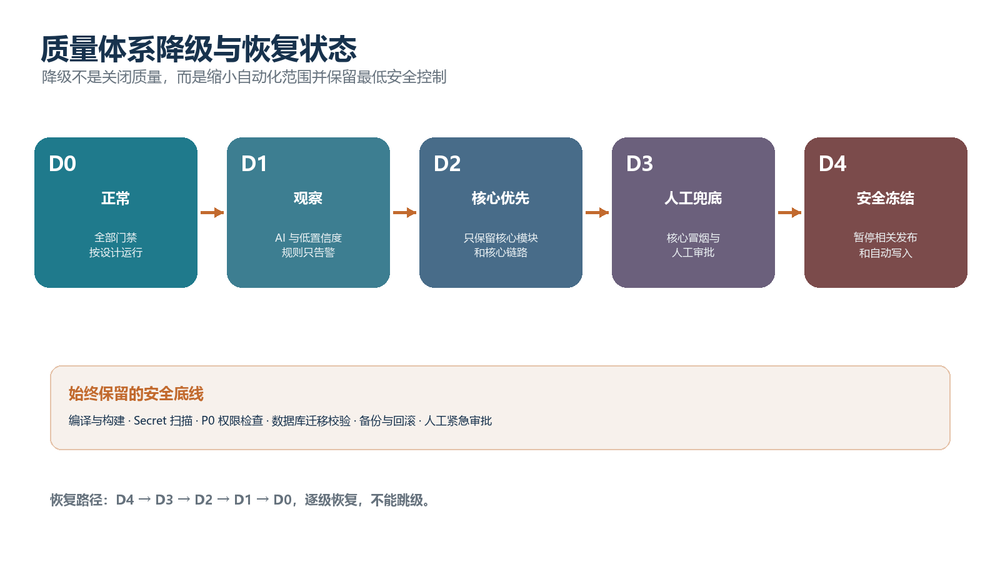

# 效果评估优化与降级方案

## 1. 评估原则

质量体系是否有效，不能看生成了多少报告、多少测试或多少缺陷，而要看它是否减少了真实缺陷逃逸、是否让反馈更快、是否降低了人工重复劳动，以及是否在效果不佳时可以安全退出。

建议每两周做一次质量评估，所有指标使用同一口径、同一环境和同一构建周期。没有基线的指标先采集两个周期，再设定目标；不要在没有数据时承诺精确百分比。

## 2. 指标体系

指标分为效果、效率、稳定、治理和结果五组。每组只保留少量能够驱动决策的指标。

| 编号 | 指标 | 计算方式 | 初始目标 | 主要用途 |
|---|---|---|---|---|
| QM-01 | 阻断门禁执行率 | 实际执行门禁的变更数除以应执行变更数 | 100% | 确认门禁确实运行 |
| QM-02 | 证据完整率 | 必填证据齐全的变更数除以变更总数 | 100% | 防止口头通过和过期结论 |
| QM-03 | P0/P1 需求证据覆盖率 | 有 REQ、BR、用例和运行证据的 P0/P1 条目数除以总数 | 100% | 证明核心业务可追溯 |
| QM-04 | 变更缺陷检出率 | 新增门禁发现的有效缺陷数除以有效缺陷与逃逸缺陷之和 | 相对基线提升 | 判断是否真的发现新问题 |
| QM-05 | 变异得分 | 被测试杀死的有效变异数除以有效变异总数 | 核心变更不低于 70% | 判断测试是否能发现错误 |
| QM-06 | 定向回归漏选率 | 全量失败但定向回归未选中的用例数除以全量失败用例数 | 不高于 3% | 防止精准测试漏检 |
| QM-07 | 阻断误报率 | 被复核为无效的阻断问题数除以阻断问题总数 | 不高于 5% | 控制开发者信任损耗 |
| QM-08 | 告警误报率 | 被复核为无效的告警问题数除以告警问题总数 | 不高于 15% | 控制噪声和人工负担 |
| QM-09 | 不稳定用例率 | 无代码变化时结果发生翻转的用例数除以总执行用例数 | 不高于 2% | 判断自动化是否可托付 |
| QM-10 | 提交前反馈时间 | 从代码修改完成到门禁结果产生的耗时 | 95 分位不高于 10 分钟 | 保证内环可用 |
| QM-11 | 合并门禁反馈时间 | 从 PR 创建到门禁结论的耗时 | 95 分位不高于 20 分钟 | 保证合并节奏 |
| QM-12 | 运行时验证耗时 | 单个高风险业务链路从开始到证据产出的耗时 | 不高于 60 分钟 | 控制系统验证成本 |
| QM-13 | 豁免率 | 带豁免的发布数除以发布总数 | 不高于 5% | 发现门禁不合理或组织绕行 |
| QM-14 | 线上逃逸缺陷数 | 发布后发现的 P0/P1 缺陷数 | 目标为 0 | 最终业务结果 |
| QM-15 | 变更失败率 | 发布后导致回滚、热修或严重告警的变更数除以发布变更数 | 首期不高于 15% | 判断交付稳定性 |
| QM-16 | 平均恢复时间 | 从故障发生到恢复业务的时间 | 首期不高于 4 小时 | 判断可恢复能力 |

覆盖率只作为辅助信息。建议监控新增或修改代码的语句和分支覆盖，但不把单一覆盖率数字作为放行条件。对于核心业务，应同时看变异得分、业务 Oracle 和不可逆动作证据。

## 3. 当前基线

首轮基线已经具备部分可量化数据。

| 类别 | 当前情况 | 说明 |
|---|---|---|
| V5 用例执行 | 通过 494 条、未执行 907 条，合计 1,435 条 | 通过率约 34.4%，未执行率约 63.2% |
| 自动探索稳定性 | 最近 15 批次 32 次通过、33 次无法确认、13 次待确认 | 通过率约 41%，暂不适合硬门禁 |
| 后端测试资产 | 99 个测试文件、约 940 个测试方法 | 是否稳定通过、覆盖率、耗时尚未纳入统一基线 |
| 前端测试资产 | 44 个测试文件、约 897 个测试调用 | 同上 |
| 持续集成 | 未发现 CI 配置 | 门禁尚未自动化，执行依赖人工命令 |
| 运行时证据 | 有 Trace、接口和数据库探针 | 证据存在，但未统一绑定提交号与发布决定 |

这些数据应作为试点起点，不应被解释为项目整体质量已经达到或未达到某个绝对水平。首轮的重点是建立持续采集和同口径比较，而不是立即追求所有指标最优。

## 4. 对照实验设计

每项新增能力都应有对照实验，证明它比现有流程多发现了什么，或者节省了多少成本。

### 4.1 缺陷注入实验

建立不少于 30 个的缺陷注入库，覆盖以下类型：

- 接口参数或返回字段错误。
- 条件判断反转。
- 金额、数量或计算逻辑错误。
- 删除异常处理或失败回滚。
- 去掉权限判断或数据范围限制。
- 写错数据库字段或状态。
- 下游接口异常、超时或返回空值。
- 重复提交、并发写入和幂等错误。
- 文件字段缺失、页数错误或版本错误。

同一批变更分别走传统流程和传统流程加新增门禁。由不知道分组的人员确认是否为真实问题，比较有效检出数、漏检数、误报数、耗时和人工复核成本。

### 4.2 变更影响实验

选择历史上曾经引发跨模块问题的变更，比较定向回归推荐与实际全量失败。重点看漏选率，而不是只看节省了多少执行时间。若漏选率超过阈值，定向回归只能作为优化项，不能替代全量核心回归。

### 4.3 测试有效性实验

对本次新增或修改的核心函数抽样执行变异测试，记录变异得分、无法杀死的变异和对应测试弱点。若测试数量增加但变异得分没有提升，说明新增测试可能只是重复执行路径，而没有增强缺陷检出能力。

### 4.4 AI 探索实验

比较有无 AI 探索时的状态覆盖、基线外发现、人工确认缺陷数和无效报告数。通过率、报告数量和执行步数不能作为主要成效指标。AI 探索的价值应体现为发现确定性测试没有覆盖的状态或业务事实。

## 5. 优化路径

优化应遵循“定位根因、最小调整、复测验证”的顺序，不能因为某个指标低就直接增加工具或增加测试数量。

| 现象 | 可能原因 | 优先优化动作 | 不应采取的动作 |
|---|---|---|---|
| 构建和单元测试经常失败 | 生成代码不可运行或测试基线不稳定 | 收紧提交前门禁，固定环境和依赖，先清理存量失败 | 直接增加 E2E 数量 |
| 接口联调问题多 | 契约缺失、字段和错误码不一致 | 增加 Schema、错误码和关键接口契约测试 | 只依赖页面测试 |
| 测试通过但缺陷逃逸 | Oracle 太弱、只验证不报错 | 增加业务结果、数据库和不可逆动作断言 | 用覆盖率替代有效性 |
| 回归耗时过长 | 无差异选择、测试重复、环境慢 | 并行、分层、缓存、定向回归加全量夜间兜底 | 删除高风险回归 |
| 误报太多 | 规则过宽、环境不稳定、AI 推断无证据 | 规则分级、影子运行、白名单和人工复核 | 直接关闭全部门禁 |
| 自动探索结果不稳定 | 任务单模糊、数据未隔离、步骤上限不足 | 固定种子数据、明确 Oracle、失败分诊、环境复位 | 把无法确认当通过 |
| 文档和填表负担过重 | 重复录入、手工汇总 | 从运行结果自动生成证据摘要和覆盖率 | 增加更多手工文档 |
| 开发者绕过门禁 | 反馈慢、误报高、无替代路径 | 降低反馈时间，保留告警和人工替代，设豁免期限 | 只靠行政强制 |

## 6. 降级状态

质量体系不是只能“全开”或“全关”。建议设置五级状态，通过明确触发条件逐级降级，并保留最低安全能力。

| 状态 | 含义 | 保留能力 | 停止或缩减的能力 | 适用场景 |
|---|---|---|---|---|
| D0 正常 | 全部门禁按设计运行 | 所有确定性门禁、运行时证据、AI 初筛、发布观测 | 无 | 指标稳定、环境可靠 |
| D1 观察 | 新增或 AI 相关规则只告警 | 构建、单元测试、Secret、权限和核心契约仍阻断 | AI 建议、低置信度规则、部分非核心告警转为观察 | 误报率上升或模型结果漂移 |
| D2 核心优先 | 只保留核心模块和核心链路 | 构建、核心单元、核心契约、P0 业务验证、人工复核 | 非核心 E2E、全量探索、低优先级静态规则 | 环境不稳定、耗时不达标、资源紧张 |
| D3 人工兜底 | 自动化结果只作参考 | 核心冒烟、关键人工检查、发布审批、回滚准备 | 自动探索、非必要全量回归、AI 判定 | 连续故障、证据不可信、工具不可用 |
| D4 安全冻结 | 暂停相关发布或自动执行 | 只读检查、备份、回滚演练、人工紧急审批 | 自动写入、AI 操作、非必要变更 | 数据安全、权限、不可逆动作出现重大风险 |

降级不是放弃质量。任何阻断项都必须有“自动化、人工或禁止发布”中的一种替代控制。编译、Secret 扫描、数据库迁移校验和 P0 权限检查不能因为降级而完全消失。

## 7. 降级触发与恢复

| 触发信号 | 起始动作 | 升级条件 | 恢复条件 |
|---|---|---|---|
| 阻断误报率连续两个周期高于 15% | 降为 D1，新增规则只告警 | 持续四个周期或开发者开始普遍绕过 | 两个周期低于 5% |
| 自动化不稳定率高于 5% | 降为 D2，暂停不稳定层 | 环境连续故障或核心链路也不可信 | 两个周期低于 2% |
| 自动探索通过率低于 50% 或无法确认超过 40% | 降为 D1/D2，不进入硬门禁 | 无法确认导致发布延误或误判 | 连续三个批次通过率超过 70% 且误报可接受 |
| 核心回归漏选率高于 3% | 立即恢复全量核心回归 | 出现 P0 逃逸缺陷 | 漏选率连续两个周期低于 3% |
| 发布后出现 P0/P1 逃逸缺陷 | 冻结相关门禁并启动复盘 | 同类问题再次发生 | 根因关闭，新增回归用例通过 |
| 模型、提示词或工具版本发生未记录变化 | 关闭 AI 判定，保留确定性工具 | 无法复现或证据不一致 | 版本固定、回放通过 |
| 环境或数据隔离不满足要求 | 降为 D3 或 D4 | 发现敏感数据或生产写入 | 隔离验证通过，审计确认 |
| 门禁耗时连续超过预算两倍 | 降为 D1/D2，先优化再恢复 | 影响发布窗口 | 连续两个周期达到耗时目标 |

恢复不能跳级。D3 应先恢复到 D2，再恢复到 D1，最后回到 D0。每次恢复都要有连续周期数据和责任人签字。

## 8. 成本与收益判断

质量建设需要控制投入。建议每月计算一次质量成本，包括工具运行时间、环境成本、人工复核时间、误报处理时间和缺陷返工成本。若某项能力的维护成本持续高于其减少的缺陷和返工，应缩减范围或转为人工抽样，而不是无限加码。

优先保留三类能力：

1. 能够稳定拦截不可逆业务错误和权限错误的能力。
2. 能够显著减少线上逃逸和回滚的能力。
3. 能够复用现有资产、维护成本低的能力。

优先缩减三类能力：

1. 长期高误报且无法稳定的规则。
2. 重复覆盖同一风险、没有新增检出价值的用例。
3. 依赖不稳定环境或高度定制维护、但只覆盖低风险展示的自动化。

## 9. 决策机制

每两周的质量评审应回答四个问题：

1. 本周期新增或修改的质量能力是否真的发现了新问题？
2. 误报、耗时和维护成本是否在可接受范围？
3. 哪些门禁可以升级为阻断，哪些需要降级或退出？
4. 线上缺陷是否已经回流为回归用例或质量规则？

评审输出应是一张决策表，而不是一份泛化总结。每项决策要写明数据依据、责任人、生效时间、回滚方式和下次复评时间。

## 10. 首轮降级执行绑定

本方案已经与首轮门禁模式绑定：自动工具故障不得被解释为通过，必须切换为人工替代检查或进入 D1/D2；P0 安全、Secret、数据破坏和不可回滚迁移始终不可豁免。

执行时以 `09-W1-04首轮门禁模式表.md`、`10-W1-05条件通过与豁免审批规则.md`、`exception-register.csv` 和 `quality-gates.json` 为准。例外率、到期未关闭数和因例外导致的逃逸缺陷进入周度复盘。
