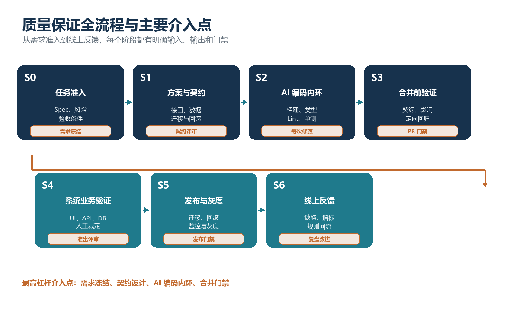
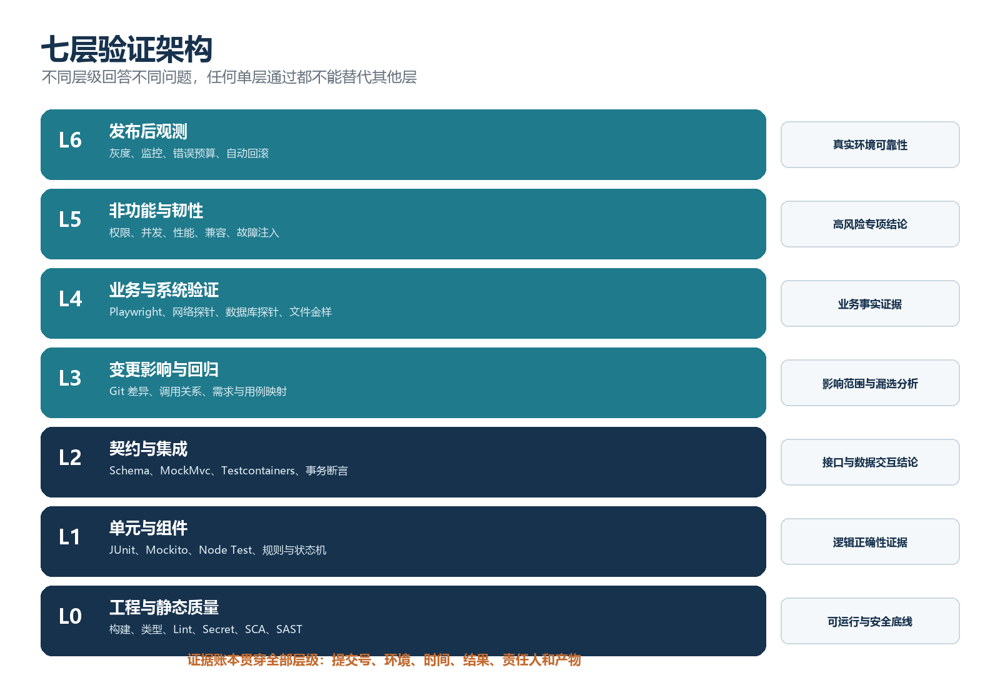
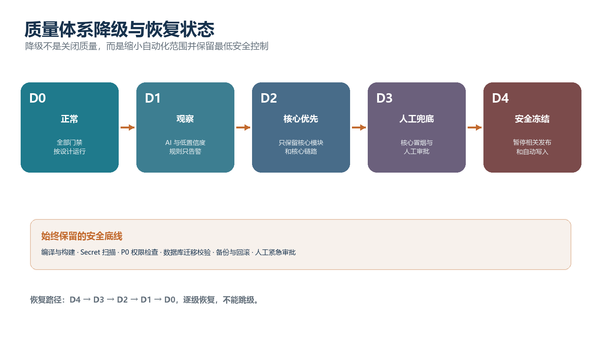

# AI 开发项目质量保证全流程与架构验证方案

## 基于现有质量执行方案和 PROP 项目资产的落地设计

2026 年 11 月

## 结论摘要

当前项目已经具备需求基线、模块行为分析、V5 用例、单元测试、运行时探索和缺陷裁定等质量素材，主要短板是缺少一条自动执行、统一取证、按风险阻断、失败后可降级的质量运行链。

建议采用“七阶段流程、七层验证、六道门禁、一套证据账本、一组量化指标”的体系。第一阶段不要追求全量平台，应先在订单、寄送和面单这类高风险纵切面串联现有工具，证明门禁能够发现传统流程遗漏的问题，同时控制误报、耗时和维护成本。

AI 可以参与需求归纳、测试生成、变更影响推荐、缺陷初筛和报告汇总，但不能单独决定真实缺陷和发布放行。最终结论由确定性工具、可复现运行证据、人工裁定和明确审批人共同完成。

## 当前基线

| 项目 | 当前快照 | 说明 |
|---|---:|---|
| V5 用例有效行 | 1,435 | 12 个业务或补充用例表 |
| V5 已通过 | 494 | 约 34.4% |
| V5 未执行 | 907 | 约 63.2% |
| 后端测试文件与方法 | 99 / 约 940 | 静态统计，不代表当前全部执行通过 |
| 前端测试文件与调用 | 44 / 约 897 | 静态统计，不代表当前全部执行通过 |
| 自动探索最近 15 批 | 32 通过 / 33 无法确认 / 13 待确认 | 通过率约 41%，暂不适合硬门禁 |
| 持续集成配置 | 未发现 | 当前门禁尚未形成自动运行链 |

## 阅读导航

1. 现状诊断与差距结论
2. 质量保证全流程与介入点
3. 架构验证与门禁体系
4. 效果评估优化与降级方案
5. 落地路线图与责任矩阵
6. 附录：变更证据包模板


# 现状诊断与差距结论

## 1. 诊断范围与证据口径

本次分析覆盖 PROP 项目的需求基线、模块行为分析、Spec 与代码对齐、V5 测试用例、运行时自动探索、单元测试、测试环境护栏、缺陷登记和发布相关资产。分析以当前磁盘文件为依据，不把文档中的历史结论直接当作当前代码事实，也不把未执行用例计为通过。

项目技术栈为 Java 17、Spring Boot 4.0.6、MyBatis、Redis、MySQL，前端为 Vue 3、Vite 5、Ant Design Vue、Pinia。仓库包含 `ruoyi-admin`、`ruoyi-prop`、`ruoyi-framework`、`ruoyi-system` 和 `ruoyi-ui` 等模块，业务页面和接口具有明显的前后端联动、跨模块数据一致性和不可逆业务动作特征。

## 2. 已有质量基础

| 能力 | 现有资产 | 可复用价值 |
|---|---|---|
| 需求基线 | 项目外 `spec`、`ai-test/01-requirement/requirement-baseline.md` | 可作为外部审核基准，避免只用开发自带文档自证 |
| 代码行为模型 | `ai-test/02-code-analysis` 中 8 个模块文档 | 已形成从需求到代码行为的中间层，可复用到变更影响分析 |
| 三方对齐 | `ai-test/04-validation` 中 Spec 到 Code、Code 到 V5 的验证文档 | 可继续产出候选缺口，但必须回到当前代码重新核对 |
| 测试用例 | `测试用例汇总_V5.xlsx` 共 19 个工作表，12 个业务或补充用例表合计 1,435 条有效行 | 已覆盖多个业务模块，是业务验证和回归选择的主要资产 |
| 后端测试 | 99 个 Java 测试文件，约 940 个 `@Test` 方法 | 已覆盖规则、服务、Mapper、Controller、文档渲染等场景 |
| 前端测试 | 44 个 Node 测试文件，约 897 个测试调用 | 可覆盖展示规则、路由、请求竞态和部分页面逻辑 |
| 运行时探索 | `auto-explore` 具备 Playwright、网络探针、MySQL 数据探针、任务单、Trace 和状态图 | 是当前最接近“程序不报错但业务结果错误”验证能力的资产 |
| 缺陷闭环 | `测试问题记录.md` 已有人工裁定、去重、飞书登记和复验规则 | 说明项目已经具备人工质量裁定基础，应保留并结构化 |

这些资产说明项目并非从零开始。当前最值得做的不是再生成一套文档，而是把上述资产接入统一流程，让每次变更都知道“该跑什么、跑完证明什么、谁来判定、失败后怎么办”。

## 3. 当前执行基线

对 `测试用例汇总_V5.xlsx` 的 12 个业务或补充用例表进行只读统计，结果如下。

| 执行状态 | 数量 | 占比或说明 |
|---|---:|---|
| 通过 | 494 | 约 34.4% |
| 部分验证 | 19 | 需补充证据或确认边界 |
| 不通过 | 2 | 需与缺陷记录和当前代码状态交叉核对 |
| 阻塞 | 5 | 含依赖未实现、验收范围另记等情形 |
| 作废或冲突确认 | 6 | 需求不存在 4 条，冲突确认 2 条 |
| 无需执行 | 1 | 不应计入有效通过 |
| 未执行 | 907 | 约 63.2% |
| 合计 | 1,435 | 仅为本工作簿口径，不等同于唯一需求覆盖数 |

该基线反映的主要问题是用例执行和证据闭环不足，而不是用例数量不足。未执行用例集中在历史补录、点检管理、受付工作台、作业管理、首页看板和补充用例等区域。若这些模块进入发布范围，不能用“已有用例”替代“已经验证”。

`auto-explore` 最近 15 个批次共记录 78 次任务结论，其中通过 32 次、无法确认 33 次、待确认 13 次。通过率约 41%，不能直接把自动探索报告作为硬门禁或发布放行证据。它的正确位置是“探索发现问题、沉淀可重复的场景”，而不是替代确定性验证。

## 4. 六个关键差距

### 4.1 质量活动未形成统一运行链

需求基线、行为模型、V5 用例、单元测试、运行时探索和缺陷登记分别存在于不同目录，缺少同一条变更主线把它们连接起来。结果是同一个问题可能被重复分析，也可能在代码已经变化后继续使用过期结论。

### 4.2 文档门禁与运行门禁脱节

现有 `tools/check-module.mjs` 能检查模块卡、验收点、验证记录、准出卡和自动化证据，但其配套模块目录已归档，当前没有活跃引用，也没有接入 CI。它证明团队已经理解“门禁必须依赖证据”，但尚未把这种检查扩展到代码构建、接口契约、数据库和业务结果。

### 4.3 测试数量较多但缺少执行治理

后端约 940 个测试方法、前端约 897 个测试调用，数量并不低。但仓库未发现 Jenkins、GitHub Actions、GitLab CI 或其他持续集成配置，也没有 JaCoCo、变异测试、依赖漏洞扫描、Secret 扫描、架构规则检查的工程化门禁。测试是否存在与测试是否每次执行、失败是否阻断是两个不同问题。

### 4.4 运行时验证尚未达到可重复判定

自动探索具备 UI、网络和数据库三路探针，且会记录 Trace 与数据库差异，这是很有价值的基础。但最近批次中“无法确认”和“待确认”占比较高，说明任务单、Oracle 断言、环境稳定性和数据准备仍需治理。当前更适合作为探索与复验工具，不应直接充当发布判定器。

### 4.5 业务结果验证覆盖不足

许多测试仍以“页面加载成功、接口返回成功、字段出现”为通过条件，尚未充分证明跨模块事实、数据库最终状态、不可逆动作、权限范围和文件产物正确。项目中的订单、寄送、质检、报废、返送、受付和面单都属于高风险业务事实，必须增加业务 Oracle 和跨观察点一致性检查。

### 4.6 缺少效果评估与降级机制

现有方案已经提出误报率、变异检出率、回归漏选率等方向，但没有形成统一基线、触发阈值、降级状态和恢复条件。一旦门禁误报过高、运行时间失控、环境不稳定或模型结果漂移，团队可能直接绕过整套机制，导致质量投入无法持续。

## 5. 总体判断

当前项目适合采用“渐进式质量工程”路径，不适合一次性建设全量平台。先把确定性工具和核心业务证据做实，再引入 AI 辅助分析、测试生成和探索；AI 可以负责生成、归纳和初筛，不能负责最终放行。最终判定必须由确定性工具、可复现运行证据和明确责任人共同完成。


# 质量保证全流程与介入点

## 1. 设计原则

质量体系以变更为主线，而不是以部门或工具为主线。每一次需求变更、缺陷修复、配置调整、数据库迁移和 AI 生成代码，都应进入同一个流程，生成同一类证据，并按同一套规则判定是否可以进入下一阶段。

体系遵循六条原则。

1. 需求基准独立于实现。需求判断以项目外 `spec` 为准，开发项目内的规格文档只用于交叉核对实现。
2. 确定性工具优先。编译、构建、类型检查、单元测试、Schema、数据库约束和安全扫描能够给出稳定结论，应优先执行。
3. AI 只做生成、归纳和初筛，不担任最终裁判。最终判定必须由可复现证据和明确责任人完成。
4. 风险决定验证深度。高风险模块和不可逆动作需要更完整的接口、数据库、业务和人工证据。
5. 证据必须与提交号、环境、工具版本和执行时间绑定。无法复现或无法追溯的“已通过”不进入门禁。
6. 门禁必须可降级。任何新增自动化能力都要有告警模式、人工替代和恢复条件，避免工具故障成为交付单点。

## 2. 七阶段流程



| 阶段 | 触发时间 | 核心目标 | 主要输入 | 关键活动 | 必须输出 | 门禁 |
|---|---|---|---|---|---|---|
| S0 任务准入 | AI 编码开始前 | 确认需求、边界和风险 | 外部 Spec、变更分析、风险清单、历史缺陷 | 需求澄清、风险分级、确定验收条件、准备测试数据 | 需求基线、风险画像、质量任务单 | G0 任务准入 |
| S1 方案与契约 | 设计完成、编码前 | 把业务规则转成可验证契约 | 需求基线、影响模块、接口和表结构 | 变更边界、接口 Schema、数据库迁移、测试策略、回滚方案 | 技术方案、契约清单、验证计划 | G1 设计准入 |
| S2 AI 编码内环 | 每次 AI 修改后 | 快速排除不可运行和明显错误 | Git 差异、上下文包、编码规则 | 编译、类型检查、Lint、相关单元测试、Secret 扫描 | 本地检查结果、失败修复记录 | G2 提交前 |
| S3 合并前验证 | 提交代码或创建 PR 后 | 验证模块逻辑、契约和影响范围 | PR、测试、契约、依赖图 | 全量相关测试、Schema、架构规则、依赖扫描、定向回归 | PR 证据包、变更影响报告 | G3 合并门禁 |
| S4 系统业务验证 | 测试环境部署后 | 证明业务结果和跨模块事实正确 | V5 用例、风险清单、测试数据、构建号 | UI、API、数据库三路验证，不可逆动作和文件检查，人工裁定 | 用例结果、运行时证据、缺陷或裁定 | G4 系统准出 |
| S5 发布与灰度 | 发布候选版本确定后 | 控制生产风险和回滚成本 | 发布包、迁移脚本、证据包、监控方案 | 发布检查、迁移校验、灰度、指标观察、回滚演练 | 发布记录、灰度结果、回滚结论 | G5 发布门禁 |
| S6 线上反馈 | 发布后持续执行 | 把线上问题转为规则和回归资产 | 监控、日志、缺陷、用户反馈 | 缺陷逃逸分析、规则补充、用例回流、门禁调整 | 复盘记录、回归用例、门禁优化项 | 质量改进门禁 |

## 3. 可介入时间点

质量介入越早，修复成本越低。项目不需要在七个阶段平均投入，而应把最强能力放在需求、契约、提交前和合并前四个时点。

| 时间点 | 建议介入方式 | 主要拦截问题 | 自动化程度 | 人工职责 |
|---|---|---|---|---|
| 需求进入前 | 需求基线核对、风险分级、验收条件检查 | 需求含糊、范围漂移、测试不可执行 | 中 | 产品、需求、测试共同确认 |
| AI 提示词和上下文组装时 | 注入项目规则、相关 Spec、接口和测试约束 | AI 幻觉、上下文缺失、越界修改 | 高 | 开发者确认上下文范围 |
| 设计完成时 | 接口契约、数据库迁移、架构规则评审 | 结构错误、跨模块耦合、不可回滚 | 中 | 架构或模块负责人确认 |
| 每次代码修改后 | 快速确定性检查 | 无法构建、类型错误、明显逻辑失败 | 高 | 开发者修复 |
| 提交或创建 PR 时 | 完整模块测试、依赖和影响分析 | 局部通过但影响旧功能 | 高 | 开发者提交证据，质量人员复核 |
| 测试环境部署后 | 业务链路、数据库结果和文件验证 | 接口成功但业务事实错误 | 中 | 测试裁定、业务确认 |
| 发布候选形成后 | 证据完整性、迁移、安全和回滚检查 | 发布条件缺失、不可逆失败 | 高 | 发布负责人批准 |
| 灰度或上线后 | 监控、错误预算、自动回滚 | 测试环境无法发现的真实问题 | 高 | 运维、开发和业务联合处置 |
| 缺陷关闭后 | 回归用例和规则回流 | 同类问题重复发生 | 中 | 测试维护资产，负责人验收 |

AI 编码模式下的特殊介入点是“上下文和提示词”。如果给 AI 的上下文包含过期规格、旧接口或与当前模块无关的代码，后续所有测试都可能建立在错误前提上。因此每次任务都应记录使用的 Spec 版本、相关模块、模型和工具版本以及实际变更范围。

## 4. 人与 AI 的职责边界

| 活动 | AI 可承担 | AI 不得承担 | 最终责任人 |
|---|---|---|---|
| 需求分析 | 摘要、提取规则、生成候选测试点 | 替代业务确认需求 | 产品、需求负责人 |
| 方案设计 | 生成候选方案、发现依赖和风险 | 独立批准架构和数据结构 | 架构或模块负责人 |
| 代码生成 | 生成实现、测试和修复建议 | 以自检代替执行结果 | 开发负责人 |
| 缺陷判定 | 汇总证据、初步归类 | 单方面决定真实缺陷和发布风险 | 测试或指定裁定人 |
| 回归选择 | 根据差异推荐测试范围 | 在漏选风险未知时取消全量兜底 | 测试负责人 |
| 发布放行 | 生成证据摘要、提示风险 | 替代发布责任人签字 | 发布负责人 |

项目现有的“人工裁定问题点”是正确设计，应保留。AI 可以帮助收集 Spec 依据、代码位置、接口响应和数据库差异，但“真实缺陷、需求偏差、环境问题、待定、不修改”的结论必须有人签字并记录理由。

## 5. 变更分级与验证深度

每个变更进入流程时先分级。分级不是按代码行数，而是按业务影响、不可逆程度、跨模块范围、权限敏感度和可检测性综合确定。

| 等级 | 判定条件 | 最低验证要求 | 放行方式 |
|---|---|---|---|
| P0 | 不可逆业务动作、权限边界、核心数据一致性、正式文件产物、跨模块主链 | 确定性门禁全部通过；P0 业务链路 UI、API、数据库证据齐全；关键回归通过；人工复核 | 质量负责人和业务负责人共同批准 |
| P1 | 重要业务流程、批量操作、历史数据、统计口径、时间边界 | 模块测试、契约测试、定向回归、必要的运行时验证 | 质量负责人批准 |
| P2 | 普通 CRUD、展示、文案、导航和非关键排序 | 构建、类型、Lint、相关测试、页面检查 | 开发自证，质量抽查 |
| P3 | 纯文档、注释、无运行影响的配置说明 | 文档检查和基础构建 | 开发自证 |

项目中的产品生产、质检、订单、寄送、返送、报废、受付、权限、编号分配、日本业务时间和 PDF/Excel 文件应默认按 P0 或 P1 处理。AI 生成代码不因“改动不大”自动降级，只要触及这些区域就按高风险验证。

## 6. 阶段进入与退出条件

### 6.1 S0 任务准入

进入条件：存在明确需求来源、变更范围、验收条件和风险等级。

退出条件：需求版本可追溯，边界和异常已明确，关键业务规则有 REQ 或 BR 编号，测试数据和环境责任已确定。

### 6.2 S1 方案与契约

退出条件：接口入参、出参、错误码、数据库变更、权限要求、回滚方式和验证策略明确。高风险变更必须说明对现有功能的影响。

### 6.3 S2 AI 编码内环

退出条件：构建、类型检查、Lint 和受影响的单元测试通过；没有新增 Secret；变更范围与任务单一致；失败项有修复记录。

### 6.4 S3 合并前验证

退出条件：相关模块测试通过；接口契约和架构规则通过；依赖漏洞和静态安全问题已处置；定向回归覆盖率满足风险等级；PR 证据可追溯。

### 6.5 S4 系统业务验证

退出条件：P0/P1 业务事实有 UI、API 和数据库证据；不可逆动作和失败路径已验证；人工裁定完成；未通过项有缺陷号或明确残余风险。

### 6.6 S5 发布与灰度

退出条件：发布包与证据绑定；数据库迁移有前置检查、后置检查和回滚方案；灰度指标和自动回滚阈值明确；所有阻断项已关闭或按规则豁免。

### 6.7 S6 线上反馈

退出条件：发布结果被记录；异常、缺陷和回滚完成归因；逃逸缺陷已补回归用例或质量规则；下轮门禁调整有数据依据。

## 7. 项目落地建议

第一阶段不建议覆盖全部业务模块，应选择一个同时具备跨模块、不可逆动作、权限和文件产物的纵切面。建议选择“订单管理到寄送和面单”链路，覆盖订单查询、寄送准备、承运商选择、面单生成、数据库状态和权限检查。

该试点可同时验证：

- Git 差异到测试范围的映射是否有效。
- 接口契约、权限和数据库状态是否能够自动判定。
- Playwright、网络探针和数据库探针能否形成一条业务证据。
- 质量门禁是否会在真实变更中产生可接受的误报和耗时。
- 降级后是否仍能保证核心业务安全。

试点期间，旧流程和新增门禁并行运行。新增门禁先以影子模式记录结果，不改变交付决定；达到稳定标准后再分批转为阻断。这样可以避免第一次上线就因误报或环境问题造成团队抵触。


# 架构验证与门禁体系

## 1. 总体结构

建议采用“七层验证、六道门禁、一套证据账本”的结构。七层验证回答“用什么手段证明质量”，六道门禁回答“什么时候可以进入下一阶段”，证据账本回答“凭什么相信这个结论”。



| 层级 | 验证对象 | 核心手段 | 主要产物 | 适用时机 |
|---|---|---|---|---|
| L0 工程与静态质量 | 代码能否构建、依赖是否安全、是否存在敏感信息 | Maven、npm 构建、类型检查、Lint、Secret 扫描、依赖扫描、静态分析 | 构建日志、扫描报告、问题清单 | 每次 AI 修改和 PR |
| L1 单元与组件 | 业务规则、状态机、计算、权限判断、前端逻辑 | JUnit 5、Mockito、Node Test、快照和规则测试 | 测试报告、失败用例、覆盖信息 | 每次提交和合并 |
| L2 契约与集成 | 接口真实性、请求响应结构、数据库事务、外部适配器 | OpenAPI/JSON Schema、MockMvc、Testcontainers、数据库断言 | 契约报告、集成报告、数据差异 | PR 和测试环境 |
| L3 变更影响与定向回归 | AI 修改是否影响其他模块和历史功能 | Git 差异、符号和调用关系、需求与用例映射、历史缺陷 | 影响报告、测试选择清单、漏选分析 | 每次 PR |
| L4 业务与系统验证 | 页面操作后业务事实是否真的正确 | Playwright、网络探针、数据库探针、文件产物检查、人工裁定 | UI/API/DB 证据、缺陷或裁定 | 测试环境 |
| L5 非功能与韧性 | 安全、权限、并发、性能、兼容性、可恢复性 | 权限矩阵、并发脚本、性能基线、故障注入、文件金样 | 专项报告、残余风险 | 高风险变更和发布前 |
| L6 发布后观测 | 真实流量下是否仍然可靠 | 灰度、监控、日志、错误预算、回滚 | 灰度报告、告警、复盘 | 发布后持续 |

七层之间是互补关系。构建通过不代表业务正确，单元测试通过不代表接口契约正确，接口返回成功不代表数据库事实正确，端到端页面通过也不代表生产环境稳定。任何一层都不能单独作为发布放行依据。

## 2. 架构适应度函数

架构验证不应只检查“代码风格”，还要把项目结构和关键约束写成可执行检查。建议建设以下适应度函数，并按风险分批启用。

| 编号 | 适应度函数 | 建议实现 | 阻断级别 | 优先级 |
|---|---|---|---|---|
| AF-01 | 后端可构建、可启动、配置可加载 | Maven 构建、Spring Boot 启动冒烟、健康检查 | 阻断 | P0 |
| AF-02 | 模块依赖方向合法 | ArchUnit；禁止公共层反向依赖业务层，禁止 Controller 直接访问 Mapper | 阻断 | P0 |
| AF-03 | 接口契约与实现一致 | OpenAPI 或 JSON Schema；关键接口请求响应校验 | 阻断 | P0 |
| AF-04 | 数据库变更可迁移、可回滚、前后检查一致 | 迁移脚本、前置检查、后置检查、事务和备份校验 | 阻断 | P0 |
| AF-05 | 权限矩阵与路由、菜单、接口一致 | 角色权限矩阵、接口 401/403/404 预期、前端路由守卫 | 阻断 | P0 |
| AF-06 | 不可逆动作原子且无部分数据 | 服务事务测试、失败注入、数据库前后快照 | 阻断 | P0 |
| AF-07 | 日本业务日、年份和时区边界正确 | 固定时钟、边界用例、数据库时间字段断言 | 阻断 | P0/P1 |
| AF-08 | 正式文件产物结构与内容正确 | PDF/Excel 渲染测试、页数、字段、文件名、版本金样 | 阻断 | P0/P1 |
| AF-09 | 前端构建、类型、路由和国际化资源可用 | `npm run build`、`vue-tsc`、路由和 i18n 完整性检查 | 阻断 | P1 |
| AF-10 | 关键接口和业务动作可观测 | 请求标识、错误日志、业务计数、告警字段 | 告警后升级 | P1 |

AF-02 的具体规则需要在试点时根据真实依赖关系确认，不能仅凭目录名称推断。首批规则应只覆盖已经确认的依赖方向，避免规则本身产生大量误报。

## 3. 项目适配的验证矩阵

| 业务能力 | 重点风险 | 必选层级 | 关键 Oracle |
|---|---|---|---|
| 客户与历史客户 | 名称、编号、快照、权限和历史关系 | L1、L2、L4 | 页面值、接口值、数据库快照一致 |
| 产品资料与部件 | 编号规则、并发写入、历史快照、关联关系 | L0、L1、L2、L3 | 唯一约束、版本历史、关联完整性 |
| 产品生产与质检 | 状态机、不可逆动作、跨模块事实 | L1、L2、L4、L5 | 质检结果、产品状态、订单关系、库存统计一致 |
| 订单与寄送 | 订单关系、寄送确认、面单、权限 | L0、L1、L2、L4、L5 | 订单状态、寄送记录、面单文件、数据库状态一致 |
| 返送与报废 | 不可逆状态、重复提交、幂等 | L1、L2、L4、L5 | 只能成功一次，失败不留下部分数据 |
| 受付与作业 | 时间归属、年度编号、跨日边界 | L1、L2、L4 | 日本业务日、年度、作业记录和统计口径一致 |
| 首页看板 | 统计口径、报废和作废排除、加载失败 | L1、L2、L4 | 页面指标等于数据库聚合结果 |
| 权限与菜单 | 越权、404/403、数据范围 | L0、L2、L4 | 同角色多账号、多数据范围的访问矩阵 |
| PDF 与 Excel | 字段、页数、字体、版本和文件完整性 | L1、L4、L5 | 文件金样和真实产物比对 |

## 4. 风险驱动测试

测试范围应由风险和变更共同决定，不能只看覆盖率，也不能每次无差别全量执行。

建议采用四个输入：业务影响、不可逆程度、跨模块范围、历史缺陷密度。每个变更输出 P0 到 P3 的风险等级，并据此选择层级。

| 风险信号 | 处理方式 |
|---|---|
| 涉及不可逆动作或许可、库存、订单状态 | 强制 L2、L4 和 L5 的核心项 |
| 涉及数据库结构或批量数据 | 强制迁移前置检查、后置检查、回滚演练 |
| 涉及多个模块共享事实 | 增加跨观察点一致性断言 |
| 涉及 AI 生成的新接口或新依赖 | 强制接口存在性、Schema 和依赖安全扫描 |
| 历史缺陷密集或近期反复修改 | 提高定向回归范围，加入历史缺陷回归集 |
| 只有展示或文案变化 | 保留构建、类型、相关页面检查和轻量回归 |

覆盖率只能说明代码被执行，不能说明业务结果被验证。对于 P0 模块，应同时要求关键分支、关键状态和数据结果断言；如果覆盖率上升但业务 Oracle 没有增加，不应视为质量提升。

## 5. 变更影响分析

每次变更至少记录以下内容：

1. 变更的 Git 提交号、分支和文件清单。
2. 变更对应的 REQ、BR、FEAT 和 V5 用例。
3. 受影响的 Controller、Service、Mapper、XML、Vue 页面、路由和权限。
4. 受影响的数据表和关键字段。
5. 需要执行的单元、契约、接口、业务和文件验证。
6. 未选择的测试及理由。

第一期可以用“人工维护的模块映射加 Git 差异”实现，不必立即建设完整调用图。等映射稳定后，再引入静态分析或 AI 推荐。无论推荐结果多好，高风险变更都应保留全量核心回归兜底。

## 6. 业务 Oracle 设计

业务 Oracle 是质量体系的核心。项目不能只验证页面是否响应，而应验证业务事实是否一致。建议至少覆盖以下四类。

### 6.1 状态 Oracle

验证状态流转的起点、终点和中间状态。例如寄送确认后订单状态、面单状态、数据库时间和操作人必须一致。

### 6.2 数据一致性 Oracle

同一事实在页面、接口和数据库中的值必须一致。跨模块统计必须能从上游数据重新计算出来，而不是只比对页面显示。

### 6.3 不可逆动作 Oracle

报废、删除、质检、确认寄出等动作必须验证成功一次、重复执行被拦截、失败时无部分写入，并可通过审计或状态回读证明结果。

### 6.4 文件产物 Oracle

PDF 和 Excel 需要验证页数、关键字段、表格行数、字体或字符、文件名、版本和再次生成结果。不能只验证接口返回 200 或浏览器触发下载。

## 7. 门禁定义

| 门禁 | 名称 | 位置 | 默认模式 | 主要检查 | 失败动作 |
|---|---|---|---|---|---|
| G0 | 任务准入 | S0 结束 | 影子后转阻断 | 需求版本、验收条件、风险等级、数据和环境准备 | 退回补充需求或拆分任务 |
| G1 | 设计准入 | S1 结束 | 影子后转阻断 | 变更边界、接口契约、数据库变更、权限、测试策略、回滚 | 退回设计或评审 |
| G2 | 提交前 | S2 每次修改后 | 阻断 | 构建、类型、Lint、相关单元测试、Secret 扫描 | 开发者修复后重跑 |
| G3 | 合并门禁 | PR 创建或更新后 | 阻断 | 模块测试、契约、架构规则、依赖扫描、定向回归 | 禁止合并或进入条件通过 |
| G4 | 系统准出 | S4 完成 | 阻断 | P0/P1 业务证据、UI/API/DB、不可逆动作、人工裁定 | 禁止进入发布候选 |
| G5 | 发布门禁 | 发布候选确定后 | 阻断 | 证据完整性、迁移、回滚、灰度方案、监控 | 禁止发布或条件发布 |

门禁结果只有四种：

| 结果 | 含义 | 使用条件 |
|---|---|---|
| 通过 | 必填证据完整且无阻断项 | 自动或人工确认 |
| 条件通过 | 存在非安全类问题，但有补偿控制、期限和责任人 | 必须有具名审批人和到期时间 |
| 阻断 | 存在安全、数据一致性、不可逆动作或核心业务失败 | 不得通过，除非修复后重跑 |
| 豁免 | 经授权接受残余风险 | 仅限非 P0 安全风险，必须登记原因和到期时间 |

门禁转换应遵循“先影子、后告警、再阻断”。新门禁至少观察两个迭代周期，达到误报、稳定性和耗时标准后才可转为阻断。

## 8. 证据账本

每个变更应生成一个证据包，建议目录如下。

```text
evidence/
└─ <项目>-<变更号>-<提交短号>/
   ├─ manifest.json
   ├─ requirements.md
   ├─ risk.md
   ├─ change-impact.md
   ├─ gate-results.json
   ├─ test/
   ├─ runtime/
   ├─ security/
   └─ release/
```

证据包的必填字段包括变更号、提交号、需求版本、风险等级、执行环境、工具版本、模型和提示词版本、执行时间、结果、失败原因、产物路径、责任人和审批记录。

证据应遵循三个规则：

1. 没有执行时间和提交号的“通过”无效。
2. 截图、Trace、接口响应和数据库快照必须可以回溯到同一构建。
3. 失败、豁免和条件通过必须保留原始证据，不能只保留结论。

## 9. 推荐工程落地方式

建议在 `prop_new` 之外先建立质量编排层，读取仓库和外部需求资产，执行现有命令并写入 `systemquality/evidence`。这样可以满足当前源码只读约束，也能先验证门禁价值。

第一阶段编排顺序：

1. 读取 Git 差异和变更号。
2. 生成风险画像和测试选择清单。
3. 并行执行后端 Maven、前端构建、类型、Lint 和相关测试。
4. 执行 Secret、依赖、Schema 和架构规则检查。
5. 汇总为 `gate-results.json`。
6. 对高风险变更触发运行时验证任务单。
7. 由人工完成缺陷裁定和条件通过审批。

第二阶段再将这些步骤写入 CI，并以仓库内的受控配置替代外部脚本。任何 CI 改动都应先经过静态检查、试运行和回滚验证，不能在其他业务变更中夹带上线。

## 10. 环境与数据安全

运行时验证必须坚持当前 `auto-explore` 已有的安全护栏：只允许本地或内网地址、数据库名必须包含测试标识、禁止系统管理和批量删除类危险操作。还需要补充：

- 测试账号按角色分层，不使用生产管理员账号。
- 测试数据与生产数据隔离，敏感字段脱敏。
- 数据库快照和 Trace 按保留周期清理，禁止携带密钥。
- 每次运行固定环境指纹、构建版本和种子数据版本。
- 模型密钥和接口令牌只通过受控环境变量注入，不写入报告。
- 外部模型不可用时使用启发式或人工流程降级，不阻塞基础验证。


# 效果评估优化与降级方案

## 1. 评估原则

质量体系是否有效，不能看生成了多少报告、多少测试或多少缺陷，而要看它是否减少了真实缺陷逃逸、是否让反馈更快、是否降低了人工重复劳动，以及是否在效果不佳时可以安全退出。

建议每两周做一次质量评估，所有指标使用同一口径、同一环境和同一构建周期。没有基线的指标先采集两个周期，再设定目标；不要在没有数据时承诺精确百分比。

## 2. 指标体系

指标分为效果、效率、稳定、治理和结果五组。每组只保留少量能够驱动决策的指标。

| 编号 | 指标 | 计算方式 | 初始目标 | 主要用途 |
|---|---|---|---|---|
| QM-01 | 阻断门禁执行率 | 实际执行门禁的变更数除以应执行变更数 | 100% | 确认门禁确实运行 |
| QM-02 | 证据完整率 | 必填证据齐全的变更数除以变更总数 | 100% | 防止口头通过和过期结论 |
| QM-03 | P0/P1 需求证据覆盖率 | 有 REQ、BR、用例和运行证据的 P0/P1 条目数除以总数 | 100% | 证明核心业务可追溯 |
| QM-04 | 变更缺陷检出率 | 新增门禁发现的有效缺陷数除以有效缺陷与逃逸缺陷之和 | 相对基线提升 | 判断是否真的发现新问题 |
| QM-05 | 变异得分 | 被测试杀死的有效变异数除以有效变异总数 | 核心变更不低于 70% | 判断测试是否能发现错误 |
| QM-06 | 定向回归漏选率 | 全量失败但定向回归未选中的用例数除以全量失败用例数 | 不高于 3% | 防止精准测试漏检 |
| QM-07 | 阻断误报率 | 被复核为无效的阻断问题数除以阻断问题总数 | 不高于 5% | 控制开发者信任损耗 |
| QM-08 | 告警误报率 | 被复核为无效的告警问题数除以告警问题总数 | 不高于 15% | 控制噪声和人工负担 |
| QM-09 | 不稳定用例率 | 无代码变化时结果发生翻转的用例数除以总执行用例数 | 不高于 2% | 判断自动化是否可托付 |
| QM-10 | 提交前反馈时间 | 从代码修改完成到门禁结果产生的耗时 | 95 分位不高于 10 分钟 | 保证内环可用 |
| QM-11 | 合并门禁反馈时间 | 从 PR 创建到门禁结论的耗时 | 95 分位不高于 20 分钟 | 保证合并节奏 |
| QM-12 | 运行时验证耗时 | 单个高风险业务链路从开始到证据产出的耗时 | 不高于 60 分钟 | 控制系统验证成本 |
| QM-13 | 豁免率 | 带豁免的发布数除以发布总数 | 不高于 5% | 发现门禁不合理或组织绕行 |
| QM-14 | 线上逃逸缺陷数 | 发布后发现的 P0/P1 缺陷数 | 目标为 0 | 最终业务结果 |
| QM-15 | 变更失败率 | 发布后导致回滚、热修或严重告警的变更数除以发布变更数 | 首期不高于 15% | 判断交付稳定性 |
| QM-16 | 平均恢复时间 | 从故障发生到恢复业务的时间 | 首期不高于 4 小时 | 判断可恢复能力 |

覆盖率只作为辅助信息。建议监控新增或修改代码的语句和分支覆盖，但不把单一覆盖率数字作为放行条件。对于核心业务，应同时看变异得分、业务 Oracle 和不可逆动作证据。

## 3. 当前基线

首轮基线已经具备部分可量化数据。

| 类别 | 当前情况 | 说明 |
|---|---|---|
| V5 用例执行 | 通过 494 条、未执行 907 条，合计 1,435 条 | 通过率约 34.4%，未执行率约 63.2% |
| 自动探索稳定性 | 最近 15 批次 32 次通过、33 次无法确认、13 次待确认 | 通过率约 41%，暂不适合硬门禁 |
| 后端测试资产 | 99 个测试文件、约 940 个测试方法 | 是否稳定通过、覆盖率、耗时尚未纳入统一基线 |
| 前端测试资产 | 44 个测试文件、约 897 个测试调用 | 同上 |
| 持续集成 | 未发现 CI 配置 | 门禁尚未自动化，执行依赖人工命令 |
| 运行时证据 | 有 Trace、接口和数据库探针 | 证据存在，但未统一绑定提交号与发布决定 |

这些数据应作为试点起点，不应被解释为项目整体质量已经达到或未达到某个绝对水平。首轮的重点是建立持续采集和同口径比较，而不是立即追求所有指标最优。

## 4. 对照实验设计

每项新增能力都应有对照实验，证明它比现有流程多发现了什么，或者节省了多少成本。

### 4.1 缺陷注入实验

建立不少于 30 个的缺陷注入库，覆盖以下类型：

- 接口参数或返回字段错误。
- 条件判断反转。
- 金额、数量或计算逻辑错误。
- 删除异常处理或失败回滚。
- 去掉权限判断或数据范围限制。
- 写错数据库字段或状态。
- 下游接口异常、超时或返回空值。
- 重复提交、并发写入和幂等错误。
- 文件字段缺失、页数错误或版本错误。

同一批变更分别走传统流程和传统流程加新增门禁。由不知道分组的人员确认是否为真实问题，比较有效检出数、漏检数、误报数、耗时和人工复核成本。

### 4.2 变更影响实验

选择历史上曾经引发跨模块问题的变更，比较定向回归推荐与实际全量失败。重点看漏选率，而不是只看节省了多少执行时间。若漏选率超过阈值，定向回归只能作为优化项，不能替代全量核心回归。

### 4.3 测试有效性实验

对本次新增或修改的核心函数抽样执行变异测试，记录变异得分、无法杀死的变异和对应测试弱点。若测试数量增加但变异得分没有提升，说明新增测试可能只是重复执行路径，而没有增强缺陷检出能力。

### 4.4 AI 探索实验

比较有无 AI 探索时的状态覆盖、基线外发现、人工确认缺陷数和无效报告数。通过率、报告数量和执行步数不能作为主要成效指标。AI 探索的价值应体现为发现确定性测试没有覆盖的状态或业务事实。

## 5. 优化路径

优化应遵循“定位根因、最小调整、复测验证”的顺序，不能因为某个指标低就直接增加工具或增加测试数量。

| 现象 | 可能原因 | 优先优化动作 | 不应采取的动作 |
|---|---|---|---|
| 构建和单元测试经常失败 | 生成代码不可运行或测试基线不稳定 | 收紧提交前门禁，固定环境和依赖，先清理存量失败 | 直接增加 E2E 数量 |
| 接口联调问题多 | 契约缺失、字段和错误码不一致 | 增加 Schema、错误码和关键接口契约测试 | 只依赖页面测试 |
| 测试通过但缺陷逃逸 | Oracle 太弱、只验证不报错 | 增加业务结果、数据库和不可逆动作断言 | 用覆盖率替代有效性 |
| 回归耗时过长 | 无差异选择、测试重复、环境慢 | 并行、分层、缓存、定向回归加全量夜间兜底 | 删除高风险回归 |
| 误报太多 | 规则过宽、环境不稳定、AI 推断无证据 | 规则分级、影子运行、白名单和人工复核 | 直接关闭全部门禁 |
| 自动探索结果不稳定 | 任务单模糊、数据未隔离、步骤上限不足 | 固定种子数据、明确 Oracle、失败分诊、环境复位 | 把无法确认当通过 |
| 文档和填表负担过重 | 重复录入、手工汇总 | 从运行结果自动生成证据摘要和覆盖率 | 增加更多手工文档 |
| 开发者绕过门禁 | 反馈慢、误报高、无替代路径 | 降低反馈时间，保留告警和人工替代，设豁免期限 | 只靠行政强制 |

## 6. 降级状态

质量体系不是只能“全开”或“全关”。建议设置五级状态，通过明确触发条件逐级降级，并保留最低安全能力。



| 状态 | 含义 | 保留能力 | 停止或缩减的能力 | 适用场景 |
|---|---|---|---|---|
| D0 正常 | 全部门禁按设计运行 | 所有确定性门禁、运行时证据、AI 初筛、发布观测 | 无 | 指标稳定、环境可靠 |
| D1 观察 | 新增或 AI 相关规则只告警 | 构建、单元测试、Secret、权限和核心契约仍阻断 | AI 建议、低置信度规则、部分非核心告警转为观察 | 误报率上升或模型结果漂移 |
| D2 核心优先 | 只保留核心模块和核心链路 | 构建、核心单元、核心契约、P0 业务验证、人工复核 | 非核心 E2E、全量探索、低优先级静态规则 | 环境不稳定、耗时不达标、资源紧张 |
| D3 人工兜底 | 自动化结果只作参考 | 核心冒烟、关键人工检查、发布审批、回滚准备 | 自动探索、非必要全量回归、AI 判定 | 连续故障、证据不可信、工具不可用 |
| D4 安全冻结 | 暂停相关发布或自动执行 | 只读检查、备份、回滚演练、人工紧急审批 | 自动写入、AI 操作、非必要变更 | 数据安全、权限、不可逆动作出现重大风险 |

降级不是放弃质量。任何阻断项都必须有“自动化、人工或禁止发布”中的一种替代控制。编译、Secret 扫描、数据库迁移校验和 P0 权限检查不能因为降级而完全消失。

## 7. 降级触发与恢复

| 触发信号 | 起始动作 | 升级条件 | 恢复条件 |
|---|---|---|---|
| 阻断误报率连续两个周期高于 15% | 降为 D1，新增规则只告警 | 持续四个周期或开发者开始普遍绕过 | 两个周期低于 5% |
| 自动化不稳定率高于 5% | 降为 D2，暂停不稳定层 | 环境连续故障或核心链路也不可信 | 两个周期低于 2% |
| 自动探索通过率低于 50% 或无法确认超过 40% | 降为 D1/D2，不进入硬门禁 | 无法确认导致发布延误或误判 | 连续三个批次通过率超过 70% 且误报可接受 |
| 核心回归漏选率高于 3% | 立即恢复全量核心回归 | 出现 P0 逃逸缺陷 | 漏选率连续两个周期低于 3% |
| 发布后出现 P0/P1 逃逸缺陷 | 冻结相关门禁并启动复盘 | 同类问题再次发生 | 根因关闭，新增回归用例通过 |
| 模型、提示词或工具版本发生未记录变化 | 关闭 AI 判定，保留确定性工具 | 无法复现或证据不一致 | 版本固定、回放通过 |
| 环境或数据隔离不满足要求 | 降为 D3 或 D4 | 发现敏感数据或生产写入 | 隔离验证通过，审计确认 |
| 门禁耗时连续超过预算两倍 | 降为 D1/D2，先优化再恢复 | 影响发布窗口 | 连续两个周期达到耗时目标 |

恢复不能跳级。D3 应先恢复到 D2，再恢复到 D1，最后回到 D0。每次恢复都要有连续周期数据和责任人签字。

## 8. 成本与收益判断

质量建设需要控制投入。建议每月计算一次质量成本，包括工具运行时间、环境成本、人工复核时间、误报处理时间和缺陷返工成本。若某项能力的维护成本持续高于其减少的缺陷和返工，应缩减范围或转为人工抽样，而不是无限加码。

优先保留三类能力：

1. 能够稳定拦截不可逆业务错误和权限错误的能力。
2. 能够显著减少线上逃逸和回滚的能力。
3. 能够复用现有资产、维护成本低的能力。

优先缩减三类能力：

1. 长期高误报且无法稳定的规则。
2. 重复覆盖同一风险、没有新增检出价值的用例。
3. 依赖不稳定环境或高度定制维护、但只覆盖低风险展示的自动化。

## 9. 决策机制

每两周的质量评审应回答四个问题：

1. 本周期新增或修改的质量能力是否真的发现了新问题？
2. 误报、耗时和维护成本是否在可接受范围？
3. 哪些门禁可以升级为阻断，哪些需要降级或退出？
4. 线上缺陷是否已经回流为回归用例或质量规则？

评审输出应是一张决策表，而不是一份泛化总结。每项决策要写明数据依据、责任人、生效时间、回滚方式和下次复评时间。


# 落地路线图与责任矩阵

## 1. 试点范围与目标

建议用 12 周完成首轮试点，范围限制在“订单管理到寄送和面单”高风险纵切面，同时用影子模式观察所有变更的基础工程质量。试点的目标不是一次性覆盖全部项目，而是证明四件事：

1. 现有测试和脚本能否被统一编排并稳定执行。
2. 变更影响分析能否在不明显增加漏检的情况下减少回归范围。
3. UI、API、数据库和文件证据能否形成可复核的业务结论。
4. 门禁效果不佳时能否按预设阈值降级而不影响业务连续性。

试点结束时，如果基础门禁稳定、核心链路证据完整、误报和耗时可控，再推广到产品生产、受付、历史补录和点检等模块。

## 2. 12 周路线

| 周期 | 里程碑 | 主要工作 | 交付物 | 退出条件 |
|---|---|---|---|---|
| 第 1 周 | 基线与责任 | 建立指标口径、任命负责人、冻结当前测试和缺陷基线、确定试点链路 | 指标基线、责任矩阵、试点任务单 | 每个 P0 门禁有唯一责任人 |
| 第 2 周 | 影子编排 | 串联 Maven、npm、JUnit、Node Test、Lint、Secret 和依赖扫描，只记录不阻断 | 本地质量编排脚本、首轮证据包 | 连续运行两次结果可复现 |
| 第 3-4 周 | G2 提交前门禁 | 接入构建、类型、Lint、相关单测和 Secret；固定环境和工具版本 | G2 门禁定义、失败分类规则 | 95 分位反馈不超过 10 分钟，误报可接受 |
| 第 5-6 周 | G3 合并门禁 | 增加契约、架构规则、依赖扫描、定向回归和变更影响报告 | G3 门禁定义、变更影响模板 | 核心回归漏选率不高于 3% |
| 第 7-8 周 | L1、L2、L3 深化 | 对核心函数抽样变异测试；补充接口 Schema 和数据库事务验证；建立调用与用例映射 | 测试有效性报告、契约基线、映射表 | 核心变更变异得分达到 70% 或明确改进计划 |
| 第 9-10 周 | G4 系统准出 | 对订单到寄送链路执行 UI、API、数据库和文件证据；保留人工裁定 | 业务链路证据包、缺陷与裁定记录 | P0 链路证据完整，未确认项有明确处理 |
| 第 11 周 | G5 发布门禁 | 建立证据完整性、迁移、回滚、灰度和监控检查；进行一次降级演练 | 发布检查单、灰度与回滚方案、演练记录 | 可在不影响核心验证的情况下降为 D2 |
| 第 12 周 | 评估与推广决策 | 汇总检出、误报、耗时、漏选、成本和团队反馈；决定推广、收缩或转人工 | 试点评估报告、下一阶段方案 | 给出明确的继续、暂缓或下线决定 |

## 3. 四个阶段的能力梯度

### 3.1 第一阶段：可见

目标是让每次变更都有可追溯的检查记录。此阶段不强求所有门禁阻断，但必须采集数据、固定命令、保存日志和记录失败分类。

### 3.2 第二阶段：可判

目标是让确定性检查和业务证据能够给出稳定判定。构建、单元、契约、权限、Secret 和高风险业务链路进入门禁。AI 探索仍以探索和复验为主。

### 3.3 第三阶段：可控

目标是让门禁具备耗时、误报、豁免和降级控制。每次阻断都有责任人、证据和申诉路径；每次豁免都有期限和补偿控制。

### 3.4 第四阶段：可优化

目标是用数据驱动规则调整、测试选择、模型和工具版本管理，形成线上缺陷回流和门禁优化的闭环。

## 4. 责任矩阵

A 表示最终问责，R 表示负责执行，C 表示被咨询，I 表示被告知。

| 活动 | 质量负责人 | 开发负责人 | 平台工程 | 安全 | 运维或 SRE | 产品与需求 | AI 工具负责人 |
|---|---|---|---|---|---|---|---|
| 需求基线与风险分级 | A | C | I | C | I | R | I |
| 架构与接口契约 | C | A/R | C | C | I | C | I |
| G2 提交前门禁 | C | A/R | R | C | I | I | C |
| G3 合并门禁 | A | R | R | C | I | I | C |
| 业务 Oracle 与裁定 | A/R | C | C | I | I | C | C |
| 运行时环境和数据 | C | C | R | C | A/R | I | I |
| 发布与灰度 | C | R | C | C | A/R | I | I |
| AI 模型和提示词版本 | C | C | C | C | I | I | A/R |
| 线上缺陷复盘 | A/R | R | C | C | R | C | C |
| 降级和恢复决策 | A | R | R | C | R | I | C |

AI 工具负责人对模型、提示词、工具版本和可复现性负责，但不承担业务缺陷的最终放行责任。质量负责人对门禁规则和证据完整性负责，开发负责人对代码可运行和修复负责，业务负责人对需求口径和残余风险负责。

## 5. 例会与决策节奏

| 频率 | 会议 | 输入 | 输出 |
|---|---|---|---|
| 每日 | 质量问题短会 | 阻塞门禁、失败用例、环境异常 | 当日修复清单和责任人 |
| 每周 | 门禁运营会 | 通过率、误报、耗时、失败分类 | 规则调整和豁免复核 |
| 每两周 | 质量评审会 | 检出、漏选、逃逸、成本和试点进度 | 升级、降级和推广决策 |
| 发布前 | 发布评审 | 证据包、残余风险、迁移和回滚方案 | 发布、条件发布或阻断 |
| 上线后 | 复盘会 | 灰度指标、事故、用户反馈 | 回归用例、规则和流程改进项 |

## 6. 首批产物清单

第一周结束时至少应存在以下产物：

1. 质量基线与指标口径表。
2. 变更风险和验证矩阵。
3. G0 到 G5 门禁定义。
4. 一个变更的证据包样例。
5. 一个高风险业务链路的 Oracle 清单。
6. 一份降级和恢复演练方案。
7. 一套负责人和审批人名单。

每项产物都要有唯一负责人、版本、更新时间和使用场景。没有使用场景的文档不进入体系，避免形成新的文档负担。

## 7. 试点验收标准

试点结束时建议用以下标准判断是否推广。

| 维度 | 推广条件 | 收缩条件 |
|---|---|---|
| 稳定性 | 连续两个周期核心门禁结果可复现，不稳定率不高于 2% | 核心门禁重复失败或环境长期不可用 |
| 有效性 | 发现至少一类传统流程遗漏的真实问题，变异得分或业务 Oracle 有明显提升 | 只增加报告和用例数量，没有新增有效检出 |
| 效率 | 提交前 95 分位不高于 10 分钟，合并门禁不高于 20 分钟 | 反馈时间超过预算两倍且无法优化 |
| 信任 | 阻断误报率不高于 5%，开发者愿意使用 | 开发者普遍绕过或要求关闭门禁 |
| 可控性 | 能在 30 分钟内降为 D2 并保留核心安全验证 | 降级后无法保证核心业务安全 |
| 可维护性 | 证据和规则可由现有团队维护，无需专职平台团队长期驻场 | 维护成本持续高于收益 |

## 8. 立即行动项

未来 14 天建议执行以下动作：

1. 任命质量负责人、平台负责人、订单到寄送链路负责人和安全接口人。
2. 固化当前 V5 执行状态、测试失败清单和自动探索结果口径，建立第一版基线。
3. 在 `systemquality/evidence` 下创建第一个变更证据包，完整记录提交号、环境、命令和产物。
4. 将 G2 确定性检查以影子模式运行，至少覆盖一次真实变更。
5. 为订单、寄送、面单和权限各设计至少一个状态 Oracle、一个数据一致性 Oracle 和一个失败场景 Oracle。
6. 完成一次降级演练，验证工具不可用或误报过高时仍能保留核心人工验证。

## 9. 需要确认的决策

以下事项需要在试点启动前明确：

- CI 平台是否允许在 `prop_new` 中新增配置，或继续使用项目外编排。
- 证据包的保存位置、保留周期、访问权限和脱敏要求。
- 哪些 P0 业务链路必须包含人工签字，哪些可以自动通过。
- 运行时测试环境、种子数据和账号的负责人。
- AI 模型、提示词和工具的允许使用范围、版本固定方式和日志保留方式。
- 条件通过和豁免的审批人、最长期限和补偿控制。


# 附录：变更证据包模板

## 1. 基本信息

| 字段 | 内容 |
|---|---|
| 项目 | PROP |
| 变更号 |  |
| 提交号 |  |
| 分支 |  |
| 变更标题 |  |
| 需求版本 |  |
| 风险等级 | P0 / P1 / P2 / P3 |
| 证据包创建时间 |  |
| 创建人 |  |
| 审批人 |  |

## 2. 需求与影响范围

| REQ 或 BR 编号 | 需求摘要 | 涉及模块 | 影响接口 | 影响数据表 | V5 用例 |
|---|---|---|---|---|---|
|  |  |  |  |  |  |

## 3. 门禁结果

| 门禁 | 模式 | 结果 | 执行时间 | 证据路径 | 责任人 | 备注 |
|---|---|---|---|---|---|---|
| G0 |  |  |  |  |  |  |
| G1 |  |  |  |  |  |  |
| G2 |  |  |  |  |  |  |
| G3 |  |  |  |  |  |  |
| G4 |  |  |  |  |  |  |
| G5 |  |  |  |  |  |  |

结果使用“通过、条件通过、阻断、豁免”四种口径。条件通过和豁免必须填写原因、补偿控制、期限和审批人。

## 4. 执行证据

| 层级 | 命令或任务 | 环境 | 构建号 | 开始时间 | 结束时间 | 结果 | 产物路径 |
|---|---|---|---|---|---|---|---|
| L0 工程与静态 |  |  |  |  |  |  |  |
| L1 单元与组件 |  |  |  |  |  |  |  |
| L2 契约与集成 |  |  |  |  |  |  |  |
| L3 变更影响 |  |  |  |  |  |  |  |
| L4 业务与系统 |  |  |  |  |  |  |  |
| L5 非功能与韧性 |  |  |  |  |  |  |  |

## 5. 业务 Oracle 结果

| Oracle 编号 | 业务事实 | 页面或接口证据 | 数据库证据 | 文件证据 | 结果 | 备注 |
|---|---|---|---|---|---|---|
|  |  |  |  |  |  |  |

## 6. 缺陷与裁定

| 编号 | 现象 | 需求依据 | 代码证据 | 运行时证据 | 裁定 | 责任人 | 状态 |
|---|---|---|---|---|---|---|---|
|  |  |  |  |  | 真实缺陷 / 需求偏差 / 环境问题 / 待定 / 不修改 |  |  |

## 7. 残余风险与发布结论

| 项目 | 内容 |
|---|---|
| 未关闭问题 |  |
| 已接受风险 |  |
| 回滚方案 |  |
| 灰度观察指标 |  |
| 最终结论 | 发布 / 条件发布 / 阻断 |
| 审批人 |  |
| 审批时间 |  |

## 8. 产物清单

| 产物 | 路径 | 是否必须 | 是否已归档 |
|---|---|---|---|
| 构建日志 |  | 是 |  |
| 测试报告 |  | 是 |  |
| 契约报告 |  | 按风险 |  |
| 运行时 Trace |  | P0/P1 |  |
| 接口响应 |  | P0/P1 |  |
| 数据库快照或差异 |  | P0/P1 |  |
| 页面截图 |  | P0/P1 |  |
| 文件金样 |  | 涉及文件时 |  |
| 发布审批 |  | 是 |  |
