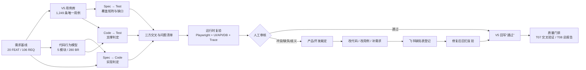

# PROP 测试实现：业务流程、执行方式与沉淀收益

> 统计时间：2026-10-27（CST）  
> 统计范围：`E:\proptest` 下现有测试资料、V5 用例、静态验证文档、运行时脚本与报告  
> 统计口径：静态判定与运行时执行分开统计；未执行、无法确认的用例不按通过处理  
> 代码基线：`E:\proptest\prop_new` 提交 `97f89bc`（运行时报告口径）

## 一、一页结论

当前测试实现已经不是单一的“写用例、点页面”，而是一条以证据为核心的链路：

**需求基线 → V5 用例资产 → 代码行为模型 → 静态三方对账 → 运行时 UI/API/DB 复验 → 缺陷裁定与飞书录入 → V5 状态回写 → 质量门禁**

它由两套执行方式组成：

- **静态验证**：不启动系统，分别给需求、代码、用例建档，再做“需求↔代码、需求↔用例、代码↔用例”三向比对，提前发现实现缺口、覆盖缺口和用例与代码冲突。
- **运行时验证**：用 Playwright 驱动真实页面，同时采集网络接口和 MySQL 前后快照，按 V5 用例逐条复验；每条结论保留脚本、日志、数据库证据和 Trace 录屏。

当前规模与状态：

| 维度 | 当前状态 |
|---|---|
| 需求基线 | 20 个 Feature，106 条 REQ |
| 用例资产 | V5 工作簿 1,249 条唯一用例；2,068 条用例-需求映射 |
| 静态代码建模 | 5 个模块级模型（覆盖 12 个 FEAT），280 条 BR |
| 静态用例判定 | 506 条：支撑 395、部分支撑 58、冲突 24、无法确认 29 |
| 需求实现判定 | 49 条 REQ：PASS 33、PARTIAL 15、UNKNOWN 1 |
| 运行时执行 | 247 条通过；995 条未执行；3 条阻塞；4 条作废 |
| 缺陷闭环 | 飞书“测试问题跟踪”已录入 16 条（产品 9、订单 3、基础设置 4） |
| 尚未完成 | FEAT-00、FEAT-12～18 等 8 个 FEAT 未建模；T07 交叉验证、T08 总报告未执行；提效比例未实测 |

一句话判断：**方法和资产已经成形，质量和风险识别已产生实际结果；但“全量执行”和“量化提效”还没有完成。当前更适合定位为“可复用的测试分析与验证底座”，而不是“已经全自动跑完的测试平台”。**

## 二、端到端业务流程

按 `业务功能模块验证清单.md`，测试对象覆盖 PROP 的六类业务域：C01 基础数据、C02 生产与追溯、C03 订单与寄送、C04 定期与通知、C05 受付/作业/返送、全局首页与品牌 UI。清单共 22 个验证条目：**10 个可全量验证、11 个迭代中部分验证、1 个（批次报告）可验证但没有独立验收清单**。



七个阶段：

| 阶段 | 输入 | 主要动作 | 产出 | 判定方式 |
|---|---|---|---|---|
| S0 版本冻结 | 代码仓库、数据库、环境 | 固定 commit、环境地址、库名和账号 | 可复现的验证基线 | 不以“最新代码”代替被测版本 |
| S1 需求建档 | FEAT-00～FEAT-19 规格 | 拆解正常流程、异常流程、业务规则、数据变化、权限、边界、验收标准 | `ai-test/01-requirement/requirement-baseline.md`，106 条 REQ | 需求歧义单列，不自行脑补 |
| S2 用例治理 | 原始 1,188 条用例 | 逐条分析目的、需求对应、内部一致性；定点修复错误行 | V5 用例库、修复日志、用例-需求映射 | 只改错不改结构，不新增/删除/合并 |
| S3 代码建模 | Controller、Service、Mapper、XML、SQL、前端页面 | 沿调用链记录真实分支、数据变化、异常和权限 | 5 份 `*-code-behavior.md`，280 条 BR | 只认代码证据，不按方法名/注释推断 |
| S4 静态对账 | REQ、BR、V5 用例 | Spec→Code、Spec→Test、Code→Test 三向比对 | 10 份模块验证文档、覆盖矩阵、冲突清单 | PASS / PARTIAL / FAIL / UNKNOWN；证据不足标 UNKNOWN |
| S5 运行时复验 | V5 用例、静态冲突清单 | 脚本驱动页面，采集接口、DB 前后快照、Trace | 7 份运行时报告、脚本、日志、Trace | 通过 / 失败 / 部分验证；以实际 UI/API/DB 为准 |
| S6 缺陷裁定与回写 | 运行时结论、静态冲突 | 人工确认后录入飞书；只把最终 PASS 回写 V5 | 飞书问题记录、V5 执行状态 | 人工审核是放行闸门，AI 不直接决定通过 |
| S7 质量门禁 | 全部对照与执行结果 | 汇总 P0～P3 问题、覆盖率和放行结论 | `cross-validation.md`、`ai-validation-report.md` | 当前为空，尚未执行 |

## 三、执行方式

### 3.1 静态分析：固定技能 + 八个提示词

静态分析入口是 Codex 技能 `module-spec-test-validation`，固定约定：

- 工作目录 `E:\proptest`，源码 `E:\proptest\prop_new` 只读；
- 先读 `Agent.md`、需求基线、同类模块文档和模块源码；
- 每个模块固定产出三份文档：`<模块>-code-behavior.md`、`<模块>-spec-code.md`、`<模块>-code-test-v5.md`；
- 输出前校验文档存在、中文、REQ/用例数量与判定汇总一致；
- 不构建、不启动系统、不改源码，除非用户明确要求。

底层由 `ai-test/prompts/T01～T08` 定义阶段任务：

| 提示词 | 阶段 | 作用 |
|---|---|---|
| T01 | 需求结构化 | 把 Spec 拆成可编号、可追踪的 REQ |
| T02 | 代码行为分析 | 沿 Controller→Service→Mapper→DB 记录 BR |
| T03/T03.1 | 用例质量分析与定点修复 | 分析 1,188 条原始用例，修复 106 行 |
| T04 | Spec→Code | 逐条 REQ 判断实现程度 |
| T05 | Spec→Test | 逐条 REQ 判断用例覆盖程度 |
| T06 | Code→Test | 逐条用例判断代码支撑程度 |
| T07 | 三方交叉 | 汇总四类脱节，按 P0～P3 分级 |
| T08 | 最终报告 | 输出覆盖率、问题清单和质量门禁 |

静态判定的三条纪律：

1. **不反推**：不能因为需求写了，就认为代码实现了；也不能因为代码有，就认为需求要求了。
2. **不猜测**：方法名、注释、行业惯例不能作为通过依据。
3. **不美化**：证据不足统一标 `UNKNOWN` / “无法确认”，不用推测替代结论。

### 3.2 运行时验证：Playwright + 三路探针 + 脚本化场景

运行时执行器在 `auto-explore`，技术栈是 Node.js 20、TypeScript、Playwright、MySQL2：

- **三路探针**：页面探针（无障碍树、可交互元素、控制台/页面错误）、网络探针（业务接口 URL、方法、状态码、响应摘要）、数据探针（MySQL 前后快照）。
- **五类 Agent**：Planner（任务单）、Explorer（探索）、Oracle（判定）、Reporter（报告）、LLM Client（模型调用）。
- **降级机制**：LLM 未配置或连续失败 3 次时，自动降级为宽度优先启发式探索，流程不中断。
- **护栏**：只允许 localhost/内网地址；数据库名必须包含 `test` 或 `prop`；系统管理区和批量删除类操作默认拦截。
- **证据**：每条用例/场景保留脚本、日志、Trace（`.zip` + `.webm`），可用 `npx playwright show-trace` 回放。

常用命令（在 `E:\proptest\auto-explore` 下）：

```powershell
npm install
npx playwright install chromium
npm run smoke        # 登录冒烟 + 三路探针可用性
npm run explore      # 按 charters 批量探索
npm run report       # 汇总最新批次
npm run selftest     # 离线验证解析、提示词组装、降级逻辑
npm run typecheck
```

具体模块复验使用 `scripts/verify-*.ts`，按场景拆分，例如：

- `verify-md-partprofile-full.ts`、`verify-md-basedata-full.ts`、`verify-md-workoption-full.ts`：基础设置全量；
- `verify-order-create.ts`、`verify-order-list.ts`、`verify-order-shipment.ts`：订单与寄送；
- `verify-prod-intake.ts`、`verify-prod-assembly.ts`、`verify-prod-inspection.ts`：生产主流程；
- `verify-product-list.ts`、`verify-product-tracing.ts`、`verify-product-delete.ts`：产品与追溯；
- `verify-concurrent-edit.ts`、`verify-part-concurrent.ts`：并发/覆盖类高风险场景。

当前运行时环境口径：

- 前端 `8090`，后端 `8080`，数据库 `prop_dev_local`；
- 被测版本固定为 `prop_new` 提交 `97f89bc`；
- 报告和 Trace 位于 `auto-explore/reports/`；
- 测试数据统一使用 `AUTO-` 前缀，按约定保留，不自动清理。

### 3.3 缺陷与用例回写：人工审核后进入飞书和 V5

缺陷记录工具在 `tools/feishu-bug`，通过飞书开放平台 Open API 读写“测试问题跟踪”多维表格：

```powershell
cd E:\proptest\tools\feishu-bug

.\feishu-bug.ps1 add -Description "问题描述" -Priority P1
.\feishu-bug.ps1 list
.\feishu-bug.ps1 update -RecordId recXXXX -Status 修复中
.\feishu-bug.ps1 batch -FromJson .\bugs.json
```

字段口径：类型（BUG/优化/新需求/建议）、优先级（P0/P1/P2）、状态（新增/修复中/待验收/验收通过/待上线/已上线）、提出方默认“AI自动探索”。

回写规则：

- **只有最终判定为 PASS 的用例**，才把 V5“执行状态”回写为“通过”，并记录执行人和执行时间；
- FAIL / PARTIAL / 无法确认的用例保留“未执行”，以报告结论跟踪，待产品裁定或补环境后复验；
- 不把“脚本跑过”直接等同于“用例通过”，脚本判定与用例原文不一致时必须人工复核。

### 3.4 证据链

每条结论尽量落到同一条链上：

```text
REQ-xxx（需求基线）
  → BR-xxx（代码行为模型）
  → 用例编号（V5）
  → 脚本 / 日志 / Trace / DB 快照（运行时）
  → 飞书 RecordId（缺陷）
  → V5 执行状态（回写）
```

这条链的价值在于：后续任何人看到“通过/失败/冲突”，都能回到具体需求、代码位置、用例、执行证据和缺陷记录，而不是只看到一句结论。

## 四、当前执行结果

### 4.1 静态建模与用例判定

| 模块 | BR 数 | 判定用例 | 支撑 | 部分支撑 | 冲突 | 无法确认 | Spec→Code |
|---|---:|---:|---:|---:|---:|---:|---|
| 基础设置（masterdata） | 50 | 106 | 50 | 27 | 6 | 23 | 3 PASS / 4 PARTIAL |
| 客户管理（customer） | 79 | 115 | 93 | 3 | 15 | 4 | 6 PASS / 2 PARTIAL / 1 UNKNOWN |
| 产品生产（production） | 53 | 76 | 70 | 4 | 2 | 0 | 2 PASS / 2 PARTIAL |
| 产品管理（product） | 46 | 70 | 59 | 10 | 0 | 1 | 6 PASS / 6 PARTIAL |
| 订单管理（order） | 52 | 139 | 123 | 14 | 1 | 1 | 16 PASS / 1 PARTIAL |
| **合计** | **280** | **506** | **395** | **58** | **24** | **29** | **33 PASS / 15 PARTIAL / 1 UNKNOWN（49 REQ）** |

注：静态文档中的用例数与当前 V5 工作簿存在少量差异（客户 115 vs 113、生产 76 vs 73、产品 70 vs 68、订单 139 vs 138），系用例修订/作废后的口径差异；本文分别按静态文档与当前工作簿统计。

静态结果含义：

- **支撑 395 条（78.1%）**：代码行为模型中有明确 BR 证据，测试点核心预期与代码一致；
- **部分支撑 58 条（11.5%）**：后端能力基本具备，但仍依赖前端交互、下游模块、角色数据或运行环境；
- **冲突 24 条（4.7%）**：测试点核心预期与代码明确相反，或依赖当前代码不存在的能力；
- **无法确认 29 条（5.7%）**：现有 BR 证据不足，不能判通过，需转运行时验证或补代码证据。

### 4.2 运行时执行

截至 2026-10-27，V5 工作簿的执行状态：

| 工作表 | 用例数 | 通过 | 未执行 | 阻塞/作废 |
|---|---:|---:|---:|---:|
| 基础设置 | 106 | 92 | 14 | 0 |
| 客户管理 | 113 | 8 | 98 | 3 阻塞 + 4 作废 |
| 产品生产 | 73 | 20 | 53 | 0 |
| 产品管理 | 68 | 46 | 22 | 0 |
| 订单管理 | 138 | 81 | 57 | 0 |
| 点检管理 | 288 | 0 | 288 | 0 |
| 受付工作台 | 188 | 0 | 188 | 0 |
| 作业管理 | 153 | 0 | 153 | 0 |
| 首页看板 | 55 | 0 | 55 | 0 |
| 端到端补充用例 | 20 | 0 | 20 | 0 |
| V5 缺口补充用例 | 47 | 0 | 47 | 0 |
| **合计** | **1,249** | **247** | **995** | **3 阻塞 + 4 作废** |

运行时已产出的主要结果：

- **基础设置**：106 条全部复核，92 条通过、3 条失败、11 条部分验证。失败集中在部件资料重名、并发编辑覆盖、引用计数缺失；其中重名和并发覆盖已按人工确认录入飞书。
- **产品管理**：46 条通过；发现业务类型字段缺失、排序/页签等偏差；9 条经人工审核批量录入飞书（P1×3、P2×6）。
- **订单管理**：81 条通过；发现关键词检索范围与用例不一致、无产品时自动保存/显式保存口径不同等问题；3 条经人工确认录入飞书（均 P2）。
- **产品生产**：主流程端到端通过，DB 证据完整；发现组装失败行内提示恒为“保存失败”、合法拦截伴随全局错误通知两项静态分析未覆盖的问题。
- **客户管理**：8 条通过；15 条冲突中 4 条已闭环、1 条并发覆盖待产品决策、其余属于功能缺失或依赖模块未实现。

### 4.3 缺陷闭环

飞书“测试问题跟踪”当前已录入 16 条：

| 来源模块 | 数量 | 说明 |
|---|---:|---|
| 产品管理 | 9 | 业务类型、排序、页签等，P1×3、P2×6 |
| 订单管理 | 3 | 关键词范围、无产品保存口径等，均 P2 |
| 基础设置 | 4 | 部件资料重名、并发覆盖等，已人工确认 |

缺陷不是脚本直接提交的，而是经过“运行时结论 → 人工审核 → 飞书录入”的闸门，避免把脚本误判直接变成缺陷单。

## 五、沉淀收益

### 5.1 资产沉淀

| 资产 | 位置 | 规模/作用 |
|---|---|---|
| 需求基线 | `ai-test/01-requirement/requirement-baseline.md` | 20 FEAT、106 REQ，含正常/异常/规则/数据/权限/边界/验收 |
| V5 用例库 | `case/outputs/测试用例汇总/测试用例汇总_V5.xlsx` | 1,249 条唯一用例，含执行状态、实际结果、缺陷编号、执行人/时间 |
| 用例-需求映射 | V5 工作簿“用例-需求映射” | 2,068 条映射，一条用例可对应多条需求项 |
| 代码行为模型 | `ai-test/02-code-analysis/*-code-behavior.md` | 5 模块、280 条 BR，可定位到文件和方法 |
| 静态验证文档 | `ai-test/04-validation/*-spec-code.md`、`*-code-test-v5.md` | 10 份模块文档 + 覆盖矩阵 + 主流程缺口专项 |
| 运行时脚本 | `auto-explore/scripts/verify-*.ts` | 覆盖基础设置、客户、产品、生产、订单、寄送等场景 |
| 自动化框架 | `auto-explore/src/` | 三路探针、五类 Agent、护栏、状态图、报告器 |
| 证据库 | `auto-explore/reports/traces/` | Trace + WebM，可按用例回放 |
| 提示词/技能 | `ai-test/prompts/T01～T08`、`module-spec-test-validation` | 把方法固化为可重复执行的步骤 |
| 缺陷工具 | `tools/feishu-bug/` | 飞书多维表格增删改查、批量导入、Token 缓存 |
| 汇报与实验资产 | `ai-test/*.md`、`测试对比分析表.xlsx` | 流程汇报、实验方案、指标字典、任务台账模板 |

### 5.2 方法沉淀

1. **三方对账代替单点阅读**：需求、代码、用例各自独立建档，再做两两比对和三方交叉，避免“只看用例”或“只看代码”的盲区。
2. **证据分级代替口头结论**：支撑/部分支撑/冲突/无法确认四档，明确什么能判、什么不能判。
3. **静态与运行时分离**：静态分析负责“提前发现”，运行时负责“实际确认”；不把静态推断说成运行通过。
4. **用例四维覆盖**：正常流程、边界值、异常输入、错误猜测，避免只测主流程。
5. **人工裁定闸门**：冲突用例到底改代码还是改用例，由产品/开发裁定；AI 不自动改业务规则。
6. **全链路可追溯**：REQ → BR → 用例 → 脚本/Trace → 飞书缺陷 → V5 状态，形成可审计的证据链。

### 5.3 质量收益

- **测试执行前发现 24 条用例与代码冲突**，避免“用例写了但代码不支持”的假覆盖；典型包括重名校验缺失、并发编辑静默覆盖、引用删除未拦截、邮箱格式不校验、关键词检索范围不一致。
- **识别 29 条无法确认项**，把它们转成运行时验证清单，而不是静默判过；这正是后续 247 条实际执行和 16 条缺陷的来源。
- **识别 15 条需求部分实现**（49 条已判定 REQ 中），把“需求写了但只做了一半”显性化，例如业务类型字段缺失、入库记录只写不读、历史编号无独立展示。
- **发现高风险数据问题**：客户并发编辑、部件资料并发编辑均存在“后保存静默覆盖先保存”的风险，已进入产品决策/缺陷流程。
- **纠正用例自身问题**：原始 1,188 条用例中修复 106 行，处理标题/测试点/预期结果方向矛盾、需求口径过期等问题。
- **避免误报**：运行时报告对脚本误判进行了人工纠正，例如基础数据-027/028 由 FAIL 纠正为 PASS、部件资料-023 由 PASS 纠正为 FAIL。

### 5.4 效率收益与边界

已经形成的可复用能力：

- 新模块可按固定技能一次产出“代码行为模型 + 需求验证 + V5 判定”三份文档，减少重复梳理和格式返工；
- 运行时脚本、探针、护栏、报告器可复用到同类模块，Trace 可直接回放定位；
- 飞书工具把缺陷录入从手工填表变成命令行/批量导入；
- V5 工作簿已带执行状态、实际结果、缺陷编号、执行人/时间，报告可直接从台账汇总。

需要明确的边界：**当前没有实测的提效比例。** `ai-test/05-report/测试对比分析表.xlsx` 的实验任务台账只有 T001-A/T001-B 两行空模板，指标字典的“实测结果/是否达标”尚未填写。因此不能宣称“提效 50%”“缺陷检出率 100%”等具体数字；这些仍属于待验证目标。

### 5.5 组织收益

- **统一语言**：需求、开发、测试用同一套 REQ/BR/用例编号讨论问题，减少“你说的和我说的不是同一个点”。
- **决策前移**：把“改代码还是改用例/补需求”变成有证据的裁定项，而不是执行阶段才发现。
- **可审计**：每个结论能回到 commit、文件、方法、用例、Trace 和缺陷记录，适合交付和复盘。
- **可交接**：新成员可以先读需求基线和行为模型，再按 V5 用例执行，不必完全依赖个人经验。

## 六、边界与下一步

### 6.1 当前边界

- **静态分析不等于测试执行**：PASS 只代表代码行为有证据支撑，不代表页面实际可用；运行时结论才代表实际观察。
- **覆盖不完整**：995 条 V5 用例未执行；FEAT-00、FEAT-12～18 尚未建立代码行为模型；T07 交叉验证、T08 总报告仍为空。
- **权限验证不足**：多数运行时验证使用管理员账号，非管理员/只读角色的运行态拦截覆盖有限。
- **环境局限**：当前是本地开发环境（8090/8080/prop_dev_local），不是生产或预发；性能、并发真实压力、第三方接口不在范围内。
- **测试数据未清理**：`AUTO-` 前缀数据按约定保留，后续做数据清理或环境重置时需要专门处理。
- **ROI 未实测**：实验台账和指标字典尚未填入实际工时、缺陷检出率、误报率等数据。

### 6.2 建议的下一步

1. **补齐高优先级模块的代码建模**：优先点检管理、受付工作台、作业管理、首页看板、返送，这些模块用例量大、业务风险高。
2. **分批执行剩余 995 条用例**：先跑高优先级/高风险场景（权限、并发、数据覆盖、报告打印），再跑 UI 细节。
3. **闭环 24 条静态冲突和运行时失败/部分验证项**：逐条给出“改代码 / 改用例 / 补需求 / 补环境”的裁定和责任人。
4. **完成 T07/T08**：输出 REQ→CODE→TEST 追踪矩阵、P0～P3 问题清单和放行/阻断/需评审结论。
5. **接入 CI 或定时任务**：把 smoke、核心 verify 脚本、报告生成纳入固定流水线，形成回归基线。
6. **做一次真实对照实验**：用 `测试对比分析表.xlsx` 记录人工组/AI 组的工时、有效用例、缺陷检出、误报和单位成本，再决定是否推广及推广范围。
7. **补权限与数据清理规范**：建立最小权限测试账号，明确 `AUTO-` 数据的保留/清理策略。

## 七、一句话总结

**这套测试实现把“需求、代码、用例、运行证据、缺陷”串成了一条可追溯的链：静态阶段已对 5 个模块、506 条用例做出支撑判定并提前发现 24 条冲突；运行时已实际执行 247 条用例、沉淀 Trace 和 16 条缺陷；下一步的关键不是再讲方法，而是补齐剩余模块、跑完剩余用例，并用真实对照数据证明提效。**
